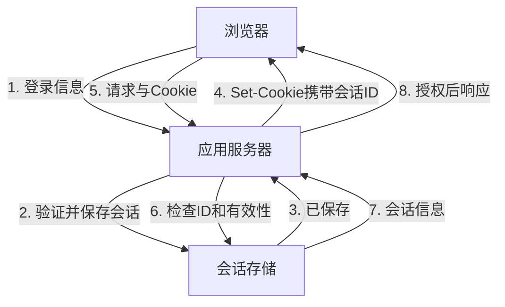
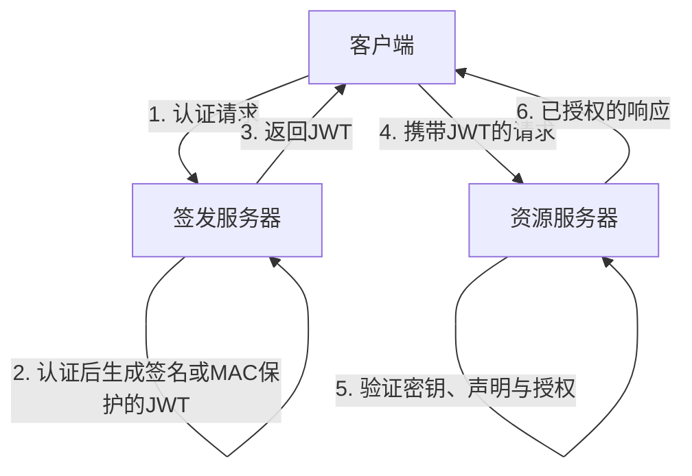
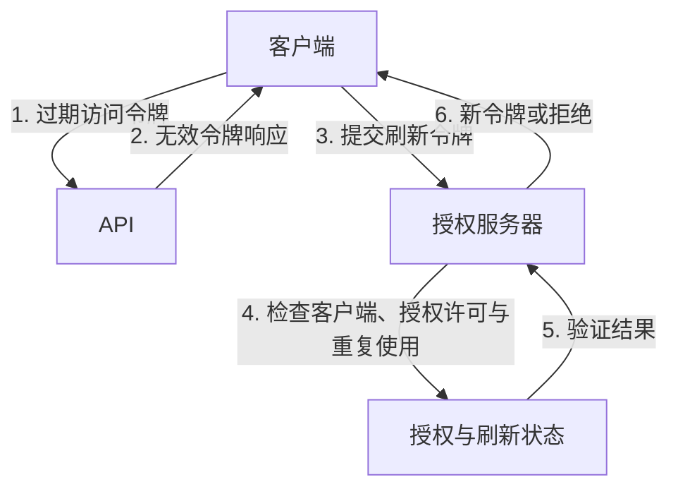

JWT是一种在系统之间传递声明（claims）的格式。采用它，并不会自动让身份认证、授权或会话管理变得安全。本文把浏览器登录会话的设计，与API令牌的验证、撤销分开讨论。

首先要区分：**JWT是令牌格式，Cookie是浏览器保存和发送数据的机制**。Cookie既可以携带JWT，也可以携带随机会话ID。只比较“Cookie还是JWT”，混淆了不同的设计维度。

## 服务器端会话如何工作

典型设计在登录成功后生成不可预测的会话ID，在服务器端存储它与用户、到期时间等会话信息的对应关系，再通过Cookie把ID返回浏览器。下图假设使用HTTPS，省略了Cookie属性和失败路径。

会话存储便于管理撤销、退出登录和权限变更。不过，尚未获知删除操作的缓存或副本可能延迟生效。在分布式设计中，还要规定各服务器何时看到哪个版本的状态。

会话ID通常较小，也不必向客户端暴露用户信息，但被盗ID仍可能遭到滥用。不可预测性、登录时更新ID、期限管理、HTTPS、Cookie属性以及XSS和CSRF防护都不可少。访问会话存储也有负载、可用性和运维成本，应按所需规模评估。

## JWT与本地验证

JWT表示JSON声明集合，可以采用JWS签名或MAC，以及／或者JWE加密。公钥签名使用签发方的私钥和验证方的公钥；HMAC使用共享密钥。下文主要讨论受签名或MAC保护的自包含JWT。

**签名不等于加密。** 只有签名的JWT，其声明内容可被读取，不应随意放入秘密信息。base64url解码也不同于验证令牌是否有效。

如果能用可信签发方的密钥在本地验证，就可以设计成不必每次请求都查询中央会话存储。不过，获取和更新密钥、停用用户、撤销信息或最新权限，仍可能需要通信或状态。JWT不会自动消除所有数据库访问，也不保证性能更好。

应用应自行规定允许的算法和密钥。除密码学验证外，还要检查签发方`iss`、目标服务`aud`、到期时间`exp`、需要时的生效时间`nbf`、令牌用途以及请求操作的权限。根据采用的配置规范，把必要声明设为必填。JWT通用规范甚至没有要求所有场景都必须包含`exp`；登录或访问管理设计必须明确规定并执行有效期策略。

## 1. 撤销可以实现，但需要设计

如果服务器只离线检查密码学保护和时间条件，完全不查询额外状态，就无法获知某个令牌已被撤销，或密码在签发后已被更改。在这种设计下，被盗的有效Bearer令牌可能一直可用到过期。仅从客户端删除令牌，不能阻止被盗副本。

可选措施包括较短有效期、撤销列表、用户或会话版本号，以及令牌内省（introspection）。停用签名密钥也会影响使用该密钥签发的其他令牌，并需要让密钥缓存和验证方收到变更。短有效期能缩小风险窗口，但不能代替立即撤销单个令牌。

引入状态或通信本身不是失败。每个API都查状态、仅在刷新时查询、分发撤销事件，具有不同特性。应按要求选择撤销速度和运维成本。撤销刷新令牌，也不一定会自动使各API仍通过本地验证接受的已签发访问令牌失效。

## 2. 算法选择与令牌用途混淆

`alg: none`表示不带签名或MAC的形式。要求签名令牌的认证或访问端点不应接受它。不要根据收到的`alg`改变验证策略。RFC 8725把不当接受`none`，与把RSA公钥误作HMAC密钥的算法混淆，作为不同问题说明。

应使用持续维护的库，并配置允许的算法、密钥与签发方的对应关系、目标接收方，以及各类令牌的验证规则。还要避免接受其他用途的令牌，例如把ID令牌当作API访问令牌。不能一概保证所有库的安全性或当前补丁状态。

## 3. 浏览器存储、XSS与CSRF

同源JavaScript可以读取`localStorage`和`sessionStorage`。因此，XSS可能泄露其中的Bearer令牌。`sessionStorage`保存时间较短，并不能阻止这种读取。

`HttpOnly` Cookie能阻止JavaScript直接读取Cookie值，但不能全面防止XSS。同源恶意代码仍可能执行携带Cookie的已认证操作，或读取获得的信息。

Cookie在符合浏览器条件时自动发送，因此也应防范CSRF。设置`Secure`、合适的`SameSite`和较窄的发送范围，为状态变更操作设计CSRF令牌或Origin检查等保护。不要认为`SameSite`涵盖所有情况，也不要通过GET改变状态。这些考虑适用于Cookie中保存JWT或会话ID的两种情况。另见[XSS与CSRF说明](/zh-cn/p/cross-site-scripting-xss-csrf-security/)。

存储选择也受架构约束。还可以考虑不把API令牌交给浏览器，而是在服务器保存令牌，仅通过会话Cookie与浏览器交互。应根据应用边界和所需操作来决定。

## 4. 刷新令牌与状态的位置

刷新令牌是重新获取短期访问令牌的一种方式。是否签发它是可选的，采用JWT并不自动要求刷新令牌。“15分钟”只是有效期示例，不是标准统一规定的值。

该图展示管理刷新状态的一种设计。应把刷新令牌作为秘密保护，并确定如何处理撤销和重复使用。RFC 9700要求向公共客户端签发的刷新令牌采用发送方约束或轮换。轮换会使前一个令牌失效，同时保留它与新令牌的关联；检测到重复使用时如何处理，也属于设计的一部分。

这不意味着必须把每个令牌的明文存入数据库。应管理安全表示及关联状态，检查它与用户、客户端和授权许可的关系。可以在刷新时管理状态，同时让各API在本地验证访问令牌。

## 结论：按用途和要求比较

JWT可用于在不同服务间传递可验证声明。不能仅因处于内部网络就省略签发方、目标和权限检查。OAuth访问令牌不限于JWT格式；OIDC的ID令牌则是JWT，用于向客户端传递身份认证结果。不能把ID令牌当作API访问令牌使用。

JWT也不会自动使密码重置或邮箱验证URL变成一次性链接。仍需有效期、目标和用途限制，以及使用状态管理。如果简单的随机令牌已能满足要求，就没有必要采用JWT。

对于以浏览器为中心且重视快速撤销的应用，服务器端会话可以作为比较起点；需要跨服务本地验证时，JWT也是候选。这是根据要求作出的设计判断，并非某种方式永远更安全或更快。应比较可接受的撤销延迟、信息时效、客户端类型、密钥管理、存储、流量和运维负担。

## 参考资料

- [RFC 7519：JWT格式与声明，§3–4](https://www.rfc-editor.org/rfc/rfc7519.html)
- [RFC 8725：算法、签发方、目标与用途验证，§2.1和§3](https://www.rfc-editor.org/rfc/rfc8725.html)
- [RFC 7009：OAuth令牌撤销设计，§3](https://www.rfc-editor.org/rfc/rfc7009.html)
- [RFC 9700：刷新令牌保护，§2.2.2和§4.14](https://www.rfc-editor.org/rfc/rfc9700.html)
- [RFC 6749：访问令牌与刷新令牌，§1.4–1.5](https://www.rfc-editor.org/rfc/rfc6749.html)
- [OpenID Connect Core 1.0：ID令牌，§2](https://openid.net/specs/openid-connect-core-1_0.html)
- [OWASP：会话管理与Cookie属性](https://cheatsheetseries.owasp.org/cheatsheets/Session_Management_Cheat_Sheet.html)
- [OWASP：Web Storage安全](https://cheatsheetseries.owasp.org/cheatsheets/HTML5_Security_Cheat_Sheet.html)
- [OWASP：密码重置令牌](https://cheatsheetseries.owasp.org/cheatsheets/Forgot_Password_Cheat_Sheet.html)
