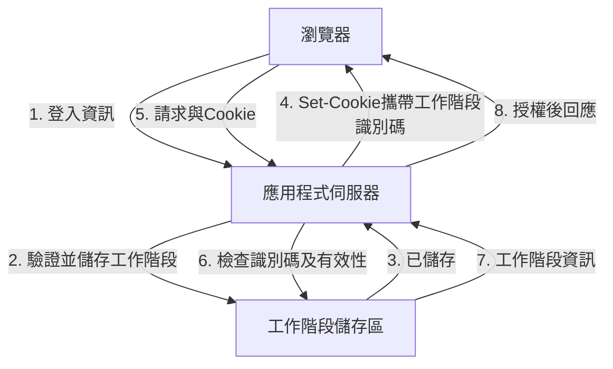
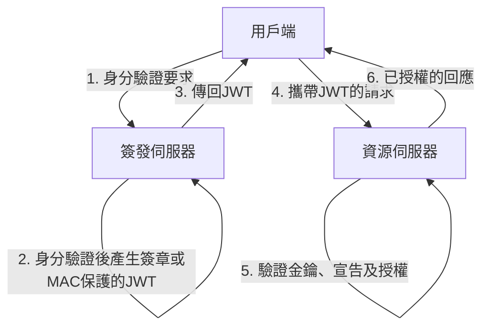
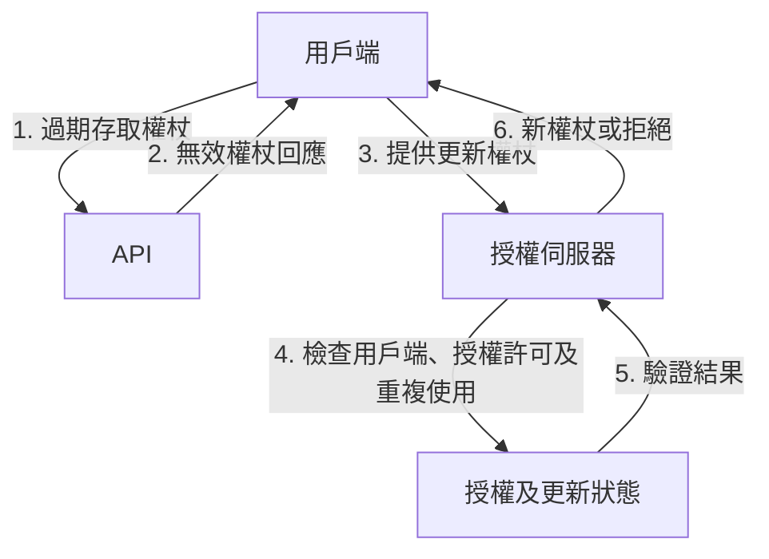

JWT是在系統之間傳遞宣告（claims）的格式。採用它，不會自動讓身分驗證、授權或工作階段管理變得安全。本文將瀏覽器登入工作階段的設計，與API權杖的驗證、撤銷分開討論。

首先要區分：**JWT是權杖格式，Cookie是瀏覽器儲存和傳送資料的機制**。Cookie可以攜帶JWT，也可以攜帶隨機的工作階段識別碼。只比較「Cookie或JWT」，混淆了不同的設計面向。

## 伺服器端工作階段如何運作

典型設計在登入成功後產生不可預測的工作階段識別碼，在伺服器端儲存它與使用者、到期時間等資訊的對應關係，再透過Cookie將識別碼傳回瀏覽器。下圖假設使用HTTPS，省略Cookie屬性與失敗時的處理。

工作階段儲存區便於管理撤銷、登出與權限變更。不過，尚未得知刪除操作的快取或複本可能延遲生效。分散式設計還須規定各伺服器何時看到哪個版本的狀態。

工作階段識別碼通常較小，也不必向用戶端揭露使用者資訊，但遭竊的識別碼仍可能被濫用。不可預測性、登入時更新識別碼、期限管理、HTTPS、Cookie屬性與XSS、CSRF防護都不可少。存取儲存區也有負載、可用性及維運成本，應依所需規模評估。

## JWT與本機驗證

JWT表示JSON宣告集合，可採用JWS簽章或MAC，以及／或者JWE加密。公開金鑰簽章使用簽發方的私密金鑰與驗證方的公開金鑰；HMAC使用共用秘密金鑰。以下主要討論以簽章或MAC保護的自足式JWT。

**簽章不等於加密。** 只有簽章的JWT，其宣告內容可以被讀取，不應隨意放入機密資訊。base64url解碼也不同於驗證權杖是否有效。

若能使用可信任簽發者的金鑰在本機驗證，就可以設計成不必每次請求都查詢中央工作階段儲存區。不過，取得與更新金鑰、停用使用者、撤銷資訊或最新權限，仍可能需要通訊或狀態。JWT不會自動消除所有資料庫存取，也不保證效能較好。

應用程式應自行規定允許的演算法與金鑰。除了密碼學驗證，還要檢查簽發者`iss`、目標服務`aud`、到期時間`exp`、必要時的生效時間`nbf`、權杖用途，以及所要求操作的權限。依採用的應用規範，將必要宣告設為必填。JWT通用規格甚至沒有規定所有情況都必須包含`exp`；登入或存取管理設計必須明確訂定並執行有效期間政策。

## 1. 可以撤銷，但需要設計

若伺服器只離線檢查密碼學保護與時間條件，完全不查詢額外狀態，就無法知道某個權杖已撤銷，或密碼在簽發後已變更。在這種設計下，遭竊的有效Bearer權杖可能一直可用至到期。僅從用戶端刪除權杖，無法阻止遭竊的複本。

可選措施包括較短有效期間、撤銷清單、使用者或工作階段版本號，以及權杖內省（introspection）。停用簽章金鑰也會影響使用該金鑰簽發的其他權杖，並需要將變更傳播至金鑰快取與驗證方。短有效期間可以縮小風險窗口，但不能取代立即撤銷單一權杖。

引入狀態或通訊本身並非失敗。每個API都查詢狀態、僅在更新時查詢、散布撤銷事件，具有不同特性。應依需求選擇撤銷速度與維運成本。撤銷更新權杖，也不一定會自動讓各API仍以本機驗證接受的既有存取權杖失效。

## 2. 演算法選擇與權杖用途混淆

`alg: none`表示沒有簽章或MAC的形式。要求簽章權杖的身分驗證或存取端點不應接受它。不要依收到的`alg`改變驗證政策。RFC 8725將不當接受`none`，與將RSA公開金鑰誤作HMAC秘密金鑰的演算法混淆，視為不同問題。

應使用持續維護的函式庫，並設定允許的演算法、金鑰與簽發者的對應關係、目標接收者，以及每種權杖的驗證規則。也要避免接受其他用途的權杖，例如將ID權杖當成API存取權杖。不能一概保證所有函式庫的安全性或目前的修補狀態。

## 3. 瀏覽器儲存、XSS與CSRF

同源JavaScript可以讀取`localStorage`與`sessionStorage`。因此，XSS可能讓其中的Bearer權杖外洩。`sessionStorage`保存時間較短，並不能阻止這種讀取。

`HttpOnly` Cookie能阻止JavaScript直接讀取Cookie值，但不能全面防止XSS。同源惡意程式碼仍可能執行攜帶Cookie的已驗證操作，或讀取取得的資訊。

Cookie在符合瀏覽器條件時會自動傳送，因此也要防範CSRF。設定`Secure`、適當的`SameSite`與較窄的傳送範圍，為變更狀態的操作設計CSRF權杖或Origin檢查等保護。不要認為`SameSite`涵蓋所有情況，也不要透過GET變更狀態。這些考量適用於Cookie儲存JWT或工作階段識別碼的兩種情況。另見[XSS與CSRF說明](/zh-tw/p/cross-site-scripting-xss-csrf-security/)。

儲存選擇也受架構限制。還可以考慮不將API權杖交給瀏覽器，而是在伺服器儲存權杖，僅透過工作階段Cookie與瀏覽器互動。應依應用程式邊界與所需操作決定。

## 4. 更新權杖與狀態的位置

更新權杖是重新取得短期存取權杖的一種方式。是否簽發它是可選的，採用JWT不會自動要求更新權杖。「15分鐘」只是有效期間範例，並非標準統一規定的值。

此圖展示管理更新狀態的一種設計。應將更新權杖當作機密保護，並決定如何處理撤銷及重複使用。RFC 9700要求向公開用戶端簽發的更新權杖採用傳送者約束或輪替。輪替會使前一個權杖失效，同時保留它與新權杖的關聯；偵測到重複使用時如何處理，也是設計的一部分。

這不表示必須將每個權杖的明文儲存於資料庫。應管理安全表示及關聯狀態，檢查它與使用者、用戶端及授權許可的關係。可以在更新時管理狀態，同時讓各API在本機驗證存取權杖。

## 結論：依用途與需求比較

JWT可用於在不同服務之間傳遞可驗證的宣告。不能只因位於內部網路，就省略簽發者、目標與權限檢查。OAuth存取權杖不限於JWT格式；OIDC的ID權杖則是JWT，用於向用戶端傳遞身分驗證結果。不能將ID權杖當作API存取權杖使用。

JWT也不會自動讓密碼重設或電子郵件驗證URL變成一次性連結。仍需有效期間、目標與用途限制，以及使用狀態管理。如果簡單的隨機權杖已能滿足需求，就沒有必要採用JWT。

對於以瀏覽器為中心且重視快速撤銷的應用程式，伺服器端工作階段可以作為比較起點；需要跨服務本機驗證時，JWT也是候選。這是依需求作出的設計判斷，並非某種方式永遠較安全或較快。應比較可接受的撤銷延遲、資訊時效、用戶端類型、金鑰管理、儲存、流量與維運負擔。

## 參考資料

- [RFC 7519：JWT格式與宣告，§3–4](https://www.rfc-editor.org/rfc/rfc7519.html)
- [RFC 8725：演算法、簽發者、目標與用途驗證，§2.1及§3](https://www.rfc-editor.org/rfc/rfc8725.html)
- [RFC 7009：OAuth權杖撤銷設計，§3](https://www.rfc-editor.org/rfc/rfc7009.html)
- [RFC 9700：更新權杖保護，§2.2.2及§4.14](https://www.rfc-editor.org/rfc/rfc9700.html)
- [RFC 6749：存取權杖與更新權杖，§1.4–1.5](https://www.rfc-editor.org/rfc/rfc6749.html)
- [OpenID Connect Core 1.0：ID權杖，§2](https://openid.net/specs/openid-connect-core-1_0.html)
- [OWASP：工作階段管理與Cookie屬性](https://cheatsheetseries.owasp.org/cheatsheets/Session_Management_Cheat_Sheet.html)
- [OWASP：Web Storage安全](https://cheatsheetseries.owasp.org/cheatsheets/HTML5_Security_Cheat_Sheet.html)
- [OWASP：密碼重設權杖](https://cheatsheetseries.owasp.org/cheatsheets/Forgot_Password_Cheat_Sheet.html)
