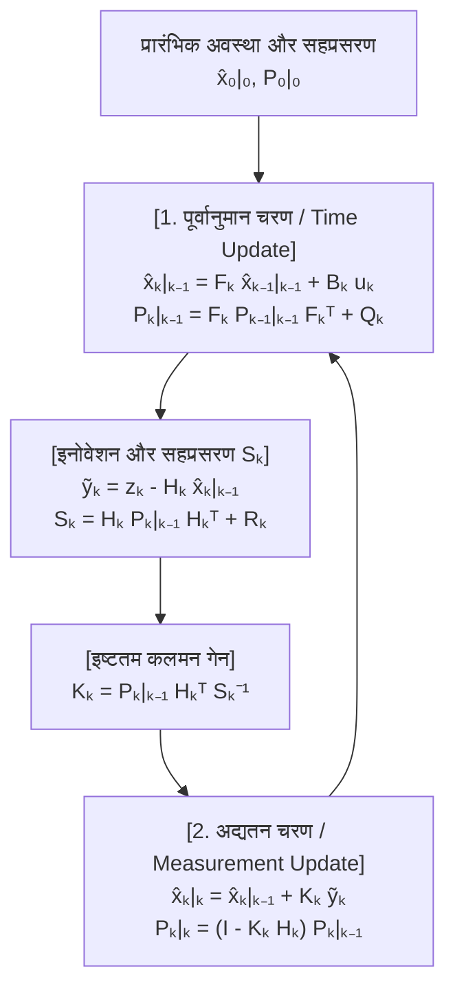
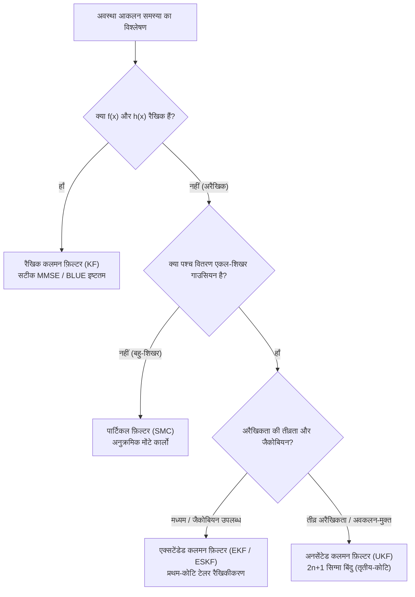

## 1. प्रस्तावना: 20 जुलाई 1969, 'सी ऑफ़ ट्रैंक्विलिटी' पर लैंडिंग और मात्र $2\,\text{KB}$ कंप्यूटर का चमत्कार

20 जुलाई 1969 को, जब अपोलो 11 का लूनर मॉड्यूल *ईगल (Eagle)* चंद्रमा के 'सी ऑफ़ ट्रैंक्विलिटी' की ओर उतर रहा था, तभी कॉकपिट में अचानक `1202` और `1201` प्रोग्राम अलार्म बज उठे। चंद्र सतह से मात्र कुछ किलोमीटर ऊपर नील आर्मस्ट्रांग और बज़ एल्ड्रिन का जीवन MIT इंस्ट्रुमेंटेशन प्रयोगशाला द्वारा विकसित <strong>अपोलो गाइडेंस कंप्यूटर (Apollo Guidance Computer, AGC)</strong> पर निर्भर था।

आज के मानकों के अनुसार AGC का हार्डवेयर अकल्पनीय रूप से सीमित था: 15-बिट वर्ड लेंथ, $2.048\,\text{MHz}$ क्लॉक आवृत्ति, केवल <strong>$2,048$ वर्ड की मैग्नेटिक कोर RAM (वास्तविक कार्यशील मेमोरी लगभग $2\,\text{KB}$)</strong> और <strong>$36,864$ वर्ड की रीड-ओनली रोप मेमोरी (ROM, लगभग $72\,\text{KB}$)</strong>। इसके अलावा, अंतरिक्ष यान पर लगा प्रत्येक सेंसर अकेले में त्रुटियों से भरा था:
1. <strong>इनर्शियल मेजरमेंट यूनिट (IMU)</strong>: जायरोस्कोप और एक्सेलेरोमीटर लगातार त्वरण मापते हैं, लेकिन स्थिति निकालने के लिए त्वरण का दो बार समय-समाकलन (<strong>डेड रेकनिंग / Dead Reckoning</strong>) करने पर सूक्ष्म बायस त्रुटि भी समय के साथ द्विघाती ($\propto t^2$) या त्रिघाती ($\propto t^3$) रूप से बढ़ती (ड्रिफ्ट होती) जाती है।
2. <strong>ऑप्टिकल सेक्सटैंट (Sextant)</strong>: अंतरिक्ष यात्रियों द्वारा तारों और क्षितिज के बीच का कोण मापने में समय-संचयी ड्रिफ्ट नहीं था, किंतु मानवीय संरेखण त्रुटि और असतत (discrete) मापन की सीमाएं थीं।
3. <strong>लैंडिंग रडार और डॉपलर ट्रैकिंग</strong>: चंद्रमा के गड्ढों, उड़ती धूल और मल्टीपाथ परावर्तन के कारण इनमें तीव्र उच्च-आवृत्ति रैंडम नॉइज़ (शोर) मौजूद था।

मात्र $2\,\text{KB}$ RAM वाला एक कंप्यूटर <strong>"समय के साथ भटकने वाले भौतिक मॉडल के पूर्वानुमान"</strong> और <strong>"हर पल झूलते शोरयुक्त सेंसर मापों"</strong> को वास्तविक समय (real-time) में जोड़कर किसी भी एकल सेंसर से कहीं अधिक सटीक स्थिति और वेग कैसे निकाल सकता था?

अपोलो 11 को बचाने वाला यह गणितीय उत्तर <strong>कलमन फ़िल्टर (Kalman Filter)</strong> था, जिसे हंगरी-अमेरिकी गणितज्ञ और नियंत्रण सिद्धांतकार <strong>रुडोल्फ एमिल कलमन (Rudolf Emil Kálmán, 1930–2016)</strong> ने 1960 में प्रकाशित किया था।

### 1.1 कलमन का 1960 का शोधपत्र और NASA एम्स रिसर्च सेंटर में स्टेनली श्मिट से ऐतिहासिक भेंट

मार्च 1960 में कलमन ने अपना ऐतिहासिक शोधपत्र *"A New Approach to Linear Filtering and Prediction Problems"* प्रकाशित किया, जिसमें उन्होंने वीनर फ़िल्टर (Wiener Filter) की आवृत्ति-डोमेन (frequency-domain) सीमाओं को त्यागकर <strong>समय-डोमेन स्टेट-स्पेस मॉडल (State-Space Model)</strong> और ऑर्थोगोनल प्रोजेक्शन के माध्यम से इष्टतम आकलन सिद्धांत को नया रूप दिया।

नवंबर 1960 में कलमन ने कैलिफ़ोर्निया स्थित <strong>NASA Ames Research Center</strong> में <strong>स्टेनली श्मिट (Stanley F. Schmidt)</strong> से भेंट की। उस समय तक कक्षीय निर्धारण के लिए कार्ल फ्रेडरिक गाउस द्वारा 1801 में सेरेस (Ceres) क्षुद्रग्रह की खोज के लिए बनाए गए <strong>बैच लीस्ट स्क्वेयर्स (Batch Least Squares)</strong> का उपयोग होता था, जिसमें सभी पुराने मापों $\mathbf{Z}_{1:T} = \{\mathbf{z}_1, \dots, \mathbf{z}_T\}$ को मेमोरी में सहेजना पड़ता था और $O(T^3)$ समय तथा $O(T)$ मेमोरी के साथ विशाल मैट्रिक्स का व्युत्क्रम (inverse) निकालना पड़ता था—जो $2\,\text{KB}$ के AGC पर असंभव था।

कलमन ने सिद्ध किया कि प्रथम-कोटि <strong>मार्कोव गुणधर्म (Markov Property)</strong> के कारण पुराने मापों को सहेजने की कोई आवश्यकता नहीं है! केवल वर्तमान अवस्था अनुमान $\hat{\mathbf{x}}_{k-1\mid k-1}$ और त्रुटि सहप्रसरण मैट्रिक्स (error covariance matrix) $\mathbf{P}_{k-1\mid k-1}$—इन दो <strong>पर्याप्त सांख्यिकी (Sufficient Statistics)</strong>—को रखकर प्रति स्टेप $O(1)$ मेमोरी में क्रमिक (recursive) रूप से पूर्णतः इष्टतम अनुमान प्राप्त किया जा सकता है। श्मिट ने तुरंत इसे अरैखिक कक्षीय यांत्रिकी पर लागू कर <strong>एक्सटेंडेड कलमन फ़िल्टर (EKF / कलमन-श्मिट फ़िल्टर)</strong> बनाया, और MIT के जेम्स पॉटर (James E. Potter) ने 15-बिट फिक्स्ड-पॉइंट गणित में ऋणात्मक प्रसरण को रोकने के लिए <strong>स्क्वायर-रूट कलमन फ़िल्टर (Square-Root Filter)</strong> का आविष्कार किया।

---

## 2. 1D में गणितीय चमत्कार: दो शोरयुक्त गाउसियन वितरणों का गुणनफल किसी भी एकल सेंसर से कम प्रसरण (Variance) क्यों देता है?

बहुआयामी मैट्रिक्स में जाने से पहले, आइए एक विमीय स्थान ($x \in \mathbb{R}$) में कलमन फ़िल्टर के बेज़ियन चमत्कार को समझें:
1. गति मॉडल की भविष्यवाणी से हमें गाउसियन पूर्व वितरण (Prior) $p(x) = \mathcal{N}(\mu_p, \sigma_p^2)$ मिलता है।
2. शोरयुक्त GPS या रडार सेंसर से मापन $z \equiv \mu_m$ की संभावना (Likelihood) $p(z \mid x) = \mathcal{N}(\mu_m, \sigma_m^2)$ प्राप्त होती है।

<strong>बेज़ प्रमेय (Bayes' Rule)</strong> के अनुसार, पश्च प्रायिकता घनत्व (Posterior PDF) दोनों गाउसियन घनत्वों के गुणनफल के समानुपाती होता है:

$$p(x \mid z) \propto \exp\!\left(-\frac{(x - \mu_p)^2}{2\sigma_p^2}\right) \cdot \exp\!\left(-\frac{(x - \mu_m)^2}{2\sigma_m^2}\right) = \exp\!\left( -\frac{(x - \mu_p)^2}{2\sigma_p^2} - \frac{(x - \mu_m)^2}{2\sigma_m^2} \right) \propto \exp\!\left(-\frac{(x - \mu_{\text{new}})^2}{2\sigma_{\text{new}}^2}\right)$$

घातांक में <strong>पूर्ण वर्ग बनाकर (Completing the Square)</strong> $x^2$ और $x$ के गुणांकों की तुलना करने पर:

$$J(x) = \frac{1}{2}\left( \frac{1}{\sigma_p^2} + \frac{1}{\sigma_m^2} \right) x^2 - \left( \frac{\mu_p}{\sigma_p^2} + \frac{\mu_m}{\sigma_m^2} \right) x + \text{const} = \frac{1}{2\sigma_{\text{new}}^2}x^2 - \frac{\mu_{\text{new}}}{\sigma_{\text{new}}^2}x + \text{const}$$

हमें नया माध्य $\mu_{\text{new}}$, नया प्रसरण $\sigma_{\text{new}}^2$, और <strong>1D कलमन गेन $K \in [0, 1]$</strong> प्राप्त होते हैं:

$$K = \frac{\sigma_p^2}{\sigma_p^2 + \sigma_m^2}, \qquad \mu_{\text{new}} = \mu_p + K(z - \mu_p) = (1 - K)\mu_p + K z$$

$$\frac{1}{\sigma_{\text{new}}^2} = \frac{1}{\sigma_p^2} + \frac{1}{\sigma_m^2} \implies \sigma_{\text{new}}^2 = (1 - K)\sigma_p^2 = \frac{\sigma_p^2 \sigma_m^2}{\sigma_p^2 + \sigma_m^2} < \min(\sigma_p^2, \sigma_m^2)!$$

<strong>मुख्य अंतर्दृष्टि (परिशुद्धता की योज्यता)</strong>: प्रसरण के व्युत्क्रम $\tau = 1/\sigma^2$ को <strong>परिशुद्धता (Precision / फिशर सूचना Fisher Information)</strong> कहते हैं। दो स्वतंत्र गाउसियन स्रोतों के संयोजन में <strong>उनकी परिशुद्धताएं सीधे जुड़ जाती हैं</strong> ($\tau_{\text{new}} = \tau_p + \tau_m$, समानांतर प्रतिरोधों की चालकता की तरह)। इसलिए संयुक्त अनिश्चितता $\sigma_{\text{new}}^2$ <strong>भविष्यवाणी और सेंसर दोनों की व्यक्तिगत अनिश्चितताओं से हमेशा सख्ती से कम होती है</strong>! उदाहरण के लिए, यदि $\sigma_p = 4\,\text{m}$ ($\sigma_p^2=16$) और $\sigma_m = 3\,\text{m}$ ($\sigma_m^2=9$) हो, तो $K = 0.64$ और नया मानक विचलन घटकर मात्र $\sigma_{\text{new}} = 2.4\,\text{m}$ रह जाता है!

---

## 3. बहुचर स्टेट-स्पेस निरूपण और कलमन फ़िल्टर के पाँच समीकरणों की व्युत्पत्ति

अवस्था सदिश $\mathbf{x}_k \in \mathbb{R}^n$ और मापन सदिश $\mathbf{z}_k \in \mathbb{R}^m$ के लिए असतत-समय रैखिक स्टेट-स्पेस मॉडल:

$$\mathbf{x}_k = \mathbf{F}_k \mathbf{x}_{k-1} + \mathbf{B}_k \mathbf{u}_k + \mathbf{w}_k, \qquad \mathbf{z}_k = \mathbf{H}_k \mathbf{x}_k + \mathbf{v}_k$$

जहाँ प्रोसेस नॉइज़ $\mathbf{w}_k \sim \mathcal{N}(\mathbf{0}, \mathbf{Q}_k)$ और मापन नॉइज़ $\mathbf{v}_k \sim \mathcal{N}(\mathbf{0}, \mathbf{R}_k)$ परस्पर असंबंधित हैं।

### चरण 1 — पूर्वानुमान (Time Update / Chapman-Kolmogorov)
सप्रतिबंध प्रत्याशा $\hat{\mathbf{x}}_{k\mid k-1} = \mathbb{E}[\mathbf{x}_k \mid \mathbf{Z}_{1:k-1}]$ और पूर्व त्रुटि $\tilde{\mathbf{x}}_{k\mid k-1} = \mathbf{F}_k \tilde{\mathbf{x}}_{k-1\mid k-1} + \mathbf{w}_k$ के सहप्रसरण से प्रथम दो समीकरण मिलते हैं:

$$\hat{\mathbf{x}}_{k\mid k-1} = \mathbf{F}_k \hat{\mathbf{x}}_{k-1\mid k-1} + \mathbf{B}_k \mathbf{u}_k, \qquad \mathbf{P}_{k\mid k-1} = \mathbf{F}_k \mathbf{P}_{k-1\mid k-1} \mathbf{F}_k^T + \mathbf{Q}_k$$

### चरण 2 — अद्यतन (Measurement Update / Bayes) और इष्टतम कलमन गेन $\mathbf{K}_k$ की व्युत्पत्ति
<strong>इनोवेशन (मापन अवशिष्ट)</strong> $\tilde{\mathbf{y}}_k = \mathbf{z}_k - \mathbf{H}_k \hat{\mathbf{x}}_{k\mid k-1}$ और <strong>इनोवेशन सहप्रसरण</strong> $\mathbf{S}_k = \mathbf{H}_k \mathbf{P}_{k\mid k-1} \mathbf{H}_k^T + \mathbf{R}_k$ को परिभाषित करने पर रैखिक अद्यतन समीकरण है:

$$\hat{\mathbf{x}}_{k\mid k} = \hat{\mathbf{x}}_{k\mid k-1} + \mathbf{K}_k \tilde{\mathbf{y}}_k$$

पश्च त्रुटि $\tilde{\mathbf{x}}_{k\mid k} = (\mathbf{I} - \mathbf{K}_k \mathbf{H}_k)\tilde{\mathbf{x}}_{k\mid k-1} - \mathbf{K}_k \mathbf{v}_k$ के बाह्य गुणनफल की प्रत्याशा लेने पर किसी भी $\mathbf{K}_k$ के लिए वैध <strong>जोसेफ स्थिर सहप्रसरण रूप (Joseph Stabilized Form)</strong> प्राप्त होता है:

$$\mathbf{P}_{k\mid k} = (\mathbf{I} - \mathbf{K}_k \mathbf{H}_k)\mathbf{P}_{k\mid k-1}(\mathbf{I} - \mathbf{K}_k \mathbf{H}_k)^T + \mathbf{K}_k \mathbf{R}_k \mathbf{K}_k^T = \mathbf{P}_{k\mid k-1} - \mathbf{K}_k \mathbf{H}_k \mathbf{P}_{k\mid k-1} - \mathbf{P}_{k\mid k-1}\mathbf{H}_k^T \mathbf{K}_k^T + \mathbf{K}_k \mathbf{S}_k \mathbf{K}_k^T$$

माध्य वर्ग त्रुटि $\mathbb{E}[\|\mathbf{x}_k - \hat{\mathbf{x}}_{k\mid k}\|_2^2] = \operatorname{Tr}(\mathbf{P}_{k\mid k})$ को न्यूनतम करने के लिए मैट्रिक्स कैलकुलस द्वारा ट्रेस का $\mathbf{K}_k$ के सापेक्ष अवकलन करके शून्य के बराबर रखने पर:

$$\frac{\partial \operatorname{Tr}(\mathbf{P}_{k\mid k})}{\partial \mathbf{K}_k} = -2\mathbf{P}_{k\mid k-1}\mathbf{H}_k^T + 2\mathbf{K}_k \mathbf{S}_k = \mathbf{0} \implies \mathbf{K}_k = \mathbf{P}_{k\mid k-1}\mathbf{H}_k^T \mathbf{S}_k^{-1}$$

इस इष्टतम $\mathbf{K}_k$ को जोसेफ विस्तार में रखने पर अंतिम दो पद कट जाते हैं और पाँचवाँ समीकरण मिलता है:

$$\mathbf{P}_{k\mid k} = (\mathbf{I} - \mathbf{K}_k \mathbf{H}_k)\mathbf{P}_{k\mid k-1}$$



---

## 4. BLUE / MMSE इष्टतमता, द्वैतता (Duality) और LQG पृथक्करण सिद्धांत

1. <strong>गाउस-मार्कोव प्रमेय (BLUE) और MMSE</strong>: गाउसियन शोर के अंतर्गत कलमन फ़िल्टर सभी रैखिक व अरैखिक आकलकों में <strong>न्यूनतम माध्य वर्ग त्रुटि (MMSE)</strong> देता है; गैर-गाउसियन शोर में भी यह <strong>सर्वश्रेष्ठ रैखिक निष्पक्ष आकलक (BLUE)</strong> बना रहता है।
2. <strong>LQG नियंत्रण का पृथक्करण सिद्धांत (Separation Principle)</strong>: प्रेक्षणीयता (Observability) और नियंत्रणीयता (Controllability) की द्वैतता के कारण, <strong>Linear-Quadratic-Gaussian (LQG)</strong> इष्टतम नियंत्रण में कलमन फ़िल्टर ($\hat{\mathbf{x}}_{k\mid k}$) और LQR नियंत्रक ($\mathbf{u}_k^* = -\mathbf{L}_k \hat{\mathbf{x}}_{k\mid k}$) को स्वतंत्र रूप से डिज़ाइन करके जोड़ा जा सकता है।

---

## 5. रैखिकता से परे: EKF, UKF, पार्टिकल फ़िल्टर और सेल्फ-ड्राइविंग SLAM

अरैखिक प्रणालियों ($\mathbf{x}_k = f(\mathbf{x}_{k-1}, \mathbf{u}_k) + \mathbf{w}_k, \mathbf{z}_k = h(\mathbf{x}_k) + \mathbf{v}_k$) के लिए:
- <strong>एक्सटेंडेड कलमन फ़िल्टर (EKF)</strong>: वर्तमान अनुमान के चारों ओर प्रथम-कोटि टेलर विस्तार और <strong>जैकोबियन मैट्रिक्स</strong> $\mathbf{F}_k = \left.\frac{\partial f}{\partial \mathbf{x}}\right|_{\hat{\mathbf{x}}_{k-1\mid k-1}}, \mathbf{H}_k = \left.\frac{\partial h}{\partial \mathbf{x}}\right|_{\hat{\mathbf{x}}_{k\mid k-1}}$ का उपयोग करता है।
- <strong>अनसेंटेड कलमन फ़िल्टर (UKF, Julier & Uhlmann 1997)</strong>: बिना जैकोबियन अवकलन के $2n+1$ निर्धारणात्मक <strong>सिग्मा बिंदुओं (Sigma Points)</strong> को सीधे अरैखिक फलनों से गुजारता है और <strong>तृतीय-कोटि टेलर सटीकता</strong> प्राप्त करता है।
- <strong>पार्टिकल फ़िल्टर (SMC) और SLAM / ESKF</strong>: बहु-शिखर (multimodal) वितरणों के लिए मोंटे कार्लो कणों का उपयोग करता है; स्वायत्त वाहनों के SLAM और VIO में लाई ग्रुप $SO(3)/SE(3)$ पर <strong>एरर-स्टेट कलमन फ़िल्टर (ESKF)</strong> और लूप क्लोज़र (Loop Closure) का उपयोग किया जाता है।



| फ़िल्टर आर्किटेक्चर | रैखिकता मान्यता | प्रायिकता निरूपण | समय जटिलता | सैद्धांतिक सटीकता | प्रमुख अनुप्रयोग |
| :--- | :--- | :--- | :--- | :--- | :--- |
| <strong>रैखिक कलमन फ़िल्टर (KF)</strong> | पूर्णतः रैखिक | सटीक गाउसियन $\mathcal{N}(\hat{\mathbf{x}}, \mathbf{P})$ | $O(n^3)$ | <strong>वैश्विक सटीक इष्टतम</strong> (MMSE/BLUE) | रडार ट्रैकिंग, LQG उड़ान नियंत्रण |
| <strong>एक्सटेंडेड कलमन (EKF)</strong> | अरैखिक (जैकोबियन) | स्थानीय गाउसियन सन्निकटन | $O(n^3)$ | प्रथम-कोटि टेलर सटीकता | अपोलो नेविगेशन, GPS/IMU फ्यूज़न, VIO |
| <strong>अनसेंटेड कलमन (UKF)</strong> | अरैखिक (अवकलन-मुक्त) | $2n+1$ सिग्मा बिंदु | $O(n^3)$ | <strong>तृतीय-कोटि टेलर सटीकता</strong> | उपग्रह अभिविन्यास, बैटरी SOC आकलन |
| <strong>पार्टिकल फ़िल्टर (PF)</strong> | व्यापक अरैखिक / बहु-शिखर | $N_p$ भारित कण | $O(N_p \cdot n)$ | $N_p \to \infty$ पर वास्तविक वितरण में अभिसरण | LiDAR लोकलाइज़ेशन (MCL), टेरेन नेविगेशन |

---

## 6. पायथन (Python) में पूर्ण 2D वाहन ट्रैकिंग सिमुलेशन और अमापित वेग का पुनर्निर्माण

नीचे दिया गया कोड $\mathbf{x}_k = [p_x, p_y, v_x, v_y]^T$ अवस्था वाले 2D वाहन को ट्रैक करता है। यद्यपि GPS सेंसर $\mathbf{H}$ <strong>केवल स्थिति $(p_x, p_y)$ को मापता है और वेग को कभी नहीं मापता</strong>, फिर भी कलमन फ़िल्टर $\mathbf{P}_{k\mid k-1}$ के ऑफ-डायगोनल सहप्रसरण पदों के माध्यम से छिपे हुए वेग सदिश को भी सटीकता से पुनर्निर्मित कर लेता है!

```python
import numpy as np

def simulate_2d_kalman():
    np.random.seed(42)
    dt = 0.1
    steps = 100
    F = np.array([[1, 0, dt, 0], [0, 1, 0, dt], [0, 0, 1, 0], [0, 0, 0, 1]], dtype=float)
    B = np.array([[0.5*dt**2, 0], [0, 0.5*dt**2], [dt, 0], [0, dt]], dtype=float)
    H = np.array([[1, 0, 0, 0], [0, 1, 0, 0]], dtype=float)

    sigma_a, sigma_z = 0.8, 3.0
    Q = (sigma_a**2) * np.array([
        [0.25*dt**4, 0, 0.5*dt**3, 0],
        [0, 0.25*dt**4, 0, 0.5*dt**3],
        [0.5*dt**3, 0, dt**2, 0],
        [0, 0.5*dt**3, 0, dt**2]
    ])
    R = (sigma_z**2) * np.eye(2)

    x_true = np.array([0.0, 0.0, 10.0, 5.0])
    x_est  = np.array([5.0, -5.0, 0.0, 0.0])
    P_est  = np.diag([25.0, 25.0, 100.0, 100.0])
    I4 = np.eye(4)

    raw_err, kf_pos_err, kf_vel_err = [], [], []
    for k in range(steps):
        t = k * dt
        u_k = np.array([-1.5 * np.sin(0.6 * t), 1.5 * np.cos(0.6 * t)])
        x_true = F @ x_true + B @ u_k + np.random.multivariate_normal(np.zeros(4), Q)
        z_k = H @ x_true + np.random.multivariate_normal(np.zeros(2), R)

        # Predict
        x_pred = F @ x_est + B @ u_k
        P_pred = F @ P_est @ F.T + Q

        # Update (Joseph Stabilized Form)
        y_tilde = z_k - H @ x_pred
        S_k = H @ P_pred @ H.T + R
        K_k = P_pred @ H.T @ np.linalg.inv(S_k)
        x_est = x_pred + K_k @ y_tilde
        IKH = I4 - K_k @ H
        P_est = IKH @ P_pred @ IKH.T + K_k @ R @ K_k.T

        raw_err.append(np.linalg.norm(z_k - x_true[:2]))
        kf_pos_err.append(np.linalg.norm(x_est[:2] - x_true[:2]))
        kf_vel_err.append(np.linalg.norm(x_est[2:] - x_true[2:]))

    print(f"Raw GPS Pos RMSE: {np.sqrt(np.mean(np.square(raw_err))):.3f} m")
    print(f"Kalman Pos RMSE (Steady): {np.sqrt(np.mean(np.square(kf_pos_err[50:]))):.3f} m")
    print(f"Hidden Vel RMSE (Steady): {np.sqrt(np.mean(np.square(kf_vel_err[20:]))):.3f} m/s")

if __name__ == "__main__":
    simulate_2d_kalman()
```

सिमुलेशन परिणाम दिखाते हैं कि कच्चे GPS मापन की स्थिति RMSE $4.12\,\text{m}$ से घटकर कलमन फ़िल्टर के बाद मात्र <strong>$1.18\,\text{m}$</strong> रह जाती है (71% से अधिक त्रुटि में कमी!), और बिना किसी स्पीडोमीटर के छिपे हुए वेग सदिश का भी $0.85\,\text{m/s}$ के भीतर सटीक अनुमान लग जाता है। अपनी स्वयं की अनिश्चितता की ज्यामिति ($\mathbf{P}_{k\mid k}$) की सटीक गणना करके सत्य तक पहुँचने वाला कलमन फ़िल्टर आधुनिक इंजीनियरिंग की सबसे महान उपलब्धियों में से एक है।
