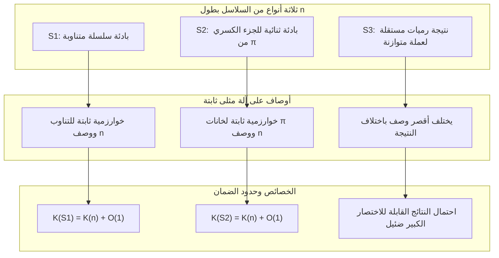
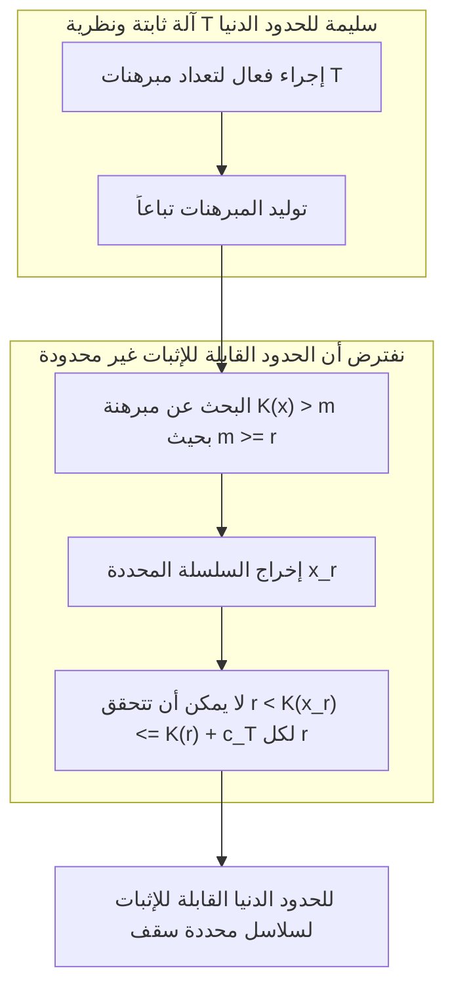

## 1. ثلاث سلاسل طول كل منها مليون بت

لننظر إلى ثلاث سلاسل ثنائية طول كل منها $n=1{,}000{,}000$:

1. $S_1$: تكرار النمط <bdi dir="ltr">`01`</bdi> خمسمئة ألف مرة.
2. $S_2$: أول مليون بت من التمثيل الثنائي <strong>للجزء الكسري</strong> من $\pi$.
3. $S_3$: نتيجة من نموذج مليون رمية مستقلة لقطعة نقد متوازنة.

عند رصّ البتات دون فراغات، تشغل كل سلسلة 125,000 بايت، أي 125 kB. أما حفظ <bdi dir="ltr">`0`</bdi> و<bdi dir="ltr">`1`</bdi> بوصفهما محارف ASCII أو UTF-8 فيحتاج إلى مليون بايت. وتُضاف إلى ذلك ترويسات الملفات ومساحة إدارة الكائنات.

التمثيل الثنائي لعدد $\pi$ هو $11.0010010000111111\ldots{}_2$، ولذلك تبدأ $S_2$ بعد حذف الجزء الصحيح بالنمط <bdi dir="ltr">`0010010000111111...`</bdi>. الأمثلة هنا للتوضيح، ولا تعني إجراء مليون رمية فعلية من أجل المقال.

يمكن توليد $S_1$ بتعليمة تكرار، وتوجد خوارزميات لحساب خانات $S_2$. لكن $S_3$ ليست بالضرورة معقدة: قد تنتج مصادفةً سلسلة كلها أصفار. الادعاء الصحيح احتمالي: <strong>عند تثبيت نموذج الحساب، تكون النتائج التي يمكن وصفها بوصف أقصر بكثير من طولها قليلة</strong>.

في نموذج الرميات المستقلة المتوازنة، تتساوى احتمالات جميع السلاسل المحددة ذات الطول $n$، سواء كانت متناوبة أو بادئة من خانات $\pi$:

$$
P(X=x)=2^{-n},\qquad x\in\{0,1\}^n
$$

كيف نميز بين نتائج متساوية الاحتمال من حيث وجود قاعدة قصيرة لتوليدها؟ تهتم <strong>نظرية المعلومات الخوارزمية (AIT)</strong>، التي طورها سولومونوف وكولموغوروف وتشايتين وغيرهم منذ ستينيات القرن العشرين، بطول أقصر برنامج يخرج السلسلة ثم يتوقف.

---

## 2. معلومات شانون والسلاسل الفردية

### 2.1 المعلومات الذاتية والإنتروبيا والترميز

لتوزيع متقطع $P$، نميز بين المعلومات الذاتية لنتيجة احتمالها $P(x)>0$ ومتوسط هذه المعلومات، أي الإنتروبيا. اللوغاريتمات التالية للأساس 2، والوحدة هي البت.

$$
I_P(x)=-\log_2P(x),\qquad
H(P)=-\sum_xP(x)\log_2P(x)
$$

نعتمد في المجموع الاصطلاح $0\log_2 0=0$. والمعلومات الذاتية لنتيجة احتمالها صفر تكون غير منتهية.

عند ترميز رمز واحد من أبجدية منتهية بشفرة ثنائية خالية من البوادئ، يحقق متوسط الطول الأمثل:

$$
H(P)\le L_{\mathrm{opt}}<H(P)+1
$$

لا يعني ذلك أن طول شفرة كل رمز يساوي الإنتروبيا. بتجميع $r$ رموز مستقلة ومتطابقة التوزيع يمكن تقليل الزيادة الناتجة عن التقريب إلى أطوال صحيحة لكل رمز:

$$
H(P)\le \frac{L_{\mathrm{opt},r}}{r}<H(P)+\frac1r
$$

أما المصادر التي تتضمن اعتماداً بين الرموز فتتطلب النظر إلى توزيعات الكتل ومعدل الإنتروبيا. وحتى عند شرح ترميز هوفمان أو الترميز الحسابي، يجب تحديد النموذج والتمييز بين القيم الفردية والمتوسطة.

### 2.2 اختيار النموذج والتكرارات التجريبية

تعتمد $-\log_2P(x)$ على النموذج $P$، لا على $x$ وحدها. في نموذج العملة المتوازنة، تحمل السلسلة المتناوبة أيضاً مليون بت من المعلومات الذاتية. وإذا اخترنا توزيعاً نقطياً يعطي تلك السلسلة المحددة وحدها باحتمال واحد، تصبح الإنتروبيا صفراً. لكن تكلفة إرسال وصف النموذج نفسه لا تصبح صفراً.

إذا اقتصرنا على تكرارات البتات المفردة، فإن تكرار <bdi dir="ltr">`01`</bdi> يحتوي على أصفار وآحاد بالتساوي، وتكون الإنتروبيا التجريبية من الرتبة صفر:

$$
\widehat H_0((01)^{n/2})
=-\tfrac12\log_2\tfrac12-\tfrac12\log_2\tfrac12=1
$$

ومع ذلك، يستطيع نموذج يتنبأ بالبت التالي انطلاقاً من السابق التقاط الانتظام. لا تظهر في السلسلة المتناوبة أكثر من كتلتين مختلفتين من كل طول $k$، حتى مع السماح بالتداخل. لذلك لا تتجاوز إنتروبيا الكتلة التجريبية بتاً واحداً، أو $1/k$ بت لكل بت. إنتروبيا الكتلة بكاملها تختلف عن القيمة محسوبةً لكل بت.

لم تُثبت خاصية السواء العددي (normality) لعدد $\pi$: أي تساوي التكرارات الحدّية لجميع الكتل ذات كل طول ثابت. لا تكفي اختبارات التكرارات المنتهية أو المظهر غير المنتظم لإثباتها. وحتى لو ثبتت، فإنها لا تتعارض مع قابلية حساب متتالية الخانات. وإذا سمح النموذج بحساب الخانات، فيمكن للتنبؤ والترميز وفق نظرية شانون استغلال هذه القاعدة.

لا تنقض AIT نظرية شانون. <strong>طول الشفرة بالنسبة إلى نموذج احتمالي وطول وصف كائن فردي على آلة ثابتة يجيبان عن سؤالين مختلفين.</strong>

| الجانب | معلومات شانون | الوصف الخوارزمي |
| :--- | :--- | :--- |
| موضوع القياس | التوزيع والنتائج في ذلك النموذج | سلسلة منتهية تخرجها آلة ثابتة |
| المرجع | النموذج الاحتمالي وقواعد الترميز | الآلة وترميز البرامج والمدخل المساعد |
| الكميات | $I_P(x)$ و$H(P)$ ومعدل الإنتروبيا | التعقيد العادي $C(x)$ والتعقيد البادئي $K(x)$ |
| القيود | لوصف النموذج تكلفة مستقلة | ثوابت تعتمد على الآلة وعدم قابلية الحساب |
| حالة $\pi$ | تعتمد على النموذج المختار | يمكن وصف قاعدة توليد الخانات وموضع التوقف |

---

## 3. أقصر البرامج ومبرهنة اللاتغير

### 3.1 التعقيد العادي والتعقيد الشرطي

لنرمز إلى مجموعة السلاسل الثنائية المنتهية بـ$\{0,1\}^*$، وإلى طول البرنامج بالبتات بـ$|p|$. لآلة جزئية قابلة للحساب $A$، تعني $A(p)=x$ أنها تخرج بالضبط $x$ وتتوقف في زمن منتهٍ.

$$
C_A(x)=\min\{|p|:A(p)=x\}
$$

إذا لم يوجد برنامج كهذا، تكون القيمة $\infty$. وعند إتاحة المدخل المساعد $y$ دون تكلفة، نعرّف:

$$
C_A(x\mid y)=\min\{|p|:A(p,y)=x\}
$$

معرفة طول السلسلة أو القاموس مسبقاً تختلف في التكلفة عن تضمين وصفهما في البرنامج.

### 3.2 التعقيد البادئي والبرامج ذاتية التحديد

في <strong>التعقيد البادئي $K$</strong>، تكون مجموعة البرامج التي تتوقف خالية من البوادئ (prefix-free): لا يكون أي برنامج صالح بادئة حقيقية لبرنامج صالح آخر.

$$
K_U(x)=\min\{|p|:U(p)=x\},\qquad
\sum_{p\in\operatorname{dom}U}2^{-|p|}\le1
$$

الجزء الثاني هو متباينة كرافت. في الحالة الشرطية، يجب أن يكون مجال التوقف خالياً من البوادئ لكل مدخل مساعد ثابت $y$. ولا تعني خاصية التحديد الذاتي مجرد إضافة قوس إغلاق إلى شيفرة مصدرية عادية. نختار ونثبّت لكل من $C$ و$K$ آلة مثلى حتى ثابت جمعي ضمن فئتها.

عند وصل برامج عادية نحتاج إلى تحديد حدودها. مثلاً، باستخدام ترميز ثابت قابل للحساب للأزواج نحصل على:

$$
C(x,y)\le C(x)+C(y)
+2\log_2\bigl(\min\{C(x),C(y)\}+2\bigr)+O(1)
$$

يمكن وصل البرامج الخالية من البوادئ وتفسيرها. وباستخدام الأوصاف الشرطية نحصل على:

$$
K(x,y)\le K(x)+K(y\mid x)+O(1)
\le K(x)+K(y)+O(1)
$$

وللآلات المرجعية المناسبة والثابتة توجد العلاقة:

$$
C(x)\le K(x)+O(1),\qquad
K(x)\le C(x)+2\log_2(C(x)+2)+O(1)
$$

يرمز $O(1)$ إلى ثابت لا يعتمد على $x$؛ ولا يعني أننا قسنا التكلفة فوجدناها صفراً أو بضعة بتات.

### 3.3 الأمثلية حتى ثابت جمعي

نختار لـ$C$ آلة مثلى ضمن فئة الآلات العادية، ولـ$K$ آلة مثلى ضمن فئة الآلات الخالية من البوادئ. إذا استُخدمت كلمة «كونية» لمجرد القدرة على محاكاة الآلات الأخرى، فيلزم أيضاً اشتراط الحفاظ على طول الوصف ضمن زيادة ثابتة.

لكل آلة خالية من البوادئ $A$، يوجد ثابت $c_A$ لا يعتمد على $x$ بحيث:

$$
K_U(x)\le K_A(x)+c_A
$$

<strong>فكرة البناء</strong> هي وضع وسم ثابت ذاتي التحديد $s_A$ يحدد الآلة $A$ قبل البرنامج $p$، ثم محاكاة $A(p)$. إذا كان $A(p)=x$، فإن برنامج المحاكاة يخرج $x$ بطول $|p|+|s_A|$ مضافاً إليه عبء ثابت. ولا يكون أقصر برنامج أطول منه. بهذه الطريقة يمكن بناء آلة مثلى. وتنطبق حجة مماثلة على التعقيد العادي داخل فئته.

بتطبيق المتباينة في الاتجاهين بين آلتين مثليين حتى ثابت جمعي:

$$
|K_{U_1}(x)-K_{U_2}(x)|\le c_{12}
$$

يجب اختيار الثابت ليغطي تكلفتي المحاكاة في الاتجاهين؛ حجم المفسر في اتجاه واحد لا يكفي وحده لتقدير الفرق المطلق.

يمكن بناء آلة خاصة تخرج سلسلة معينة طولها مليون بت بأمر قصير. لكن تكلفة وصف تلك الآلة ومحاكاتها تدخل في الثابت. لا تلغي مبرهنة اللاتغير اعتماد الكائنات المنتهية على الآلة. يصغر أثر الثابت بعد قسمته على $n$ عندما $n\to\infty$، بينما لا يمكن عموماً معرفة طول أقصر وصف لكائن محدد. كذلك لا ينبغي مساواة معالج واقعي ذي ذاكرة منتهية بآلة رياضية تسمح بذاكرة غير محدودة.

### 3.4 التناوب وخانات باي وموضع التوقف

نمثل العدد الصحيح $n$ بترميز ثنائي ثابت. ولتكن $s(n)$ السلسلة المتناوبة بطول $n$ أو أول $n$ بت من الجزء الكسري لعدد $\pi$. يمكن توليد $s(n)$ من $n$، واستعادة $n$ من طول السلسلة. وبالتحويلات القابلة للحساب في الاتجاهين:

$$
K(s(n))=K(n)+O(1),\qquad K(s(n)\mid n)=O(1)
$$

إذا أُعطي موضع التوقف دون تكلفة، يكفي وصف ثابت الطول؛ وإلا لزم وصف $n$ أيضاً. مثلاً، يعطي ترميز الأعداد الصحيحة ذاتي التحديد، عندما $n\ge2$:

$$
K(n)\le \log_2 n+2\log_2\log_2 n+O(1)=O(\log n)
$$

لا تصح $K(n)=\log_2n+O(1)$ لجميع الأعداد الصحيحة. إذا كان $n=2^m$، فقد يكفي وصف قصير للأس $m$ لإعادة بناء $n$. ولا تقيس الصيغة التقاربية برنامجاً فعلياً على أنه عشرون بتاً بالضبط أو بضع مئات من البايتات.



ليس أقصر وصف لـ$S_3$ بالضرورة نسخة من البتات الأصلية. يوضح العد في القسم التالي المعنى الاحتمالي لهذا المثال.

---

## 4. عدم القابلية للضغط وعشوائية المتتاليات اللانهائية

### 4.1 الحدود الناتجة عن الإخراج الحرفي

يعطي وصف يخرج سلسلة $x$ بطول $n$ بت حرفياً الحدين:

$$
C(x)\le n+O(1),\qquad K(x\mid n)\le n+O(1)
$$

أما التعقيد البادئي غير المشروط فيتطلب أيضاً وصف الطول بطريقة ذاتية التحديد:

$$
K(x)\le n+K(n)+O(1)
$$

لا يمكن أن تتحقق $K(x)\le |x|+O(1)$ بثابت واحد لجميع السلاسل. فلو أمكن ذلك لكان مجموع الأوزان $\sum_{|x|=n}2^{-K(x)}$ عند كل طول $n$ محدوداً من أسفل بثابت موجب. وجمع هذه الحدود عبر جميع الأطوال يخالف متباينة كرافت.

### 4.2 العد الدقيق بمبدأ الحمام

ليكن $n\ge0$ و$0\le c\le n$ عددين صحيحين. عدد البرامج الثنائية التي يقل طولها تماماً عن $n-c$ هو:

$$
\sum_{j=0}^{n-c-1}2^j=2^{n-c}-1
$$

عند $c=n$ يكون المجموع فارغاً ويساوي صفراً. لكل برنامج يتوقف ناتج واحد على الأكثر؛ لذلك لا يزيد عدد السلاسل ذات الطول $n$ التي تحقق $C(x)<n-c$ على عدد هذه البرامج. ومن ثم:

$$
\#\{x\in\{0,1\}^n:C(x)\ge n-c\}
\ge2^n-2^{n-c}+1
$$

قد لا تتوقف بعض البرامج، وقد تخرج برامج مختلفة السلسلة نفسها، لذا يمكن أن يكون عدد النتائج المتميزة أقل. عندما $c>n$ يكون $n-c<0$، فتتحقق $C(x)\ge n-c$ تلقائياً لكل سلسلة. لا نمدد صيغة المجموع الهندسي آلياً إلى تلك الحالة.

بالنسبة إلى التوزيع المنتظم الناتج عن رميات مستقلة لعملة متوازنة:

$$
P\{C(X)<n-c\}
\le\frac{2^{n-c}-1}{2^n}<2^{-c}
$$

عند $c=0$ توجد لكل طول سلسلة واحدة على الأقل تحقق $C(x)\ge n$. وعند $c=1$ لا يمكن اختصار أكثر من نصف السلاسل <strong>بأكثر من</strong> بت واحد. عند $c=10$ و$c=20$، يكون الحد الأدنى $1-2^{-c}$ لنسبة السلاسل التي لا يمكن اختصارها بأكثر من 10 أو 20 بتاً نحو 99.902% و99.999905% على الترتيب. لا يمنع ذلك اختصاراً بمقدار $c$ بت بالضبط.

ينطبق العد نفسه على $K(x\mid n)$ عند تثبيت الشرط $n$. لذلك تتطلب نتائج الرميات، باحتمال مرتفع، أوصافاً قريبة من طول البيانات، لكن لا يوجد ضمان لكل نتيجة منفردة.

وجود ضاغط غير فاقد يقصر كل ملف يناقض هذا العد. تستخدم الضواغط الواقعية انتظامات معينة. ولا يصح تفسير النسب تحت التوزيع المنتظم لجميع السلاسل مباشرةً باعتبارها تكرارات البيانات الطبيعية أو البشرية.

### 4.3 عشوائية مارتن-لوف

عدم إمكان اختصار سلسلة منتهية بمقدار محدد وعشوائية متتالية لانهائية مفهومان مختلفان. نأخذ مقياس العملة المتوازنة $\mu$ على فضاء المتتاليات الثنائية اللانهائية. المجموعة الأسطوانية $[w]$ تضم المتتاليات التي تبدأ بالسلسلة المنتهية $w$، ومقياسها $2^{-|w|}$.

<strong>اختبار مارتن-لوف</strong> هو متتالية مجموعات مفتوحة $V_j$ يمكن تعدادها حسابياً بصورة موحدة بوصفها اتحادات لمجموعات أسطوانية محددة ببوادئ منتهية، وتحقق:

$$
\mu(V_j)\le2^{-j},\qquad j=1,2,\ldots
$$

تفشل $\omega$ في الاختبار إذا كانت $\omega\in\bigcap_jV_j$. وتكون عشوائية وفق مارتن-لوف إذا لم تفشل في أي اختبار من هذا النوع. لا يشترط ذلك عدم ظهور نمط منتهٍ نادر ولو مرة واحدة. الاختبارات قابلة للعد، ومجموعة الفشل لكل منها ذات مقياس صفر، لذا فإن مجموعة المتتاليات التي تجتازها جميعاً ذات مقياس واحد.

تصف مبرهنة ليفين-شنور هذا المفهوم باستخدام <strong>التعقيد البادئي</strong> الأمثل:

$$
\omega\text{ عشوائية وفق مارتن-لوف}
\iff
\exists c\ \forall n\quad K(\omega_{1:n})\ge n-c
$$

النقطة الأساسية هي استخدام <strong>الثابت نفسه $c$</strong> لجميع الأطوال $n$. ولا يمكن إحلال التعقيد العادي $C$ محل $K$ هنا مباشرةً.

تدخل قواعد الاختيار لفون ميزس وتشرش في تاريخ هذه الأفكار، لكن شروط قابلية الحساب المفروضة على الاختبارات واستراتيجيات الرهان تؤدي إلى مفاهيم مختلفة. خصوصاً، العشوائية القابلة للحساب، التي لا يستطيع فيها أي مارتينغال قابل للحساب زيادة رأس المال بلا حد، أضعف من عشوائية مارتن-لوف. متتالية خانات $\pi$ القابلة للحساب ليست عشوائية وفق مارتن-لوف؛ والسواء العددي خاصية أخرى.

---

## 5. عدم قابلية الحساب وحدود البرهان واحتمال التوقف

### 5.1 تقريب من أعلى دون معيار عام لاكتماله

للبحث عن برامج قصيرة تخرج $x$، يمكن التناوب بين تنفيذ البرامج المرشحة، مع منح كل منها مزيداً من الخطوات تدريجياً. يعطي أصغر طول عُثر عليه تقريباً من أعلى:

$$
K_t(x)\searrow K(x)\qquad(t\to\infty)
$$

يمكن البدء بحد علوي منتهٍ قابل للحساب باستخدام وصف يخرج البيانات حرفياً. ولأن القيم أعداد صحيحة، فإنها تبلغ التعقيد الحقيقي لكل $x$ ثابتة في مرحلة ما وتستقر عليه. لكن لا توجد طريقة عامة للتعرف إلى تلك المرحلة لجميع المدخلات؛ فقد يتوقف لاحقاً برنامج أقصر لم يتوقف بعد ويخرج $x$.

### 5.2 حجة على نمط مفارقة بيري

تحتوي العبارة «أصغر عدد صحيح موجب لا يمكن تعريفه بأقل من عشرين كلمة» على إحدى عشرة كلمة مفصولة بمسافات، أي أقل من عشرين. لكن معنى «تعريفه» في اللغة الطبيعية ملتبس، والعبارة وحدها ليست برهاناً صورياً. نحتاج إلى نقل الفكرة إلى إجراءات قابلة للحساب.

لنفترض أن الإجراء <bdi dir="ltr">`ComputeK`</bdi> يعيد القيمة الحقيقية $K(x)$ ويتوقف لكل سلسلة $x$. تعتمد <strong>الشيفرة الكاذبة</strong> التالية على هذا الافتراض المستحيل؛ فهي ليست خوارزمية قابلة للتنفيذ لحساب التعقيد.

```text
Berry(m):
    عدّد جميع السلاسل الثنائية x حسب الطول 0,1,2,...، ثم معجمياً بين السلاسل المتساوية الطول:
        if ComputeK(x) >= m:
            أخرج x وتوقف
```

يسمى هذا الترتيب shortlex: حسب الطول أولاً، ثم معجمياً. الترتيب المعجمي وحده لا يكفي للحصول على التعداد المطلوب لجميع السلاسل المنتهية.

يبين العد أن التعقيد غير محدود من أعلى. تحت الافتراض السابق، ينتهي البحث لكل $m$ ويخرج $x_m$ بحيث $K(x_m)\ge m$. لكن تكفي لتوليدها تعليمة ثابتة ووصف ذاتي التحديد للعدد $m$:

$$
m\le K(x_m)\le K(m)+c
\le \log_2m+2\log_2\log_2m+c'
$$

ينطبق الحد الأخير عندما $m\ge2$. عند تثبيت الثوابت واختيار $m$ كبيراً بما يكفي نحصل على تناقض، ولذلك لا يوجد <bdi dir="ltr">`ComputeK`</bdi>. لا نحتاج إلى افتراض أن هامشاً ثابتاً مقداره 10,000 بت يكفي دائماً دون قياس تكاليف الآلة.

### 5.3 مبرهنة عدم الاكتمال لتشايتين

لنثبت الآلة المرجعية ونظرية $T$ قابلة للأكسمة الفعالة، تستطيع التعبير عن حدود التعقيد لسلاسل منتهية محددة. نفترض <strong>سلامتها الدلالية</strong> فيما يخص الحدود الدنيا التي تثبتها: أي إن تلك العبارات صحيحة.

يوجد عندئذ حد $b_T$ لا تستطيع النظرية $T$ إثبات العبارة «$K(x)>b_T$» لأي سلسلة محددة $x$.

لإثبات ذلك، نفترض أن الحدود الدنيا العددية القابلة للإثبات غير محدودة. عندئذ يمكن، لكل مدخل $r$، تعداد جميع المبرهنات والعثور على عبارة «$K(x)>m$» لسلسلة محددة وعدد صحيح $m\ge r$.

```text
SearchProof(r):
    عدّد مبرهنات T بإجراء فعال:
        if تؤكد المبرهنة "K(x) > m" لسلسلة محددة x وعدد صحيح m بحيث m >= r:
            أخرج x وتوقف
```

تضمن السلامة أن تعقيد الناتج $x_r$ أكبر من $r$. لكن الجزء الثابت من البرنامج يمكن أن يتضمن بالفعل إجراء تعداد مبرهنات $T$، ومن ثم:

$$
r<K(x_r)\le K(r)+c_T=O(\log r)+c_T
$$

يستحيل ذلك عندما يكبر $r$ بما يكفي، ولذلك تكون الحدود الدنيا العددية القابلة للإثبات محدودة.



يعتمد الحد على الآلة والنظرية والتمثيل. ليس هذا قياساً لحد كوني لنظرية ZFC مقداره 20,000 أو 50,000 بت. إذا كان طول السلسلة $n$ كبيراً بما يكفي مقارنةً بالحد، يبين العد أن كثيراً من السلاسل تتجاوزه فعلاً، مع أن النظرية قد لا تستطيع إثبات الحد المطلوب لسلسلة محددة.

تربط هذه النتيجة عدم الاكتمال عند غودل بالأوصاف الخوارزمية. لكنها ليست «قانون حفظ للمعلومات» عاماً يمنع استنتاج مبرهنات طويلة أو كثيرة من بديهيات قصيرة. إضافة بديهيات تعطي نظرية أخرى بثابت آخر.

### 5.4 احتمال توقف يعتمد على الآلة

لآلة مثلى خالية من البوادئ $U$، يكون احتمال أن تبدأ متتالية لانهائية من البتات المستقلة المتساوية الاحتمال ببرنامج يتوقف:

$$
\Omega_U=\sum_{p\in\operatorname{dom}U}2^{-|p|}
$$

المجموعات الأسطوانية للبرامج التي تتوقف متباينة، ولذلك يملك المجموع تفسيراً احتمالياً. تعطينا متباينة كرافت $\Omega_U\le1$. ومع الشروط المذكورة، ومنها الأمثلية، يكون $\Omega_U$ أيضاً عدداً حقيقياً غير قابل للحساب وعشوائياً وفق مارتن-لوف، ويحقق $0<\Omega_U<1$. لا تكفي خاصية الخلو من البوادئ لآلة اعتباطية لضمان كل هذه النتائج.

يولد تعداد البرامج التي تتوقف مجاميع جزئية متزايدة لأوزانها. لذلك فإن $\Omega_U$ <strong>قابل للتقريب الحسابي من أسفل (left-c.e.)</strong>: توجد متتالية قابلة للحساب من الأعداد النسبية تتزايد نحوه. لكن لا توجد دالة قابلة للحساب تحدد، لكل دقة مطلوبة، مرحلة تضمن بلوغ تلك الدقة.

لنفترض معرفة أول $N$ بت من الجزء الكسري معرفة دقيقة، ولنسَمِّ الطرف السفلي للفترة المحددة بها $a$. بما أن التمثيل الثنائي لـ$\Omega_U$ لا ينتهي:

$$
a=\frac{\lfloor2^N\Omega_U\rfloor}{2^N},
\qquad a<\Omega_U<a+2^{-N}
$$

نتناوب على تنفيذ البرامج حتى <strong>يتجاوز</strong> المجموع الجزئي لأوزان التوقف $q_s$ القيمة $a$. عندئذ:

$$
0\le\Omega_U-q_s<2^{-N}
$$

لو توقف لاحقاً برنامج لم نكتشف توقفه وطوله لا يتجاوز $N$، لأضاف وزناً لا يقل عن $2^{-N}$، وهذا يناقض حد الكتلة المتبقية. لذلك تسمح هذه البتات بحسم توقف جميع المدخلات ذات الطول الذي لا يتجاوز $N$ على <strong>الآلة نفسها</strong>.

لا يعني ذلك أن بضعة آلاف ثابتة من البتات تحسم جميع العبارات الرياضية. عند ترميز البحث عن مثال مضاد مثلاً على هيئة مسألة توقف، تؤثر الآلة وطول البرنامج والصيغة المنطقية للعبارة. ودراسة عدد منتهٍ من الخانات لا توفر خوارزمية تولد جميع الخانات.

---

## 6. الإنتروبيا وMDL وNCD والذكاء الاصطناعي

### 6.1 متوسط طول الوصف ومعدل الإنتروبيا

ليكن $P$ توزيعاً متقطعاً قابلاً للحساب على السلاسل المنتهية، محدداً بإجراء حسابي منتهٍ $d_P$. إذا كان هذا الإجراء متاحاً بوصفه مدخلاً مساعداً مشتركاً، وكان $H(P)<\infty$، فإن:

$$
H(P)\le\mathbb E_{X\sim P}[K(X\mid d_P)]\le H(P)+c
$$

قد يكون التوزيع على مجموعة منتهية أو قابلة للعد؛ ونفترض إمكان حساب احتمالاته بصورة موحدة إلى أي دقة محددة. يشمل الثابت $c$ تكلفة إجراء فك الترميز، ولا تعني المتباينة تساوي القيم عددياً.

ينتج الحد الأدنى من متباينة كرافت لأقصر الأوصاف الخالية من البوادئ تحت كل شرط ثابت $d_P$، ومن حجة متوسط طول الشفرة. وللحد الأعلى، نبني من التوزيع المشترك شفرة خالية من البوادئ تُحدَّد أطوالها وفق الاحتمالات، ونفكها بإجراء ثابت. إذا لم يكن التوزيع مشتركاً، وجب حساب تكلفة وصف النموذج أيضاً. مجرد وصف توزيع اعتباطي بأنه «معلوم» لا يضمن حساب إنتروبيته بدقة تامة في زمن منتهٍ.

توجد علاقة أخرى من نوع مبرهنة برودنو <strong>للعمليات المستقرة الإرغودية ذات الأبجدية المنتهية</strong>. إذا كان معدل الإنتروبيا $h$ بت لكل رمز، فلكل مسار تقريباً:

$$
\lim_{n\to\infty}\frac{K(X_{1:n})}{n}=h
$$

ويتقارب المتوسط أيضاً: $\mathbb E[K(X_{1:n})]/n\to h$. يتيح الحد العلوي الخطي الموحد الناتج عن الترميز الحرفي لسلسلة من $n$ رموز الانتقال من التقارب شبه المؤكد إلى تقارب المتوسطات. ويختفي الفرق اللوغاريتمي بين التعقيد العادي والبادئي بعد قسمته على $n$. لا يلزم إضافة فرض قابلية حساب التوزيع من المتباينة السابقة إلى هذه المبرهنة عن المعدل.

### 6.2 شبه المقياس الكوني المتقطع وتنبؤ سولومونوف

لآلة مثلى خالية من البوادئ تتوقف بعد الإخراج، نعرّف احتمال إخراج $x$ بالضبط ثم التوقف:

$$
m_U(x)=\sum_{p:U(p)=x}2^{-|p|}
$$

هذا <strong>شبه مقياس</strong> لأن مجموع القيم على جميع النتائج لا يتجاوز واحداً، وهو قابل للتقريب الحسابي من أسفل. تربط مبرهنة الترميز شبه المقياس الكوني المتقطع بالتعقيد البادئي:

$$
-\log_2m_U(x)=K_U(x)+O(1),
\qquad m_U(x)=\Theta(2^{-K_U(x)})
$$

أما تنبؤ سولومونوف المتتابع فيستخدم شبه مقياس آخر $M(x)$ لآلة رتيبة: احتمال أن <strong>يبدأ</strong> الإخراج بـ$x$. لا يُشترط أن يتوقف الإخراج عندها، وتتحقق علاقة الاتساق $M(x)\ge M(x0)+M(x1)$. لا يجوز مساواة تعريف $m_U$ المتقطع بتعريف $M$ الخاص بالتنبؤ المتتابع، أو نقل مبرهنة الترميز نفسها إليهما دون شروط إضافية.

يرتبط تفضيل الأوصاف القصيرة بمبدأ نصل أوكام، لكن الفرضية الأقصر لا تكون بالضرورة الأعلى احتمالاً بعد مشاهدة البيانات؛ فدالة الإمكان مهمة أيضاً.

### 6.3 الاختيار البايزي ومبدأ الحد الأدنى لطول الوصف

إذا أعطينا النموذج $H$ وصفاً فعلياً خالياً من البوادئ بطول $L(H)$، واخترنا احتمالاً قبلياً يتناسب مع وزنه الترميزي، تصبح قاعدة بايز:

$$
-\log_2P(H\mid D)
=L(H)-\log_2P(D\mid H)+\mathrm{const}
$$

لا يعتمد الثابت هنا على $H$. في هذا الإعداد، تقابل زيادة الاحتمال البعدي تصغير الطرف الأيمن. لكن لا يجوز دائماً استبدال $-\log_2P(D\mid H)$ بقيمة مساوية لها هي $K(D\mid H)$.

يقارن <strong>مبدأ الحد الأدنى لطول الوصف (MDL)</strong> مجموع تكلفة وصف النموذج وتكلفة وصف البيانات باستخدامه:

$$
\widehat H=\arg\min_{H\in\mathcal H}
\{L(H)+L(D\mid H)\}
$$

النموذج المفرط في البساطة يترك وصفاً طويلاً للبيانات، والنموذج الذي يحفظ البيانات كلها يحتاج هو نفسه إلى وصف طويل. إزالة الباقي بالحفظ ليست مساوية لتقليل الطول الإجمالي. مبدأ MDL لريسانن نهج عملي للاختيار الإحصائي، وليس ضماناً لاكتشاف كل قانون طبيعي صحيح أو علاقة سببية.

### 6.4 مسافة المعلومات المثالية ومسافة الضغط العملية

عندما يكون المقام موجباً، تُعرَّف <strong>مسافة المعلومات المعيّرة (NID)</strong> المثالية كما يلي:

$$
\operatorname{NID}(x,y)=
\frac{\max\{K(x\mid y),K(y\mid x)\}}
{\max\{K(x),K(y)\}}
$$

ترتبط كذلك بصيغ تستخدم تعقيد الزوج $K(x,y)$ ضمن هوامش خطأ جمعي ومعيّر مناسبة. لا ينبغي مساواة وصل السلسلتين دون فاصل $xy$ بترميز زوج يسمح باستعادة جزأيه على نحو وحيد.

لنرمز إلى طول مخرجات ضاغط فعلي بـ$Z$، تمييزاً له من التعقيد العادي $C$. عندئذ تكون <strong>مسافة الضغط المعيّرة (NCD)</strong>:

$$
\operatorname{NCD}_Z(x,y)=
\frac{Z(xy)-\min\{Z(x),Z(y)\}}
{\max\{Z(x),Z(y)\}}
$$

الفكرة أن الضاغط قد يعيد استخدام البنية المشتركة بين ملفين متشابهين، فتقل القيمة؛ وإذا لم يتمكن من استغلال بنية مشتركة، تقترب القيمة من الواحد.

لكن للضواغط الفعلية ترويسات ونوافذ قواميس وكتل وإعدادات، وقد تعتمد على ترتيب المدخلات. افتراضات الضاغط الطبيعي (normal compressor)، مثل عدم تغير الطول تقريباً عند تكرار البيانات والرتابة والتناظر والتوزيعية، لا تتحقق تلقائياً لكل ضاغط على جميع المدخلات. حتى لملفين متطابقين قد لا تتحقق $Z(xx)\approx Z(x)$. ولا تضمن NCD للبيانات المنتهية تحقيق مسلمات المسافة بدقة أو البقاء دائماً بين صفر وواحد.

في فحص مساعد، وُصلت سلسلة ثابتة طولها 65,536 بايت بنسخة منها، وأعطى gzip ذو النافذة المحدودة قيمة NCD تقارب 0.9997 بين السلسلة ونفسها. هذا مثال على حدود التقريب بضاغط فعلي، لا مثال مضاد لـNID المثالية.

درس Cilibrasi وVitányi وغيرهما التجميع باستخدام الضغط في الجينومات واللغات والموسيقى. من المفيد عدم الحاجة إلى تصميم سمات خاصة بكل مجال يدوياً، لكن النتائج تظل مرتبطة بترميز المحارف وتمثيل الملفات واختيار الضاغط، ولا تضمن استعادة أي شجرة تطورية بدقة.

### 6.5 تنبؤ نموذج اللغة وطول الشفرة

لسلسلة توكنات $D=x_{1:T}$ ونموذج انحدار ذاتي ثابت، يكون طول الشفرة المثالي الموافق للتنبؤات:

$$
\mathcal L_\theta(D)=
-\sum_{t=1}^T\log_2p_\theta(x_t\mid x_{<t})
$$

إذا استُخدم اللوغاريتم الطبيعي كانت الوحدة نات؛ نقسم على $\ln2$ للتحويل إلى بتات. هذه هي سالب لوغاريتم الإمكان للبيانات المنتهية، ويُستخدم متوسطها بوصفه خسارة الإنتروبيا المتقاطعة.

للنتائج ذات الاحتمال الموجب، ومع اشتراك المرمِّز وفاك الترميز في النموذج وطول السلسلة، يتيح الترميز الحسابي المثالي بناء وصف خالٍ من البوادئ بطول لا يتجاوز $\lceil\mathcal L_\theta(D)\rceil+2$. هذه زيادة ثابتة، وليست دعوى أن كل تنفيذ يعطي بالضبط «الخسارة زائد بتين». تؤثر الدقة المنتهية وإنهاء الترميز والتقريب وتحديد حدود تدفق البيانات.

إذا كان $L_{\mathrm{model}}$ و$L_{\mathrm{meta}}$ طولي وصفين فعليين ذاتيي التحديد للنموذج والبيانات الوصفية اللازمة، فإن فاك ترميز ثابتاً يعطي:

$$
K(D)\le L_{\mathrm{model}}+L_{\mathrm{meta}}
+\lceil\mathcal L_\theta(D)\rceil+O(1)
$$

تشمل البيانات الوصفية طول السلسلة والقاموس ومواصفات تقسيم النص إلى توكنات بصورة قابلة للعكس، بحسب الحاجة. لا يمكن استعادة مسافات أو محارف حذفها تطبيع النص دون إرسال المعلومات اللازمة.

تقليل خسارة التنبؤ لنموذج ثابت الحجم يقابل تقليل طول شفرة البيانات عندما يكون النموذج مشتركاً. أما عند تغيير حجم النموذج فيجب مقارنة التكلفة الكلية؛ فلا تساوي خسارة التدريب وحدها معيار MDL ذي الجزأين.

تمثل AIXI لماركوس هوتر وجائزة Hutter اهتماماً بحثياً بالعلاقة بين الضغط والذكاء. لكن AIXI نموذج مثالي غير قابل للحساب، وليس محولاً (Transformer) فعلياً. وتبحث دراسة Delétang وزملائه عن الضغط بنماذج اللغة أيضاً في العلاقة بين التنبؤ والضغط.

إذا تنبأ النموذج جيداً باسم الجاني في رواية بوليسية، تقصر شفرة الاسم الصحيح. لكن التحسن قد ينتج من الحفظ أو الانحيازات المعجمية أو تكرار البيانات، وليس من الاستدلال المنطقي وحده. لا تنتج من القدرة على ضغط نصوص التدريب مبرهنة تضمن اكتساب نموذج سببي للعالم أو استدلال صحيح أو تعميم أو ذكاء اصطناعي عام.

| النظرية أو الفكرة | المقابل العملي | التمييز الضروري |
| :--- | :--- | :--- |
| $K(x)$ و$K(x\mid y)$ | أوصاف تشمل فك الترميز وترميز بسياق مشترك | طول الضغط الفعلي ليس عموماً الحد الأدنى |
| شبه المقياس الكوني المتقطع $m_U$ | نمذجة تفضّل الأوصاف القصيرة | الإخراج المتوقف يختلف عن التنبؤ المتتابع $M$ |
| MDL | مقارنة تكلفة النموذج وشفرة البيانات | لا يتساوى الإمكان دائماً مع التعقيد الشرطي |
| NID وNCD | تشابه وتجميع على أساس الضغط | نافذة الضاغط والتمثيل والترتيب والطول المنتهي |
| نماذج اللغة والترميز الحسابي | العلاقة بين احتمالات التنبؤ وأطوال الشفرات | النموذج المشترك يختلف عن الوصف الكامل المستقل؛ وتقييم الذكاء مسألة إضافية |

---

## 7. ما الذي يكشفه الضغط وما الذي يبقى مفتوحاً؟

توجد إجراءات قصيرة لتوليد مليون بت متناوب وبوادئ خانات $\pi$. يختلف الوصف الذي يتضمن موضع التوقف عن الوصف الشرطي عندما يكون الطول معلوماً مسبقاً. ويعطي العد احتمالاً مرتفعاً لعدم قابلية نتائج العملة المتوازنة للضغط، لكنه لا يضمن ذلك لكل نتيجة.

تحدد مبرهنة اللاتغير فرقاً ثابتاً بين الآلات المثلى. وتبين حجة بيري استحالة حساب الطول الأدنى الحقيقي عموماً. توضح مبرهنة تشايتين و$\Omega_U$ حدود البرهان والحساب، لكنها لا تقدم طريقة لتقييم كل كائن منتهٍ بصورة مستقلة عن الآلة والافتراضات.

تربط MDL وNCD وأطوال شفرات نماذج اللغة بين المثال النظري والتطبيق. يوفر الضغط أداة مفيدة لفهم الانتظامات ومشاركة النماذج، لكن نسبة الضغط وحدها لا تصبح تعريفاً مكتملاً للفهم أو الذكاء.

### المراجع

- [Shen: Algorithmic Information Theory and Kolmogorov Complexity](https://www.lirmm.fr/~ashen/uppsala-notes.pdf) — التعقيد العادي والبادئي، وفك الترميز الأمثل، وعدم قابلية الحساب، ومبرهنة الترميز.
- [Rute: Computable randomness and betting for computable probability spaces](https://arxiv.org/html/1203.5535v4) — التمييز بين العشوائية القابلة للحساب واختبارات مارتن-لوف.
- [Tadaki: Chaitin Ω numbers and halting problems](https://arxiv.org/abs/0904.1149) — احتمال توقف الآلة المثلى ومسائل التوقف لأطوال محدودة.
- [Chazottes: Entropy in Dynamical Systems & Ergodic Theory](https://www.claymath.org/wp-content/uploads/2023/04/Chazottes-rev.pdf) — الشريحة 50 ومبرهنة برودنو للتقسيمات المنتهية.
- [Cilibrasi, Vitányi: Clustering by Compression](https://arxiv.org/html/cs/0312044v2) — افتراضات الضاغط الطبيعي وNCD.
- [Delétang وزملاؤه: Language Modeling Is Compression](https://arxiv.org/abs/2309.10668) — دراسة العلاقة بين التنبؤ والضغط.
- [Hutter: Universal Algorithmic Intelligence](https://www.hutter1.net/ai/aixigentle.htm) — نموذج AIXI المثالي الذي يربط الاستقراء الكوني باتخاذ القرار، وحدوده الحسابية.
- [Bailey وزملاؤه: An Empirical Approach to the Normality of Pi](https://www.davidhbailey.com/dhbpapers/normality-digits-pi.pdf) — الفرق بين الفحص التجريبي للخانات وإثبات السواء العددي.
