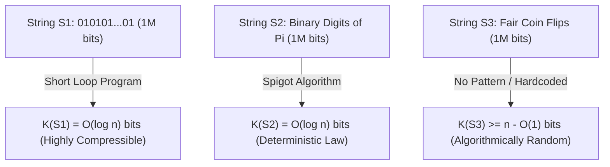
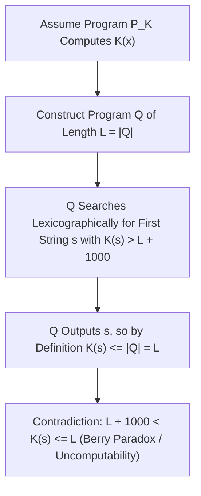

## مقدمة: لغز السلاسل الثلاث ذات المليون بت — النقطة العمياء في نظرية شانون

تخيّل أن أمامك ثلاث سلاسل ثنائية يبلغ طول كل واحدة منها بالضبط $1,000,000$ بت:
- السلسلة الأولى $S_1$ هي تكرار النمط `01` خمسمئة ألف مرة: `01010101...01`.
- السلسلة الثانية $S_2$ تمثل أول مليون خانة ثنائية بعد الفاصلة للثابت الرياضي $\pi$: `1100100100001111110110...`.
- السلسلة الثالثة $S_3$ هي المتتالية الناتجة عن رمي قطعة نقد متوازنة مليون مرة متتالية (صورة = `1`، كتابة = `0`).

أيّ هذه السلاسل الثلاث يحتوي على «معلومات» أكثر؟ وأيّها أكثر «تعقيداً»؟ وأيّها هو «العشوائي» حقاً؟
إذا بحثنا عن الإجابة في <strong>نظرية المعلومات الكلاسيكية لكلود شانون (1948)</strong>، فسنصطدم بمعضلة غير متوقعة: إنتروبيا شانون $H(X) = -\sum P(x)\log_2 P(x)$ تقيس متوسط عدم اليقين في <strong>توزيع احتمالي (مجموعة إحصائية Ensemble)</strong>، لكنها عاجزة تماماً عن قياس التعقيد الذاتي <strong>لكائن فردي محدد $x$ بحد ذاته</strong>! ففي نموذج رمي العملة المتوازنة، تتساوى احتمالية ظهور السلسلة المنتظمة تماماً $S_1$ مع احتمالية ظهور السلسلة الفوضوية $S_3$ وتبلغ $2^{-1,000,000}$ لكلتيهما؛ أما الثابت الحتمي $\pi$ ($S_2$) فتوزيعه الاحتمالي نقطي ذو إنتروبيا صفرية ($H=0$)، رغم أن تكرارات الأصفار والآحاد فيه تجتاز جميع الاختبارات الإحصائية للعشوائية الكاذبة!

لوضع أساس رياضي صارم لتعقيد وعشوائية الكائن الفردي، أسس كل من راي سولومونوف (1960) و<strong>أندريه كولموغوروف (1965)</strong> وغريغوري تشايتين (1966) بشكل مستقل <strong>نظرية المعلومات الخوارزمية (Algorithmic Information Theory, AIT)</strong>. وكانت بصيرتهم المشتركة ثورية: <strong>إن التعقيد الحقيقي لأي كائن لا يُقاس بعدد رموزه الظاهرية، بل بطول «أقصر برنامج حاسوبي» قادر على توليده!</strong>

---

## 1. تعقيد كولموغوروف $K(x)$ ومبرهنة اللاتغير لآلة تورينغ الكونية

بالنسبة لآلة تورينغ كونية $U$ (أو أي لغة برمجة كاملة بتعريف تورينغ مثل C أو Python)، يُعرّف <strong>تعقيد كولموغوروف</strong> $K_U(x)$ لسلسلة ثنائية $x \in \{0,1\}^*$ بأنه طول البتات $|p|$ لأقصر برنامج $p$ يطبع السلسلة $x$ ثم يتوقف عند تشغيله على الآلة $U$. ولضمان تقارب مجموع الاحتمالات (متباينة كرافت $\sum 2^{-|p|} \le 1$)، تعتمد النظرية الحديثة <strong>التعقيد الخالي من البوادئ (تعقيد ليفين-تشايتين)</strong> $K(x)$، حيث لا يكون أي برنامج صالح بادئة لبرنامج صالح آخر.

عندما نعيد النظر إلى سلاسل المليون بت الثلاث عبر عدسة $K(x)$، ينقشع الضباب فوراً:
- بالنسبة للسلسلة $S_1$، يكفي البرنامج القصير جداً `print("01" * 500000)`. ولأننا نحتاج فقط إلى ترميز عداد الحلقة $n/2$ ثنائياً، فإن $K(S_1) = O(\log_2 n) pprox 20$ بت فقط: إنها سلسلة <strong>بسيطة للغاية خوارزمياً</strong>.
- بالنسبة للسلسلة $S_2$ (أول $n$ بت من $\pi$)، فرغم أنها تبدو كضجيج عشوائي، فإن برنامجاً صغيراً من بضع مئات من البايتات ينفذ صيغة ماشين أو خوارزمية BBP يحسب $S_2$ بدقة تامة. وبالتالي فإن $K(S_2) = O(\log_2 n)$ أيضاً! وهذا يكشف حقيقة عميقة في فلسفة العلوم: <strong>القانون الطبيعي ليس سوى ضغط خوارزمي فائق لبيانات الرصد التجريبية.</strong>
- أما السلسلة $S_3$ الناتجة عن رمي العملة الحقيقي، فلا يوجد فيها أي نمط خفي يسمح باختزالها. إن أقصر برنامج قادر على طباعة $S_3$ مضطر لتضمين المليون بت حرفياً داخله (`print("1011001...")`)، ومن ثم فإن $K(S_3) pprox n + O(1) pprox 1,000,000$ بت!

قد يتساءل القارئ: ألا يعتمد $K_U(x)$ بشكل تعسفي على لغة البرمجة $U$ المختارة؟ تثبت <strong>مبرهنة اللاتغير لكولموغوروف (Invariance Theorem)</strong> عكس ذلك: لأي آلتين كونيتين $U_1$ و$U_2$، يوجد ثابت $c_{12}$ يعتمد فقط على $U_1$ و$U_2$ (و<strong>لا يعتمد إطلاقاً على السلسلة $x$</strong>) بحيث يتحقق $|K_{U_1}(x) - K_{U_2}(x)| \le c_{12}$ لكل $x$. البرهان بديهي للغاية: الثابت $c_{12}$ ليس سوى الحجم الثابت بالبتات لبرنامج <strong>مفسّر (Interpreter)</strong> مكتوب بلغة $U_1$ يحاكي عمل $U_2$! وعندما يكبر حجم البيانات $n 	o \infty$، يصبح هذا العبء الثابت مهملاً تماماً.

$$
H(X) = -\sum_{x \in \mathcal{X}} P(X = x) \log_2 P(X = x)
$$

$$
K_U(x) = \min_{p \in \{0,1\}^*} \Big\{ |p| \;\Big|\; U(p) = x \Big\}, \qquad \Big| K_{U_1}(x) - K_{U_2}(x) \Big| \le c_{12}
$$

---

## 2. جوهر العشوائية: مبدأ برج الحمام، عدم القابلية للضغط، وعشوائية مارتن-لوف

قبل كولموغوروف، عجزت نظرية الاحتمالات عن تفسير لماذا لا تُعد السلسلة `0000000000` عشوائية بينما تبدو `0110100110` عشوائية. قدّمت نظرية المعلومات الخوارزمية أول تعريف رياضي صارم للعشوائية الفردية: <strong>العشوائية هي عدم القابلية للضغط (Incompressibility) — أي الغياب التام لأي انتظام خوارزمي!</strong>

والأدهى من ذلك أنه باستخدام <strong>مبدأ برج الحمام (Pigeonhole Principle)</strong> البسيط، يمكننا أن نبرهن في سطرين أن <strong>الأغلبية الساحقة من السلاسل الثنائية هي سلاسل عشوائية خوارزمياً (غير قابلة للضغط)</strong>:
يوجد بالضبط $2^n$ سلسلة ثنائية بطول $n$. كم عدد البرامج الثنائية التي يقل طولها قطعا عن $n - c$ بت؟ بجمع أعداد البرامج ذات الأطوال $0, 1, \dots, n-c-1$، نحصل على $\sum_{i=0}^{n-c-1} 2^i = 2^{n-c} - 1$ برنامجاً على الأكثر. وبما أن كل برنامج ينتج مخرجاً واحداً كحد أقصى، فإنه من بين $2^n$ سلسلة بطول $n$، <strong>هناك على الأكثر $2^{n-c} - 1$ سلسلة فقط يمكن ضغطها بأكثر من $c$ بت</strong> ($K(x) < n - c$)!
بعبارة أخرى، فإن نسبة السلاسل ذات الطول $n$ القابلة للضغط بمقدار $c$ بت أو أكثر تقل قطعا عن $2^{-c}$. فإذا أخذنا $c = 20$، فإن أكثر من $99.9999\,\%$ من السلاسل لا يمكن تقصيرها حتى بمقدار $20$ بت بأي خوارزمية ممكنة! وفي عام 1966 أثبت بير مارتن-لوف أن المتتالية الثنائية اللانهائية تجتاز جميع الاختبارات الإحصائية القابلة للحساب (<strong>عشوائية مارتن-لوف</strong>) إذا وفقط إذا كانت جميع بوادئها $x_{1:n}$ غير قابلة للضغط ($K(x_{1:n}) \ge n - O(1)$).

$$
\sum_{i=0}^{n-c-1} 2^i = 2^{n-c} - 1 \implies \mathbb{P}_{x \sim \text{Unif}(\{0,1\}^n)}\big( K(x) < n - c \big) < \frac{2^{n-c}}{2^n} = 2^{-c}
$$

$$
\Omega = \sum_{p:\, U(p)\text{ halts}} 2^{-|p|} \in (0, 1), \qquad K(\Omega_{1:n}) \ge n - O(1)
$$

---

## 3. مفارقة بيري، عدم قابلية $K(x)$ للحساب، ثابت تشايتين $\Omega$، والذكاء الاصطناعي الحديث

إذا كان $K(x)$ بهذه القوة، فهل يمكننا كتابة برنامج ضغط مثالي يستقبل أي سلسلة $x$ ويحسب قيمة $K(x)$ بدقة؟ الجواب هو <strong>الاستحالة المطلقة: الدالة $K(x)$ غير قابلة للحساب (Uncomputable)!</strong>

ينبع هذا القيد العميق من <strong>مفارقة بيري (Berry's Paradox)</strong> الشهيرة («أصغر عدد صحيح موجب لا يمكن تعريفه بأقل من عشرين كلمة» — وهي جملة عرّفته في إحدى عشرة كلمة فقط!). صاغها غريغوري تشايتين رياضياً كالتالي: لنفترض وجود دالة فرعية `ComputeK(x)` بطول ثابت $L$ بت تحسب $K(x)$. نبني عندئذٍ برنامجاً رئيسياً $Q$ يمر على جميع السلاسل $s$ بترتيب معجمي، ويستدعي `ComputeK(s)`، ويطبع أول سلسلة $s^*$ تحقق $K(s^*) > L + 10000$ ثم يتوقف. إن الطول الكلي للبرنامج $Q$ هو $L + O(1)$ بت فقط، ومع ذلك نجح في طباعة $s^*$! وبحسب تعريف $K(s^*)$ كأقصر برنامج يولّد $s^*$، يجب أن يكون $K(s^*) \le |Q| < L + 10000$، وهو تناقض صريح مع الشرط $K(s^*) > L + 10000$! ومن هنا تنتج <strong>مبرهنة عدم الاكتمال لتشايتين</strong>: لا يمكن لأي نظام بديهيات صوري ذي تعقيد $C$ بت أن يثبت أن سلسلة محددة تحقق $K(x) > C + O(1)$.

كما جمع تشايتين احتمالات التوقف لآلة تورينغ الكونية الخالية من البوادئ في عدد حقيقي أسطوري هو <strong>ثابت أوميغا $\Omega = \sum_{U(p)	ext{ يتوقف}} 2^{-|p|}$</strong>. ورغم أن $\Omega \in (0,1)$ عدد محدد بدقة، فإنه <strong>غير قابل للحساب إطلاقاً وعشوائي خوارزمياً لأقصى درجة</strong> ($K(\Omega_{1:n}) \ge n - O(1)$): فمعرفة أول $n$ بت من $\Omega$ تكافئ حل مسألة التوقف لتورينغ لجميع البرامج حتى طول $n$!

في الهندسة الحديثة والذكاء الاصطناعي، تقود الحدود العليا القابلة للحساب للدالة $K(x)$ أهم التطبيقات:
1. <strong>الجسر مع إنتروبيا شانون</strong>: للعمليات العشوائية المستقرة الإرغودية، يتقارب التوقع $rac{1}{n}\mathbb{E}[K(X_{1:n})]$ إلى معدل إنتروبيا شانون $H(X)$.
2. <strong>استقراء سولومونوف الكوني وأقصر طول وصف (MDL)</strong>: تتم صياغة شفرة أوكام رياضياً عبر التوزيع المسبق الكوني $P_M(x) \propto 2^{-K(x)}$.
3. <strong>مسافة الضغط المعيّرة (NCD)</strong>: بتقريب $K(x)$ عبر ضواغط حقيقية (`zstd`, `lzma`, `gzip`) في الصيغة $	ext{NCD}(x,y) = rac{C(xy) - \min(C(x),C(y))}{\max(C(x),C(y))}$، يمكن بناء أشجار التطور الجيني وتصنيف البرمجيات الخبيثة دون هندسة ميزات يدوية.
4. <strong>نماذج اللغة الكبيرة (LLMs): الضغط هو الذكاء</strong>: كما أوضح ماركوس هوتر (جائزة Hutter) وإيليا سوتسكيفر، فإن تقليل خسارة الإنتروبيا المتقاطعة $-\sum \log_2 P_	heta(x_t \mid x_{<t})$ لنموذج المحول (Transformer) يكافئ رياضياً عبر الترميز الحسابي <strong>البحث عن أقصر ضغط غير فاقد لبيانات النصوص البشرية</strong>. ولضغط النصوص إلى أقصى حد، يضطر النموذج إلى استيعاب القواعد النحوية والاستدلال المنطقي والنموذج السببي للعالم.

| البعد / المفهوم | إنتروبيا شانون $H(X)$ | تعقيد كولموغوروف $K(x)$ | التقريبات الهندسية الحديثة (MDL / LLM / NCD) |
| :--- | :--- | :--- | :--- |
| <strong>موضوع القياس</strong> | التوزيع الاحتمالي للمصدر (Ensemble) | <strong>الكائن أو السلسلة الفردية $x$ بذاتها</strong> | الملفات الفعلية، الجينومات، المدونات النصية |
| <strong>الحكم على أول $10^6$ بت من $\pi$</strong> | ثابت حتمي ($H=0$)؛ تكرارات متساوية إحصائياً | $K(\pi_{1:n}) = O(\log n)$ (بسيطة جداً بفضل الخوارزمية) | الترميز الحسابي والشبكات العصبية تلتقط البنية |
| <strong>القابلية للحساب</strong> | قابلة للحساب بدقة عند معرفة $P(X)$ | <strong>غير قابلة للحساب قطعا</strong> (تكافئ مسألة التوقف) | حدود عليا عبر `zstd`/LZMA أو Transformer $P_	heta$ |
| <strong>المبرهنات والفلسفة</strong> | مبرهنة ترميز المصدر لشانون | مبرهنة اللاتغير، عدم اكتمال تشايتين، العدد $\Omega$ | شفرة أوكام، «الضغط = التنبؤ = الذكاء» |

$$
P_M(x) = \sum_{p:\, U(p)=x} 2^{-|p|} \approx 2^{-K(x)}, \qquad \text{NCD}(x, y) = \frac{C(xy) - \min\{C(x), C(y)\}}{\max\{C(x), C(y)\}}
$$
