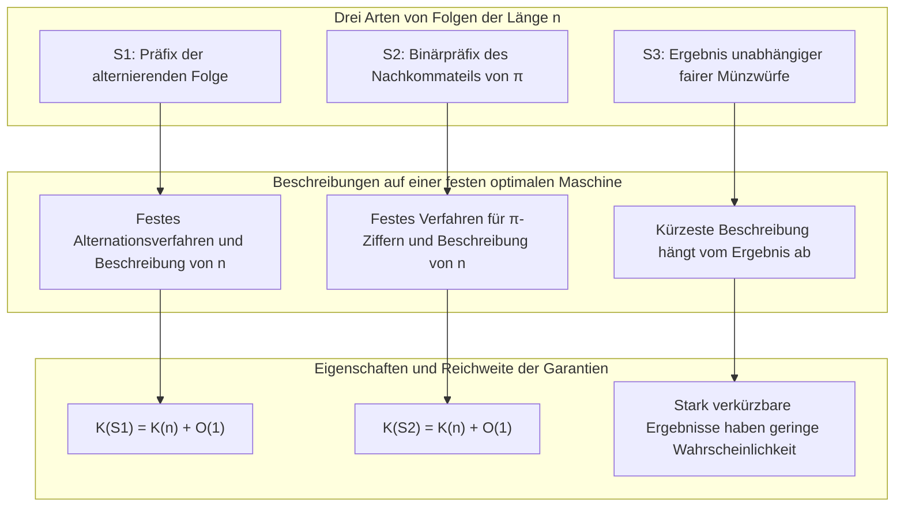
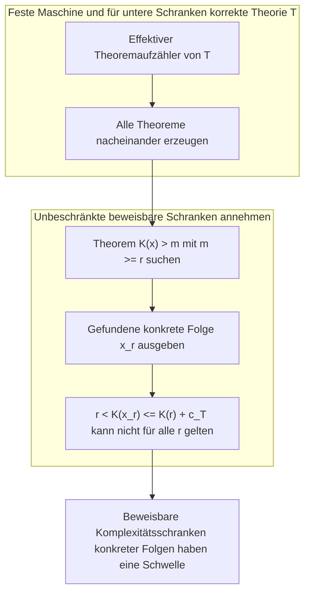

## 1. Drei Folgen mit einer Million Bits

Betrachten wir drei Binärfolgen der Länge $n=1{,}000{,}000$:

1. $S_1$: das Muster `01`, fünfhunderttausendmal wiederholt.
2. $S_2$: die erste Million Bits der Binärentwicklung des <strong>Nachkommateils</strong> von $\pi$.
3. $S_3$: ein Ergebnis des Modells einer Million unabhängiger Würfe einer fairen Münze.

Dicht als Bits gespeichert benötigen alle drei 125 000 Byte, also 125 kB. Werden `0` und `1` dagegen als ASCII- oder UTF-8-Zeichen gespeichert, ist eine Million Byte nötig. Dateiköpfe und Verwaltungsstrukturen kommen hinzu.

Die Binärdarstellung von $\pi$ lautet $11.0010010000111111\ldots{}_2$. Ohne den ganzzahligen Anteil beginnt $S_2$ daher mit `0010010000111111...`. Die Beispiele dienen der Erklärung; sie behaupten nicht, dass für diesen Artikel eine Million physische Münzwürfe durchgeführt wurden.

$S_1$ lässt sich durch eine Wiederholungsanweisung erzeugen, und für $S_2$ gibt es Algorithmen zur Ziffernberechnung. $S_3$ muss jedoch nicht komplex sein: Zufällig könnten alle Würfe null ergeben. Richtig ist eine Wahrscheinlichkeitsaussage: <strong>Bei festem Berechnungsmodell haben nur wenige Ergebnisse eine wesentlich kürzere Beschreibung als ihre Länge.</strong>

Im Modell unabhängiger fairer Würfe hat jede konkrete Folge der Länge $n$ dieselbe Wahrscheinlichkeit, auch die alternierende Folge oder ein Präfix von $\pi$:

$$
P(X=x)=2^{-n},\qquad x\in\{0,1\}^n
$$

Wie lässt sich unter gleich wahrscheinlichen Ergebnissen das Vorhandensein kurzer Erzeugungsregeln erfassen? Die seit den 1960er-Jahren unter anderem von Solomonoff, Kolmogorow und Chaitin entwickelte <strong>algorithmische Informationstheorie (AIT)</strong> betrachtet die Länge des kürzesten Programms, das die Folge ausgibt und anhält.

---

## 2. Shannon-Information und einzelne Folgen

### 2.1 Selbstinformation, Entropie und Codierung

Für eine diskrete Verteilung $P$ unterscheiden wir die Selbstinformation eines Ergebnisses mit $P(x)>0$ von ihrem Mittelwert, der Entropie. Alle Logarithmen haben hier die Basis 2; die Einheit ist Bit.

$$
I_P(x)=-\log_2P(x),\qquad
H(P)=-\sum_xP(x)\log_2P(x)
$$

In der Summe gilt die Konvention $0\log_2 0=0$. Die Selbstinformation eines Ergebnisses mit Wahrscheinlichkeit null ist unendlich.

Bei einem binären Präfixcode für ein Symbol aus einem endlichen Alphabet erfüllt die optimale mittlere Codelänge die Ungleichung:

$$
H(P)\le L_{\mathrm{opt}}<H(P)+1
$$

Nicht jedes einzelne Codewort hat also eine Länge gleich der Entropie. Fasst man $r$ unabhängige, identisch verteilte Symbole zusammen, sinkt der Rundungsaufschlag pro Symbol:

$$
H(P)\le \frac{L_{\mathrm{opt},r}}{r}<H(P)+\frac1r
$$

Bei abhängigen Quellen spielen Blockverteilungen oder Entropieraten eine Rolle. Auch Huffman-Codes und arithmetische Codierung müssen relativ zum Modell und unter Unterscheidung von Einzelwerten und Mittelwerten verstanden werden.

### 2.2 Modellwahl und empirische Häufigkeiten

Der Wert $-\log_2P(x)$ hängt nicht nur von $x$, sondern auch vom Modell $P$ ab. Unter dem fairen Münzmodell hat selbst die alternierende Folge eine Million Bits Selbstinformation. Wählt man dagegen ein Punktmaß, das ausschließlich diese Folge erzeugt, ist die Entropie null. <strong>Die Kosten für die Übermittlung des Modells selbst verschwinden dadurch nicht.</strong>

Betrachtet man nur die Häufigkeiten einzelner Bits, enthält die Wiederholung von `01` gleich viele Nullen und Einsen. Ihre empirische Entropie nullter Ordnung beträgt:

$$
\widehat H_0((01)^{n/2})
=-\tfrac12\log_2\tfrac12-\tfrac12\log_2\tfrac12=1
$$

Ein Modell, das das nächste Bit aus dem vorigen vorhersagt, erkennt die Regelmäßigkeit. Unter den überlappenden Blöcken der Länge $k$ der alternierenden Folge gibt es höchstens zwei Arten. Ihre empirische Entropie ist daher höchstens 1 Bit pro Block, also $1/k$ pro Bit. Blockentropie und Entropie pro Bit sind verschiedene Größen.

Die Normalität von $\pi$ ist nicht bewiesen. Sie würde bedeuten, dass alle Blöcke jeder festen Länge im Grenzwert gleich häufig auftreten. Endliche Häufigkeitstests oder ein unregelmäßiges Erscheinungsbild beweisen das nicht. Selbst Normalität wäre mit einer berechenbaren Folge vereinbar. Darf das Modell die Ziffern berechnen, können auch probabilistische Vorhersage und Codierung diese Regel nutzen.

AIT widerlegt die Shannon-Theorie nicht. <strong>Codelängen relativ zu einem Wahrscheinlichkeitsmodell und Beschreibungslängen einzelner Objekte auf einer festen Maschine beantworten unterschiedliche Fragen.</strong>

| Gesichtspunkt | Shannon-Information | Algorithmische Beschreibung |
| :--- | :--- | :--- |
| Gegenstand | Verteilung und Ergebnisse unter diesem Modell | Endliche Folge, die eine feste Maschine ausgibt |
| Bezugspunkt | Wahrscheinlichkeitsmodell und Codierungsregeln | Maschine, Programmcodierung und Hilfseingabe |
| Größen | $I_P(x)$, $H(P)$ und Entropierate | Einfache Komplexität $C(x)$ und Präfixkomplexität $K(x)$ |
| Grenzen | Modellbeschreibung kostet zusätzlich | Maschinenabhängige Konstanten und Unberechenbarkeit |
| Behandlung von $\pi$ | Hängt vom gewählten Modell ab | Erzeugungsregel und Endposition sind beschreibbar |

---

## 3. Kürzeste Programme und Invarianzsatz

### 3.1 Einfache und bedingte Komplexität

Sei $\{0,1\}^*$ die Menge aller endlichen Binärfolgen und $|p|$ die Bitlänge eines Programms. Für eine partiell berechenbare Maschine $A$ bedeutet $A(p)=x$, dass sie in endlicher Zeit anhält und genau $x$ ausgibt.

$$
C_A(x)=\min\{|p|:A(p)=x\}
$$

Existiert kein solches Programm, setzen wir den Wert auf $\infty$. Wird eine Hilfseingabe $y$ kostenlos bereitgestellt, definieren wir:

$$
C_A(x\mid y)=\min\{|p|:A(p,y)=x\}
$$

Eine Länge oder ein Wörterbuch bereits zu kennen ist nicht dasselbe, wie diese Information im Programm beschreiben zu müssen.

### 3.2 Präfixkomplexität und Abgrenzung

Für die <strong>Präfixkomplexität $K$</strong> ist die Menge der haltenden Programme präfixfrei: Kein gültiges Programm ist ein echtes Präfix eines anderen. Es gilt die Kraft-Ungleichung:

$$
K_U(x)=\min\{|p|:U(p)=x\},\qquad
\sum_{p\in\operatorname{dom}U}2^{-|p|}\le1
$$

Im bedingten Fall muss der Haltebereich für jede festgehaltene Hilfseingabe $y$ präfixfrei sein. Selbstabgrenzung bedeutet nicht bloß, an gewöhnlichen Quelltext eine schließende Klammer anzuhängen. Für $C$ und $K$ wählen wir in der jeweiligen Maschinenklasse additiv optimale Referenzmaschinen.

Bei der Verkettung einfacher Programme müssen ihre Grenzen mitgeteilt werden. Für eine feste berechenbare Codierung von Paaren gilt beispielsweise:

$$
C(x,y)\le C(x)+C(y)
+2\log_2\bigl(\min\{C(x),C(y)\}+2\bigr)+O(1)
$$

Präfixprogramme lassen sich verketten und interpretieren. Mithilfe bedingter Beschreibungen erhält man:

$$
K(x,y)\le K(x)+K(y\mid x)+O(1)
\le K(x)+K(y)+O(1)
$$

Zwischen den beiden Komplexitäten besteht bei passenden Referenzmaschinen die Beziehung:

$$
C(x)\le K(x)+O(1),\qquad
K(x)\le C(x)+2\log_2(C(x)+2)+O(1)
$$

$O(1)$ steht für eine von $x$ unabhängige Konstante, nicht für einen gemessenen Aufwand von null oder wenigen Bits.

### 3.3 Additive Optimalität und Maschinenabhängigkeit

Für $C$ fixieren wir eine optimale Maschine in der Klasse einfacher Maschinen, für $K$ eine in der Klasse präfixfreier Maschinen. Bedeutet „universell“ lediglich Simulationsfähigkeit, muss zusätzlich gefordert werden, dass Beschreibungslängen bis auf einen konstanten additiven Aufschlag erhalten bleiben.

Für jede präfixfreie Maschine $A$ existiert eine von $x$ unabhängige Konstante $c_A$ mit:

$$
K_U(x)\le K_A(x)+c_A
$$

Zur Konstruktion stellt man dem Programm $p$ eine feste selbstabgrenzende Kennung $s_A$ der Maschine $A$ voran und simuliert $A(p)$. Falls $A(p)=x$, gibt das Simulationsprogramm $x$ aus und hat die Länge $|p|+|s_A|$ zuzüglich eines festen Aufwands. Das kürzeste Programm kann nicht länger sein. So lässt sich eine optimale Maschine konstruieren. Für die einfache Komplexität gilt ein entsprechendes Argument innerhalb ihrer Klasse.

Wendet man die Ungleichung zwischen zwei additiv optimalen Maschinen in beiden Richtungen an, folgt:

$$
|K_{U_1}(x)-K_{U_2}(x)|\le c_{12}
$$

Die Konstante muss beide Simulationskosten abdecken. Die Größe eines Interpreters nur in einer Richtung ist nicht ohne Weiteres eine Schranke für den absoluten Unterschied.

Eine Spezialmaschine kann eine bestimmte Folge von einer Million Bits mit einem kurzen Befehl ausgeben. Die Beschreibung und Simulation dieser Maschine gehen in die Konstante ein. <strong>Der Invarianzsatz beseitigt die Maschinenabhängigkeit endlicher Objekte nicht.</strong> Eine durch $n$ geteilte Konstante wird für $n\to\infty$ relativ unbedeutend; die Konstante selbst verschwindet nicht. Auch die genaue kürzeste Beschreibung eines konkreten Objekts wird dadurch nicht bekannt. Reale CPUs mit endlichem Speicher sind zudem nicht mit mathematischen Maschinen mit unbegrenztem Speicher gleichzusetzen.

### 3.4 Alternation, pi und die Endposition

Identifizieren wir $n$ mit einer festen Binärdarstellung der ganzen Zahlen. Sei $s(n)$ die alternierende Folge der Länge $n$ oder das Präfix der ersten $n$ Bits des Nachkommateils von $\pi$. Aus $n$ lässt sich $s(n)$ berechnen; aus der Folge lässt sich ihre Länge $n$ bestimmen. Die berechenbaren Umwandlungen in beiden Richtungen liefern:

$$
K(s(n))=K(n)+O(1),\qquad K(s(n)\mid n)=O(1)
$$

Wird die Endposition kostenlos mitgegeben, genügt ein Generator konstanter Länge. Andernfalls muss auch $n$ beschrieben werden. Eine selbstabgrenzende Ganzzahlcodierung ergibt für $n\ge2$ etwa:

$$
K(n)\le \log_2 n+2\log_2\log_2 n+O(1)=O(\log n)
$$

Die Gleichung $K(n)=\log_2n+O(1)$ gilt nicht für alle ganzen Zahlen. Bei $n=2^m$ kann eine kurze Beschreibung des Exponenten $m$ zur Rekonstruktion dienen. Die asymptotische Notation misst auch kein konkretes Programm auf genau zwanzig Bits oder einige hundert Byte.



Die kürzeste Beschreibung von $S_3$ muss nicht immer eine Kopie der Rohdaten sein. Die folgende Zählung erklärt die Wahrscheinlichkeitsaussage.

---

## 4. Inkompressibilität und Zufälligkeit unendlicher Folgen

### 4.1 Schranken durch wörtliche Ausgabe

Eine Beschreibung, die eine beliebige Folge $x$ von $n$ Bits wörtlich ausgibt, liefert:

$$
C(x)\le n+O(1),\qquad K(x\mid n)\le n+O(1)
$$

Bei unbedingter Präfixkomplexität muss zusätzlich die Länge selbstabgrenzend angegeben werden:

$$
K(x)\le n+K(n)+O(1)
$$

Eine einheitliche Schranke $K(x)\le |x|+O(1)$ für alle Folgen ist unmöglich. Sonst wäre für jede Länge $n$ die Summe $\sum_{|x|=n}2^{-K(x)}$ durch dieselbe positive Konstante nach unten beschränkt. Die Summe über alle Längen würde die Kraft-Ungleichung verletzen.

### 4.2 Exakte Zählung mit dem Schubfachprinzip

Seien $n\ge0$ und $0\le c\le n$ ganze Zahlen. Insgesamt gibt es so viele Binärprogramme mit Länge strikt kleiner als $n-c$:

$$
\sum_{j=0}^{n-c-1}2^j=2^{n-c}-1
$$

Für $c=n$ ist die leere Summe null. Jedes haltende Programm erzeugt höchstens eine Folge. Unter den $2^n$ Folgen der Länge $n$ können daher höchstens so viele $C(x)<n-c$ erfüllen. Folglich:

$$
\#\{x\in\{0,1\}^n:C(x)\ge n-c\}
\ge2^n-2^{n-c}+1
$$

Manche Programme halten nicht oder erzeugen dieselbe Ausgabe; dann gibt es noch weniger verschiedene Ausgaben. Für $c>n$ gilt $n-c<0$, sodass $C(x)\ge n-c$ für alle Folgen trivial ist. Die Formel der geometrischen Summe wird nicht einfach auf diesen Bereich ausgedehnt.

Unter der Gleichverteilung, also bei unabhängigen fairen Münzwürfen:

$$
P\{C(X)<n-c\}
\le\frac{2^{n-c}-1}{2^n}<2^{-c}
$$

Für $c=0$ gibt es in jeder Länge mindestens eine Folge mit $C(x)\ge n$. Bei $c=1$ lässt sich mehr als die Hälfte der Folgen nicht um <strong>mehr als</strong> ein Bit verkürzen. Für $c=10$ und $c=20$ betragen die unteren Schranken $1-2^{-c}$ für den Anteil ohne Verkürzung um mehr als 10 beziehungsweise 20 Bits ungefähr 99,902 % und 99,999905 %. Eine Einsparung von genau $c$ Bits wird damit nicht ausgeschlossen.

Dieselbe Zählung gilt für $K(x\mid n)$ bei festgehaltener Bedingung $n$. Münzergebnisse benötigen daher mit hoher Wahrscheinlichkeit Beschreibungen nahe ihrer eigenen Länge, aber nicht ausnahmslos.

Ein verlustfreier Kompressor, der jede Datei verkürzt, widerspräche dieser Zählung. Reale Kompressoren nutzen bestimmte Regelmäßigkeiten. Anteile unter der Gleichverteilung aller Bitfolgen sind nicht automatisch die Häufigkeiten natürlicher oder von Menschen erzeugter Daten.

### 4.3 Martin-Löf-Zufälligkeit

Dass eine endliche Folge nicht um eine vorgegebene Anzahl Bits verkürzbar ist, und die Zufälligkeit einer unendlichen Folge sind verschiedene Definitionen. Auf dem Raum unendlicher Binärfolgen verwenden wir das Maß $\mu$ der fairen Münze. Die Zylindermenge $[w]$ aller Folgen mit endlichem Anfangsstück $w$ hat Maß $2^{-|w|}$.

Ein <strong>Martin-Löf-Test</strong> ist eine Folge offener Mengen $V_j$, die sich gleichmäßig effektiv als Vereinigungen von Zylindermengen endlicher Präfixe aufzählen lassen und folgende Bedingung erfüllen:

$$
\mu(V_j)\le2^{-j},\qquad j=1,2,\ldots
$$

Liegt $\omega$ in $\bigcap_jV_j$, besteht die Folge diesen Test nicht. Sie ist Martin-Löf-zufällig, wenn sie keinen Test dieser Form verfehlt. Das verbietet nicht das gelegentliche Auftreten eines seltenen endlichen Musters. Es gibt abzählbar viele effektive Tests, deren jeweilige Fehlermenge Maß null hat; die Menge aller Folgen, die sämtliche Tests bestehen, hat daher Maß eins.

Der Satz von Levin–Schnorr charakterisiert dies mit der optimalen <strong>Präfixkomplexität</strong>:

$$
\omega\text{ ist Martin-Löf-zufällig}
\iff
\exists c\ \forall n\quad K(\omega_{1:n})\ge n-c
$$

Entscheidend ist, dass <strong>dieselbe Konstante $c$</strong> für alle $n$ gilt. $K$ lässt sich hier nicht einfach durch die einfache Komplexität $C$ ersetzen.

Die Auswahlregeln von von Mises und Church gehören zur Vorgeschichte, doch unterschiedliche Berechenbarkeitsanforderungen an Tests und Wettstrategien ergeben unterschiedliche Begriffe. Berechenbare Zufälligkeit, bei der kein berechenbares Martingal unbeschränktes Kapital gewinnt, ist schwächer als Martin-Löf-Zufälligkeit. Die berechenbare unendliche Ziffernfolge von $\pi$ ist nicht Martin-Löf-zufällig. Normalität ist davon zu unterscheiden.

---

## 5. Unberechenbarkeit, Beweisgrenzen und Haltewahrscheinlichkeit

### 5.1 Von oben annähern, ohne das Erreichen zu erkennen

Um kurze Programme zu finden, die $x$ ausgeben, kann man ihre Ausführung verzahnen und jedem Kandidaten schrittweise Rechenzeit geben. Das Minimum der bisher gefundenen Beschreibungslängen liefert obere Näherungen:

$$
K_t(x)\searrow K(x)\qquad(t\to\infty)
$$

Als Anfangswert dient eine berechenbare endliche Schranke aus der wörtlichen Ausgabe. Da die Werte ganzzahlig sind, erreichen sie für jedes feste $x$ irgendwann den wahren Wert und bleiben dort. Es gibt aber kein allgemeines Verfahren, das diesen Zeitpunkt für alle Eingaben erkennt. Ein noch nicht beendetes kürzeres Programm könnte später $x$ ausgeben.

### 5.2 Ein Widerspruchsargument nach Berry

Die Wendung „Die kleinste positive ganze Zahl, die sich nicht mit weniger als zwanzig Wörtern beschreiben lässt“ besteht aus fünfzehn durch Leerzeichen getrennten Wörtern, also weniger als zwanzig. „Beschreiben“ ist in natürlicher Sprache jedoch mehrdeutig; die Wendung selbst ist kein formaler Beweis. Wir übertragen die Idee auf berechenbare Verfahren.

Nehmen wir an, eine Prozedur `ComputeK` gebe für jedes $x$ den wahren Wert $K(x)$ zurück und halte an. Der folgende <strong>Pseudocode</strong> verwendet diese unmögliche Annahme; er ist kein implementierbarer Komplexitätsrechner.

```text
Berry(m):
    Alle Binärfolgen x nach Länge 0,1,2,... aufzählen, bei gleicher Länge lexikographisch:
        if ComputeK(x) >= m:
            x ausgeben und anhalten
```

Diese Reihenfolge heißt shortlex: zuerst die Länge, dann die lexikographische Ordnung. Die gewöhnliche lexikographische Ordnung allein liefert nicht die hier benötigte Aufzählung aller endlichen Folgen.

Die Zählung zeigt, dass die Komplexität unbeschränkt ist. Unter der Annahme endet die Suche für jedes $m$ und gibt ein $x_m$ mit $K(x_m)\ge m$ aus. Dafür reichen jedoch ein festes Programm und eine selbstabgrenzende Beschreibung von $m$:

$$
m\le K(x_m)\le K(m)+c
\le \log_2m+2\log_2\log_2m+c'
$$

Die letzte Schranke gilt für $m\ge2$. Für feste Konstanten und hinreichend großes $m$ entsteht ein Widerspruch. Somit existiert `ComputeK` nicht. Eine feste Marge von 10 000 Bits ohne Messung der maschinenabhängigen Kosten zu behaupten ist unnötig.

### 5.3 Chaitins Unvollständigkeitssatz

Fixieren wir die Referenzmaschine und eine effektiv axiomatisierbare Theorie $T$, die Komplexitätsaussagen über konkrete endliche Folgen ausdrücken kann. Wir setzen ihre <strong>semantische Korrektheit</strong> für die bewiesenen unteren Schranken voraus: Diese Aussagen sind wahr.

Dann existiert eine Schwelle $b_T$, sodass $T$ für keine konkrete Folge $x$ die Aussage „$K(x)>b_T$“ beweisen kann.

Angenommen, die beweisbaren numerischen unteren Schranken wären unbeschränkt. Dann könnten wir für jede Eingabe $r$ alle Theoreme aufzählen und eines der Form „$K(x)>m$“ mit einer konkreten Zahl $m\ge r$ finden.

```text
SearchProof(r):
    Die Theoreme von T effektiv aufzählen:
        if ein Theorem "K(x) > m" für eine konkrete Folge x und eine ganze Zahl m mit m >= r behauptet:
            x ausgeben und anhalten
```

Die Korrektheit gewährleistet $K(x_r)>r$ für die Ausgabe $x_r$. Doch der feste Programmteil kann den Theoremaufzähler von $T$ bereits enthalten. Daher:

$$
r<K(x_r)\le K(r)+c_T=O(\log r)+c_T
$$

Für hinreichend großes $r$ ist das unmöglich. Die beweisbaren numerischen unteren Schranken sind also beschränkt.



Die Schwelle hängt von Maschine, Theorie und Darstellung ab. Sie ist keine universell gemessene Grenze von ZFC bei 20 000 oder 50 000 Bits. Ist die Länge $n$ hinreichend groß gegenüber der Schwelle, haben nach der Zählung viele Folgen tatsächlich eine höhere Komplexität. Trotzdem ist der Beweis einer solchen Schranke für eine bestimmte Folge begrenzt.

Der Satz verbindet die Unvollständigkeit seit Gödel mit algorithmischen Beschreibungen. Er ist kein allgemeines „Informationserhaltungsgesetz“, das lange oder viele Theoreme aus kurzen Axiomen verbietet. Zusätzliche Axiome ergeben eine andere Theorie und damit eine andere Konstante.

### 5.4 Eine maschinenabhängige Haltewahrscheinlichkeit

Für eine optimale präfixfreie Maschine $U$ ist die Wahrscheinlichkeit, dass eine unendliche Folge unabhängiger fairer Bits mit einem haltenden Programm beginnt:

$$
\Omega_U=\sum_{p\in\operatorname{dom}U}2^{-|p|}
$$

Die Zylindermengen der haltenden Programme sind disjunkt; daher lässt sich die Summe als Wahrscheinlichkeit deuten. Kraft liefert $\Omega_U\le1$. Unter diesen Voraussetzungen, einschließlich der Optimalität, ist $\Omega_U$ außerdem eine unberechenbare, Martin-Löf-zufällige reelle Zahl mit $0<\Omega_U<1$. Präfixfreiheit allein garantiert nicht alle diese Eigenschaften für eine beliebige Maschine.

Die Aufzählung haltender Programme liefert wachsende Partialsummen von unten. Deshalb ist $\Omega_U$ <strong>von links berechenbar aufzählbar (left-c.e.)</strong>. Es gibt jedoch keine berechenbare Funktion, die für jede gewünschte Genauigkeit einen garantiert ausreichenden Näherungsschritt angibt.

Angenommen, die ersten $N$ Nachkommabits sind exakt bekannt, und $a$ ist der entsprechende untere Endpunkt. Da $\Omega_U$ keine endliche Binärentwicklung besitzt:

$$
a=\frac{\lfloor2^N\Omega_U\rfloor}{2^N},
\qquad a<\Omega_U<a+2^{-N}
$$

Wir führen Programme verzahnt aus, bis die Partialsumme der Haltegewichte $q_s$ den Wert $a$ <strong>überschreitet</strong>. Dann gilt:

$$
0\le\Omega_U-q_s<2^{-N}
$$

Ein noch nicht erfasstes Programm der Länge höchstens $N$ würde bei späterem Halten mindestens $2^{-N}$ beitragen und damit der Schranke widersprechen. Die bekannten Bits entscheiden also das Halten aller Eingaben der Länge höchstens $N$ für <strong>dieselbe Maschine</strong>.

Das bedeutet nicht, dass einige fest gewählte Tausend Bits sämtliche beliebigen mathematischen Aussagen entscheiden. Bei der Codierung etwa einer Gegenbeispielsuche als Halteproblem zählen die Maschine, die Programmlänge und die logische Form der Aussage. Auch Untersuchungen endlich vieler Ziffern liefern keinen Algorithmus für alle Ziffern.

---

## 6. Shannon-Theorie, MDL, NCD und künstliche Intelligenz

### 6.1 Mittlere Beschreibungslänge und Entropierate

Sei $P$ eine berechenbare diskrete Verteilung auf endlichen Folgen, angegeben durch ein endliches Verfahren $d_P$. Wird $d_P$ als kostenlose Hilfseingabe geteilt und gilt $H(P)<\infty$, dann:

$$
H(P)\le\mathbb E_{X\sim P}[K(X\mid d_P)]\le H(P)+c
$$

Der Träger kann endlich oder abzählbar sein; die Wahrscheinlichkeiten müssen gleichmäßig bis zu jeder gewünschten Genauigkeit berechenbar sein. Die Konstante $c$ umfasst einen festen Decodierungsaufwand. Eine exakte numerische Gleichheit wird nicht behauptet.

Die untere Schranke folgt aus Kraft für die kürzesten Präfixbeschreibungen bei fester Bedingung $d_P$ und dem Argument zur mittleren Codelänge. Für die obere konstruiert man aus der geteilten Verteilung einen passenden Präfixcode und decodiert ihn mit einem festen Verfahren. Wird die Verteilung nicht geteilt, kommen die Kosten ihrer Beschreibung hinzu. Dass eine beliebige Verteilung „bekannt“ ist, garantiert nicht die exakte Berechenbarkeit ihrer Entropie in endlicher Zeit.

Eine andere Beziehung liefert ein Satz vom Typ Brudno für <strong>stationäre ergodische Prozesse auf einem endlichen Alphabet</strong>. Ist $h$ die Entropierate in Bits pro Symbol, gilt für fast jede Stichprobenfolge:

$$
\lim_{n\to\infty}\frac{K(X_{1:n})}{n}=h
$$

Außerdem gilt $\mathbb E[K(X_{1:n})]/n\to h$. Die wörtliche Codierung von $n$ Symbolen liefert eine einheitliche lineare obere Schranke; damit lässt sich von fast sicherer Konvergenz zur Konvergenz der Mittelwerte übergehen. Der logarithmische Unterschied zwischen einfacher und Präfixkomplexität verschwindet nach Division durch $n$. Dieser Satz über die Entropierate benötigt nicht die Berechenbarkeit des Maßes, die für die vorherige bedingte Verteilungsungleichung vorausgesetzt wurde.

### 6.2 Diskretes universelles Halbmaß und Solomonoff-Vorhersage

Für eine optimale Präfixmaschine, die eine endliche Ausgabe erzeugt und anhält, definieren wir die Wahrscheinlichkeit, genau $x$ auszugeben und anzuhalten:

$$
m_U(x)=\sum_{p:U(p)=x}2^{-|p|}
$$

Die Gesamtmasse ist höchstens eins. Damit handelt es sich um ein <strong>Halbmaß</strong>, das von unten semiberechenbar ist. Der Codierungssatz verbindet dieses diskrete universelle Halbmaß mit der Präfixkomplexität:

$$
-\log_2m_U(x)=K_U(x)+O(1),
\qquad m_U(x)=\Theta(2^{-K_U(x)})
$$

Die sequentielle Vorhersage nach Solomonoff verwendet dagegen eine monotone Maschine und ein Halbmaß $M(x)$ für die Wahrscheinlichkeit, dass die Ausgabe <strong>mit $x$ beginnt</strong>. Die Maschine muss an dieser Stelle nicht halten. Es gilt $M(x)\ge M(x0)+M(x1)$. Das diskrete $m_U$ und das sequentielle $M$ dürfen nicht gleichgesetzt werden; derselbe Codierungssatz lässt sich nicht ohne weitere Bedingungen übertragen.

Die Bevorzugung kurzer Beschreibungen verbindet sich mit Ockhams Rasiermesser. Eine kurze Hypothese muss aber nach Beobachtung der Daten nicht die höhere Wahrscheinlichkeit haben: Auch die Likelihood ist entscheidend.

### 6.3 Bayessche Auswahl und minimale Beschreibungslänge

Ordnen wir einem Modell $H$ eine tatsächliche Präfixbeschreibungslänge $L(H)$ zu und wählen die A-priori-Wahrscheinlichkeit proportional zu seinem Codegewicht. Dann nimmt die Bayes-Formel folgende Gestalt an:

$$
-\log_2P(H\mid D)
=L(H)-\log_2P(D\mid H)+\mathrm{const}
$$

Die additive Konstante ist unabhängig von $H$. Bei dieser Wahl entspricht die Maximierung der A-posteriori-Wahrscheinlichkeit der Minimierung der rechten Seite. Im Allgemeinen lässt sich $-\log_2P(D\mid H)$ aber nicht einfach durch $K(D\mid H)$ ersetzen.

Das <strong>Prinzip der minimalen Beschreibungslänge (MDL)</strong> vergleicht die Gesamtkosten des Modells und der mit ihm beschriebenen Daten:

$$
\widehat H=\arg\min_{H\in\mathcal H}
\{L(H)+L(D\mid H)\}
$$

Ein zu einfaches Modell kann lange Datencodes erfordern; ein alles auswendig speicherndes Modell kann selbst eine sehr lange Beschreibung besitzen. Residuen durch Auswendiglernen zu beseitigen ist nicht dasselbe wie die Gesamtlänge zu minimieren. Rissanens MDL ist ein praktisches Prinzip statistischer Auswahl, keine Garantie für die Entdeckung jeder wahren Naturgesetzmäßigkeit oder Kausalbeziehung.

### 6.4 Ideale Informationsdistanz und reale Kompressoren

Bei positivem Nenner wird die ideale <strong>normalisierte Informationsdistanz (NID)</strong> definiert durch:

$$
\operatorname{NID}(x,y)=
\frac{\max\{K(x\mid y),K(y\mid x)\}}
{\max\{K(x),K(y)\}}
$$

Sie steht auch mit Ausdrücken für die Paarbeschreibung $K(x,y)$ in Beziehung, bis auf passende additive und normalisierte Fehler. Eine Verkettung ohne Trennzeichen $xy$ ist nicht exakt dasselbe wie eine Codierung, aus der beide Teile eindeutig rekonstruierbar sind.

Die Ausgabelänge eines realen Kompressors bezeichnen wir mit $Z$, um sie von der einfachen Komplexität $C$ zu unterscheiden. Die <strong>normalisierte Kompressionsdistanz (NCD)</strong> lautet:

$$
\operatorname{NCD}_Z(x,y)=
\frac{Z(xy)-\min\{Z(x),Z(y)\}}
{\max\{Z(x),Z(y)\}}
$$

Kann der Kompressor gemeinsame Strukturen wiederverwenden, sollen ähnliche Dateien einen kleinen Wert ergeben. Kann er die Gemeinsamkeiten nicht nutzen, liegt der Wert eher nahe eins.

Reale Kompressoren haben jedoch Dateiköpfe, Wörterbuchfenster, Blöcke, Einstellungen und Reihenfolgeeffekte. Nicht jeder erfüllt für alle Eingaben die Annahmen eines theoretischen normalen Kompressors (normal compressor) wie Idempotenz, Monotonie, Symmetrie und Distributivität. Selbst bei identischen Dateien muss $Z(xx)\approx Z(x)$ nicht gelten. Für endliche Daten sind weder die exakten Distanzaxiome noch Werte stets zwischen null und eins garantiert.

In einer Hilfsprüfung wurde eine feste Folge von 65 536 Byte mit sich selbst verkettet. Mit gzip und seinem endlichen Fenster lag die NCD der Datei mit sich selbst bei ungefähr 0,9997. Das widerlegt nicht die ideale NID, sondern zeigt eine Grenze der praktischen Näherung.

Cilibrasi, Vitányi und Mitautoren untersuchten Gruppierung durch Kompression für Genome, Sprachen und Musik. Auf manuell entworfene fachliche Merkmale zu verzichten kann nützlich sein. Die Ergebnisse sind aber nicht unabhängig von Zeichencodierung, Dateidarstellung und Kompressorwahl. Eine korrekte Rekonstruktion beliebiger Stammbäume ist nicht garantiert.

### 6.5 Sprachmodellvorhersagen und Codelängen

Für eine Tokenfolge $D=x_{1:T}$ und ein festes autoregressives Modell ist die ideale, den Vorhersagen entsprechende Codelänge:

$$
\mathcal L_\theta(D)=
-\sum_{t=1}^T\log_2p_\theta(x_t\mid x_{<t})
$$

Bei natürlichen Logarithmen ist die Einheit Nat; durch Division durch $\ln2$ erhält man Bits. Es handelt sich um die negative Log-Likelihood auf endlichen Daten. Ihr Mittel pro Token dient als Kreuzentropieverlust.

Für Ergebnisse positiver Wahrscheinlichkeit lässt sich bei geteiltem Modell und geteilter Folgenlänge durch ideale arithmetische Codierung oder eine verwandte Konstruktion eine Präfixbeschreibung mit Länge höchstens $\lceil\mathcal L_\theta(D)\rceil+2$ erreichen. Nicht jede Implementierung benötigt exakt „Verlust plus zwei Bits“: Endliche Genauigkeit, Abschluss, Rundung und Rahmung verursachen Kosten.

Seien $L_{\mathrm{model}}$ und $L_{\mathrm{meta}}$ die tatsächlichen Längen selbstabgrenzender Beschreibungen des Modells und der nötigen Metadaten. Für einen festen Decoder gilt:

$$
K(D)\le L_{\mathrm{model}}+L_{\mathrm{meta}}
+\lceil\mathcal L_\theta(D)\rceil+O(1)
$$

Zu den Metadaten gehören je nach Bedarf Folgenlänge, Vokabular und Spezifikation einer umkehrbaren Tokenisierung. Durch Normalisierung entfernte ursprüngliche Leerzeichen oder Zeichen lassen sich nicht ohne zusätzliche Information wiederherstellen.

Ein geringerer Vorhersageverlust bei einem geteilten Modell fester Größe verkürzt den Datencode. Ändert sich auch die Modellgröße, müssen die Gesamtkosten verglichen werden. Nur den Trainingsverlust zu minimieren ist daher nicht dasselbe wie eine zweiteilige MDL-Zielfunktion zu minimieren.

Die Sicht auf Kompression und Intelligenz, die etwa Marcus Hutters AIXI und der Hutter Prize vertreten, motiviert solche Zusammenhänge. AIXI ist jedoch ein unberechenbares Idealmodell, kein realer Transformer. Auch Delétang und Mitautoren untersuchen mit Sprachmodellen die Beziehung zwischen Vorhersage und Kompression.

Wer den Täter in einem Kriminalroman richtig vorhersagt, verkürzt den Code seines Namens. Das kann auf Schlussfolgern beruhen, aber auch auf Erinnerung, Wortverteilungsunterschieden oder doppelten Trainingsdaten. Die Kompression von Trainingstexten beweist nicht, dass zwangsläufig ein kausales Weltmodell, korrektes Schlussfolgern, Generalisierungsfähigkeit oder allgemeine künstliche Intelligenz erworben wurden.

| Theorie oder Prinzip | Praktischer Bezug | Wichtige Unterscheidung |
| :--- | :--- | :--- |
| $K(x)$, $K(x\mid y)$ | Beschreibungen mit Decoder und geteiltem Kontext | Reale Codelänge ist nicht notwendig minimal |
| Diskretes universelles Halbmaß $m_U$ | Modelle, die kurze Beschreibungen bevorzugen | Haltende Ausgabe und sequentielle Vorhersage $M$ |
| MDL | Modelllänge plus Datencodelänge | Likelihood und bedingte Komplexität |
| NID und NCD | Ähnlichkeit und Gruppierung durch Kompression | Fenster, Darstellung, Reihenfolge und endliche Länge |
| Sprachmodelle und arithmetische Codierung | Vorhersagewahrscheinlichkeit und Codelänge | Geteiltes Modell, vollständige Gesamtkosten und Intelligenzbewertung |

---

## 7. Was Kompression erklärt und was offenbleibt

Bei gleicher Länge von einer Million Bits haben alternierende Folgen und Präfixe von $\pi$ kurze Generatoren. Die Endposition mitzubeschreiben kostet etwas anderes, als sie kostenlos zu kennen. Das Zählargument liefert hohe Wahrscheinlichkeit für Inkompressibilität fairer Münzergebnisse, keine Einzelgarantie.

Der Invarianzsatz begrenzt Unterschiede zwischen optimalen Maschinen durch Konstanten. Das Berry-Argument zeigt, dass wahre minimale Beschreibungslängen im Allgemeinen unberechenbar sind. Chaitin und $\Omega_U$ verdeutlichen die Grenzen von Beweis und Berechnung. Sie ermöglichen keine Bewertung beliebiger endlicher Objekte unabhängig von Maschinen und Voraussetzungen.

MDL, NCD und Codelängen von Sprachmodellen verbinden das Ideal mit der Praxis. Kompression hilft, Regelmäßigkeiten und geteilte Modelle zu untersuchen. Ihre Rate ersetzt aber keine vollständige Definition von Verständnis oder Intelligenz.

### Literatur

- [Shen: Algorithmic Information Theory and Kolmogorov Complexity](https://www.lirmm.fr/~ashen/uppsala-notes.pdf) — Einfache und Präfixkomplexität, optimale Decoder, Unberechenbarkeit und Codierungssatz.
- [Rute: Computable randomness and betting for computable probability spaces](https://arxiv.org/html/1203.5535v4) — Unterschied zwischen berechenbarer Zufälligkeit und Martin-Löf-Tests.
- [Tadaki: Chaitin Ω numbers and halting problems](https://arxiv.org/abs/0904.1149) — Haltewahrscheinlichkeiten optimaler Maschinen und Halteprobleme bei beschränkter Eingabelänge.
- [Chazottes: Entropy in Dynamical Systems & Ergodic Theory](https://www.claymath.org/wp-content/uploads/2023/04/Chazottes-rev.pdf) — Folie 50: Brudnos Satz für endliche Partitionen.
- [Cilibrasi und Vitányi: Clustering by Compression](https://arxiv.org/html/cs/0312044v2) — Annahmen an normale Kompressoren und NCD.
- [Delétang et al.: Language Modeling Is Compression](https://arxiv.org/abs/2309.10668) — Untersuchung des Zusammenhangs zwischen Vorhersage und Kompression.
- [Hutter: Universal Algorithmic Intelligence](https://www.hutter1.net/ai/aixigentle.htm) — Das Idealmodell AIXI zwischen universeller Induktion und Entscheidung sowie seine Berechnungsgrenzen.
- [Bailey et al.: An Empirical Approach to the Normality of Pi](https://www.davidhbailey.com/dhbpapers/normality-digits-pi.pdf) — Unterschied zwischen empirischen Zifferntests und einem Beweis der Normalität.
