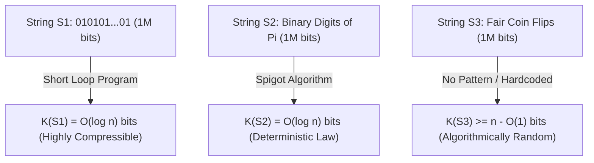
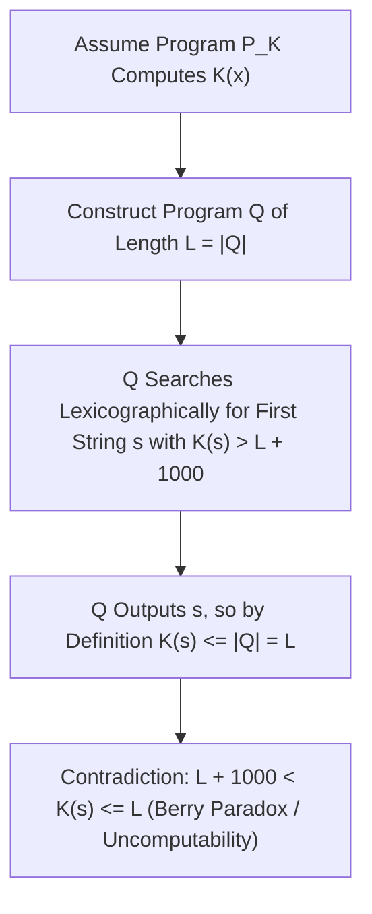

## Einleitung: Das Rätsel dreier Ein-Millionen-Bit-Strings — Der blinde Fleck der Shannon-Informationstheorie

Stellen Sie sich drei Binärstrings vor, die jeweils exakt $1.000.000$ Bits lang sind:
- Der erste String $S_1$ besteht aus fünfmal hunderttausend Wiederholungen von `01`: `01010101...01`.
- Der zweite String $S_2$ enthält die ersten $1.000.000$ Nachkommastellen der Kreiszahl $\pi$ im Binärsystem: `1100100100001111110110...`.
- Der dritte String $S_3$ entstand durch eine Million Würfe einer fairen Münze (Kopf = `1`, Zahl = `0`).

Welcher dieser drei Strings enthält am meisten „Information“? Welcher ist am „komplexesten“, und welcher ist wirklich „zufällig“?
Sucht man die Antwort in der klassischen <strong>Informationstheorie von Claude Shannon (1948)</strong>, stößt man auf ein fundamentales Problem: Die Shannon-Entropie $H(X) = -\sum P(x)\log_2 P(x)$ misst die mittlere Unsicherheit einer <strong>Wahrscheinlichkeitsverteilung (eines Ensembles)</strong>, sagt jedoch überhaupt nichts über die intrinsische Komplexität eines <strong>einzelnen, konkreten Objekts $x$</strong> aus! Bei einem fairen Münzwurf haben die hochgradig geordnete Folge $S_1$ und die chaotische Folge $S_3$ exakt dieselbe Einzelwahrscheinlichkeit $2^{-1.000.000}$; und für die deterministische Konstante $\pi$ ($S_2$) ist die Wahrscheinlichkeitsverteilung sogar ein Punktmaß mit Entropie $0$, obwohl ihre Ziffernfolge fast jeden statistischen Zufallstest besteht!

Um die Komplexität und Zufälligkeit einzelner Objekte mathematisch exakt zu fassen, begründeten Ray Solomonoff (1960), <strong>Andrei Kolmogorow (1965)</strong> und Gregory Chaitin (1966) unabhängig voneinander die <strong>Algorithmische Informationstheorie (AIT)</strong>. Ihre zentrale Erkenntnis lautet: <strong>Die wahre Komplexität eines Objekts bemisst sich nicht nach seiner Länge in Zeichen, sondern nach der Länge des kürzesten Computerprogramms, das dieses Objekt erzeugen kann!</strong>

---

## 1. Die Kolmogorow-Komplexität $K(x)$ und der Invarianzsatz für universelle Turingmaschinen

Für eine fest gewählte universelle Turingmaschine $U$ (oder eine beliebige Turing-vollständige Programmiersprache wie C oder Python) ist die <strong>Kolmogorow-Komplexität</strong> $K_U(x)$ eines Binärstrings $x \in \{0,1\}^*$ definiert als die Bitlänge $|p|$ des kürzesten Programms $p$, das auf $U$ gestartet den String $x$ ausgibt und anhält. Um die Kraft-Ungleichung $\sum 2^{-|p|} \le 1$ zu erfüllen, verwendet man in der modernen Theorie meist die <strong>präfixfreie Komplexität (Levin-Chaitin-Komplexität)</strong> $K(x)$, bei der kein gültiges Programm Präfix eines anderen sein darf.

Betrachten wir unsere drei Strings durch die Brille von $K(x)$, löst sich das Rätsel sofort:
- Für $S_1$ genügt das winzige Programm `print("01" * 500000)`. Da nur der Schleifenzähler $n/2$ binär codiert werden muss, gilt $K(S_1) = O(\log_2 n) pprox 20$ Bits — der String ist <strong>algorithmisch extrem einfach</strong>.
- Für $S_2$ (die ersten $n$ Bits von $\pi$) wirkt die Folge zwar statistisch wie weißes Rauschen, doch ein kurzes Programm von wenigen hundert Bytes, das eine Machin-Formel oder den BBP-Tröpfelalgorithmus implementiert, berechnet $S_2$ exakt. Folglich gilt auch hier $K(S_2) = O(\log_2 n)$! Dies offenbart eine tiefe wissenschaftsphilosophische Einsicht: <strong>Ein Naturgesetz ist nichts anderes als eine extreme algorithmische Kompression empirischer Beobachtungsdaten.</strong>
- Für den echten Münzwurf-String $S_3$ existiert hingegen keinerlei versteckte Gesetzmäßigkeit. Das kürzeste Programm, das $S_3$ ausgibt, muss alle eine Million Bits wörtlich als Konstante enthalten (`print("1011001...")`), sodass $K(S_3) pprox n + O(1) pprox 1.000.000$ Bits gilt!

Nun könnte man einwenden: Hängt $K_U(x)$ nicht willkürlich von der gewählten Programmiersprache $U$ ab? Der fundamentale <strong>Invarianzsatz (Invariance Theorem)</strong> von Kolmogorow beweist das Gegenteil: Für zwei beliebige universelle Turingmaschinen $U_1$ und $U_2$ existiert eine Konstante $c_{12}$, die nur von $U_1$ und $U_2$, aber <strong>nicht vom String $x$</strong> abhängt, sodass für alle $x$ gilt: $|K_{U_1}(x) - K_{U_2}(x)| \le c_{12}$. Der Beweis ist bestechend einfach: $c_{12}$ ist schlicht die feste Bitlänge eines <strong>Interpreters (Simulators)</strong> für $U_2$, geschrieben in der Sprache von $U_1$! Für große Datenmengen ($n 	o \infty$) verschwindet dieser konstante Interpreter-Overhead vollständig.

$$
H(X) = -\sum_{x \in \mathcal{X}} P(X = x) \log_2 P(X = x)
$$

$$
K_U(x) = \min_{p \in \{0,1\}^*} \Big\{ |p| \;\Big|\; U(p) = x \Big\}, \qquad \Big| K_{U_1}(x) - K_{U_2}(x) \Big| \le c_{12}
$$

---

## 2. Das Wesen des Zufalls: Schubfachprinzip, Inkompressibilität und Martin-Löf-Zufälligkeit

Vor Kolmogorow konnte die Wahrscheinlichkeitstheorie nicht begründen, warum ein einzelner String wie `0000000000` weniger zufällig sein sollte als `0110100110`. Die Algorithmische Informationstheorie liefert die exakte Definition: <strong>Algorithmische Zufälligkeit ist Inkompressibilität — die vollständige Abwesenheit von Regularität!</strong>

Mit dem elementaren <strong>Schubfachprinzip (Pigeonhole Principle)</strong> lässt sich in zwei Zeilen beweisen, dass <strong>fast alle Binärstrings der Länge $n$ inkompressibel (also zufällig) sind</strong>:
Es gibt genau $2^n$ Binärstrings der Länge $n$. Wie viele Programme gibt es insgesamt, deren Länge strikt kleiner als $n - c$ Bits ist? Summiert man über alle Programmlängen von $0$ bis $n-c-1$, erhält man $\sum_{i=0}^{n-c-1} 2^i = 2^{n-c} - 1$ mögliche Programme. Da jedes Programm höchstens einen Output liefert, können von den $2^n$ Strings der Länge $n$ <strong>höchstens $2^{n-c} - 1$ Strings um mehr als $c$ Bits komprimiert werden</strong> ($K(x) < n - c$)!
Der Anteil der Strings, die sich um mindestens $c$ Bits komprimieren lassen, ist also kleiner als $2^{n-c}/2^n = 2^{-c}$. Setzt man $c = 20$, so lassen sich über $99{,}9999\,\%$ aller Strings von keinem denkbaren Algorithmus auch nur um $20$ Bits verkürzen! Per Martin-Löf bewies 1966 zudem, dass eine unendliche Binärfolge genau dann alle berechenbaren statistischen Zufallstests besteht (<strong>Martin-Löf-Zufälligkeit</strong>), wenn ihre Präfixe $x_{1:n}$ sämtlich inkompressibel sind ($K(x_{1:n}) \ge n - O(1)$).

$$
\sum_{i=0}^{n-c-1} 2^i = 2^{n-c} - 1 \implies \mathbb{P}_{x \sim \text{Unif}(\{0,1\}^n)}\big( K(x) < n - c \big) < \frac{2^{n-c}}{2^n} = 2^{-c}
$$

$$
\Omega = \sum_{p:\, U(p)\text{ halts}} 2^{-|p|} \in (0, 1), \qquad K(\Omega_{1:n}) \ge n - O(1)
$$

---

## 3. Das Berry-Paradoxon, die Unberechenbarkeit von $K(x)$, Chaitins $\Omega$ und moderne KI

Können wir ein Programm schreiben, das für jeden beliebigen Input $x$ exakt seine Kolmogorow-Komplexität $K(x)$ berechnet? Die Antwort lautet: <strong>Nein — die Funktion $K(x)$ ist algorithmisch unberechenbar!</strong>

Der Beweis formalisiert das klassische <strong>Berry-Paradoxon</strong> („Die kleinste positive ganze Zahl, die sich nicht mit weniger als zwanzig Wörtern beschreiben lässt“ — ein Satz aus fünfzehn Wörtern!). Angenommen, es gäbe ein Unterprogramm `ComputeK(x)` der festen Länge $L$ Bits, das $K(x)$ berechnet. Dann konstruieren wir ein Hauptprogramm $Q$, das alle Strings $s$ lexikographisch durchläuft, `ComputeK(s)` aufruft und den ersten String $s^*$ ausgibt, für den $K(s^*) > L + 10000$ gilt. Das Programm $Q$ hat insgesamt nur die Länge $L + O(1)$ Bits, gibt aber $s^*$ aus! Nach Definition von $K(s^*)$ als kürzester Programmlänge muss also $K(s^*) \le |Q| < L + 10000$ gelten — ein direkter Widerspruch zu $K(s^*) > L + 10000$! Daraus folgt unmittelbar <strong>Chaitins Unvollständigkeitssatz</strong>: Kein formales Axiomensystem der Komplexität $C$ kann für irgendeinen spezifischen String $x$ beweisen, dass $K(x) > C + O(1)$ gilt.

Gregory Chaitin fasste die Haltewahrscheinlichkeit einer universellen präfixfreien Turingmaschine in der legendären Konstante $\Omega = \sum_{U(p)	ext{ hält}} 2^{-|p|}$ zusammen. $\Omega$ ist eine wohldefinierte reelle Zahl zwischen $0$ und $1$, aber <strong>vollständig unberechenbar und maximal zufällig</strong> ($K(\Omega_{1:n}) \ge n - O(1)$): Wer die ersten $n$ Bits von $\Omega$ kennt, kann das Turingsche Halteproblem für alle Programme bis zur Länge $n$ lösen!

In der Praxis treiben berechenbare obere Schranken von $K(x)$ die moderne Informatik und Künstliche Intelligenz an:
1. <strong>Brücke zur Shannon-Entropie</strong>: Für stationäre ergodische Prozesse konvergiert die mittlere Kolmogorow-Komplexität pro Symbol gegen die Shannon-Entropierate: $\lim_{n	o\infty} rac{1}{n}\mathbb{E}[K(X_{1:n})] = H(X)$.
2. <strong>Solomonoff-Induktion und Minimum Description Length (MDL)</strong>: Ockhams Rasiermesser wird durch die universelle A-priori-Verteilung $P_M(x) \propto 2^{-K(x)}$ exakt mathematisiert.
3. <strong>Normalized Compression Distance (NCD)</strong>: Reale Kompressoren (`zstd`, `lzma`, `gzip`) approximieren $K(x)$ über $	ext{NCD}(x,y) = rac{C(xy) - \min(C(x),C(y))}{\max(C(x),C(y))}$ und ermöglichen parameterfreie Genomanalyse und Malware-Klassifikation.
4. <strong>Große Sprachmodelle (LLMs): Kompression ist Intelligenz</strong>: Wie Marcus Hutter (Hutter Prize) und Ilya Sutskever betonten, ist die Minimierung des Cross-Entropy-Loss $-\sum \log_2 P_	heta(x_t \mid x_{<t})$ eines autoregressiven Sprachmodells über arithmetische Codierung <strong>mathematisch äquivalent zur verlustfreien Datenkompression</strong>. Um Texte maximal zu komprimieren, muss das Modell Grammatik, Logik und ein Weltmodell erlernen.

| Dimension / Konzept | Shannon-Entropie $H(X)$ | Kolmogorow-Komplexität $K(x)$ | Praktische Approximation (MDL / LLM / NCD) |
| :--- | :--- | :--- | :--- |
| <strong>Untersuchungsobjekt</strong> | Wahrscheinlichkeitsverteilung (Ensemble) | <strong>Einzelnes konkretes Objekt / String $x$</strong> | Konkrete Dateien, Genome, Textkorpora |
| <strong>Bewertung der ersten $10^6$ Bits von $\pi$</strong> | Deterministisch $H=0$; Ziffernfrequenz fast gleichverteilt | $K(\pi_{1:n}) = O(\log n)$ (extrem einfach dank Algorithmus) | Neuronale Netze / Arithmetische Codierung finden Muster |
| <strong>Berechenbarkeit</strong> | Exakt berechenbar bei bekannter Verteilung $P(X)$ | <strong>Strikt unberechenbar</strong> (äquivalent zum Halteproblem) | Obere Schranken durch `zstd`/LZMA oder Transformer $P_	heta$ |
| <strong>Zentrale Sätze & Philosophie</strong> | Quellencodierungssatz (Kompressionsgrenze $H(X)$) | Invarianzsatz, Chaitin-Unvollständigkeit, Zahl $\Omega$ | Ockhams Rasiermesser, „Kompression = Vorhersage = Intelligenz“ |

$$
P_M(x) = \sum_{p:\, U(p)=x} 2^{-|p|} \approx 2^{-K(x)}, \qquad \text{NCD}(x, y) = \frac{C(xy) - \min\{C(x), C(y)\}}{\max\{C(x), C(y)\}}
$$
