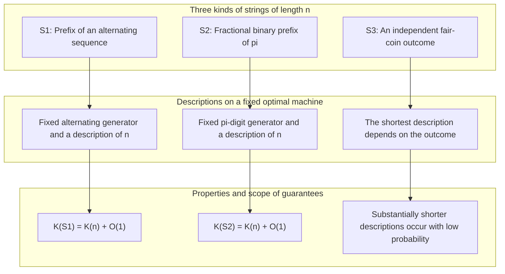
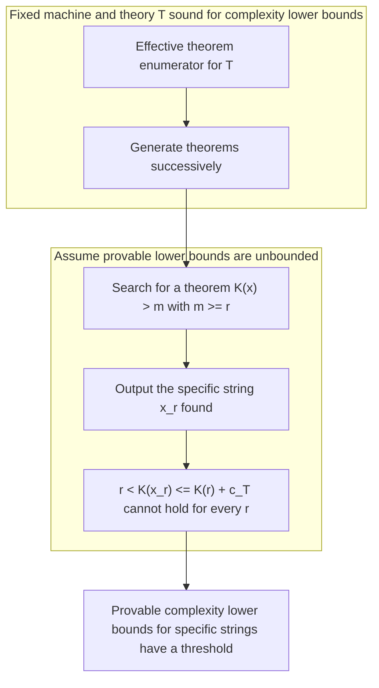

## 1. Three Strings of a Million Bits: Is Length the Same as Complexity?

Consider three bit strings of length $n=1{,}000{,}000$.

1. $S_1$: the pattern `01` repeated 500,000 times.
2. $S_2$: the first million bits of the binary expansion of the <strong>fractional part</strong> of $\pi$.
3. $S_3$: an outcome from a model of a million independent, fair coin tosses.

Packed without gaps, each occupies 125,000 bytes, or 125 decimal kB. Storing the characters `0` and `1` in ASCII or UTF-8 instead takes a million bytes. File headers and object-management overhead are additional costs.

The binary expansion of $\pi$ begins $11.0010010000111111\ldots{}_2$, so $S_2$, with the integer part excluded, begins `0010010000111111...`. The short strings shown here are illustrations, not evidence that this article performed a million physical coin tosses.

A repetition rule generates $S_1$, and an algorithm can compute the digits needed for $S_2$. However, $S_3$ is not guaranteed to be complex: a fair coin can accidentally produce an all-zero or alternating string. The correct claim is probabilistic: <strong>with the computational model fixed, outcomes admitting substantially shorter descriptions are rare</strong>.

Under the independent fair-coin model, each particular $n$-bit outcome has the same probability, including an alternating string or a prefix of $\pi$.

$$
P(X=x)=2^{-n},\qquad x\in\{0,1\}^n
$$

How can we describe the different availability of short generating rules among equally probable outcomes? This is the question addressed by <strong>Algorithmic Information Theory (AIT)</strong>, developed by Solomonoff, Kolmogorov, Chaitin, and others from the 1960s onward. Its central quantity is the length of the shortest program that outputs a string and halts.

---

## 2. Shannon Information and Individual Strings

### 2.1 Surprisal, Entropy, and Coding

For a discrete distribution $P$, distinguish the information of an outcome with $P(x)>0$ from its average, the entropy. Unless stated otherwise, logarithms have base 2 and information is measured in bits.

$$
I_P(x)=-\log_2P(x),\qquad
H(P)=-\sum_xP(x)\log_2P(x)
$$

Use the convention $0\log_2 0=0$ in the sum. An outcome assigned probability zero has infinite surprisal.

For a finite alphabet encoded one symbol at a time using a binary prefix code, expected length cannot be less than entropy, and a code with expected length less than entropy plus one exists.

$$
H(P)\le L_{\mathrm{opt}}<H(P)+1
$$

This is not a claim that every individual codeword length equals the entropy. Grouping $r$ independent, identically distributed symbols reduces the rounding overhead per symbol.

$$
H(P)\le \frac{L_{\mathrm{opt},r}}{r}<H(P)+\frac1r
$$

Dependent sources involve block distributions or entropy rates. Discussions of Huffman and arithmetic coding also need to distinguish the model, expectations, and individual outcomes.

### 2.2 Model Choice and Empirical Frequencies

The value $-\log_2P(x)$ depends on $P$, not on $x$ alone. The fair-coin distribution assigns a million bits of surprisal even to the alternating string. A point mass concentrated on that particular string has entropy zero. But this does not make the cost of communicating the model itself zero.

The alternating string contains equally many zeros and ones, so its zeroth-order empirical entropy is one bit. A predictor that uses the preceding bit can nevertheless capture its regularity.

$$
\widehat H_0((01)^{n/2})
=-\tfrac12\log_2\tfrac12-\tfrac12\log_2\tfrac12=1
$$

For overlapping blocks of length $k$, at most two block types occur in an alternating string. Their empirical block entropy is at most one bit, and the value divided by $k$ is at most $1/k$. Block entropy and entropy per bit are different quantities.

Normality of $\pi$—the limiting equal frequency of every block of each fixed length—is not proved. Finite frequency tests or an irregular appearance do not establish normality. Even normality would be compatible with computability. If a coding model can compute the digits, Shannon-style prediction and coding can exploit that rule; Shannon theory is not restricted to zeroth-order frequencies.

AIT does not invalidate Shannon theory. <strong>Code lengths relative to probability models and descriptions relative to a fixed computer answer different questions.</strong>

| Perspective | Shannon information | Algorithmic description length |
| :--- | :--- | :--- |
| Object | A distribution and outcomes under that distribution | A finite string output by a fixed machine |
| Reference | Probability model and coding convention | Machine, program encoding, and auxiliary input |
| Main quantities | $I_P(x)$, $H(P)$, entropy rate | Plain complexity $C(x)$ and prefix complexity $K(x)$ |
| Limitation | Describing the model can cost additional bits | Machine-dependent constants and incomputability |
| Treatment of $\pi$ | Depends on the selected model | Digits have a generating rule; the endpoint must also be described |

---

## 3. Shortest Programs and the Invariance Theorem

### 3.1 Plain and Conditional Complexity

Let $\{0,1\}^*$ denote the finite binary strings and $|p|$ the bit length of a program. For a partial computable machine $A$, writing $A(p)=x$ means that it halts after finite time and outputs exactly $x$.

$$
C_A(x)=\min\{|p|:A(p)=x\}
$$

Set the minimum to $\infty$ if no such program exists. With an auxiliary input $y$ supplied for free, define:

$$
C_A(x\mid y)=\min\{|p|:A(p,y)=x\}
$$

Knowing a length or dictionary as an auxiliary input differs from paying to include it in the program.

### 3.2 Self-Delimiting Prefix Complexity

<strong>Prefix complexity $K$</strong> restricts the domain of halting programs to a prefix-free set: no halting program is a proper prefix of another.

$$
K_U(x)=\min\{|p|:U(p)=x\},\qquad
\sum_{p\in\operatorname{dom}U}2^{-|p|}\le1
$$

The second statement is Kraft's inequality. For conditional prefix complexity, the domain must be prefix-free for each fixed auxiliary input $y$. Self-delimitation is not achieved merely by appending a closing bracket to arbitrary source code.

In the bounds below, $C$ and $K$ use additively optimal reference machines in their respective classes. The next section explains this optimality.

Concatenating plain programs requires communicating their boundary. For a fixed computable encoding of pairs, one obtains, for example:

$$
C(x,y)\le C(x)+C(y)
+2\log_2\bigl(\min\{C(x),C(y)\}+2\bigr)+O(1)
$$

Self-delimiting programs can be concatenated and interpreted. Including a conditional description gives a simpler upper bound:

$$
K(x,y)\le K(x)+K(y\mid x)+O(1)
\le K(x)+K(y)+O(1)
$$

For fixed reference machines of the corresponding kinds, plain and prefix complexities satisfy:

$$
C(x)\le K(x)+O(1),\qquad
K(x)\le C(x)+2\log_2(C(x)+2)+O(1)
$$

Here $O(1)$ denotes a constant independent of the object $x$. It is not a measured claim that the overhead is zero or only a few bits.

### 3.3 Invariance for Additively Optimal Machines

Fix an additively optimal machine in the class of plain machines for $C$, and one in the class of prefix-free machines for $K$. If “universal” means only the ability to simulate other machines, the constant-overhead property must also be specified.

For prefix complexity, every prefix-free machine $A$ has a constant $c_A$, independent of $x$, such that:

$$
K_U(x)\le K_A(x)+c_A
$$

A <strong>proof construction</strong> uses a fixed self-delimiting tag $s_A$ identifying $A$, followed by its program $p$. If $A(p)=x$, the simulator produces $x$ using $|p|+|s_A|$ bits plus fixed overhead. The shortest program is no longer than this constructed program. An optimal reference machine can be built in this way. Plain complexity has the analogous result within its own class.

Applying the bound in both directions to two additively optimal machines gives:

$$
|K_{U_1}(x)-K_{U_2}(x)|\le c_{12}
$$

Choose the constant to cover both simulation costs; one directional interpreter size alone need not bound the absolute difference.

A specialized machine could produce one particular million-bit string from a one-bit instruction. Its specification contributes to the cost of simulating it on a reference machine. However, without first establishing the complexity of that particular string, we cannot assert that the simulation constant must be at least a million bits: the string itself might have a short rule.

Invariance controls a constant difference; it does not remove machine dependence for finite objects. The constant divided by $n$ vanishes as $n\to\infty$, while exact shortest lengths for arbitrary finite strings remain unknown in general. Real CPUs with finite memory are also not literally the unbounded machines of the mathematical model.

### 3.4 Repetition, Pi, and Coin Tosses Revisited

Identify an integer $n$ with a fixed binary representation. Let $s(n)$ be either the alternating prefix of length $n$ or the first $n$ fractional binary digits of $\pi$. We can compute the string from $n$ and recover $n$ by measuring the string's length. Computable transformations in both directions therefore give:

$$
K(s(n))=K(n)+O(1),\qquad K(s(n)\mid n)=O(1)
$$

If the endpoint is free, a constant-size procedure suffices; otherwise, describing $n$ has a cost. A self-delimiting integer encoding gives, for $n\ge2$:

$$
K(n)\le \log_2 n+2\log_2\log_2 n+O(1)=O(\log n)
$$

This does not imply $K(n)=\log_2n+O(1)$ for every integer. For $n=2^m$, one can describe the exponent $m$ and reconstruct $n$, exploiting a shorter description of $m$.



The shortest description of $S_3$ need not literally copy the data. The next section provides the appropriate counting argument.

---

## 4. Incompressibility and Randomness of Infinite Sequences

### 4.1 Literal-Output Upper Bounds

A description that outputs the literal $n$-bit string $x$ gives these bounds for plain complexity and length-conditional prefix complexity:

$$
C(x)\le n+O(1),\qquad K(x\mid n)\le n+O(1)
$$

For unconditional prefix complexity, the length must also be communicated in self-delimiting form:

$$
K(x)\le n+K(n)+O(1)
$$

The general bound $K(x)\le |x|+O(1)$ is false. If it held with a single constant for all strings, the total weight $\sum_{|x|=n}2^{-K(x)}$ at each length would be bounded below by a positive constant. Summing over all lengths would contradict Kraft's inequality.

### 4.2 The Exact Pigeonhole Count

Let $n\ge0$ and $0\le c\le n$ be integers. There are exactly this many binary programs shorter than $n-c$:

$$
\sum_{j=0}^{n-c-1}2^j=2^{n-c}-1
$$

For $c=n$, the empty sum is zero. A halting program outputs at most one string, so no more than this number of $n$-bit strings can satisfy $C(x)<n-c$. Therefore:

$$
\#\{x\in\{0,1\}^n:C(x)\ge n-c\}
\ge2^n-2^{n-c}+1
$$

Some short programs may never halt or may output the same string, making the number of strings with short descriptions even smaller. If $c>n$, the inequality $C(x)\ge n-c$ is automatic for every string; do not extend the geometric-sum expression into that case.

For the uniform fair-coin distribution, the count becomes:

$$
P\{C(X)<n-c\}
\le\frac{2^{n-c}-1}{2^n}<2^{-c}
$$

For $c=0$, at least one string of every length satisfies $C(x)\ge n$. For $c=1$, more than half cannot be shortened by <strong>more than</strong> one bit. For $c=10$ and $c=20$, the respective lower bounds $1-2^{-c}$ on the fraction that cannot be shortened by more than $c$ bits are approximately 99.902% and 99.999905%. This does not prohibit a saving of exactly $c$ bits.

The same counting argument applies to $K(x\mid n)$ with the condition $n$ fixed. Thus, fair-coin outcomes require descriptions close to their length with high probability, but not with certainty for every outcome.

A reversible compressor that shortens every possible file would violate this count. Real compressors work well on data suited to their regularities. A fraction under the uniform distribution over all bit strings is not automatically the fraction of structured objects occurring in nature or human-created data.

### 4.3 Martin-Löf Randomness

A finite string resisting a specified amount of compression and an infinite sequence being random are different definitions. Equip infinite binary sequences with the fair-coin measure $\mu$. The cylinder $[w]$ of sequences beginning with a finite word $w$ has measure $2^{-|w|}$.

A <strong>Martin-Löf test</strong> is a sequence of open sets $V_j$, uniformly computably enumerable as unions of finite-prefix cylinders, satisfying:

$$
\mu(V_j)\le2^{-j},\qquad j=1,2,\ldots
$$

A sequence fails the test if $\omega\in\bigcap_j V_j$. It is Martin-Löf random if it fails none of these tests. This does not mean avoiding every rare finite pattern on every occasion. There are only countably many effective tests, and each failure set has measure zero, so the sequences passing them all form a measure-one set.

The Levin–Schnorr theorem gives the following equivalence using optimal <strong>prefix</strong> complexity:

$$
\omega\text{ is Martin-Löf random}
\iff
\exists c\ \forall n\quad K(\omega_{1:n})\ge n-c
$$

The crucial point is that <strong>the same constant $c$</strong> works for every $n$. Replacing $K$ by plain complexity $C$ in this statement does not work.

Historically, von Mises and Church studied admissible selection rules, but varying the effectiveness requirements on tests or betting strategies changes the resulting randomness notion. In particular, computable randomness—no computable martingale gains unbounded capital—is weaker than Martin-Löf randomness, not an equivalent definition of it.

The computable infinite digit sequence of $\pi$ is not Martin-Löf random. This again distinguishes algorithmic randomness from normality.

---

## 5. Incomputability, Limits of Proof, and Halting Probability

### 5.1 Approximating from Above Without a General Stopping Criterion

Dovetailing runs candidate programs a little at a time in parallel. Keeping the shortest description of $x$ found so far produces successively improved upper bounds.

$$
K_t(x)\searrow K(x)\qquad(t\to\infty)
$$

A computable finite upper bound from a literal-output construction supplies an initial value. Because the bounds are integers, they eventually reach the true value and remain there for each fixed $x$. What is impossible is a general procedure that recognizes and certifies this final value for every input. A shorter candidate still running might eventually output $x$.

### 5.2 A Berry-Style Contradiction

Consider the phrase “The smallest positive integer not definable in under twenty English words.” It contains eleven whitespace-separated words, fewer than twenty. Natural-language “definability” is ambiguous, so this phrase itself is not a formal proof. Instead, translate the idea into a contradiction about computable procedures.

Assume a procedure `ComputeK` halts on every string and returns its true $K$ value. The following is <strong>pseudocode</strong> using that impossible assumption, not an implementation of a complexity oracle.

```text
Berry(m):
    enumerate binary strings x by increasing length, then lexicographically within each length:
        if ComputeK(x) >= m:
            output x and halt
```

This is shortlex order. Ordinary lexicographic order alone does not provide the required enumeration of all finite strings.

Counting shows that complexity is unbounded. Under the assumption, the search therefore halts for every $m$ and produces $x_m$ with $K(x_m)\ge m$. Yet the procedure consists of fixed code plus a self-delimiting description of $m$:

$$
m\le K(x_m)\le K(m)+c
\le \log_2m+2\log_2\log_2m+c'
$$

The final bound is for $m\ge2$. For sufficiently large $m$, it contradicts the fixed constant $c'$. Therefore `ComputeK` does not exist. No unmeasured, machine-independent numerical allowance such as “10,000 additional bits always suffices” is needed.

### 5.3 Chaitin's Incompleteness Theorem

Fix a reference machine and an effectively axiomatized theory $T$ able to express complexity bounds for particular finite strings. Assume <strong>soundness</strong> for the lower-bound statements it proves.

There is a threshold $b_T$ such that $T$ cannot prove “$K(x)>b_T$” for any particular $x$.

To see the core argument, suppose instead that provable numerical lower bounds were unbounded. For any input $r$, the following search would halt after finding a theorem “$K(x)>m$” whose numerical bound $m$ is at least $r$.

```text
SearchProof(r):
    effectively enumerate the theorems of T:
        if a theorem states "K(x) > m" for a specific x and integer m, with m >= r:
            output x and halt
```

Soundness makes the output $x_r$ have complexity greater than $r$. But the fixed part of this procedure can include the theorem enumerator for $T$, giving:

$$
r<K(x_r)\le K(r)+c_T=O(\log r)+c_T
$$

This is impossible for sufficiently large $r$. Thus the provable numerical lower bounds must be bounded.



The threshold depends on the machine, theory, and representation. We have not measured a universal 20,000-bit or 50,000-bit limit for ZFC. If the length $n$ sufficiently exceeds a fixed threshold, counting shows that many strings really exceed it in complexity; nonetheless the theory has limitations in proving a lower bound for a specific string.

This connects incompleteness, in the tradition of Gödel, with algorithmic descriptions. It is not a general conservation law forbidding short axioms from yielding long theorems or many theorems. Adding axioms produces a different theory with a different constant.

### 5.4 The Machine-Dependent Halting Probability $\Omega_U$

For an optimal prefix-free machine $U$, the probability that an infinite fair-bit input begins with a halting program is:

$$
\Omega_U=\sum_{p\in\operatorname{dom}U}2^{-|p|}
$$

The cylinders associated with halting programs are disjoint, giving the probability interpretation. Kraft's inequality yields $\Omega_U\le1$. In this setting, including optimality, $\Omega_U$ is also a Martin-Löf random, noncomputable real with $0<\Omega_U<1$. These additional properties do not hold for every arbitrary prefix-free machine.

Enumerating halting programs yields increasing partial sums of their weights. Hence $\Omega_U$ is <strong>left-computably enumerable (left-c.e.)</strong>, but there is no computable modulus telling us when the approximation achieves an arbitrary requested accuracy.

Suppose its exact first $N$ bits are supplied, and let $a$ be the corresponding lower dyadic endpoint. Since $\Omega_U$ does not have a terminating binary expansion:

$$
a=\frac{\lfloor2^N\Omega_U\rfloor}{2^N},
\qquad a<\Omega_U<a+2^{-N}
$$

Dovetail the programs until the enumerated halting weight $q_s$ <strong>exceeds</strong> $a$. Then:

$$
0\le\Omega_U-q_s<2^{-N}
$$

A not-yet-enumerated program of length at most $N$ would add at least $2^{-N}$ if it later halted, contradicting the residual bound. This decides halting or nonhalting for every input of length at most $N$ to <strong>the same machine</strong>.

It does not decide infinitely many arbitrary mathematical statements from some fixed few thousand digits. Counterexample searches encoded as halting problems have a particular machine, description length, and logical form. Computing finitely many digits in special investigations also differs from having an algorithm that generates every digit.

---

## 6. Shannon Bridges, MDL, NCD, and AI

### 6.1 Expected Description Length and Entropy Rate

Let a computable discrete distribution $P$ on finite strings be specified by a finite computational procedure $d_P$. Sharing $d_P$ as auxiliary input gives, when $H(P)<\infty$:

$$
H(P)\le\mathbb E_{X\sim P}[K(X\mid d_P)]\le H(P)+c
$$

The distribution may have finite or countable support, with probabilities uniformly computable to requested precision. The decoding constant $c$ does not assert numerical equality.

The lower bound follows from applying Kraft's inequality to shortest prefix descriptions with the fixed condition $d_P$ and using the expected-code-length argument. For the upper bound, construct a probability-based prefix code using the shared distribution and decode it with a fixed procedure. If the distribution is not shared, its description has a cost too. Merely saying that an arbitrary distribution is “known” does not guarantee a finite-time algorithm for its exact entropy.

A different relation, of Brudno type, holds for a <strong>stationary ergodic process on a finite alphabet</strong>. If its entropy rate is $h$ bits per symbol, then for almost every sample sequence:

$$
\lim_{n\to\infty}\frac{K(X_{1:n})}{n}=h
$$

The expectations satisfy $\mathbb E[K(X_{1:n})]/n\to h$ as well. A uniform linear literal-coding bound for $n$ symbols supports the passage from almost-sure convergence to convergence of expectations. The logarithmic-order difference between plain and prefix complexities vanishes after division by $n$. This rate theorem does not require indiscriminately adding the computability assumption used in the preceding conditional-distribution inequality.

### 6.2 Discrete Universal Semimeasure and Solomonoff Prediction

For an optimal halting prefix machine, define the probability of outputting exactly $x$ and halting:

$$
m_U(x)=\sum_{p:U(p)=x}2^{-|p|}
$$

Its total mass is at most one, so it is a <strong>semimeasure</strong>, and it is lower semicomputable. The coding theorem relates this discrete universal semimeasure to prefix complexity:

$$
-\log_2m_U(x)=K_U(x)+O(1),
\qquad m_U(x)=\Theta(2^{-K_U(x)})
$$

For Solomonoff's sequential prediction, a monotone machine instead defines a semimeasure $M(x)$ for output that <strong>starts with</strong> $x$. The output need not halt there, and $M(x)\ge M(x0)+M(x1)$. Do not identify this $M$ with the discrete $m_U$ and automatically transfer the same coding theorem unchanged.

Favoring short descriptions connects to Occam's razor, but a short hypothesis does not necessarily have greater probability after seeing the data. The likelihood matters too.

### 6.3 Bayesian Selection and Minimum Description Length

Give a model $H$ an actual prefix-description length $L(H)$ and choose prior probabilities proportional to those coding weights. Bayes' rule then gives:

$$
-\log_2P(H\mid D)
=L(H)-\log_2P(D\mid H)+\mathrm{const}
$$

The additive constant is independent of $H$. Under this particular choice, maximizing posterior probability corresponds to minimizing the right-hand side. In general, however, $-\log_2P(D\mid H)$ cannot simply be replaced by $K(D\mid H)$.

The <strong>Minimum Description Length (MDL) principle</strong> compares the combined cost of describing a model and its data:

$$
\widehat H=\arg\min_{H\in\mathcal H}
\{L(H)+L(D\mid H)\}
$$

An underfitting model can leave a long data code; a memorizing model can itself require a long description. Eliminating a residual by memorization and minimizing the total description are different achievements. Rissanen's MDL is a practical principle for statistical selection, not a guarantee of finding the true natural law or causal structure.

### 6.4 Ideal Information Distance and Practical NCD

For a positive denominator, define the ideal <strong>Normalized Information Distance (NID)</strong> as:

$$
\operatorname{NID}(x,y)=
\frac{\max\{K(x\mid y),K(y\mid x)\}}
{\max\{K(x),K(y)\}}
$$

It is related to a formula involving a computable, uniquely decodable representation of the pair $(x,y)$. To make the error explicit, with $R=\max\{K(x),K(y)\}>0$:

$$
\operatorname{NID}(x,y)=
\frac{K(x,y)-\min\{K(x),K(y)\}}{R}
+O\!\left(\frac{\log_2(R+2)}{R}\right)
$$

Do not treat a boundary-free concatenation $xy$ as exactly the same object as an encoded pair whose two components can be recovered.

Write a real compressor's output length as $Z$, to distinguish it from plain complexity $C$. The <strong>Normalized Compression Distance (NCD)</strong> is:

$$
\operatorname{NCD}_Z(x,y)=
\frac{Z(xy)-\min\{Z(x),Z(y)\}}
{\max\{Z(x),Z(y)\}}
$$

The idea is that similar files have small values when the compressor can reuse their shared structure, whereas files without exploitable common structure give values near one.

Real compressors have headers, windows, blocks, settings, and order effects. The idempotency, monotonicity, symmetry, and distributivity assumptions of a normal compressor are not properties that every real compressor satisfies on every input. Even an identical-file pair can fail to satisfy $Z(xx)\approx Z(x)$, and a finite-file NCD is not guaranteed to be an exact metric or always lie between zero and one.

An auxiliary check used a fixed 65,536-byte string concatenated with itself and finite-window gzip, reproducing an identical-file NCD of approximately 0.9997. This is not a counterexample to ideal NID; it illustrates a limitation of the practical approximation.

Cilibrasi, Vitányi, and colleagues investigated compression-based clustering of genomes, languages, music, and other data. Avoiding handcrafted domain-specific features is useful, but the method is not independent of encoding, file representation, or compressor choice, and it does not guarantee correct reconstruction of every phylogeny.

### 6.5 Language-Model Prediction and Code Length

For tokens $D=x_{1:T}$ and a fixed autoregressive model, prediction corresponds to this ideal code length:

$$
\mathcal L_\theta(D)=
-\sum_{t=1}^T\log_2p_\theta(x_t\mid x_{<t})
$$

Natural logarithms instead give nats; divide by $\ln2$ to convert to bits. This is negative log-likelihood on finite data, whose per-token average serves as the cross-entropy loss.

For positive-probability outcomes, an ideal arithmetic code or related construction with the model and sequence length shared can produce a prefix description of length at most $\lceil\mathcal L_\theta(D)\rceil+2$. This does not mean every implementation takes exactly “loss plus two bits.” Finite precision, termination, rounding, and framing have costs.

Let $L_{\mathrm{model}}$ and $L_{\mathrm{meta}}$ be actual self-delimiting description lengths of the model and necessary metadata. With a fixed decoder, we obtain:

$$
K(D)\le L_{\mathrm{model}}+L_{\mathrm{meta}}
+\lceil\mathcal L_\theta(D)\rceil+O(1)
$$

Metadata includes the sequence length, vocabulary, and a reversible tokenization specification as needed. If normalization discarded original whitespace or characters, they cannot be reconstructed without additional information.

For a fixed-size shared model, reducing prediction loss corresponds to reducing data code length. When model size varies, the total cost also matters; minimizing training loss alone is not the same optimization as minimizing a two-part MDL objective.

Hutter's AIXI and compression challenges such as the Hutter Prize motivate research on compression and intelligence. AIXI is an incomputable ideal, however, not the same object as a practical Transformer. Delétang and colleagues likewise investigate the prediction–compression relationship in language models.

Predicting the culprit's name correctly in a mystery novel shortens its code. But improvement need not come only from logical reasoning: memorization, vocabulary biases, and duplicated data can help too. Compressing training text alone does not imply a theorem forcing acquisition of a causal world model, correct reasoning, generalization, or AGI.

| Theory or principle | Practical connection | Necessary distinction |
| :--- | :--- | :--- |
| $K(x)$ and $K(x\mid y)$ | Descriptions including a decoder; codes with shared context | Practical compressed length is generally not the shortest possible description |
| Discrete universal semimeasure $m_U$ | Modeling that favors short descriptions | Halting output and sequential prediction $M$ differ |
| MDL | Comparing model cost and data code length | Likelihood and conditional complexity cannot always be equated |
| NID and NCD | Compression-based similarity and clustering | Windows, representation, order, and finite-file behavior |
| Language models and arithmetic codes | Prediction probabilities correspond to code lengths | Shared models versus self-contained total cost; evaluation of intelligence |

---

## 7. Conclusion: What Compression Reveals and What Remains

Alternation and prefixes of $\pi$ admit short generating procedures, even when a million bits long. Describing the endpoint differs from knowing it as a free condition. Fair-coin outcomes have a counting-based, high-probability incompressibility guarantee, not certainty for each realization.

The invariance theorem bounds differences between optimal machines by constants. Berry-style reasoning establishes the general incomputability of exact shortest lengths; Chaitin's theorem and $\Omega_U$ further expose limits of proof and computation. These results do not let us evaluate arbitrary finite objects independently of machines and assumptions.

MDL, NCD, and language-model code lengths connect the ideal to practice. Compression is a useful way to investigate regularity and model sharing, but compression ratio alone is not a complete definition of understanding or intelligence.

### References

- [Shen: Algorithmic Information Theory and Kolmogorov Complexity](https://www.lirmm.fr/~ashen/uppsala-notes.pdf) — Plain and prefix complexity, optimal decompressors, incomputability, and the coding theorem.
- [Rute: Computable randomness and betting for computable probability spaces](https://arxiv.org/html/1203.5535v4) — Computable randomness and Martin-Löf tests.
- [Tadaki: Chaitin Ω numbers and halting problems](https://arxiv.org/abs/0904.1149) — Halting probabilities of optimal machines and finite-size halting problems.
- [Chazottes: Entropy in Dynamical Systems & Ergodic Theory](https://www.claymath.org/wp-content/uploads/2023/04/Chazottes-rev.pdf) — Slide 50, Brudno's theorem for a finite partition.
- [Cilibrasi and Vitányi: Clustering by Compression](https://arxiv.org/html/cs/0312044v2) — Normal-compressor assumptions and NCD.
- [Delétang et al.: Language Modeling Is Compression](https://arxiv.org/abs/2309.10668) — Research on prediction and compression.
- [Hutter: Universal Algorithmic Intelligence](https://www.hutter1.net/ai/aixigentle.htm) — The AIXI ideal combining universal induction and decision-making, and its computational limitation.
- [Bailey et al.: An Empirical Approach to the Normality of Pi](https://www.davidhbailey.com/dhbpapers/normality-digits-pi.pdf) — Empirical digit tests versus proof of normality.
