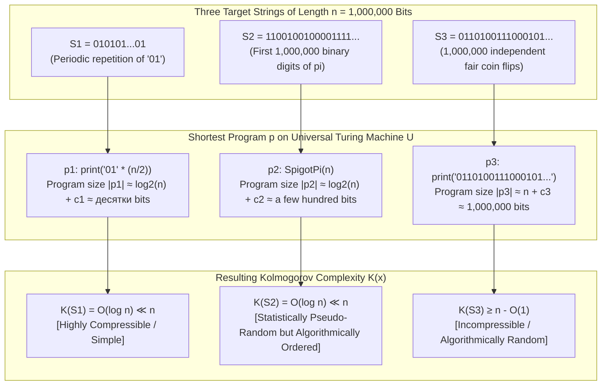
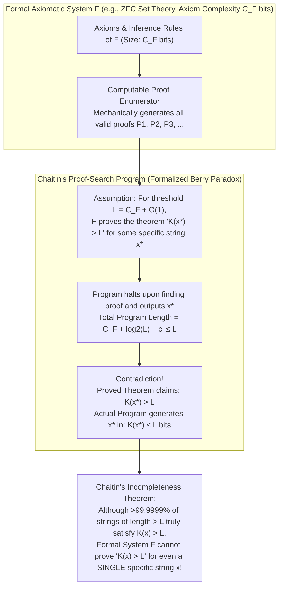

## 1. Three 1,000,000-Bit Strings and the Paradox of Intuition

Imagine that three binary strings $S_1, S_2, S_3$, each consisting of <strong>exactly $n = 1,000,000$ bits</strong> (`0`s and `1`s), are placed before you. Stored as uncompressed raw binary data in computer memory, all three occupy the exact same footprint: $1,000,000$ bits ($125\text{ kilobytes}$).

1. <strong>The First String $S_1$</strong>:
   $$S_1 = \texttt{01010101010101010101010101010101\dots01}$$
   The two-bit pattern `01` repeated exactly $500,000$ times: $(01)^{500,000}$.
2. <strong>The Second String $S_2$</strong>:
   $$S_2 = \texttt{11001001000011111101101010100010\dots10}$$
   At first glance, the `0`s and `1`s appear thoroughly irregular and unpredictable. In fact, $S_2$ consists of the first $1,000,000$ binary digits of the mathematical constant $\pi = 3.14159265358979\dots = 11.001001000011111101101010100010\dots_2$.
3. <strong>The Third String $S_3$</strong>:
   $$S_3 = \texttt{01101001110001011011001011100101\dots00}$$
   A sequence generated by physically tossing an unbiased coin $1,000,000$ times, recording `1` for heads and `0` for tails.

Let us ask a deceptively simple question: <strong>Which of these three strings is truly "complex," and which is genuinely "random"?</strong>

Our intuition answers without hesitation:
- $S_1$ is <strong>utterly simple</strong>. It can be completely specified by a single sentence: *"Print `01` 500,000 times."*
- $S_2$ looks disorderly on the surface, yet it is governed by a <strong>rigid, deterministic mathematical law</strong>—the geometry of a circle and analytic series for $\pi$ (such as Machin's formula, the Chudnovsky algorithm, or the Bailey–Borwein–Plouffe spigot algorithm). A short computer program of a few hundred bytes can reproduce all $1,000,000$ bits of $S_2$ from scratch with zero errors. Thus, its intrinsic complexity is very small.
- $S_3$ is <strong>genuinely complex and truly random</strong>. Because each bit arose from an independent physical coin flip, there is no hidden formula, rule, or shortcut behind it. The only way to communicate $S_3$ faithfully to another person is to transmit all $1,000,000$ bits verbatim.

Yet when we attempt to formalize this intuition using classical <strong>Probability Theory</strong> or raw <strong>String Length</strong>, we hit a profound conceptual wall.

Suppose we toss a fair coin $1,000,000$ times. What is the probability of obtaining the alternating string $S_1$?
$$\mathbb{P}(S_1) = \left(\frac{1}{2}\right)^{1,000,000} = 2^{-1,000,000}$$
What is the probability of obtaining the exact binary digits of $\pi$, $S_2$? Again, $2^{-1,000,000}$. And what is the probability of obtaining the specific coin-toss sequence $S_3$ that actually occurred? Once more, it is identically:
$$\mathbb{P}(S_3) = \left(\frac{1}{2}\right)^{1,000,000} = 2^{-1,000,000}$$
Under a uniform distribution over $\{0,1\}^n$, <strong>every individual string $x$ of length $n$ has the exact same probability $2^{-n}$</strong>. Classical probability theory is equipped to describe properties of an *ensemble* (a sample space equipped with a probability measure), but it lacks the vocabulary to declare that one *specific individual outcome* $x$ is "ordered" while another specific outcome $y$ is "random."

Why do $S_1$ and $S_2$ contain so little intrinsic complexity despite being $1,000,000$ bits long, whereas $S_3$ contains $1,000,000$ bits of irreducible complexity? What does it mathematically mean for a single, standalone sequence of digits to be "random"?

In the 1960s, three visionary thinkers—<strong>Ray Solomonoff</strong>, <strong>Andrey Nikolaevich Kolmogorov</strong>, and <strong>Gregory Chaitin</strong>—independently arrived at a revolutionary answer:

> <strong>The intrinsic "complexity" of an object is the length of the shortest computer program that outputs that object and halts. And "randomness" is nothing more and nothing less than incompressibility—the complete absence of any shorter algorithmic description.</strong>

From this insight emerged <strong>Algorithmic Information Theory (AIT)</strong> and <strong>Kolmogorov Complexity</strong>, a mathematical edifice that unifies information theory, Alan Turing's computability theory, Kurt Gödel's incompleteness theorems, Bayesian inductive inference, and the modern theory of why Large Language Models (LLMs) acquire general intelligence through data compression.

---

## 2. The Scope and Limits of Shannon Information Theory: From Ensemble Distributions to Individual Objects

To appreciate why Kolmogorov complexity was necessary, we must first examine the achievements and inherent boundaries of classical information theory, founded by <strong>Claude E. Shannon</strong> in his landmark 1948 paper *A Mathematical Theory of Communication*.

### 2.1 Shannon Entropy and Self-Information

Shannon conceptualized information as the resolution of statistical uncertainty. Given a discrete random variable $X$ taking values in an alphabet $\mathcal{X}$ according to a known probability distribution $P(x) = \mathbb{P}(X = x)$, the <strong>self-information (surprisal)</strong> $I(x)$ received upon observing a specific outcome $x$ is defined as:

$$I(x) = -\log_2 P(x) = \log_2 \frac{1}{P(x)} \quad [\text{bits}]$$

Rare events (small $P(x)$) carry high surprisal; certain events ($P(x) = 1$) carry zero information. The <strong>Shannon Entropy</strong> $H(X)$ of the random source $X$ is the expected value of self-information across the entire ensemble:

$$H(X) = \mathbb{E}_{X \sim P}[-\log_2 P(X)] = -\sum_{x \in \mathcal{X}} P(x) \log_2 P(x)$$

Shannon's <strong>Source Coding Theorem (Noiseless Coding Theorem)</strong> proved that when encoding independent and identically distributed (i.i.d.) symbols from $X$, the minimum achievable expected codeword length per symbol $L$ satisfies $H(X) \le L < H(X) + 1$. Algorithms such as Huffman coding and arithmetic coding assign short codewords of length $\approx -\log_2 P(x)$ to high-probability symbols and long codewords to low-probability symbols, achieving optimal ensemble compression.

### 2.2 Two Fundamental Limitations of Shannon Information

Despite its triumph in telecommunication engineering and statistical data compression, Shannon's framework encounters two insurmountable obstacles when asked to measure the complexity of a single concrete object $x$:

#### Obstacle 1: Dependence on an A Priori Ensemble Probability Distribution $P(x)$
The quantity $I(x) = -\log_2 P(x)$ is not a property of the object $x$ alone; it is a property of the probability distribution $P$ from which $x$ is assumed to be drawn. For a standalone object in the real world—such as the text of Leo Tolstoy's *War and Peace*, the human chromosome 1 DNA sequence, or the binary expansion of $\pi$—what is the "underlying probability distribution $P$" from which it was sampled? An individual string is a deterministic mathematical entity, not a random variable.

#### Obstacle 2: Blindness of Empirical Frequency Statistics to Algorithmic Law
One might attempt to bypass the need for an external distribution $P$ by estimating empirical symbol frequencies directly from the string $x$ itself. Suppose we treat each of our three $1,000,000$-bit strings $S_1, S_2, S_3$ as a memoryless (0th-order Markov) source and compute its empirical bit entropy $\hat{H}_0(S)$:

- <strong>For $S_1 = (01)^{500,000}$</strong>: Exactly $500,000$ bits are `0` ($p_0 = 0.5$) and $500,000$ bits are `1` ($p_1 = 0.5$). Thus:
  $$\hat{H}_0(S_1) = -\left(0.5 \log_2 0.5 + 0.5 \log_2 0.5\right) = 1.0 \text{ bit/symbol}$$
- <strong>For $S_2$ (the first $1,000,000$ bits of $\pi$)</strong>: $\pi$ is widely conjectured to be a normal number in base 2, and empirically its first $1,000,000$ bits contain almost exactly $50\%$ zeros and $50\%$ ones. Thus:
  $$\hat{H}_0(S_2) \approx 1.0 \text{ bit/symbol}$$
- <strong>For $S_3$ ($1,000,000$ fair coin flips)</strong>: By the Law of Large Numbers, approximately $50\%$ of the bits are `0` and $50\%$ are `1`. Thus:
  $$\hat{H}_0(S_3) \approx 1.0 \text{ bit/symbol}$$

Single-bit empirical entropy rates all three strings identically at $1.0\text{ bit/symbol}$! What if we use higher-order $k$-gram block entropies $\hat{H}_k(S)$ (counting frequencies of all $2^k$ blocks of length $k$)?
While $\hat{H}_k(S_1)$ drops toward $0$ as soon as $k \ge 2$ (since only `01` and `10` appear, never `00` or `11`), <strong>$\hat{H}_k(S_2)$ remains stubbornly close to $1.0\text{ bit/symbol}$ for every finite block length $k$</strong>! Because $\pi$ is empirically normal in base 2, every $k$-bit block appears with asymptotic frequency $2^{-k}$, exactly mimicking fair coin flips. Purely statistical or finite-state Markov entropy models are fundamentally blind to the deterministic computable algorithm that generates $\pi$.

### 2.3 The Three Founders of Algorithmic Information Theory

Between 1960 and 1966, three researchers working from completely different perspectives independently realized that the missing ingredient in information theory was Alan Turing's concept of a <strong>Universal Turing Machine (UTM)</strong>:

1. <strong>Ray Solomonoff (1960, 1964)</strong>:
   Motivated by artificial intelligence and the philosophy of science, Solomonoff published *A Preliminary Report on a General Theory of Inductive Inference* (1960) and its full two-part sequel in 1964. Seeking a rigorous mathematical formulation of <strong>Occam's Razor</strong> to assign prior probabilities to competing scientific hypotheses (programs) that explain observed data, he invented <strong>Universal Algorithmic Probability</strong> ($M(x)$).
2. <strong>Andrey Nikolaevich Kolmogorov (1965)</strong>:
   The towering giant of 20th-century probability theory—who had axiomatized modern measure-theoretic probability in 1933—was acutely aware that his own axioms could not define what makes an *individual* finite sequence random. In his seminal 1965 paper *Three Approaches to the Quantitative Definition of Information*, Kolmogorov contrasted the combinatorial, probabilistic (Shannon), and algorithmic approaches, defining the complexity of an individual object as the minimum length of a program that generates it on a universal computer.
3. <strong>Gregory Chaitin (1966, 1975)</strong>:
   Beginning while still an undergraduate student at the City College of New York in 1965–1966, Chaitin independently formulated program-size complexity, subsequently introducing prefix-free (self-delimiting) complexity, proving his celebrated <strong>Information-Theoretic Incompleteness Theorem</strong>, and discovering the halting probability real number $\Omega$.

The table below summarizes the paradigm shift from Shannon Information Theory to Algorithmic Information Theory:

| Dimension of Comparison | Classical Shannon Information Theory | Algorithmic Information Theory (Kolmogorov Complexity) |
| :--- | :--- | :--- |
| <strong>Founders & Era</strong> | Claude E. Shannon (1948) | Ray Solomonoff (1960), Andrey Kolmogorov (1965), Gregory Chaitin (1966) |
| <strong>Object of Measurement</strong> | <strong>Random Variable / Ensemble Source $X \sim P$</strong> | <strong>Single Individual Object $x \in \{0,1\}^*$</strong> |
| <strong>Fundamental Formula</strong> | $H(X) = -\sum_{x} P(x) \log_2 P(x)$ | $K_U(x) = \min_{p:\, U(p)=x} |p|$ |
| <strong>Role of Probability</strong> | Requires a known probability distribution $P(x)$ | Requires <strong>zero probability assumptions</strong>; intrinsic to $x$ |
| <strong>Notion of Regularity</strong> | Statistical bias in symbol/block frequencies | <strong>Any Turing-computable algorithmic pattern or law</strong> |
| <strong>Verdict on $\pi$ ($S_2$)</strong> | High empirical entropy ($\approx 1\text{ bit/symbol}$; looks random) | <strong>Extremely low complexity</strong> ($K(S_2) = O(\log n)$ bits) |
| <strong>Computability</strong> | Computable whenever $P(x)$ is explicitly given | <strong>Uncomputable</strong> (reduces to Turing's Halting Problem) |

---

## 3. Rigorous Definition of Kolmogorov Complexity and the Invariance Theorem

Let us now establish the formal mathematical definitions of Kolmogorov complexity and prove why it is an objective, machine-independent measure.

### 3.1 Definition as Minimum Program Length

Let $\Sigma = \{0, 1\}$ be the binary alphabet, $\Sigma^*$ be the set of all finite binary strings, and $|x|$ denote the bit length of a string $x \in \Sigma^*$. Let $M$ be a partial computable function (equivalently, a Turing machine or programming language interpreter) mapping binary program strings $p \in \{0,1\}^*$ to binary output strings $M(p) \in \{0,1\}^*$. Writing $M(p) = x$ means that when machine $M$ is given input program $p$, it halts after finitely many steps and outputs $x$.

<strong>Definition (Kolmogorov Complexity)</strong>:
The <strong>Kolmogorov complexity</strong> (or algorithmic description complexity) $K_M(x)$ of a finite binary string $x \in \{0,1\}^*$ with respect to machine $M$ is the length in bits of the shortest program $p \in \{0,1\}^*$ that causes $M$ to output $x$ and halt:

$$K_M(x) = \min_{p \in \{0,1\}^*} \left\{ |p| \;\middle|\; M(p) = x \right\}$$

If no program $p$ satisfies $M(p) = x$, we set $K_M(x) = \infty$.

Similarly, when the machine $M$ is provided with an auxiliary input string $y \in \{0,1\}^*$ "for free" alongside the program $p$ (for instance, the length $n = |x|$ of the target string), the <strong>Conditional Kolmogorov Complexity</strong> $K_M(x \mid y)$ of $x$ given $y$ is defined as:

$$K_M(x \mid y) = \min_{p \in \{0,1\}^*} \left\{ |p| \;\middle|\; M(p, y) = x \right\}$$

### 3.2 Plain Complexity $C(x)$ vs. Prefix-Free Complexity $K(x)$

In the technical literature of Algorithmic Information Theory, a crucial distinction is drawn between two variants of Kolmogorov complexity:

1. <strong>Plain Kolmogorov Complexity $C(x)$</strong> (Kolmogorov, 1965):
   Any finite binary string $p \in \{0,1\}^*$ may serve as a valid program. While simple to define, plain complexity suffers from a subtle mathematical inconvenience when concatenating descriptions: if $p_x$ is the shortest program for $x$ ($|p_x| = C(x)$) and $p_y$ is the shortest program for $y$ ($|p_y| = C(y)$), simply concatenating their bits into $p_x p_y$ does not tell the Turing machine where $p_x$ ends and $p_y$ begins! Encoding the boundary location requires specifying the length $|p_x| = C(x)$ using a self-delimiting prefix code of length $\le 2\log_2 C(x) + O(1)$ bits. Consequently, plain complexity violates strict subadditivity up to a logarithmic term:
   $$C(x, y) \le C(x) + C(y) + 2\log_2\!\left(\min(C(x), C(y))\right) + O(1)$$

2. <strong>Prefix-Free (Self-Delimiting) Complexity $K(x)$</strong> (Levin, 1974; Chaitin, 1975):
   To eliminate boundary ambiguities, Leonid Levin and Gregory Chaitin restricted the set of valid programs $\text{Dom}(U) \subset \{0,1\}^*$ to be a <strong>prefix-free set (instantaneous code)</strong>: no valid halting program $p$ is a proper prefix of another valid halting program $p'$. Intuitively, every valid program is self-delimiting—like a syntactically complete program in a real programming language that ends with a closing delimiter or `EOF` token so the interpreter knows the exact bit where the program terminates without reading past it.

   Because $\text{Dom}(U)$ is prefix-free, the lengths of all valid programs automatically satisfy <strong>Kraft's Inequality</strong>:
   $$\sum_{p \in \text{Dom}(U)} 2^{-|p|} \le 1$$
   Furthermore, two self-delimiting programs $p_x$ and $p_y$ can be concatenated directly as $p_x p_y$ without any separator overhead, yielding clean <strong>subadditivity</strong> up to an $O(1)$ constant:
   $$K(x, y) \le K(x) + K(y \mid x) + O(1) \le K(x) + K(y) + O(1)$$

The two measures are closely related for all strings $x$:
$$C(x) \le K(x) \le C(x) + 2\log_2 C(x) + O(1)$$
For large strings such as our $1,000,000$-bit examples, the logarithmic difference $2\log_2 C(x) \approx 40$ bits is negligible compared to $n = 1,000,000$. Throughout this article, we use both $C(x)$ (where raw bit-counting via the Pigeonhole Principle is sharpest) and $K(x)$ (where Kraft's inequality, $\Omega$, and Shannon connections shine), noting their exact relationship where relevant.

### 3.3 The Invariance Theorem (Universality Theorem)

A skeptic might immediately object to the definition of $K_M(x)$:
*"Doesn't the length of the shortest program depend entirely on which computer or programming language $M$ we choose? A program in Python might be much shorter than in x86 assembly! Worse yet, what if I build a rigged Turing machine $M_{\text{rigged}}$ whose 1-bit program `0` is hardwired to output the first $1,000,000$ coin flips $S_3$? Then $K_{M_{\text{rigged}}}(S_3) = 1$!"*

This objection is completely resolved by the cornerstone theorem of Algorithmic Information Theory, discovered independently by Solomonoff, Kolmogorov, and Chaitin: the <strong>Invariance Theorem</strong>.

Recall from Alan Turing's 1936 paper that there exist <strong>Universal Turing Machines (UTMs)</strong>—machines capable of simulating any other Turing machine given a description of that machine's transition table and its input tape. Every modern general-purpose programming language (Python, C++, Rust, Lisp) is universal in this exact sense.

<strong>Theorem 1 (The Invariance Theorem)</strong>:
There exists a Universal Turing Machine $U$ (called an additively optimal universal machine) such that for any other Turing machine $A$, there exists a constant $c_A \ge 0$ depending <strong>only on $U$ and $A$ (and completely independent of the string $x$)</strong> such that for all strings $x \in \{0,1\}^*$:
$$K_U(x) \le K_A(x) + c_A$$
In particular, for any two additively optimal Universal Turing Machines $U_1$ and $U_2$, there exists a constant $c_{12} \ge 0$ independent of $x$ such that for all $x \in \{0,1\}^*$:
$$\left| K_{U_1}(x) - K_{U_2}(x) \right| \le c_{12}$$

#### 【Rigorous Proof of the Invariance Theorem】
Let $U_1$ and $U_2$ be two Universal Turing Machines, and let $x \in \{0,1\}^*$ be an arbitrary binary string. Let $p_2 \in \{0,1\}^*$ be a shortest program for $x$ on machine $U_2$, so that $U_2(p_2) = x$ and $|p_2| = K_{U_2}(x)$.

Because $U_1$ is universal, it can simulate the execution of $U_2$. Specifically, there exists a fixed binary string $s_{12}$—which is simply an <strong>interpreter (or emulator/compiler) for machine $U_2$ written in the machine language of $U_1$</strong>—such that for every program $q$, running $U_1$ on the combined input $\langle s_{12}, q \rangle$ produces the exact same output as running $U_2$ on $q$:
$$U_1(\langle s_{12}, q \rangle) = U_2(q)$$
Now choose $q = p_2$. Then $p_1 = \langle s_{12}, p_2 \rangle$ is a valid program on $U_1$ that outputs $U_2(p_2) = x$. Since $K_{U_1}(x)$ is the length of the *shortest* program for $x$ on $U_1$, its length cannot exceed the length of this specific program $p_1$:
$$K_{U_1}(x) \le |p_1| = |s_{12}| + |p_2| = K_{U_2}(x) + |s_{12}|$$
Notice that $|s_{12}|$ is the bit length of the $U_2$-interpreter written in $U_1$. It depends solely on the two machines $U_1$ and $U_2$, and has <strong>nothing whatsoever to do with the string $x$</strong>!
By exact symmetry, since $U_2$ is also universal, there exists an interpreter $s_{21}$ for $U_1$ written in $U_2$ of fixed length $|s_{21}|$, yielding:
$$K_{U_2}(x) \le K_{U_1}(x) + |s_{21}|$$
Setting $c_{12} = \max(|s_{12}|, |s_{21}|)$ proves that $|K_{U_1}(x) - K_{U_2}(x)| \le c_{12}$ for all $x \in \{0,1\}^*$. $\blacksquare$

What about the "rigged machine" $M_{\text{rigged}}$ that outputs $S_3$ from a 1-bit program `0`? To simulate $M_{\text{rigged}}$ on our standard Universal Turing Machine $U$, the interpreter $s_{U, M_{\text{rigged}}}$ must contain the complete specification of $M_{\text{rigged}}$'s hardware lookup table—which itself has to store all $1,000,000$ bits of $S_3$ inside the constant $c_{M_{\text{rigged}}} \ge 1,000,000$! You cannot cheat Kolmogorov complexity by hiding the data inside the hardware or the language specification; the Invariance Theorem guarantees that any complexity hidden in a specialized machine immediately surfaces in the compiler/interpreter constant $c_A$.

Consequently, we fix a single reference Universal Turing Machine $U$ once and for all, drop the subscript $U$, and write $K(x)$. Up to an additive constant $O(1)$, $K(x)$ is a universal, intrinsic mathematical invariant of the string $x$.

### 3.4 Evaluating $K(S_1)$, $K(S_2)$, and $K(S_3)$

Equipped with the formal definition and the Invariance Theorem, let us evaluate the Kolmogorov complexity of our three $n = 1,000,000$-bit strings:



1. <strong>Complexity of $S_1 = (01)^{n/2}$</strong>:
   A program to generate $S_1$ consists of a fixed loop instruction (`for i = 1 to n/2: print("01")`) of constant length $O(1)$ bits, plus the binary representation of the integer $n = 1,000,000$, which takes $\lceil \log_2(1,000,000) \rceil = 20$ bits. Therefore:
   $$K(S_1) = \log_2 n + O(1) \approx 20 + O(1) \text{ bits}, \qquad K(S_1 \mid n) = O(1) \text{ bits}$$
2. <strong>Complexity of $S_2$ (First $n$ bits of $\pi$)</strong>:
   An algorithm that computes the binary expansion of $\pi$ (such as a spigot algorithm or series expansion) has a fixed code size $c_\pi = O(1)$ bits that does not grow with $n$. The only part of the program that grows with $n$ is specifying how many digits $n$ to output ($\log_2 n \approx 20$ bits). Therefore:
   $$K(S_2) = \log_2 n + O(1) \text{ bits}, \qquad K(S_2 \mid n) = O(1) \text{ bits}$$
   Whereas Shannon's empirical block entropy could not distinguish $S_2$ from random noise, Kolmogorov complexity effortlessly pierces through the statistical disguise of $\pi$ and reveals that its conditional complexity given $n$ is a tiny constant $O(1)$!
3. <strong>Complexity of $S_3$ ($n$ fair coin flips)</strong>:
   Because $S_3$ has no internal regularity, the shortest program that outputs $S_3$ is literally a `print` instruction followed by the $1,000,000$ raw bits of $S_3$ hardcoded verbatim:
   $$K(S_3) \ge n - O(1) \approx 1,000,000 \text{ bits}, \qquad K(S_3 \mid n) \ge n - O(1) \text{ bits}$$

---

## 4. The True Nature of Randomness: The Pigeonhole Principle, Incompressibility, and Martin-Löf Randomness

At this point, a critical mathematical question arises:
*"Just because we haven't found a short formula for our coin-toss string $S_3$ doesn't automatically prove that none exists! After all, if someone handed you the bits of $\pi$ ($S_2$) without telling you where they came from, they would look random too. How do we know for sure that there isn't some clever mathematical formula that compresses every $1,000,000$-bit string into a few thousand bits? Can we rigorously prove that incompressible strings ($C(x) \ge |x|$) actually exist?"*

Remarkably, not only do incompressible strings exist, we can prove using a three-line counting argument—the <strong>Pigeonhole Principle</strong>—that <strong>almost all strings in the mathematical universe are incompressible</strong>.

### 4.1 The Trivial Upper Bound

First, note that for every string $x \in \{0,1\}^n$, there is always a trivial program that simply says `print("...")` with the literal bits of $x$ embedded inside it. If the `print` wrapper takes a fixed constant $c_{\text{print}}$ bits, then:
$$C(x) \le |x| + c_{\text{print}}, \qquad K(x \mid |x|) \le |x| + c_{\text{print}}$$
(For unconditional prefix-free complexity $K(x)$, making the literal string self-delimiting adds the cost of encoding its length $|x| = n$, giving $K(x) \le |x| + 2\log_2 |x| + O(1)$.) Thus, no string can have complexity significantly larger than its own length.

### 4.2 The Incompressibility Theorem via the Pigeonhole Principle

Now let us count how many strings of length $n$ can be compressed by more than $c$ bits.

<strong>Theorem 2 (The Incompressibility Theorem)</strong>:
For every length $n \in \mathbb{N}$ and every non-negative integer $c \ge 0$, out of the $2^n$ binary strings of length $n$ in $\{0,1\}^n$, at least
$$2^n - 2^{n-c} + 1 = 2^n\left(1 - 2^{-c}\right) + 1$$
strings satisfy the incompressibility bound:
$$C(x) \ge n - c$$

#### 【Rigorous Proof via the Pigeonhole Principle】
Suppose a string $x \in \{0,1\}^n$ can be compressed by strictly more than $c$ bits, meaning its shortest program $p$ has length $|p| \le n - c - 1$.
Since our Turing machine $U$ is deterministic, each program $p \in \{0,1\}^*$ can halt and output <strong>at most one</strong> string $U(p) = x$. (In the language of the Pigeonhole Principle, strings $x \in \{0,1\}^n$ are the *pigeons*, and programs $p$ of length $< n - c$ are the *pigeonholes*.)

How many binary programs $p \in \{0,1\}^*$ exist of length at most $n - c - 1$?
There is $2^0 = 1$ program of length $0$ (the empty string $\epsilon$), $2^1 = 2$ programs of length $1$, $2^2 = 4$ programs of length $2$, and $2^k$ programs of length $k$. Summing this finite geometric series from $k = 0$ to $n - c - 1$ gives the exact total number of programs shorter than $n - c$:

$$\sum_{k=0}^{n-c-1} 2^k = 2^{n-c} - 1$$

There are $2^n$ strings of length $n$, but there are altogether at most $2^{n-c} - 1$ programs of length $< n - c$ in the entire universe!
By the <strong>Pigeonhole Principle</strong>, at most $2^{n-c} - 1$ strings of length $n$ can possibly be generated by programs of length $< n - c$. Therefore, at least the remaining
$$2^n - \left(2^{n-c} - 1\right) = 2^n - 2^{n-c} + 1 = 2^n\left(1 - 2^{-c}\right) + 1$$
strings of length $n$ cannot be output by *any* program shorter than $n - c$, which means they must satisfy $C(x) \ge n - c$. $\blacksquare$

### 4.3 Profound Consequences of the Counting Argument

Let us plug concrete numbers into the fraction $1 - 2^{-c}$ for strings of length $n = 1,000,000$ bits:

- <strong>For $c = 0$</strong>: At least $2^n - 2^n + 1 = 1$ string of every length $n$ satisfies $C(x) \ge n$ (it cannot be compressed by even a single bit).
- <strong>For $c = 1$</strong>: At least $1 - 2^{-1} = \mathbf{50\%}$ of all $n$-bit strings satisfy $C(x) \ge n - 1$.
- <strong>For $c = 10$</strong>: At least $1 - 2^{-10} = 1 - \frac{1}{1024} \approx \mathbf{99.902\%}$ of all $n$-bit strings cannot be compressed by even $10$ bits ($C(x) \ge n - 10$).
- <strong>For $c = 20$</strong>: At least $1 - 2^{-20} \approx \mathbf{99.999905\%}$ of all $n$-bit strings cannot be compressed by $20$ bits ($2.5\text{ bytes}$) out of $1,000,000$ bits!

Two immediate corollaries follow:

1. <strong>The Myth of the Universal Lossless Compressor</strong>:
   Every few years, someone claims to have invented a "revolutionary lossless compression algorithm" that can shrink *any* file by $10\%$. Theorem 2 proves mathematically that such an algorithm is as impossible as a perpetual motion machine. If a lossless compression program shrinks some files (such as natural language text, source code, or images), the Pigeonhole Principle dictates that it *must* expand other files. Practical compressors like `gzip`, `zstd`, and `lzma` succeed only because human-generated files live inside an exponentially tiny, highly structured subset of $\{0,1\}^n$.
2. <strong>Order is an Exponentially Rare Oasis in an Ocean of Randomness</strong>:
   Out of all $2^{1,000,000}$ possible binary files of size $125\text{ KB}$, the overwhelming majority ($> 99.9999\%$) are completely structureless, incompressible random noise. Every meaningful book, symphony, photograph, computer program, and mathematical constant like $\pi$ belongs to an infinitesimally small oasis of compressible strings where $K(x) \ll |x|$.

### 4.4 Martin-Löf Randomness and Schnorr's Equivalence Theorem

The Incompressibility Theorem finally enabled mathematicians to solve the century-old riddle: <strong>What does it mean for an individual sequence to be random?</strong>

In 1919, <strong>Richard von Mises</strong> proposed that an infinite binary sequence $\omega = \omega_1\omega_2\omega_3\dots$ should be called random (a *Kollektiv*) if the limiting relative frequency of `1`s is $1/2$, and remains $1/2$ across any subsequence chosen by an "admissible place-selection rule" (a rule deciding whether to pick $\omega_k$ based only on previous bits $\omega_1, \dots, \omega_{k-1}$). <strong>Abraham Wald</strong> (1937) and <strong>Alonzo Church</strong> (1940) made this rigorous by restricting place-selection rules to *computable functions*. However, in 1939 <strong>Jean Ville</strong> proved that von Mises–Church randomness is still too weak: there exist sequences that pass every computable place-selection rule (every subsequence has limiting frequency $1/2$) yet violate the Law of the Iterated Logarithm (e.g., the running fraction of `1`s stays $\ge 1/2$ at every single finite prefix $n$).

In 1966, Kolmogorov's student <strong>Per Martin-Löf</strong> resolved this crisis by uniting measure theory and computability theory. Instead of looking only at frequency limits, Martin-Löf considered <strong>all possible effective (computably enumerable) statistical tests for randomness</strong>.
In classical statistics, we reject the null hypothesis ("$\omega$ is generated by fair coin flips") if $\omega$ falls into an exceptional critical region $V_m \subset \{0,1\}^\infty$ of probability measure $\mu(V_m) \le 2^{-m}$ (for instance, "the first $100$ bits are all `0`," or "the bits match the binary expansion of $\pi$," or "the sequence violates the Law of the Iterated Logarithm"). A <strong>Martin-Löf test</strong> is a uniformly computably enumerable sequence of open sets $V_1 \supseteq V_2 \supseteq V_3 \supseteq \dots$ with uniform measure $\mu(V_m) \le 2^{-m}$. An infinite sequence $\omega$ fails the test if $\omega \in \bigcap_{m=1}^\infty V_m$.

<strong>Definition (Martin-Löf Randomness, 1966)</strong>:
An infinite binary sequence $\omega = \omega_1\omega_2\dots \in \{0,1\}^\infty$ is <strong>Martin-Löf random</strong> if and only if it passes <em>every</em> computably enumerable statistical test for randomness (equivalently, no computable martingale betting strategy can win unbounded capital on $\omega$).

Then, in 1973, <strong>Claus-Peter Schnorr</strong> (alongside independent work by Levin and Chaitin) proved that Martin-Löf's statistical definition of randomness and Kolmogorov–Chaitin's algorithmic definition of incompressibility are <strong>mathematically identical</strong>:

<strong>Theorem 3 (Schnorr's Theorem / Levin–Chaitin–Martin-Löf Equivalence)</strong>:
An infinite binary sequence $\omega = \omega_1\omega_2\omega_3\dots \in \{0,1\}^\infty$ is <strong>Martin-Löf random</strong> if and only if its finite prefixes $\omega_{1:n} = \omega_1\omega_2\dots\omega_n$ are algorithmically incompressible—that is, there exists a constant $c > 0$ such that for all $n \in \mathbb{N}$:
$$K(\omega_{1:n}) \ge n - c$$

This theorem is one of the crown jewels of 20th-century mathematics. It tells us that:
- Possessing *any* statistical regularity (failing some computable statistical test) is equivalent to being *compressible* ($K(\omega_{1:n}) < n - c$ for arbitrarily large $c$).
- Therefore, <strong>randomness is the complete absence of computable regularity, which is identical to algorithmic incompressibility</strong>.

---

## 5. The Abyss of Uncomputability: Berry's Paradox, the Halting Problem, Chaitin's Incompleteness Theorem, and $\Omega$

If Kolmogorov complexity $K(x)$ is the ultimate measure of information content and randomness, why don't we simply build a software library `kolmogorov.compute(x)` that finds the shortest program for any file $x$?

Because <strong>$K(x)$ is strictly uncomputable</strong>. No algorithm can ever compute $K(x)$ for general $x$.

### 5.1 Upper Semi-Computability and Turing's Halting Problem

Wait—if $x$ has length $n$, we know that $K(x) \le n + O(1)$. There are only finitely many binary programs $p$ of length $\le n + O(1)$. Why can't we just run all of them and pick the shortest one that outputs $x$?

Because of <strong>Turing's Halting Problem (1936)</strong>!
We can indeed execute all short programs in parallel using a technique called <strong>dovetailing</strong> (in stage $t$, run the first $t$ programs for $t$ steps each). Whenever some program $p$ halts and outputs $x$, we update our best-known upper bound:
$$K_t(x) = \min\left(K_{t-1}(x),\, |p|\right)$$
As $t \to \infty$, this computable sequence of upper bounds converges monotonically from above to the true complexity: $K_t(x) \searrow K(x)$ (a property known as <strong>upper semi-computability</strong>).
However, at any finite time $t$, suppose our best upper bound so far is $K_t(x) = 500$ bits, while a tiny $50$-bit program $p^*$ is still running without having halted yet. Will $p^*$ eventually halt at step $10^{10^{100}}$ and output $x$ (dropping the complexity to $50$), or is $p^*$ trapped in an infinite loop? Deciding whether $p^*$ will ever halt is the Halting Problem, which is undecidable. Thus, we can approximate $K(x)$ from above (which is exactly what practical data compressors do!), but we can never know when we have reached the true bottom $K(x)$.

### 5.2 Proof of Uncomputability via Berry's Paradox

While $K(x)$'s uncomputability can be proved by reducing the Halting Problem to it, Kolmogorov and Chaitin discovered a far more direct, self-contained proof by formalizing <strong>Berry's Paradox (1906)</strong>.

Published by Bertrand Russell and attributed to Oxford librarian G. G. Berry, the classical paradox considers the English phrase:

> <strong>"The smallest positive integer not definable in under twenty English words."</strong>

Since the English vocabulary is finite, there are only finitely many phrases of fewer than twenty words, and thus only finitely many positive integers can be defined in under twenty words. Since there are infinitely many positive integers, the set of positive integers *not* definable in under twenty words is non-empty, and by the well-ordering principle of $\mathbb{N}$, it must have a unique smallest element $N^*$.
Yet look at the quoted phrase above: *"The smallest positive integer not definable in under twenty English words."* Count the words—<strong>it has only eleven words!</strong> We just uniquely defined $N^*$ in eleven words (fewer than twenty words), contradicting the definition of $N^*$!

In ordinary English, the notion of "definable" is ambiguous, so logicians dismissed Berry's paradox as a semantic confusion of natural language. Kolmogorov and Chaitin realized that if you replace "definable in under $k$ words" with <strong>"output by a program of length under $n$ bits ($K(x) < n$)"</strong>, Berry's Paradox transforms into an ironclad mathematical proof by contradiction that $K(x)$ is uncomputable!

<strong>Theorem 4 (Uncomputability of Kolmogorov Complexity)</strong>:
The function $x \mapsto K(x)$ is not computable by any Turing machine.

#### 【Rigorous Proof via Berry's Paradox】
Assume for the sake of contradiction that there exists a total computable function (subroutine) `ComputeK(x)` that halts on every input string $x \in \{0,1\}^*$ and returns its exact Kolmogorov complexity $K(x)$. Since `ComputeK` is a fixed program, its binary code has some fixed finite length $L_{\text{K}}$ bits.

Using `ComputeK` as a subroutine, we construct the following program `Berry(n)` that takes a positive integer $n$ as input:

```python
def Berry(n):
    # Enumerate all binary strings x in lexicographical order: "", "0", "1", "00", "01", ...
    for x in generate_all_binary_strings_lexicographically():
        if ComputeK(x) >= n:
            return x  # Output the first string x* whose complexity is at least n, and halt!
```

Let us trace what happens when we run `Berry(n)`:
1. <strong>Guaranteed Termination</strong>: By Theorem 2 (the Incompressibility Theorem), for every integer $n$, there exist infinitely many strings $x$ with $K(x) \ge n$. Since `ComputeK(x)` is assumed to be a total computable function that always halts, the `for` loop is guaranteed to eventually find the lexicographically first string $x^*$ satisfying `ComputeK(x*) >= n`, output $x^*$, and halt.
2. <strong>Lower Bound on $K(x^*)$</strong>: Because $x^*$ passed the `if` condition `ComputeK(x*) >= n`, we have by definition:
   $$K(x^*) \ge n \quad \cdots \text{(1)}$$
3. <strong>Upper Bound on $K(x^*)$</strong>: On the other hand, `Berry(n)` is itself a valid computer program that halts and outputs $x^*$! How many bits long is the program `Berry(n)`?
   - The lexicographical loop and `if` statement logic take a fixed constant $c$ bits.
   - The subroutine `ComputeK` takes a fixed constant $L_{\text{K}}$ bits.
   - Encoding the integer parameter $n$ in binary takes $\lceil \log_2 n \rceil + O(1)$ bits.
   Therefore, the total bit length of the program `Berry(n)` is $\log_2 n + L_{\text{K}} + c$. Because $K(x^*)$ is the length of the *shortest* program that outputs $x^*$, $K(x^*)$ cannot exceed the length of `Berry(n)`:
   $$K(x^*) \le |\texttt{Berry}(n)| = \log_2 n + L_{\text{K}} + c \quad \cdots \text{(2)}$$

Combining inequalities (1) and (2) yields, for *every* positive integer $n$:

$$n \le K(x^*) \le \log_2 n + L_{\text{K}} + c$$

Here $L_{\text{K}}$ and $c$ are fixed constants independent of $n$. Since linear growth $n$ eventually overtakes logarithmic growth $\log_2 n$ for all sufficiently large $n$ (for instance, choose $n = 2^{L_{\text{K}} + c + 10}$), we obtain $n \le \log_2 n + O(1)$, a blatant contradiction!
Therefore, the subroutine `ComputeK(x)` cannot exist; $K(x)$ is uncomputable. $\blacksquare$

### 5.3 Chaitin's Information-Theoretical Incompleteness Theorem

In 1931, <strong>Kurt Gödel</strong> shook the foundations of mathematics with his <strong>First Incompleteness Theorem</strong>: any consistent, effectively axiomatized formal system $\mathcal{F}$ capable of expressing elementary arithmetic contains true statements that cannot be proved within $\mathcal{F}$. Because Gödel's proof relied on a self-referential sentence $G$ (*"This statement is unprovable in $\mathcal{F}$"*), many working mathematicians comforted themselves with the belief that incompleteness was an exotic pathology restricted to contrived self-referential riddles.

In the early 1970s, <strong>Gregory Chaitin</strong> shattered that illusion. By embedding Berry's Paradox directly into formal axiomatic systems, Chaitin proved that incompleteness is natural, ubiquitous, and governed by an absolute <strong>conservation law of algorithmic information</strong>.

<strong>Theorem 5 (Chaitin's Incompleteness Theorem, 1971 / 1974)</strong>:
Let $\mathcal{F}$ be any consistent, sound (only proves true statements), recursively axiomatizable formal system (such as Peano Arithmetic $\text{PA}$ or Zermelo–Fraenkel Set Theory $\text{ZFC}$). Let $C_{\mathcal{F}}$ denote the bit length of the program that enumerates all valid formal proofs and theorems of $\mathcal{F}$.
Then there exists a constant threshold $L = C_{\mathcal{F}} + c$ depending only on $\mathcal{F}$ such that <strong>for no specific string $x \in \{0,1\}^*$ can the formal system $\mathcal{F}$ ever prove a theorem of the form:</strong>
$$\text{`` } K(x) > L \text{ ''}$$
<strong>even though almost all strings of length $> L$ actually satisfy $K(x) > L$!</strong>

#### 【Proof of Chaitin's Incompleteness Theorem】
In any formal axiomatic system $\mathcal{F}$ (like $\text{ZFC}$), checking whether a sequence of symbols constitutes a valid proof from the axioms is a purely mechanical, computable procedure. Therefore, given an integer $L$, we can write a program `SearchFormalProof(L)` that systematically enumerates all valid formal proofs $P_1, P_2, P_3, \dots$ in $\mathcal{F}$:

```python
def SearchFormalProof(L):
    for proof in enumerate_all_valid_proofs_in_F():
        if proof_concludes_statement_of_form("K(x) > L", for_some_specific_string_x):
            return x  # Output the specific string x* whose complexity was proved > L, and halt!
```

Suppose, for the sake of contradiction, that $\mathcal{F}$ is able to prove the theorem $"K(x^*) > L"$ for at least one specific string $x^*$.
1. Then `SearchFormalProof(L)` will eventually encounter that proof, output $x^*$, and halt.
2. Since $\mathcal{F}$ is assumed sound, the theorem $"K(x^*) > L"$ is true, so $K(x^*) > L$.
3. However, `SearchFormalProof(L)` is itself a program that outputs $x^*$! What is its bit length? It consists of the proof-enumerator for $\mathcal{F}$ ($C_{\mathcal{F}}$ bits), the fixed search loop ($c'$ bits), and the binary representation of $L$ ($\log_2 L$ bits). Thus:
   $$K(x^*) \le |\texttt{SearchFormalProof}(L)| = C_{\mathcal{F}} + \log_2 L + c'$$
Choosing the constant threshold $L$ large enough that $L > C_{\mathcal{F}} + \log_2 L + c'$, we arrive at $L < K(x^*) \le L$, a contradiction! Therefore, $\mathcal{F}$ can never prove $"K(x) > L"$ for any specific string $x$. $\blacksquare$



Pause to absorb what Theorem 5 says.
Suppose the axioms and rules of $\text{ZFC}$ Set Theory take $C_{\text{ZFC}} \approx 20,000$ bits to write down. By the Pigeonhole Principle (Theorem 2), over $99.9999999\%$ of all $1,000,000$-bit strings have Kolmogorov complexity greater than $999,900$ bits—vastly exceeding $L \approx 20,000$ bits.
Yet <strong>$\text{ZFC}$ cannot prove that a single specific $1,000,000$-bit string has complexity greater than $20,000$ bits!</strong> While $\text{ZFC}$ can easily prove the *existential* statement "Over $99.9999\%$ of $1,000,000$-bit strings have $K(x) > 20,000$," it is mathematically blind when asked to certify the randomness of *any individual string*. As Chaitin famously put it: <strong>"You cannot prove a twenty-pound theorem from a ten-pound set of axioms."</strong>

### 5.4 Chaitin's Constant $\Omega$: The Halting Probability

To crystallize uncomputability and algorithmic randomness into a single mathematical object, Chaitin defined the <strong>Halting Probability $\Omega$</strong> (also called <strong>Chaitin's Constant</strong> or the "Number of Wisdom").

For a prefix-free Universal Turing Machine $U$, imagine generating a program $p$ by flipping a fair coin for each bit until $U$ reaches the end of a self-delimiting program. What is the probability that $U(p)$ eventually halts? It is the sum over all halting prefix-free programs $p \in \text{Dom}(U)$ of $2^{-|p|}$:

$$\Omega = \sum_{p \in \text{Dom}(U):\, U(p)\text{ halts}} 2^{-|p|}$$

By Kraft's inequality, $0 < \Omega < 1$. Consider the infinite binary expansion of this well-defined real number: $\Omega = 0.\omega_1\omega_2\omega_3\dots\omega_n\dots$. Chaitin proved that $\Omega$ possesses extraordinary properties:

1. <strong>$\Omega$ is Computably Enumerable from Below (Left-c.e.), yet Uncomputable</strong>: By running all programs in dovetailed parallel and adding $2^{-|p|}$ whenever a program $p$ halts, we obtain a computable increasing sequence of rational numbers $\Omega_t \nearrow \Omega$, but it converges slower than any computable function!
2. <strong>$\Omega$ is Martin-Löf Random (Maximally Incompressible)</strong>: Every finite prefix $\omega_{1:n}$ of $\Omega$'s binary expansion satisfies:
   $$K(\omega_{1:n}) \ge n - O(1)$$
   Thus, $\Omega$ is a concrete, mathematically definable real number whose digits are completely indistinguishable from fair coin tosses and obey no computable pattern whatsoever!
3. <strong>Concentrated Mathematical Omniscience</strong>: If an oracle handed you the first $N$ binary digits $\omega_{1:N}$ of $\Omega$ (say, the first $10,000$ bits), you could solve the Halting Problem for <em>every program of length $\le N$</em>! You would simply run all programs in parallel until the accumulated halting weight $\Omega_t$ exceeded $0.\omega_1\omega_2\dots\omega_N$; at that exact moment, no remaining program of length $\le N$ could ever halt (since adding $2^{-N}$ would overshoot $\Omega$). Because famous conjectures like Goldbach's Conjecture or the Riemann Hypothesis can be phrased as "Does a short program searching for a counterexample ever halt?", the truth or falsity of every finitely refutable conjecture expressible in $\le 10,000$ bits is encoded directly inside the first $10,000$ bits of $\Omega$.

---

## 6. From Uncomputable Ideal to Practical Science: Shannon Bridges, Solomonoff Induction, MDL, NCD, and Modern AI (LLMs)

A pragmatic engineer might ask: *"If $K(x)$ and $\Omega$ are uncomputable, how can Algorithmic Information Theory be useful in real-world computer science, statistics, and machine learning?"*
Just as Carnot's idealized heat engine defines the theoretical ceiling of thermodynamics and guides the design of real engines, $K(x)$ provides the exact mathematical target that computable compression, statistical inference, and modern deep learning approximate.

### 6.1 The Exact Bridge Between Kolmogorov Complexity and Shannon Entropy

First, although $K(x)$ measures individual strings and Shannon entropy $H(X)$ measures probability distributions, the two theories unite when we take the <strong>expected value</strong> of $K(X)$ over a computable probability distribution $P(x)$:

$$0 \le \sum_{x \in \{0,1\}^n} P(x) K(x \mid P) - H(P) \le O(1)$$

Why does this hold? By Shannon–Fano–Elias coding, each string $x$ with probability $P(x)$ can be assigned a prefix-free codeword of length $\lceil -\log_2 P(x) \rceil + 1$; since $P$ is computable, a program of size $O(1)$ can decode that codeword back into $x$, proving $K(x \mid P) \le -\log_2 P(x) + O(1)$. Conversely, since the prefix-free complexities $K(x \mid P)$ satisfy Kraft's inequality $\sum_x 2^{-K(x \mid P)} \le 1$, the non-negativity of the Kullback–Leibler divergence $D_{\text{KL}}(P \parallel 2^{-K}) \ge 0$ (Noiseless Coding Theorem) forces $\sum_x P(x) K(x \mid P) \ge H(P)$.
Thus, <strong>Shannon entropy $H(P)$ is simply the ensemble average of Kolmogorov complexity $K(x)$</strong>!

### 6.2 Solomonoff Universal Induction and the Minimum Description Length (MDL) Principle

In 1960, Ray Solomonoff asked how an ideal intelligent agent should infer the hidden law governing an observed sequence $x$ and predict its continuation. He defined the <strong>Universal Algorithmic Probability (Solomonoff Prior)</strong> $M(x)$ as the probability that a prefix-free Universal Turing Machine $U$ outputs $x$ when fed fair coin flips as its program bits:

$$M(x) = \sum_{p \in \text{Dom}(U):\, U(p) = x} 2^{-|p|}$$

Although infinitely many programs output $x$, <strong>Levin's Coding Theorem (1974)</strong> proved that the sum is dominated within a constant factor by the single shortest program $K(x)$:

$$-\log_2 M(x) = K(x) \pm O(1) \quad \Longleftrightarrow \quad M(x) = \Theta\!\left(2^{-K(x)}\right)$$

When we combine Solomonoff's prior $P(H) = 2^{-K(H)}$ over candidate hypotheses (models/programs) $H$ with Bayes' rule $P(H \mid D) \propto P(H) P(D \mid H)$ for observed data $D$, taking negative base-2 logarithms yields:

$$-\log_2 P(H \mid D) = K(H) + K(D \mid H) + \text{const}$$

Maximizing the Bayesian posterior probability $P(H \mid D)$ of a hypothesis is mathematically identical to <strong>minimizing the two-part total description length $K(H) + K(D \mid H)$</strong>!

In 1978, <strong>Jorma Rissanen</strong> translated this uncomputable ideal into a practical foundation for statistical modeling and machine learning: the <strong>Minimum Description Length (MDL) Principle</strong>:

$$\text{MDL} = \min_{M \in \mathcal{M}} \Big( \underbrace{L(M)}_{\text{Bit length to describe Model } M} + \underbrace{L(D \mid M)}_{\text{Bit length to encode Data } D \text{ using } M} \Big)$$

- <strong>Underfitting</strong>: If $M$ is too simplistic, $L(M)$ is tiny, but $M$ fails to capture the structure of $D$, leaving a huge residual encoding cost $L(D \mid M)$.
- <strong>Overfitting</strong>: If $M$ memorizes every random fluctuation and noise bit in $D$ (like fitting a degree-$1000$ polynomial to $1000$ noisy points, or hardcoding `print(S3)`), the residual error $L(D \mid M)$ drops to $0$, but the model complexity $L(M)$ bloats to the raw size of the data itself! Nothing has been compressed, so nothing has been learned.
- <strong>Generalization as Compression</strong>: Finding a true scientific law means discovering a compact model $M$ ($L(M) \ll |D|$) that drastically compresses the observed data ($L(D \mid M) \ll |D|$).

### 6.3 Normalized Compression Distance (NCD): Universal Similarity via Real Compressors

How can we measure the intrinsic similarity between two arbitrary digital objects $x$ and $y$ (two genomes, two texts, two music files, or two binaries) without domain-specific feature engineering?

In 2004, <strong>Ming Li, Xin Chen, Xin Li, Bin Ma, and Paul Vitányi</strong> introduced the <strong>Normalized Information Distance (NID)</strong>:
$$\text{NID}(x, y) = \frac{\max\{K(x \mid y),\, K(y \mid x)\}}{\max\{K(x),\, K(y)\}} = \frac{K(xy) - \min\{K(x),\, K(y)\}}{\max\{K(x),\, K(y)\}} + O\!\left(\frac{\log K}{\max(K(x),K(y))}\right)$$
By replacing the uncomputable $K(\cdot)$ with the output size $C(\cdot)$ of a real-world lossless data compressor (such as `gzip`, `bzip2`, `lzma`, or `zstd`), they defined the computable <strong>Normalized Compression Distance (NCD)</strong>:

$$\text{NCD}(x, y) = \frac{C(xy) - \min\{C(x),\, C(y)\}}{\max\{C(x),\, C(y)\}}$$

where $C(xy)$ is the compressed bit length of the concatenation of files $x$ and $y$.
- <strong>If $x$ and $y$ share deep structural patterns</strong>: When compressing the concatenated file $xy$, the compressor reuses the dictionary or statistical model built while compressing $x$ to compress $y$ at almost zero additional cost. Thus $C(xy) \approx \max(C(x), C(y))$, and $\text{NCD}(x, y) \to 0$.
- <strong>If $x$ and $y$ are completely unrelated</strong>: Knowing $x$ provides no dictionary or statistical help in compressing $y$. Thus $C(xy) \approx C(x) + C(y)$, and $\text{NCD}(x, y) \to 1$.

With zero biological, linguistic, or musical domain knowledge built in, applying $\text{NCD}(x,y)$ directly to raw files accurately reconstructs mammalian evolutionary phylogenetic trees from mitochondrial DNA, clusters human languages into their true linguistic families, detects plagiarism in source code, and classifies musical genres and composers.

### 6.4 Modern Large Language Models (LLMs): Why Compression IS Intelligence

In the 2020s, the deepest thesis of Algorithmic Information Theory—that <strong>optimal data compression and general intelligence are two sides of the same coin</strong>—became the driving engine of the Artificial Intelligence revolution.

Building on Solomonoff induction, <strong>Marcus Hutter</strong> formulated <strong>AIXI</strong> (2000), the mathematical model of an optimal universal reinforcement learning agent, and in 2006 launched the <strong>Hutter Prize</strong>, challenging researchers to losslessly compress a $100\text{ MB}$ snapshot of Wikipedia (`enwik8` / `enwik9`) under the premise that *compressing human text requires understanding the human world*.

Let us examine how modern autoregressive <strong>Large Language Models (LLMs)</strong> such as GPT, Gemini, and Claude are trained. Given a training corpus of tokens $D = x_{1:T} = (x_1, x_2, \dots, x_T)$, a neural network with weights $\theta$ outputs a conditional probability distribution $p_\theta(x_t \mid x_{<t})$ over the next token $x_t$ given the preceding context $x_{<t} = (x_1, \dots, x_{t-1})$. The training objective minimizes the <strong>Cross-Entropy Loss (Negative Log-Likelihood)</strong>:

$$\mathcal{L}(\theta) = \sum_{t=1}^{T} -\log_2 p_\theta(x_t \mid x_1, x_2, \dots, x_{t-1}) \quad [\text{bits}]$$

By the <strong>Arithmetic Coding Theorem</strong> of information theory, any sequential probability predictor $p_\theta(x_t \mid x_{<t})$ can be paired with an arithmetic coder to losslessly compress the entire token sequence $x_{1:T}$ into a binary bitstream of length $\lceil \mathcal{L}(\theta) \rceil + 2$ bits!
Moreover, if we package the neural network's weights $\theta$ (encoded in $|\theta|$ bits) together with the arithmetic-coded bitstream ($\mathcal{L}(\theta)$ bits) and a tiny fixed decoding loop ($O(1)$ bits), we obtain a self-contained computer program that reproduces the entire training corpus $D$ verbatim:

$$K(D) \le |\theta| + \sum_{t=1}^{T} -\log_2 p_\theta(x_t \mid x_{<t}) + O(1)$$

As OpenAI co-founder <strong>Ilya Sutskever</strong> and information-theoretic ML researchers have emphasized, <strong>minimizing next-token cross-entropy loss in an LLM is mathematically identical to finding a two-part MDL / Kolmogorov compression of the human knowledge corpus $D$</strong>.

Why does compressing text force a neural network to become intelligent?
Consider a mystery novel in the training corpus that ends with the sentence: *"Therefore, the person who poisoned the tea was ___."*
Every time the LLM assigns a higher probability $p_\theta(\text{culprit} \mid \text{context})$ to the true culprit's name, it shaves bits off the compressed code length $-\log_2 p_\theta$. To achieve maximal compression across trillions of tokens of science, mathematics, software repositories, dialogues, and stories using a bounded parameter budget $|\theta|$, the network cannot merely memorize surface $n$-gram frequencies. Just as compressing the digits of $\pi$ ($S_2$) requires discovering the underlying generating algorithm of $\pi$, <strong>compressing the totality of human text forces the neural network to internalize the underlying generative algorithms of reality—syntax, formal logic, causal physics, programming semantics, and human psychology—inside its weights $\theta$</strong>!

The table below synthesizes the bridge between pure Algorithmic Information Theory and modern applied computer science:

| Theoretical Ideal in AIT (Uncomputable) | Mathematical Formulation | Computable Real-World / AI Counterpart |
| :--- | :--- | :--- |
| <strong>Kolmogorov Complexity $K(x)$</strong> | $\min_{p:\, U(p)=x} |p|$ | Lossless compression size $C(x)$ (`zstd`, `lzma`, arithmetic-coded LLMs) |
| <strong>Conditional Complexity $K(x \mid y)$</strong> | $\min_{p:\, U(p, y)=x} |p|$ | Conditional cross-entropy $-\log_2 p_\theta(x \mid y)$ given prompt $y$ |
| <strong>Solomonoff Universal Prior $M(x)$</strong> | $\sum_{p:\, U(p)=x} 2^{-|p|} = \Theta(2^{-K(x)})$ | <strong>Minimum Description Length (MDL)</strong>, Bayesian Occam's Razor, regularization |
| <strong>Normalized Information Distance $\text{NID}$</strong> | $\frac{K(xy) - \min(K(x), K(y))}{\max(K(x), K(y))}$ | <strong>Normalized Compression Distance ($\text{NCD}$)</strong> for DNA/language clustering |
| <strong>Solomonoff Induction / AIXI</strong> | Universal Bayesian prediction over all UTMs | <strong>Large Language Models (LLMs)</strong> trained via next-token compression |

---

## 7. Conclusion: To Understand Is to Compress

Starting from a simple puzzle about three $1,000,000$-bit strings—an alternating sequence $S_1$, the binary digits of $\pi$ ($S_2$), and a million coin tosses $S_3$—we have journeyed through the heart of modern mathematical logic and information science:

1. <strong>Complexity is not string length, nor is it statistical symbol frequency</strong>: While classical Shannon entropy $H(X)$ measures the average uncertainty of a random *ensemble*, <strong>Kolmogorov Complexity $K(x)$</strong> measures the intrinsic information content of an *individual object* $x$ as the length of the shortest program that generates it on a Universal Turing Machine.
2. <strong>Objectivity via the Invariance Theorem</strong>: Because any two Universal Turing Machines can simulate each other using a fixed-size interpreter of length $c_{12}$ independent of $x$, $K(x)$ is an invariant, hardware-independent mathematical property up to an additive constant $O(1)$.
3. <strong>Randomness is Incompressibility</strong>: By the <strong>Pigeonhole Principle</strong>, there are strictly fewer short programs than long strings ($2^{n-c} - 1 < 2^n$), proving that over $1 - 2^{-c}$ of all $n$-bit strings cannot be compressed by more than $c$ bits. Combined with <strong>Martin-Löf Randomness</strong> and <strong>Schnorr's Theorem</strong>, this reveals that randomness is the complete absence of computable regularity—which is identical to incompressibility ($K(x) \ge |x| - O(1)$).
4. <strong>Uncomputability and Metamathematical Limits</strong>: Through the formalization of <strong>Berry's Paradox</strong>, $K(x)$ is proved uncomputable. This directly implies <strong>Chaitin's Incompleteness Theorem</strong>—no formal axiomatic system $\mathcal{F}$ of complexity $C_{\mathcal{F}}$ can prove that any specific string $x$ has complexity $K(x) > C_{\mathcal{F}} + O(1)$—and gives rise to <strong>Chaitin's Halting Probability $\Omega$</strong>, a concrete real number whose binary digits are maximally random and encode the solutions to all finitely refutable mathematical conjectures.
5. <strong>Compression as the Foundation of Science and AI</strong>: Through <strong>Solomonoff Induction</strong>, <strong>Minimum Description Length (MDL)</strong>, <strong>Normalized Compression Distance (NCD)</strong>, and modern <strong>Large Language Models (LLMs)</strong>, the search for shorter programs approximating $K(x)$ powers both scientific discovery and artificial intelligence.

When Isaac Newton formulated $F = ma$ and the law of universal gravitation, he compressed centuries of Tycho Brahe's astronomical tables into a few lines of differential equations. When a modern foundation model learns to reason across code, mathematics, and natural language, it does so by compressing trillions of tokens into compact neural circuitry. As Gregory Chaitin memorably summarized the deepest lesson of Algorithmic Information Theory: <strong>"Comprehension is compression."</strong>
