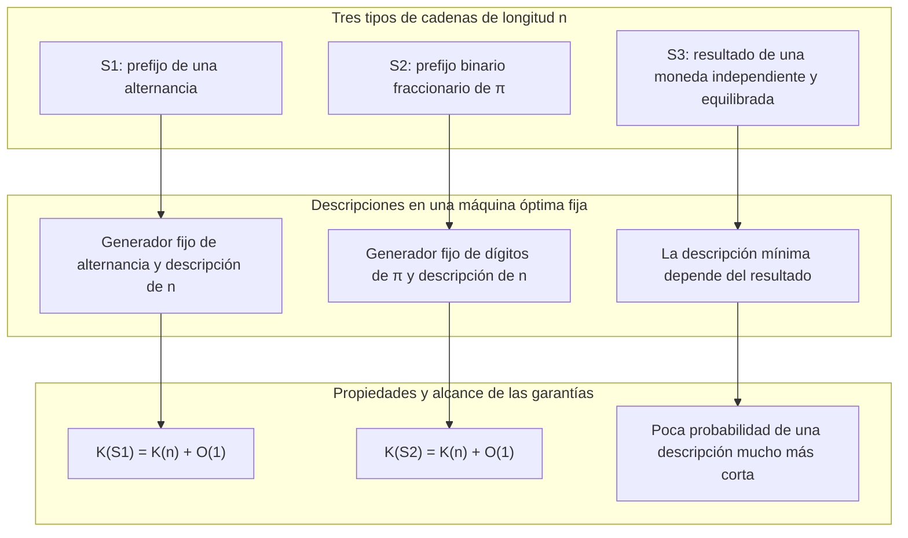
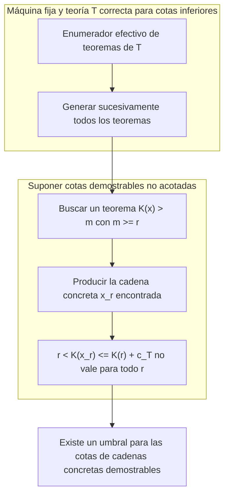

## 1. Tres cadenas de un millón de bits: ¿longitud o complejidad?

Consideremos tres cadenas binarias de longitud $n=1{,}000{,}000$.

1. $S_1$: `01` repetido quinientas mil veces.
2. $S_2$: el primer millón de bits de la expansión binaria de la <strong>parte fraccionaria</strong> de $\pi$.
3. $S_3$: un resultado del modelo de un millón de lanzamientos independientes de una moneda equilibrada.

Si empaquetamos los bits sin espacios, cada cadena ocupa 125 000 bytes, es decir, 125 kB decimales. Si guardamos cada `0` y `1` como un carácter ASCII o UTF-8, necesitamos un millón de bytes. Las cabeceras y la gestión de objetos añaden otros costes.

La representación binaria de $\pi$ comienza por $11.0010010000111111\ldots{}_2$. Al excluir la parte entera, $S_2$ empieza por `0010010000111111...`. Esta muestra es ilustrativa: no afirma que el artículo haya realizado un millón de lanzamientos físicos.

Una regla de repetición genera $S_1$, y existen algoritmos para calcular los dígitos de $S_2$. En cambio, $S_3$ no es necesariamente compleja: una moneda equilibrada puede producir por casualidad una cadena de ceros o una alternancia perfecta. La afirmación correcta es probabilística: <strong>fijado el modelo de computación, los resultados que admiten descripciones mucho más cortas constituyen una proporción pequeña</strong>.

En el modelo de lanzamientos independientes y equilibrados, cada cadena concreta de longitud $n$ tiene la misma probabilidad, incluidos los prefijos de $\pi$ y las cadenas alternantes.

$$
P(X=x)=2^{-n},\qquad x\in\{0,1\}^n
$$

¿Cómo distinguir entre resultados equiprobables que tienen o no una regla breve de generación? Este es un problema de la <strong>teoría algorítmica de la información (AIT)</strong>, desarrollada desde la década de 1960 por Solomonoff, Kolmogórov, Chaitin y otros. Su medida central es la longitud del programa más corto que produce la cadena y se detiene.

---

## 2. Información de Shannon y cadenas individuales

### 2.1 Autoinformación, entropía y codificación

Para una distribución discreta $P$, distinguimos la autoinformación de un resultado con $P(x)>0$ de su promedio, la entropía. Salvo indicación contraria, los logaritmos tienen base 2 y las cantidades se expresan en bits.

$$
I_P(x)=-\log_2P(x),\qquad
H(P)=-\sum_xP(x)\log_2P(x)
$$

En la suma se adopta la convención $0\log_2 0=0$. Un resultado al que el modelo asigna probabilidad cero tiene autoinformación infinita.

Al codificar un símbolo de un alfabeto finito con un código binario libre de prefijos, la longitud media no puede ser inferior a la entropía. Además, existe un código cuya longitud media es menor que la entropía más uno.

$$
H(P)\le L_{\mathrm{opt}}<H(P)+1
$$

No significa que la longitud de cada palabra de código sea igual a la entropía. Agrupar $r$ símbolos independientes e idénticamente distribuidos reduce el exceso debido al redondeo por símbolo.

$$
H(P)\le \frac{L_{\mathrm{opt},r}}{r}<H(P)+\frac1r
$$

Para fuentes con dependencia importan las distribuciones de bloques y la tasa de entropía. Al hablar de codificación de Huffman o aritmética también debemos distinguir el modelo, las medias y los resultados individuales.

### 2.2 Elección del modelo y frecuencias empíricas

$-\log_2P(x)$ depende de la cadena y del modelo $P$. Bajo el modelo de la moneda equilibrada, una cadena alternante también tiene un millón de bits de autoinformación. Si elegimos una distribución puntual que solo produce esa cadena, su entropía es cero. Esto no hace desaparecer el coste de comunicar el propio modelo.

Si contamos únicamente las frecuencias de los bits, la repetición de `01` tiene tantos ceros como unos y una entropía empírica de orden cero de un bit. Un modelo que prediga el siguiente bit a partir del anterior puede aprovechar su regularidad.

$$
\widehat H_0((01)^{n/2})
=-\tfrac12\log_2\tfrac12-\tfrac12\log_2\tfrac12=1
$$

Entre los bloques solapados de longitud $k$ de una cadena alternante hay a lo sumo dos tipos. Por tanto, la entropía empírica del bloque completo es como máximo un bit, y al dividir por $k$ obtenemos como máximo $1/k$ por bit. Son cantidades distintas.

No está demostrada la normalidad de $\pi$: que cada bloque de longitud fija aparezca con la frecuencia límite uniforme correspondiente. Las pruebas sobre frecuencias finitas y la apariencia desordenada no demuestran normalidad. Incluso un número normal puede tener una expansión computable. Si el modelo de predicción puede calcular los dígitos de $\pi$, la predicción y la codificación de tipo Shannon también pueden aprovechar esa regla; la teoría no se limita a modelos de frecuencias de orden cero.

AIT no invalida la teoría de Shannon. <strong>La longitud de código respecto de un modelo probabilístico y la descripción de un objeto respecto de una máquina fija responden a preguntas diferentes.</strong>

| Perspectiva | Información de Shannon | Descripción algorítmica |
| :--- | :--- | :--- |
| Objeto | Distribución y resultados bajo ella | Cadena finita producida por una máquina fija |
| Referencia | Modelo probabilístico y código | Máquina, codificación del programa y entrada auxiliar |
| Cantidades | $I_P(x)$, $H(P)$, tasa de entropía | Complejidad simple $C(x)$ y prefija $K(x)$ |
| Límites | El coste de describir el modelo se cuenta aparte | Constantes dependientes de la máquina e incomputabilidad |
| Tratamiento de $\pi$ | Depende del modelo elegido | Regla de generación y posición final |

---

## 3. Programas mínimos y teorema de invariancia

### 3.1 Complejidad simple y condicional

Sea $\{0,1\}^*$ el conjunto de las cadenas binarias finitas y $|p|$ la longitud en bits de un programa. Para una máquina parcialmente computable $A$, escribir $A(p)=x$ significa que se detiene en tiempo finito con salida exactamente igual a $x$.

$$
C_A(x)=\min\{|p|:A(p)=x\}
$$

Si ningún programa produce $x$, el mínimo se interpreta como $\infty$. Si la entrada auxiliar $y$ se proporciona sin coste, definimos:

$$
C_A(x\mid y)=\min\{|p|:A(p,y)=x\}
$$

Conocer de antemano la longitud o un diccionario tiene un coste diferente de incluirlos en el programa.

### 3.2 Complejidad prefija y programas autodelimitados

En la <strong>complejidad prefija $K$</strong>, el conjunto de programas que se detienen es libre de prefijos: ninguno de ellos es prefijo propio de otro.

$$
K_U(x)=\min\{|p|:U(p)=x\},\qquad
\sum_{p\in\operatorname{dom}U}2^{-|p|}\le1
$$

La segunda expresión es la desigualdad de Kraft. Para la complejidad prefija condicional, el dominio de parada debe ser libre de prefijos para cada entrada auxiliar fija $y$. Ser autodelimitado no consiste simplemente en añadir un paréntesis de cierre al código fuente.

En lo que sigue, $C$ y $K$ usan máquinas de referencia aditivamente óptimas en sus respectivas clases. La siguiente sección explica esta condición.

Concatenar programas simples requiere indicar sus límites. Con una codificación computable fija de pares ordenados, por ejemplo, se obtiene:

$$
C(x,y)\le C(x)+C(y)
+2\log_2\bigl(\min\{C(x),C(y)\}+2\bigr)+O(1)
$$

Los programas autodelimitados pueden concatenarse e interpretarse. Usando descripciones condicionales obtenemos una cota más sencilla:

$$
K(x,y)\le K(x)+K(y\mid x)+O(1)
\le K(x)+K(y)+O(1)
$$

Con las correspondientes máquinas de referencia fijas, ambas complejidades satisfacen:

$$
C(x)\le K(x)+O(1),\qquad
K(x)\le C(x)+2\log_2(C(x)+2)+O(1)
$$

$O(1)$ representa una constante independiente de $x$, no una medición que sitúe el coste en cero o en unos pocos bits.

### 3.3 Invariancia entre máquinas aditivamente óptimas

Para $C$ elegimos una máquina aditivamente óptima dentro de las máquinas simples; para $K$, dentro de las máquinas libres de prefijos. Si «universal» solo quiere decir que puede simular otras máquinas, debemos exigir además el coste aditivo constante de la descripción.

Para toda máquina libre de prefijos $A$ existe una constante $c_A$, independiente de $x$, tal que:

$$
K_U(x)\le K_A(x)+c_A
$$

La <strong>construcción de la demostración</strong> antepone a $p$ una etiqueta autodelimitada fija $s_A$ que identifica a $A$ y permite simular $A(p)$. Si $A(p)=x$, el programa de simulación produce $x$ con longitud $|p|+|s_A|$ más un coste fijo. El programa mínimo no puede ser más largo. Así puede construirse una máquina óptima. Para la complejidad simple hay un argumento análogo dentro de su clase.

Aplicar la cota en ambas direcciones entre dos máquinas aditivamente óptimas da:

$$
|K_{U_1}(x)-K_{U_2}(x)|\le c_{12}
$$

La constante debe cubrir ambos costes de simulación. No basta identificar el tamaño de un intérprete en una sola dirección con una cota de la diferencia absoluta.

Podemos diseñar una máquina especializada que produzca una cadena concreta de un millón de bits mediante una orden muy breve. Simular esa máquina incorpora su especificación al coste constante, pero la invariancia no elimina la dependencia de la máquina para objetos finitos. La contribución relativa de una constante dividida por $n$ tiende a cero cuando $n\to\infty$; eso no permite conocer en general la longitud mínima exacta de una cadena particular. Tampoco debemos identificar una CPU de memoria finita con el modelo matemático que permite almacenamiento sin límite.

### 3.4 Reconsiderar la alternancia, $\pi$ y la moneda

Identificamos el entero $n$ con una representación binaria fija. Sea $s(n)$ la cadena alternante de longitud $n$, o los primeros $n$ bits fraccionarios de $\pi$. Podemos obtener la cadena a partir de $n$ y recuperar $n$ como su longitud. Estas dos transformaciones computables dan:

$$
K(s(n))=K(n)+O(1),\qquad K(s(n)\mid n)=O(1)
$$

Si la posición final es una entrada gratuita, basta un generador de longitud constante. Si no, hay que describir $n$. Una codificación autodelimitada de enteros, para $n\ge2$, proporciona por ejemplo:

$$
K(n)\le \log_2 n+2\log_2\log_2 n+O(1)=O(\log n)
$$

No se deduce que $K(n)=\log_2n+O(1)$ para todos los enteros. Si $n=2^m$, podemos describir $m$ y reconstruir $n$, aprovechando una descripción breve del exponente.



No podemos afirmar que la descripción mínima de $S_3$ sea necesariamente una copia de los datos. El siguiente recuento precisa el sentido probabilístico.

---

## 4. Incompresibilidad y aleatoriedad de sucesiones infinitas

### 4.1 Cotas por reproducción literal

Reproducir literalmente cualquier cadena $x$ de longitud $n$ da cotas para la complejidad simple y la prefija condicionada a la longitud:

$$
C(x)\le n+O(1),\qquad K(x\mid n)\le n+O(1)
$$

La descripción prefija incondicional debe comunicar también la longitud de manera autodelimitada:

$$
K(x)\le n+K(n)+O(1)
$$

No existe una cota uniforme $K(x)\le |x|+O(1)$ para todas las cadenas. Si existiera, el peso $\sum_{|x|=n}2^{-K(x)}$ sería al menos una misma constante positiva para cada $n$. Sumando sobre todas las longitudes se violaría Kraft.

### 4.2 Recuento exacto mediante el principio del palomar

Sean enteros $n\ge0$ y $0\le c\le n$. El número de programas binarios de longitud estrictamente menor que $n-c$ es:

$$
\sum_{j=0}^{n-c-1}2^j=2^{n-c}-1
$$

Para $c=n$ la suma vacía vale cero. Cada programa que se detiene produce a lo sumo una cadena. Así, no puede haber más de esa cantidad de cadenas de longitud $n$ con $C(x)<n-c$. Por tanto:

$$
\#\{x\in\{0,1\}^n:C(x)\ge n-c\}
\ge2^n-2^{n-c}+1
$$

Algunos programas cortos no se detienen o producen la misma cadena, por lo que puede haber aún menos salidas distintas. Si $c>n$, tenemos $n-c<0$ y todas las cadenas satisfacen trivialmente $C(x)\ge n-c$; no se debe extender sin más la fórmula geométrica a ese dominio.

Bajo la distribución uniforme de la moneda equilibrada:

$$
P\{C(X)<n-c\}
\le\frac{2^{n-c}-1}{2^n}<2^{-c}
$$

Para $c=0$, en cada longitud hay al menos una cadena con $C(x)\ge n$. Para $c=1$, más de la mitad no admite un ahorro de <strong>más de</strong> un bit. Para $c=10$ y $c=20$, las cotas inferiores $1-2^{-c}$ de la proporción que no admite un ahorro mayor de 10 o 20 bits son aproximadamente 99,902 % y 99,999905 %. Esto no excluye ahorrar exactamente $c$ bits.

El mismo recuento sirve para $K(x\mid n)$ si fijamos la condición $n$. Los resultados de la moneda requieren, con alta probabilidad, una descripción cercana a su longitud; no es una garantía para cada resultado.

Un compresor reversible que acortase todos los archivos violaría este recuento. Los compresores reales aprovechan regularidades concretas. La proporción bajo la distribución uniforme sobre todas las cadenas binarias no es automáticamente la frecuencia de datos estructurados en la naturaleza o en la actividad humana.

### 4.3 Aleatoriedad de Martin-Löf

No poder acortar una cadena finita en cierta cantidad de bits y ser una sucesión infinita aleatoria son definiciones diferentes. En el espacio de sucesiones binarias infinitas usamos la medida $\mu$ de la moneda equilibrada. El cilindro $[w]$ reúne las sucesiones que empiezan por la cadena finita $w$ y tiene medida $2^{-|w|}$.

Un <strong>test de Martin-Löf</strong> es una sucesión de conjuntos abiertos $V_j$, enumerables computablemente de manera uniforme como uniones de cilindros de prefijos finitos, que satisface:

$$
\mu(V_j)\le2^{-j},\qquad j=1,2,\ldots
$$

Si $\omega\in\bigcap_jV_j$, la sucesión falla ese test. Es aleatoria en el sentido de Martin-Löf si no pertenece al conjunto de fallo de ningún test de este tipo. No significa que nunca exhiba un patrón finito poco frecuente. Hay una cantidad numerable de tests efectivos y cada conjunto de fallo tiene medida cero; por ello, el conjunto que los supera todos tiene medida uno.

El teorema de Levin–Schnorr expresa la equivalencia mediante la complejidad <strong>prefija</strong> óptima:

$$
\omega\text{ es aleatoria en el sentido de Martin-Löf}
\iff
\exists c\ \forall n\quad K(\omega_{1:n})\ge n-c
$$

Lo importante es que <strong>la misma constante $c$</strong> sirve para todos los $n$. No se puede sustituir aquí $K$ por la complejidad simple $C$.

Las reglas de selección de von Mises y Church forman parte de esta historia, pero cambiar la efectividad de los tests o las estrategias de apuesta da distintas nociones. La aleatoriedad computable, definida por la imposibilidad de que una martingala computable obtenga capital no acotado, es más débil que la de Martin-Löf.

La sucesión computable de dígitos de $\pi$ no es aleatoria en el sentido de Martin-Löf. Tampoco debemos confundir esta noción con la normalidad.

---

## 5. Incomputabilidad, límites de la demostración y probabilidad de parada

### 5.1 Aproximar desde arriba no permite reconocer siempre el mínimo

Mediante simulación entrelazada o dovetailing, ejecutamos poco a poco los programas candidatos. La menor longitud encontrada hasta el momento actualiza una cota superior de $K(x)$.

$$
K_t(x)\searrow K(x)\qquad(t\to\infty)
$$

Podemos iniciar la aproximación con una cota finita computable obtenida de la reproducción literal. Como los valores son enteros, para cada $x$ fijo la aproximación termina alcanzando el valor verdadero y permanece allí. Sin embargo, no existe un procedimiento general que reconozca ese momento para todas las entradas: un programa más corto que aún no se ha detenido podría producir $x$ más adelante.

### 5.2 Un argumento de tipo Berry

Consideremos «el menor entero positivo que no puede definirse en menos de veinte palabras». Contando palabras separadas por espacios, la frase tiene trece: menos de veinte. El lenguaje natural deja ambigua la expresión «puede definirse»; por eso no usamos la frase como demostración formal, sino que trasladamos la idea a procedimientos computables.

Supongamos que `ComputeK` devuelve el verdadero $K(x)$ y se detiene para toda cadena $x$. Lo siguiente es <strong>pseudocódigo</strong> que usa esa hipótesis imposible, no un calculador de complejidad implementado.

```text
Berry(m):
    Enumerar todas las cadenas binarias x por longitud 0,1,2,... y, a igual longitud, lexicográficamente:
        if ComputeK(x) >= m:
            Producir x y detenerse
```

Este orden se denomina shortlex. El orden lexicográfico habitual, por sí solo, no proporciona la enumeración de todas las cadenas finitas que necesita el argumento.

El recuento demuestra que la complejidad no está acotada. Bajo la hipótesis, la búsqueda termina para cada $m$ y produce $x_m$ con $K(x_m)\ge m$. Pero generar esa salida solo exige código fijo y una descripción autodelimitada de $m$.

$$
m\le K(x_m)\le K(m)+c
\le \log_2m+2\log_2\log_2m+c'
$$

La última cota se usa para $m\ge2$. Para constantes fijas y $m$ suficientemente grande aparece una contradicción: `ComputeK` no existe. No hace falta afirmar, sin medir los costes de la máquina, que un margen de 10 000 bits siempre bastaría.

### 5.3 Incompletitud de Chaitin

Fijemos la máquina de referencia y una teoría $T$ efectivamente axiomatizable que pueda expresar cotas de complejidad de cadenas concretas. Suponemos la <strong>corrección semántica</strong> de esas cotas demostradas: las cotas inferiores que prueba son verdaderas.

Entonces existe un umbral $b_T$ tal que $T$ no puede demostrar «$K(x)>b_T$» para ninguna cadena concreta $x$.

La idea es suponer, por contradicción, que las cotas numéricas demostrables no están acotadas. Dado $r$, podríamos enumerar todos los teoremas hasta encontrar uno de la forma «$K(x)>m$» con un valor numérico $m\ge r$.

```text
SearchProof(r):
    Enumerar efectivamente todos los teoremas de T:
        if un teorema afirma «K(x) > m» para una cadena concreta x y un entero m, con m >= r:
            Producir x y detenerse
```

La corrección garantiza que la salida $x_r$ tiene complejidad mayor que $r$. Pero el código fijo de este procedimiento ya puede incluir el enumerador de teoremas de $T$, de modo que:

$$
r<K(x_r)\le K(r)+c_T=O(\log r)+c_T
$$

Esto es imposible para $r$ suficientemente grande. Por tanto, las cotas numéricas demostrables están acotadas.



El umbral depende de la máquina, la teoría y su representación. No hemos medido un límite universal de ZFC de 20 000 o 50 000 bits. Si la longitud $n$ supera suficientemente el umbral, el recuento muestra que muchas cadenas realmente lo exceden; aun así, demostrarlo para una cadena particular puede estar fuera del alcance de la teoría.

El resultado relaciona la incompletitud de Gödel con las descripciones algorítmicas. No es una ley general de «conservación de información» que prohíba deducir teoremas largos o numerosos a partir de axiomas cortos. Añadir axiomas da otra teoría y otra constante.

### 5.4 La probabilidad de parada depende de la máquina

Para una máquina óptima libre de prefijos $U$, la probabilidad de que una secuencia infinita de bits independientes y equilibrados comience por un programa que se detiene es:

$$
\Omega_U=\sum_{p\in\operatorname{dom}U}2^{-|p|}
$$

Los cilindros correspondientes a los programas de parada son disjuntos, lo que da la interpretación probabilística. Kraft implica $\Omega_U\le1$. Con la optimalidad y las demás condiciones indicadas, $\Omega_U$ es además un real no computable, aleatorio en el sentido de Martin-Löf, y $0<\Omega_U<1$. No atribuimos todas estas propiedades a cualquier máquina que solo sea libre de prefijos.

Enumerar programas que se detienen produce sumas parciales crecientes desde abajo. Así, $\Omega_U$ es un <strong>real enumerable computablemente por la izquierda (left-c.e.)</strong>, pero no tiene un módulo computable de convergencia que indique cuándo se ha alcanzado cada precisión.

Supongamos conocidos exactamente sus primeros $N$ bits fraccionarios y llamemos $a$ al extremo inferior binario correspondiente. Como $\Omega_U$ no tiene una expansión binaria terminante:

$$
a=\frac{\lfloor2^N\Omega_U\rfloor}{2^N},
\qquad a<\Omega_U<a+2^{-N}
$$

Simulamos los programas de forma entrelazada hasta que la suma parcial $q_s$ de pesos de parada <strong>supere</strong> $a$. Entonces:

$$
0\le\Omega_U-q_s<2^{-N}
$$

Si después se detuviera un programa aún no enumerado de longitud como máximo $N$, añadiría al menos $2^{-N}$, contradiciendo la cota del peso restante. Esto decide la parada de todas las entradas de longitud como máximo $N$ de <strong>la misma máquina</strong>.

No significa que unos miles de bits fijos resuelvan infinitas proposiciones matemáticas arbitrarias. Al codificar una búsqueda de contraejemplos como problema de parada importan la máquina, la longitud del programa y la forma lógica de la proposición. Calcular algunos bits bajo condiciones especiales tampoco equivale a un algoritmo para toda la expansión.

---

## 6. Entropía, MDL, NCD e inteligencia artificial

### 6.1 Longitud media de descripción y tasa de entropía

Sea $P$ una distribución discreta computable sobre cadenas finitas, especificada por un procedimiento finito $d_P$. Si compartimos $d_P$ como entrada auxiliar gratuita y $H(P)<\infty$:

$$
H(P)\le\mathbb E_{X\sim P}[K(X\mid d_P)]\le H(P)+c
$$

El soporte puede ser finito o numerable, y las probabilidades deben poder calcularse uniformemente hasta la precisión solicitada. La constante $c$ incluye el coste del decodificador fijo; no afirmamos igualdad numérica exacta.

La cota inferior aplica Kraft a las descripciones prefijas mínimas bajo la condición fija $d_P$ y usa el argumento de longitud media de código. Para la superior se construye un código prefijo según las probabilidades compartidas y se decodifica con un procedimiento fijo. Sin compartir la distribución hay que sumar su descripción. Que una distribución arbitraria sea «conocida» no permite calcular siempre su entropía exacta en tiempo finito.

Un teorema de tipo Brudno da otra relación para <strong>procesos estacionarios ergódicos sobre un alfabeto finito</strong>. Si $h$ es la tasa de entropía en bits por símbolo, para casi toda sucesión de muestras:

$$
\lim_{n\to\infty}\frac{K(X_{1:n})}{n}=h
$$

También $\mathbb E[K(X_{1:n})]/n\to h$. La codificación literal de cadenas de $n$ símbolos proporciona una cota lineal uniforme, lo que permite pasar de la convergencia casi segura a la de las medias. La diferencia de orden logarítmico entre complejidad simple y prefija desaparece al dividir por $n$. No debemos imponer indiscriminadamente a este teorema la computabilidad de la distribución exigida en la desigualdad condicional anterior.

### 6.2 Semimedida universal discreta y predicción de Solomonoff

Para una máquina prefija óptima de salida finita y parada, definimos la probabilidad de producir exactamente $x$ y detenerse:

$$
m_U(x)=\sum_{p:U(p)=x}2^{-|p|}
$$

La masa total es como máximo uno: es una <strong>semimedida</strong> y es semicomputable inferiormente. El teorema de codificación la relaciona con la complejidad prefija.

$$
-\log_2m_U(x)=K_U(x)+O(1),
\qquad m_U(x)=\Theta(2^{-K_U(x)})
$$

En cambio, la predicción secuencial de Solomonoff usa una máquina monótona y una semimedida $M(x)$ de la probabilidad de que la salida <strong>empiece por $x$</strong>. No tiene que detenerse justo allí, y satisface $M(x)\ge M(x0)+M(x1)$. No se deben identificar $m_U$ y $M$ y trasladar sin condiciones el mismo teorema de codificación de una a otra.

Preferir descripciones breves está relacionado con la navaja de Ockham. No significa que una hipótesis corta tenga necesariamente mayor probabilidad después de observar los datos: también importa la verosimilitud.

### 6.3 Selección bayesiana y longitud mínima de descripción

Asignemos a cada modelo $H$ una longitud efectiva de descripción prefija $L(H)$ y una probabilidad a priori proporcional a su peso de código. La fórmula de Bayes da:

$$
-\log_2P(H\mid D)
=L(H)-\log_2P(D\mid H)+\mathrm{const}
$$

La constante aditiva no depende de $H$. Bajo esta elección, maximizar la probabilidad posterior equivale a minimizar el lado derecho. En general, sin embargo, no podemos sustituir siempre $-\log_2P(D\mid H)$ por $K(D\mid H)$.

El <strong>principio de longitud mínima de descripción (MDL)</strong> compara el coste conjunto de describir el modelo y los datos con él.

$$
\widehat H=\arg\min_{H\in\mathcal H}
\{L(H)+L(D\mid H)\}
$$

Un modelo demasiado simple puede dejar un código de datos muy largo; uno que memoriza todo puede ser muy costoso de describir. Eliminar el residuo memorizándolo no equivale a reducir la descripción total. MDL, desarrollado por Rissanen, es un principio práctico de selección estadística, no una garantía de descubrir cualquier ley natural o relación causal verdadera.

### 6.4 Distancia ideal y compresores reales

Para un denominador positivo, la <strong>distancia de información normalizada (NID)</strong> ideal se define como:

$$
\operatorname{NID}(x,y)=
\frac{\max\{K(x\mid y),K(y\mid x)\}}
{\max\{K(x),K(y)\}}
$$

También se relaciona con expresiones que usan la descripción del par $K(x,y)$, admitiendo los errores aditivos y normalizados adecuados. La concatenación sin delimitadores $xy$ no equivale exactamente a una codificación que permite recuperar de manera única los dos componentes del par.

Sea $Z$ la longitud de salida de un compresor real, para distinguirla de la complejidad simple $C$. La <strong>distancia de compresión normalizada (NCD)</strong> es:

$$
\operatorname{NCD}_Z(x,y)=
\frac{Z(xy)-\min\{Z(x),Z(y)\}}
{\max\{Z(x),Z(y)\}}
$$

Si el compresor aprovecha la estructura compartida, archivos similares deberían tener un valor pequeño. Si no puede aprovecharla, el valor tiende a estar cerca de uno.

Los compresores reales tienen cabeceras, ventanas de diccionario, bloques, configuraciones y efectos de orden. No todos satisfacen para toda entrada la idempotencia, monotonía, simetría y distributividad que exige el concepto teórico de normal compressor. Incluso con archivos idénticos puede fallar $Z(xx)\approx Z(x)$; la NCD de archivos finitos no garantiza exactamente los axiomas de distancia ni valores siempre entre cero y uno.

Una comprobación auxiliar concatena consigo misma una cadena fija de 65 536 bytes. Con gzip y su ventana finita se obtiene una NCD del archivo consigo mismo de aproximadamente 0,9997. No refuta la NID ideal: ilustra una limitación de la aproximación práctica.

Cilibrasi, Vitányi y colaboradores investigaron agrupamiento por compresión de genomas, lenguajes y música. Evitar características diseñadas manualmente tiene ventajas, pero el método sigue dependiendo de la codificación, la representación de archivos y el compresor. No garantiza reconstruir correctamente cualquier árbol filogenético.

### 6.5 Predicción de modelos de lenguaje y longitud de código

Para una secuencia de tokens $D=x_{1:T}$ y un modelo autorregresivo fijo, la longitud ideal asociada a las predicciones es:

$$
\mathcal L_\theta(D)=
-\sum_{t=1}^T\log_2p_\theta(x_t\mid x_{<t})
$$

Con logaritmos naturales la unidad es el nat; dividimos por $\ln2$ para obtener bits. Es la log-verosimilitud negativa sobre datos finitos, cuyo promedio por token se usa como pérdida de entropía cruzada.

Para resultados de probabilidad positiva, compartiendo modelo y longitud de secuencia, una codificación aritmética ideal o una construcción relacionada permite un código prefijo de longitud como máximo $\lceil\mathcal L_\theta(D)\rceil+2$. No significa que toda implementación ocupe exactamente «pérdida más dos bits»: hay precisión finita, terminación, redondeo y delimitación de tramas.

Sean $L_{\mathrm{model}}$ y $L_{\mathrm{meta}}$ las longitudes autodelimitadas efectivas del modelo y los metadatos necesarios. Con un decodificador fijo:

$$
K(D)\le L_{\mathrm{model}}+L_{\mathrm{meta}}
+\lceil\mathcal L_\theta(D)\rceil+O(1)
$$

Los metadatos incluyen, según corresponda, longitud, vocabulario y especificación de una tokenización reversible. Si la normalización elimina espacios o caracteres originales, no podemos recuperarlos sin información adicional.

Reducir la pérdida de un modelo compartido de tamaño fijo reduce la longitud de código de los datos. Si también cambia el tamaño del modelo, debemos comparar el coste total. Minimizar solo la pérdida de entrenamiento no es el mismo problema que minimizar un objetivo MDL de dos partes.

La perspectiva sobre compresión e inteligencia representada por AIXI y el Hutter Prize de Marcus Hutter motiva estas conexiones. Pero AIXI es un modelo ideal incomputable, no un Transformer real. El trabajo de Delétang y colaboradores sobre compresión con modelos de lenguaje también estudia la correspondencia entre predicción y compresión.

Predecir correctamente el nombre del culpable de una novela policial acorta su código. La mejora puede deberse al razonamiento, pero también a memoria, sesgos léxicos o datos repetidos. Comprimir texto de entrenamiento no demuestra que se haya adquirido necesariamente un modelo causal del mundo, razonamiento correcto, generalización o inteligencia artificial general.

| Teoría o principio | Correspondencia práctica | Distinción necesaria |
| :--- | :--- | :--- |
| $K(x)$, $K(x\mid y)$ | Descripciones con decodificador y contexto compartido | La longitud real no suele ser la mínima |
| Semimedida discreta $m_U$ | Modelos que favorecen descripciones breves | Salida con parada frente a predicción secuencial $M$ |
| MDL | Coste del modelo más código de datos | Verosimilitud frente a complejidad condicional |
| NID y NCD | Similitud y agrupamiento por compresión | Ventana, representación, orden y longitud finita |
| Modelos de lenguaje y codificación aritmética | Probabilidad predictiva y longitud | Modelo compartido, coste autónomo total y evaluación de inteligencia |

---

## 7. Conclusión: qué explica la compresión y qué queda abierto

La alternancia y los prefijos de $\pi$ tienen generadores breves incluso con un millón de bits. Describir la posición final no cuesta lo mismo que recibirla gratis como condición. Los resultados de una moneda presentan incompresibilidad con alta probabilidad por recuento, sin una garantía individual.

La invariancia controla diferencias constantes entre máquinas óptimas. El argumento de Berry muestra que la longitud mínima verdadera no es computable en general; Chaitin y $\Omega_U$ precisan los límites de la demostración y la computación. No dan una forma de evaluar cualquier objeto finito independientemente de máquinas e hipótesis.

MDL, NCD y las longitudes de código de modelos de lenguaje conectan la teoría ideal con la práctica. La compresión ayuda a estudiar regularidades y modelos compartidos, pero su tasa no sustituye una definición completa de comprensión o inteligencia.

### Referencias

- [Shen: Algorithmic Information Theory and Kolmogorov Complexity](https://www.lirmm.fr/~ashen/uppsala-notes.pdf) — Complejidad simple y prefija, descompresores óptimos, incomputabilidad y codificación.
- [Rute: Computable randomness and betting for computable probability spaces](https://arxiv.org/html/1203.5535v4) — Distinción entre aleatoriedad computable y tests de Martin-Löf.
- [Tadaki: Chaitin Ω numbers and halting problems](https://arxiv.org/abs/0904.1149) — Probabilidad de parada y problemas de parada de longitud finita para máquinas óptimas.
- [Chazottes: Entropy in Dynamical Systems & Ergodic Theory](https://www.claymath.org/wp-content/uploads/2023/04/Chazottes-rev.pdf) — Diapositiva 50: teorema de Brudno para particiones finitas.
- [Cilibrasi y Vitányi: Clustering by Compression](https://arxiv.org/html/cs/0312044v2) — Hipótesis de normal compressor y NCD.
- [Delétang y colaboradores: Language Modeling Is Compression](https://arxiv.org/abs/2309.10668) — Investigación de la relación entre predicción y compresión.
- [Hutter: Universal Algorithmic Intelligence](https://www.hutter1.net/ai/aixigentle.htm) — Ideal AIXI de inducción universal y decisión, y sus límites computacionales.
- [Bailey y colaboradores: An Empirical Approach to the Normality of Pi](https://www.davidhbailey.com/dhbpapers/normality-digits-pi.pdf) — Pruebas empíricas de dígitos frente a demostración de normalidad.
