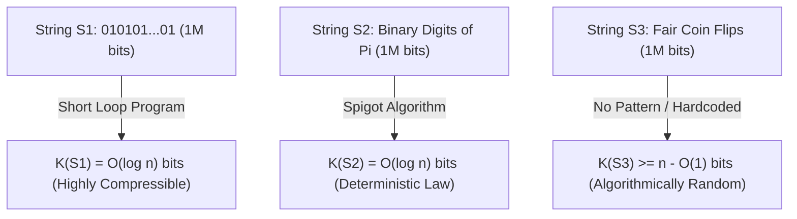
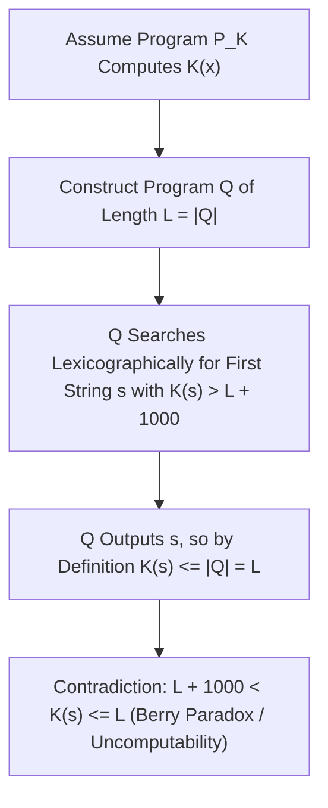

## Introducción: El enigma de las tres cadenas de un millón de bits — El punto ciego de la teoría de Shannon

Imagina que tienes frente a ti tres cadenas binarias de exactamente $1.000.000$ de bits cada una:
- La primera cadena $S_1$ es la repetición quinientas mil veces de `01`: `01010101...01`.
- La segunda cadena $S_2$ contiene el primer millón de dígitos binarios tras la coma del número $\pi$: `1100100100001111110110...`.
- La tercera cadena $S_3$ es la secuencia obtenida al lanzar un millón de veces una moneda equilibrada (cara = `1`, cruz = `0`).

¿Cuál de estas tres cadenas contiene más «información»? ¿Cuál es más «compleja» y cuál es verdaderamente «aleatoria»?
Si buscamos la respuesta en la <strong>teoría clásica de la información de Claude Shannon (1948)</strong>, nos topamos con una limitación sorprendente: la entropía de Shannon $H(X) = -\sum P(x)\log_2 P(x)$ mide la incertidumbre media de una <strong>distribución de probabilidad (un conjunto o *ensemble*)</strong>, ¡pero no dice nada sobre la complejidad intrínseca de un <strong>objeto individual concreto $x$</strong>! En el modelo de lanzamientos de una moneda justa, la secuencia perfectamente periódica $S_1$ y la secuencia caótica $S_3$ tienen exactamente la misma probabilidad $2^{-1.000.000}$; y para la constante determinista $\pi$ ($S_2$), su distribución es puntual con entropía $0$, ¡a pesar de que la frecuencia estadística de sus bits supera cualquier prueba de pseudoaleatoriedad!

Para dotar de una base matemática rigurosa a la complejidad y aleatoriedad de un objeto individual, Ray Solomonoff (1960), <strong>Andréi Kolmogórov (1965)</strong> y Gregory Chaitin (1966) fundaron de manera independiente la <strong>Teoría Algorítmica de la Información (AIT)</strong>. Su idea central es revolucionaria: <strong>la verdadera complejidad de un objeto no se mide por cuántos caracteres tiene, sino por la longitud del programa informático más corto capaz de generarlo.</strong>

---

## 1. La complejidad de Kolmogórov $K(x)$ y el teorema de invariancia

Fijada una máquina de Turing universal $U$ (o cualquier lenguaje de programación Turing-completo como C o Python), la <strong>complejidad de Kolmogórov</strong> $K_U(x)$ de una cadena binaria $x \in \{0,1\}^*$ se define como la longitud en bits $|p|$ del programa más corto $p$ que, al ejecutarse en $U$, imprime $x$ y se detiene. Para satisfacer la desigualdad de Kraft $\sum 2^{-|p|} \le 1$, en la teoría moderna se emplea la <strong>complejidad libre de prefijos (complejidad de Levin-Chaitin)</strong> $K(x)$, donde ningún programa válido es prefijo de otro.

Al analizar nuestras tres cadenas de un millón de bits bajo la lente de $K(x)$, el misterio desaparece de inmediato:
- Para $S_1$, basta con el minúsculo programa `print("01" * 500000)`. Como solo hay que codificar en binario el contador de bucle $n/2$, tenemos $K(S_1) = O(\log_2 n) pprox 20$ bits: es una cadena <strong>algorítmicamente trivial</strong>.
- Para $S_2$ (los primeros $n$ bits de $\pi$), aunque parezca ruido aleatorio, un breve programa de unos pocos cientos de bytes que implemente una fórmula de Machin o el algoritmo de goteo BBP calcula $S_2$ de forma exacta. Por tanto, ¡también cumple $K(S_2) = O(\log_2 n)$! Esto revela una profunda verdad de la filosofía de la ciencia: <strong>una ley natural no es más que una compresión algorítmica extrema de los datos empíricos.</strong>
- En cambio, para la cadena $S_3$ generada por lanzamientos reales de moneda, no existe ninguna regla oculta que permita resumirla. El programa más corto capaz de producir $S_3$ debe incorporar literalmente el millón de bits (`print("1011001...")`), por lo que $K(S_3) pprox n + O(1) pprox 1.000.000$ de bits.

Podríamos preguntarnos: ¿no depende $K_U(x)$ arbitrariamente del lenguaje de programación $U$ elegido? El <strong>teorema de invariancia de Kolmogórov</strong> demuestra que no: para cualquier par de máquinas universales $U_1$ y $U_2$, existe una constante $c_{12}$ que depende únicamente de $U_1$ y $U_2$ (y es <strong>totalmente independiente de $x$</strong>) tal que $|K_{U_1}(x) - K_{U_2}(x)| \le c_{12}$. La demostración es inmediata: ¡$c_{12}$ es simplemente el tamaño fijo en bits de un <strong>intérprete (o compilador cruzado)</strong> escrito en $U_1$ que simula a $U_2$! Cuando el tamaño de los datos $n 	o \infty$, ese coste fijo resulta despreciable.

$$
H(X) = -\sum_{x \in \mathcal{X}} P(X = x) \log_2 P(X = x)
$$

$$
K_U(x) = \min_{p \in \{0,1\}^*} \Big\{ |p| \;\Big|\; U(p) = x \Big\}, \qquad \Big| K_{U_1}(x) - K_{U_2}(x) \Big| \le c_{12}
$$

---

## 2. La esencia del azar: Principio del palomar, incompresibilidad y aleatoriedad de Martin-Löf

Antes de Kolmogórov, la teoría de probabilidades no podía explicar por qué `0000000000` no es aleatorio mientras que `0110100110` sí lo parece. La Teoría Algorítmica de la Información ofrece la primera definición rigurosa del azar individual: <strong>la aleatoriedad es incompresibilidad — la ausencia total de regularidad algorítmica.</strong>

Más aún, mediante el elemental <strong>principio del palomar (Pigeonhole Principle)</strong> podemos demostrar en dos líneas que <strong>casi todas las cadenas binarias son algorítmicamente aleatorias (incompresibles)</strong>:
Existen exactamente $2^n$ cadenas binarias de longitud $n$. ¿Cuántos programas binarios existen cuya longitud sea estrictamente menor que $n - c$ bits? Sumando el número de programas de longitudes $0, 1, \dots, n-c-1$, obtenemos en total $\sum_{i=0}^{n-c-1} 2^i = 2^{n-c} - 1$ programas posibles. Como cada programa produce a lo sumo una salida, ¡<strong>como máximo $2^{n-c} - 1$ cadenas de longitud $n$ pueden comprimirse en más de $c$ bits</strong> ($K(x) < n - c$)!
Es decir, la fracción de cadenas de longitud $n$ que admiten una compresión de al menos $c$ bits es estrictamente menor que $2^{-c}$. Si tomamos $c = 20$, ¡más del $99,9999\,\%$ de todas las cadenas no pueden acortarse ni siquiera en $20$ bits mediante ningún algoritmo concebible! Per Martin-Löf demostró en 1966 que una sucesión binaria infinita supera todos los tests estadísticos computables de azar (<strong>aleatoriedad de Martin-Löf</strong>) si y solo si todos sus prefijos $x_{1:n}$ son incompresibles ($K(x_{1:n}) \ge n - O(1)$).

$$
\sum_{i=0}^{n-c-1} 2^i = 2^{n-c} - 1 \implies \mathbb{P}_{x \sim \text{Unif}(\{0,1\}^n)}\big( K(x) < n - c \big) < \frac{2^{n-c}}{2^n} = 2^{-c}
$$

$$
\Omega = \sum_{p:\, U(p)\text{ halts}} 2^{-|p|} \in (0, 1), \qquad K(\Omega_{1:n}) \ge n - O(1)
$$

---

## 3. Paradoja de Berry, incomputabilidad de $K(x)$, constante $\Omega$ de Chaitin e IA moderna

Si $K(x)$ es tan potente, ¿podemos programar un compresor definitivo que reciba cualquier cadena $x$ y calcule exactamente $K(x)$? La respuesta es un <strong>no rotundo: la función $K(x)$ es incomputable.</strong>

Esta imposibilidad surge de la clásica <strong>paradoja de Berry</strong> («el menor entero positivo que no puede definirse en menos de veinte palabras» — frase que lo define en catorce palabras). Gregory Chaitin la formalizó así: supongamos que existiera una subrutina `ComputeK(x)` de longitud fija $L$ bits capaz de calcular $K(x)$. Construimos entonces un programa principal $Q$ que enumera todas las cadenas $s$ en orden lexicográfico, invoca `ComputeK(s)` e imprime la primera cadena $s^*$ que cumpla $K(s^*) > L + 10000$. La longitud total del programa $Q$ es de apenas $L + O(1)$ bits, ¡y sin embargo logra imprimir $s^*$! Por definición de $K(s^*)$ como longitud del programa más corto que genera $s^*$, debe cumplirse $K(s^*) \le |Q| < L + 10000$, ¡lo que contradice directamente $K(s^*) > L + 10000$! De aquí se deduce el <strong>teorema de incompletitud de Chaitin</strong>: ningún sistema axiomático formal de complejidad $C$ bits puede demostrar que una cadena específica satisface $K(x) > C + O(1)$.

Chaitin también reunió la probabilidad de parada de una máquina universal libre de prefijos en el célebre <strong>número Omega $\Omega = \sum_{U(p)	ext{ se detiene}} 2^{-|p|}$</strong>. Aunque $\Omega \in (0,1)$ está perfectamente definido, es <strong>totalmente incomputable y algorítmicamente aleatorio</strong> ($K(\Omega_{1:n}) \ge n - O(1)$): conocer los primeros $n$ bits de $\Omega$ equivaldría a resolver el problema de la parada de Turing para todos los programas de longitud hasta $n$.

En la ingeniería y la inteligencia artificial modernas, las cotas superiores computables de $K(x)$ impulsan aplicaciones fundamentales:
1. <strong>Puente con la entropía de Shannon</strong>: Para procesos estacionarios ergódicos, la esperanza $rac{1}{n}\mathbb{E}[K(X_{1:n})]$ converge a la tasa de entropía de Shannon $H(X)$.
2. <strong>Inducción universal de Solomonoff y longitud mínima de descripción (MDL)</strong>: La navaja de Ockham se formaliza mediante la distribución a priori universal $P_M(x) \propto 2^{-K(x)}$.
3. <strong>Distancia de compresión normalizada (NCD)</strong>: Aproximando $K(x)$ con compresores reales (`zstd`, `lzma`, `gzip`), la fórmula $	ext{NCD}(x,y) = rac{C(xy) - \min(C(x),C(y))}{\max(C(x),C(y))}$ permite construir árboles filogenéticos genómicos y agrupar malware sin ingeniería de características.
4. <strong>Grandes modelos de lenguaje (LLM): Comprimir es comprender</strong>: Como señalaron Marcus Hutter (Hutter Prize) e Ilya Sutskever, minimizar la pérdida de entropía cruzada $-\sum \log_2 P_	heta(x_t \mid x_{<t})$ de un Transformer autorregresivo es, mediante codificación aritmética, <strong>estrictamente equivalente a buscar la compresión sin pérdida óptima de los datos</strong>. Para comprimir al máximo el texto humano, el modelo se ve obligado a internalizar la gramática, el razonamiento lógico y un modelo causal del mundo.

| Dimensión / Concepto | Entropía de Shannon $H(X)$ | Complejidad de Kolmogórov $K(x)$ | Aproximaciones modernas (MDL / LLM / NCD) |
| :--- | :--- | :--- | :--- |
| <strong>Objeto medido</strong> | Distribución de probabilidad (*Ensemble*) | <strong>Objeto o cadena individual $x$</strong> | Archivos reales, genomas, corpus de texto |
| <strong>Juicio sobre $10^6$ bits de $\pi$</strong> | Constante determinista ($H=0$); frecuencias uniformes | $K(\pi_{1:n}) = O(\log n)$ (muy simple gracias al algoritmo) | Codificación aritmética y redes neuronales |
| <strong>Computabilidad</strong> | Exactamente computable si se conoce $P(X)$ | <strong>Estrictamente incomputable</strong> (problema de la parada) | Cotas superiores vía `zstd`/LZMA o Transformer $P_	heta$ |
| <strong>Teoremas y filosofía</strong> | Teorema de codificación de fuente | Teorema de invariancia, incompletitud de Chaitin, $\Omega$ | Navaja de Ockham, «Compresión = Predicción = Inteligencia» |

$$
P_M(x) = \sum_{p:\, U(p)=x} 2^{-|p|} \approx 2^{-K(x)}, \qquad \text{NCD}(x, y) = \frac{C(xy) - \min\{C(x), C(y)\}}{\max\{C(x), C(y)\}}
$$
