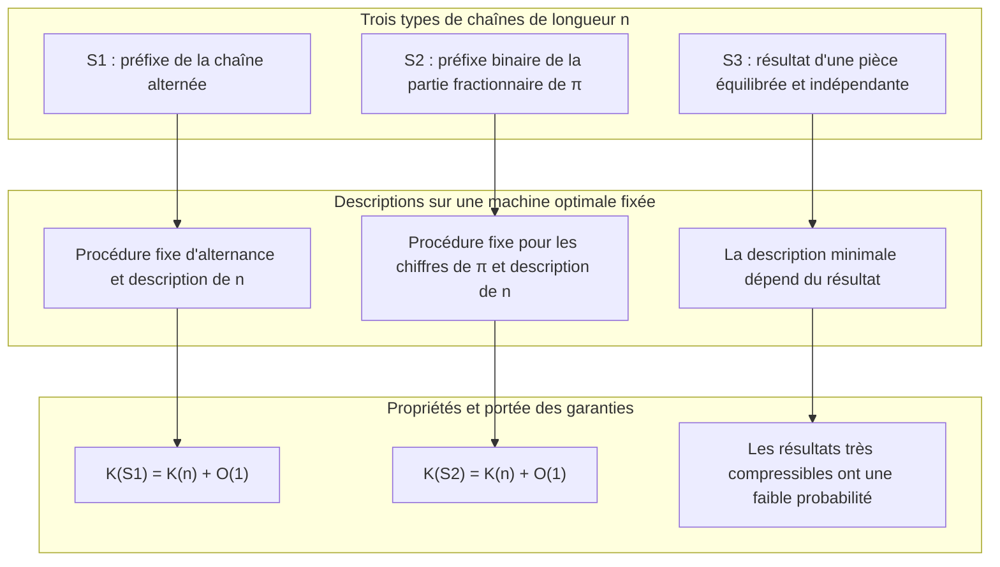
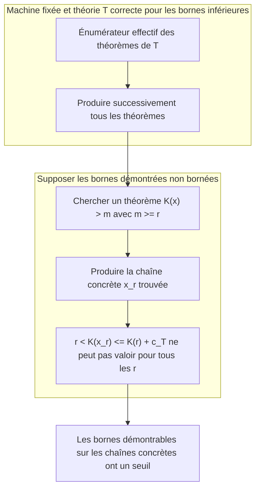

## 1. Trois chaînes d'un million de bits

Considérons trois chaînes binaires de longueur $n=1{,}000{,}000$ :

1. $S_1$ : le motif `01` répété cinq cent mille fois.
2. $S_2$ : le premier million de bits du développement binaire de la <strong>partie fractionnaire</strong> de $\pi$.
3. $S_3$ : un résultat du modèle d'un million de lancers indépendants d'une pièce équilibrée.

En stockant les bits de manière compacte, chacune occupe 125 000 octets, soit 125 kB. Si les `0` et les `1` sont enregistrés comme caractères ASCII ou UTF-8, il faut un million d'octets. Les en-têtes et les structures de gestion occupent de l'espace supplémentaire.

Le développement binaire de $\pi$ est $11.0010010000111111\ldots{}_2$. La chaîne $S_2$ commence donc par `0010010000111111...`, sans la partie entière. Ces exemples servent d'illustration ; ils ne décrivent pas un million de lancers physiques réalisés pour cet article.

Une instruction de répétition suffit pour engendrer $S_1$, et des algorithmes calculent les chiffres de $S_2$. En revanche, $S_3$ n'est pas nécessairement complexe : tous les lancers pourraient donner zéro. L'affirmation correcte est probabiliste : <strong>pour un modèle de calcul fixé, peu de résultats admettent une description beaucoup plus courte que leur longueur</strong>.

Dans le modèle de la pièce équilibrée et indépendante, toute chaîne particulière de longueur $n$ a la même probabilité, y compris la chaîne alternée ou un préfixe de $\pi$ :

$$
P(X=x)=2^{-n},\qquad x\in\{0,1\}^n
$$

Comment distinguer les résultats qui possèdent une règle de génération courte ? La <strong>théorie algorithmique de l'information (AIT)</strong>, développée notamment par Solomonoff, Kolmogorov et Chaitin depuis les années 1960, utilise la longueur du plus court programme qui produit la chaîne puis s'arrête.

---

## 2. Information de Shannon et chaînes individuelles

### 2.1 Information propre, entropie et codage

Pour une distribution discrète $P$, distinguons l'information propre d'un résultat de probabilité $P(x)>0$ de sa moyenne, l'entropie. Les logarithmes sont ici en base 2 et les quantités en bits.

$$
I_P(x)=-\log_2P(x),\qquad
H(P)=-\sum_xP(x)\log_2P(x)
$$

Dans la somme, on pose $0\log_2 0=0$. L'information propre d'un résultat de probabilité nulle est infinie.

Pour coder un symbole d'un alphabet fini avec un code binaire préfixe, la longueur moyenne optimale vérifie :

$$
H(P)\le L_{\mathrm{opt}}<H(P)+1
$$

Cela ne signifie pas que chaque mot de code a une longueur égale à l'entropie. En groupant $r$ symboles indépendants et de même loi, on réduit le surcoût d'arrondi par symbole :

$$
H(P)\le \frac{L_{\mathrm{opt},r}}{r}<H(P)+\frac1r
$$

Pour des sources dépendantes, il faut considérer les distributions de blocs ou le taux d'entropie. Le codage de Huffman comme le codage arithmétique s'interprètent par rapport à un modèle, en distinguant les quantités individuelles des moyennes.

### 2.2 Modèles et fréquences empiriques

La valeur $-\log_2P(x)$ dépend du modèle $P$, pas seulement de $x$. Sous le modèle de la pièce équilibrée, même la chaîne alternée possède un million de bits d'information propre. Une masse de probabilité concentrée sur cette seule chaîne a, au contraire, une entropie nulle. Mais <strong>le coût de transmettre le modèle lui-même n'est pas nul pour autant</strong>.

Si l'on ne regarde que les fréquences des bits individuels, la répétition de `01` contient autant de zéros que de uns. Son entropie empirique d'ordre zéro vaut :

$$
\widehat H_0((01)^{n/2})
=-\tfrac12\log_2\tfrac12-\tfrac12\log_2\tfrac12=1
$$

Un modèle qui prédit le bit suivant à partir du précédent capte pourtant la régularité. Les blocs chevauchants de longueur $k$ de la chaîne alternée sont d'au plus deux types. Leur entropie empirique est donc au plus 1 bit par bloc, soit $1/k$ par bit. L'entropie d'un bloc entier et sa valeur par bit sont des quantités différentes.

La normalité de $\pi$, selon laquelle les blocs de chaque longueur fixée ont des fréquences limites égales, n'est pas démontrée. Des tests de fréquence finis ou une apparence irrégulière ne la prouvent pas. Même la normalité serait compatible avec une suite calculable. Un modèle capable de calculer les chiffres peut exploiter cette règle pour prévoir et coder.

L'AIT ne réfute pas la théorie de Shannon. <strong>La longueur de code relative à un modèle probabiliste et la longueur de description d'un objet sur une machine fixée répondent à des questions différentes.</strong>

| Point de vue | Information de Shannon | Description algorithmique |
| :--- | :--- | :--- |
| Objet | Distribution et résultats sous ce modèle | Chaîne finie produite par une machine fixée |
| Référence | Modèle probabiliste et règles de codage | Machine, codage des programmes et entrée auxiliaire |
| Quantités | $I_P(x)$, $H(P)$ et taux d'entropie | Complexité simple $C(x)$ et préfixe $K(x)$ |
| Limites | Décrire le modèle a un coût distinct | Constantes dépendant de la machine et non-calculabilité |
| Cas de $\pi$ | Dépend du modèle choisi | On peut décrire la règle de génération et où s'arrêter |

---

## 3. Programmes minimaux et théorème d'invariance

### 3.1 Complexité simple et complexité conditionnelle

Notons $\{0,1\}^*$ l'ensemble des chaînes binaires finies et $|p|$ la longueur d'un programme en bits. Pour une machine partiellement calculable $A$, l'égalité $A(p)=x$ signifie que la machine s'arrête en temps fini et produit exactement $x$.

$$
C_A(x)=\min\{|p|:A(p)=x\}
$$

S'il n'existe aucun tel programme, la valeur est $\infty$. Lorsqu'une entrée auxiliaire $y$ est fournie gratuitement, on définit :

$$
C_A(x\mid y)=\min\{|p|:A(p,y)=x\}
$$

Connaître gratuitement la longueur ou un dictionnaire n'a pas le même coût que les inclure dans le programme.

### 3.2 Complexité préfixe et délimitation

Pour la <strong>complexité préfixe $K$</strong>, l'ensemble des programmes qui s'arrêtent est sans préfixe : aucun programme valide n'est un préfixe propre d'un autre. L'inégalité de Kraft donne :

$$
K_U(x)=\min\{|p|:U(p)=x\},\qquad
\sum_{p\in\operatorname{dom}U}2^{-|p|}\le1
$$

Dans le cas conditionnel, le domaine d'arrêt doit être sans préfixe pour chaque entrée auxiliaire fixée $y$. Un programme autodélimité n'est pas simplement un code source auquel on ajoute une parenthèse fermante. Nous fixerons des machines additivement optimales dans les classes respectives de $C$ et de $K$.

Concaténer des programmes simples exige d'en communiquer les frontières. Avec un codage calculable fixé des couples, on obtient par exemple :

$$
C(x,y)\le C(x)+C(y)
+2\log_2\bigl(\min\{C(x),C(y)\}+2\bigr)+O(1)
$$

Les programmes préfixes peuvent être concaténés et interprétés. Des descriptions conditionnelles donnent :

$$
K(x,y)\le K(x)+K(y\mid x)+O(1)
\le K(x)+K(y)+O(1)
$$

Pour les machines de référence correspondantes, les deux complexités satisfont :

$$
C(x)\le K(x)+O(1),\qquad
K(x)\le C(x)+2\log_2(C(x)+2)+O(1)
$$

Le terme $O(1)$ désigne une constante indépendante de $x$, et non un coût effectivement mesuré à zéro ou à quelques bits.

### 3.3 L'optimalité additive et ses limites

Pour $C$, on fixe une machine optimale parmi les machines simples ; pour $K$, parmi les machines sans préfixe. Si « universelle » signifie seulement la capacité de simuler les autres machines, il faut exiger en plus la préservation des longueurs à une constante additive près.

Pour toute machine sans préfixe $A$, il existe une constante $c_A$, indépendante de $x$, telle que :

$$
K_U(x)\le K_A(x)+c_A
$$

La construction consiste à faire précéder le programme $p$ d'une étiquette autodélimitée fixe $s_A$ identifiant $A$, puis à simuler $A(p)$. Si $A(p)=x$, la simulation produit $x$ avec une description de longueur $|p|+|s_A|$ plus un coût fixe. Le programme minimal ne peut être plus long. Cette construction fournit une machine optimale ; un raisonnement correspondant s'applique à la complexité simple dans sa propre classe.

En appliquant l'inégalité dans les deux sens entre deux machines additivement optimales :

$$
|K_{U_1}(x)-K_{U_2}(x)|\le c_{12}
$$

La constante doit couvrir les deux coûts de simulation. La taille d'un interpréteur dans une seule direction ne constitue pas, à elle seule, une borne de la différence absolue.

Une machine spécialisée peut produire une chaîne particulière d'un million de bits à partir d'une instruction courte. Le coût de décrire et de simuler cette machine entre dans la constante. Ainsi, <strong>l'invariance ne supprime pas la dépendance à la machine pour les objets finis</strong>. L'effet relatif d'une constante divisée par $n$ tend vers zéro quand $n\to\infty$, mais ne révèle pas la longueur minimale exacte d'une chaîne donnée. Une CPU réelle à mémoire finie n'est pas non plus une machine mathématique disposant d'une mémoire illimitée.

### 3.4 Alternance, chiffres de pi et coût du point d'arrêt

Identifions $n$ à une représentation binaire fixée des entiers. Soit $s(n)$ la chaîne alternée de longueur $n$, ou les $n$ premiers bits de la partie fractionnaire de $\pi$. On peut calculer $s(n)$ à partir de $n$ et retrouver $n$ par la longueur de la chaîne. Ces transformations calculables dans les deux sens donnent :

$$
K(s(n))=K(n)+O(1),\qquad K(s(n)\mid n)=O(1)
$$

Si le point d'arrêt est fourni gratuitement, un générateur de longueur constante suffit. Sinon, il faut décrire $n$. Un code autodélimité des entiers donne, pour $n\ge2$ :

$$
K(n)\le \log_2 n+2\log_2\log_2 n+O(1)=O(\log n)
$$

L'égalité $K(n)=\log_2n+O(1)$ n'est pas valable pour tous les entiers. Si $n=2^m$, une description courte de l'exposant $m$ permet de reconstruire $n$. La notation asymptotique ne mesure pas un programme concret à vingt bits ou à quelques centaines d'octets.



On ne peut pas affirmer que la description minimale de $S_3$ est toujours une copie des données brutes. La section suivante précise sa situation probabiliste.

---

## 4. Incompressibilité et aléatoire des suites infinies

### 4.1 Bornes obtenues par reproduction littérale

Pour toute chaîne $x$ de $n$ bits, une description qui reproduit les données fournit :

$$
C(x)\le n+O(1),\qquad K(x\mid n)\le n+O(1)
$$

Sans donner gratuitement la longueur, il faut aussi la délimiter dans la description préfixe :

$$
K(x)\le n+K(n)+O(1)
$$

Une borne uniforme $K(x)\le |x|+O(1)$ pour toutes les chaînes est impossible. Sinon, pour chaque longueur $n$, la somme $\sum_{|x|=n}2^{-K(x)}$ serait minorée par une même constante positive. En sommant sur toutes les longueurs, on violerait l'inégalité de Kraft.

### 4.2 Un dénombrement précis

Soient des entiers $n\ge0$ et $0\le c\le n$. Le nombre total de programmes binaires de longueur strictement inférieure à $n-c$ est :

$$
\sum_{j=0}^{n-c-1}2^j=2^{n-c}-1
$$

Pour $c=n$, la somme vide vaut zéro. Un programme qui s'arrête produit au plus une chaîne. Parmi les $2^n$ chaînes de longueur $n$, le nombre de celles qui satisfont $C(x)<n-c$ est donc au plus égal à ce nombre de programmes. Ainsi :

$$
\#\{x\in\{0,1\}^n:C(x)\ge n-c\}
\ge2^n-2^{n-c}+1
$$

Certains programmes ne s'arrêtent pas ou produisent la même sortie : le nombre de sorties distinctes peut être encore inférieur. Si $c>n$, alors $n-c<0$ et toutes les chaînes satisfont trivialement $C(x)\ge n-c$. On n'étend pas directement la formule de la somme géométrique à ce domaine.

Sous la distribution uniforme, correspondant aux lancers indépendants d'une pièce équilibrée :

$$
P\{C(X)<n-c\}
\le\frac{2^{n-c}-1}{2^n}<2^{-c}
$$

Pour $c=0$, il existe au moins une chaîne de chaque longueur telle que $C(x)\ge n$. Pour $c=1$, plus de la moitié des chaînes ne permettent pas une économie <strong>strictement supérieure à</strong> un bit. Pour $c=10$ et $c=20$, les bornes inférieures $1-2^{-c}$ de la proportion qui ne permet pas d'économiser plus de 10 ou 20 bits sont environ 99,902 % et 99,999905 %. Cela n'interdit pas une économie d'exactement $c$ bits.

Le même dénombrement s'applique à $K(x\mid n)$ pour la condition $n$ fixée. Les résultats de la pièce exigent donc, avec une forte probabilité, une description proche de leur longueur ; ce n'est pas une garantie pour chaque résultat.

Un compresseur réversible qui raccourcirait tous les fichiers contredirait ce dénombrement. Les compresseurs réels exploitent des régularités propres à certaines données. La proportion sous la distribution uniforme de toutes les chaînes ne se transpose pas automatiquement aux données naturelles ou humaines.

### 4.3 L'aléatoire au sens de Martin-Löf

L'incompressibilité d'une chaîne finie à une marge donnée et l'aléatoire d'une suite infinie sont des définitions distinctes. Sur les suites binaires infinies, prenons la mesure $\mu$ de la pièce équilibrée. Le cylindre $[w]$ des suites commençant par une chaîne finie $w$ a pour mesure $2^{-|w|}$.

Un <strong>test de Martin-Löf</strong> est une suite d'ouverts $V_j$, uniformément énumérables par calcul comme unions de cylindres de préfixes finis, telle que :

$$
\mu(V_j)\le2^{-j},\qquad j=1,2,\ldots
$$

Une suite $\omega$ échoue au test si $\omega\in\bigcap_jV_j$. Elle est aléatoire au sens de Martin-Löf si elle n'échoue à aucun test de cette forme. Cela n'interdit pas l'apparition occasionnelle d'un motif fini rare. Il existe un nombre dénombrable de tests effectifs, chacun ayant un ensemble d'échec de mesure nulle ; l'ensemble des suites qui réussissent tous les tests est donc de mesure un.

Le théorème de Levin–Schnorr caractérise cette propriété à l'aide de la complexité <strong>préfixe</strong> optimale :

$$
\omega\text{ est aléatoire au sens de Martin-Löf}
\iff
\exists c\ \forall n\quad K(\omega_{1:n})\ge n-c
$$

Il faut que <strong>la même constante $c$</strong> convienne pour tous les $n$. On ne peut pas remplacer directement $K$ par la complexité simple $C$ dans cette équivalence.

Les règles de sélection de von Mises et de Church font partie de cette histoire, mais les notions varient selon les conditions de calculabilité imposées aux tests ou aux stratégies de pari. En particulier, l'aléatoire calculable, défini par l'impossibilité pour une martingale calculable d'accumuler un capital non borné, est plus faible que l'aléatoire de Martin-Löf. La suite calculable des chiffres de $\pi$ n'est pas aléatoire au sens de Martin-Löf ; la normalité est une autre propriété.

---

## 5. Non-calculabilité, limites de la preuve et probabilité d'arrêt

### 5.1 Approcher par le haut sans savoir que l'on est arrivé

Pour chercher les programmes courts qui produisent $x$, on peut entrelacer leur exécution, en donnant progressivement quelques étapes à chaque candidat. La plus petite longueur trouvée fournit une approximation supérieure :

$$
K_t(x)\searrow K(x)\qquad(t\to\infty)
$$

On peut commencer par une borne finie calculable obtenue par reproduction littérale. Les valeurs étant entières, pour chaque $x$ fixé, elles finissent par atteindre la vraie valeur et restent ensuite constantes. Mais aucun procédé général ne reconnaît ce moment pour toutes les entrées. Un programme plus court qui n'a pas encore terminé pourrait produire $x$ plus tard.

### 5.2 Un raisonnement de type Berry

L'expression « le plus petit entier positif non définissable en moins de vingt mots » comporte douze mots séparés par des espaces, donc moins de vingt. La notion de « définissable » en langue naturelle est ambiguë : cette phrase n'est pas à elle seule une démonstration formelle. On transpose l'idée à des procédures calculables.

Supposons qu'une procédure `ComputeK` renvoie la vraie valeur de $K(x)$ et s'arrête pour toute chaîne $x$. Le <strong>pseudocode</strong> suivant utilise cette hypothèse impossible ; il ne s'agit pas d'un calculateur réalisable de complexité.

```text
Berry(m):
    Énumérer les chaînes binaires x par longueur 0,1,2,..., puis par ordre lexicographique à longueur égale :
        if ComputeK(x) >= m:
            Produire x et s'arrêter
```

L'ordre est dit shortlex : la longueur d'abord, puis l'ordre lexicographique. L'ordre lexicographique ordinaire seul ne fournit pas l'énumération de toutes les chaînes finies requise ici.

Le dénombrement montre que la complexité n'est pas bornée. Sous l'hypothèse, la recherche termine pour chaque $m$ et produit $x_m$ tel que $K(x_m)\ge m$. Pourtant, un code fixe et une description autodélimitée de $m$ suffisent à produire cette sortie :

$$
m\le K(x_m)\le K(m)+c
\le \log_2m+2\log_2\log_2m+c'
$$

La dernière borne vaut pour $m\ge2$. Pour des constantes fixées et $m$ assez grand, on obtient une contradiction. La procédure `ComputeK` n'existe donc pas. Il n'est pas nécessaire d'affirmer qu'une marge fixe de 10 000 bits suffirait sans mesurer les coûts de la machine choisie.

### 5.3 Incomplétude de Chaitin

Fixons la machine de référence et une théorie $T$ effectivement axiomatisable, capable d'exprimer des bornes de complexité pour des chaînes concrètes. Supposons sa <strong>correction sémantique</strong> pour ces bornes inférieures : celles qu'elle démontre sont vraies.

Il existe alors un seuil $b_T$ tel que $T$ ne peut démontrer « $K(x)>b_T$ » pour aucune chaîne concrète $x$.

Pour comprendre la preuve, supposons au contraire les bornes numériques démontrables non bornées. Pour chaque entrée $r$, on pourrait énumérer les théorèmes et en trouver un de la forme « $K(x)>m$ », avec un entier concret $m\ge r$.

```text
SearchProof(r):
    Énumérer effectivement les théorèmes de T :
        if un théorème affirme "K(x) > m" pour une chaîne concrète x et un entier m, avec m >= r:
            Produire x et s'arrêter
```

La correction assure que la sortie $x_r$ a une complexité supérieure à $r$. Mais le code fixe du procédé peut inclure l'énumérateur des théorèmes de $T$, d'où :

$$
r<K(x_r)\le K(r)+c_T=O(\log r)+c_T
$$

C'est impossible pour $r$ assez grand. Les bornes numériques démontrables sont donc bornées.



Le seuil dépend de la machine, de la théorie et de la représentation. Il ne mesure pas une limite universelle de ZFC à 20 000 ou 50 000 bits. Pour des longueurs $n$ suffisamment grandes par rapport au seuil, le dénombrement montre que beaucoup de chaînes ont réellement une complexité supérieure à ce seuil. La limite concerne la démonstration d'une telle borne pour une chaîne particulière.

Le résultat relie l'incomplétude de Gödel aux descriptions algorithmiques. Ce n'est pas une loi générale de « conservation de l'information » qui interdirait de déduire des théorèmes longs ou nombreux d'axiomes courts. Ajouter des axiomes donne une autre théorie, avec une autre constante.

### 5.4 Une probabilité d'arrêt propre à chaque machine

Pour une machine optimale sans préfixe $U$, la probabilité qu'une suite infinie de bits indépendants et équiprobables commence par un programme qui s'arrête est :

$$
\Omega_U=\sum_{p\in\operatorname{dom}U}2^{-|p|}
$$

Les cylindres des programmes qui s'arrêtent sont disjoints, ce qui justifie l'interprétation probabiliste. Kraft donne $\Omega_U\le1$. Sous ces hypothèses, notamment l'optimalité, $\Omega_U$ est aussi un réel non calculable, aléatoire au sens de Martin-Löf, et $0<\Omega_U<1$. Toutes ces propriétés ne valent pas pour une machine arbitraire simplement parce que son domaine est sans préfixe.

Énumérer les programmes qui s'arrêtent produit des sommes partielles croissantes. Ainsi, $\Omega_U$ est <strong>calculablement énumérable par la gauche (left-c.e.)</strong>, mais aucune fonction calculable ne fournit un stade garantissant chaque précision demandée.

Supposons connus exactement les $N$ premiers bits fractionnaires et notons $a$ l'extrémité inférieure correspondante. Puisque $\Omega_U$ n'a pas de développement binaire fini :

$$
a=\frac{\lfloor2^N\Omega_U\rfloor}{2^N},
\qquad a<\Omega_U<a+2^{-N}
$$

Exécutons les programmes de façon entrelacée jusqu'à ce que la somme partielle de leurs poids d'arrêt $q_s$ <strong>dépasse</strong> $a$. Alors :

$$
0\le\Omega_U-q_s<2^{-N}
$$

Un programme non encore énuméré, de longueur au plus $N$, ajouterait au moins $2^{-N}$ s'il s'arrêtait plus tard, ce qui contredirait cette borne. Ces bits permettent donc de décider l'arrêt de toutes les entrées de longueur au plus $N$ de la <strong>même machine</strong>.

Cela ne signifie pas qu'un nombre fixé de quelques milliers de bits décide toutes les propositions mathématiques arbitraires. Lorsqu'on code une recherche de contre-exemple comme problème d'arrêt, la machine, la longueur du programme et la forme logique de la proposition comptent. Étudier un nombre fini de chiffres ne fournit pas non plus un algorithme qui les engendre tous.

---

## 6. Shannon, MDL, NCD et intelligence artificielle

### 6.1 Longueur moyenne de description et taux d'entropie

Soit $P$ une distribution discrète calculable sur les chaînes finies, spécifiée par une procédure finie $d_P$. Si $d_P$ est partagée gratuitement comme entrée auxiliaire et si $H(P)<\infty$, alors :

$$
H(P)\le\mathbb E_{X\sim P}[K(X\mid d_P)]\le H(P)+c
$$

Le support peut être fini ou dénombrable ; les probabilités doivent être calculables uniformément à la précision demandée. La constante $c$ comprend notamment un coût fixe de décodage. On n'affirme pas une égalité numérique exacte.

La borne inférieure résulte de Kraft appliquée aux descriptions préfixes minimales pour la condition fixée $d_P$, puis de l'argument de longueur moyenne de code. Pour la borne supérieure, on construit un code préfixe à partir des probabilités partagées et on le décode avec une procédure fixe. Si la distribution n'est pas partagée, il faut compter sa description. Le simple fait qu'une distribution arbitraire soit « connue » ne garantit pas que son entropie soit toujours calculable exactement en temps fini.

Un autre résultat, de type Brudno, concerne les <strong>processus stationnaires ergodiques sur un alphabet fini</strong>. Si $h$ est le taux d'entropie en bits par symbole, alors, pour presque toute suite d'observations :

$$
\lim_{n\to\infty}\frac{K(X_{1:n})}{n}=h
$$

On a également $\mathbb E[K(X_{1:n})]/n\to h$. Un codage littéral des chaînes de $n$ symboles fournit une borne linéaire uniforme permettant de passer de la convergence presque sûre à celle des moyennes. La différence logarithmique entre complexité simple et préfixe disparaît après division par $n$. Ce théorème de taux n'exige pas la calculabilité de la mesure imposée dans l'inégalité conditionnelle précédente.

### 6.2 Semi-mesure universelle discrète et prédiction de Solomonoff

Pour une machine préfixe optimale qui produit une sortie finie puis s'arrête, définissons la probabilité de produire exactement $x$ et de s'arrêter :

$$
m_U(x)=\sum_{p:U(p)=x}2^{-|p|}
$$

La masse totale étant au plus égale à un, il s'agit d'une <strong>semi-mesure</strong>, semi-calculable inférieurement. Le théorème du codage relie cette semi-mesure universelle discrète à la complexité préfixe :

$$
-\log_2m_U(x)=K_U(x)+O(1),
\qquad m_U(x)=\Theta(2^{-K_U(x)})
$$

La prédiction séquentielle de Solomonoff utilise, elle, une machine monotone et une semi-mesure $M(x)$ pour la probabilité que la sortie <strong>commence par $x$</strong>. Il n'est pas nécessaire que la machine s'arrête à cet endroit ; on a $M(x)\ge M(x0)+M(x1)$. La semi-mesure discrète $m_U$ et l'objet séquentiel $M$ ne sont pas identiques, et on ne leur transfère pas sans conditions le même théorème du codage.

Favoriser les descriptions courtes rejoint le rasoir d'Ockham. Cela ne garantit pas qu'une hypothèse courte ait une probabilité supérieure après observation des données : la vraisemblance intervient aussi.

### 6.3 Sélection bayésienne et longueur minimale de description

Attribuons au modèle $H$ une longueur effective de description préfixe $L(H)$ et une probabilité a priori proportionnelle au poids de ce code. La formule de Bayes devient :

$$
-\log_2P(H\mid D)
=L(H)-\log_2P(D\mid H)+\mathrm{const}
$$

La constante ne dépend pas de $H$. Avec ce choix, maximiser la probabilité a posteriori revient à minimiser le membre de droite. Mais on ne peut pas, en général, remplacer systématiquement $-\log_2P(D\mid H)$ par $K(D\mid H)$.

Le <strong>principe de longueur minimale de description (MDL)</strong> compare le coût total du modèle et des données codées avec lui :

$$
\widehat H=\arg\min_{H\in\mathcal H}
\{L(H)+L(D\mid H)\}
$$

Un modèle trop simple peut laisser un code long pour les données. Un modèle qui mémorise tout peut avoir une description propre très longue. Supprimer les résidus par mémorisation ne revient pas à réduire la longueur totale. Le MDL de Rissanen est un principe pratique de sélection statistique, pas une garantie de découvrir toute vraie loi naturelle ou relation causale.

### 6.4 Distance idéale et compresseurs réels

Pour un dénominateur positif, la <strong>distance d'information normalisée (NID)</strong> idéale est définie par :

$$
\operatorname{NID}(x,y)=
\frac{\max\{K(x\mid y),K(y\mid x)\}}
{\max\{K(x),K(y)\}}
$$

Elle est également liée à des expressions utilisant la description du couple $K(x,y)$, à des erreurs additives et normalisées appropriées près. Une concaténation sans délimiteur $xy$ n'est pas exactement un codage permettant de retrouver les deux éléments du couple de manière unique.

Notons $Z$ la longueur de sortie d'un compresseur réel, pour la distinguer de la complexité simple $C$. La <strong>distance de compression normalisée (NCD)</strong> est :

$$
\operatorname{NCD}_Z(x,y)=
\frac{Z(xy)-\min\{Z(x),Z(y)\}}
{\max\{Z(x),Z(y)\}}
$$

L'idée est qu'un compresseur capable de réutiliser les structures communes donnera une petite valeur pour des fichiers similaires ; si ces structures ne sont pas exploitées, la valeur tendra vers un.

Mais les compresseurs réels ont des en-têtes, des fenêtres de dictionnaire, des blocs, des réglages et des effets d'ordre. Ils ne satisfont pas tous, sur toute entrée, les hypothèses d'idempotence, de monotonie, de symétrie et de distributivité du compresseur normal théorique. Même pour deux fichiers identiques, $Z(xx)\approx Z(x)$ peut échouer. Pour des données finies, la NCD ne garantit ni les axiomes exacts d'une distance ni une valeur toujours comprise entre zéro et un.

Une vérification auxiliaire a concaténé une chaîne fixe de 65 536 octets avec elle-même. Avec gzip et sa fenêtre finie, la NCD du fichier avec lui-même était proche de 0,9997. Ce n'est pas un contre-exemple à la NID idéale, mais une illustration des limites de l'approximation pratique.

Cilibrasi, Vitányi et leurs collaborateurs ont étudié le regroupement par compression de génomes, de langues et de musique. Éviter la conception manuelle de caractéristiques spécialisées présente un intérêt, mais le résultat dépend encore du codage des caractères, de la représentation des fichiers et du compresseur. Aucune reconstruction correcte de toute phylogénie n'est garantie.

### 6.5 Prédictions des modèles de langage et longueur de code

Pour une suite de tokens $D=x_{1:T}$ et un modèle autorégressif fixé, la longueur idéale associée aux prédictions est :

$$
\mathcal L_\theta(D)=
-\sum_{t=1}^T\log_2p_\theta(x_t\mid x_{<t})
$$

Avec des logarithmes naturels, l'unité est le nat ; on divise par $\ln2$ pour obtenir des bits. Il s'agit de la log-vraisemblance négative sur des données finies, dont la moyenne par token sert de perte d'entropie croisée.

Pour les résultats de probabilité positive, si le modèle et la longueur de la suite sont partagés, un codage arithmétique idéal ou une construction apparentée permet une description préfixe de longueur au plus $\lceil\mathcal L_\theta(D)\rceil+2$. Toutes les implémentations ne produisent pas exactement « perte plus deux bits » : précision finie, terminaison, arrondi et délimitation des blocs ajoutent des coûts.

Notons $L_{\mathrm{model}}$ et $L_{\mathrm{meta}}$ les longueurs effectives des descriptions autodélimitées du modèle et des métadonnées nécessaires. Pour un décodeur fixé :

$$
K(D)\le L_{\mathrm{model}}+L_{\mathrm{meta}}
+\lceil\mathcal L_\theta(D)\rceil+O(1)
$$

Les métadonnées comprennent, selon les besoins, la longueur de la suite, le vocabulaire et la spécification d'une tokenisation réversible. Si une normalisation supprime des espaces ou des caractères originaux, on ne peut pas les reconstruire sans information supplémentaire.

Diminuer la perte prédictive d'un modèle partagé de taille fixe réduit la longueur de code des données. Si la taille du modèle varie aussi, il faut comparer le coût total. Minimiser seulement la perte d'entraînement n'est pas le même objectif que minimiser un MDL en deux parties.

Les recherches sur compression et intelligence illustrées par AIXI et le Hutter Prize de Marcus Hutter motivent ces rapprochements. AIXI est toutefois un modèle idéal non calculable, pas un Transformer réel. Les travaux de Delétang et de ses collaborateurs étudient eux aussi la correspondance entre prédiction et compression.

Prédire correctement le nom du coupable dans un roman policier raccourcit le code de ce nom. L'amélioration peut provenir du raisonnement, mais aussi de la mémorisation, de biais lexicaux ou de données répétées. Compresser les textes d'entraînement ne démontre pas l'acquisition nécessaire d'un modèle causal du monde, d'un raisonnement correct, d'une capacité de généralisation ou d'une intelligence artificielle générale.

| Théorie ou principe | Correspondance pratique | Distinction nécessaire |
| :--- | :--- | :--- |
| $K(x)$, $K(x\mid y)$ | Descriptions avec décodeur et contexte partagé | La longueur réelle n'est pas nécessairement minimale |
| Semi-mesure discrète $m_U$ | Modélisation favorisant les descriptions courtes | Sortie avec arrêt et prédiction séquentielle $M$ |
| MDL | Longueur du modèle plus code des données | Vraisemblance et complexité conditionnelle |
| NID et NCD | Similarité et regroupement par compression | Fenêtre, représentation, ordre et longueur finie |
| Modèles de langage et codage arithmétique | Probabilité prédite et longueur de code | Modèle partagé, coût total autonome et évaluation de l'intelligence |

---

## 7. Ce que la compression explique et ce qu'elle laisse ouvert

À longueur égale d'un million de bits, la chaîne alternée et les préfixes de $\pi$ ont des générateurs courts. Décrire où s'arrêter ne coûte pas la même chose que recevoir cette information gratuitement. Le dénombrement garantit une forte probabilité d'incompressibilité pour la pièce équilibrée, pas une garantie individuelle.

Le théorème d'invariance borne les différences entre machines optimales par des constantes. L'argument de Berry montre que les vraies longueurs minimales ne sont pas calculables en général. Chaitin et $\Omega_U$ précisent les limites de la preuve et du calcul ; ils ne donnent pas une évaluation de tout objet fini indépendante des machines et des hypothèses.

MDL, NCD et longueurs de code des modèles de langage relient cet idéal à la pratique. La compression aide à comprendre les régularités et le partage des modèles, mais son taux ne remplace pas une définition complète de la compréhension ou de l'intelligence.

### Références

- [Shen: Algorithmic Information Theory and Kolmogorov Complexity](https://www.lirmm.fr/~ashen/uppsala-notes.pdf) — Complexités simple et préfixe, décodeurs optimaux, non-calculabilité et théorème du codage.
- [Rute: Computable randomness and betting for computable probability spaces](https://arxiv.org/html/1203.5535v4) — Distinction entre aléatoire calculable et tests de Martin-Löf.
- [Tadaki: Chaitin Ω numbers and halting problems](https://arxiv.org/abs/0904.1149) — Probabilités d'arrêt des machines optimales et problèmes d'arrêt pour des entrées de longueur bornée.
- [Chazottes: Entropy in Dynamical Systems & Ergodic Theory](https://www.claymath.org/wp-content/uploads/2023/04/Chazottes-rev.pdf) — Diapositive 50 : théorème de Brudno pour les partitions finies.
- [Cilibrasi et Vitányi: Clustering by Compression](https://arxiv.org/html/cs/0312044v2) — Hypothèses de compresseur normal et NCD.
- [Delétang et al.: Language Modeling Is Compression](https://arxiv.org/abs/2309.10668) — Étude du lien entre prédiction et compression.
- [Hutter: Universal Algorithmic Intelligence](https://www.hutter1.net/ai/aixigentle.htm) — Le modèle idéal AIXI, entre induction universelle et décision, et ses limites calculatoires.
- [Bailey et al.: An Empirical Approach to the Normality of Pi](https://www.davidhbailey.com/dhbpapers/normality-digits-pi.pdf) — Différence entre tests empiriques des chiffres et preuve de normalité.
