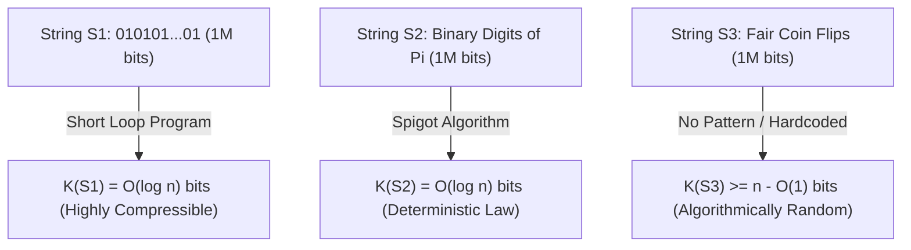
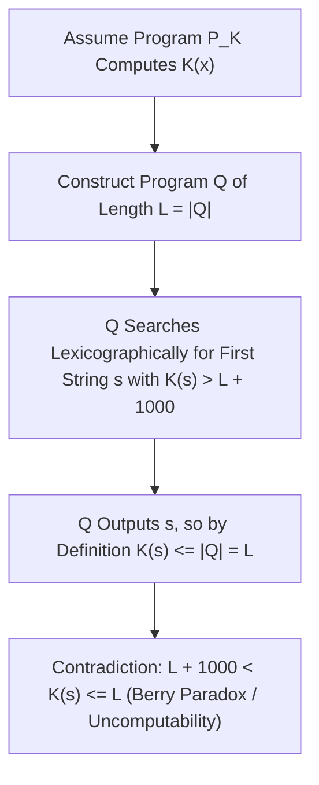

## Introduction : L'énigme des trois chaînes d'un million de bits — L'angle mort de la théorie de Shannon

Imaginez devant vous trois chaînes binaires mesurant chacune exactement $1\,000\,000$ de bits :
- La première chaîne $S_1$ est la répétition cinq cent mille fois du motif `01` : `01010101...01`.
- La deuxième chaîne $S_2$ représente le premier million de chiffres binaires après la virgule du nombre $\pi$ : `1100100100001111110110...`.
- La troisième chaîne $S_3$ est la suite obtenue en lançant un million de fois une pièce de monnaie équilibrée (pile = `1`, face = `0`).

Laquelle de ces trois chaînes contient le plus d'« information » ? Laquelle est la plus « complexe », et laquelle est véritablement « aléatoire » ?
Si nous interrogeons la <strong>théorie classique de l'information de Claude Shannon (1948)</strong>, nous nous heurtons à une impasse surprenante : l'entropie de Shannon $H(X) = -\sum P(x)\log_2 P(x)$ mesure l'incertitude moyenne d'une <strong>distribution de probabilité (un ensemble statistique)</strong>, mais reste muette sur la complexité intrinsèque d'un <strong>objet individuel isolé $x$</strong> ! Dans le modèle du lancer de pièce équilibrée, la suite parfaitement régulière $S_1$ et la suite chaotique $S_3$ ont exactement la même probabilité $2^{-1\,000\,000}$ ; quant à la constante déterministe $\pi$ ($S_2$), sa distribution est ponctuelle d'entropie nulle ($H=0$), alors même que la fréquence de ses bits imite à la perfection le hasard !

Pour fonder mathématiquement la complexité et le hasard d'un objet individuel, Ray Solomonoff (1960), <strong>Andreï Kolmogorov (1965)</strong> et Gregory Chaitin (1966) ont indépendamment créé la <strong>théorie algorithmique de l'information (AIT)</strong>. Leur intuition centrale est lumineuse : <strong>la véritable complexité d'un objet ne se mesure pas au nombre de caractères qui le composent, mais à la longueur du plus court programme informatique capable de le générer !</strong>

---

## 1. La complexité de Kolmogorov $K(x)$ et le théorème d'invariance

Étant donné une machine de Turing universelle $U$ (ou tout langage de programmation Turing-complet comme C ou Python), la <strong>complexité de Kolmogorov</strong> $K_U(x)$ d'une chaîne binaire $x \in \{0,1\}^*$ est définie comme la longueur en bits $|p|$ du plus court programme $p$ qui, exécuté sur $U$, affiche $x$ et s'arrête. Pour garantir l'inégalité de Kraft $\sum 2^{-|p|} \le 1$, on utilise généralement la <strong>complexité sans préfixe (complexité de Levin-Chaitin)</strong> $K(x)$, où aucun programme valide n'est le préfixe d'un autre.

Sous l'éclairage de $K(x)$, le mystère de nos trois chaînes d'un million de bits se dissipe instantanément :
- Pour $S_1$, le programme se résume à `print("01" * 500000)`. Il suffit de coder en binaire le nombre d'itérations $n/2$, si bien que $K(S_1) = O(\log_2 n) pprox 20$ bits : cette chaîne est <strong>algorithmiquement élémentaire</strong>.
- Pour $S_2$ (les $n$ premiers bits de $\pi$), bien que la suite paraisse désordonnée et réussisse tous les tests statistiques de pseudo-aléatoire, un programme de quelques centaines d'octets implémentant une formule de Machin ou l'algorithme compte-gouttes BBP permet de la calculer exactement. On a donc aussi $K(S_2) = O(\log_2 n)$ ! Cela révèle une vérité épistémologique majeure : <strong>une loi de la nature n'est rien d'autre qu'une compression algorithmique radicale des données d'observation.</strong>
- En revanche, pour la chaîne $S_3$ issue de vrais lancers de pièce, aucune régularité cachée ne permet de résumer la suite. Le plus court programme capable de produire $S_3$ doit inclure le million de bits littéralement en dur (`print("1011001...")`), d'où $K(S_3) pprox n + O(1) pprox 1\,000\,000$ de bits !

Mais cette définition ne dépend-elle pas du choix arbitraire du langage de programmation $U$ ? Le <strong>théorème d'invariance de Kolmogorov</strong> prouve qu'il n'en est rien : pour tout couple de machines universelles $U_1$ et $U_2$, il existe une constante $c_{12}$ dépendant uniquement de $U_1$ et $U_2$ (et <strong>totalement indépendante de $x$</strong>) telle que $|K_{U_1}(x) - K_{U_2}(x)| \le c_{12}$. La preuve est limpide : $c_{12}$ est simplement la taille fixe d'un <strong>interpréteur (ou compilateur croisé)</strong> permettant à $U_1$ de simuler $U_2$ ! Lorsque la taille des données $n 	o \infty$, ce coût fixe devient négligeable.

$$
H(X) = -\sum_{x \in \mathcal{X}} P(X = x) \log_2 P(X = x)
$$

$$
K_U(x) = \min_{p \in \{0,1\}^*} \Big\{ |p| \;\Big|\; U(p) = x \Big\}, \qquad \Big| K_{U_1}(x) - K_{U_2}(x) \Big| \le c_{12}
$$

---

## 2. L'essence du hasard : Principe des tiroirs, incompressibilité et aléatoire de Martin-Löf

Avant Kolmogorov, les probabilistes ne pouvaient expliquer pourquoi la chaîne `0000000000` n'est pas aléatoire alors que `0110100110` semble l'être. La théorie algorithmique de l'information apporte la première définition rigoureuse du hasard individuel : <strong>le hasard est l'incompressibilité — l'absence totale de régularité algorithmique !</strong>

Mieux encore, le simple <strong>principe des tiroirs de Dirichlet (Pigeonhole Principle)</strong> permet de démontrer en deux lignes que <strong>la quasi-totalité des chaînes binaires sont algorithmiquement aléatoires (incompressibles)</strong> :
Il existe exactement $2^n$ chaînes binaires de longueur $n$. Combien existe-t-il de programmes binaires de longueur strictement inférieure à $n - c$ bits ? En sommant le nombre de programmes de longueur $0, 1, \dots, n-c-1$, on obtient au total $\sum_{i=0}^{n-c-1} 2^i = 2^{n-c} - 1$ programmes. Puisque chaque programme produit au plus une sortie, il y a <strong>au maximum $2^{n-c} - 1$ chaînes de longueur $n$ qui peuvent être compressées de plus de $c$ bits</strong> ($K(x) < n - c$) !
Autrement dit, la proportion de chaînes de longueur $n$ compressibles d'au moins $c$ bits est strictement inférieure à $2^{-c}$. Pour $c = 20$, plus de $99,9999\,\%$ des chaînes ne peuvent même pas être raccourcies de $20$ bits par quelque algorithme que ce soit ! En 1966, Per Martin-Löf a démontré qu'une suite binaire infinie passe tous les tests statistiques d'aléatoire calculables (<strong>aléatoire au sens de Martin-Löf</strong>) si et seulement si tous ses préfixes $x_{1:n}$ sont incompressibles ($K(x_{1:n}) \ge n - O(1)$).

$$
\sum_{i=0}^{n-c-1} 2^i = 2^{n-c} - 1 \implies \mathbb{P}_{x \sim \text{Unif}(\{0,1\}^n)}\big( K(x) < n - c \big) < \frac{2^{n-c}}{2^n} = 2^{-c}
$$

$$
\Omega = \sum_{p:\, U(p)\text{ halts}} 2^{-|p|} \in (0, 1), \qquad K(\Omega_{1:n}) \ge n - O(1)
$$

---

## 3. Paradoxe de Berry, incomputabilité de $K(x)$, constante $\Omega$ de Chaitin et IA moderne

Puisque $K(x)$ est si puissant, peut-on écrire un programme universel qui prend en entrée n'importe quelle chaîne $x$ et calcule exactement $K(x)$ ? La réponse est un <strong>non absolu : la fonction $K(x)$ est non calculable (Uncomputable) !</strong>

Cette impossibilité découle du célèbre <strong>paradoxe de Berry</strong> (« le plus petit entier positif non définissable en moins de vingt mots » — phrase qui le définit pourtant en quatorze mots !). Gregory Chaitin l'a formalisé ainsi : supposons qu'il existe un sous-programme `ComputeK(x)` de longueur fixe $L$ bits calculant $K(x)$. Construisons alors un programme principal $Q$ qui énumère toutes les chaînes $s$ par ordre lexicographique, appelle `ComputeK(s)` et affiche la première chaîne $s^*$ vérifiant $K(s^*) > L + 10000$. La taille totale du programme $Q$ n'est que de $L + O(1)$ bits, et pourtant $Q$ affiche $s^*$ ! Par définition de $K(s^*)$ comme longueur du plus court programme produisant $s^*$, on doit avoir $K(s^*) \le |Q| < L + 10000$, ce qui contredit frontalement $K(s^*) > L + 10000$ ! Il en résulte le <strong>théorème d'incomplétude de Chaitin</strong> : aucun système formel d'axiomes de complexité $C$ bits ne peut prouver qu'une chaîne spécifique vérifie $K(x) > C + O(1)$.

Chaitin a également condensé la probabilité d'arrêt d'une machine universelle sans préfixe dans le mythique <strong>nombre Oméga $\Omega = \sum_{U(p)	ext{ s'arrête}} 2^{-|p|}$</strong>. Bien que parfaitement défini dans $(0,1)$, $\Omega$ est <strong>totalement non calculable et aléatoire au sens de Martin-Löf</strong> ($K(\Omega_{1:n}) \ge n - O(1)$) : connaître les $n$ premiers bits de $\Omega$ permettrait de résoudre le problème de l'arrêt de Turing pour tous les programmes de taille inférieure ou égale à $n$ !

En ingénierie et en intelligence artificielle, les bornes supérieures calculables de $K(x)$ sont au cœur des technologies modernes :
1. <strong>Pont avec l'entropie de Shannon</strong> : Pour une source stationnaire ergodique, l'espérance de $rac{1}{n}K(X_{1:n})$ converge vers le taux d'entropie de Shannon $H(X)$.
2. <strong>Induction universelle de Solomonoff et longueur minimale de description (MDL)</strong> : Le rasoir d'Ockham est formalisé par la distribution a priori universelle $P_M(x) \propto 2^{-K(x)}$.
3. <strong>Distance de compression normalisée (NCD)</strong> : En approchant $K(x)$ par des compresseurs réels (`zstd`, `lzma`, `gzip`), la formule $	ext{NCD}(x,y) = rac{C(xy) - \min(C(x),C(y))}{\max(C(x),C(y))}$ permet de construire des arbres phylogénétiques ou de classifier des logiciels malveillants sans extraction manuelle de caractéristiques.
4. <strong>Grands modèles de langage (LLM) : Compresser, c'est comprendre</strong> : Comme l'ont souligné Marcus Hutter (Hutter Prize) et Ilya Sutskever, minimiser la perte d'entropie croisée $-\sum \log_2 P_	heta(x_t \mid x_{<t})$ d'un Transformer autorégressif est, via le codage arithmétique, <strong>strictement équivalent à chercher la compression sans perte optimale du corpus</strong>. Pour compresser le langage humain à l'extrême, le réseau est forcé d'intérioriser la grammaire, le raisonnement logique et un modèle causal du monde.

| Dimension / Concept | Entropie de Shannon $H(X)$ | Complexité de Kolmogorov $K(x)$ | Approximations modernes (MDL / LLM / NCD) |
| :--- | :--- | :--- | :--- |
| <strong>Objet mesuré</strong> | Distribution de probabilité (Ensemble) | <strong>Objet ou chaîne individuelle $x$</strong> | Fichiers réels, génomes, corpus textuels |
| <strong>Verdict sur $10^6$ bits de $\pi$</strong> | Constante déterministe ($H=0$) ; fréquences uniformes | $K(\pi_{1:n}) = O(\log n)$ (très simple grâce à l'algorithme) | Codage arithmétique et réseaux neuronaux |
| <strong>Calculabilité</strong> | Exactement calculable si $P(X)$ est connue | <strong>Strictement non calculable</strong> (problème de l'arrêt) | Bornes supérieures via `zstd`/LZMA ou Transformer $P_	heta$ |
| <strong>Théorèmes & Philosophie</strong> | Théorème du codage de source | Théorème d'invariance, incomplétude de Chaitin, $\Omega$ | Rasoir d'Ockham, « Compression = Prédiction = Intelligence » |

$$
P_M(x) = \sum_{p:\, U(p)=x} 2^{-|p|} \approx 2^{-K(x)}, \qquad \text{NCD}(x, y) = \frac{C(xy) - \min\{C(x), C(y)\}}{\max\{C(x), C(y)\}}
$$
