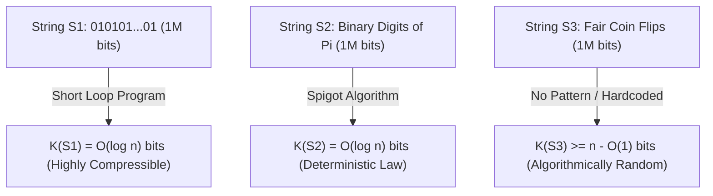
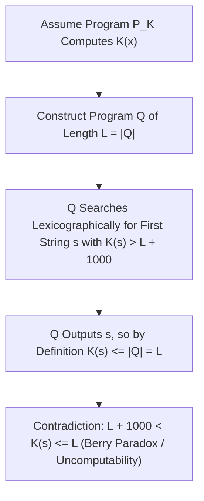

## प्रस्तावना: दस लाख बिट वाली तीन स्ट्रिंग्स की पहेली — शैनन सूचना सिद्धांत का अंधबिंदु

कल्पना कीजिए कि आपके सामने तीन बाइनरी स्ट्रिंग्स (binary strings) रखी हैं जिनकी लंबाई ठीक $1,000,000$ बिट है:
- पहली स्ट्रिंग $S_1$ में पाँच लाख बार `01` की पुनरावृत्ति है: `01010101...01`।
- दूसरी स्ट्रिंग $S_2$ में $\pi$ (पाई) के बाइनरी प्रसार के दशमलव के बाद के पहले $1,000,000$ अंक हैं: `1100100100001111110110...`।
- तीसरी स्ट्रिंग $S_3$ एक निष्पक्ष सिक्के को दस लाख बार उछालकर (चित = `1`, पट = `0`) वास्तविक रूप से दर्ज किया गया अनुक्रम है।

अब प्रश्न यह है: <strong>इन तीनों स्ट्रिंग्स में से किसमें सबसे अधिक ‘सूचना’ है? कौन सी सबसे अधिक ‘जटिल’ है, और कौन सी वास्तव में ‘यादृच्छिक (random)’ है?</strong>
यदि हम क्लॉड शैनन (Claude Shannon) द्वारा 1948 में स्थापित क्लासिकल <strong>शैनन सूचना सिद्धांत (Classical Information Theory)</strong> में इसका उत्तर खोजें, तो हम एक अप्रत्याशित विरोधाभास का सामना करते हैं: शैनन एन्ट्रॉपी $H(X) = -\sum P(x)\log_2 P(x)$ किसी <strong>प्रायिकता बंटन (स्रोत के समुच्चय / Ensemble)</strong> की औसत अनिश्चितता को मापती है, लेकिन किसी <strong>एकल विशिष्ट वस्तु (Individual Object) $x$</strong> की आंतरिक जटिलता के बारे में कुछ नहीं कहती! निष्पक्ष सिक्का उछालने के मॉडल में, पूर्णतः आवर्ती स्ट्रिंग $S_1$ और अराजक स्ट्रिंग $S_3$ दोनों के उत्पन्न होने की प्रायिकता बिल्कुल समान अर्थात $2^{-1,000,000}$ है; और नियतिवादी स्थिरांक $\pi$ ($S_2$) के लिए तो प्रायिकता बंटन एकल बिंदु है जिसकी एन्ट्रॉपी शून्य ($H=0$) है, जबकि उसके बिट्स की सांख्यिकीय आवृत्ति सिक्के की उछाल से बिल्कुल अलग नहीं दिखती!

एकल वस्तु की जटिलता और यादृच्छिकता को कठोर गणितीय आधार देने के लिए 1960 के दशक में रे सोलोमोनोफ (Ray Solomonoff, 1960), <strong>आंद्रेई कोलमोगोरोव (Andrey Kolmogorov, 1965)</strong> और ग्रेगरी चैतिन (Gregory Chaitin, 1966) ने स्वतंत्र रूप से <strong>एल्गोरिदमिक सूचना सिद्धांत (Algorithmic Information Theory, AIT)</strong> की स्थापना की। उनकी केंद्रीय अंतर्दृष्टि क्रांतिकारी थी: <strong>किसी वस्तु की वास्तविक जटिलता उसमें दिखने वाले अक्षरों की संख्या से नहीं, बल्कि उसे उत्पन्न करने वाले ‘सबसे छोटे कंप्यूटर प्रोग्राम’ की लंबाई से मापी जाती है!</strong>

---

## 1. कोलमोगोरोव जटिलता $K(x)$ और सार्वभौमिक ट्यूरिंग मशीन का निश्चरता प्रमेय

किसी सार्वभौमिक ट्यूरिंग मशीन (Universal Turing Machine, या C/Python जैसी किसी भी ट्यूरिंग-पूर्ण प्रोग्रामिंग भाषा) $U$ के सापेक्ष, किसी बाइनरी स्ट्रिंग $x \in \{0,1\}^*$ की <strong>कोलमोगोरोव जटिलता (Kolmogorov Complexity)</strong> $K_U(x)$ उस सबसे छोटे बाइनरी प्रोग्राम $p$ की बिट लंबाई $|p|$ के रूप में परिभाषित की जाती है, जो $U$ पर चलने पर $x$ को आउटपुट करता है और रुक जाता है (halts)। क्राफ्ट असमिका $\sum 2^{-|p|} \le 1$ को संतुष्ट करने के लिए आधुनिक सिद्धांत में <strong>उपसर्ग-मुक्त जटिलता (Prefix-Free / Levin-Chaitin Complexity)</strong> $K(x)$ का उपयोग किया जाता है, जहाँ कोई भी वैध प्रोग्राम किसी अन्य वैध प्रोग्राम का उपसर्ग नहीं होता।

$K(x)$ के दृष्टिकोण से हमारी दस लाख बिट वाली तीनों स्ट्रिंग्स का रहस्य तुरंत खुल जाता है:
- $S_1$ के लिए केवल छोटा सा प्रोग्राम `print("01" * 500000)` पर्याप्त है। चूँकि इसमें केवल लूप काउंटर $n/2$ को बाइनरी में लिखना होता है, इसलिए $K(S_1) = O(\log_2 n) pprox 20$ बिट है: यह स्ट्रिंग <strong>एल्गोरिदमिक रूप से अत्यंत सरल</strong> है।
- $S_2$ ($\pi$ के पहले $n$ बिट) के लिए, यद्यपि यह सांख्यिकीय रूप से यादृच्छिक शोर जैसा दिखता है, फिर भी माचिन सूत्र (Machin-like formula) या BBP एल्गोरिदम का कुछ सौ बाइट का प्रोग्राम इसे सटीक रूप से निकाल सकता है। अतः इसके लिए भी $K(S_2) = O(\log_2 n)$ ही है! यह विज्ञान के दर्शन का एक गहरा सत्य उजागर करता है: <strong>प्रकृति का नियम (Natural Law) वास्तव में प्रायोगिक प्रेक्षण डेटा का चरम एल्गोरिदमिक संपीडन (compression) ही है।</strong>
- इसके विपरीत, वास्तविक सिक्का उछालने से बनी स्ट्रिंग $S_3$ के भीतर कोई छिपा हुआ नियम नहीं है। $S_3$ को प्रिंट करने वाले सबसे छोटे प्रोग्राम को पूरे दस लाख बिट्स को ज्यों का त्यों कोड में लिखना होगा (`print("1011001...")`), इसलिए $K(S_3) pprox n + O(1) pprox 1,000,000$ बिट!

यहाँ यह प्रश्न उठ सकता है कि क्या प्रोग्रामिंग भाषा $U$ बदलने पर $K_U(x)$ बदल नहीं जाएगा? <strong>कोलमोगोरोव का निश्चरता प्रमेय (Invariance Theorem)</strong> सिद्ध करता है कि किन्हीं भी दो सार्वभौमिक मशीनों $U_1$ और $U_2$ के लिए एक नियतांक $c_{12}$ अस्तित्व में है जो केवल $U_1, U_2$ पर निर्भर करता है (और <strong>स्ट्रिंग $x$ से पूर्णतः स्वतंत्र है</strong>), जिससे सभी $x$ के लिए $|K_{U_1}(x) - K_{U_2}(x)| \le c_{12}$ होता है। इसका प्रमाण बहुत सरल है: $c_{12}$ केवल $U_1$ पर लिखी गई उस <strong>इंटरप्रेटर (Interpreter)</strong> की निश्चित बिट लंबाई है जो $U_2$ का अनुकरण करती है! जब $n 	o \infty$ होता है, तो यह स्थिर लागत नगण्य हो जाती है।

$$
H(X) = -\sum_{x \in \mathcal{X}} P(X = x) \log_2 P(X = x)
$$

$$
K_U(x) = \min_{p \in \{0,1\}^*} \Big\{ |p| \;\Big|\; U(p) = x \Big\}, \qquad \Big| K_{U_1}(x) - K_{U_2}(x) \Big| \le c_{12}
$$

---

## 2. यादृच्छिकता का स्वरूप: कपोत-कोष्ठ सिद्धांत, असंपीड्यता और मार्टिन-लोफ यादृच्छिकता

कोलमोगोरोव से पहले प्रायिकता सिद्धांत यह स्पष्ट नहीं कर सकता था कि `0000000000` यादृच्छिक क्यों नहीं है जबकि `0110100110` यादृच्छिक क्यों लगता है। एल्गोरिदमिक सूचना सिद्धांत ने व्यक्तिगत यादृच्छिकता की पहली सटीक परिभाषा दी: <strong>यादृच्छिकता का अर्थ ही असंपीड्यता (Incompressibility) है — अर्थात किसी भी नियम या पैटर्न का पूर्ण अभाव!</strong>

सबसे आश्चर्यजनक बात यह है कि प्रारंभिक <strong>कपोत-कोष्ठ सिद्धांत (Pigeonhole Principle)</strong> की सहायता से हम केवल दो पंक्तियों में सिद्ध कर सकते हैं कि <strong>ब्रह्मांड की लगभग सभी बाइनरी स्ट्रिंग्स एल्गोरिदमिक रूप से यादृच्छिक (असंपीड्य) हैं</strong>:
लंबाई $n$ की कुल $2^n$ बाइनरी स्ट्रिंग्स होती हैं। अब सोचिए कि $n - c$ बिट से कम लंबाई के कुल कितने बाइनरी प्रोग्राम संभव हैं? लंबाई $0, 1, \dots, n-c-1$ के सभी प्रोग्रामों को जोड़ने पर कुल $\sum_{i=0}^{n-c-1} 2^i = 2^{n-c} - 1$ प्रोग्राम मिलते हैं। चूँकि प्रत्येक प्रोग्राम अधिकतम एक ही आउटपुट दे सकता है, इसलिए $2^n$ स्ट्रिंग्स में से <strong>अधिकतम $2^{n-c} - 1$ स्ट्रिंग्स ही $c$ बिट से अधिक संपीडित की जा सकती हैं</strong> ($K(x) < n - c$)!
दूसरे शब्दों में, यादृच्छिक रूप से चुनी गई लंबाई $n$ की स्ट्रिंग के $c$ बिट से अधिक संपीडित होने की प्रायिकता $2^{-c}$ से कम है। यदि $c = 20$ लें, तो $99.9999\,\%$ से अधिक स्ट्रिंग्स को दुनिया का कोई भी एल्गोरिदम मात्र $20$ बिट भी छोटा नहीं कर सकता! पेर मार्टिन-लोफ (Per Martin-Löf, 1966) ने सिद्ध किया कि कोई अनंत बाइनरी अनुक्रम सभी कलनीय सांख्यिकीय परीक्षणों को तभी पार करता है (<strong>मार्टिन-लोफ यादृच्छिकता</strong>) जब उसके सभी उपसर्ग $x_{1:n}$ असंपीड्य हों ($K(x_{1:n}) \ge n - O(1)$)।

$$
\sum_{i=0}^{n-c-1} 2^i = 2^{n-c} - 1 \implies \mathbb{P}_{x \sim \text{Unif}(\{0,1\}^n)}\big( K(x) < n - c \big) < \frac{2^{n-c}}{2^n} = 2^{-c}
$$

$$
\Omega = \sum_{p:\, U(p)\text{ halts}} 2^{-|p|} \in (0, 1), \qquad K(\Omega_{1:n}) \ge n - O(1)
$$

---

## 3. बेरी विरोधाभास, $K(x)$ की अकलनीयता, चैतिन का स्थिरांक $\Omega$ और आधुनिक AI

यदि $K(x)$ इतना शक्तिशाली है, तो क्या हम ऐसा प्रोग्राम लिख सकते हैं जो किसी भी इनपुट $x$ के लिए उसका सटीक $K(x)$ निकाल दे? उत्तर है: <strong>बिल्कुल नहीं — फलन $K(x)$ अकलनीय (Uncomputable) है!</strong>

यह सीमा प्रसिद्ध <strong>बेरी विरोधाभास (Berry's Paradox)</strong> (“वह सबसे छोटा धनात्मक पूर्णांक जिसे बीस से कम शब्दों में परिभाषित नहीं किया जा सकता” — यह वाक्य स्वयं चौदह शब्दों में उसे परिभाषित कर देता है!) से निकलती है। ग्रेगरी चैतिन ने इसे इस प्रकार सिद्ध किया: मान लीजिए कि $L$ बिट लंबा एक सबरूटीन `ComputeK(x)` मौजूद है जो $K(x)$ की गणना करता है। तब हम एक मुख्य प्रोग्राम $Q$ बनाते हैं जो शब्दकोश क्रम में सभी स्ट्रिंग्स $s$ की जाँच करता है और पहली ऐसी स्ट्रिंग $s^*$ प्रिंट करके रुक जाता है जिसके लिए $K(s^*) > L + 10000$ हो। प्रोग्राम $Q$ की कुल लंबाई केवल $L + O(1)$ बिट है, फिर भी उसने $s^*$ को प्रिंट कर दिया! परिभाषा के अनुसार $K(s^*) \le |Q| < L + 10000$ होना चाहिए, जो $K(s^*) > L + 10000$ के सीधा विरुद्ध है! इसी से <strong>चैतिन का अपूर्णता प्रमेय</strong> निकलता है: $C$ बिट जटिलता वाली कोई भी स्वयंसिद्ध प्रणाली किसी विशिष्ट $x$ के लिए $K(x) > C + O(1)$ सिद्ध नहीं कर सकती।

चैतिन ने रुकने वाले सभी प्रोग्रामों की लंबाइयों को जोड़कर प्रसिद्ध वास्तविक संख्या <strong>चैतिन नियतांक $\Omega = \sum_{U(p)	ext{ रुकता है}} 2^{-|p|}$ (रुकने की प्रायिकता)</strong> को परिभाषित किया। यद्यपि $\Omega \in (0,1)$ सुपरिभाषित है, यह <strong>पूर्णतः अकलनीय और एल्गोरिदमिक रूप से यादृच्छिक</strong> है ($K(\Omega_{1:n}) \ge n - O(1)$): $\Omega$ के पहले $n$ बिट्स को जानना $n$ लंबाई तक के सभी प्रोग्रामों के लिए ट्यूरिंग की हॉल्टिंग समस्या (Halting Problem) को हल करने के बराबर है!

आधुनिक इंजीनियरिंग और कृत्रिम बुद्धिमत्ता (AI) में $K(x)$ की कलनीय ऊपरी सीमाएँ (computable upper bounds) क्रांतिकारी भूमिका निभा रही हैं:
1. <strong>शैनन एन्ट्रॉपी से सेतु</strong>: स्थिर एर्गोडिक प्रक्रियाओं के लिए प्रत्याशा $rac{1}{n}\mathbb{E}[K(X_{1:n})]$ शैनन एन्ट्रॉपी दर $H(X)$ की ओर अभिसरित होती है।
2. <strong>सोलोमोनोफ सार्वभौमिक आगमन और न्यूनतम विवरण लंबाई (MDL)</strong>: ओकम के उस्तरे (Occam's Razor) को सार्वभौमिक पूर्व बंटन $P_M(x) \propto 2^{-K(x)}$ द्वारा गणितीय रूप दिया जाता है।
3. <strong>सामान्यीकृत संपीडन दूरी (NCD)</strong>: वास्तविक कंप्रेसर (`zstd`, `lzma`, `gzip`) से $K(x)$ का सन्निकटन करके सूत्र $	ext{NCD}(x,y) = rac{C(xy) - \min(C(x),C(y))}{\max(C(x),C(y))}$ द्वारा बिना किसी डोमेन फीचर इंजीनियरिंग के जीनोम विकास वृक्ष और मैलवेयर वर्गीकरण किया जाता है।
4. <strong>बड़े भाषा मॉडल (LLMs): संपीडन ही बुद्धिमत्ता है (Compression is Intelligence)</strong>: जैसा कि मार्कस हटर (Hutter Prize) और इल्या सुत्स्केवर ने बताया, ऑटोरिग्रेसिव ट्रांसफॉर्मर के क्रॉस-एन्ट्रॉपी लॉस $-\sum \log_2 P_	heta(x_t \mid x_{<t})$ को न्यूनतम करना अंकगणितीय कोडिंग के तहत <strong>मानव टेक्स्ट डेटा के सबसे छोटे दोषरहित संपीडन (lossless compression) को खोजने के पूर्णतः तुल्य है</strong>। डेटा को चरम सीमा तक संपीडित करने के लिए मॉडल को व्याकरण, तर्क और भौतिक दुनिया के कारण-कार्य मॉडल को सीखना ही पड़ता है।

| आयाम / अवधारणा | शैनन सूचना एन्ट्रॉपी $H(X)$ | कोलमोगोरोव जटिलता $K(x)$ | आधुनिक इंजीनियरिंग सन्निकटन (MDL / LLM / NCD) |
| :--- | :--- | :--- | :--- |
| <strong>मापन की वस्तु</strong> | प्रायिकता बंटन (समुच्चय / Ensemble) | <strong>एकल विशिष्ट वस्तु या स्ट्रिंग $x$ स्वयं</strong> | वास्तविक फाइलें, जीनोम अनुक्रम, टेक्स्ट कॉर्पस |
| <strong>$\pi$ के पहले $10^6$ बिट्स पर निर्णय</strong> | नियतिवादी स्थिरांक ($H=0$); आवृत्ति एकसमान जैसी | $K(\pi_{1:n}) = O(\log n)$ (छोटे एल्गोरिदम के कारण सरल) | अंकगणितीय कोडिंग और न्यूरल नेटवर्क पैटर्न पकड़ते हैं |
| <strong>कलनीयता (Computability)</strong> | बंटन $P(X)$ ज्ञात होने पर पूर्णतः कलनीय | <strong>कड़ाई से अकलनीय</strong> (हॉल्टिंग समस्या के तुल्य) | `zstd`/LZMA या Transformer $P_	heta$ द्वारा ऊपरी सीमा |
| <strong>प्रमुख प्रमेय और दर्शन</strong> | शैनन का स्रोत कोडिंग प्रमेय | निश्चरता प्रमेय, चैतिन अपूर्णता, स्थिरांक $\Omega$ | ओकम का उस्तरा, “संपीडन = पूर्वानुमान = बुद्धिमत्ता” |

$$
P_M(x) = \sum_{p:\, U(p)=x} 2^{-|p|} \approx 2^{-K(x)}, \qquad \text{NCD}(x, y) = \frac{C(xy) - \min\{C(x), C(y)\}}{\max\{C(x), C(y)\}}
$$
