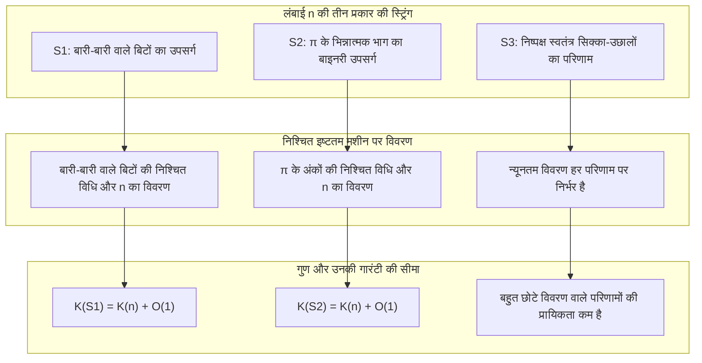

## 1. दस लाख बिट वाली तीन स्ट्रिंग

लंबाई $n=1{,}000{,}000$ की तीन बाइनरी स्ट्रिंग पर विचार करें:

1. $S_1$: `01` को पाँच लाख बार दोहराने से बनी स्ट्रिंग।
2. $S_2$: $\pi$ के <strong>भिन्नात्मक भाग</strong> के बाइनरी प्रसार के पहले दस लाख बिट।
3. $S_3$: एक निष्पक्ष सिक्के के दस लाख स्वतंत्र उछालों के मॉडल से प्राप्त कोई परिणाम।

बिटों को सघन रूप में रखने पर हर स्ट्रिंग 125,000 बाइट, यानी 125 kB लेती है। लेकिन `0` और `1` को ASCII या UTF-8 अक्षरों के रूप में रखने पर दस लाख बाइट लगेंगे। फ़ाइल के हेडर और अन्य प्रबंधन डेटा का स्थान अलग है।

$\pi$ का बाइनरी रूप $11.0010010000111111\ldots{}_2$ है। इसलिए पूर्णांक भाग हटाने पर $S_2$ की शुरुआत `0010010000111111...` से होती है। ये उदाहरण समझाने के लिए हैं; इसका अर्थ यह नहीं है कि इस लेख के लिए दस लाख वास्तविक सिक्का-उछाल किए गए।

$S_1$ को दोहराव का निर्देश देकर बनाया जा सकता है और $S_2$ के अंक निकालने के लिए भी एल्गोरिदम हैं। लेकिन $S_3$ का जटिल होना निश्चित नहीं है: संयोग से सभी परिणाम शून्य भी हो सकते हैं। सही कथन प्रायिकता के बारे में है: <strong>गणना का मॉडल निश्चित होने पर बहुत कम परिणामों का विवरण उनकी लंबाई से बहुत छोटा होता है।</strong>

निष्पक्ष और स्वतंत्र उछालों के मॉडल में लंबाई $n$ की हर विशेष स्ट्रिंग की प्रायिकता समान है, चाहे वह बारी-बारी से शून्य और एक वाली स्ट्रिंग हो या $\pi$ का उपसर्ग:

$$
P(X=x)=2^{-n},\qquad x\in\{0,1\}^n
$$

समान प्रायिकता वाले परिणामों में छोटी उत्पादन-विधि का होना कैसे पहचाना जाए? 1960 के दशक से सोलोमोनोफ, कोलमोगोरोव, चैतिन और अन्य शोधकर्ताओं द्वारा विकसित <strong>एल्गोरिदमिक सूचना सिद्धांत (AIT)</strong> उस सबसे छोटे प्रोग्राम की लंबाई देखता है जो स्ट्रिंग को आउटपुट करके रुक जाता है।

---

## 2. शैनन सूचना और अलग-अलग स्ट्रिंग

### 2.1 स्व-सूचना, एन्ट्रॉपी और कोडिंग

किसी विविक्त प्रायिकता बंटन $P$ में, $P(x)>0$ वाले परिणाम की स्व-सूचना और उसके औसत, यानी एन्ट्रॉपी, में अंतर है। यहाँ लघुगणक का आधार 2 है और इकाई बिट है।

$$
I_P(x)=-\log_2P(x),\qquad
H(P)=-\sum_xP(x)\log_2P(x)
$$

योग में $0\log_2 0=0$ माना जाता है। शून्य प्रायिकता वाले परिणाम की स्व-सूचना अनंत होती है।

परिमित वर्णमाला के एक प्रतीक को बाइनरी उपसर्ग कोड से दर्शाने पर सर्वोत्तम औसत कोड-लंबाई यह असमिका संतुष्ट करती है:

$$
H(P)\le L_{\mathrm{opt}}<H(P)+1
$$

इसका अर्थ यह नहीं है कि हर कोड-शब्द की लंबाई एन्ट्रॉपी के बराबर है। समान बंटन वाले $r$ स्वतंत्र प्रतीकों को एक साथ कोड करने पर पूर्णांक लंबाई के कारण प्रति प्रतीक लगने वाला अतिरिक्त स्थान कम हो जाता है:

$$
H(P)\le \frac{L_{\mathrm{opt},r}}{r}<H(P)+\frac1r
$$

निर्भरता वाले स्रोतों में ब्लॉक बंटन या एन्ट्रॉपी दर महत्वपूर्ण होती है। हफ़मैन और अंकगणितीय कोडिंग को समझते समय भी मॉडल तथा व्यक्तिगत और औसत मात्राओं का अंतर रखना चाहिए।

### 2.2 मॉडल का चुनाव और अनुभवजन्य आवृत्तियाँ

$-\log_2P(x)$ केवल $x$ पर नहीं, चुने गए मॉडल $P$ पर भी निर्भर है। निष्पक्ष सिक्के के मॉडल में बारी-बारी से शून्य और एक वाली स्ट्रिंग की स्व-सूचना भी दस लाख बिट है। इसके विपरीत, केवल उसी स्ट्रिंग पर सारी प्रायिकता केंद्रित करने वाले बिंदु बंटन की एन्ट्रॉपी शून्य है। लेकिन <strong>मॉडल को प्राप्तकर्ता तक पहुँचाने की लागत इससे शून्य नहीं हो जाती।</strong>

यदि हम केवल अलग-अलग बिटों की आवृत्ति देखें, तो `01` की पुनरावृत्ति में शून्य और एक आधे-आधे हैं। उसकी शून्य-क्रम की अनुभवजन्य एन्ट्रॉपी है:

$$
\widehat H_0((01)^{n/2})
=-\tfrac12\log_2\tfrac12-\tfrac12\log_2\tfrac12=1
$$

पिछले बिट से अगले बिट का अनुमान लगाने वाला मॉडल इस नियमितता को पकड़ सकता है। लंबाई $k$ के एक-दूसरे पर चढ़ते ब्लॉकों में अधिकतम दो प्रकार हैं। इसलिए उनकी अनुभवजन्य एन्ट्रॉपी अधिकतम 1 बिट प्रति ब्लॉक, यानी $1/k$ बिट प्रति बिट है। पूरे ब्लॉक की एन्ट्रॉपी और प्रति बिट मात्रा को एक नहीं समझना चाहिए।

$\pi$ की सामान्यता (normality) सिद्ध नहीं हुई है। सामान्यता का अर्थ है कि हर निश्चित लंबाई के सभी ब्लॉक सीमा में समान आवृत्ति से आते हैं। परिमित आवृत्ति-परीक्षण या अनियमित दिखना इसे सिद्ध नहीं करता। सामान्यता भी किसी अनुक्रम के संगणनीय होने के साथ संगत है। यदि मॉडल को अंक निकालने की अनुमति हो, तो प्रायिकता-आधारित पूर्वानुमान और कोडिंग उस नियम का उपयोग कर सकते हैं।

AIT शैनन सिद्धांत को गलत नहीं ठहराता। <strong>प्रायिकता मॉडल के सापेक्ष कोड की लंबाई और निश्चित मशीन पर किसी विशेष वस्तु के विवरण की लंबाई अलग प्रश्नों का उत्तर देती हैं।</strong>

| पहलू | शैनन सूचना | एल्गोरिदमिक विवरण |
| :--- | :--- | :--- |
| विषय | बंटन और उसके अंतर्गत परिणाम | निश्चित मशीन द्वारा उत्पन्न परिमित स्ट्रिंग |
| आधार | प्रायिकता मॉडल और कोडिंग के नियम | मशीन, प्रोग्राम कोडिंग और सहायक इनपुट |
| मुख्य मात्राएँ | $I_P(x)$, $H(P)$ और एन्ट्रॉपी दर | साधारण जटिलता $C(x)$ और उपसर्ग जटिलता $K(x)$ |
| सीमाएँ | मॉडल का विवरण देने की लागत अलग है | मशीन पर निर्भर नियतांक और असंगणनीयता |
| $\pi$ का मामला | चुने गए मॉडल पर निर्भर | अंक बनाने की विधि और कहाँ रुकना है, दोनों बताए जा सकते हैं |

---

## 3. सबसे छोटे प्रोग्राम और निश्चरता प्रमेय

### 3.1 साधारण और सशर्त जटिलता

$\{0,1\}^*$ सभी परिमित बाइनरी स्ट्रिंग का समुच्चय है और $|p|$ प्रोग्राम की बिट-लंबाई है। आंशिक रूप से संगणनीय मशीन $A$ के लिए $A(p)=x$ का अर्थ है कि मशीन परिमित समय में रुककर ठीक $x$ को आउटपुट करती है।

$$
C_A(x)=\min\{|p|:A(p)=x\}
$$

यदि ऐसा प्रोग्राम न हो, तो मान $\infty$ लिया जाता है। सहायक इनपुट $y$ निःशुल्क मिलने पर परिभाषा है:

$$
C_A(x\mid y)=\min\{|p|:A(p,y)=x\}
$$

लंबाई या शब्दकोश पहले से जानने की लागत, उसे प्रोग्राम में लिखकर भेजने की लागत जैसी नहीं है।

### 3.2 उपसर्ग जटिलता और प्रोग्राम की सीमाएँ

<strong>उपसर्ग जटिलता $K$</strong> में रुकने वाले प्रोग्रामों का समुच्चय उपसर्ग-मुक्त होता है: कोई वैध प्रोग्राम किसी दूसरे वैध प्रोग्राम का वास्तविक उपसर्ग नहीं है। क्राफ्ट असमिका देती है:

$$
K_U(x)=\min\{|p|:U(p)=x\},\qquad
\sum_{p\in\operatorname{dom}U}2^{-|p|}\le1
$$

सशर्त मामले में हर निश्चित सहायक इनपुट $y$ के लिए रुकने वाले प्रोग्रामों का क्षेत्र उपसर्ग-मुक्त होना चाहिए। अपने अंत का संकेत स्वयं देने वाला प्रोग्राम केवल ऐसा सामान्य स्रोत-कोड नहीं है जिसके अंत में एक बंद कोष्ठक जोड़ दिया गया हो। आगे $C$ और $K$ के लिए उनकी अपनी मशीन-श्रेणी में योगात्मक रूप से इष्टतम संदर्भ मशीनें चुनी जाएँगी।

साधारण प्रोग्रामों को जोड़ने पर उनकी सीमाएँ बतानी पड़ती हैं। युग्मों की एक निश्चित संगणनीय कोडिंग के लिए, उदाहरण के तौर पर:

$$
C(x,y)\le C(x)+C(y)
+2\log_2\bigl(\min\{C(x),C(y)\}+2\bigr)+O(1)
$$

उपसर्ग प्रोग्रामों को जोड़कर समझा जा सकता है। सशर्त विवरणों का उपयोग करने पर:

$$
K(x,y)\le K(x)+K(y\mid x)+O(1)
\le K(x)+K(y)+O(1)
$$

संगत संदर्भ मशीनें निश्चित करने पर दोनों जटिलताओं के बीच संबंध है:

$$
C(x)\le K(x)+O(1),\qquad
K(x)\le C(x)+2\log_2(C(x)+2)+O(1)
$$

$O(1)$ का अर्थ $x$ से स्वतंत्र नियतांक है। इसका अर्थ यह नहीं है कि वास्तविक लागत शून्य या कुछ बिट मापी गई है।

### 3.3 योगात्मक इष्टतमता और मशीन पर निर्भरता

$C$ के लिए साधारण मशीनों की श्रेणी में और $K$ के लिए उपसर्ग-मुक्त मशीनों की श्रेणी में इष्टतम मशीन निश्चित करें। यदि “सार्वभौमिक” का अर्थ केवल दूसरी मशीनों का अनुकरण करना हो, तो यह भी आवश्यक है कि विवरण की लंबाई में अधिकतम एक स्थिर योगात्मक लागत जुड़े।

किसी भी उपसर्ग-मुक्त मशीन $A$ के लिए $x$ से स्वतंत्र नियतांक $c_A$ मौजूद है, जिसके लिए:

$$
K_U(x)\le K_A(x)+c_A
$$

निर्माण में प्रोग्राम $p$ के आगे मशीन $A$ की पहचान बताने वाला निश्चित, स्वयं-सीमांकित संकेत $s_A$ रखा जाता है और फिर $A(p)$ का अनुकरण किया जाता है। यदि $A(p)=x$, तो अनुकरण करने वाला प्रोग्राम $x$ उत्पन्न करता है और उसकी लंबाई $|p|+|s_A|$ में एक स्थिर लागत जोड़ने के बराबर है। सबसे छोटा प्रोग्राम इससे लंबा नहीं हो सकता। इस तरीके से इष्टतम मशीन बनाई जा सकती है। साधारण जटिलता के लिए उसी की श्रेणी में मिलता-जुलता तर्क लागू होता है।

दो योगात्मक रूप से इष्टतम मशीनों के बीच दोनों दिशाओं में यह असमिका लगाने पर:

$$
|K_{U_1}(x)-K_{U_2}(x)|\le c_{12}
$$

नियतांक को दोनों दिशाओं के अनुकरण की लागत समेटनी चाहिए। केवल एक दिशा के इंटरप्रेटर का आकार स्वतः निरपेक्ष अंतर की सीमा नहीं बन जाता।

किसी खास दस लाख बिट की स्ट्रिंग को छोटा निर्देश देकर प्रिंट करने वाली विशेष मशीन बनाई जा सकती है। उस मशीन के विवरण और अनुकरण की लागत नियतांक में शामिल होती है। इसलिए <strong>निश्चरता प्रमेय परिमित वस्तुओं की मशीन पर निर्भरता समाप्त नहीं करता।</strong> नियतांक को लंबाई $n$ से भाग देने पर उसका सापेक्ष प्रभाव $n\to\infty$ में छोटा होता है; इससे किसी निश्चित स्ट्रिंग का सटीक न्यूनतम विवरण ज्ञात नहीं होता। परिमित स्मृति वाले वास्तविक CPU को असीमित स्मृति वाली गणितीय मशीन के बराबर भी नहीं मानना चाहिए।

### 3.4 बारी-बारी वाले बिट, पाई और समाप्ति-स्थान

$n$ को पूर्णांकों की एक निश्चित बाइनरी अभिव्यक्ति से पहचानें। $s(n)$ लंबाई $n$ की बारी-बारी से शून्य और एक वाली स्ट्रिंग, या $\pi$ के भिन्नात्मक भाग के पहले $n$ बिट हों। $n$ से $s(n)$ बनाया जा सकता है और स्ट्रिंग की लंबाई से $n$ प्राप्त किया जा सकता है। दोनों दिशाओं के संगणनीय रूपांतरण देते हैं:

$$
K(s(n))=K(n)+O(1),\qquad K(s(n)\mid n)=O(1)
$$

यदि कहाँ रुकना है यह निःशुल्क दिया गया हो, तो स्थिर लंबाई की उत्पादन-विधि पर्याप्त है। अन्यथा $n$ का विवरण भी चाहिए। उदाहरण के लिए, पूर्णांकों की स्वयं-सीमांकित कोडिंग से $n\ge2$ के लिए:

$$
K(n)\le \log_2 n+2\log_2\log_2 n+O(1)=O(\log n)
$$

$K(n)=\log_2n+O(1)$ सभी पूर्णांकों के लिए सही नहीं है। यदि $n=2^m$ हो, तो घातांक $m$ के छोटे विवरण से $n$ दोबारा बनाया जा सकता है। यह आसन्न संकेतन किसी वास्तविक प्रोग्राम का आकार ठीक बीस बिट या कुछ सौ बाइट नहीं मापता।

$S_3$ का सबसे छोटा विवरण हमेशा मूल बिटों की नकल ही हो, यह नहीं कहा जा सकता। अगले खंड में गिनती के आधार पर उसका प्रायिकतात्मक अर्थ स्पष्ट किया जाएगा।

---

## 4. असंपीड्यता और अनंत अनुक्रमों की यादृच्छिकता

### 4.1 मूल बिटों को लिखने से मिलने वाली ऊपरी सीमाएँ

लंबाई $n$ की किसी भी स्ट्रिंग $x$ को ज्यों का त्यों आउटपुट करने वाला विवरण साधारण जटिलता और लंबाई को शर्त के रूप में लेने वाली उपसर्ग जटिलता के लिए देता है:

$$
C(x)\le n+O(1),\qquad K(x\mid n)\le n+O(1)
$$

बिना शर्त वाली उपसर्ग जटिलता में लंबाई को भी स्वयं-सीमांकित रूप में बताना पड़ता है:

$$
K(x)\le n+K(n)+O(1)
$$

सभी स्ट्रिंग के लिए एक ही नियतांक के साथ $K(x)\le |x|+O(1)$ नहीं हो सकता। ऐसा होता तो हर लंबाई $n$ पर योग $\sum_{|x|=n}2^{-K(x)}$ की एक समान धनात्मक निचली सीमा होती। सभी लंबाइयों पर जोड़ने से क्राफ्ट असमिका का उल्लंघन होता।

### 4.2 कपोत-कोष्ठ सिद्धांत से सटीक गिनती

$n\ge0$ और $0\le c\le n$ पूर्णांक हों। $n-c$ से सख्ती से कम लंबाई वाले बाइनरी प्रोग्रामों की कुल संख्या है:

$$
\sum_{j=0}^{n-c-1}2^j=2^{n-c}-1
$$

$c=n$ पर खाली योग शून्य है। रुकने वाला हर प्रोग्राम अधिकतम एक स्ट्रिंग उत्पन्न करता है। इसलिए लंबाई $n$ की $2^n$ स्ट्रिंग में से $C(x)<n-c$ वाली स्ट्रिंग की संख्या इस प्रोग्राम-संख्या से अधिक नहीं हो सकती। अतः:

$$
\#\{x\in\{0,1\}^n:C(x)\ge n-c\}
\ge2^n-2^{n-c}+1
$$

कुछ प्रोग्राम रुकते नहीं हैं या एक ही आउटपुट देते हैं, इसलिए अलग-अलग आउटपुट की संख्या और भी कम हो सकती है। $c>n$ पर $n-c<0$ है और सभी स्ट्रिंग के लिए $C(x)\ge n-c$ अपने आप सही है। ज्यामितीय योग का सूत्र इस क्षेत्र में सीधे नहीं बढ़ाना चाहिए।

समान बंटन, यानी निष्पक्ष और स्वतंत्र सिक्का-उछालों के मॉडल में:

$$
P\{C(X)<n-c\}
\le\frac{2^{n-c}-1}{2^n}<2^{-c}
$$

$c=0$ के लिए हर लंबाई पर कम से कम एक स्ट्रिंग है जिसके लिए $C(x)\ge n$ है। $c=1$ पर आधे से अधिक स्ट्रिंग का विवरण एक बिट से <strong>अधिक</strong> छोटा नहीं किया जा सकता। $c=10$ और $c=20$ पर 10 या 20 बिट से अधिक बचत न होने वाले अनुपात की निचली सीमा $1-2^{-c}$ लगभग 99.902% और 99.999905% है। इसका अर्थ ठीक $c$ बिट की बचत को भी असंभव कहना नहीं है।

इसी तरह की गिनती निश्चित शर्त $n$ के अंतर्गत $K(x\mid n)$ पर भी लागू होती है। इसलिए सिक्के के परिणाम को उच्च प्रायिकता से उसकी लंबाई के करीब विवरण चाहिए, लेकिन हर अलग परिणाम के लिए इसकी गारंटी नहीं है।

हर फ़ाइल को अनिवार्य रूप से छोटा करने वाला दोषरहित कंप्रेसर इस गिनती के विरुद्ध होगा। वास्तविक कंप्रेसर कुछ प्रकार की नियमितताओं का लाभ उठाते हैं। सभी बिट-स्ट्रिंग के समान बंटन में निकले अनुपात को प्रकृति या मनुष्य द्वारा बनाए गए डेटा की आवृत्ति नहीं मान सकते।

### 4.3 मार्टिन-लोफ यादृच्छिकता

परिमित स्ट्रिंग को तय संख्या में बिटों से छोटा न कर पाना और अनंत अनुक्रम की यादृच्छिकता अलग परिभाषाएँ हैं। अनंत बाइनरी अनुक्रमों के स्थान पर निष्पक्ष सिक्के का माप $\mu$ लें। परिमित स्ट्रिंग $w$ से शुरू होने वाले अनुक्रमों का सिलिंडर समुच्चय $[w]$ है, जिसका माप $2^{-|w|}$ है।

<strong>मार्टिन-लोफ परीक्षण</strong> खुले समुच्चयों $V_j$ का ऐसा अनुक्रम है जिन्हें परिमित उपसर्गों के सिलिंडर समुच्चयों के संघ के रूप में एक समान प्रभावी प्रक्रिया से सूचीबद्ध किया जा सकता है और जिनके लिए:

$$
\mu(V_j)\le2^{-j},\qquad j=1,2,\ldots
$$

यदि $\omega\in\bigcap_jV_j$ है, तो अनुक्रम उस परीक्षण में विफल होता है। जो अनुक्रम इस प्रकार के किसी भी परीक्षण में विफल नहीं होता, वह मार्टिन-लोफ यादृच्छिक है। इसका अर्थ यह नहीं कि कोई दुर्लभ परिमित पैटर्न कभी दिख ही नहीं सकता। प्रभावी परीक्षणों की संख्या गणनीय है और हर परीक्षण के विफलता-समुच्चय का माप शून्य है। इसलिए सभी परीक्षणों में सफल अनुक्रमों का समुच्चय माप एक रखता है।

लेविन–श्नोर प्रमेय इष्टतम <strong>उपसर्ग जटिलता</strong> से यह समतुल्यता देता है:

$$
\omega\text{ मार्टिन-लोफ यादृच्छिक है}
\iff
\exists c\ \forall n\quad K(\omega_{1:n})\ge n-c
$$

यह आवश्यक है कि <strong>एक ही नियतांक $c$</strong> सभी लंबाइयों $n$ के लिए काम करे। इस समतुल्यता में $K$ को सीधे साधारण जटिलता $C$ से नहीं बदल सकते।

वॉन मीसेस और चर्च के चयन-नियम इस इतिहास का हिस्सा हैं। लेकिन परीक्षणों या दाँव लगाने की रणनीतियों की संगणनीयता पर अलग शर्तें लगाने से अलग अवधारणाएँ मिलती हैं। विशेषतः, किसी संगणनीय मार्टिंगेल द्वारा पूँजी को असीमित न बढ़ा पाने से परिभाषित संगणनीय यादृच्छिकता (computable randomness), मार्टिन-लोफ यादृच्छिकता से कमजोर है। $\pi$ के अंकों का संगणनीय अनंत अनुक्रम मार्टिन-लोफ यादृच्छिक नहीं है। सामान्यता (normality) उससे अलग गुण है।

---

## 5. बेरी विरोधाभास, $K(x)$ की अकलनीयता, चैतिन का स्थिरांक $\Omega$ और आधुनिक AI

यदि $K(x)$ इतना शक्तिशाली है, तो क्या हम ऐसा प्रोग्राम लिख सकते हैं जो किसी भी इनपुट $x$ के लिए उसका सटीक $K(x)$ निकाल दे? उत्तर है: <strong>बिल्कुल नहीं — फलन $K(x)$ अकलनीय (Uncomputable) है!</strong>

यह सीमा प्रसिद्ध <strong>बेरी विरोधाभास (Berry's Paradox)</strong> (“वह सबसे छोटा धनात्मक पूर्णांक जिसे बीस से कम शब्दों में परिभाषित नहीं किया जा सकता” — यह वाक्य स्वयं सोलह शब्दों में उसे परिभाषित कर देता है!) से निकलती है। ग्रेगरी चैतिन ने इसे इस प्रकार सिद्ध किया: मान लीजिए कि $L$ बिट लंबा एक सबरूटीन `ComputeK(x)` मौजूद है जो $K(x)$ की गणना करता है। तब हम एक मुख्य प्रोग्राम $Q$ बनाते हैं जो शब्दकोश क्रम में सभी स्ट्रिंग्स $s$ की जाँच करता है और पहली ऐसी स्ट्रिंग $s^*$ प्रिंट करके रुक जाता है जिसके लिए $K(s^*) > L + 10000$ हो। प्रोग्राम $Q$ की कुल लंबाई केवल $L + O(1)$ बिट है, फिर भी उसने $s^*$ को प्रिंट कर दिया! परिभाषा के अनुसार $K(s^*) \le |Q| < L + 10000$ होना चाहिए, जो $K(s^*) > L + 10000$ के सीधा विरुद्ध है! इसी से <strong>चैतिन का अपूर्णता प्रमेय</strong> निकलता है: $C$ बिट जटिलता वाली कोई भी स्वयंसिद्ध प्रणाली किसी विशिष्ट $x$ के लिए $K(x) > C + O(1)$ सिद्ध नहीं कर सकती।

चैतिन ने रुकने वाले सभी प्रोग्रामों की लंबाइयों को जोड़कर प्रसिद्ध वास्तविक संख्या <strong>चैतिन नियतांक $\Omega = \sum_{U(p)\text{ रुकता है}} 2^{-|p|}$ (रुकने की प्रायिकता)</strong> को परिभाषित किया। यद्यपि $\Omega \in (0,1)$ सुपरिभाषित है, यह <strong>पूर्णतः अकलनीय और एल्गोरिदमिक रूप से यादृच्छिक</strong> है ($K(\Omega_{1:n}) \ge n - O(1)$): $\Omega$ के पहले $n$ बिट्स को जानना $n$ लंबाई तक के सभी प्रोग्रामों के लिए ट्यूरिंग की हॉल्टिंग समस्या (Halting Problem) को हल करने के बराबर है!

आधुनिक इंजीनियरिंग और कृत्रिम बुद्धिमत्ता (AI) में $K(x)$ की कलनीय ऊपरी सीमाएँ (computable upper bounds) क्रांतिकारी भूमिका निभा रही हैं:
1. <strong>शैनन एन्ट्रॉपी से सेतु</strong>: स्थिर एर्गोडिक प्रक्रियाओं के लिए प्रत्याशा $\frac{1}{n}\mathbb{E}[K(X_{1:n})]$ शैनन एन्ट्रॉपी दर $H(X)$ की ओर अभिसरित होती है।
2. <strong>सोलोमोनोफ सार्वभौमिक आगमन और न्यूनतम विवरण लंबाई (MDL)</strong>: ओकम के उस्तरे (Occam's Razor) को सार्वभौमिक पूर्व बंटन $P_M(x) \propto 2^{-K(x)}$ द्वारा गणितीय रूप दिया जाता है।
3. <strong>सामान्यीकृत संपीडन दूरी (NCD)</strong>: वास्तविक कंप्रेसर (`zstd`, `lzma`, `gzip`) से $K(x)$ का सन्निकटन करके सूत्र $\text{NCD}(x,y) = \frac{C(xy) - \min(C(x),C(y))}{\max(C(x),C(y))}$ द्वारा बिना किसी डोमेन फीचर इंजीनियरिंग के जीनोम विकास वृक्ष और मैलवेयर वर्गीकरण किया जाता है।
4. <strong>बड़े भाषा मॉडल (LLMs): संपीडन ही बुद्धिमत्ता है (Compression is Intelligence)</strong>: जैसा कि मार्कस हटर (Hutter Prize) और इल्या सुत्स्केवर ने बताया, ऑटोरिग्रेसिव ट्रांसफॉर्मर के क्रॉस-एन्ट्रॉपी लॉस $-\sum \log_2 P_\theta(x_t \mid x_{<t})$ को न्यूनतम करना अंकगणितीय कोडिंग के तहत <strong>मानव टेक्स्ट डेटा के सबसे छोटे दोषरहित संपीडन (lossless compression) को खोजने के पूर्णतः तुल्य है</strong>। डेटा को चरम सीमा तक संपीडित करने के लिए मॉडल को व्याकरण, तर्क और भौतिक दुनिया के कारण-कार्य मॉडल को सीखना ही पड़ता है।

| आयाम / अवधारणा | शैनन सूचना एन्ट्रॉपी $H(X)$ | कोलमोगोरोव जटिलता $K(x)$ | आधुनिक इंजीनियरिंग सन्निकटन (MDL / LLM / NCD) |
| :--- | :--- | :--- | :--- |
| <strong>मापन की वस्तु</strong> | प्रायिकता बंटन (समुच्चय / Ensemble) | <strong>एकल विशिष्ट वस्तु या स्ट्रिंग $x$ स्वयं</strong> | वास्तविक फाइलें, जीनोम अनुक्रम, टेक्स्ट कॉर्पस |
| <strong>$\pi$ के पहले $10^6$ बिट्स पर निर्णय</strong> | नियतिवादी स्थिरांक ($H=0$); आवृत्ति एकसमान जैसी | $K(\pi_{1:n}) = O(\log n)$ (छोटे एल्गोरिदम के कारण सरल) | अंकगणितीय कोडिंग और न्यूरल नेटवर्क पैटर्न पकड़ते हैं |
| <strong>कलनीयता (Computability)</strong> | बंटन $P(X)$ ज्ञात होने पर पूर्णतः कलनीय | <strong>कड़ाई से अकलनीय</strong> (हॉल्टिंग समस्या के तुल्य) | `zstd`/LZMA या Transformer $P_\theta$ द्वारा ऊपरी सीमा |
| <strong>प्रमुख प्रमेय और दर्शन</strong> | शैनन का स्रोत कोडिंग प्रमेय | निश्चरता प्रमेय, चैतिन अपूर्णता, स्थिरांक $\Omega$ | ओकम का उस्तरा, “संपीडन = पूर्वानुमान = बुद्धिमत्ता” |

$$
P_M(x) = \sum_{p:\, U(p)=x} 2^{-|p|} \approx 2^{-K(x)}, \qquad \text{NCD}(x, y) = \frac{C(xy) - \min\{C(x), C(y)\}}{\max\{C(x), C(y)\}}
$$
