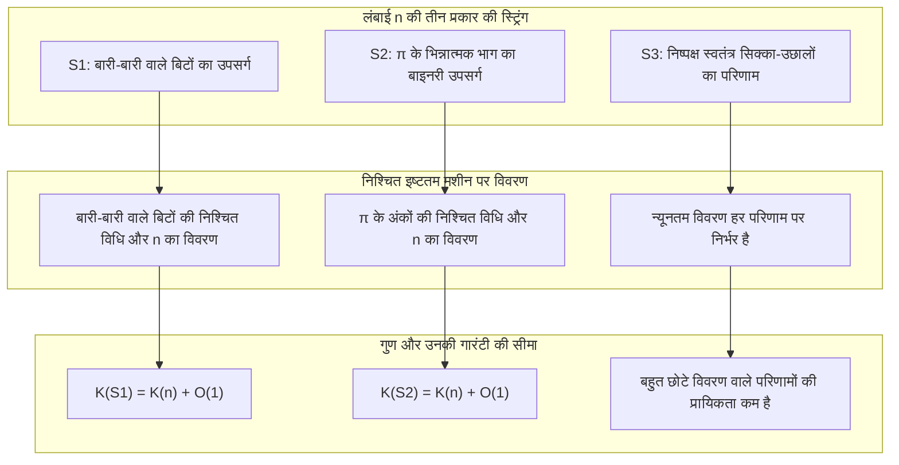
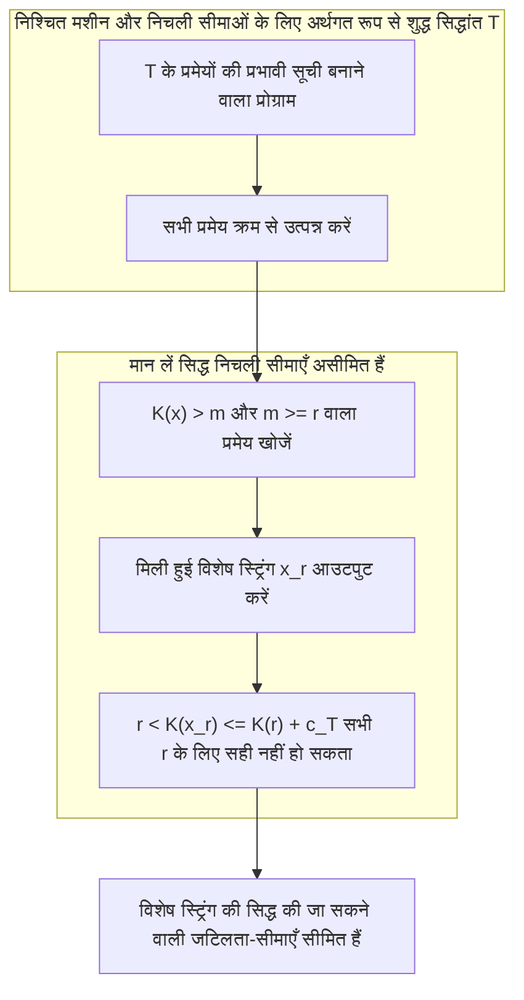

## 1. दस लाख बिट वाली तीन स्ट्रिंग

लंबाई $n=1{,}000{,}000$ की तीन बाइनरी स्ट्रिंग पर विचार करें:

1. $S_1$: `01` को पाँच लाख बार दोहराने से बनी स्ट्रिंग।
2. $S_2$: $\pi$ के <strong>भिन्नात्मक भाग</strong> के बाइनरी प्रसार के पहले दस लाख बिट।
3. $S_3$: एक निष्पक्ष सिक्के के दस लाख स्वतंत्र उछालों के मॉडल से प्राप्त कोई परिणाम।

बिटों को सघन रूप में रखने पर हर स्ट्रिंग 125,000 बाइट, यानी 125 kB लेती है। लेकिन `0` और `1` को ASCII या UTF-8 अक्षरों के रूप में रखने पर दस लाख बाइट लगेंगे। फ़ाइल के हेडर और अन्य प्रबंधन डेटा का स्थान अलग है।

$\pi$ का बाइनरी रूप $11.0010010000111111\ldots{}_2$ है। इसलिए पूर्णांक भाग हटाने पर $S_2$ की शुरुआत `0010010000111111...` से होती है। ये उदाहरण समझाने के लिए हैं; इसका अर्थ यह नहीं है कि इस लेख के लिए दस लाख वास्तविक सिक्का-उछाल किए गए।

$S_1$ को दोहराव का निर्देश देकर बनाया जा सकता है और $S_2$ के अंक निकालने के लिए भी एल्गोरिदम हैं। लेकिन $S_3$ का जटिल होना निश्चित नहीं है: संयोग से सभी परिणाम शून्य भी हो सकते हैं। सही कथन प्रायिकता के बारे में है: <strong>गणना का मॉडल निश्चित होने पर बहुत कम परिणामों का विवरण उनकी लंबाई से बहुत छोटा होता है।</strong>

निष्पक्ष और स्वतंत्र उछालों के मॉडल में लंबाई $n$ की हर विशेष स्ट्रिंग की प्रायिकता समान है, चाहे वह बारी-बारी से शून्य और एक वाली स्ट्रिंग हो या $\pi$ का उपसर्ग:

$$
P(X=x)=2^{-n},\qquad x\in\{0,1\}^n
$$

समान प्रायिकता वाले परिणामों में छोटी उत्पादन-विधि का होना कैसे पहचाना जाए? 1960 के दशक से सोलोमोनोफ, कोलमोगोरोव, चैतिन और अन्य शोधकर्ताओं द्वारा विकसित <strong>एल्गोरिदमिक सूचना सिद्धांत (AIT)</strong> उस सबसे छोटे प्रोग्राम की लंबाई देखता है जो स्ट्रिंग को आउटपुट करके रुक जाता है।

---

## 2. शैनन सूचना और अलग-अलग स्ट्रिंग

### 2.1 स्व-सूचना, एन्ट्रॉपी और कोडिंग

किसी विविक्त प्रायिकता बंटन $P$ में, $P(x)>0$ वाले परिणाम की स्व-सूचना और उसके औसत, यानी एन्ट्रॉपी, में अंतर है। यहाँ लघुगणक का आधार 2 है और इकाई बिट है।

$$
I_P(x)=-\log_2P(x),\qquad
H(P)=-\sum_xP(x)\log_2P(x)
$$

योग में $0\log_2 0=0$ माना जाता है। शून्य प्रायिकता वाले परिणाम की स्व-सूचना अनंत होती है।

परिमित वर्णमाला के एक प्रतीक को बाइनरी उपसर्ग कोड से दर्शाने पर सर्वोत्तम औसत कोड-लंबाई यह असमिका संतुष्ट करती है:

$$
H(P)\le L_{\mathrm{opt}}<H(P)+1
$$

इसका अर्थ यह नहीं है कि हर कोड-शब्द की लंबाई एन्ट्रॉपी के बराबर है। समान बंटन वाले $r$ स्वतंत्र प्रतीकों को एक साथ कोड करने पर पूर्णांक लंबाई के कारण प्रति प्रतीक लगने वाला अतिरिक्त स्थान कम हो जाता है:

$$
H(P)\le \frac{L_{\mathrm{opt},r}}{r}<H(P)+\frac1r
$$

निर्भरता वाले स्रोतों में ब्लॉक बंटन या एन्ट्रॉपी दर महत्वपूर्ण होती है। हफ़मैन और अंकगणितीय कोडिंग को समझते समय भी मॉडल तथा व्यक्तिगत और औसत मात्राओं का अंतर रखना चाहिए।

### 2.2 मॉडल का चुनाव और अनुभवजन्य आवृत्तियाँ

$-\log_2P(x)$ केवल $x$ पर नहीं, चुने गए मॉडल $P$ पर भी निर्भर है। निष्पक्ष सिक्के के मॉडल में बारी-बारी से शून्य और एक वाली स्ट्रिंग की स्व-सूचना भी दस लाख बिट है। इसके विपरीत, केवल उसी स्ट्रिंग पर सारी प्रायिकता केंद्रित करने वाले बिंदु बंटन की एन्ट्रॉपी शून्य है। लेकिन <strong>मॉडल को प्राप्तकर्ता तक पहुँचाने की लागत इससे शून्य नहीं हो जाती।</strong>

यदि हम केवल अलग-अलग बिटों की आवृत्ति देखें, तो `01` की पुनरावृत्ति में शून्य और एक आधे-आधे हैं। उसकी शून्य-क्रम की अनुभवजन्य एन्ट्रॉपी है:

$$
\widehat H_0((01)^{n/2})
=-\tfrac12\log_2\tfrac12-\tfrac12\log_2\tfrac12=1
$$

पिछले बिट से अगले बिट का अनुमान लगाने वाला मॉडल इस नियमितता को पकड़ सकता है। लंबाई $k$ के एक-दूसरे पर चढ़ते ब्लॉकों में अधिकतम दो प्रकार हैं। इसलिए उनकी अनुभवजन्य एन्ट्रॉपी अधिकतम 1 बिट प्रति ब्लॉक, यानी $1/k$ बिट प्रति बिट है। पूरे ब्लॉक की एन्ट्रॉपी और प्रति बिट मात्रा को एक नहीं समझना चाहिए।

$\pi$ की सामान्यता (normality) सिद्ध नहीं हुई है। सामान्यता का अर्थ है कि हर निश्चित लंबाई के सभी ब्लॉक सीमा में समान आवृत्ति से आते हैं। परिमित आवृत्ति-परीक्षण या अनियमित दिखना इसे सिद्ध नहीं करता। सामान्यता भी किसी अनुक्रम के संगणनीय होने के साथ संगत है। यदि मॉडल को अंक निकालने की अनुमति हो, तो प्रायिकता-आधारित पूर्वानुमान और कोडिंग उस नियम का उपयोग कर सकते हैं।

AIT शैनन सिद्धांत को गलत नहीं ठहराता। <strong>प्रायिकता मॉडल के सापेक्ष कोड की लंबाई और निश्चित मशीन पर किसी विशेष वस्तु के विवरण की लंबाई अलग प्रश्नों का उत्तर देती हैं।</strong>

| पहलू | शैनन सूचना | एल्गोरिदमिक विवरण |
| :--- | :--- | :--- |
| विषय | बंटन और उसके अंतर्गत परिणाम | निश्चित मशीन द्वारा उत्पन्न परिमित स्ट्रिंग |
| आधार | प्रायिकता मॉडल और कोडिंग के नियम | मशीन, प्रोग्राम कोडिंग और सहायक इनपुट |
| मुख्य मात्राएँ | $I_P(x)$, $H(P)$ और एन्ट्रॉपी दर | साधारण जटिलता $C(x)$ और उपसर्ग जटिलता $K(x)$ |
| सीमाएँ | मॉडल का विवरण देने की लागत अलग है | मशीन पर निर्भर नियतांक और असंगणनीयता |
| $\pi$ का मामला | चुने गए मॉडल पर निर्भर | अंक बनाने की विधि और कहाँ रुकना है, दोनों बताए जा सकते हैं |

---

## 3. सबसे छोटे प्रोग्राम और निश्चरता प्रमेय

### 3.1 साधारण और सशर्त जटिलता

$\{0,1\}^*$ सभी परिमित बाइनरी स्ट्रिंग का समुच्चय है और $|p|$ प्रोग्राम की बिट-लंबाई है। आंशिक रूप से संगणनीय मशीन $A$ के लिए $A(p)=x$ का अर्थ है कि मशीन परिमित समय में रुककर ठीक $x$ को आउटपुट करती है।

$$
C_A(x)=\min\{|p|:A(p)=x\}
$$

यदि ऐसा प्रोग्राम न हो, तो मान $\infty$ लिया जाता है। सहायक इनपुट $y$ निःशुल्क मिलने पर परिभाषा है:

$$
C_A(x\mid y)=\min\{|p|:A(p,y)=x\}
$$

लंबाई या शब्दकोश पहले से जानने की लागत, उसे प्रोग्राम में लिखकर भेजने की लागत जैसी नहीं है।

### 3.2 उपसर्ग जटिलता और प्रोग्राम की सीमाएँ

<strong>उपसर्ग जटिलता $K$</strong> में रुकने वाले प्रोग्रामों का समुच्चय उपसर्ग-मुक्त होता है: कोई वैध प्रोग्राम किसी दूसरे वैध प्रोग्राम का उससे छोटा आरंभिक भाग (proper prefix) नहीं है। क्राफ्ट असमिका देती है:

$$
K_U(x)=\min\{|p|:U(p)=x\},\qquad
\sum_{p\in\operatorname{dom}U}2^{-|p|}\le1
$$

सशर्त मामले में हर निश्चित सहायक इनपुट $y$ के लिए रुकने वाले प्रोग्रामों का क्षेत्र उपसर्ग-मुक्त होना चाहिए। अपने अंत का संकेत स्वयं देने वाला प्रोग्राम केवल ऐसा सामान्य स्रोत-कोड नहीं है जिसके अंत में एक बंद कोष्ठक जोड़ दिया गया हो। आगे $C$ और $K$ के लिए उनकी अपनी मशीन-श्रेणी में योगात्मक रूप से इष्टतम संदर्भ मशीनें चुनी जाएँगी।

साधारण प्रोग्रामों को जोड़ने पर उनकी सीमाएँ बतानी पड़ती हैं। युग्मों की एक निश्चित संगणनीय कोडिंग के लिए, उदाहरण के तौर पर:

$$
C(x,y)\le C(x)+C(y)
+2\log_2\bigl(\min\{C(x),C(y)\}+2\bigr)+O(1)
$$

उपसर्ग प्रोग्रामों को जोड़कर समझा जा सकता है। सशर्त विवरणों का उपयोग करने पर:

$$
K(x,y)\le K(x)+K(y\mid x)+O(1)
\le K(x)+K(y)+O(1)
$$

संगत संदर्भ मशीनें निश्चित करने पर दोनों जटिलताओं के बीच संबंध है:

$$
C(x)\le K(x)+O(1),\qquad
K(x)\le C(x)+2\log_2(C(x)+2)+O(1)
$$

$O(1)$ का अर्थ $x$ से स्वतंत्र नियतांक है। इसका अर्थ यह नहीं है कि वास्तविक लागत शून्य या कुछ बिट मापी गई है।

### 3.3 योगात्मक इष्टतमता और मशीन पर निर्भरता

$C$ के लिए साधारण मशीनों की श्रेणी में और $K$ के लिए उपसर्ग-मुक्त मशीनों की श्रेणी में इष्टतम मशीन निश्चित करें। यदि “सार्वभौमिक” का अर्थ केवल दूसरी मशीनों का अनुकरण करना हो, तो यह भी आवश्यक है कि विवरण की लंबाई में अधिकतम एक स्थिर योगात्मक लागत जुड़े।

किसी भी उपसर्ग-मुक्त मशीन $A$ के लिए $x$ से स्वतंत्र नियतांक $c_A$ मौजूद है, जिसके लिए:

$$
K_U(x)\le K_A(x)+c_A
$$

निर्माण में प्रोग्राम $p$ के आगे मशीन $A$ की पहचान बताने वाला निश्चित, स्वयं-सीमांकित संकेत $s_A$ रखा जाता है और फिर $A(p)$ का अनुकरण किया जाता है। यदि $A(p)=x$, तो अनुकरण करने वाला प्रोग्राम $x$ उत्पन्न करता है और उसकी लंबाई $|p|+|s_A|$ में एक स्थिर लागत जोड़ने के बराबर है। सबसे छोटा प्रोग्राम इससे लंबा नहीं हो सकता। इस तरीके से इष्टतम मशीन बनाई जा सकती है। साधारण जटिलता के लिए उसी की श्रेणी में मिलता-जुलता तर्क लागू होता है।

दो योगात्मक रूप से इष्टतम मशीनों के बीच दोनों दिशाओं में यह असमिका लगाने पर:

$$
|K_{U_1}(x)-K_{U_2}(x)|\le c_{12}
$$

नियतांक को दोनों दिशाओं के अनुकरण की लागत समेटनी चाहिए। केवल एक दिशा के इंटरप्रेटर का आकार स्वतः निरपेक्ष अंतर की सीमा नहीं बन जाता।

किसी खास दस लाख बिट की स्ट्रिंग को छोटा निर्देश देकर प्रिंट करने वाली विशेष मशीन बनाई जा सकती है। उस मशीन के विवरण और अनुकरण की लागत नियतांक में शामिल होती है। इसलिए <strong>निश्चरता प्रमेय परिमित वस्तुओं की मशीन पर निर्भरता समाप्त नहीं करता।</strong> नियतांक को लंबाई $n$ से भाग देने पर उसका सापेक्ष प्रभाव $n\to\infty$ में छोटा होता है; इससे किसी निश्चित स्ट्रिंग का सटीक न्यूनतम विवरण ज्ञात नहीं होता। परिमित स्मृति वाले वास्तविक CPU को असीमित स्मृति वाली गणितीय मशीन के बराबर भी नहीं मानना चाहिए।

### 3.4 बारी-बारी वाले बिट, पाई और समाप्ति-स्थान

$n$ को पूर्णांकों की एक निश्चित बाइनरी अभिव्यक्ति से पहचानें। $s(n)$ लंबाई $n$ की बारी-बारी से शून्य और एक वाली स्ट्रिंग, या $\pi$ के भिन्नात्मक भाग के पहले $n$ बिट हों। $n$ से $s(n)$ बनाया जा सकता है और स्ट्रिंग की लंबाई से $n$ प्राप्त किया जा सकता है। दोनों दिशाओं के संगणनीय रूपांतरण देते हैं:

$$
K(s(n))=K(n)+O(1),\qquad K(s(n)\mid n)=O(1)
$$

यदि कहाँ रुकना है यह निःशुल्क दिया गया हो, तो स्थिर लंबाई की उत्पादन-विधि पर्याप्त है। अन्यथा $n$ का विवरण भी चाहिए। उदाहरण के लिए, पूर्णांकों की स्वयं-सीमांकित कोडिंग से $n\ge2$ के लिए:

$$
K(n)\le \log_2 n+2\log_2\log_2 n+O(1)=O(\log n)
$$

$K(n)=\log_2n+O(1)$ सभी पूर्णांकों के लिए सही नहीं है। यदि $n=2^m$ हो, तो घातांक $m$ के छोटे विवरण से $n$ दोबारा बनाया जा सकता है। यह आसन्न (asymptotic) संकेतन किसी वास्तविक प्रोग्राम का आकार ठीक बीस बिट या कुछ सौ बाइट नहीं मापता।



$S_3$ का सबसे छोटा विवरण हमेशा मूल बिटों की नकल ही हो, यह नहीं कहा जा सकता। अगले खंड में गिनती के आधार पर उसका प्रायिकतात्मक अर्थ स्पष्ट किया जाएगा।

---

## 4. असंपीड्यता और अनंत अनुक्रमों की यादृच्छिकता

### 4.1 मूल बिटों को लिखने से मिलने वाली ऊपरी सीमाएँ

लंबाई $n$ की किसी भी स्ट्रिंग $x$ को ज्यों का त्यों आउटपुट करने वाला विवरण साधारण जटिलता और लंबाई को शर्त के रूप में लेने वाली उपसर्ग जटिलता के लिए देता है:

$$
C(x)\le n+O(1),\qquad K(x\mid n)\le n+O(1)
$$

बिना शर्त वाली उपसर्ग जटिलता में लंबाई को भी स्वयं-सीमांकित रूप में बताना पड़ता है:

$$
K(x)\le n+K(n)+O(1)
$$

सभी स्ट्रिंग के लिए एक ही नियतांक के साथ $K(x)\le |x|+O(1)$ नहीं हो सकता। ऐसा होता तो हर लंबाई $n$ पर योग $\sum_{|x|=n}2^{-K(x)}$ की एक समान धनात्मक निचली सीमा होती। सभी लंबाइयों पर जोड़ने से क्राफ्ट असमिका का उल्लंघन होता।

### 4.2 कपोत-कोष्ठ सिद्धांत से सटीक गिनती

$n\ge0$ और $0\le c\le n$ पूर्णांक हों। $n-c$ से सख्ती से कम लंबाई वाले बाइनरी प्रोग्रामों की कुल संख्या है:

$$
\sum_{j=0}^{n-c-1}2^j=2^{n-c}-1
$$

$c=n$ पर खाली योग शून्य है। रुकने वाला हर प्रोग्राम अधिकतम एक स्ट्रिंग उत्पन्न करता है। इसलिए लंबाई $n$ की $2^n$ स्ट्रिंग में से $C(x)<n-c$ वाली स्ट्रिंग की संख्या इस प्रोग्राम-संख्या से अधिक नहीं हो सकती। अतः:

$$
\#\{x\in\{0,1\}^n:C(x)\ge n-c\}
\ge2^n-2^{n-c}+1
$$

कुछ प्रोग्राम रुकते नहीं हैं या एक ही आउटपुट देते हैं, इसलिए अलग-अलग आउटपुट की संख्या और भी कम हो सकती है। $c>n$ पर $n-c<0$ है और सभी स्ट्रिंग के लिए $C(x)\ge n-c$ अपने आप सही है। ज्यामितीय योग का सूत्र इस क्षेत्र में सीधे नहीं बढ़ाना चाहिए।

समान बंटन, यानी निष्पक्ष और स्वतंत्र सिक्का-उछालों के मॉडल में:

$$
P\{C(X)<n-c\}
\le\frac{2^{n-c}-1}{2^n}<2^{-c}
$$

$c=0$ के लिए हर लंबाई पर कम से कम एक स्ट्रिंग है जिसके लिए $C(x)\ge n$ है। $c=1$ पर आधे से अधिक स्ट्रिंग का विवरण एक बिट से <strong>अधिक</strong> छोटा नहीं किया जा सकता। $c=10$ और $c=20$ पर 10 या 20 बिट से अधिक बचत न होने वाले अनुपात की निचली सीमा $1-2^{-c}$ लगभग 99.902% और 99.999905% है। इसका अर्थ ठीक $c$ बिट की बचत को भी असंभव कहना नहीं है।

इसी तरह की गिनती निश्चित शर्त $n$ के अंतर्गत $K(x\mid n)$ पर भी लागू होती है। इसलिए सिक्के के परिणाम को उच्च प्रायिकता से उसकी लंबाई के करीब विवरण चाहिए, लेकिन हर अलग परिणाम के लिए इसकी गारंटी नहीं है।

हर फ़ाइल को अनिवार्य रूप से छोटा करने वाला दोषरहित कंप्रेसर इस गिनती के विरुद्ध होगा। वास्तविक कंप्रेसर कुछ प्रकार की नियमितताओं का लाभ उठाते हैं। सभी बिट-स्ट्रिंग के समान बंटन में निकले अनुपात को प्रकृति या मनुष्य द्वारा बनाए गए डेटा की आवृत्ति नहीं मान सकते।

### 4.3 मार्टिन-लोफ यादृच्छिकता

परिमित स्ट्रिंग को तय संख्या में बिटों से छोटा न कर पाना और अनंत अनुक्रम की यादृच्छिकता अलग परिभाषाएँ हैं। अनंत बाइनरी अनुक्रमों के स्थान पर निष्पक्ष सिक्के का माप $\mu$ लें। परिमित स्ट्रिंग $w$ से शुरू होने वाले अनुक्रमों का सिलिंडर समुच्चय $[w]$ है, जिसका माप $2^{-|w|}$ है।

<strong>मार्टिन-लोफ परीक्षण</strong> खुले समुच्चयों $V_j$ का ऐसा अनुक्रम है जिन्हें परिमित उपसर्गों के सिलिंडर समुच्चयों के संघ के रूप में एक समान प्रभावी प्रक्रिया से सूचीबद्ध किया जा सकता है और जिनके लिए:

$$
\mu(V_j)\le2^{-j},\qquad j=1,2,\ldots
$$

यदि $\omega\in\bigcap_jV_j$ है, तो अनुक्रम उस परीक्षण में विफल होता है। जो अनुक्रम इस प्रकार के किसी भी परीक्षण में विफल नहीं होता, वह मार्टिन-लोफ यादृच्छिक है। इसका अर्थ यह नहीं कि कोई दुर्लभ परिमित पैटर्न कभी दिख ही नहीं सकता। प्रभावी परीक्षणों की संख्या गणनीय है और हर परीक्षण के विफलता-समुच्चय का माप शून्य है। इसलिए सभी परीक्षणों में सफल अनुक्रमों का समुच्चय माप एक रखता है।

लेविन–श्नोर प्रमेय इष्टतम <strong>उपसर्ग जटिलता</strong> से यह समतुल्यता देता है:

$$
\omega\text{ मार्टिन-लोफ यादृच्छिक है}
\iff
\exists c\ \forall n\quad K(\omega_{1:n})\ge n-c
$$

यह आवश्यक है कि <strong>एक ही नियतांक $c$</strong> सभी लंबाइयों $n$ के लिए काम करे। इस समतुल्यता में $K$ को सीधे साधारण जटिलता $C$ से नहीं बदल सकते।

वॉन मीसेस और चर्च के चयन-नियम इस इतिहास का हिस्सा हैं। लेकिन परीक्षणों या दाँव लगाने की रणनीतियों की संगणनीयता पर अलग शर्तें लगाने से अलग अवधारणाएँ मिलती हैं। विशेषतः, किसी संगणनीय मार्टिंगेल द्वारा पूँजी को असीमित न बढ़ा पाने से परिभाषित संगणनीय यादृच्छिकता (computable randomness), मार्टिन-लोफ यादृच्छिकता से कमजोर है। $\pi$ के अंकों का संगणनीय अनंत अनुक्रम मार्टिन-लोफ यादृच्छिक नहीं है। सामान्यता (normality) उससे अलग गुण है।

---

## 5. असंगणनीयता, प्रमाण की सीमाएँ और रुकने की प्रायिकता

### 5.1 ऊपर से सन्निकटन, पर सही मान तक पहुँचने की पहचान नहीं

$x$ उत्पन्न करने वाले छोटे प्रोग्राम खोजने के लिए सभी उम्मीदवारों को बारी-बारी से कुछ कदम चलाया जा सकता है। अब तक मिले विवरणों की न्यूनतम लंबाई लेने से ऊपरी सीमाएँ सुधरती जाती हैं:

$$
K_t(x)\searrow K(x)\qquad(t\to\infty)
$$

शुरुआत में मूल बिटों को लिखने से मिलने वाली संगणनीय परिमित ऊपरी सीमा ली जा सकती है। मान पूर्णांक हैं, इसलिए हर निश्चित $x$ के लिए सन्निकटन किसी समय सही मान तक पहुँचकर स्थिर हो जाता है। लेकिन कोई सामान्य प्रक्रिया सभी इनपुट के लिए उस समय को पहचान नहीं सकती। कोई छोटा प्रोग्राम जो अभी नहीं रुका, बाद में $x$ उत्पन्न कर सकता है।

### 5.2 बेरी के विचार पर आधारित विरोधाभास

“वह सबसे छोटा धनात्मक पूर्णांक जिसे बीस से कम शब्दों में परिभाषित नहीं किया जा सकता” में रिक्त स्थान से अलग किए गए सोलह शब्द हैं, यानी बीस से कम। प्राकृतिक भाषा में “परिभाषित करना” अस्पष्ट है; यह वाक्य अपने आप में औपचारिक प्रमाण नहीं है। हम इस विचार को संगणनीय प्रक्रियाओं के बारे में तर्क में बदलते हैं।

मान लें कि `ComputeK` हर स्ट्रिंग $x$ के लिए सही $K(x)$ लौटाकर रुकता है। नीचे का <strong>छद्म-कोड</strong> इस असंभव धारणा का उपयोग करता है; यह जटिलता निकालने का लागू किया जा सकने वाला प्रोग्राम नहीं है।

```text
Berry(m):
    लंबाई 0,1,2,... के क्रम में सभी बाइनरी स्ट्रिंग x गिनें; समान लंबाई पर शब्दकोश क्रम लें:
        if ComputeK(x) >= m:
            x आउटपुट करें और रुकें
```

इस क्रम को shortlex कहते हैं: पहले लंबाई, फिर शब्दकोश क्रम। केवल सामान्य शब्दकोश क्रम से यहाँ आवश्यक सभी परिमित स्ट्रिंग की सूची नहीं मिलती।

गिनती दिखाती है कि जटिलता ऊपर से सीमित नहीं है। धारणा के अंतर्गत खोज हर $m$ पर रुकती है और $K(x_m)\ge m$ वाला $x_m$ देती है। लेकिन इस आउटपुट को बनाने के लिए निश्चित प्रोग्राम और $m$ का स्वयं-सीमांकित विवरण पर्याप्त है:

$$
m\le K(x_m)\le K(m)+c
\le \log_2m+2\log_2\log_2m+c'
$$

अंतिम ऊपरी सीमा $m\ge2$ पर लागू है। निश्चित नियतांकों के लिए पर्याप्त बड़े $m$ पर विरोधाभास मिलता है। इसलिए `ComputeK` मौजूद नहीं है। मशीन की लागत मापे बिना यह कहना आवश्यक नहीं कि ठीक 10,000 बिट का अंतर हमेशा पर्याप्त होगा।

### 5.3 चैतिन का अपूर्णता प्रमेय

संदर्भ मशीन और एक प्रभावी रूप से स्वयंसिद्धीकृत सिद्धांत $T$ निश्चित करें, जिसमें विशेष परिमित स्ट्रिंग की जटिलता के बारे में कथन व्यक्त किए जा सकते हों। मान लें कि वह जिन निचली सीमाओं को सिद्ध करता है वे सत्य हैं। यही इन कथनों के लिए उसकी <strong>अर्थगत शुद्धता (soundness)</strong> है।

तब एक सीमा $b_T$ मौजूद है, जिसके लिए $T$ किसी भी विशेष स्ट्रिंग $x$ के बारे में “$K(x)>b_T$” सिद्ध नहीं कर सकता।

प्रमाण के लिए मानें कि सिद्ध की जा सकने वाली संख्यात्मक निचली सीमाएँ असीमित हों। तब हर इनपुट $r$ के लिए सभी प्रमेय सूचीबद्ध करके “$K(x)>m$” के रूप वाला ऐसा प्रमेय खोज सकते हैं जिसमें विशिष्ट पूर्णांक $m\ge r$ हो।

```text
SearchProof(r):
    T के प्रमेयों को प्रभावी रूप से सूचीबद्ध करें:
        if कोई प्रमेय विशेष स्ट्रिंग x और पूर्णांक m के लिए "K(x) > m" कहता है तथा m >= r:
            x आउटपुट करें और रुकें
```

अर्थगत शुद्धता से आउटपुट $x_r$ की जटिलता $r$ से अधिक होगी। लेकिन प्रक्रिया के स्थिर हिस्से में $T$ के प्रमेयों की सूची बनाने वाला प्रोग्राम भी शामिल किया जा सकता है। इसलिए:

$$
r<K(x_r)\le K(r)+c_T=O(\log r)+c_T
$$

पर्याप्त बड़े $r$ पर यह असंभव है। अतः सिद्ध की जा सकने वाली संख्यात्मक निचली सीमाएँ सीमित हैं।



यह सीमा मशीन, सिद्धांत और अभिव्यक्ति पर निर्भर है। यह ZFC की कोई सार्वभौमिक सीमा 20,000 या 50,000 बिट पर मापने का दावा नहीं है। लंबाई $n$ सीमा की तुलना में पर्याप्त बड़ी हो तो गिनती से पता चलता है कि कई स्ट्रिंग की वास्तविक जटिलता उससे अधिक है। फिर भी किसी एक विशेष स्ट्रिंग के लिए वह निचली सीमा सिद्ध करने की सीमा बनी रहती है।

यह परिणाम गोडेल की अपूर्णता और एल्गोरिदमिक विवरण को जोड़ता है। यह कोई सामान्य “सूचना संरक्षण नियम” नहीं है जो छोटे स्वयंसिद्धों से लंबे या अनेक प्रमेय निकालना मना करे। नए स्वयंसिद्ध जोड़ने पर नया सिद्धांत और नया नियतांक मिलता है।

### 5.4 हर मशीन की अपनी रुकने की प्रायिकता

इष्टतम उपसर्ग-मुक्त मशीन $U$ के लिए स्वतंत्र निष्पक्ष बिटों का अनंत अनुक्रम किसी रुकने वाले प्रोग्राम से शुरू हो, इसकी प्रायिकता है:

$$
\Omega_U=\sum_{p\in\operatorname{dom}U}2^{-|p|}
$$

रुकने वाले प्रोग्रामों के सिलिंडर समुच्चय परस्पर अलग हैं, इसलिए यह योग प्रायिकता है। क्राफ्ट असमिका से $\Omega_U\le1$ मिलता है। इष्टतमता सहित इन शर्तों में $\Omega_U$ असंगणनीय, मार्टिन-लोफ यादृच्छिक वास्तविक संख्या है और $0<\Omega_U<1$ है। केवल उपसर्ग-मुक्त होने से किसी मनमानी मशीन में सभी गुण नहीं मिलते।

रुकने वाले प्रोग्राम सूचीबद्ध करने पर उनके भारों के आंशिक योग नीचे से बढ़ते हैं। इसलिए $\Omega_U$ <strong>बाएँ से अर्ध-संगणनीय (left-c.e.)</strong> है: उसके लिए बढ़ते हुए संगणनीय परिमेय सन्निकटन हैं। लेकिन ऐसी संगणनीय विधि नहीं है जो हर वांछित परिशुद्धता के लिए बता दे कि कौन-सा चरण पर्याप्त होगा।

मान लें कि पहले $N$ भिन्नात्मक बिट सटीक रूप से ज्ञात हैं और उनसे बना निचला सिरा $a$ है। $\Omega_U$ का बाइनरी प्रसार परिमित नहीं है, इसलिए:

$$
a=\frac{\lfloor2^N\Omega_U\rfloor}{2^N},
\qquad a<\Omega_U<a+2^{-N}
$$

प्रोग्रामों को बारी-बारी से चलाएँ और रुकने के भारों के आंशिक योग $q_s$ के $a$ से <strong>अधिक</strong> होने तक प्रतीक्षा करें। तब:

$$
0\le\Omega_U-q_s<2^{-N}
$$

अभी तक सूची में न आया कोई अधिकतम $N$ लंबाई का प्रोग्राम बाद में रुकता, तो कम से कम $2^{-N}$ जोड़ता। यह बची हुई मात्रा की सीमा के विरुद्ध है। इसलिए इन बिटों से <strong>उसी मशीन</strong> के अधिकतम $N$ लंबाई वाले सभी इनपुट के रुकने या न रुकने का निर्णय मिलता है।

इसका अर्थ यह नहीं कि कुछ निश्चित हजार बिट सभी मनमाने गणितीय कथनों का निर्णय कर देते हैं। प्रतिउदाहरण खोजने जैसी प्रक्रिया को रुकने की समस्या में बदलते समय मशीन, प्रोग्राम की लंबाई और कथन का तार्किक रूप महत्वपूर्ण हैं। कुछ परिमित अंकों का अध्ययन भी सभी अंक उत्पन्न करने का एल्गोरिदम नहीं देता।

---

## 6. शैनन सिद्धांत, MDL, NCD और कृत्रिम बुद्धिमत्ता

### 6.1 औसत विवरण-लंबाई और एन्ट्रॉपी दर

परिमित स्ट्रिंग पर संगणनीय विविक्त बंटन $P$ को परिमित प्रक्रिया $d_P$ से निर्दिष्ट करें। यदि $d_P$ सहायक इनपुट के रूप में निःशुल्क साझा हो और $H(P)<\infty$ हो, तो:

$$
H(P)\le\mathbb E_{X\sim P}[K(X\mid d_P)]\le H(P)+c
$$

बंटन का आधार-समुच्चय परिमित या गणनीय हो सकता है; प्रायिकताओं को किसी भी दी गई परिशुद्धता तक एक समान विधि से संगणित किया जा सकना चाहिए। नियतांक $c$ में स्थिर डिकोडिंग लागत शामिल है। यहाँ संख्यात्मक रूप से पूर्ण समानता का दावा नहीं है।

निचली सीमा के लिए निश्चित शर्त $d_P$ के अंतर्गत न्यूनतम उपसर्ग विवरणों पर क्राफ्ट असमिका और औसत कोड-लंबाई का तर्क लागू होता है। ऊपरी सीमा साझा बंटन से प्रायिकताओं के अनुसार उपसर्ग कोड बनाने और एक निश्चित प्रक्रिया से उसे डिकोड करने से मिलती है। बंटन साझा न हो तो उसका विवरण भी भेजना पड़ेगा। कोई मनमाना बंटन केवल “ज्ञात” होने से उसकी एन्ट्रॉपी हमेशा परिमित समय में सटीक संगणित नहीं की जा सकती।

एक अलग, ब्रुदनो-प्रकार का प्रमेय <strong>परिमित वर्णमाला पर स्थिर (stationary) एर्गोडिक प्रक्रियाओं</strong> के लिए है। यदि $h$ बिट प्रति प्रतीक में एन्ट्रॉपी दर है, तो लगभग हर नमूना-अनुक्रम पर:

$$
\lim_{n\to\infty}\frac{K(X_{1:n})}{n}=h
$$

साथ ही $\mathbb E[K(X_{1:n})]/n\to h$ होता है। $n$ प्रतीकों को सीधे लिखने की एक समान रैखिक ऊपरी सीमा होती है, इसलिए लगभग निश्चित अभिसरण से औसत का अभिसरण मिलता है। साधारण और उपसर्ग जटिलता का लघुगणकीय अंतर $n$ से भाग देने पर समाप्त होता है। इस दर वाले प्रमेय के लिए माप की संगणनीयता आवश्यक नहीं है, जबकि पिछले सशर्त बंटन वाले संबंध में वह शर्त थी।

### 6.2 विविक्त सार्वभौमिक अर्ध-माप और सोलोमोनोफ पूर्वानुमान

परिमित आउटपुट देकर रुकने वाली इष्टतम उपसर्ग मशीन के लिए ठीक $x$ उत्पन्न करके रुकने की प्रायिकता परिभाषित करें:

$$
m_U(x)=\sum_{p:U(p)=x}2^{-|p|}
$$

कुल भार अधिकतम एक है, इसलिए यह एक <strong>अर्ध-माप (semimeasure)</strong> है और नीचे से अर्ध-संगणनीय है। कोडिंग प्रमेय इस विविक्त सार्वभौमिक अर्ध-माप को उपसर्ग जटिलता से जोड़ता है:

$$
-\log_2m_U(x)=K_U(x)+O(1),
\qquad m_U(x)=\Theta(2^{-K_U(x)})
$$

इसके विपरीत, सोलोमोनोफ के क्रमिक पूर्वानुमान में मोनोटोन मशीन और अर्ध-माप $M(x)$ लिया जाता है, जो आउटपुट के <strong>$x$ से शुरू होने</strong> की प्रायिकता दर्शाता है। मशीन का वहीं रुकना आवश्यक नहीं है और $M(x)\ge M(x0)+M(x1)$ होता है। विविक्त $m_U$ और क्रमिक $M$ को एक ही परिभाषा नहीं मानना चाहिए; वही कोडिंग प्रमेय बिना अतिरिक्त शर्तों के लागू नहीं किया जा सकता।

छोटे विवरणों को महत्व देना ओकम के उस्तरे से जुड़ता है। लेकिन डेटा देखने के बाद छोटी परिकल्पना की प्रायिकता हमेशा अधिक नहीं होती; संभाव्यता (likelihood) भी महत्वपूर्ण है।

### 6.3 बेज़ीय चयन और न्यूनतम विवरण-लंबाई

मॉडल $H$ को वास्तविक उपसर्ग विवरण-लंबाई $L(H)$ दें और पूर्व प्रायिकता को उस कोड के भार के अनुपाती चुनें। तब बेज़ सूत्र का रूप है:

$$
-\log_2P(H\mid D)
=L(H)-\log_2P(D\mid H)+\mathrm{const}
$$

यह नियतांक $H$ से स्वतंत्र है। इस विशेष चुनाव में पश्च प्रायिकता अधिकतम करना दाएँ पक्ष को न्यूनतम करने के बराबर है। लेकिन सामान्यतः $-\log_2P(D\mid H)$ की जगह हमेशा $K(D\mid H)$ नहीं रख सकते।

<strong>न्यूनतम विवरण-लंबाई (MDL) सिद्धांत</strong> मॉडल और उससे वर्णित डेटा की कुल लागत की तुलना करता है:

$$
\widehat H=\arg\min_{H\in\mathcal H}
\{L(H)+L(D\mid H)\}
$$

बहुत सरल मॉडल डेटा के लिए लंबा कोड छोड़ सकता है। सब कुछ याद रखने वाले मॉडल का अपना विवरण बहुत लंबा हो सकता है। याद कर लेने से अवशेष मिटाना और कुल विवरण छोटा करना एक बात नहीं हैं। रिस्सानेन का MDL सांख्यिकीय चयन का व्यावहारिक सिद्धांत है, हर सच्चे प्राकृतिक नियम या कारण-संबंध की खोज की गारंटी नहीं।

### 6.4 आदर्श सूचना-दूरी और वास्तविक कंप्रेसर

धनात्मक हर के लिए आदर्श <strong>सामान्यीकृत सूचना-दूरी (NID)</strong> है:

$$
\operatorname{NID}(x,y)=
\frac{\max\{K(x\mid y),K(y\mid x)\}}
{\max\{K(x),K(y)\}}
$$

यह युग्म के विवरण $K(x,y)$ वाले सूत्रों से भी उपयुक्त योगात्मक और सामान्यीकृत त्रुटियों तक संबंधित है। बिना विभाजक का संयोजन $xy$ उस कोड के बिल्कुल समान नहीं है जिससे दोनों हिस्से अद्वितीय रूप से वापस मिल सकें।

वास्तविक कंप्रेसर की आउटपुट-लंबाई को साधारण जटिलता $C$ से अलग रखने के लिए $Z$ लिखें। <strong>सामान्यीकृत संपीडन-दूरी (NCD)</strong> है:

$$
\operatorname{NCD}_Z(x,y)=
\frac{Z(xy)-\min\{Z(x),Z(y)\}}
{\max\{Z(x),Z(y)\}}
$$

विचार यह है कि कंप्रेसर साझा संरचना दोबारा उपयोग कर सके तो समान फ़ाइलों का मान छोटा होगा। साझा संरचना का उपयोग न हो तो मान एक के पास जा सकता है।

लेकिन वास्तविक कंप्रेसर में हेडर, शब्दकोश की खिड़की, ब्लॉक, सेटिंग और क्रम के प्रभाव होते हैं। हर कंप्रेसर सभी इनपुट पर सैद्धांतिक normal compressor की आइडेम्पोटेन्स, मोनोटोनिसिटी, सममिति और वितरणशीलता जैसी शर्तें पूरी नहीं करता। समान फ़ाइल के लिए भी $Z(xx)\approx Z(x)$ विफल हो सकता है। परिमित लंबाई पर NCD के लिए दूरी के स्वयंसिद्ध या हमेशा शून्य से एक के बीच होना सुनिश्चित नहीं है।

एक सहायक जाँच में 65,536 बाइट की निश्चित स्ट्रिंग को अपने साथ जोड़ा गया। सीमित खिड़की वाले gzip से फ़ाइल की अपने आप से NCD लगभग 0.9997 मिली। यह आदर्श NID का खंडन नहीं, व्यावहारिक सन्निकटन की सीमा का उदाहरण है।

सिलिब्रासी, वितान्यी और सहकर्मियों ने जीनोम, भाषाओं और संगीत में संपीडन द्वारा समूह बनाने का अध्ययन किया। हाथ से क्षेत्र-विशेष के लक्षण न चुनना लाभदायक हो सकता है, लेकिन परिणाम अक्षर-कोडिंग, फ़ाइल-अभिव्यक्ति और कंप्रेसर के चुनाव से स्वतंत्र नहीं है। हर वंश-विकास वृक्ष सही बनाने की गारंटी नहीं है।

### 6.5 भाषा मॉडल का पूर्वानुमान और कोड-लंबाई

टोकन अनुक्रम $D=x_{1:T}$ और निश्चित ऑटोरिग्रेसिव मॉडल के लिए पूर्वानुमान से जुड़ी आदर्श कोड-लंबाई है:

$$
\mathcal L_\theta(D)=
-\sum_{t=1}^T\log_2p_\theta(x_t\mid x_{<t})
$$

प्राकृतिक लघुगणक में इकाई नैट होती है; बिट पाने के लिए $\ln2$ से भाग देते हैं। यह परिमित डेटा की ऋणात्मक लॉग-संभाव्यता है। प्रति टोकन उसके औसत को क्रॉस-एन्ट्रॉपी हानि के रूप में लिया जाता है।

धनात्मक प्रायिकता वाले परिणामों के लिए, मॉडल और अनुक्रम की लंबाई साझा होने पर आदर्श अंकगणितीय कोडिंग या संबंधित निर्माण से अधिकतम $\lceil\mathcal L_\theta(D)\rceil+2$ लंबाई का उपसर्ग विवरण बन सकता है। हर कार्यान्वयन ठीक “हानि और दो बिट” नहीं लेता: सीमित परिशुद्धता, अंत-संकेत, पूर्णांकन और फ़्रेम की सीमाओं की लागत जुड़ती है।

मॉडल और आवश्यक मेटाडेटा के वास्तविक स्वयं-सीमांकित विवरणों की लंबाई $L_{\mathrm{model}}$ और $L_{\mathrm{meta}}$ हो। निश्चित डिकोडर के लिए:

$$
K(D)\le L_{\mathrm{model}}+L_{\mathrm{meta}}
+\lceil\mathcal L_\theta(D)\rceil+O(1)
$$

मेटाडेटा में आवश्यकतानुसार अनुक्रम की लंबाई, शब्दावली और उलटी की जा सकने वाली टोकनीकरण-विधि शामिल हैं। सामान्यीकरण से मिटे मूल रिक्त स्थान या अक्षर बिना अतिरिक्त सूचना के वापस नहीं मिल सकते।

निश्चित आकार का साझा मॉडल बेहतर पूर्वानुमान दे तो डेटा का कोड छोटा होता है। मॉडल का आकार भी बदलता हो तो कुल लागत देखनी चाहिए। केवल प्रशिक्षण-हानि घटाना दो-भाग वाले MDL लक्ष्य को घटाने के समान नहीं है।

मार्कस हटर के AIXI और Hutter Prize से जुड़ा संपीडन और बुद्धिमत्ता का दृष्टिकोण इस संबंध के अध्ययन को प्रेरित करता है। लेकिन AIXI एक असंगणनीय आदर्श मॉडल है, वास्तविक Transformer नहीं। डेलेताँ और सहकर्मियों का भाषा-मॉडल आधारित संपीडन शोध भी पूर्वानुमान और संपीडन के संबंध की जाँच करता है।

किसी जासूसी उपन्यास में अपराधी का नाम सही बताने से उस नाम का कोड छोटा होता है। सुधार तर्क से आ सकता है, लेकिन याद रखने, शब्दों के झुकाव या दोहराए गए डेटा से भी। प्रशिक्षण-पाठ संपीडित होने से यह सिद्ध नहीं होता कि कारणात्मक विश्व-मॉडल, सही तर्क, सामान्यीकरण की क्षमता या सामान्य कृत्रिम बुद्धिमत्ता अनिवार्य रूप से प्राप्त हो गई।

| सिद्धांत या विचार | व्यावहारिक संबंध | आवश्यक अंतर |
| :--- | :--- | :--- |
| $K(x)$, $K(x\mid y)$ | डिकोडर सहित विवरण और साझा संदर्भ | वास्तविक लंबाई जरूरी नहीं कि न्यूनतम हो |
| विविक्त अर्ध-माप $m_U$ | छोटे विवरणों को महत्व देने वाले मॉडल | रुकने वाला आउटपुट और क्रमिक पूर्वानुमान $M$ |
| MDL | मॉडल की लंबाई और डेटा के कोड की कुल लागत | संभाव्यता और सशर्त जटिलता |
| NID और NCD | संपीडन आधारित समानता और समूह | खिड़की, अभिव्यक्ति, क्रम और परिमित लंबाई |
| भाषा मॉडल और अंकगणितीय कोडिंग | पूर्वानुमान प्रायिकता और कोड-लंबाई | साझा मॉडल, पूरी कुल लागत और बुद्धिमत्ता का मूल्यांकन |

---

## 7. संपीडन क्या बताता है और क्या शेष रहता है

समान दस लाख बिट होने पर भी बारी-बारी वाली स्ट्रिंग और $\pi$ के उपसर्गों को बनाने की छोटी विधियाँ हैं। समाप्ति-स्थान का विवरण देना और उसे निःशुल्क जानना अलग हैं। सिक्के के परिणामों में गिनती से उच्च प्रायिकता वाली असंपीड्यता मिलती है, हर परिणाम के लिए गारंटी नहीं।

निश्चरता प्रमेय इष्टतम मशीनों का अंतर नियतांक तक सीमित करता है। बेरी-प्रकार का तर्क दिखाता है कि वास्तविक न्यूनतम विवरण-लंबाई सामान्यतः असंगणनीय है। चैतिन और $\Omega_U$ प्रमाण और गणना की सीमाएँ स्पष्ट करते हैं। वे हर परिमित वस्तु को मशीनों और धारणाओं से स्वतंत्र मूल्य देने की विधि नहीं हैं।

MDL, NCD और भाषा मॉडल की कोड-लंबाई इस आदर्श और व्यवहार को जोड़ते हैं। संपीडन नियमितताओं और साझा मॉडलों को समझने का उपयोगी तरीका है, लेकिन संपीडन-दर समझ या बुद्धिमत्ता की पूरी परिभाषा नहीं बन जाती।

### संदर्भ

- [Shen: Algorithmic Information Theory and Kolmogorov Complexity](https://www.lirmm.fr/~ashen/uppsala-notes.pdf) — साधारण और उपसर्ग जटिलता, इष्टतम डिकोडर, असंगणनीयता और कोडिंग प्रमेय।
- [Rute: Computable randomness and betting for computable probability spaces](https://arxiv.org/html/1203.5535v4) — संगणनीय यादृच्छिकता और मार्टिन-लोफ परीक्षणों का अंतर।
- [Tadaki: Chaitin Ω numbers and halting problems](https://arxiv.org/abs/0904.1149) — इष्टतम मशीन की रुकने की प्रायिकता और सीमित लंबाई की रुकने की समस्याएँ।
- [Chazottes: Entropy in Dynamical Systems & Ergodic Theory](https://www.claymath.org/wp-content/uploads/2023/04/Chazottes-rev.pdf) — स्लाइड 50: परिमित विभाजनों के लिए ब्रुदनो प्रमेय।
- [Cilibrasi और Vitányi: Clustering by Compression](https://arxiv.org/html/cs/0312044v2) — normal compressor की शर्तें और NCD।
- [Delétang एवं अन्य: Language Modeling Is Compression](https://arxiv.org/abs/2309.10668) — पूर्वानुमान और संपीडन के संबंध का अध्ययन।
- [Hutter: Universal Algorithmic Intelligence](https://www.hutter1.net/ai/aixigentle.htm) — सार्वभौमिक आगमन और निर्णय को जोड़ने वाला आदर्श AIXI तथा गणना की सीमाएँ।
- [Bailey एवं अन्य: An Empirical Approach to the Normality of Pi](https://www.davidhbailey.com/dhbpapers/normality-digits-pi.pdf) — अंकों की अनुभवजन्य जाँच और सामान्यता के प्रमाण में अंतर।
