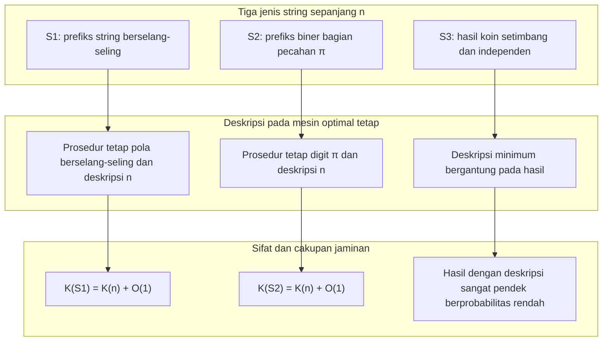
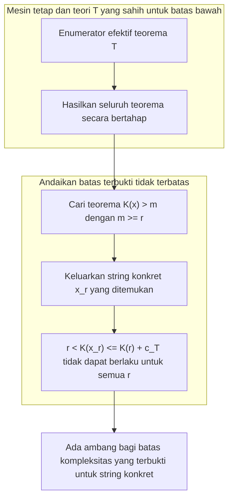

## 1. Tiga string sepanjang satu juta bit

Pertimbangkan tiga string biner dengan panjang $n=1{,}000{,}000$:

1. $S_1$: pola `01` yang diulang lima ratus ribu kali.
2. $S_2$: satu juta bit pertama ekspansi biner <strong>bagian pecahan</strong> $\pi$.
3. $S_3$: suatu hasil dari model satu juta lemparan koin setimbang yang saling independen.

Jika bit disimpan secara padat, semuanya membutuhkan 125.000 byte, atau 125 kB. Jika `0` dan `1` disimpan sebagai karakter ASCII atau UTF-8, ukurannya menjadi satu juta byte. Header berkas dan struktur pengelolaan memerlukan ruang tambahan.

Representasi biner $\pi$ adalah $11.0010010000111111\ldots{}_2$. Jadi, setelah bagian bulat dihilangkan, $S_2$ dimulai dengan `0010010000111111...`. Contoh ini bersifat ilustratif; bukan laporan eksperimen fisik satu juta lemparan yang dilakukan untuk artikel ini.

$S_1$ dapat dihasilkan dengan instruksi pengulangan, sedangkan digit $S_2$ dapat dihitung dengan algoritma. Namun, $S_3$ tidak selalu kompleks: semua lemparan bisa saja menghasilkan nol. Pernyataan yang tepat bersifat probabilistik: <strong>dengan model komputasi yang tetap, hanya sedikit hasil yang dapat dideskripsikan jauh lebih pendek daripada panjangnya</strong>.

Dalam model koin setimbang dan independen, setiap string tertentu sepanjang $n$ memiliki probabilitas yang sama, termasuk string berselang-seling maupun prefiks $\pi$:

$$
P(X=x)=2^{-n},\qquad x\in\{0,1\}^n
$$

Bagaimana membedakan keberadaan aturan pembangkitan yang pendek di antara hasil yang sama mungkin? <strong>Teori informasi algoritmik (AIT)</strong>, yang dikembangkan Solomonoff, Kolmogorov, Chaitin, dan peneliti lain sejak 1960-an, menggunakan panjang program terpendek yang menghasilkan string lalu berhenti.

---

## 2. Informasi Shannon dan string individual

### 2.1 Informasi diri, entropi, dan pengodean

Untuk distribusi diskret $P$, bedakan informasi diri suatu hasil dengan $P(x)>0$ dari rata-ratanya, yaitu entropi. Semua logaritma di sini berbasis 2 dan satuannya bit.

$$
I_P(x)=-\log_2P(x),\qquad
H(P)=-\sum_xP(x)\log_2P(x)
$$

Dalam penjumlahan, digunakan konvensi $0\log_2 0=0$. Informasi diri hasil dengan probabilitas nol adalah tak hingga.

Jika satu simbol dari alfabet berhingga dikodekan dengan kode prefiks biner, panjang rata-rata optimal memenuhi:

$$
H(P)\le L_{\mathrm{opt}}<H(P)+1
$$

Ini tidak berarti setiap kata kode memiliki panjang yang sama dengan entropi. Dengan mengelompokkan $r$ simbol independen yang berdistribusi identik, kelebihan akibat pembulatan per simbol dapat diperkecil:

$$
H(P)\le \frac{L_{\mathrm{opt},r}}{r}<H(P)+\frac1r
$$

Untuk sumber dengan ketergantungan, distribusi blok atau laju entropi ikut berperan. Kode Huffman dan pengodean aritmetika juga perlu dipahami relatif terhadap model, dengan membedakan nilai individual dan rata-rata.

### 2.2 Pilihan model dan frekuensi empiris

Nilai $-\log_2P(x)$ bergantung pada model $P$, bukan hanya $x$. Di bawah model koin setimbang, string berselang-seling pun memiliki satu juta bit informasi diri. Sebaliknya, distribusi titik yang memberikan probabilitas satu hanya kepada string itu memiliki entropi nol. Tetapi <strong>biaya menyampaikan model itu sendiri tidak otomatis menjadi nol</strong>.

Jika hanya frekuensi bit individual yang diperhatikan, pengulangan `01` mengandung separuh nol dan separuh satu. Entropi empiris orde nolnya adalah:

$$
\widehat H_0((01)^{n/2})
=-\tfrac12\log_2\tfrac12-\tfrac12\log_2\tfrac12=1
$$

Model yang memprediksi bit berikutnya dari bit sebelumnya dapat menangkap keteraturannya. Blok tumpang tindih sepanjang $k$ pada string berselang-seling hanya memiliki paling banyak dua jenis. Karena itu, entropi empirisnya paling tinggi 1 bit per blok, atau $1/k$ per bit. Entropi seluruh blok berbeda dari nilainya per bit.

Normalitas $\pi$ belum terbukti. Sifat ini berarti setiap blok dengan panjang tetap muncul dengan frekuensi limit yang sama. Uji frekuensi berhingga atau tampilan yang tidak teratur tidak membuktikannya. Bahkan normalitas tetap dapat dimiliki barisan yang dapat dikomputasi. Jika model boleh menghitung digit, prediksi dan pengodean probabilistik dapat memanfaatkan aturan itu.

AIT tidak membantah teori Shannon. <strong>Panjang kode relatif terhadap model probabilitas dan panjang deskripsi objek pada mesin tetap menjawab pertanyaan yang berbeda.</strong>

| Aspek | Informasi Shannon | Deskripsi algoritmik |
| :--- | :--- | :--- |
| Objek | Distribusi dan hasil di bawah modelnya | String berhingga yang dihasilkan mesin tetap |
| Acuan | Model probabilitas dan aturan pengodean | Mesin, pengodean program, dan masukan tambahan |
| Besaran | $I_P(x)$, $H(P)$, dan laju entropi | Kompleksitas biasa $C(x)$ dan prefiks $K(x)$ |
| Batasan | Deskripsi model mempunyai biaya tersendiri | Konstanta bergantung mesin dan ketakterkomputasian |
| Perlakuan terhadap $\pi$ | Bergantung pada model yang dipilih | Aturan pembangkitan digit dan titik akhir dapat dideskripsikan |

---

## 3. Program terpendek dan teorema invariansi

### 3.1 Kompleksitas biasa dan bersyarat

Misalkan $\{0,1\}^*$ adalah himpunan string biner berhingga dan $|p|$ panjang program dalam bit. Untuk mesin yang dapat dikomputasi secara parsial $A$, pernyataan $A(p)=x$ berarti mesin berhenti dalam waktu berhingga dan menghasilkan tepat $x$.

$$
C_A(x)=\min\{|p|:A(p)=x\}
$$

Jika tidak ada program seperti itu, nilainya ditetapkan sebagai $\infty$. Ketika masukan tambahan $y$ diberikan secara gratis:

$$
C_A(x\mid y)=\min\{|p|:A(p,y)=x\}
$$

Mengetahui panjang atau kamus secara gratis berbeda biayanya dari menyertakannya dalam program.

### 3.2 Kompleksitas prefiks dan batas program

Dalam <strong>kompleksitas prefiks $K$</strong>, himpunan program yang berhenti bersifat bebas prefiks: tidak ada program valid yang merupakan prefiks sejati program valid lain. Pertidaksamaan Kraft memberikan:

$$
K_U(x)=\min\{|p|:U(p)=x\},\qquad
\sum_{p\in\operatorname{dom}U}2^{-|p|}\le1
$$

Dalam versi bersyarat, domain penghentian harus bebas prefiks untuk setiap masukan tambahan tetap $y$. Program yang membatasi dirinya sendiri bukan sekadar kode sumber biasa yang diberi kurung penutup. Kita akan menetapkan mesin acuan yang optimal secara aditif dalam kelas masing-masing untuk $C$ dan $K$.

Menggabungkan program biasa memerlukan informasi tentang batas antarprogram. Untuk pengodean pasangan tetap yang dapat dikomputasi, salah satu batasnya adalah:

$$
C(x,y)\le C(x)+C(y)
+2\log_2\bigl(\min\{C(x),C(y)\}+2\bigr)+O(1)
$$

Program prefiks dapat digabungkan dan diinterpretasikan. Dengan deskripsi bersyarat:

$$
K(x,y)\le K(x)+K(y\mid x)+O(1)
\le K(x)+K(y)+O(1)
$$

Untuk mesin acuan yang sesuai, kedua kompleksitas berhubungan melalui:

$$
C(x)\le K(x)+O(1),\qquad
K(x)\le C(x)+2\log_2(C(x)+2)+O(1)
$$

$O(1)$ menyatakan konstanta yang tidak bergantung pada $x$, bukan biaya yang benar-benar diukur sebesar nol atau beberapa bit.

### 3.3 Optimalitas aditif dan ketergantungan mesin

Untuk $C$, pilih mesin optimal dalam kelas mesin biasa; untuk $K$, dalam kelas mesin bebas prefiks. Jika “universal” hanya berarti kemampuan simulasi, kita juga harus mensyaratkan pelestarian panjang deskripsi hingga tambahan konstanta tetap.

Untuk setiap mesin bebas prefiks $A$, ada konstanta $c_A$ yang tidak bergantung pada $x$ sehingga:

$$
K_U(x)\le K_A(x)+c_A
$$

Konstruksinya menambahkan penanda tetap yang membatasi dirinya sendiri, $s_A$, untuk mengidentifikasi mesin $A$ di depan program $p$, kemudian menyimulasikan $A(p)$. Jika $A(p)=x$, program simulasi menghasilkan $x$; panjang program tersebut adalah $|p|+|s_A|$ ditambah biaya tetap. Program terpendek tidak mungkin lebih panjang. Mesin optimal dapat dibangun dengan cara ini. Argumen yang sesuai berlaku untuk kompleksitas biasa di dalam kelasnya sendiri.

Menerapkan pertidaksamaan dalam kedua arah antara dua mesin optimal secara aditif menghasilkan:

$$
|K_{U_1}(x)-K_{U_2}(x)|\le c_{12}
$$

Konstanta harus mencakup biaya simulasi kedua arah. Ukuran satu interpreter dalam satu arah saja tidak otomatis menjadi batas selisih absolut.

Mesin khusus dapat mencetak satu string tertentu sepanjang satu juta bit dengan instruksi pendek. Biaya mendeskripsikan dan menyimulasikan mesin tersebut masuk ke dalam konstanta. Jadi, <strong>invariansi tidak menghapus ketergantungan mesin untuk objek berhingga</strong>. Konstanta yang dibagi dengan $n$ menjadi kecil secara relatif ketika $n\to\infty$, tetapi panjang minimum suatu string tertentu tetap tidak diketahui secara umum. CPU nyata dengan memori berhingga juga berbeda dari mesin matematis dengan penyimpanan tak terbatas.

### 3.4 Pola berselang-seling, pi, dan titik akhir

Identifikasikan $n$ dengan representasi biner tetap untuk bilangan bulat. Misalkan $s(n)$ adalah string berselang-seling sepanjang $n$, atau $n$ bit pertama bagian pecahan $\pi$. Kita dapat menghasilkan $s(n)$ dari $n$ dan memperoleh kembali $n$ dari panjang string. Transformasi yang dapat dikomputasi dalam kedua arah memberikan:

$$
K(s(n))=K(n)+O(1),\qquad K(s(n)\mid n)=O(1)
$$

Jika titik akhir diberikan gratis, pembangkit berpanjang konstan cukup. Jika tidak, $n$ juga harus dideskripsikan. Misalnya, pengodean bilangan bulat yang membatasi dirinya sendiri memberikan, untuk $n\ge2$:

$$
K(n)\le \log_2 n+2\log_2\log_2 n+O(1)=O(\log n)
$$

Persamaan $K(n)=\log_2n+O(1)$ tidak berlaku untuk semua bilangan bulat. Jika $n=2^m$, deskripsi pendek eksponen $m$ dapat digunakan untuk membentuk kembali $n$. Notasi asimtotik juga tidak mengukur program nyata sebagai tepat dua puluh bit atau beberapa ratus byte.



Deskripsi terpendek $S_3$ tidak selalu berupa salinan data mentah. Bagian berikut menjelaskan kedudukannya secara probabilistik.

---

## 4. Ketakterkompresian dan keacakan barisan tak hingga

### 4.1 Batas melalui keluaran literal

Deskripsi yang menghasilkan string $x$ sepanjang $n$ bit secara literal memberi:

$$
C(x)\le n+O(1),\qquad K(x\mid n)\le n+O(1)
$$

Untuk kompleksitas prefiks tanpa syarat, panjangnya juga perlu disampaikan dengan kode yang membatasi dirinya sendiri:

$$
K(x)\le n+K(n)+O(1)
$$

Batas seragam $K(x)\le |x|+O(1)$ untuk semua string tidak mungkin. Jika ada, pada setiap panjang $n$, jumlah $\sum_{|x|=n}2^{-K(x)}$ akan memiliki batas bawah positif yang sama. Menjumlahkannya untuk semua panjang melanggar Kraft.

### 4.2 Penghitungan yang tepat

Misalkan $n\ge0$ dan $0\le c\le n$ adalah bilangan bulat. Banyaknya program biner dengan panjang kurang dari $n-c$ adalah:

$$
\sum_{j=0}^{n-c-1}2^j=2^{n-c}-1
$$

Untuk $c=n$, jumlah kosong bernilai nol. Setiap program yang berhenti menghasilkan paling banyak satu string. Di antara $2^n$ string sepanjang $n$, banyaknya yang memenuhi $C(x)<n-c$ tidak dapat melebihi jumlah program tersebut. Maka:

$$
\#\{x\in\{0,1\}^n:C(x)\ge n-c\}
\ge2^n-2^{n-c}+1
$$

Program yang tidak berhenti atau menghasilkan keluaran yang sama dapat membuat jumlah keluaran berbeda lebih kecil lagi. Jika $c>n$, maka $n-c<0$ sehingga $C(x)\ge n-c$ berlaku secara trivial untuk semua string. Rumus jumlah geometri tidak diperluas begitu saja ke wilayah ini.

Di bawah distribusi seragam, yang sesuai dengan lemparan koin setimbang dan independen:

$$
P\{C(X)<n-c\}
\le\frac{2^{n-c}-1}{2^n}<2^{-c}
$$

Untuk $c=0$, pada setiap panjang ada setidaknya satu string dengan $C(x)\ge n$. Untuk $c=1$, lebih dari separuh string tidak dapat dipendekkan <strong>lebih dari</strong> satu bit. Untuk $c=10$ dan $c=20$, batas bawah $1-2^{-c}$ bagi proporsi tanpa penghematan lebih dari 10 atau 20 bit kira-kira 99,902% dan 99,999905%. Penghematan tepat $c$ bit tidak dilarang oleh pernyataan ini.

Penghitungan serupa berlaku untuk $K(x\mid n)$ ketika kondisi $n$ tetap. Jadi, dengan probabilitas tinggi hasil koin memerlukan deskripsi yang mendekati panjangnya, tetapi tidak ada jaminan untuk setiap hasil.

Kompresor nirrugi yang selalu memendekkan semua berkas bertentangan dengan penghitungan ini. Kompresor nyata memanfaatkan keteraturan tertentu. Proporsi di bawah distribusi seragam seluruh string tidak otomatis sama dengan frekuensi data alamiah atau buatan manusia.

### 4.3 Keacakan Martin-Löf

Ketidakmampuan memendekkan string berhingga sebesar margin tertentu berbeda definisinya dari keacakan barisan tak hingga. Pada ruang barisan biner tak hingga, gunakan ukuran koin setimbang $\mu$. Himpunan silinder $[w]$ berisi barisan yang diawali string berhingga $w$ dan memiliki ukuran $2^{-|w|}$.

<strong>Uji Martin-Löf</strong> adalah barisan himpunan terbuka $V_j$ yang dapat dienumerasi secara efektif dan seragam sebagai gabungan silinder prefiks berhingga, dengan:

$$
\mu(V_j)\le2^{-j},\qquad j=1,2,\ldots
$$

Barisan $\omega$ gagal dalam uji jika $\omega\in\bigcap_jV_j$. Barisan itu acak menurut Martin-Löf jika tidak gagal dalam uji mana pun yang berbentuk demikian. Ini tidak melarang kemunculan sesekali pola berhingga yang langka. Jumlah uji efektif paling banyak terhitung, dan masing-masing memiliki himpunan kegagalan berukuran nol; himpunan yang lolos semua uji berukuran satu.

Teorema Levin–Schnorr mencirikan sifat ini menggunakan <strong>kompleksitas prefiks</strong> optimal:

$$
\omega\text{ acak menurut Martin-Löf}
\iff
\exists c\ \forall n\quad K(\omega_{1:n})\ge n-c
$$

<strong>Konstanta $c$ yang sama</strong> harus berlaku untuk semua $n$. Kita tidak dapat langsung mengganti $K$ dengan kompleksitas biasa $C$ dalam ekuivalensi ini.

Aturan seleksi von Mises dan Church merupakan bagian dari sejarahnya, tetapi kondisi keterkomputasian yang berbeda pada uji atau strategi taruhan menghasilkan konsep berbeda. Keacakan komputabel, yang melarang martingal komputabel memperoleh modal tak terbatas, lebih lemah daripada keacakan Martin-Löf. Barisan digit $\pi$ yang dapat dikomputasi tidak acak menurut Martin-Löf. Normalitas adalah sifat yang berbeda.

---

## 5. Ketakterkomputasian, batas pembuktian, dan probabilitas berhenti

### 5.1 Mendekati dari atas tanpa mengenali saat tiba

Untuk mencari program pendek yang menghasilkan $x$, kita dapat menjalankan kandidat secara berselang-seling, memberikan beberapa langkah komputasi kepada masing-masing. Panjang terkecil yang telah ditemukan memberikan pendekatan dari atas:

$$
K_t(x)\searrow K(x)\qquad(t\to\infty)
$$

Nilai awal dapat berupa batas atas berhingga yang dapat dikomputasi melalui keluaran literal. Karena nilainya bulat, untuk setiap $x$ tetap pendekatan akhirnya mencapai nilai benar dan menetap. Namun, tidak ada prosedur umum yang mengenali saat itu untuk semua masukan. Program lebih pendek yang belum berhenti mungkin menghasilkan $x$ kemudian.

### 5.2 Argumen bergaya Berry

Ungkapan “bilangan bulat positif terkecil yang tidak dapat didefinisikan dalam kurang dari dua puluh kata” memiliki empat belas kata yang dipisahkan spasi, jadi kurang dari dua puluh. Makna “didefinisikan” dalam bahasa alami ambigu; ungkapan ini bukan bukti formal dengan sendirinya. Kita memindahkan idenya ke prosedur yang dapat dikomputasi.

Andaikan prosedur `ComputeK` mengembalikan nilai benar $K(x)$ dan berhenti untuk setiap $x$. <strong>Pseudokode</strong> berikut menggunakan asumsi mustahil itu; ini bukan pengukur kompleksitas yang dapat diimplementasikan.

```text
Berry(m):
    Enumerasi semua string biner x menurut panjang 0,1,2,..., lalu urutan leksikografis untuk panjang yang sama:
        if ComputeK(x) >= m:
            Keluarkan x lalu berhenti
```

Urutannya disebut shortlex: panjang lebih dahulu, lalu leksikografis. Urutan leksikografis biasa saja tidak menyediakan enumerasi seluruh string berhingga yang diperlukan di sini.

Penghitungan menunjukkan bahwa kompleksitas tidak terbatas. Di bawah asumsi tersebut, pencarian berhenti untuk setiap $m$ dan menghasilkan $x_m$ dengan $K(x_m)\ge m$. Namun, kode tetap dan deskripsi $m$ yang membatasi dirinya sendiri cukup untuk menghasilkan keluaran itu:

$$
m\le K(x_m)\le K(m)+c
\le \log_2m+2\log_2\log_2m+c'
$$

Batas terakhir berlaku untuk $m\ge2$. Dengan konstanta tetap dan $m$ cukup besar, timbul kontradiksi. Jadi, `ComputeK` tidak ada. Kita tidak perlu menyatakan bahwa margin tetap 10.000 bit selalu cukup tanpa mengukur biaya mesin yang dipilih.

### 5.3 Teorema ketaklengkapan Chaitin

Tetapkan mesin acuan dan teori $T$ yang dapat diaksiomatisasi secara efektif serta mampu menyatakan batas kompleksitas string konkret. Asumsikan <strong>kesahihan semantik (soundness)</strong> untuk batas bawah yang dibuktikannya: pernyataan tersebut benar.

Maka ada ambang $b_T$ sehingga $T$ tidak dapat membuktikan “$K(x)>b_T$” untuk string konkret $x$ mana pun.

Inti buktinya adalah mengandaikan batas bawah numerik yang dapat dibuktikan tidak terbatas. Untuk setiap masukan $r$, kita dapat mengenumerasi semua teorema dan menemukan pernyataan “$K(x)>m$” dengan bilangan bulat konkret $m\ge r$.

```text
SearchProof(r):
    Enumerasi teorema-teorema T secara efektif:
        if sebuah teorema menyatakan "K(x) > m" untuk string konkret x dan bilangan bulat m dengan m >= r:
            Keluarkan x lalu berhenti
```

Kesahihan menjamin bahwa keluaran $x_r$ memiliki kompleksitas lebih besar daripada $r$. Tetapi bagian program yang tetap dapat memuat enumerator teorema $T$. Akibatnya:

$$
r<K(x_r)\le K(r)+c_T=O(\log r)+c_T
$$

Untuk $r$ cukup besar, ini mustahil. Jadi, batas bawah numerik yang dapat dibuktikan memang terbatas.



Ambang bergantung pada mesin, teori, dan representasi. Kita tidak mengukur batas universal ZFC sebesar 20.000 atau 50.000 bit. Ketika panjang $n$ cukup besar dibandingkan ambang, penghitungan menunjukkan bahwa banyak string benar-benar memiliki kompleksitas lebih tinggi. Namun, ada batas pada pembuktian batas bawah itu untuk satu string tertentu.

Hasil ini menghubungkan ketaklengkapan Gödel dengan deskripsi algoritmik. Ini bukan hukum umum “kekekalan informasi” yang melarang penurunan teorema panjang atau banyak dari aksioma pendek. Menambahkan aksioma menghasilkan teori lain dengan konstanta lain.

### 5.4 Probabilitas berhenti bergantung pada mesin

Untuk mesin optimal bebas prefiks $U$, probabilitas bahwa barisan tak hingga bit independen yang setimbang dimulai dengan program yang berhenti adalah:

$$
\Omega_U=\sum_{p\in\operatorname{dom}U}2^{-|p|}
$$

Silinder program-program yang berhenti saling lepas, sehingga jumlah ini dapat ditafsirkan sebagai probabilitas. Kraft memberikan $\Omega_U\le1$. Dengan kondisi ini, termasuk optimalitas, $\Omega_U$ juga merupakan bilangan real tak komputabel yang acak menurut Martin-Löf, dengan $0<\Omega_U<1$. Kebebasan prefiks saja tidak menjamin semua sifat tersebut bagi mesin sembarang.

Enumerasi program yang berhenti menghasilkan jumlah parsial yang meningkat dari bawah. Jadi, $\Omega_U$ <strong>dapat dienumerasi secara komputabel dari kiri (left-c.e.)</strong>: ada pendekatan rasional komputabel yang meningkat menuju nilainya. Namun, tidak ada fungsi komputabel yang memberikan tahap yang dijamin cukup untuk setiap ketelitian yang diminta.

Andaikan $N$ bit pertama bagian pecahan diketahui secara eksak, dan $a$ adalah ujung bawah biner yang bersesuaian. Karena ekspansi biner $\Omega_U$ tidak berakhir:

$$
a=\frac{\lfloor2^N\Omega_U\rfloor}{2^N},
\qquad a<\Omega_U<a+2^{-N}
$$

Jalankan program secara berselang-seling hingga jumlah parsial bobot penghentian $q_s$ <strong>melampaui</strong> $a$. Saat itu:

$$
0\le\Omega_U-q_s<2^{-N}
$$

Program yang belum ditemukan dan panjangnya paling banyak $N$ akan menambah setidaknya $2^{-N}$ jika berhenti kemudian, bertentangan dengan batas sisa massa. Maka bit-bit itu menentukan penghentian seluruh masukan sepanjang paling banyak $N$ pada <strong>mesin yang sama</strong>.

Ini tidak berarti beberapa ribu bit tertentu memutuskan semua pernyataan matematika sembarang. Ketika pencarian contoh penyangkal dikodekan sebagai masalah berhenti, mesin, panjang program, dan bentuk logis pernyataan berperan. Penelitian tentang sejumlah digit berhingga juga bukan algoritma untuk menghasilkan semua digit.

---

## 6. Teori Shannon, MDL, NCD, dan kecerdasan buatan

### 6.1 Panjang deskripsi rata-rata dan laju entropi

Misalkan $P$ adalah distribusi diskret komputabel pada string berhingga, ditentukan oleh prosedur berhingga $d_P$. Jika $d_P$ dibagikan gratis sebagai masukan tambahan dan $H(P)<\infty$, maka:

$$
H(P)\le\mathbb E_{X\sim P}[K(X\mid d_P)]\le H(P)+c
$$

Himpunan pendukung distribusi boleh berhingga atau terhitung; nilai probabilitas harus dapat dihitung secara seragam hingga ketelitian yang diminta. Konstanta $c$ mencakup biaya dekoder tetap, bukan pernyataan kesamaan numerik eksak.

Batas bawah mengikuti Kraft pada deskripsi prefiks minimum dengan kondisi tetap $d_P$ dan argumen panjang kode rata-rata. Batas atas diperoleh dengan membangun kode prefiks berdasarkan distribusi bersama dan mendekodenya dengan prosedur tetap. Jika distribusi tidak dibagikan, biaya deskripsi model juga perlu dihitung. Distribusi sembarang yang sekadar “diketahui” tidak menjamin entropinya selalu dapat dihitung secara eksak dalam waktu berhingga.

Hasil berbeda, bertipe Brudno, berlaku bagi <strong>proses stasioner ergodik pada alfabet berhingga</strong>. Jika $h$ adalah laju entropi dalam bit per simbol, untuk hampir setiap barisan sampel:

$$
\lim_{n\to\infty}\frac{K(X_{1:n})}{n}=h
$$

Selain itu, $\mathbb E[K(X_{1:n})]/n\to h$. Pengodean literal barisan sepanjang $n$ simbol memberikan batas atas linear yang seragam sehingga konvergensi hampir pasti dapat diteruskan ke rata-rata. Selisih logaritmik kompleksitas biasa dan prefiks menghilang setelah dibagi $n$. Teorema laju ini tidak memerlukan keterkomputasian ukuran yang disyaratkan dalam pertidaksamaan distribusi bersyarat sebelumnya.

### 6.2 Semiukuran universal diskret dan prediksi Solomonoff

Untuk mesin prefiks optimal yang menghasilkan keluaran berhingga lalu berhenti, definisikan probabilitas menghasilkan tepat $x$ dan berhenti:

$$
m_U(x)=\sum_{p:U(p)=x}2^{-|p|}
$$

Massa totalnya paling banyak satu, sehingga ini merupakan <strong>semiukuran (semimeasure)</strong>, yang semikomputabel dari bawah. Teorema pengodean menghubungkan semiukuran universal diskret ini dengan kompleksitas prefiks:

$$
-\log_2m_U(x)=K_U(x)+O(1),
\qquad m_U(x)=\Theta(2^{-K_U(x)})
$$

Sebaliknya, prediksi sekuensial Solomonoff menggunakan mesin monoton dan semiukuran $M(x)$ bagi probabilitas keluaran <strong>diawali oleh $x$</strong>. Mesin tidak harus berhenti di sana, dan berlaku $M(x)\ge M(x0)+M(x1)$. Objek diskret $m_U$ tidak sama dengan objek sekuensial $M$; teorema pengodean yang sama tidak dapat dipindahkan tanpa syarat.

Mengutamakan deskripsi pendek berkaitan dengan pisau cukur Ockham. Namun, hipotesis pendek tidak harus memiliki probabilitas lebih tinggi setelah data diamati: likelihood juga berperan.

### 6.3 Pemilihan Bayesian dan panjang deskripsi minimum

Berikan panjang deskripsi prefiks aktual $L(H)$ kepada model $H$ dan pilih probabilitas prior sebanding dengan bobot kodenya. Rumus Bayes menjadi:

$$
-\log_2P(H\mid D)
=L(H)-\log_2P(D\mid H)+\mathrm{const}
$$

Konstanta aditif tidak bergantung pada $H$. Dalam pilihan ini, memaksimalkan probabilitas posterior sama dengan meminimalkan ruas kanan. Namun, secara umum $-\log_2P(D\mid H)$ tidak selalu dapat diganti dengan $K(D\mid H)$.

<strong>Prinsip panjang deskripsi minimum (MDL)</strong> membandingkan biaya gabungan model dan data yang dikodekan dengannya:

$$
\widehat H=\arg\min_{H\in\mathcal H}
\{L(H)+L(D\mid H)\}
$$

Model terlalu sederhana dapat meninggalkan kode data yang panjang. Model yang menghafal semuanya bisa memiliki deskripsi model sangat panjang. Menghilangkan residu melalui hafalan tidak sama dengan meminimalkan panjang total. MDL Rissanen adalah prinsip praktis pemilihan statistik, bukan jaminan menemukan semua hukum alam atau hubungan sebab-akibat yang benar.

### 6.4 Jarak ideal dan kompresor nyata

Untuk penyebut positif, <strong>jarak informasi ternormalisasi (NID)</strong> ideal didefinisikan sebagai:

$$
\operatorname{NID}(x,y)=
\frac{\max\{K(x\mid y),K(y\mid x)\}}
{\max\{K(x),K(y)\}}
$$

Besaran ini juga berkaitan dengan rumus menggunakan deskripsi pasangan $K(x,y)$, hingga galat aditif dan ternormalisasi yang sesuai. Penggabungan tanpa pembatas $xy$ tidak persis sama dengan pengodean pasangan yang memungkinkan kedua bagiannya dipulihkan secara unik.

Tuliskan $Z$ untuk panjang keluaran kompresor nyata agar berbeda dari kompleksitas biasa $C$. <strong>Jarak kompresi ternormalisasi (NCD)</strong> adalah:

$$
\operatorname{NCD}_Z(x,y)=
\frac{Z(xy)-\min\{Z(x),Z(y)\}}
{\max\{Z(x),Z(y)\}}
$$

Gagasannya: jika kompresor dapat menggunakan kembali struktur bersama, berkas serupa akan mendapat nilai kecil. Jika struktur bersama tidak dapat dimanfaatkan, nilainya cenderung mendekati satu.

Namun, kompresor nyata memiliki header, jendela kamus, blok, pengaturan, dan pengaruh urutan. Tidak semua kompresor memenuhi asumsi kompresor normal teoretis, seperti idempotensi, monotonisitas, simetri, dan distributivitas, pada setiap masukan. Bahkan untuk berkas identik, $Z(xx)\approx Z(x)$ dapat gagal. NCD berhingga tidak menjamin aksioma jarak secara eksak maupun nilai selalu di antara nol dan satu.

Pemeriksaan tambahan menggabungkan sebuah string tetap sepanjang 65.536 byte dengan dirinya sendiri. Dengan gzip dan jendela berhingga, NCD berkas terhadap dirinya sendiri mendekati 0,9997. Ini bukan sanggahan terhadap NID ideal, melainkan contoh batas pendekatan praktis.

Cilibrasi, Vitányi, dan rekan-rekan meneliti pengelompokan berdasarkan kompresi untuk genom, bahasa, dan musik. Tidak merancang fitur khusus secara manual bisa bermanfaat, tetapi hasil tetap bergantung pada pengodean karakter, representasi berkas, dan pilihan kompresor. Tidak ada jaminan merekonstruksi semua pohon filogenetik dengan benar.

### 6.5 Prediksi model bahasa dan panjang kode

Untuk barisan token $D=x_{1:T}$ dan model autoregresif tetap, panjang ideal yang berkaitan dengan prediksi adalah:

$$
\mathcal L_\theta(D)=
-\sum_{t=1}^T\log_2p_\theta(x_t\mid x_{<t})
$$

Dengan logaritma natural, satuannya nat; bagi dengan $\ln2$ untuk memperoleh bit. Ini adalah log-likelihood negatif pada data berhingga, yang rata-ratanya per token digunakan sebagai kerugian entropi silang.

Untuk hasil berprobabilitas positif, jika model dan panjang barisan dibagikan, pengodean aritmetika ideal atau konstruksi terkait dapat memberikan deskripsi prefiks dengan panjang paling banyak $\lceil\mathcal L_\theta(D)\rceil+2$. Tidak setiap implementasi menggunakan tepat “kerugian ditambah dua bit”: ketelitian berhingga, terminasi, pembulatan, dan pembingkaian menambah biaya.

Misalkan $L_{\mathrm{model}}$ dan $L_{\mathrm{meta}}$ adalah panjang aktual deskripsi model dan metadata yang membatasi dirinya sendiri. Dengan dekoder tetap:

$$
K(D)\le L_{\mathrm{model}}+L_{\mathrm{meta}}
+\lceil\mathcal L_\theta(D)\rceil+O(1)
$$

Metadata mencakup, sesuai kebutuhan, panjang barisan, kosakata, dan spesifikasi tokenisasi yang dapat dibalik. Spasi atau karakter asli yang dihilangkan oleh normalisasi tidak dapat dipulihkan tanpa informasi tambahan.

Menurunkan kerugian prediksi model bersama dengan ukuran tetap mengurangi panjang kode data. Jika ukuran model ikut berubah, biaya total harus dibandingkan. Meminimalkan kerugian pelatihan saja tidak sama dengan meminimalkan tujuan MDL dua bagian.

Perspektif penelitian kompresi dan kecerdasan yang diwakili AIXI dan Hutter Prize dari Marcus Hutter memotivasi hubungan ini. Tetapi AIXI adalah model ideal tak komputabel, bukan Transformer nyata. Penelitian Delétang dan rekan-rekan juga mengkaji hubungan prediksi dan kompresi melalui model bahasa.

Memprediksi nama pelaku dalam novel detektif dengan benar memendekkan kode nama itu. Perbaikan bisa berasal dari penalaran, tetapi juga hafalan, bias kosakata, atau data berulang. Mengompresi teks pelatihan tidak membuktikan bahwa model pasti memperoleh model kausal dunia, penalaran benar, kemampuan generalisasi, atau kecerdasan buatan umum.

| Teori atau prinsip | Hubungan praktis | Perbedaan penting |
| :--- | :--- | :--- |
| $K(x)$, $K(x\mid y)$ | Deskripsi dengan dekoder dan konteks bersama | Panjang nyata belum tentu minimum |
| Semiukuran diskret $m_U$ | Pemodelan yang mengutamakan deskripsi pendek | Keluaran yang berhenti versus prediksi sekuensial $M$ |
| MDL | Panjang model ditambah kode data | Likelihood versus kompleksitas bersyarat |
| NID dan NCD | Kemiripan dan pengelompokan melalui kompresi | Jendela, representasi, urutan, dan panjang berhingga |
| Model bahasa dan pengodean aritmetika | Probabilitas prediksi dan panjang kode | Model bersama, biaya total mandiri, dan evaluasi kecerdasan |

---

## 7. Apa yang dijelaskan kompresi dan apa yang masih terbuka?

Meskipun sama-sama satu juta bit, string berselang-seling dan prefiks $\pi$ mempunyai pembangkit pendek. Mendeskripsikan titik akhir berbeda biayanya dari mengetahuinya secara gratis. Penghitungan memberikan ketakterkompresian dengan probabilitas tinggi untuk hasil koin, bukan jaminan individual.

Invariansi membatasi perbedaan mesin optimal dengan konstanta. Argumen Berry menunjukkan bahwa panjang minimum sebenarnya tidak dapat dikomputasi secara umum. Chaitin dan $\Omega_U$ memperjelas batas pembuktian serta komputasi. Semuanya bukan cara menilai objek berhingga sembarang secara bebas dari mesin dan asumsi.

MDL, NCD, dan panjang kode model bahasa menghubungkan ideal tersebut dengan praktik. Kompresi membantu memahami keteraturan dan model bersama, tetapi rasionya tidak menggantikan definisi lengkap pemahaman atau kecerdasan.

### Referensi

- [Shen: Algorithmic Information Theory and Kolmogorov Complexity](https://www.lirmm.fr/~ashen/uppsala-notes.pdf) — Kompleksitas biasa dan prefiks, dekoder optimal, ketakterkomputasian, dan teorema pengodean.
- [Rute: Computable randomness and betting for computable probability spaces](https://arxiv.org/html/1203.5535v4) — Perbedaan keacakan komputabel dan uji Martin-Löf.
- [Tadaki: Chaitin Ω numbers and halting problems](https://arxiv.org/abs/0904.1149) — Probabilitas berhenti mesin optimal dan masalah berhenti dengan panjang masukan terbatas.
- [Chazottes: Entropy in Dynamical Systems & Ergodic Theory](https://www.claymath.org/wp-content/uploads/2023/04/Chazottes-rev.pdf) — Slide 50: teorema Brudno untuk partisi berhingga.
- [Cilibrasi dan Vitányi: Clustering by Compression](https://arxiv.org/html/cs/0312044v2) — Asumsi kompresor normal dan NCD.
- [Delétang dkk.: Language Modeling Is Compression](https://arxiv.org/abs/2309.10668) — Kajian hubungan prediksi dan kompresi.
- [Hutter: Universal Algorithmic Intelligence](https://www.hutter1.net/ai/aixigentle.htm) — Ideal AIXI yang menghubungkan induksi universal dan keputusan, beserta batas komputasinya.
- [Bailey dkk.: An Empirical Approach to the Normality of Pi](https://www.davidhbailey.com/dhbpapers/normality-digits-pi.pdf) — Perbedaan uji digit empiris dan bukti normalitas.
