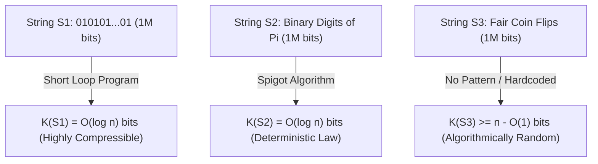
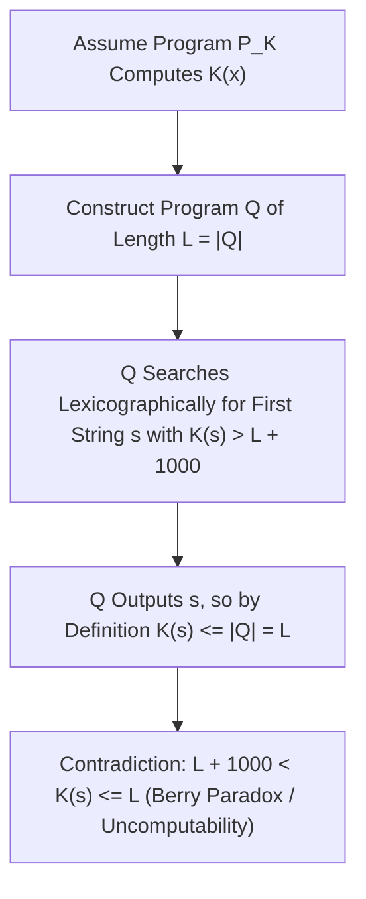

## Pendahuluan: Teka-teki Tiga String Satu Juta Bit — Titik Buta Teori Informasi Shannon

Bayangkan di hadapan Anda terdapat tiga string biner yang masing-masing panjangnya tepat $1.000.000$ bit:
- String pertama $S_1$ adalah pengulangan lima ratus ribu kali pola `01`: `01010101...01`.
- String kedua $S_2$ berisi satu juta digit biner pertama di belakang koma dari bilangan $\pi$: `1100100100001111110110...`.
- String ketiga $S_3$ adalah barisan yang diperoleh dengan melempar koin setimbang sebanyak satu juta kali (angka = `1`, gambar = `0`).

Manakah dari ketiga string ini yang mengandung paling banyak “informasi”? Manakah yang paling “kompleks”, dan manakah yang benar-benar “acak”?
Jika kita mencari jawaban pada <strong>teori informasi klasik Claude Shannon (1948)</strong>, kita akan menemui jalan buntu yang mengejutkan: entropi Shannon $H(X) = -\sum P(x)\log_2 P(x)$ mengukur ketidakpastian rata-rata dari suatu <strong>distribusi probabilitas (ansambel sumber)</strong>, tetapi sama sekali tidak bisa mengukur kompleksitas intrinsik dari <strong>satu objek individual spesifik $x$</strong>! Dalam model pelemparan koin setimbang, barisan rapi $S_1$ dan barisan kacau $S_3$ memiliki peluang kemunculan yang persis sama, yakni $2^{-1.000.000}$; sedangkan untuk konstanta deterministik $\pi$ ($S_2$), distribusinya adalah titik tunggal dengan entropi $0$, padahal frekuensi bit 0 dan 1 di dalamnya lulus hampir semua uji keacakan statistik!

Untuk memberikan landasan matematika yang ketat bagi kompleksitas dan keacakan objek tunggal, Ray Solomonoff (1960), <strong>Andrey Kolmogorov (1965)</strong>, dan Gregory Chaitin (1966) secara independen mendirikan <strong>Teori Informasi Algoritmik (Algorithmic Information Theory, AIT)</strong>. Wawasan inti mereka sangat revolusioner: <strong>kompleksitas sejati suatu objek tidak diukur dari banyaknya karakter yang tampak, melainkan dari panjang “program komputer terpendek” yang sanggup menghasilkan objek tersebut!</strong>

---

## 1. Kompleksitas Kolmogorov $K(x)$ dan Teorema Invariansi Mesin Turing Universal

Diberikan sebuah mesin Turing universal $U$ (atau bahasa pemrograman Turing-complete apa pun seperti C atau Python), <strong>kompleksitas Kolmogorov</strong> $K_U(x)$ dari string biner $x \in \{0,1\}^*$ didefinisikan sebagai panjang bit $|p|$ dari program terpendek $p$ yangเมื่อ dijalankan pada $U$ akan mencetak $x$ lalu berhenti (halt). Agar memenuhi pertidaksamaan Kraft $\sum 2^{-|p|} \le 1$, teori modern menggunakan <strong>kompleksitas bebas-prefiks (kompleksitas Levin-Chaitin)</strong> $K(x)$, di mana tidak ada program sah yang menjadi prefiks bagi program sah lainnya.

Ketika kita meninjau kembali ketiga string satu juta bit tadi melalui kacamata $K(x)$, kabut misteri langsung sirna:
- Untuk $S_1$, programnya cukup ditulis `print("01" * 500000)`. Karena hanya perlu menyimpan jumlah perulangan $n/2$ dalam biner, maka $K(S_1) = O(\log_2 n) pprox 20$ bit: string ini <strong>secara algoritmik sangat sederhana</strong>.
- Untuk $S_2$ ($n$ bit pertama $\pi$), meskipun tampak acak secara statistik, sebuah program pendek berukuran beberapa ratus byte yang mengimplementasikan rumus Machin atau algoritma tetes BBP dapat menghitung $S_2$ secara eksak. Maka berlaku pula $K(S_2) = O(\log_2 n)$! Ini menyingkap kebenaran mendalam filsafat sains: <strong>hukum alam pada hakikatnya adalah kompresi algoritmik ekstrem atas data pengamatan empiris.</strong>
- Sebaliknya, untuk string $S_3$ hasil lemparan koin sungguhan, tidak ada pola tersembunyi yang dapat meringkasnya. Program terpendek untuk mencetak $S_3$ terpaksa menyalin seluruh satu juta bit tersebut mentah-mentah (`print("1011001...")`), sehingga $K(S_3) pprox n + O(1) pprox 1.000.000$ bit!

Mungkin muncul pertanyaan: bukankah $K_U(x)$ bergantung secara sembarang pada bahasa pemrograman $U$ yang dipilih? <strong>Teorema Invariansi Kolmogorov (Invariance Theorem)</strong> membuktikan sebaliknya: untuk sembarang dua mesin universal $U_1$ dan $U_2$, terdapat konstanta $c_{12}$ yang hanya bergantung pada $U_1$ dan $U_2$ (dan <strong>sama sekali tidak bergantung pada string $x$</strong>) sedemikian sehingga $|K_{U_1}(x) - K_{U_2}(x)| \le c_{12}$. Buktinya sangat intuitif: $c_{12}$ hanyalah ukuran bit tetap dari sebuah <strong>interpreter (simulator)</strong> untuk bahasa $U_2$ yang ditulis dalam bahasa $U_1$! Saat ukuran data $n 	o \infty$, biaya tetap interpreter ini menjadi tak berarti.

$$
H(X) = -\sum_{x \in \mathcal{X}} P(X = x) \log_2 P(X = x)
$$

$$
K_U(x) = \min_{p \in \{0,1\}^*} \Big\{ |p| \;\Big|\; U(p) = x \Big\}, \qquad \Big| K_{U_1}(x) - K_{U_2}(x) \Big| \le c_{12}
$$

---

## 2. Hakikat Keacakan: Prinsip Sarang Merpati, Ketakterkompresian, dan Keacakan Martin-Löf

Sebelum Kolmogorov, teori probabilitas tidak mampu menjelaskan mengapa `0000000000` bukan barisan acak sedangkan `0110100110` tampak acak. Teori Informasi Algoritmik memberikan definisi ketat pertama dalam sejarah: <strong>keacakan adalah ketakterkompresian (Randomness is Incompressibility) — ketiadaan mutlak keteraturan algoritmik!</strong>

Lebih mengejutkan lagi, hanya dengan <strong>Prinsip Sarang Merpati (Pigeonhole Principle)</strong> dasar, kita dapat membuktikan dalam dua baris bahwa <strong>hampir semua string biner bersifat acak secara algoritmik (tak-terkompresi)</strong>:
Terdapat tepat $2^n$ string biner dengan panjang $n$. Berapa banyak program biner yang panjangnya kurang dari $n - c$ bit? Jika kita menjumlahkan banyaknya program dengan panjang $0, 1, \dots, n-c-1$, totalnya adalah $\sum_{i=0}^{n-c-1} 2^i = 2^{n-c} - 1$ program. Karena setiap program menghasilkan paling banyak satu keluaran, maka dari $2^n$ string sepanjang $n$, <strong>paling banyak hanya $2^{n-c} - 1$ string yang dapat dikompresi lebih dari $c$ bit</strong> ($K(x) < n - c$)!
Dengan kata lain, proporsi string sepanjang $n$ yang bisa dikompresi minimal $c$ bit bernilai kurang dari $2^{-c}$. Ambil $c = 20$, maka lebih dari $99,9999\,\%$ string tidak dapat dipendekkan walau hanya $20$ bit oleh algoritma apa pun! Per Martin-Löf (1966) membuktikan bahwa suatu barisan biner tak-hingga lulus seluruh uji statistik keacakan yang terkomputasi (<strong>keacakan Martin-Löf</strong>) jika dan hanya jika seluruh prefiksnya $x_{1:n}$ tak-terkompresi ($K(x_{1:n}) \ge n - O(1)$).

$$
\sum_{i=0}^{n-c-1} 2^i = 2^{n-c} - 1 \implies \mathbb{P}_{x \sim \text{Unif}(\{0,1\}^n)}\big( K(x) < n - c \big) < \frac{2^{n-c}}{2^n} = 2^{-c}
$$

$$
\Omega = \sum_{p:\, U(p)\text{ halts}} 2^{-|p|} \in (0, 1), \qquad K(\Omega_{1:n}) \ge n - O(1)
$$

---

## 3. Paradoks Berry, Ketakterkomputasian $K(x)$, Konstanta $\Omega$ Chaitin, dan AI Modern

Jika $K(x)$ begitu hebat, bisakah kita membuat program kompresi pamungkas yang menerima string $x$ apa pun lalu menghitung nilai eksak $K(x)$? Jawabannya adalah <strong>mustahil: fungsi $K(x)$ bersifat tak-terkomputasi (Uncomputable)!</strong>

Keterbatasan mendalam ini berakar dari <strong>Paradoks Berry</strong> klasik (“bilangan bulat positif terkecil yang tidak dapat didefinisikan dalam kurang dari dua puluh kata” — kalimat yang justru mendefinisikannya dalam lima belas kata!). Gregory Chaitin memformalkannya sebagai berikut: andaikan ada subrutin `ComputeK(x)` sepanjang $L$ bit yang mampu menghitung $K(x)$. Kita bangun program utama $Q$ yang memeriksa semua string $s$ secara leksikografis, memanggil `ComputeK(s)`, dan mencetak string pertama $s^*$ yang memenuhi $K(s^*) > L + 10000$. Panjang total program $Q$ hanyalah $L + O(1)$ bit, namun ia berhasil mencetak $s^*$! Berdasarkan definisi $K(s^*)$ sebagai panjang program terpendek, haruslah berlaku $K(s^*) \le |Q| < L + 10000$, yang bertentangan langsung dengan $K(s^*) > L + 10000$! Dari sini lahir <strong>Teorema Ketaklengkapan Chaitin</strong>: sistem aksioma formal dengan kompleksitas $C$ bit tidak akan pernah bisa membuktikan bahwa suatu string spesifik memenuhi $K(x) > C + O(1)$.

Chaitin juga merangkum peluang berhentinya mesin Turing universal bebas-prefiks ke dalam bilangan real legendaris <strong>Konstanta Omega $\Omega = \sum_{U(p)	ext{ berhenti}} 2^{-|p|}$</strong>. Meskipun $\Omega \in (0,1)$ terdefinisi secara pasti, nilainya <strong>sama sekali tak-terkomputasi dan acak secara algoritmik</strong> ($K(\Omega_{1:n}) \ge n - O(1)$): mengetahui $n$ bit pertama $\Omega$ setara dengan memecahkan Masalah Berhenti (Halting Problem) Turing untuk semua program hingga panjang $n$!

Dalam rekayasa perangkat lunak dan kecerdasan buatan modern, batas atas terkomputasi dari $K(x)$ menjadi motor penggerak utama:
1. <strong>Jembatan menuju Entropi Shannon</strong>: untuk proses stokastik stasioner ergodik, nilai harapan $rac{1}{n}\mathbb{E}[K(X_{1:n})]$ konvergen menuju laju entropi Shannon $H(X)$.
2. <strong>Induksi Universal Solomonoff & Minimum Description Length (MDL)</strong>: Pisau Cukur Ockham diformalkan melalui distribusi prior universal $P_M(x) \propto 2^{-K(x)}$.
3. <strong>Normalized Compression Distance (NCD)</strong>: menghampiri $K(x)$ dengan kompresor nyata (`zstd`, `lzma`, `gzip`) melalui $	ext{NCD}(x,y) = rac{C(xy) - \min(C(x),C(y))}{\max(C(x),C(y))}$ untuk membangun pohon filogenetik genom dan mengelompokkan malware tanpa rekayasa fitur manual.
4. <strong>Model Bahasa Besar (LLM): Kompresi adalah Kecerdasan</strong>: sebagaimana ditekankan oleh Marcus Hutter (Hutter Prize) dan Ilya Sutskever, meminimalkan kerugian cross-entropy $-\sum \log_2 P_	heta(x_t \mid x_{<t})$ pada Transformer autoregresif melalui pengkodean aritmetika <strong>secara matematis ekuivalen dengan mencari kompresi nirrugi (lossless) terpendek atas seluruh korpus teks manusia</strong>. Demi mengompresi data secara maksimal, model dipaksa menginternalisasi tata bahasa, penalaran logis, dan model kausal dunia.

| Dimensi / Konsep | Entropi Informasi Shannon $H(X)$ | Kompleksitas Kolmogorov $K(x)$ | Hampiran Rekayasa Modern (MDL / LLM / NCD) |
| :--- | :--- | :--- | :--- |
| <strong>Objek yang Diukur</strong> | Distribusi probabilitas (Ansambel) | <strong>Objek atau string individual $x$ itu sendiri</strong> | Berkas nyata, sekuens genom, korpus teks |
| <strong>Penilaian atas $10^6$ bit pertama $\pi$</strong> | Konstanta deterministik ($H=0$); frekuensi seragam | $K(\pi_{1:n}) = O(\log n)$ (sangat sederhana berkat algoritma) | Pengkodean aritmetika & jaringan saraf menangkap pola |
| <strong>Keterkomputasian</strong> | Terkomputasi eksak jika distribusi $P(X)$ diketahui | <strong>Mutlak tak-terkomputasi</strong> (setara Halting Problem) | Batas atas via `zstd`/LZMA atau Transformer $P_	heta$ |
| <strong>Teorema & Filosofi Utama</strong> | Teorema pengkodean sumber Shannon | Teorema Invariansi, Ketaklengkapan Chaitin, bilangan $\Omega$ | Pisau Cukur Ockham, “Kompresi = Prediksi = Kecerdasan” |

$$
P_M(x) = \sum_{p:\, U(p)=x} 2^{-|p|} \approx 2^{-K(x)}, \qquad \text{NCD}(x, y) = \frac{C(xy) - \min\{C(x), C(y)\}}{\max\{C(x), C(y)\}}
$$
