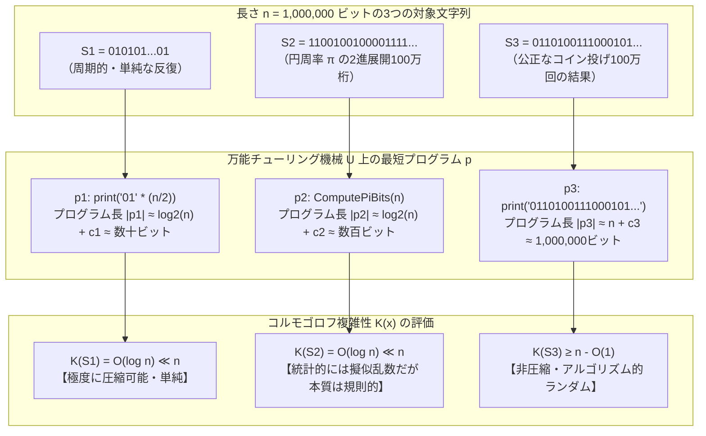
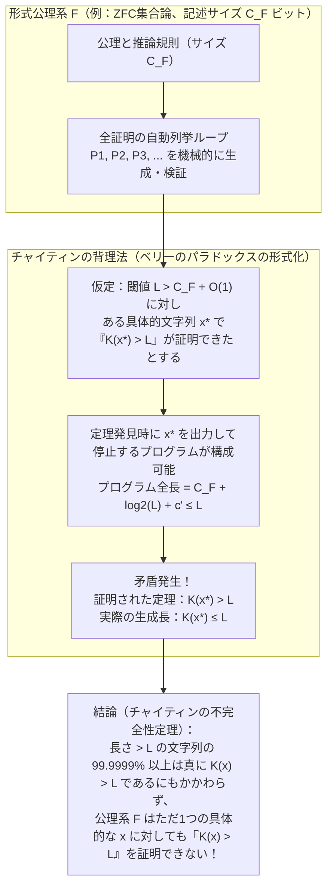

## 1. 3つの「100万ビットの文字列」と直感のパラドックス

いま、あなたの目の前に<strong>長さ $n = 1,000,000$ ビット（100万文字の `0` と `1`）</strong>からなる3つのバイナリ文字列 $S_1, S_2, S_3$ が置かれているとしよう。コンピュータのメモリ上に非圧縮のプレーンテキストとして保存すれば、3つともまったく同じ $1,000,000$ ビット（125キロバイト）の容量を占める。

1. <strong>第1の文字列 $S_1$</strong>：
   $$S_1 = \texttt{01010101010101010101010101010101\dots01}$$
   すなわち、`01` という2ビットのパターンを正確に50万回繰り返した文字列 $(01)^{500,000}$ である。
2. <strong>第2の文字列 $S_2$</strong>：
   $$S_2 = \texttt{11001001000011111101101010100010\dots10}$$
   一見すると不規則に `0` と `1` が並んでいるが、実はこれは円周率 $\pi = 3.14159265358979\dots$ を2進数表記（$\pi = 11.001001000011111101101010100010\dots_2$）に変換したときの、最初の100万ビットである。
3. <strong>第3の文字列 $S_3$</strong>：
   $$S_3 = \texttt{01101001110001011011001011100101\dots00}$$
   これは、歪みのない理想的なコインを実際に100万回投げ、表が出たら `1`、裏が出たら `0` と記録して得られた100万ビットの系列である。

ここで根本的な問いを立てよう。<strong>これら3つの文字列のうち、どれが本当に「複雑」であり、どれが「ランダム（無作為）」だろうか？</strong>

私たちの直感は即座にこう答えるはずだ。
- $S_1$ は<strong>極めて単純</strong>である。「`01` を50万回繰り返せ」という一言で完全に記述できるからだ。
- $S_2$ は見た目こそ無秩序に見えるものの、背後に「円周率 $\pi$」という<strong>厳密な数学的法則</strong>が潜んでいる。マチンの公式やチュドノフスキーのアルゴリズム、あるいはBBP（Bailey–Borwein–Plouffe）公式のような数行のプログラムを書けば、いつでも寸分違わず同じ100万ビットを再生成できる。したがって、その本質的な複雑さは見かけほど大きくない。
- $S_3$ は<strong>真に複雑かつランダム</strong>である。各ビットは独立した物理的コイン投げの結果であり、背後に隠された数式も規則性も一切存在しない。この文字列を他人に正確に伝えるには、100万ビットすべてをそのまま丸暗記して送る以外に方法がない。

ところが、古典的な<strong>確率論（Probability Theory）</strong>や<strong>文字数（データ長）</strong>の観点からは、この直感を数学的に正当化しようとすると奇妙な壁に突き当たる。

もし公正なコインを100万回投げるという確率試行を考えるなら、すべてが交互に並ぶ $S_1$ が偶然出現する確率は、
$$\mathbb{P}(S_1) = \left(\frac{1}{2}\right)^{1,000,000} = 2^{-1,000,000}$$
である。では、円周率のビット列 $S_2$ が偶然出現する確率はいくつか？ やはり $2^{-1,000,000}$ である。そして、現実のコイン投げでたまたま得られた特定の系列 $S_3$ が出現する確率もまた、寸分違わず
$$\mathbb{P}(S_3) = \left(\frac{1}{2}\right)^{1,000,000} = 2^{-1,000,000}$$
なのだ。一様分布のもとでは、長さ $n$ のあらゆる個別文字列 $x \in \{0,1\}^n$ は<strong>すべて同一の確率 $2^{-n}$</strong> を持つ。古典的な確率論は、「どのような生成過程（確率分布）から標本が抽出されたか」という<strong>集合（アンサンブル）の性質</strong>を語ることはできても、抽出された結果として目の前に横たわる<strong>単一の個別対象 $x$ そのものがランダムであるか否か</strong>を判定する言葉を原理的に持っていなかったのである。

「文字数（ビット長）が同じ100万ビットであるにもかかわらず、$S_1$ や $S_2$ が単純であり、$S_3$ が複雑であるという決定的な違いはどこから生まれるのか？」
「そもそも、ある個別の文字列が『ランダムである』とは数学的にどういうことなのか？」

1960年代、レイ・ソロモノフ（Ray Solomonoff）、アンドレイ・コルモゴロフ（Andrey N. Kolmogorov）、グレゴリー・チャイティン（Gregory Chaitin）の3人の数学者・計算機科学者が独立に到達した答えは、驚くほど鮮やかだった。

> <strong>対象の「複雑さ」とは、その対象を出力して停止する「最短のコンピュータ・プログラムの長さ」である。そして「ランダム」とは、それ以上短いプログラムに決して圧縮できない「非圧縮性（Incompressibility）」のことである。</strong>

この発想から誕生した<strong>アルゴリズム的情報理論（Algorithmic Information Theory: AIT）</strong>と<strong>コルモゴロフ複雑性（Kolmogorov Complexity）</strong>は、情報理論・計算可能性理論・数理論理学（不完全性定理）・統計的機械学習、さらには現代の大規模言語モデル（LLM）がなぜ知能を獲得するのかという問いに至るまで、現代科学の根幹を貫く最も深い指導原理となった。本稿では、その数学的構造と哲学的な射程を徹底的に解き明かしていく。

---

## 2. シャノン情報理論の射程と限界——「集合の確率」から「個別の対象」へ

コルモゴロフ複雑性の革新性を理解するために、まずは1948年にクロード・シャノン（Claude E. Shannon）が打ち立てた古典的情報理論（シャノン情報理論）の枠組みと、その構造的な限界を整理しておこう。

### 2.1 シャノン・エントロピーと自己情報量

シャノンは歴史的論文『通信の数学的理論（A Mathematical Theory of Communication）』において、情報を「不確実性の減少量」として定義した。離散確率変数 $X$ がアルファベット $\mathcal{X}$ 上の確率分布 $P(x) = \mathbb{P}(X = x)$ に従うとき、ある事象 $x$ が生起したときに得られる<strong>自己情報量（Self-Information / Surprisal）</strong> $I(x)$ は次式で与えられる。

$$I(x) = -\log_2 P(x) = \log_2 \frac{1}{P(x)} \quad [\text{bits}]$$

生起確率 $P(x)$ が小さい珍しい事象ほど、それが起きたときの「驚き（情報量）」は大きい。そして、情報源 $X$ が発生する平均的な情報量、すなわち<strong>シャノン・エントロピー（Shannon Entropy）</strong> $H(X)$ は、自己情報量の期待値として定義される。

$$H(X) = \mathbb{E}_{X \sim P}[-\log_2 P(X)] = -\sum_{x \in \mathcal{X}} P(x) \log_2 P(x)$$

シャノンの情報源符号化定理（Noiseless Coding Theorem）は、確率分布 $P(x)$ に従って生成される記号列を無損失圧縮するとき、1記号あたりの平均符号長 $L$ の理論的限界がシャノン・エントロピー $H(X)$ に一致すること（$H(X) \le L < H(X) + 1$）を証明した。出現頻度の高い記号に短い符号を、低い記号に長い符号を割り当てるハフマン符号や算術符号は、この原理の直接的な実装である。

### 2.2 シャノン情報量が抱える2つの根本的限界

通信路の容量計算や統計的なデータ圧縮において絶大な威力を発揮したシャノン情報理論だが、「個別のデータの複雑さ」を測ろうとすると2つの本質的な壁に直面する。

#### 第1の壁：背後に「確率分布 $P(x)$」を仮定しなければならない
シャノンの式 $I(x) = -\log_2 P(x)$ は、対象 $x$ が何らかの既知の確率空間 $(\mathcal{X}, P)$ から抽出された標本であることを前提としている。しかし、現実世界に存在する個別の対象——たとえば『戦争と平和』という小説のテキストファイル、ヒトの第1染色体のDNA塩基配列、あるいは円周率 $\pi$ の最初の100万桁 $S_2$——に対して、「その小説や円周率が抽出された母集団の確率分布 $P(x)$ とは何か？」と問うこと自体がナンセンスである。個別の対象は確率変数ではなく、ただ1つの確定した文字列 $x$ としてそこに存在している。

#### 第2の壁：統計的な出現頻度だけでは「数学的規則」を見抜けない
もし確率分布 $P$ が未知であるならば、文字列 $x$ の内部における文字の出現頻度（経験分布）からエントロピーを推定すればよいのではないか、と考えるかもしれない。各ビット（`0` と `1`）の出現比率から計算した0次の経験エントロピー $\hat{H}_0(x)$ を第1章の3つの文字列 $S_1, S_2, S_3$ に適用してみよう。

- $S_1 = (01)^{500,000}$：`0` が50万個、`1` が50万個。比率は $(0.5, 0.5)$ であるため、
  $$\hat{H}_0(S_1) = -\left(0.5 \log_2 0.5 + 0.5 \log_2 0.5\right) = 1.0 \text{ bit/symbol}$$
- $S_2$（円周率 $\pi$ の2進展開）：円周率は2進正規数（Normal Number）であると強く信じられており、最初の100万ビットにおいても `0` と `1` はほぼ正確に50万個ずつ出現する。したがって、
  $$\hat{H}_0(S_2) \approx 1.0 \text{ bit/symbol}$$
- $S_3$（コイン投げ100万回）：大数の法則により、`0` と `1` は約50万回ずつ出現する。したがって、
  $$\hat{H}_0(S_3) \approx 1.0 \text{ bit/symbol}$$

なんと、単一ビットの頻度統計では3つとも同じ $1.0\text{ bit}$ になってしまう。では、連続する2ビット（2-gram: `00`, `01`, `10`, `11`）や $k$ ビットブロック（$k$-gram）の経験エントロピー $\hat{H}_k$ を使えばどうだろうか？
確かに $S_1$ については、`01` と `10` しか出現せず `00` と `11` の頻度がゼロになるため、ブロック長 $k$ を大きくすれば経験エントロピーは速やかに $0$ へと収束する。
しかし、<strong>円周率 $S_2$ に対しては、いかなる有限ブロック長 $k$ の統計量 $\hat{H}_k$ も無力である</strong>。円周率のビット列は、長さ $k$ のあらゆるビットパターンが漸近的に等確率 $2^{-k}$ で出現するという統計的性質（正規性）を備えているため、有限次数のマルコフ情報源モデルや頻度統計の目から見れば、円周率 $S_2$ は真のランダム系列 $S_3$ と<strong>統計的に見分けがつかない（$\hat{H}_k(S_2) \approx \hat{H}_k(S_3) \approx 1.0$）</strong>のである。

### 2.3 アルゴリズム的情報理論の3人の創始者

「確率分布や表層的な文字頻度に頼らず、計算機（アルゴリズム）の力を使って個別対象の真の情報量を定義できないか？」
この問いにほぼ同時期（1960年〜1966年）に独立に挑んだのが、以下の3人の巨人だった。

1. <strong>レイ・ソロモノフ（Ray Solomonoff, 1960 / 1964）</strong>：
   人工知能と帰納推論（Inductive Inference）の基礎を研究していたソロモノフは、「観測データ列を説明する無数の仮説（プログラム）のうち、どれが最も確からしいか」という問題に対し、オッカムの剃刀を数学化した<strong>普遍事前分布（Universal Prior / Solomonoff Probability）</strong>を提唱した。「短いプログラムによって生成されるデータほど高い事前確率を持つ」という彼の理論は、ベイズ推論とチューリング機械を融合させた最初の金字塔であった。
2. <strong>アンドレイ・コルモゴロフ（Andrey N. Kolmogorov, 1965）</strong>：
   20世紀最大の確率論学者であり、1933年に確率論の公理系（コルモゴロフの公理）を完成させた当人であるコルモゴロフは、自らが築いた確率論の限界を誰よりも深く認識していた。1965年の論文『情報の定量的定義への3つのアプローチ（Three Approaches to the Quantitative Definition of Information）』において、彼は情報の定義を「①組合せ論的アプローチ」「②確率論的（シャノン的）アプローチ」「③アルゴリズム的アプローチ」の3つに分類し、万能チューリング機械における最短記述長によって個別対象の情報量とランダム性を定義する道筋を確立した。
3. <strong>グレゴリー・チャイティン（Gregory Chaitin, 1966 / 1975）</strong>：
   当時まだニューヨーク市立大学の10代の学部生だったチャイティンは、1966年にプログラムサイズ複雑性を独立に定式化し、さらに1970年代にかけて自己区切り（Prefix-Free）複雑性の導入、<strong>チャイティンの不完全性定理</strong>、そして<strong>停止確率 $\Omega$（オメガ）</strong>の発見へと突き進み、アルゴリズム的情報理論をゲーデルの不完全性定理と直結させた。

シャノン情報理論とアルゴリズム的情報理論（コルモゴロフ複雑性）の対比を以下の表にまとめよう。

| 比較の軸 | シャノン情報理論（古典情報理論） | アルゴリズム的情報理論（コルモゴロフ複雑性） |
| :--- | :--- | :--- |
| <strong>創始者・年代</strong> | クロード・シャノン（1948年） | ソロモノフ（1960）、コルモゴロフ（1965）、チャイティン（1966） |
| <strong>測定の対象</strong> | <strong>確率変数（情報源のアンサンブル $X \sim P$）</strong> | <strong>単一の個別対象（有限文字列 $x \in \{0,1\}^*$）</strong> |
| <strong>基本定義式</strong> | $H(X) = -\sum_{x} P(x) \log_2 P(x)$ | $K_U(x) = \min_{p:\, U(p)=x} |p|$ |
| <strong>確率分布の要否</strong> | 事前の確率分布 $P(x)$ が<strong>必須</strong> | 確率分布を一切必要としない（個別対象のintrinsicな性質） |
| <strong>規則性の捉え方</strong> | 記号やブロックの統計的偏り（確率モデルのエントロピー） | <strong>チューリング計算可能なあらゆるアルゴリズム的規則</strong> |
| <strong>円周率 $S_2$ の評価</strong> | 0と1が等頻度で出現するため高エントロピー（ランダムに見える） | 数行の計算アルゴリズムで生成可能なため<strong>複雑性は極めて低い</strong> |
| <strong>計算可能性</strong> | 確率分布 $P$ が既知ならば容易に計算可能 | <strong>計算不可能（Uncomputable：停止問題に帰着）</strong> |

---

## 3. コルモゴロフ複雑性の厳密な定義と普遍性定理（不変性定理）

それでは、コルモゴロフ複雑性を数学的に厳密に定義しよう。

### 3.1 最短プログラム長としての定義

アルファベットを2進ビット列 $\Sigma = \{0, 1\}$ とし、すべての有限長バイナリ文字列の集合を $\Sigma^* = \{\epsilon, 0, 1, 00, 01, 10, 11, 000, \dots\}$ と書く。文字列 $x \in \Sigma^*$ の長さ（ビット数）を $|x|$ で表す。

いま、計算モデルとして1つの<strong>チューリング機械（またはプログラミング言語処理系）</strong> $M$ を固定する。機械 $M$ にバイナリ文字列として符号化されたプログラム $p \in \{0,1\}^*$ を入力したとき、$M$ が有限ステップで停止して文字列 $x$ を出力することを $M(p) = x$ と表記する。

<strong>定義（コルモゴロフ複雑性 / 記述複雑性）</strong>：
計算機 $M$ に関する有限文字列 $x \in \{0,1\}^*$ の<strong>コルモゴロフ複雑性（Kolmogorov Complexity）</strong> $K_M(x)$ とは、$M$ 上で実行したときに $x$ を出力して停止するプログラム $p$ のうちの<strong>最小のビット長</strong>である。

$$K_M(x) = \min_{p \in \{0,1\}^*} \left\{ |p| \;\middle|\; M(p) = x \right\}$$

もし $M(p) = x$ となるプログラム $p$ が1つも存在しない場合は、$K_M(x) = \infty$ と定める。

さらに、補助入力（条件）として別の文字列 $y$（たとえば文字列 $x$ の長さ $n = |x|$ など）があらかじめ計算機に与えられている状況を考えよう。機械 $M$ がプログラム $p$ と補助データ $y$ の組を受け取って $x$ を出力することを $M(p, y) = x$ と書くとき、<strong>条件付きコルモゴロフ複雑性（Conditional Kolmogorov Complexity）</strong> $K_M(x \mid y)$ は次式で定義される。

$$K_M(x \mid y) = \min_{p \in \{0,1\}^*} \left\{ |p| \;\middle|\; M(p, y) = x \right\}$$

### 3.2 プレーン複雑性 $C(x)$ とプレフィックス複雑性 $K(x)$

専門的な文献を読む際に極めて重要な技術的区別として、<strong>プレーン複雑性（Plain Complexity） $C(x)$</strong> と、レオニード・レビン（Leonid Levin, 1974）およびチャイティン（1975）が導入した<strong>プレフィックス複雑性（Prefix-Free Complexity / 自己区切り複雑性） $K(x)$</strong> の違いがある。

プレーン複雑性 $C(x)$ では、任意のビット列 $p \in \{0,1\}^*$ がプログラムとして許される。しかしこの場合、2つの文字列 $x$ と $y$ の最短プログラム $p_x$（$|p_x| = C(x)$）と $p_y$（$|p_y| = C(y)$）を単純に連結して $p_x p_y$ という1本のビット列を作っても、計算機はどこで $p_x$ が終わり、どこから $p_y$ が始まるのか（境界の位置）を判別できない。境界を教えるためには $p_x$ の長さ $|p_x| = C(x)$ を自己区切り符号として先頭に付加する必要があり、約 $\log_2 C(x)$ ビットの余分なオーバーヘッドが生じる。その結果、直積 $(x, y)$ の複雑性において綺麗な加法性（劣加法性）が崩れ、
$$C(x, y) \le C(x) + C(y) + 2\log_2\!\left(\min(C(x), C(y))\right) + O(1)$$
という対数誤差項が現れてしまう。

この不都合を解消するため、レビンとチャイティンは、有効なプログラムの集合（機械 $U$ の定義域 $\text{Dom}(U)$）を<strong>プレフィックス・フリー集合（Prefix-Free Set：いかなる有効なプログラムも、別の有効なプログラムの先頭部分［接頭辞］にならない集合）</strong>に制限した。実用的には、「プログラム自身が自分の終端位置を認識できる（たとえば構文的に閉じ括弧や `END` トークンで終わる）」という自然な条件に対応する。

プレフィックス・フリーなプログラム集合 $\text{Dom}(U)$ は、情報理論における<strong>クラフトの不等式（Kraft's Inequality）</strong>を必ず満たす。

$$\sum_{p \in \text{Dom}(U)} 2^{-|p|} \le 1$$

このプレフィックス・フリー万能チューリング機械上で定義された複雑性 $K(x)$ は、対数誤差項に悩まされることなく、以下の美しい<strong>劣加法性（Subadditivity）</strong>を厳密に（定数項 $O(1)$ の範囲で）満たす。

$$K(x, y) \le K(x) + K(y \mid x) + O(1) \le K(x) + K(y) + O(1)$$

なお、プレーン複雑性 $C(x)$ とプレフィックス複雑性 $K(x)$ の差は高々プログラム長の対数オーダーであり、
$$C(x) \le K(x) \le C(x) + 2\log_2 C(x) + O(1)$$
が成り立つため、本稿で扱う長さ $n = 1,000,000$ のような巨大な文字列の漸近的議論においては両者は本質的に同じ振る舞いを示す。以下では標準的な記法に従い $K(x)$（または計算機を明示するときは $K_U(x)$）を用いる。

### 3.3 不変性定理（普遍性定理）：なぜプログラミング言語の選び方に依存しないのか？

コルモゴロフ複雑性の定義を初めて聞いた人が必ず抱く疑問がある。
<strong>「プログラムの長さ $|p|$ なんて、使うプログラミング言語（Pythonか、C言語か、機械語か）によって全く変わってしまうではないか？ もし『円周率の最初の100万桁を出力する1ビットの専用命令』を持ったズルい計算機 $M_{\pi}$ を作れば、$K_{M_\pi}(S_2) = 1$ になってしまうのではないか？」</strong>

この疑問に対する完璧な数学的回答こそが、ソロモノフ・コルモゴロフ・チャイティンによって証明されたアルゴリズム的情報理論の第一の基本定理、<strong>不変性定理（Invariance Theorem / Universality Theorem）</strong>である。

計算機科学の父アラン・チューリング（Alan Turing, 1936）が示した通り、世の中には<strong>万能チューリング機械（Universal Turing Machine: UTM）</strong>と呼ばれる計算機が存在する。現代のPython、C++、Java、x86/ARMプロセッサなど、チューリング完全（Turing-complete）なあらゆる汎用プログラミング言語やCPUはすべて万能チューリング機械と等価であり、「他のいかなるチューリング機械 $A$ の動作もシミュレート（エミュレート）できる」という普遍的な能力を持っている。

<strong>定理1（コルモゴロフ複雑性の不変性定理）</strong>：
万能チューリング機械 $U$ を1つ固定する。このとき、他の任意のチューリング機械 $A$ に対して、<strong>文字列 $x$ には一切依存せず、機械 $U$ と $A$ の組のみによって決まる定数 $c_A \ge 0$</strong> が存在し、すべての文字列 $x \in \{0,1\}^*$ について次式が成り立つ。
$$K_U(x) \le K_A(x) + c_A$$
特に、$U_1$ と $U_2$ がともに万能チューリング機械であるならば、$x$ に依存しない定数 $c_{12} \ge 0$ が存在して、すべての $x \in \{0,1\}^*$ に対して次式が成り立つ。
$$\left| K_{U_1}(x) - K_{U_2}(x) \right| \le c_{12}$$

#### 【不変性定理の厳密な証明】
任意の文字列 $x \in \{0,1\}^*$ をとる。機械 $U_2$ 上で $x$ を出力する最短プログラムを $p_2$ とする。定義より $U_2(p_2) = x$ であり、$|p_2| = K_{U_2}(x)$ である。
ここで $U_1$ は万能チューリング機械であるから、機械 $U_2$ の動作を完全に模倣する<strong>シミュレータ（インタプリタ／エミュレータ）</strong>のプログラム $s_{12}$ を $U_1$ の機械語で記述することができる。すなわち、任意のプログラム $q$ に対して $U_1(s_{12}, q) = U_2(q)$ が成立する。
すると、$U_1$ に対して「インタプリタ $s_{12}$ とプログラム $p_2$ を結合したプログラム $p_1 = \langle s_{12}, p_2 \rangle$」を入力すれば、$U_1$ は $s_{12}$ を使って $p_2$ を実行し、確実に $x$ を出力して停止する。
したがって、$U_1$ における $x$ の最短プログラム長 $K_{U_1}(x)$ は、この具体的なプログラム $p_1$ の長さを超えることはない。
$$K_{U_1}(x) \le |p_1| = |s_{12}| + |p_2| + O(1) = K_{U_2}(x) + c_{1 \leftarrow 2}$$
ここで $c_{1 \leftarrow 2} = |s_{12}| + O(1)$ は、「$U_1$ 上で書かれた $U_2$ のインタプリタのサイズ」であり、<strong>出力したい文字列 $x$ が何であるかには全く無関係な固定定数</strong>である！
まったく同様に、$U_2$ も万能であるから、$U_2$ 上で $U_1$ をエミュレートするインタプリタ $s_{21}$ が存在し、そのサイズを $c_{2 \leftarrow 1}$ と置けば、
$$K_{U_2}(x) \le K_{U_1}(x) + c_{2 \leftarrow 1}$$
が成り立つ。よって $c_{12} = \max(c_{1 \leftarrow 2}, c_{2 \leftarrow 1})$ と置けば、すべての $x$ について $|K_{U_1}(x) - K_{U_2}(x)| \le c_{12}$ が成立する。（証明終）

この定理が意味するところは極めて深い。
たとえば $U_1$ を Python、$U_2$ を C言語としよう。C言語で書かれた Python インタプリタ（CPython）のバイナリサイズが仮に数メガバイト（定数 $c_{12}$ ビット）だったとしても、対象となるデータ $x$ のサイズ $n$ がギガバイト、テラバイト、あるいは $n \to \infty$ へと巨大化していく極限においては、固定されたインタプリタの翻訳コスト $c_{12}$ は相対的に無視できる定数項 $O(1)$ に吸収されてしまう。
したがって、特定の基準万能機械 $U$ を1つ固定し、定数項 $O(1)$ の違いを無視する限り、<strong>コルモゴロフ複雑性 $K(x)$ はプログラミング言語やハードウェアの選択に依存しない、文字列 $x$ 固有の絶対的・普遍的な数学的性質</strong>となるのである。

### 3.4 3つの文字列 $S_1, S_2, S_3$ のコルモゴロフ複雑性を計算する

不変性定理を武器に、第1章で提示した長さ $n = 1,000,000$ ビットの3つの文字列のコルモゴロフ複雑性を評価してみよう。



1. <strong>$S_1 = (01)^{n/2}$ の複雑性</strong>：
   $S_1$ を出力するプログラムは、「`01` を $n/2$ 回出力せよ」というループ構造だけで書ける。ループの制御コード自体は定数ビット $O(1)$ であり、唯一変化するのは繰り返し回数 $n = 1,000,000$ を2進数で指定する部分（$\lceil \log_2(1,000,000) \rceil = 20$ ビット）だけである。よって、
   $$K(S_1) = \log_2 n + O(1) \approx 20 + O(1) \text{ bits}$$
   もし文字列の長さ $n$ が条件として既知であるならば、条件付き複雑性はなんと定数 $K(S_1 \mid n) = O(1)$ となる。

2. <strong>$S_2$（円周率 $\pi$ の最初の $n$ ビット）の複雑性</strong>：
   円周率の任意の桁を計算するアルゴリズム（たとえばスピゴット・アルゴリズムやチュドノフスキー級数）自体のコード長は、求めたい桁数 $n$ に依存しない定数 $c_{\pi} = O(1)$ ビット（数百〜数千ビット）である。プログラムに与える必要がある変数は「何ビット目まで出力するか」を表す整数 $n$（$\log_2 n \approx 20$ ビット）だけだ。したがって、
   $$K(S_2) = \log_2 n + O(1) \text{ bits}, \qquad K(S_2 \mid n) = O(1) \text{ bits}$$
   シャノンの経験エントロピーではランダムなコイン投げと区別できなかった円周率 $S_2$ が、コルモゴロフ複雑性のレンズを通した瞬間、<strong>$K(S_2) \ll n$ という極めて低い複雑性（高い圧縮可能性）を持つ規則的な対象</strong>として鮮やかに分離されたのである！

3. <strong>$S_3$（コイン投げ $n$ 回の結果）の複雑性</strong>：
   全く規則のない $S_3$ を出力する最短プログラムは、`print("011010011100...")` のように $S_3$ の100万ビットの文字列リテラルをプログラム内部にそのままハードコーディングし、先頭に数ビットの `print` 命令を添えるだけのものになる。したがって、
   $$K(S_3) \approx n + O(1) = 1,000,000 + O(1) \text{ bits}$$
   100万ビットのデータを生成するのに100万ビットのプログラムが必要である——すなわち<strong>1ビットたりとも実質的に圧縮できない</strong>。これこそが複雑さの極致であり、ランダムの正体なのである。

---

## 4. ランダムの正体——鳩の巣原理・非圧縮性・マルティン＝レーフのランダム性

ここで、鋭い読者はもう1つの疑問を抱くかもしれない。
「円周率 $S_2$ が実は数行のプログラムに圧縮できたように、私たちが『ランダムなコイン投げの結果だ』と思い込んでいる $S_3$ にも、人類がまだ発見していないだけで、実は裏に巧妙な短い数式が必ず存在するのではないか？ そもそも、<strong>絶対に圧縮できない文字列（$K(x) \ge |x|$）などというものが数学的に実在すると証明できるのか？</strong>」

驚くべきことに、この問いは初等的な組合せ論の原理——<strong>鳩の巣原理（Pigeonhole Principle）</strong>——をたった数行適用するだけで、寸分の狂いもなく完全に証明することができる。

### 4.1 複雑性の上界（自明なプログラム）

まず、任意の文字列 $x$ の複雑性がどれほど大きくなり得るか（上界）を確認しよう。どんな文字列 $x$ であっても、「リテラルとして $x$ をそのまま出力せよ」という自明なプログラム（`print(x)`）を書けば必ず出力できる。`print` 命令自体の固定オーバーヘッドを $c_{\text{print}}$ ビットとすれば、プレーン複雑性 $C(x)$ および長さを条件としたプレフィックス複雑性 $K(x \mid |x|)$ には次の自明な上界が存在する。

$$C(x) \le |x| + c_{\text{print}}, \qquad K(x \mid |x|) \le |x| + c_{\text{print}}$$

（プレフィックス複雑性 $K(x)$ で $|x|$ が与えられない場合も、$x$ の長さを自己区切り符号化するコスト $2\log_2|x|$ を足して $K(x) \le |x| + 2\log_2|x| + O(1)$ が常に成り立つ。）
つまり、いかなる文字列の複雑性も、その文字列自身の長さ $|x|$ を（定数項を除いて）超えることはない。

### 4.2 非圧縮性定理と鳩の巣原理による存在証明

では、複雑性が $|x|$ よりはるかに小さい（圧縮可能な）文字列と、$|x|$ とほぼ同じ（圧縮不可能な）文字列は、それぞれどれくらいの割合で存在するのだろうか？

<strong>定理2（非圧縮性定理 / Incompressibility Theorem）</strong>：
任意の自然数 $n$ および任意の非負整数 $c \ge 0$ に対して、長さ $n$ のバイナリ文字列全体 $\{0, 1\}^n$（総数 $2^n$ 個）のうち、
$$C(x) \ge n - c$$
を満たす（すなわち、<strong>$c$ ビットを超えて圧縮することが原理的に不可能な</strong>）文字列 $x$ は、少なくとも
$$2^n - 2^{n-c} + 1 = 2^n\left(1 - 2^{-c}\right) + 1 \text{ 個}$$
存在する。

#### 【鳩の巣原理による厳密な証明】
ある文字列 $x \in \{0,1\}^n$ が「$c$ ビットより大きく圧縮できる」とは、$x$ を出力する最短プログラム $p$ の長さが $|p| \le n - c - 1$ であることを意味する。
ところで、1つの決定論的プログラム $p$ は、実行して停止したとき<strong>高々1つの出力文字列 $U(p)$</strong> しか生成できない（1つの巣箱＝プログラムには、高々1羽の鳩＝出力文字列しか入れない）。
では、長さが $n - c - 1$ 以下のバイナリ・プログラム $p \in \{0,1\}^*$ は、この世に全部で何個存在するだろうか？
長さ $0$ のプログラム（空文字列 $\epsilon$）は $2^0 = 1$ 個、長さ $1$ のプログラムは $2^1 = 2$ 個、……、長さ $k$ のプログラムは $2^k$ 個存在するから、長さ $n - c - 1$ 以下のすべてのプログラムの総数は、等比数列の和の公式より正確に次のようになる。

$$\sum_{k=0}^{n-c-1} 2^k = 2^{n-c} - 1 \text{ 個}$$

長さ $n$ の文字列（鳩）は全部で $2^n$ 個存在するのに対し、長さ $n - c - 1$ 以下の短いプログラム（巣箱）は全部合わせても高々 $2^{n-c} - 1$ 個しか存在しない！
よって<strong>鳩の巣原理</strong>により、少なくとも残りの
$$2^n - \left(2^{n-c} - 1\right) = 2^n - 2^{n-c} + 1 \text{ 個}$$
の文字列 $x \in \{0,1\}^n$ は、長さ $n - c - 1$ 以下のいかなるプログラムによっても絶対に出力することができない。すなわち、それらの文字列については必ず $C(x) \ge n - c$ が成り立つ。（証明終）

### 4.3 「ほとんどの文字列はランダムである」という衝撃の帰結

この定理2の式 $1 - 2^{-c}$ に具体的な数値を代入してみると、驚くべき事実が浮かび上がる。長さ $n = 1,000,000$ ビットの文字列全体 $2^{1,000,000}$ 個の中で：

- <strong>$c = 0$ のとき</strong>：$2^n - 2^n + 1 = 1$ 個以上の文字列は、$C(x) \ge n$ を満たす（1ビットたりとも圧縮できない文字列がすべての長さ $n$ で必ず存在する）。
- <strong>$c = 1$ のとき</strong>：全体の $1 - 2^{-1} = \mathbf{50\%}$ 以上の文字列は、たった1ビットすら圧縮できない（$C(x) \ge n - 1$）。
- <strong>$c = 10$ のとき</strong>：全体の $1 - 2^{-10} = 1 - \frac{1}{1024} \approx \mathbf{99.902\%}$ 以上の文字列は、10ビット以上圧縮することが絶対にできない（$C(x) \ge n - 10$）。
- <strong>$c = 20$ のとき</strong>：全体の $1 - 2^{-20} \approx \mathbf{99.999905\%}$ の文字列は、100万ビット中わずか20ビット（2.5バイト！）すら圧縮することができない（$C(x) \ge n - 20$）。

ここから導かれる結論は、私たちの世界観を根底から揺さぶる。

1. <strong>「万能な無損失圧縮ソフト」は数学的に存在し得ない</strong>：
   ときおり「どんなデータファイルでも必ず半分に圧縮できる画期的なアルゴリズムを発明した」と主張する人が現れるが、鳩の巣原理によりそれは100%不可能である。ZIPやZstandard、xzなどの圧縮プログラムが、ある一部のファイル（テキストや画像など規則性の高いデータ）のサイズを劇的に縮められるのは、その代償として他の大多数のファイル（ランダムなビット列）のサイズを少なくとも1ビット以上<strong>膨張させている</strong>からにほかならない。
2. <strong>秩序は極小の例外であり、宇宙のほとんどすべてはランダム（非圧縮）である</strong>：
   私たちが普段コンピュータで扱うテキスト、ソースコード、音声、画像、そして円周率のような数学定数は、$2^n$ 個という広大な文字列の海の中では、比率にして $2^{-c} \approx 0$ にすぎない<strong>奇跡のように希少な「圧縮可能なオアシス」</strong>に属している。文字列の海の $99.9999\%$ 以上は、いかなる規則性も持たない非圧縮な文字列で埋め尽くされているのである。

### 4.4 マルティン＝レーフのランダム性とシュノアの定理

この「非圧縮性」によって、確率論が長年定義できずに苦しんできた「個別の系列がランダムであるとはどういうことか」という問題に最終的な決着がついた。

20世紀前半、リヒャルト・フォン・ミーゼス（Richard von Mises, 1919）は、無限ビット列 $\omega = \omega_1\omega_2\omega_3\dots$ がランダム（コレクティブ：Kollektiv）であるための条件として、「0と1の極限相対頻度が $1/2$ に収束し、かつどのような合理的な規則（Place-Selection Rule）で部分列を抜き出しても極限頻度が $1/2$ のまま変わらないこと」を提案した。その後、アロンゾ・チャーチ（Alonzo Church, 1940）はこの抜き出し規則を「計算可能な関数」として厳密化したが、ジャン・ヴィル（Jean Ville, 1939）は「フォン・ミーゼス＝チャーチの意味でランダムであっても、常に表の累積比率が $1/2$ 以上になり続ける（重複対数の法則を破る）病的な系列が存在する」という反例を発見した。

1966年、コルモゴロフの弟子であったスウェーデンの数学者<strong>ペール・マルティン＝レーフ（Per Martin-Löf）</strong>は、計算可能性理論と測度論を融合させ、<strong>「統計的ランダム性検定（Statistical Test for Randomness）」の概念そのものをすべて計算可能な形で束ねる</strong>という画期的な手法を導入した。

私たちが「このビット列はランダムではない！」と棄却するとき、必ず何らかの計算可能な統計検定（例：「0が100回連続している」「奇数番目がすべて1である」「ある周期の自己相関が異常に高い」「重複対数の法則から逸脱している」など、帰無仮説のもとで生起確率が $2^{-m}$ 以下になるような計算可能な異常パターンの集合）を用いている。マルティン＝レーフは、<strong>「人間やコンピュータが記述し得るありとあらゆる計算可能な（帰納的可算な）統計検定のすべてを同時にパスする系列」</strong>を<strong>マルティン＝レーフ・ランダム（Martin-Löf Random）</strong>と定義したのである。

そして1973年、クラウス＝ペーター・シュノア（Claus-Peter Schnorr）およびレビン、チャイティンによって、統計的ランダム性とアルゴリズム的圧縮不可能性を完全に結びつける以下の大定理が証明された。

<strong>定理3（マルティン＝レーフ＝チャイティン＝シュノアの同値定理）</strong>：
無限バイナリ系列 $\omega = \omega_1\omega_2\omega_3\dots \in \{0,1\}^\infty$ が<strong>マルティン＝レーフ・ランダム</strong>（あらゆる計算可能な統計的ランダム性検定をすべてパスする）であるための必要十分条件は、ある定数 $c > 0$ が存在して、すべての自然数 $n \in \mathbb{N}$ に対してその先頭 $n$ ビットの部分列 $\omega_{1:n} = \omega_1\omega_2\dots\omega_n$ のプレフィックス・コルモゴロフ複雑性が次式を満たすことである。

$$\exists c > 0 \;\forall n \in \mathbb{N}, \quad K(\omega_{1:n}) \ge n - c$$

有限文字列 $x \in \{0,1\}^n$ に対しても同様に、固定された小さな定数 $c$ に対して $K(x) \ge |x| - c$ を満たす文字列を<strong>$c$-非圧縮（$c$-incompressible）</strong>あるいは<strong>アルゴリズム的にランダム（Algorithmically Random）</strong>と呼ぶ。

直感は完全に数学化された。
- 「系列に何らかの規則性（統計的偏りや法則）が存在する」ということは、「その規則性を利用して系列をより短いプログラムに<strong>圧縮できる</strong>（$K(\omega_{1:n}) < n - c$）」ことと数学的に同値である。
- したがって、<strong>「ランダムである」とは「規則性が完全に欠如していること」であり、それはすなわち「いかなるプログラムによっても圧縮できないこと（非圧縮性）」にほかならない！</strong>

---

## 5. 計算不可能性の深淵——ベリーのパラドックス・停止問題・チャイティンの不完全性定理と $\Omega$

コルモゴロフ複雑性 $K(x)$ は、個別のデータの情報量とランダム性を測る究極の尺度である。では、任意の文字列 $x$ を入力するとそのコルモゴロフ複雑性 $K(x)$（および最短プログラム $p^*$）を出力してくれる「究極の圧縮・解析プログラム」を実際に書くことはできるだろうか？

答えは<strong>「絶対に不可能である」</strong>だ。コルモゴロフ複雑性 $K(x)$ は、数学的に明確に定義された関数でありながら、いかなるチューリング機械によっても計算することができない<strong>計算不可能関数（Uncomputable Function）</strong>なのである。

### 5.1 なぜ $K(x)$ を素朴に探索できないのか？（チューリングの停止問題）

ある文字列 $x$（たとえば長さ100ビット）の最短プログラム $p$ を見つけたいとしよう。候補となるプログラムは、長さ $0$ ビットから $100$ ビットまでの有限個（高々 $2^{101} - 1$ 個）しか存在しない。「ならば、短いプログラムから順番にすべて実行してみて、最初に $x$ を出力したプログラムの長さを返せばよいのではないか？」と思うかもしれない。

しかし、ここにはアラン・チューリングが1936年に証明した<strong>停止問題（Halting Problem）の決定不可能性</strong>が立ちはだかる。
長さ $10$ ビットのあるプログラム $p$ を実行したとき、もし $p$ が100ステップ後に停止して $x$ を出力してくれれば、$K(x) \le 10$ であることはわかる。しかし、もし $p$ が1億ステップ経っても1兆ステップ経っても停止しなかったらどうするか？
「このプログラム $p$ は無限ループに陥っていて永遠に停止しないのか、それともあと100京ステップ走らせれば停止して見事に $x$ を出力するのか」を事前に判定する汎用アルゴリズムは、数学的に存在しない。

したがって、すべてのプログラムを少しずつ並列に実行していく（ダブテイリング法：Dovetailing）ことで、時間 $t$ とともに上からの近似値 $K_t(x) \searrow K(x)$ を単調減少させていくこと（<strong>上からの半計算可能性：Upper Semi-Computability</strong>）はできるが、「いま見つかっている長さ $k$ のプログラムが本当に最短であり、これより短いプログラムは絶対に停止しない」と確証を持って宣言できる瞬間は永遠に訪れないのである。

### 5.2 ベリーのパラドックスによる計算不可能性の厳密な証明

$K(x)$ が計算不可能であることの最もエレガントで本質的な証明は、1906年にイギリスの図書館員 G. G. ベリー（G. G. Berry）が考案しバートランド・ラッセルが紹介した論理的パラドックス——<strong>ベリーのパラドックス（Berry's Paradox）</strong>——をプログラムの世界に翻訳することで得られる。

古典的なベリーのパラドックスとは、次のような英語のフレーズ（または日本語の表現）に関する矛盾である。

> <strong>「30文字未満の日本語では定義できない最小の正の整数」</strong>
> （英語原文：*"The smallest positive integer not definable in under sixty letters"*）

日本語の文字（ひらがな・漢字・数字）の種類は有限個だから、30文字未満で作れる日本語の文の総数も有限個である。したがって、30文字未満の日本語で定義できる正の整数は高々有限個しか存在しない。正の整数全体は無数（無限個）にあるから、「30文字未満の日本語では定義できない正の整数」は必ず無数に存在し、自然数の整列性によってその中には必ず<strong>「最小の正の整数 $N$」</strong>が存在するはずである。
ところが、上のカギ括弧の中のフレーズ『30文字未満の日本語では定義できない最小の正の整数』の文字数を数えてみてほしい。<strong>わずか24文字である！</strong>
「30文字未満では定義できないはずの整数 $N$」を、いま24文字（30文字未満！）の日本語で見事に一意に定義してしまった——これがベリーのパラドックスである。

日常言語（日本語や英語）においては「定義できる（definable）」という言葉の意味が曖昧であるため、これは単なる言葉遊びの矛盾として片付けられることもあった。しかしコルモゴロフとチャイティンは、この「文字数による定義」を<strong>「万能チューリング機械における最短プログラム長 $K(x)$」</strong>に置き換えることで、ベリーのパラドックスを<strong>$K(x)$ の計算不可能性を証明する厳密な背理法</strong>へと昇華させたのである！

<strong>定理4（コルモゴロフ複雑性の計算不可能性）</strong>：
関数 $x \mapsto K(x)$ は計算不可能である。すなわち、任意の入力文字列 $x \in \{0,1\}^*$ に対して $K(x)$ の正確な値を計算して停止するプログラムは存在しない。

#### 【ベリーのパラドックスを用いた背理法による証明】
背理法のため、もし仮に任意の文字列 $x$ に対して $K(x)$ を正確に計算して返すサブルーチン（プログラム）`ComputeK(x)` が存在したと仮定しよう。このサブルーチン `ComputeK` 自身のプログラム長は、ある固定された定数 $L_{\text{K}}$ ビットである。

いま、任意の正の整数 $n$ を受け取って次のように動作する新しいプログラム `Berry(n)` を作成する。

```python
def Berry(n):
    # 長さ 0, 1, 2, ... のすべてのバイナリ文字列 x を辞書順に生成する
    for x in generate_all_binary_strings_in_lexicographic_order():
        if ComputeK(x) >= n:
            return x  # 複雑性が n 以上である最初の文字列 x* を出力して停止
```

このプログラム `Berry(n)` の挙動を解析しよう。
1. <strong>必ず停止すること</strong>：定理2（非圧縮性定理）で証明した通り、複雑性が $n$ 以上（$K(x) \ge n$）となる文字列 $x$ は（長さ $n$ 以上の文字列の中に）無数に存在する。そして仮定より `ComputeK(x)` はすべての $x$ に対して有限時間で停止して真の複雑性 $K(x)$ を返す。したがって、`for` ループは必ず有限ステップ以内に条件 `ComputeK(x) >= n` を満たす最初の文字列 $x^*$ を発見し、その $x^*$ を出力して停止する。
2. <strong>出力 $x^*$ の複雑性の下界</strong>：`if` 文の条件を通過して出力されたのだから、この出力文字列 $x^*$ は定義により確実に次を満たす。
   $$K(x^*) \ge n \quad \cdots \text{①}$$
3. <strong>出力 $x^*$ の複雑性の上界</strong>：一方で、いま私たちが書いたプログラム `Berry(n)` 自身が、まさにその文字列 $x^*$ を出力して停止する立派なプログラムになっている！
   では、このプログラム `Berry(n)` 全体のビット長 $| \texttt{Berry}(n) |$ はいくつだろうか？
   - 辞書順ループと `if` 判定の固定ロジック部分：定数 $c$ ビット
   - サブルーチン `ComputeK` のコード部分：定数 $L_{\text{K}}$ ビット
   - 整数パラメータ $n$ を2進数で記述する部分：$\lceil \log_2 n \rceil + O(1)$ ビット
   これらをすべて合わせても、`Berry(n)` のプログラム長は高々 $\log_2 n + L_{\text{K}} + c$ ビットである。$K(x^*)$ は $x^*$ を出力する<strong>最短</strong>プログラムの長さなのだから、`Berry(n)` の長さを超えることは絶対にない。
   $$K(x^*) \le |\texttt{Berry}(n)| = \log_2 n + L_{\text{K}} + c \quad \cdots \text{②}$$

①と②を繋げると、すべての正の整数 $n$ に対して次の不等式が成り立たなければならない。

$$n \le K(x^*) \le \log_2 n + L_{\text{K}} + c$$

ここで $L_{\text{K}}$ と $c$ は、整数 $n$ には一切依存しない<strong>固定された定数</strong>である。対数関数 $\log_2 n$ の増加速度は線形関数 $n$ よりはるかに遅いため、$n$ として十分に巨大な整数（たとえば $L_{\text{K}} + c = 100,000$ ビットだったとしても、$n = 10,000,000$）を選べば、
$$10,000,000 \le \log_2(10,000,000) + 100,000 \approx 23.25 + 100,000 = 100,023.25$$
となり、<strong>明白な数学的矛盾</strong>が生じる！
この矛盾は「$K(x)$ を計算するプログラム `ComputeK(x)` が存在する」という最初の仮定から生じたものである。したがって、$K(x)$ を計算するプログラムは原理的に存在しない。（証明終）

### 5.3 チャイティンの情報理論的不完全性定理

1931年、クルト・ゲーデル（Kurt Gödel）は<strong>不完全性定理（Incompleteness Theorems）</strong>を発表し、「自然数論を含む無矛盾で計算可能な任意の公理系 $\mathcal{F}$ には、真であるにもかかわらず $\mathcal{F}$ の内部では証明も反証もできない命題 $G$ が存在する」ことを証明した。ゲーデルの証明は「この命題は証明できない」という巧妙な自己言及文を構成するものだったため、当時の数学者の多くは「不完全性とは、自己言及のような人工的で特殊なパラドックス的命題にだけ起きる例外現象だろう」と楽観視していた。

しかし1971年から1974年にかけて、グレゴリー・チャイティンはコルモゴロフ複雑性とベリーのパラドックスを用いることで、<strong>不完全性が決して特殊な例外ではなく、数学の至るところに遍在する「情報量の壁」であること</strong>を暴き出した。

<strong>定理5（チャイティンの不完全性定理 / Chaitin's Incompleteness Theorem）</strong>：
ペアノ算術（$\text{PA}$）やツェルメロ＝フレンケル集合論（$\text{ZFC}$）のように、公理と推論規則が計算可能であり、かつ健全（証明される命題がすべて真）である形式公理系 $\mathcal{F}$ を考える。公理系 $\mathcal{F}$ の公理と推論規則を記述した「定理列挙プログラム」のサイズを $C_{\mathcal{F}}$ ビットとする。
このとき、公理系の複雑さだけで決まる定数 $L = C_{\mathcal{F}} + c$ が存在し、公理系 $\mathcal{F}$ は<strong>いかなる具体的な文字列 $x \in \{0,1\}^*$ に対しても、</strong>
$$\text{「 } K(x) > L \text{ 」}$$
<strong>という形の定理を1つたりとも証明することができない。</strong>

#### 【なぜ証明できないのか？（証明の核心）】
もし形式公理系 $\mathcal{F}$ の中では機械的に証明をチェックできるのだから、計算機にすべての可能な証明列 $P_1, P_2, P_3, \dots$ を片っ端から自動生成・検証させるプログラム `SearchProof(L)` を書くことができる。

```python
def SearchProof(L):
    for proof in enumerate_all_formal_proofs_in_system_F():
        if proof_proves_statement_of_form("K(x) > L", for_some_specific_string_x):
            return x  # 証明に登場した具体的な文字列 x* を出力して停止！
```

もし公理系 $\mathcal{F}$ が、ある具体的な文字列 $x^*$ について「$K(x^*) > L$」という定理を1つでも証明できたとしよう。すると上のプログラム `SearchProof(L)` はいつかは必ずその証明を発見し、その文字列 $x^*$ を出力して停止する。
ところが、このプログラム `SearchProof(L)` 自身のサイズはどうなっているだろうか？
公理系 $\mathcal{F}$ の公理と推論規則のコード（$C_{\mathcal{F}}$ ビット）と、探索ループの固定コード（$c'$ ビット）と、整数 $L$ の記述（$\log_2 L$ ビット）の合計、すなわちわずか $C_{\mathcal{F}} + \log_2 L + c'$ ビットしかない！
つまり、このプログラム自身が $x^*$ を出力してしまうため、真の複雑性は
$$K(x^*) \le C_{\mathcal{F}} + \log_2 L + c'$$
となる。ここで $L$ を $L > C_{\mathcal{F}} + \log_2 L + c'$ となる定数に設定しておけば、公理系 $\mathcal{F}$ が証明した主張「$K(x^*) > L$」と、実際の複雑性「$K(x^*) \le L$」が正面衝突してしまう。公理系 $\mathcal{F}$ が健全（嘘の定理を証明しない）である限り、$\mathcal{F}$ は $K(x) > L$ という形の命題を決して証明できない！（証明終）



この定理が突きつける哲学的衝撃は計り知れない。
現代数学の土台である $\text{ZFC}$ 集合論の公理系と推論規則をプログラムとして記述すると、数千ビット〜数万ビット程度（たとえば $L \approx 50,000$ ビット）に収まる。
一方で、長さ $n = 1,000,000$ ビットの文字列全体の $99.9999999\%$ 以上は、鳩の巣原理によって間違いなく $K(x) > 50,000$（それどころか $K(x) > 999,900$）を満たしている。つまり、100万ビットの文字列をランダムに1つ選べば、それはほぼ確実に「複雑性が5万ビットより大きい」という<strong>真なる数学的事実</strong>を持っている。
にもかかわらず、<strong>人類の持つ最強の数学体系 $\text{ZFC}$ をもってしても、特定の100万ビットの文字列 $x$ を指さして「この文字列 $x$ の複雑性は5万ビットより大きい（ランダムである）」と証明することは、ただの1つに対しても未来永劫不可能</strong>なのである！

チャイティンはこれを次のように要約した。
<strong>「1ポンドの公理系という袋から、10ポンドの定理を取り出すことはできない。」</strong>
形式公理系 $\mathcal{F}$ は、自らの公理が持つアルゴリズム的情報量 $C_{\mathcal{F}}$ を超える複雑性を持った対象のランダム性を証明することは原理的にできないのである。

### 5.4 停止確率 $\Omega$（チャイティンの定数・知恵の数値）

チャイティンはさらに、計算不可能性とアルゴリズム的ランダム性を1つの実数へと凝縮した伝説的な定数——<strong>チャイティンの定数（停止確率 $\Omega$: Halting Probability）</strong>——を発見した。

プレフィックス・フリーな万能チューリング機械 $U$ に対して、ランダムなコイン投げによってプログラム $p$ のビットを1つずつ与えたとき、そのプログラム $p$ が有限時間で停止する確率 $\Omega_U$ を考える。これは停止するすべての有効なプログラム $p$ にわたる $2^{-|p|}$ の総和として厳密に定義される。

$$\Omega = \sum_{p \in \text{Dom}(U):\, U(p)\text{ が停止する}} 2^{-|p|}$$

クラフトの不等式により $0 < \Omega < 1$ であり、$\Omega$ は円周率 $\pi$ や自然対数の底 $e$ と同じように数学的に一点に定まる確定した実数である。この実数 $\Omega$ を2進小数展開した無限ビット列を $\Omega = 0.\omega_1\omega_2\omega_3\dots\omega_n\dots$ と書こう。$\Omega$ は以下の驚くべき性質を兼ね備えている。

1. <strong>究極の非圧縮性（マルティン＝レーフ・ランダム性）</strong>：
   $\Omega$ の最初の $n$ ビット $\omega_{1:n}$ のコルモゴロフ複雑性は常に
   $$K(\omega_{1:n}) \ge n - O(1)$$
   を満たす。すなわち、数学的に明確な式で定義された具体的な実数でありながら、そのビット列は<strong>完全にランダム（非圧縮）</strong>であり、いかなる法則によっても次のビットを予測できない。
2. <strong>計算不可能性の濃縮（全知の数）</strong>：
   もし神託（オラクル）によって $\Omega$ の最初の $N$ ビット $\omega_{1:N}$ の正確な値を知ることができたとしよう。すると、すべてのプログラムを並列実行して停止したプログラムの重み $2^{-|p|}$ を足し上げていき、累積和が $0.\omega_1\omega_2\dots\omega_N$ に達した時点で、<strong>長さ $N$ ビット以下のまだ停止していないすべてのプログラムは未来永劫絶対に停止しない</strong>ことが確定する！
   つまり、$\Omega$ の最初の数千ビットの中には、長さ数千ビット以下のあらゆるプログラムの停止問題の答えが圧縮されて詰まっている。ゴールドバッハの予想、リーマン予想、フェルマーの最終定理など、「反例を探索して見つかれば停止するプログラム」として数千ビットで書けるすべての数学の未解決問題の真偽が、$\Omega$ の最初の数千ビットの中にそっくりそのまま刻み込まれているのである（そのため $\Omega$ は「神の知恵の数：Number of Wisdom」とも呼ばれる）。

---

## 6. 計算不可能な理想から実用科学へ——シャノン理論との架け橋・MDL原理・NCD・現代AI（LLM）の本質

「コルモゴロフ複雑性 $K(x)$ が計算不可能であるならば、それは純粋数学や哲学の中の絵に描いた餅であり、現実のエンジニアリングや人工知能には役に立たないのではないか？」
決してそうではない。熱力学における「カルノーサイクルの最大効率」が現実のエンジン設計の絶対的な指針となったように、計算不可能な理想である $K(x)$ は、それをいかにして実用的なアルゴリズムで近似するかという道筋を通じて、現代の情報科学・統計学・AIの理論的背骨を形成している。

### 6.1 シャノン・エントロピーとの厳密な架け橋

まず、第2章で対比したシャノン情報理論とコルモゴロフ複雑性は、<strong>期待値（アンサンブル平均）</strong>をとることで完全に一致する。
確率分布 $P(x)$ が計算可能であるとき、その確率分布 $P$ に従って生成される文字列 $X$ のコルモゴロフ複雑性の期待値 $\mathbb{E}_{X \sim P}[K(X \mid P)]$ と、シャノン・エントロピー $H(P) = -\sum_x P(x) \log_2 P(x)$ の間には、次の美しい不等式が成り立つ。

$$0 \le \sum_{x} P(x) K(x \mid P) - H(P) \le O(1)$$

シャノン＝ファノ＝エリアス符号や算術符号によれば、生起確率 $P(x)$ の事象には長さ $\lceil -\log_2 P(x) \rceil$ ビットのプレフィックス符号を割り当てることができ、逆にクラフトの不等式 $\sum_x 2^{-K(x)} \le 1$ とイェンセンの不等式（あるいはカルバック・ライブラー情報量 $D_{\text{KL}}(P \parallel 2^{-K}) \ge 0$）から、平均記述長は絶対にシャノン・エントロピー $H(P)$ を下回ることができない。
すなわち、<strong>「個別の対象の究極の圧縮長であるコルモゴロフ複雑性 $K(x)$ を、確率分布 $P$ のもとで平均したものがシャノン・エントロピー $H(P)$ である」</strong>という完璧な階層関係が成り立っているのである。

### 6.2 ソロモノフの普遍帰納推論とオッカムの剃刀・MDL原理

レイ・ソロモノフは、万能チューリング機械 $U$ にランダムなビット列（コイン投げ）を入力したときに文字列 $x$ が出力される確率を<strong>アルゴリズム的確率（普遍事前分布：Solomonoff Universal Prior）</strong> $M(x)$ として定義した。

$$M(x) = \sum_{p:\, U(p) = x} 2^{-|p|}$$

文字列 $x$ を出力するプログラム $p$ は無数に存在するが、短いプログラムほど $2^{-|p|}$ の重みが指数関数的に大きくなる。1974年、レオニード・レビンは<strong>符号化定理（Levin's Coding Theorem）</strong>において、この無限和が実は<strong>たった1つの最短プログラムの長さ $K(x)$ によって支配される</strong>という驚異的な事実を証明した。

$$-\log_2 M(x) = K(x) \pm O(1) \quad \Longleftrightarrow \quad M(x) = \Theta\!\left(2^{-K(x)}\right)$$

これは科学哲学における<strong>オッカムの剃刀（Occam's Razor：「現象を説明する仮説は、必要以上に複雑であってはならない」）</strong>の究極の数学的定式化である。
観測データ $D$ が与えられたとき、それを説明する仮説（モデル／プログラム） $H$ の事後確率 $P(H \mid D)$ は、ベイズの定理と普遍事前分布 $P(H) = 2^{-K(H)}$ より、
$$-\log_2 P(H \mid D) = -\log_2 P(H) - \log_2 P(D \mid H) + \text{const} \approx K(H) + K(D \mid H)$$
となる。事後確率 $P(H \mid D)$ を最大化することは、右辺の総記述長 $K(H) + K(D \mid H)$ を最小化することと完全に同値である！

この原理を計算可能な統計学・機械学習のモデル選択基準へと落とし込んだのが、ヨルマ・リッサネン（Jorma Rissanen, 1978）による<strong>最小記述長原理（Minimum Description Length: MDL Principle）</strong>である。

$$\text{MDL} = \min_{M \in \mathcal{M}} \Big( \underbrace{L(M)}_{\text{モデル（法則）の記述長}} + \underbrace{L(D \mid M)}_{\text{モデルで説明できない残差データの記述長}} \Big)$$

- もしモデル $M$ を単純にしすぎれば（Underfitting）、$L(M)$ は小さくなるが、データをうまく予測できないため残差の記述長 $L(D \mid M)$ が肥大化する。
- 逆に、観測データのノイズまで丸暗記するような複雑なモデル $M$ を作れば（Overfitting：過学習）、残差 $L(D \mid M)$ は $0$ になるが、その代わりモデル自身の記述長 $L(M)$ が生データの長さ $L(D)$ と同じだけ肥大化してしまい、全体として何の圧縮にもなっていない（第1章のコイン投げ $S_3$ をそのまま `print` するプログラムと同じ状態になる）。
- 真の科学的法則の発見（汎化能力の獲得）とは、<strong>「モデル自体の記述長 $L(M)$ と、そのモデルを使ったデータの圧縮長 $L(D \mid M)$ の和を最小化すること」</strong>、すなわちデータの2段階無損失圧縮にほかならないのである。

### 6.3 正規化圧縮距離（NCD）：実用圧縮アルゴリズムによる普遍的類似度測定

コルモゴロフ複雑性をデータマイニングやクラスタリングに直接応用した画期的な手法が、ポール・ヴィターニ（Paul Vitányi）とミン・リー（Ming Li）らが2004年に確立した<strong>正規化情報距離（Normalized Information Distance: NID）</strong>と、その計算可能な近似である<strong>正規化圧縮距離（Normalized Compression Distance: NCD）</strong>である。

2つのデータ（文字列・ファイル） $x$ と $y$ が「どれくらい似ているか（どれほど共通の構造や情報を共有しているか）」を測りたいとしよう。もし $x$ と $y$ が本質的に同じ構造を持っていれば、$x$ をすでに知っている状態で $y$ を生成する条件付き複雑性 $K(y \mid x)$ はほぼ $0$ になり、また $x$ と $y$ を連結した文字列 $xy$ の複雑性 $K(xy)$ は $K(x)$ 単体とほとんど変わらなくなる（$K(xy) \approx K(x) + K(y \mid x) \approx K(x)$）。
そこで、計算不可能な $K(\cdot)$ の代わりに、現実世界の汎用データ圧縮アルゴリズム（`gzip`, `bzip2`, `lzma`, `zstd` など）で圧縮したときのファイルサイズ関数 $C(\cdot)$ を代入することで、以下の<strong>正規化圧縮距離（NCD）</strong>が定義される。

$$\text{NCD}(x, y) = \frac{C(xy) - \min\{C(x),\, C(y)\}}{\max\{C(x),\, C(y)\}}$$

ここで $C(xy)$ は、ファイル $x$ とファイル $y$ を連結したファイルを圧縮したときのビット長である。

- <strong>$x$ と $y$ が全く同じ（または同じ規則を持つ）とき</strong>：圧縮器は前半の $x$ を圧縮する際に構築した辞書や統計モデルをそのまま後半の $y$ の圧縮に再利用できるため、$C(xy) \approx C(x) = C(y)$ となり、$\text{NCD}(x, y) \approx 0$ となる。
- <strong>$x$ と $y$ が全く無関係なとき</strong>：$x$ の情報は $y$ の圧縮に一切役に立たないため、$C(xy) \approx C(x) + C(y)$ となり、$\text{NCD}(x, y) \approx 1$ となる。

この $\text{NCD}(x, y)$ の驚くべき点は、<strong>対象分野に関する専門知識や特徴量設計（Feature Engineering）を一切必要としない「パラメータフリーの普遍的距離尺度」</strong>であることだ。実際、ヴィターニらの研究チームは、単なる汎用圧縮プログラムを $\text{NCD}$ の式に組み込むだけで、以下を自動的に達成してみせた。
1. 哺乳類数十種のミトコンドリアDNA塩基配列をそのまま圧縮比較し、生物学的な<strong>進化系統樹（Phylogenetic Tree）</strong>を正確に再構築する。
2. 50以上の言語で書かれた『世界人権宣言』のテキストを文字コード知識ゼロで比較し、インド・ヨーロッパ語族やウラル語族などの<strong>言語系統樹</strong>を完全にクラスタリングする。
3. クラシック音楽やジャズ、ロックのMIDIデータを比較して作曲家やジャンルを分類し、さらにはコンピュータウイルスの亜種検知やソースコードの盗用検出まで行う。

### 6.4 現代の大規模言語モデル（LLM）：「圧縮こそが知能である」

そして2020年代、アルゴリズム的情報理論とコルモゴロフ複雑性の思想は、<strong>大規模言語モデル（Large Language Models: LLMs）</strong>の登場によって劇的な形で現実世界に結実した。

ソロモノフの普遍帰納推論を強化学習・意思決定理論へと拡張し、数学的に最強の汎用人工知能モデル<strong>AIXI</strong>を定式化したマルクス・フッター（Marcus Hutter）は、2006年に<strong>フッター賞（Hutter Prize for Lossless Compression of Human Knowledge）</strong>を創設した。そのスローガンは明快である——<strong>「人間知識の無損失圧縮は、汎用人工知能（AGI）と等価である」</strong>。

なぜ「テキストの圧縮」が「知能」と等価なのか？ 現代のGPTやGemini、Claudeといった自己回帰型の大規模言語モデルの学習目的関数（交差エントロピー損失：Cross-Entropy Loss）を数学的に見てみよう。
トークン列 $x_{1:T} = (x_1, x_2, \dots, x_T)$ に対して、パラメータ $\theta$ を持つニューラルネットワークが次のトークン $x_t$ の条件付き確率分布 $p_\theta(x_t \mid x_{<t})$ を予測するとき、学習で最小化される負の対数尤度（損失関数） $\mathcal{L}(\theta)$ は次式で与えられる。

$$\mathcal{L}(\theta) = \sum_{t=1}^{T} -\log_2 p_\theta(x_t \mid x_1, x_2, \dots, x_{t-1}) \quad [\text{bits}]$$

情報理論の<strong>算術符号化定理（Arithmetic Coding Theorem）</strong>によれば、確率予測器 $p_\theta(x_t \mid x_{<t})$ があれば、任意の系列 $x_{1:T}$ を正確に $\mathcal{L}(\theta) + 2$ ビットのバイナリ列へと<strong>無損失圧縮（Lossless Compression）</strong>し、また完全に元の系列へと復元することができる！
そして、コーパス全体 $D = x_{1:T}$ を復元するために必要な自己完結したプログラム（2段階記述）の全長は、ニューラルネットワークの重みパラメータ $\theta$ の記述長 $|\theta|$ と、そのネットワークを使って算術符号化したデータの圧縮長 $\mathcal{L}(\theta)$ の和となり、コルモゴロフ複雑性の厳密な上界を与える。

$$K(D) \le |\theta| + \sum_{t=1}^{T} -\log_2 p_\theta(x_t \mid x_{<t}) + O(1)$$

OpenAIの共同創業者イリヤ・サツケヴァー（Ilya Sutskever）らが繰り返し強調してきた通り、<strong>「次のトークンを極限まで正確に予測すること（＝クロスエントロピー損失 $\mathcal{L}(\theta)$ を最小化すること）」は、「人類が書き残した数兆トークンのテキストデータを、有限サイズのニューラルネットワーク $\theta$ を用いて極限まで無損失圧縮すること」と数学的に100%同一</strong>なのである。

考えてみてほしい。もし推論問題のテキストの中に『ある探偵小説の犯人当てのあらすじが書かれており、最後の文が「したがって、真犯人は〇〇である」となっている』としよう。この最後のトークン「〇〇」の予測確率 $p_\theta(\text{〇〇} \mid \text{文脈})$ を高めて記述長 $-\log_2 p_\theta$ を数ビット節約（圧縮）するためには、ニューラルネットワークは単なる単語の出現頻度（シャノン的な表層統計）を覚えるだけでは到底足りない。登場人物の動機、アリバイの論理的整合性、物理法則、人間の心理、さらにはプログラミングコードの実行結果に至るまで、<strong>テキストの背後にある「世界の生成メカニズム（World Model / アルゴリズム）」を自らの重み回路の中に抽出・圧縮して獲得する以外に、圧縮率を高める方法が存在しない</strong>のである。

これはまさに、第1章で見た「円周率の100万桁 $S_2$ を究極まで圧縮するためには、見かけの `0` と `1` の羅列の背後にある『円周率を生成するアルゴリズム』を発見するしかない」というコルモゴロフ複雑性の原理そのものである。

最後に、アルゴリズム的情報理論の理論的概念と、それに対応する実用科学・AIの手法を一覧表にまとめておこう。

| 理論的概念（計算不可能・理想極限） | 数学的定式化 | 実用科学・機械学習における計算可能な対応物 |
| :--- | :--- | :--- |
| <strong>コルモゴロフ複雑性 $K(x)$</strong> | $\min_{p:\, U(p)=x} |p|$ | 汎用無損失圧縮（`zstd`, `lzma`）や深層生成モデルによる最小符号長 $C(x)$ |
| <strong>条件付き複雑性 $K(x \mid y)$</strong> | $\min_{p:\, U(p, y)=x} |p|$ | 文脈 $y$ が与えられたときの条件付き予測符号長 $-\log_2 p_\theta(x \mid y)$ |
| <strong>ソロモノフの普遍事前分布 $M(x)$</strong> | $\sum_{p:\, U(p)=x} 2^{-|p|} \approx 2^{-K(x)}$ | <strong>最小記述長原理（MDL）</strong>、ベイズモデル選択、正則化（Weight Decay / L1・L2） |
| <strong>正規化情報距離 $\text{NID}(x, y)$</strong> | $\frac{K(xy) - \min(K(x), K(y))}{\max(K(x), K(y))}$ | <strong>正規化圧縮距離 $\text{NCD}(x, y)$</strong> によるDNA系統樹推定・言語クラスタリング |
| <strong>普遍人工知能 AIXI / ソロモノフ推論</strong> | すべての計算可能プログラムにわたるベイズ予測 | <strong>大規模言語モデル（LLM）</strong>の次トークン予測（算術符号化による世界モデルの圧縮） |

---

## 7. おわりに——「理解する」とは「圧縮する」ことである

本稿では、100万ビットの3つの文字列 $S_1, S_2, S_3$ という素朴な問いから出発し、シャノン情報理論とアルゴリズム的情報理論の対比、万能チューリング機械と不変性定理、鳩の巣原理が暴く「ほとんどの文字列はランダム（非圧縮）である」という事実、ベリーのパラドックスとチャイティンの不完全性定理・停止確率 $\Omega$ が示す形式数学の限界、そしてMDL原理やNCD、大規模言語モデル（LLM）に至る壮大な体系を辿ってきた。

コルモゴロフ複雑性が私たちに教えてくれる最も深い洞察は、<strong>「規則性」「複雑さ」「ランダム性」「科学的法則」、そして「知能による理解」という一見バラバラに見える概念が、すべて「最短プログラム（圧縮）」というただ1つの糸で結ばれている</strong>ということだ。

- 対象の中に<strong>規則性がある</strong>とは、対象そのものより短いプログラムに<strong>圧縮できる</strong>ことである。
- 対象が<strong>ランダムである</strong>とは、いかなる規則性も存在せず、対象自身より短いプログラムに<strong>決して圧縮できない（非圧縮である）</strong>ことである。
- 対象が持つ<strong>本質的な情報量（複雑さ）</strong>とは、見かけの文字数やファイルサイズではなく、それを生成する<strong>最短プログラムのビット数 $K(x)$</strong> である。
- そして、科学者が自然界の観測データから物理法則（ケプラーの法則やニュートンの運動方程式）を発見することも、現代のAIが膨大なデータから世界モデルを獲得することも、その本質は<strong>「無秩序に見える巨大なデータ列を、驚くほど短いプログラム（法則）へと圧縮すること」</strong>にほかならない。

かつてチャイティンはこう記した——<strong>「理解するとは、圧縮することである（Comprehension is compression）」</strong>。
目の前のデータの文字数に惑わされず、その背後に潜む「最短の生成プログラム」を見抜こうとするアルゴリズム的情報理論の視座は、情報と知能の時代を生きる私たちにとって、これからも最も強力な思考の羅針盤であり続けるだろう。
