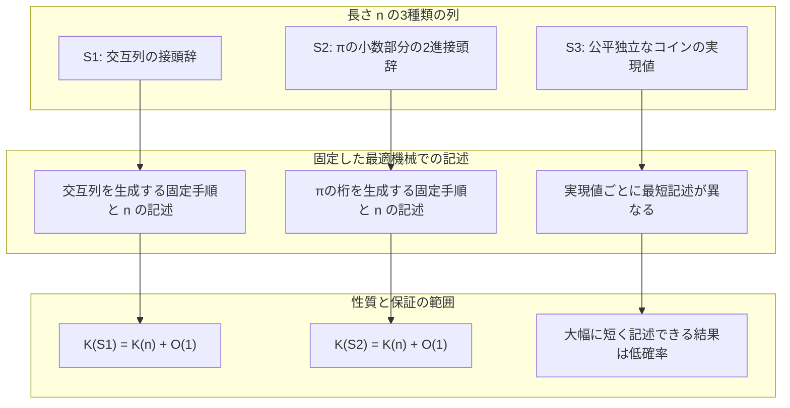
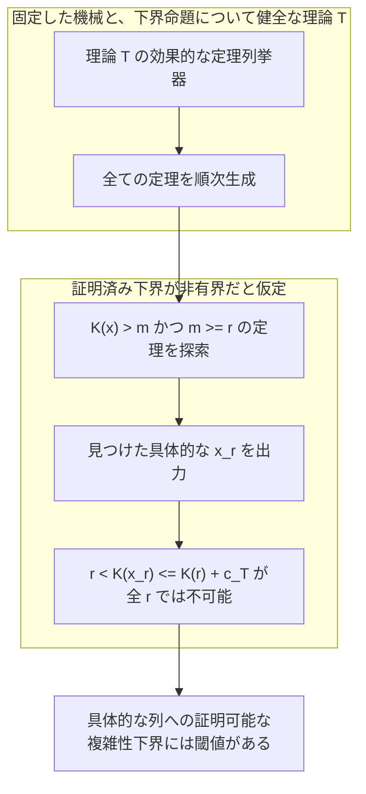

## 1. 3つの100万ビット列――長さと複雑さは同じか

長さ $n=1{,}000{,}000$ のビット列を3つ考える。

1. $S_1$：`01`を50万回繰り返した列。
2. $S_2$：円周率 $\pi$ の<strong>小数部分</strong>の2進展開から先頭100万ビットを取り出した列。
3. $S_3$：公平で独立なコイン投げを100万回行うというモデルから得る列。

ビットを隙間なく詰めれば、どれも125,000 byte＝125 kBである。ただし、`0`と`1`をASCIIやUTF-8の文字として保存すれば100万byteになる。ファイルのヘッダやオブジェクトの管理領域も別である。

$\pi$ の2進表記は $11.0010010000111111\ldots{}_2$ なので、整数部を除いた $S_2$ は`0010010000111111...`で始まる。ここに示す短い表記は説明用であり、記事で100万回の物理実験を行ったという意味ではない。

$S_1$ は繰り返しを指示すれば生成でき、$S_2$ にも桁を計算するアルゴリズムがある。一方、$S_3$ が必ず複雑になるとは限らない。コインから偶然すべて0の列が出る可能性もある。正しい主張は、<strong>固定した計算モデルのもとで、大幅に短く記述できる実現値は少数である</strong>という高確率の主張だ。

公平独立なコインのモデルでは、特定の長さ $n$ の列 $x$ の確率は、交互列でも $\pi$ の接頭辞でも同じである。

$$
P(X=x)=2^{-n},\qquad x\in\{0,1\}^n
$$

同じ確率を持つ個々の結果の間で、短い生成規則の有無をどう表すか。そのための尺度が、ソロモノフ、コルモゴロフ、チャイティンらが1960年代から発展させた<strong>アルゴリズム的情報理論（AIT）</strong>である。中心となるのは「その列を出力して停止する最短プログラムの長さ」だ。

---

## 2. シャノン情報量と個別の文字列

### 2.1 自己情報量、エントロピー、符号化

離散分布 $P$ について、$P(x)>0$ の結果の自己情報量と、その平均であるエントロピーを区別する。以下、対数の底は2、単位はbitとする。

$$
I_P(x)=-\log_2P(x),\qquad
H(P)=-\sum_xP(x)\log_2P(x)
$$

和では $0\log_2 0=0$ と約束する。ゼロ確率の結果の自己情報量は無限大である。

有限アルファベット上の1記号を二進の接頭符号で表す場合、平均長 $L$ は $H(P)$ 以上であり、$H(P)+1$ 未満となる符号が存在する。

$$
H(P)\le L_{\mathrm{opt}}<H(P)+1
$$

これは各記号の符号長がすべてエントロピーと一致するという意味ではない。独立同分布の $r$ 記号をまとめれば、1記号あたりの丸めの余分を小さくできる。

$$
H(P)\le \frac{L_{\mathrm{opt},r}}{r}<H(P)+\frac1r
$$

依存のある情報源ではブロック分布やエントロピー率が関わる。ハフマン符号や算術符号の説明でも、モデルと平均・個別の区別が必要である。

### 2.2 モデルの選択と経験頻度

$-\log_2P(x)$ は $x$ だけの値ではなく、選んだモデル $P$ に依存する。公平コインの分布なら交互列も100万bitの自己情報量を持つ。反対に、その特定の列だけを確率1で出す点質量を選べばエントロピーは0になる。ただし、モデル自体を相手に伝える費用まで0になったわけではない。

単一ビットの経験頻度だけを見ると、`01`の繰り返しは0と1が半分ずつで、0次の経験エントロピーが1 bitになる。しかし、直前のビットから次を予測するモデルは規則性を捉えられる。

$$
\widehat H_0((01)^{n/2})
=-\tfrac12\log_2\tfrac12-\tfrac12\log_2\tfrac12=1
$$

長さ $k$ の重なりを許したブロックの経験エントロピーを $k$ で割る考え方でも、交互列で現れるブロックは高々2種類なので、1ビットあたりは高々 $1/k$ となる。ブロック全体のエントロピーと、1ビットあたりの値を混同しない。

$\pi$ の正規性、すなわち各固定長のブロックが極限で等頻度になる性質は、証明済みではない。有限の頻度検査や見た目の不規則さから正規性は導けない。仮に正規的でも、計算可能な列であることとは両立する。また、桁を計算するモデルまで許すなら、シャノン型の予測・符号化がその規則を使えない理由はない。

AITはシャノン理論を否定するものではない。<strong>確率モデルに対する符号長と、計算機を固定した個別対象の記述長は、異なる問いに答える。</strong>

| 観点 | シャノン情報量 | アルゴリズム的記述長 |
| :--- | :--- | :--- |
| 対象 | 分布と、そのもとでの個別の結果 | 固定した機械が出力する有限列 |
| 基準 | 確率モデル、符号の規則 | 機械、プログラムの符号化、補助入力 |
| 主な量 | $I_P(x)$、$H(P)$、エントロピー率 | 通常の複雑性 $C(x)$、接頭複雑性 $K(x)$ |
| 注意点 | モデルの記述費用は別途必要 | 機械依存の定数と計算不可能性がある |
| $\pi$ の扱い | どのモデルを選ぶかによる | 桁の生成規則と終了位置を記述できる |

---

## 3. 最短プログラムと不変性定理

### 3.1 通常の複雑性と条件付き複雑性

二進の有限列の集合を $\{0,1\}^*$、プログラムのビット長を $|p|$ とする。部分計算可能な機械 $A$ に対し、$A(p)=x$ は「有限時間で停止し、ちょうど $x$ を出力する」という意味である。

$$
C_A(x)=\min\{|p|:A(p)=x\}
$$

出力できるプログラムがなければ値は $\infty$ とする。補助入力 $y$ を無料で与える場合には、

$$
C_A(x\mid y)=\min\{|p|:A(p,y)=x\}
$$

と定める。同じ文字列でも、長さや辞書を補助入力として知っている場合と、それもプログラムに含める場合とでは費用が異なる。

### 3.2 自己区切りの接頭複雑性

<strong>接頭複雑性 $K$</strong> では、停止するプログラムの集合をprefix-free、つまり有効なプログラムが別の有効なプログラムの真の接頭辞にならない集合にする。

$$
K_U(x)=\min\{|p|:U(p)=x\},\qquad
\sum_{p\in\operatorname{dom}U}2^{-|p|}\le1
$$

後半はクラフトの不等式である。条件付きの場合は、各固定した補助入力 $y$ ごとに停止領域がprefix-freeとなる機械を使う。ここでいう自己区切りは、一般のソースコードに単に閉じ括弧を付けるだけという条件ではない。以下の $C$ と $K$ では、それぞれのクラスで加法最適な基準機械を固定する。その最適性を次節で説明する。

通常のプログラムを連結するには境界を伝える必要がある。たとえば対を固定した計算可能な形式で表すと、次の上界が得られる。

$$
C(x,y)\le C(x)+C(y)
+2\log_2\bigl(\min\{C(x),C(y)\}+2\bigr)+O(1)
$$

接頭プログラムは連結して解釈できるので、条件付きの記述を使った上界はより簡潔になる。

$$
K(x,y)\le K(x)+K(y\mid x)+O(1)
\le K(x)+K(y)+O(1)
$$

対応する基準機械を固定したとき、両種の複雑性には次の関係がある。

$$
C(x)\le K(x)+O(1),\qquad
K(x)\le C(x)+2\log_2(C(x)+2)+O(1)
$$

$O(1)$ は対象 $x$ に依存しない定数であり、実際に0bitや数bitだと測定したという意味ではない。

### 3.3 加法最適な機械についての不変性

ここから $C$ には通常の機械のクラスで加法最適な機械、$K$ にはprefix-freeな機械のクラスで加法最適な機械を固定する。任意のシミュレーション能力だけを「万能」と呼ぶ場合には、記述長が定数差となる性質も別に要求する必要がある。

接頭複雑性については、任意のprefix-free機械 $A$ に対し、$x$ に依存しない $c_A$ が存在する。

$$
K_U(x)\le K_A(x)+c_A
$$

<strong>証明の構成</strong>は、機械 $A$ を指定する固定の自己区切りのタグ $s_A$ を先頭に置き、最適機械に残りのプログラム $p$ を模倣させることだ。$A(p)=x$ なら、シミュレート用のプログラムは $|p|+|s_A|$ に固定の費用を加えた長さで $x$ を出す。最短プログラムはそれより長くならない。このような方式で最適機械を構成できる。通常の複雑性にも同じクラス内で対応する議論が成り立つ。

加法最適な2機械の間で双方向に適用すれば、

$$
|K_{U_1}(x)-K_{U_2}(x)|\le c_{12}
$$

となる。定数は両方向の模倣費用を覆うように選ぶ。一方向のインタプリタのサイズだけを絶対差と同一視しない。

特定の100万ビット列だけを短い命令で出す専用機械も作れる。その機械の仕様を模倣する費用は定数側に入るが、不変性定理が有限対象の機械依存を消すわけではない。定数を長さ $n$ で割った効果は $n\to\infty$ で小さくなる一方、有限の具体的な最短長を一般に知ることはできない。現実の有限メモリのCPUと言語処理系を、無限の記憶を許した数学的な機械と同一視することも避ける。

### 3.4 繰り返し列、円周率、コインの再評価

$n$ を整数の固定した二進表現と同一視する。長さ $n$ の交互列、または $\pi$ の小数部分の先頭 $n$ ビットを $s(n)$ と書く。$n$ から列を生成でき、列から長さ $n$ を計算できるので、両方向の計算可能な変換により、

$$
K(s(n))=K(n)+O(1),\qquad K(s(n)\mid n)=O(1)
$$

である。終了位置を無料にすれば定数長だが、無料でなければ $n$ の記述費用が必要になる。たとえば $n\ge2$ に対する自己区切り整数符号から、

$$
K(n)\le \log_2 n+2\log_2\log_2 n+O(1)=O(\log n)
$$

という上界を得られる。$K(n)=\log_2n+O(1)$ が全整数で成立するわけではない。$n=2^m$ なら、指数 $m$ から $n$ を再生成できるので $m$ の短い記述を使える。



$S_3$ の最短記述が必ず生データのコピーだということはできない。その確率的な位置付けを、次節で数える。

---

## 4. 非圧縮性と無限列のランダム性

### 4.1 リテラル出力の上界

任意の $n$ ビット列 $x$ をそのまま出す記述から、通常の複雑性と、長さを条件とした接頭複雑性には、

$$
C(x)\le n+O(1),\qquad K(x\mid n)\le n+O(1)
$$

という上界がある。無条件の接頭複雑性では、長さも自己区切りで伝える。

$$
K(x)\le n+K(n)+O(1)
$$

一律に $K(x)\le |x|+O(1)$ とはできない。もし全列で同じ定数の上界があれば、各長さ $n$ の列の重み $\sum_{|x|=n}2^{-K(x)}$ が正の定数以上となり、全長で足すとクラフトの不等式に反する。

### 4.2 鳩の巣原理の厳密な数え上げ

$n\ge0$ と $0\le c\le n$ を整数とする。長さ $n-c$ 未満の二進プログラムの総数は、

$$
\sum_{j=0}^{n-c-1}2^j=2^{n-c}-1
$$

である。$c=n$ では空和を0とする。1プログラムの停止出力は高々1つなので、長さ $n$ の列のうち $C(x)<n-c$ となるものはこの数以下である。従って、

$$
\#\{x\in\{0,1\}^n:C(x)\ge n-c\}
\ge2^n-2^{n-c}+1
$$

となる。短いプログラムが停止しない場合や同じ列を出す場合もあるので、短い記述を持つ列の数はさらに少なくなり得る。$c>n$ では $n-c<0$ なので $C(x)\ge n-c$ は全列で自明であり、この幾何和の式をそのまま延長しない。

公平コインの一様分布に直せば、

$$
P\{C(X)<n-c\}
\le\frac{2^{n-c}-1}{2^n}<2^{-c}
$$

である。$c=0$ なら各長さで少なくとも1つの $C(x)\ge n$ の列がある。$c=1$ では半数より多い列が1bitを<strong>超えて</strong>短く記述できない。$c=10$ と $c=20$ では、10bit、20bitを<strong>超える</strong>短縮が不可能な列の割合の下界 $1-2^{-c}$ は、それぞれ約99.902%、約99.999905%になる。ちょうどそのbit数の短縮まで禁止する主張ではない。

同様の数え上げは、固定した条件 $n$ のもとでの $K(x\mid n)$ にも適用できる。従って、公平コインの実現値は高確率で長さに近い記述を要するが、各結果への保証ではない。

どんなファイルでも必ず短くする可逆圧縮器は、この数え上げに反する。現実の圧縮器は一定の規則に適したデータを縮める。一様な全ビット列での割合を、そのまま自然界や人間が作るデータの出現割合と読み替えることはできない。

### 4.3 マルティン＝レーフ・ランダム性

有限の文字列で指定の定数だけ短縮できないことと、無限列のランダム性は別の定義である。無限二進列の空間に公平コインの測度 $\mu$ を入れる。有限列 $w$ で始まる列の集合 $[w]$ の測度は $2^{-|w|}$ である。

<strong>マルティン＝レーフ検定</strong>は、有限接頭辞の円筒集合の和として一様に計算可算に列挙できる開集合 $V_j$ の列で、次を満たすものとする。

$$
\mu(V_j)\le2^{-j},\qquad j=1,2,\ldots
$$

$\omega\in\bigcap_jV_j$ ならその検定に失敗する。全てのこの種の検定に失敗しない無限列がマルティン＝レーフ・ランダムである。一度だけ珍しい有限パターンを見せないという条件ではない。検定は可算個で、それぞれの失敗集合は測度0なので、全検定を通る集合の測度は1になる。

レビン＝シュノアの定理は、最適な<strong>接頭</strong>複雑性を用いて次の同値を与える。

$$
\omega\text{ がマルティン＝レーフ・ランダム}
\iff
\exists c\ \forall n\quad K(\omega_{1:n})\ge n-c
$$

重要なのは、全ての $n$ に<strong>同じ定数 $c$</strong> が使える点だ。ここを通常の複雑性 $C$ にそのまま置き換えることはできない。

フォン・ミーゼスやチャーチの選択規則から発展した歴史はあるが、許す検定や賭け戦略の計算可能性によって定義が変わる。特に「計算可能なマルチンゲールで資産を無限に増やせない」というcomputable randomnessを、より強いマルティン＝レーフ・ランダム性と同一視しない。計算可能な $\pi$ の無限桁列はマルティン＝レーフ・ランダムではない。正規性とはこの点でも異なる。

---

## 5. 計算不可能性、証明の限界、停止確率

### 5.1 上から近づけても、到達を一般に判定できない

$x$ を出す短いプログラムを探すには、候補を少しずつ並行して実行するダブテイリングが使える。見つかった記述長の最小値を採れば、$K(x)$ の上界を更新できる。

$$
K_t(x)\searrow K(x)\qquad(t\to\infty)
$$

初期値にはリテラル出力から得る計算可能な有限上界を使える。整数値なので、各固定 $x$ ではいつか真の値に達し、その後一定になる。しかし、全入力に対し「これが真の最短値だ」と判定して停止できる汎用手続きは存在しない。まだ停止していない短い候補が、将来 $x$ を出す可能性を一般には排除できないからだ。

### 5.2 ベリー型の背理法

「30文字未満の日本語では定義できない最小の正の整数」という文は、数字を各1文字と数えると25文字で、確かに30文字未満である。自然言語の「定義できる」は曖昧なので、この文自体を形式的な証明に使うのではなく、計算可能な手続きについての背理法へ置き換える。

仮に、全ての $x$ に対して真の $K(x)$ を返して停止する手続き`ComputeK`があるとする。次はその仮定を使う<strong>擬似コード</strong>であり、実装可能な複雑性計算器ではない。

```text
Berry(m):
    長さ0,1,2,...の順、同じ長さでは辞書順に全二進列xを列挙:
        if ComputeK(x) >= m:
            xを出力して停止
```

通常の辞書順だけでは、全有限列をこの順で列挙できるとは限らないため、長さ優先のshortlexを指定した。

数え上げから複雑性は非有界なので、仮定のもとではこの探索は全ての $m$ で停止し、出力 $x_m$ は $K(x_m)\ge m$ を満たす。一方、この生成手続きは固定コードと $m$ の自己区切り記述で表せる。

$$
m\le K(x_m)\le K(m)+c
\le \log_2m+2\log_2\log_2m+c'
$$

最後の上界は $m\ge2$ に対するものである。固定した $c'$ に対し十分大きい $m$ では矛盾する。従って`ComputeK`は存在しない。「必ず10000bitの余裕で矛盾する」といった、機械ごとの費用を測っていない定数の指定は不要だ。

### 5.3 チャイティンの不完全性定理

基準機械と、有限列についての複雑性命題を表せる効果的に公理化された理論 $T$ を固定する。ここでは、$T$ が証明するこれらの下界命題が真であるという<strong>健全性</strong>を仮定する。

すると、ある閾値 $b_T$ が存在し、具体的な $x$ について $T$ は「$K(x)>b_T$」を証明できない。

証明の核心は、仮に複雑性の証明済み下界が非有界なら、全定理を列挙し「$K(x)>m$」という形で、数値 $m$ が入力 $r$ 以上となる定理を探す手続きが全 $r$ で停止する、という点にある。

```text
SearchProof(r):
    理論Tの定理を効果的に列挙:
        if 定理が具体的なxと整数mについて「K(x) > m」で、m >= r:
            xを出力して停止
```

健全性から出力 $x_r$ の複雑性は $r$ より大きい。しかしこの手続きの固定部分には $T$ の列挙器も含められるので、

$$
r<K(x_r)\le K(r)+c_T=O(\log r)+c_T
$$

となり、大きい $r$ で矛盾する。よって証明可能な数値下界は有界である。



この閾値は機械、理論、表現に依存する。ZFCの限界を普遍的に20,000bitや50,000bitと測ったわけではない。対象長 $n$ と閾値の差が十分大きければ、多数の列が実際にはその閾値を超えることは数え上げから示せる。それでも特定の列への下界証明に限界がある、というのが定理である。

これは、ゲーデル以来の不完全性と情報的記述を結ぶ結果だが、短い公理から長い定理や多くの定理を導けないという一般的な「情報量保存則」ではない。公理を追加した別の理論には、別の定数が対応する。

### 5.4 機械ごとに定まる停止確率 $\Omega_U$

最適なprefix-free機械 $U$ について、ランダムな無限の公平ビット列が停止プログラムで始まる確率は、

$$
\Omega_U=\sum_{p\in\operatorname{dom}U}2^{-|p|}
$$

となる。接頭辞に関する円筒集合が互いに交わらないため、この和は確率として解釈できる。クラフトから $\Omega_U\le1$ が出る。さらに最適性を含むこの設定では、$\Omega_U$ はマルティン＝レーフ・ランダムな非計算可能実数で、$0<\Omega_U<1$ である。prefix-freeなだけの任意の機械に、これら全てを主張するものではない。

停止したプログラムを列挙すれば重みの部分和は下から増加する。従って $\Omega_U$ は<strong>左計算可算（left-c.e.）</strong>であるが、任意の精度への有効な収束速度は得られない。

正確な先頭 $N$ ビットが分かったと仮定し、その下端を $a$ とする。$\Omega_U$ は有限桁で終わる二進小数ではないので、

$$
a=\frac{\lfloor2^N\Omega_U\rfloor}{2^N},
\qquad a<\Omega_U<a+2^{-N}
$$

となる。プログラムを並行実行して停止重みの部分和 $q_s$ が $a$ を<strong>超える</strong>まで待てば、

$$
0\le\Omega_U-q_s<2^{-N}
$$

である。まだ列挙されていない長さ $N$ 以下のプログラムが後から停止すると、少なくとも $2^{-N}$ を追加するので矛盾する。こうして、<strong>同じ機械</strong>の長さ $N$ 以下の全入力について停止・非停止を判定できる。

これは無限に多数の任意の数学命題を、特定の数千桁だけで全て決められるという主張ではない。反例探索などを停止問題に符号化する際の機械、プログラム長、命題の形が関わる。有限個の桁を扱う研究と、全桁を生成するアルゴリズムの不存在も区別する。

---

## 6. シャノン理論との架け橋、MDL、NCD、AI

### 6.1 平均記述長とエントロピー率

有限列上の計算可能な離散分布 $P$ を、有限の計算手順 $d_P$ で指定する。$d_P$ を補助入力として共有すれば、$H(P)<\infty$ の場合、

$$
H(P)\le\mathbb E_{X\sim P}[K(X\mid d_P)]\le H(P)+c
$$

という関係がある。ここで $P$ は有限分布でも可算分布でもよく、値を所定の精度で一様に計算できる分布を想定する。$c$ は復号手順などの定数であり、両辺の数値が完全に等しいとはいわない。

下界は、各固定条件 $d_P$ のもとでの最短接頭記述にクラフトの不等式を使う平均符号長の議論から従う。上界は、共有した分布から確率に応じた接頭符号を構成し、固定した手順で復号することから従う。分布を共有しなければ、モデルの記述費用も加わる。単に任意の確率分布が「既知」ならエントロピーを常に有限時間で厳密計算できる、という主張ではない。

別の関係として、<strong>有限アルファベットの定常エルゴード的過程</strong>にはBrudno型の定理がある。エントロピー率を $h$ bit/記号とすると、ほとんど全ての標本列で、

$$
\lim_{n\to\infty}\frac{K(X_{1:n})}{n}=h
$$

となり、平均についても $\mathbb E[K(X_{1:n})]/n\to h$ となる。長さ $n$ の記号列をリテラル符号化する一様な線形上界があるため、ほぼ確実な収束から平均への議論ができる。ここで通常の複雑性と接頭複雑性の対数程度の差は、$n$ で割ると消える。この率の定理に、直前の条件付き分布の不等式と同じ計算可能性仮定を一律に加える必要はない。

### 6.2 離散の普遍半測度とソロモノフ予測

最適な停止型prefix機械に対して、ちょうど $x$ を出して停止する確率を、

$$
m_U(x)=\sum_{p:U(p)=x}2^{-|p|}
$$

と定める。総和が1以下なので<strong>半測度</strong>であり、下から半計算可能である。符号化定理は、この離散の普遍半測度と接頭複雑性を結ぶ。

$$
-\log_2m_U(x)=K_U(x)+O(1),
\qquad m_U(x)=\Theta(2^{-K_U(x)})
$$

一方、ソロモノフの逐次予測では、出力が $x$ <strong>で始まる</strong>確率を単調機械で考える半測度 $M(x)$ が使われる。出力がそこで停止する必要はなく、$M(x)\ge M(x0)+M(x1)$ という形の整合性を持つ。離散の $m_U$ と、この逐次予測の $M$ を同じ定義として扱い、同じ符号化定理を無条件に転用しない。

短い記述を重視する点はオッカムの剃刀と結び付くが、「短い仮説ならデータを見た後の確率も必ず大きい」とは限らない。尤度も必要である。

### 6.3 ベイズ選択と最小記述長原理

モデル $H$ に実際の接頭記述長 $L(H)$ を割り当て、事前確率をその重みに比例させれば、ベイズの式は次の形になる。

$$
-\log_2P(H\mid D)
=L(H)-\log_2P(D\mid H)+\mathrm{const}
$$

ここで定数は $H$ に依存しない。この設定では、事後確率の最大化は右辺の最小化に対応する。ただし、一般の $-\log_2P(D\mid H)$ を常に $K(D\mid H)$ と同じ値に置き換えることはできない。

<strong>最小記述長（MDL）原理</strong>は、モデルと、それを使ったデータの記述費用を合わせて比較する。

$$
\widehat H=\arg\min_{H\in\mathcal H}
\{L(H)+L(D\mid H)\}
$$

単純すぎるモデルはデータを説明する符号が長くなり、丸暗記するモデルはモデル自身の記述が長くなる。丸暗記で残差をなくすことと、総記述長を小さくすることは同じではない。リッサネンのMDLは実用的な統計的選択の考え方であり、任意の真の自然法則や因果関係の発見を保証するものではない。

### 6.4 理想的情報距離と実圧縮器のNCD

理想的な<strong>正規化情報距離（NID）</strong>は、正の分母について次の形で定義される。

$$
\operatorname{NID}(x,y)=
\frac{\max\{K(x\mid y),K(y\mid x)\}}
{\max\{K(x),K(y)\}}
$$

対の記述 $K(x,y)$ を使う式とも、適切な加法・正規化誤差の範囲で関係する。区切りのない連結 $xy$ と、対を一意に復元できる符号化を厳密に同一視しない。

実際の圧縮器の出力長を、通常の複雑性 $C$ と区別して $Z$ と書けば、<strong>正規化圧縮距離（NCD）</strong>は、

$$
\operatorname{NCD}_Z(x,y)=
\frac{Z(xy)-\min\{Z(x),Z(y)\}}
{\max\{Z(x),Z(y)\}}
$$

である。圧縮器が共通構造を再利用できるなら、似たファイルの値は小さくなり、共通構造を使えないファイルでは1に近くなる、という発想だ。

しかし実圧縮器にはヘッダ、辞書の窓、ブロック、設定、順序依存がある。理論で用いるnormal compressorの冪等性・単調性・対称性・分配性などの仮定を、任意の実圧縮器が全入力で満たすわけではない。同一ファイルでも $Z(xx)\approx Z(x)$ とならない例があり、有限長のNCDが厳密な距離の公理や常に0以上1以下という範囲を保証されるわけでもない。

補助検査では、65,536 byteの固定した列を二度連結し、有限窓を持つgzipを使うと、同一列とのNCDが約0.9997になる例を再現した。これは理想NIDの反例ではなく、実圧縮器を使う近似の限界を示す一例である。

CilibrasiとVitányiらの研究はゲノム、言語、音楽などで圧縮によるクラスタリングを調べた。分野固有の特徴を手で設計しない利点はあるが、文字コードやファイル表現、圧縮器の選択から独立でも、どんな系統樹も正確に復元する保証でもない。

### 6.5 言語モデルの予測と符号長

トークン列 $D=x_{1:T}$ と固定した自己回帰モデルについて、予測に対応する理想符号長は、

$$
\mathcal L_\theta(D)=
-\sum_{t=1}^T\log_2p_\theta(x_t\mid x_{<t})
$$

である。底が自然対数なら単位はnatとなり、$\ln2$ で割ってbitへ直す。これは有限データ上の負の対数尤度で、その平均を交差エントロピー損失として扱う。

正の確率を持つ結果について、モデルと系列長を共有した理想的な算術符号などでは、$\lceil\mathcal L_\theta(D)\rceil+2$ 以下という定数程度の余分を持つ接頭記述を構成できる。全ての実装がちょうど「損失＋2bit」になるわけではない。有限精度、終端、丸めやフレーミングの費用が関わる。

モデルと必要なメタデータを実際に自己区切りで記述する長さを $L_{\mathrm{model}}$、$L_{\mathrm{meta}}$ とすれば、固定した復号器のもとで、

$$
K(D)\le L_{\mathrm{model}}+L_{\mathrm{meta}}
+\lceil\mathcal L_\theta(D)\rceil+O(1)
$$

という上界を得る。メタデータには必要な系列長、語彙、可逆なトークン化の仕様などを含める。正規化で消えた元の空白や文字を、情報を送らずに復元することはできない。

固定した大きさのモデルの予測損失を下げることは、モデル共有時のデータ符号長を下げることに対応する。一方、モデルサイズまで変えるときは総費用を見る必要があり、訓練損失の最小化だけが二部MDLの最小化と同じではない。

HutterのAIXIやHutter Prizeに象徴される圧縮と知能の研究上の視点は、この関係を考える動機になる。ただしAIXIは計算不可能な理想モデルで、実際のTransformerと同一ではない。Delétangらの言語モデルによる圧縮研究も、予測と圧縮の対応を調べるものである。

推理小説の犯人をうまく予測できれば、その正しい名前の符号長は短くなる。しかし改善の理由は論理的推論だけとは限らず、記憶、語彙の偏り、データの重複もあり得る。訓練文を圧縮できたことだけから、世界の因果モデル、正しい推論、汎化能力、AGIが必然的に獲得されたという定理は出ない。

| 理論・考え方 | 実用上の対応 | 区別すべき点 |
| :--- | :--- | :--- |
| $K(x)$、$K(x\mid y)$ | 復号手順を含む記述、共有文脈による符号 | 実圧縮長は一般に最短値ではない |
| 離散普遍半測度 $m_U$ | 短い記述を重視するモデル化 | 停止出力と逐次予測の $M$ は異なる |
| MDL | モデル長とデータ符号長の比較 | 尤度と条件付き複雑性を常に等置しない |
| NIDとNCD | 圧縮に基づく類似性・クラスタリング | 実圧縮器の窓、表現、順序、有限長 |
| 言語モデルと算術符号 | 予測確率と符号長の対応 | 共有モデルと自己完結した総費用、知能の評価 |

---

## 7. おわりに――圧縮から何が分かり、何が残るか

同じ100万ビットでも、交互列や $\pi$ の接頭辞には短い生成手順がある。終了位置まで含めた記述長と、終了位置を知っている場合の条件付き記述長は異なる。公平コインの結果には数え上げによる高確率の非圧縮性があるが、各実現値への保証ではない。

不変性定理は最適機械間の定数差を示し、ベリー型の論証は真の最短長を一般に計算できないことを示す。チャイティンの定理や $\Omega_U$ は、証明と計算の限界をさらに具体化する。それらは任意の有限対象を機械や仮定から独立に評価できる方法ではない。

MDL、NCD、言語モデルの符号長は、この理想と実用の接点である。圧縮という見方は規則やモデルの共有を考える有力な道具になるが、圧縮率だけを理解や知能の完成した定義に置き換えることはできない。

### 参考文献

- [Shen: Algorithmic Information Theory and Kolmogorov Complexity](https://www.lirmm.fr/~ashen/uppsala-notes.pdf) — 通常・接頭複雑性、最適復号器、計算不可能性、符号化定理。
- [Rute: Computable randomness and betting for computable probability spaces](https://arxiv.org/html/1203.5535v4) — 計算可能ランダム性とマルティン＝レーフ検定の区別。
- [Tadaki: Chaitin Ω numbers and halting problems](https://arxiv.org/abs/0904.1149) — 最適機械の停止確率と有限長の停止問題。
- [Chazottes: Entropy in Dynamical Systems & Ergodic Theory](https://www.claymath.org/wp-content/uploads/2023/04/Chazottes-rev.pdf) — スライド50、有限分割に対するBrudnoの定理。
- [Cilibrasi・Vitányi: Clustering by Compression](https://arxiv.org/html/cs/0312044v2) — normal compressorの仮定とNCD。
- [Delétangほか: Language Modeling Is Compression](https://arxiv.org/abs/2309.10668) — 予測と圧縮の対応を調べる研究。
- [Hutter: Universal Algorithmic Intelligence](https://www.hutter1.net/ai/aixigentle.htm) — 普遍帰納と意思決定を結ぶAIXIの理想と計算上の制約。
- [Baileyほか: An Empirical Approach to the Normality of Pi](https://www.davidhbailey.com/dhbpapers/normality-digits-pi.pdf) — 数字の経験的検査と正規性の証明の区別。
