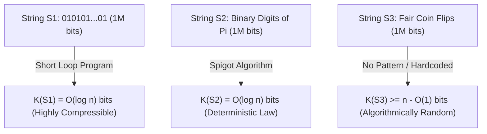
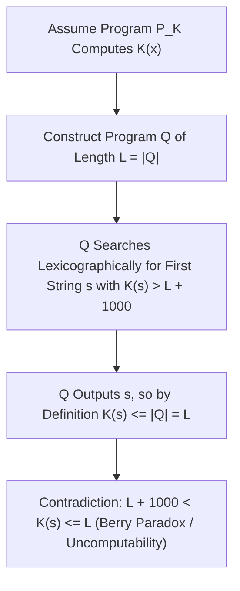

## 서론: 백만 비트짜리 세 문자열의 수수께끼 — 섀넌 정보이론의 사각지대

당신 앞에 길이가 모두 $1,000,000$ 비트(bit)인 세 개의 이진 문자열이 놓여 있다고 상상해 봅시다.
- 첫 번째 문자열 $S_1$은 `01`이 50만 번 교대로 반복되는 `01010101...01`입니다.
- 두 번째 문자열 $S_2$는 원주율 $\pi$를 이진수로 전개했을 때 소수점 아래 첫 $1,000,000$자리인 `1100100100001111110110...`입니다.
- 세 번째 문자열 $S_3$는 공정한 동전을 백만 번 던져(앞면은 `1`, 뒷면은 `0`) 직접 기록한 수열입니다.

자, 이제 질문해 보겠습니다. <strong>이 세 문자열 중 어느 것이 더 많은 ‘정보’를 담고 있을까요? 어느 것이 더 ‘복잡’하며, 어느 것이 진정으로 ‘무작위(random)’일까요?</strong>
만약 클로드 섀넌(Claude Shannon)이 1948년에 창시한 고전적 <strong>섀넌 정보이론(Classical Information Theory)</strong>에 답을 구한다면, 우리는 뜻밖의 난관에 부딪힙니다. 섀넌 엔트로피 $H(X) = -\sum P(x)\log_2 P(x)$는 <strong>확률 분포(확률적 정보원의 앙상블 Ensemble)</strong>의 평균적인 불확실성을 측정할 뿐, <strong>개별적이고 구체적인 객체(Individual Object)</strong> 자체의 내재적 복잡성을 측정하지 못하기 때문입니다! 공정한 동전 던지기 모델에서 $S_1$(`01` 반복)이 나올 확률과 $S_3$(특정한 불규칙 수열)가 나올 확률은 둘 다 $2^{-1,000,000}$으로 완전히 똑같습니다. 게다가 결정론적 상수인 $S_2$($\pi$의 전개)는 확률 분포로 보면 단일 점 분포이므로 엔트로피가 $0$이지만, 0과 1의 통계적 빈도는 동전 던지기와 거의 구별할 수 없습니다!

‘개별 문자열의 복잡성과 무작위성’에 엄밀한 수학적 토대를 부여하기 위해 1960년대에 레이 솔로모노프(Ray Solomonoff, 1960), <strong>안드레이 콜모고로프(Andrey Kolmogorov, 1965)</strong>, 그레고리 차이틴(Gregory Chaitin, 1966)은 각자 독립적으로 <strong>알고리즘 정보이론(Algorithmic Information Theory, AIT)</strong>을 창시했습니다. 이들의 핵심 통찰은 놀랍도록 일치했습니다. <strong>어떤 객체의 진정한 복잡성은 겉으로 보이는 글자 수가 아니라, 그 객체를 생성해 내는 ‘가장 짧은 컴퓨터 프로그램’의 길이에 의해 정의된다!</strong>

---

## 1. 콜모고로프 복잡성 $K(x)$와 보편 튜링 기계의 불변성 정리

보편 튜링 기계(Universal Turing Machine, 또는 Python/C와 같은 임의의 튜링 완전 프로그래밍 언어) $U$가 주어졌을 때, 문자열 $x \in \{0,1\}^*$의 <strong>콜모고로프 복잡성(Kolmogorov Complexity, 알고리즘 엔트로피 또는 기술 복잡성)</strong> $K_U(x)$는 기계 $U$에서 실행되어 $x$를 출력하고 정지하는 가장 짧은 이진 프로그램 $p$의 비트 길이 $|p|$로 정의됩니다. 확률의 합이 수렴하도록(크래프트 부등식 $\sum 2^{-|p|} \le 1$을 만족하도록) 현대 이론에서는 어떤 유효한 프로그램도 다른 프로그램의 접두사가 되지 않는 <strong>접두사 자유 복잡성(Prefix-Free Complexity / Levin-Chaitin Complexity)</strong> $K(x)$를 주로 사용합니다.

$K(x)$의 관점으로 서론의 백만 비트 문자열 세 개를 다시 바라보면 안개가 순식간에 걷힙니다.
- $S_1$의 경우 프로그램은 그저 `print("01" * 500000)`이라고 쓰면 됩니다. 길이 $n$이 아무리 커져도 반복 횟수 $n/2$의 이진 표현만 저장하면 되므로 $K(S_1) = O(\log_2 n) pprox 20$ 비트에 불과하며, <strong>극도로 단순한 문자열</strong>입니다.
- $S_2$($\pi$의 첫 $n$자리)의 경우 겉보기에는 불규칙해 보이고 모든 통계적 의사난수 테스트를 통과하지만, 백여 바이트짜리 마친 공식(Machin-like formula)이나 BBP 스핏 알고리즘 프로그램을 작성하면 첫 $n$자리를 정확히 계산할 수 있으므로 마찬가지로 $K(S_2) = O(\log_2 n)$입니다! 이는 과학철학의 핵심 진리를 보여줍니다. <strong>자연 법칙(Law)의 본질은 관측 데이터에 대한 극한의 압축이다.</strong>
- 반면 실제 동전을 던져 만든 $S_3$는 내부에 압축 가능한 규칙이 전혀 없습니다. 컴퓨터가 $S_3$를 출력하게 하려면 백만 개의 비트를 프로그램 안에 그대로 하드코딩(`print("1011001...")`)하는 수밖에 없으며, 따라서 $K(S_3) pprox n + O(1) pprox 1,000,000$ 비트가 됩니다!

여기서 “프로그래밍 언어를 바꾸면(예: C에서 Python으로) 최단 프로그램의 길이도 바뀌지 않는가?”라는 의문이 들 수 있습니다. <strong>콜모고로프 불변성 정리(Invariance Theorem)</strong>는 이 우려를 완벽히 해소합니다. 임의의 두 보편 튜링 기계 $U_1$과 $U_2$에 대해, 문자열 $x$와는 전혀 무관하고 오직 $U_1, U_2$에만 의존하는 상수 $c_{12}$가 존재하여 모든 $x$에 대해 $|K_{U_1}(x) - K_{U_2}(x)| \le c_{12}$가 성립합니다. 증명은 매우 직관적입니다. $c_{12}$는 그저 $U_1$ 위에서 $U_2$를 에뮬레이션하는 <strong>인터프리터(Interpreter / 교차 컴파일러)</strong>의 고정된 비트 길이일 뿐입니다! 데이터 크기 $n 	o \infty$일 때 고정된 인터프리터 오버헤드 $c_{12}$는 무시할 수 있으므로, $K(x)$는 특정 하드웨어나 언어에 구애받지 않는 절대적 수학 불변량이 됩니다.

$$
H(X) = -\sum_{x \in \mathcal{X}} P(X = x) \log_2 P(X = x)
$$

$$
K_U(x) = \min_{p \in \{0,1\}^*} \Big\{ |p| \;\Big|\; U(p) = x \Big\}, \qquad \Big| K_{U_1}(x) - K_{U_2}(x) \Big| \le c_{12}
$$

---

## 2. 무작위성의 정체: 비둘기집 원리, 비압축성과 마르틴-뢰프 무작위성

콜모고로프 이전의 확률론자들은 “왜 `0000000000`은 무작위 수열이 아니고 `0110100110`은 무작위처럼 보이는가?”라는 질문에 답하지 못했습니다. 알고리즘 정보이론은 인류 역사상 최초로 개별 객체의 무작위성에 대한 엄밀한 정의를 내렸습니다. <strong>무작위성이란 곧 비압축성(Randomness is Incompressibility)이며, 규칙성의 완전한 부재다!</strong>

더욱 놀라운 사실은 가장 기초적인 <strong>비둘기집 원리(Pigeonhole Principle)</strong>만으로 <strong>우주에 존재하는 거의 모든 문자열이 알고리즘적으로 무작위(비압축적)임</strong>을 단 두 줄의 산수로 증명할 수 있다는 점입니다.
길이가 $n$인 모든 이진 문자열은 총 $2^n$개입니다. 그렇다면 길이가 $n - c$ 비트보다 엄밀히 짧은 이진 프로그램은 모두 몇 개일까요? 길이가 $0, 1, 2, \dots, n-c-1$인 모든 프로그램의 개수를 합하면 $\sum_{i=0}^{n-c-1} 2^i = 2^{n-c} - 1$개입니다. 각 프로그램은 최대 하나의 결과만 출력할 수 있으므로, 길이 $n$인 $2^n$개의 문자열 중 $c$ 비트 이상 압축될 수 있는(즉 $K(x) < n - c$를 만족하는) 문자열은 <strong>아무리 많아도 $2^{n-c} - 1$개뿐</strong>입니다!
다시 말해 무작위로 뽑은 길이 $n$짜리 문자열이 $c$ 비트 이상 압축될 확률은 $2^{-c}$ 미만입니다. $c = 20$으로 잡으면, 무려 $1 - 2^{-20} pprox 99.9999\%$ 이상의 문자열이 어떤 알고리즘으로도 단 $20$ 비트조차 압축될 수 없습니다! 페르 마르틴-뢰프(Per Martin-Löf, 1966)는 무한 이진 수열이 계산 가능한 모든 통계적 유의성 검정을 통과할(마르틴-뢰프 무작위성) 필요충분조건이 그 수열의 모든 길이 $n$짜리 접두사 $x_{1:n}$가 비압축적($K(x_{1:n}) \ge n - O(1)$)인 것임을 증명했습니다.

$$
\sum_{i=0}^{n-c-1} 2^i = 2^{n-c} - 1 \implies \mathbb{P}_{x \sim \text{Unif}(\{0,1\}^n)}\big( K(x) < n - c \big) < \frac{2^{n-c}}{2^n} = 2^{-c}
$$

$$
\Omega = \sum_{p:\, U(p)\text{ halts}} 2^{-|p|} \in (0, 1), \qquad K(\Omega_{1:n}) \ge n - O(1)
$$

---

## 3. 베리 역설, 계산 불가능성과 차이틴 정지 확률 $\Omega$, 그리고 현대 AI 압축 법칙

$K(x)$가 이토록 강력하다면, 임의의 문자열 $x$를 입력받아 $K(x)$를 정확히 계산해 주는 궁극의 압축 프로그램을 만들 수 있을까요? 정답은 <strong>절대 불가능하다 — 함수 $K(x)$는 계산 불가능(Uncomputable)하다!</strong>입니다.

이 심오한 한계는 고전적인 <strong>베리 역설(Berry's Paradox)</strong>(“스무 단어 미만으로 정의할 수 없는 가장 작은 양의 정수”라는 문장 자체가 열 단어 남짓으로 그 수를 정의해 버리는 모순)에서 비롯됩니다. 그레고리 차이틴은 이를 엄밀한 귀류법으로 증명했습니다. 만약 임의의 $x$에 대해 $K(x)$를 계산하는 서브루틴 `ComputeK(x)`(코드 길이 $L$ 비트)가 존재한다고 가정해 봅시다. 그러면 우리는 모든 문자열 $s$를 사전순으로 열거하며 `ComputeK(s)`를 호출하다가 $K(s) > L + 10000$을 만족하는 첫 번째 문자열 $s^*$를 찾자마자 출력하고 멈추는 메인 프로그램 $Q$를 작성할 수 있습니다. 프로그램 $Q$의 전체 길이는 고작 $L + O(1)$ 비트($L + 10000$보다 훨씬 작음)인데 $s^*$를 출력하는 데 성공했습니다! 최단 프로그램 정의에 의해 $K(s^*) \le |Q| < L + 10000$이어야 하므로 $K(s^*) > L + 10000$과 정면으로 모순됩니다! 이로부터 <strong>차이틴의 불완전성 정리(Chaitin's Incompleteness Theorem)</strong>가 도출됩니다. 복잡도가 $C$ 비트인 공리계는 $K(x) > C + O(1)$이라는 명제를 절대 증명할 수 없습니다.

또한 차이틴은 정지하는 모든 프로그램의 길이를 모아 전설적인 실수인 <strong>차이틴 상수 $\Omega = \sum_{U(p)	ext{ halts}} 2^{-|p|}$(정지 확률)</strong>를 정의했습니다. $\Omega$는 $(0,1)$ 사이의 명확히 정의된 실수이지만 <strong>극도로 계산 불가능하며 알고리즘적으로 완전히 무작위</strong>입니다($K(\Omega_{1:n}) \ge n - O(1)$). $\Omega$의 첫 $n$자리를 아는 것은 길이 $n$ 이하의 모든 프로그램에 대한 튜링 정지 문제를 푸는 것과 동치입니다!

현대 공학과 인공지능에서 비록 정확한 $K(x)$는 계산할 수 없지만, 그 계산 가능한 상한(Upper Bound)이 핵심 동력으로 작동하고 있습니다.
1. <strong>섀넌 엔트로피와의 가교</strong>: 정상 에르고딕 확률 과정에서 기대 콜모고로프 복잡성을 길이로 나눈 값은 섀넌 엔트로피율 $\lim_{n	o\infty} rac{1}{n}\mathbb{E}[K(X_{1:n})] = H(X)$로 수렴합니다.
2. <strong>솔로모노프 보편 귀납법과 최소 기술 길이(MDL)</strong>: 오컴의 면도날을 사전 확률 $P_M(x) \propto 2^{-K(x)}$로 형식화하여, 짧은 프로그램(간결한 과학 가설)에 지수적으로 높은 가중치를 부여합니다.
3. <strong>정규화 압축 거리(Normalized Compression Distance, NCD)</strong>: 실제 압축기(`zstd`, `lzma`, `gzip`)로 $K(x)$를 근사하여 $	ext{NCD}(x,y) = rac{C(xy) - \min(C(x),C(y))}{\max(C(x),C(y))}$ 공식만으로 도메인 지식 없이 유전체 계통수 복원, 악성코드 클러스터링, 표절 탐지를 수행합니다.
4. <strong>대규모 언어 모델(LLM): 압축이 곧 지능이다(Compression is Intelligence)</strong>: 마르쿠스 후터(Marcus Hutter)의 Hutter Prize와 일리야 수츠케버(Ilya Sutskever)가 통찰했듯, 자기회귀 언어 모델이 교차 엔트로피 손실 $-\sum \log_2 P_	heta(x_t \mid x_{<t})$를 최소화하는 것은 산술 부호화(Arithmetic Coding) 하에서 <strong>인류의 모든 텍스트 데이터에 대한 최단 무손실 압축 코드를 찾는 것과 수학적으로 완전히 동치</strong>입니다. 데이터를 극한까지 압축하기 위해 모델은 문법과 논리적 추론, 세계의 인과 모델을 스스로 내재화해야만 합니다.

| 비교 차원 / 개념 | 섀넌 정보 엔트로피 $H(X)$ | 콜모고로프 복잡성 $K(x)$ | 현대 공학적 근사 (MDL / LLM / NCD) |
| :--- | :--- | :--- | :--- |
| <strong>측정 대상</strong> | 확률 변수의 분포 (앙상블 Ensemble) | <strong>개별적이고 구체적인 문자열/객체 $x$ 자체</strong> | 실제 파일, 유전체 서열, 자연어 코퍼스 |
| <strong>$\pi$의 첫 $10^6$자리 판정</strong> | 결정론적 상수로는 $H=0$; 통계 빈도는 균등 분포 유사 | $K(\pi_{1:n}) = O(\log n)$ (짧은 수식 알고리즘으로 생성) | 신경망 및 산술 부호화로 심층 패턴 포착 |
| <strong>계산 가능성 (Computability)</strong> | 확률 분포 $P(X)$를 알면 완전히 계산 가능 | <strong>엄밀히 계산 불가능</strong> (튜링 정지 문제와 동치) | `zstd`/LZMA 또는 Transformer $P_	heta$가 상한 제공 |
| <strong>핵심 철학 및 수학 정리</strong> | 정보원 부호화 정리 (무손실 압축 한계 $H(X)$) | 불변성 정리, 차이틴 불완전성 정리, 정지 확률 $\Omega$ | 오컴의 면도날 형식화, “압축 = 예측 = 지능” |

$$
P_M(x) = \sum_{p:\, U(p)=x} 2^{-|p|} \approx 2^{-K(x)}, \qquad \text{NCD}(x, y) = \frac{C(xy) - \min\{C(x), C(y)\}}{\max\{C(x), C(y)\}}
$$
