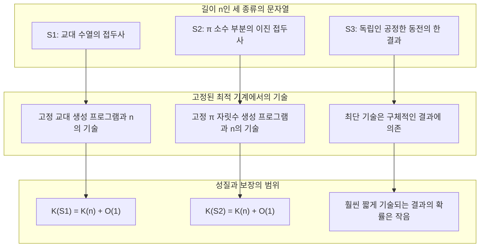
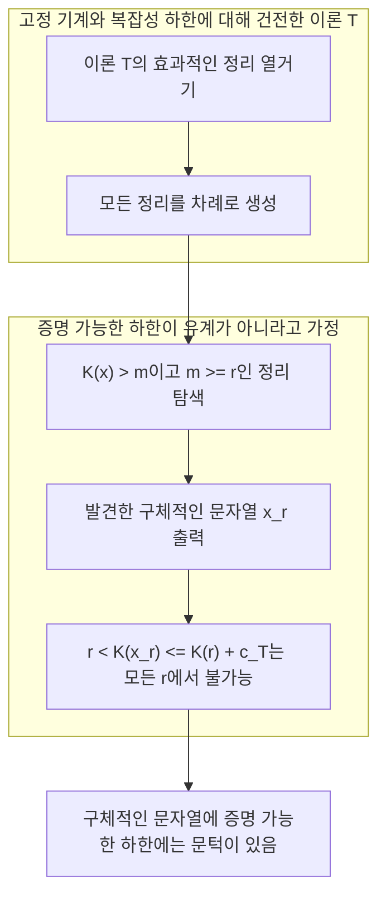

## 1. 백만 비트 문자열 세 개: 길이가 곧 복잡성일까?

길이가 $n=1{,}000{,}000$인 이진 문자열 세 개를 생각해 봅시다.

1. $S_1$: `01`을 50만 번 반복한 문자열.
2. $S_2$: 원주율 $\pi$의 <strong>소수 부분</strong>을 이진수로 전개한 첫 백만 비트.
3. $S_3$: 서로 독립인 공정한 동전 던지기를 백만 번 수행한다는 확률 모델에서 얻는 한 결과.

비트를 빈틈없이 묶어 저장하면 셋 모두 125,000바이트, 즉 십진 단위로 125 kB입니다. 반면 `0`과 `1`을 ASCII 또는 UTF-8 문자로 저장하면 백만 바이트가 필요합니다. 파일 헤더나 객체 관리 비용은 별도입니다.

$\pi$의 이진 표기는 $11.0010010000111111\ldots{}_2$로 시작합니다. 따라서 정수 부분을 제외한 $S_2$는 `0010010000111111...`로 시작합니다. 이 짧은 표기는 설명용이며, 이 글에서 실제로 백만 번의 물리적 동전 실험을 했다는 뜻은 아닙니다.

$S_1$은 반복 규칙으로 만들 수 있고 $S_2$에도 필요한 자릿수를 계산하는 알고리즘이 있습니다. 그러나 $S_3$가 반드시 복잡한 것은 아닙니다. 공정한 동전에서도 우연히 모두 0이거나 완벽히 교대하는 결과가 나올 수 있습니다. 올바른 결론은 확률적입니다. <strong>계산 모델을 고정하면, 훨씬 짧게 기술할 수 있는 결과가 차지하는 비율은 작습니다.</strong>

독립인 공정한 동전 모델에서는 길이 $n$의 구체적인 문자열마다 확률이 같습니다. 교대 문자열이나 $\pi$의 접두사도 예외가 아닙니다.

$$
P(X=x)=2^{-n},\qquad x\in\{0,1\}^n
$$

확률이 같은 개별 결과들 사이에서 짧은 생성 규칙의 유무를 어떻게 나타낼까요? 솔로모노프, 콜모고로프, 차이틴 등이 1960년대부터 발전시킨 <strong>알고리즘 정보이론(AIT)</strong>은 이 문제를 다룹니다. 핵심 척도는 “그 문자열을 출력하고 정지하는 가장 짧은 프로그램의 비트 길이”입니다.

---

## 2. 섀넌 정보량과 개별 문자열

### 2.1 자기정보량, 엔트로피와 부호화

이산 분포 $P$에 대해, $P(x)>0$인 개별 결과의 자기정보량과 그 평균인 엔트로피를 구별해야 합니다. 아래에서 로그의 밑은 기본적으로 2이며, 단위는 비트입니다.

$$
I_P(x)=-\log_2P(x),\qquad
H(P)=-\sum_xP(x)\log_2P(x)
$$

합에서는 $0\log_2 0=0$으로 약속합니다. 모델이 확률 0을 부여한 결과의 자기정보량은 무한대입니다.

유한 알파벳의 한 기호를 이진 접두 부호로 표현할 때 평균 부호 길이는 엔트로피보다 작을 수 없습니다. 또한 엔트로피에 1을 더한 값보다 평균 길이가 작은 부호가 존재합니다.

$$
H(P)\le L_{\mathrm{opt}}<H(P)+1
$$

각 부호어의 길이가 모두 엔트로피와 같다는 뜻은 아닙니다. 독립이고 동일한 분포를 따르는 기호 $r$개를 묶으면 기호당 정수 반올림 비용을 줄일 수 있습니다.

$$
H(P)\le \frac{L_{\mathrm{opt},r}}{r}<H(P)+\frac1r
$$

의존성이 있는 정보원에서는 블록 분포와 엔트로피율을 살펴야 합니다. 허프먼 부호와 산술 부호를 설명할 때도 모델, 평균값, 개별 결과를 구별해야 합니다.

### 2.2 모델 선택과 경험적 빈도

$-\log_2P(x)$는 $x$만의 성질이 아니라 선택한 모델 $P$에도 의존합니다. 공정한 동전 모델에서는 교대 문자열도 백만 비트의 자기정보량을 가집니다. 반대로 그 특정 문자열만 확률 1로 출력하는 점질량 분포를 선택하면 엔트로피는 0입니다. 그렇다고 모델 자체를 수신자에게 전달하는 비용까지 0이 되지는 않습니다.

한 비트의 빈도만 보면 `01` 반복 문자열은 0과 1이 반씩이므로 0차 경험적 엔트로피가 1비트입니다. 하지만 직전 비트에서 다음 비트를 예측하는 모델은 그 규칙을 이용할 수 있습니다.

$$
\widehat H_0((01)^{n/2})
=-\tfrac12\log_2\tfrac12-\tfrac12\log_2\tfrac12=1
$$

교대 문자열에서 길이 $k$의 겹치는 블록은 많아야 두 종류입니다. 따라서 블록 전체의 경험적 엔트로피는 최대 1비트이고, 이를 $k$로 나눈 비트당 값은 최대 $1/k$입니다. 블록 전체와 비트당 엔트로피는 다른 양입니다.

$\pi$의 정규성, 즉 모든 고정 길이 블록이 해당하는 균등한 극한 빈도로 나타난다는 성질은 증명되지 않았습니다. 유한한 빈도 검사나 불규칙한 외관으로 정규성을 증명할 수는 없습니다. 정규수라도 자릿수 열이 계산 가능할 수 있습니다. $\pi$의 자릿수를 계산하는 확률 예측 모델을 허용한다면 섀넌식 예측과 부호화도 그 규칙을 활용할 수 있습니다. 섀넌 이론은 0차 빈도 모델에만 한정되지 않습니다.

AIT가 섀넌 이론을 부정하는 것은 아닙니다. <strong>확률 모델에 대한 부호 길이와 고정된 계산기에 대한 개별 객체의 기술 길이는 서로 다른 질문에 답합니다.</strong>

| 관점 | 섀넌 정보량 | 알고리즘적 기술 길이 |
| :--- | :--- | :--- |
| 대상 | 분포 및 그 분포에서 얻는 개별 결과 | 고정된 기계가 출력하는 유한 문자열 |
| 기준 | 확률 모델과 부호 규칙 | 기계, 프로그램 부호화, 보조 입력 |
| 주요 양 | $I_P(x)$, $H(P)$, 엔트로피율 | 일반 복잡성 $C(x)$, 접두 복잡성 $K(x)$ |
| 한계 | 모델 기술 비용은 따로 필요 | 기계별 상수와 계산 불가능성 |
| $\pi$의 처리 | 선택한 모델에 의존 | 자릿수 생성 규칙과 끝 위치의 기술 |

---

## 3. 최단 프로그램과 불변성 정리

### 3.1 일반 복잡성과 조건부 복잡성

$\{0,1\}^*$는 모든 유한 이진 문자열의 집합이고 $|p|$는 프로그램의 비트 길이입니다. 부분 계산 가능 기계 $A$에 대해 $A(p)=x$는 유한 시간에 정지하여 정확히 $x$를 출력한다는 뜻입니다.

$$
C_A(x)=\min\{|p|:A(p)=x\}
$$

그런 프로그램이 없으면 최솟값을 $\infty$로 정합니다. 보조 입력 $y$를 무료로 제공할 때는 다음과 같이 정의합니다.

$$
C_A(x\mid y)=\min\{|p|:A(p,y)=x\}
$$

길이나 사전을 미리 알고 있는 경우와 그것을 프로그램에 포함하는 경우의 비용은 다릅니다.

### 3.2 자기구분 프로그램과 접두 복잡성

<strong>접두 복잡성 $K$</strong>에서는 정지하는 프로그램들의 집합이 접두사 자유(prefix-free)여야 합니다. 어떤 정지 프로그램도 다른 정지 프로그램의 진접두사가 되지 않아야 한다는 뜻입니다.

$$
K_U(x)=\min\{|p|:U(p)=x\},\qquad
\sum_{p\in\operatorname{dom}U}2^{-|p|}\le1
$$

뒤의 식은 크래프트 부등식입니다. 조건부 접두 복잡성에서는 각 고정된 보조 입력 $y$마다 정지 영역이 접두사 자유여야 합니다. 자기구분(self-delimiting)은 일반 소스 코드에 단순히 닫는 괄호 하나를 붙이는 조건이 아닙니다.

이하의 $C$와 $K$에서는 각각의 기계 부류에서 덧셈 상수의 의미로 최적인 기준 기계를 고정합니다. 다음 절에서 이 최적성을 설명합니다.

일반 프로그램을 이어 붙이려면 경계를 알려야 합니다. 순서쌍에 대한 고정된 계산 가능 부호화를 사용하면, 예를 들어 다음 상한을 얻습니다.

$$
C(x,y)\le C(x)+C(y)
+2\log_2\bigl(\min\{C(x),C(y)\}+2\bigr)+O(1)
$$

자기구분 프로그램은 이어 붙여 해석할 수 있습니다. 조건부 기술을 사용하면 상한은 더 간결해집니다.

$$
K(x,y)\le K(x)+K(y\mid x)+O(1)
\le K(x)+K(y)+O(1)
$$

해당하는 기준 기계들을 고정하면 두 복잡성 사이에는 다음 관계가 있습니다.

$$
C(x)\le K(x)+O(1),\qquad
K(x)\le C(x)+2\log_2(C(x)+2)+O(1)
$$

$O(1)$은 객체 $x$에 의존하지 않는 상수입니다. 실제 비용이 0비트나 몇 비트라고 측정했다는 뜻은 아닙니다.

### 3.3 최적 기계 사이의 불변성

$C$는 일반 기계 부류에서, $K$는 접두사 자유 기계 부류에서 최적인 기계를 사용합니다. 여기서 최적성이란 다른 기계의 기술 길이를 덧셈 상수의 비용으로 모사할 수 있다는 뜻입니다. “보편적”을 단순히 다른 기계를 시뮬레이션할 수 있다는 의미로만 쓴다면, 기술 길이의 상수 오버헤드 조건도 추가로 요구해야 합니다.

접두사 자유 기계 $A$마다 $x$와 무관한 상수 $c_A$가 존재하여 다음이 성립합니다.

$$
K_U(x)\le K_A(x)+c_A
$$

<strong>증명의 구성</strong>은 프로그램 $p$ 앞에 기계 $A$를 지정하는 고정된 자기구분 태그 $s_A$를 붙이고 $A(p)$를 모사하는 것입니다. $A(p)=x$라면 이 모사 프로그램은 $|p|+|s_A|$에 고정 비용을 더한 길이로 $x$를 출력합니다. 최단 프로그램은 이보다 길 수 없습니다. 이런 방식으로 최적 기계를 구성할 수 있습니다. 일반 복잡성에도 같은 부류 안에서 대응하는 논증이 있습니다.

두 최적 기계 사이에 양방향으로 적용하면 다음을 얻습니다.

$$
|K_{U_1}(x)-K_{U_2}(x)|\le c_{12}
$$

상수는 양방향 모사 비용을 모두 덮도록 정해야 합니다. 한 방향의 인터프리터 크기만을 절대차의 상한과 동일시하면 안 됩니다.

특정한 백만 비트 문자열만 아주 짧은 명령으로 출력하는 전용 기계를 설계할 수도 있습니다. 그 기계를 모사하는 비용은 상수에 포함되지만, 불변성 정리가 유한 객체의 기계 의존성을 없애지는 않습니다. 상수를 길이 $n$으로 나눈 상대적 영향은 $n\to\infty$에서 작아집니다. 그렇다고 구체적인 문자열의 정확한 최단 길이를 일반적으로 알 수 있는 것은 아닙니다. 유한 메모리의 실제 CPU와 언어 구현을 무제한 저장 공간을 허용하는 수학적 기계와 동일시해서도 안 됩니다.

### 3.4 교대 문자열, 원주율과 동전의 재평가

정수 $n$을 고정된 이진 표현과 대응시킵니다. 길이 $n$의 교대 문자열 또는 $\pi$ 소수 부분의 첫 $n$비트를 $s(n)$이라 합시다. $n$에서 문자열을 계산할 수 있고, 문자열 길이에서 다시 $n$을 구할 수 있습니다. 양방향 계산 가능 변환으로 다음이 성립합니다.

$$
K(s(n))=K(n)+O(1),\qquad K(s(n)\mid n)=O(1)
$$

끝 위치가 무료로 주어지면 고정 길이의 생성 프로그램이면 충분합니다. 그렇지 않으면 $n$도 기술해야 합니다. 예를 들어 $n\ge2$에 대해 자기구분 정수 부호로 다음 상한을 얻습니다.

$$
K(n)\le \log_2 n+2\log_2\log_2 n+O(1)=O(\log n)
$$

모든 정수에서 $K(n)=\log_2n+O(1)$이라는 뜻은 아닙니다. $n=2^m$이면 지수 $m$을 기술한 뒤 $n$을 복원할 수 있으므로 $m$의 짧은 기술을 이용할 수 있습니다.



$S_3$의 최단 기술이 반드시 원시 데이터의 복사본인 것은 아닙니다. 다음 절의 계수 논증이 그 확률적 의미를 명확히 합니다.

---

## 4. 비압축성과 무한 수열의 무작위성

### 4.1 문자열을 그대로 출력하는 상한

임의의 길이 $n$인 문자열 $x$를 그대로 출력하면 일반 복잡성과 길이를 조건으로 한 접두 복잡성에 다음 상한이 있습니다.

$$
C(x)\le n+O(1),\qquad K(x\mid n)\le n+O(1)
$$

조건 없는 접두 기술에서는 길이도 자기구분 방식으로 알려야 합니다.

$$
K(x)\le n+K(n)+O(1)
$$

모든 문자열에 대해 일률적으로 $K(x)\le |x|+O(1)$이라 할 수는 없습니다. 그렇다면 각 길이 $n$에서 총 가중치 $\sum_{|x|=n}2^{-K(x)}$가 동일한 양의 상수 이상이 됩니다. 모든 길이에 걸쳐 합하면 크래프트 부등식을 위반합니다.

### 4.2 비둘기집 원리의 정확한 계수

정수 $n\ge0$, $0\le c\le n$이라 합시다. 길이가 $n-c$보다 엄밀히 짧은 이진 프로그램의 수는 다음과 같습니다.

$$
\sum_{j=0}^{n-c-1}2^j=2^{n-c}-1
$$

$c=n$에서는 빈 합을 0으로 정합니다. 정지하는 프로그램 하나는 많아야 문자열 하나를 출력합니다. 따라서 길이 $n$의 문자열 중 $C(x)<n-c$인 것은 위의 개수보다 많을 수 없습니다.

$$
\#\{x\in\{0,1\}^n:C(x)\ge n-c\}
\ge2^n-2^{n-c}+1
$$

어떤 짧은 프로그램은 정지하지 않거나 같은 문자열을 출력하므로 서로 다른 출력은 더 적을 수 있습니다. $c>n$이면 $n-c<0$이므로 모든 문자열이 자명하게 $C(x)\ge n-c$를 만족합니다. 그 범위까지 등비합 공식을 그대로 연장해서는 안 됩니다.

공정한 동전의 균등 분포로 바꾸면 다음과 같습니다.

$$
P\{C(X)<n-c\}
\le\frac{2^{n-c}-1}{2^n}<2^{-c}
$$

$c=0$이면 각 길이에 $C(x)\ge n$인 문자열이 하나 이상 있습니다. $c=1$이면 절반보다 많은 문자열이 1비트를 <strong>초과하여</strong> 줄일 수 없습니다. $c=10$, $c=20$에서 10비트, 20비트를 초과하는 절약이 불가능한 비율의 하한 $1-2^{-c}$는 각각 약 99.902%, 99.999905%입니다. 정확히 $c$비트를 절약하는 것까지 금지하는 명제가 아닙니다.

조건 $n$을 고정한 $K(x\mid n)$에도 같은 계수 논증을 적용할 수 있습니다. 따라서 공정한 동전 결과는 높은 확률로 길이에 가까운 기술을 요구하지만, 개별 결과마다 보장되는 것은 아닙니다.

모든 파일을 반드시 줄이는 가역 압축기는 이 계수 논증에 어긋납니다. 실제 압축기는 특정 규칙을 활용할 수 있는 데이터를 줄입니다. 전체 이진 문자열의 균등 분포에서 얻은 비율을 자연이나 인간 데이터의 출현 비율로 곧바로 해석할 수는 없습니다.

### 4.3 마르틴–뢰프 무작위성

유한 문자열을 지정된 비트 수만큼 줄이지 못한다는 성질과 무한 수열의 무작위성은 다른 정의입니다. 무한 이진 수열 공간에 공정한 동전 측도 $\mu$를 둡니다. 유한 문자열 $w$로 시작하는 수열들의 원통 집합 $[w]$는 측도가 $2^{-|w|}$입니다.

<strong>마르틴–뢰프 검정</strong>은 유한 접두사의 원통 집합들의 합집합으로 균일하게 계산 열거할 수 있는 열린집합 $V_j$의 열이며, 다음을 만족합니다.

$$
\mu(V_j)\le2^{-j},\qquad j=1,2,\ldots
$$

$\omega\in\bigcap_jV_j$이면 그 검정에 실패합니다. 이러한 검정의 실패 집합 어느 것에도 속하지 않는 수열을 마르틴–뢰프 무작위라고 합니다. 드문 유한 패턴을 단 한 번도 보이지 않는다는 뜻은 아닙니다. 유효한 검정은 가산 개이고 각 실패 집합의 측도는 0이므로, 모든 검정을 통과하는 집합의 측도는 1입니다.

레빈–슈노어 정리는 최적 <strong>접두</strong> 복잡성으로 다음 동치를 줍니다.

$$
\omega\text{ 는 마르틴–뢰프 무작위}
\iff
\exists c\ \forall n\quad K(\omega_{1:n})\ge n-c
$$

핵심은 모든 $n$에 <strong>같은 상수 $c$</strong>를 사용한다는 것입니다. 여기서 $K$를 일반 복잡성 $C$로 그대로 바꿀 수는 없습니다.

폰 미제스와 처치의 선택 규칙에 관한 역사가 있지만, 허용하는 검정과 베팅 전략의 계산 가능성 조건에 따라 정의가 달라집니다. 특히 어떤 계산 가능 마팅게일로도 자본을 무한히 키울 수 없다는 계산 가능 무작위성은 마르틴–뢰프 무작위성보다 약하며, 둘은 동의어가 아닙니다.

계산 가능한 $\pi$의 무한 자릿수 열은 마르틴–뢰프 무작위가 아닙니다. 이는 정규성과도 다른 개념입니다.

---

## 5. 계산 불가능성, 증명의 한계와 정지 확률

### 5.1 위에서 근사해도 최솟값 도달을 항상 알아낼 수는 없다

후보 프로그램을 조금씩 번갈아 실행하는 교대 모사(dovetailing)로 짧은 기술을 찾을 수 있습니다. 지금까지 찾은 기술 길이의 최솟값으로 $K(x)$의 상한을 갱신합니다.

$$
K_t(x)\searrow K(x)\qquad(t\to\infty)
$$

처음에는 문자열을 그대로 출력하는 계산 가능한 유한 상한을 사용할 수 있습니다. 상한은 정수이므로 고정된 $x$마다 언젠가 실제 값에 도달하고 이후 변하지 않습니다. 하지만 모든 입력에서 그 시점을 알아내는 일반 절차는 없습니다. 아직 정지하지 않은 더 짧은 프로그램이 나중에 $x$를 출력할 가능성을 일반적으로 배제할 수 없기 때문입니다.

### 5.2 베리식 귀류법

“스무 단어 미만으로 정의할 수 없는 가장 작은 양의 정수”라는 구절을 생각해 봅시다. 공백으로 나눈 어절을 세면 열 개로, 스무 개보다 적습니다. 자연어에서 “정의할 수 있다”는 말은 모호하므로, 이 문장 자체를 형식적 증명으로 삼기보다는 계산 가능한 절차에 관한 귀류법으로 옮깁니다.

모든 $x$에 대해 실제 $K(x)$를 반환하고 정지하는 `ComputeK`가 있다고 가정합시다. 아래는 이 불가능한 가정을 쓰는 <strong>의사 코드</strong>이지, 구현된 복잡성 계산기가 아닙니다.

```text
Berry(m):
    길이 0,1,2,... 순서로, 같은 길이에서는 사전순으로 모든 이진 문자열 x를 열거:
        if ComputeK(x) >= m:
            x를 출력하고 정지
```

이를 길이 우선 사전순(shortlex)이라 합니다. 일반 사전순만으로는 이 논증에 필요한 모든 유한 문자열의 열거를 얻을 수 없습니다.

계수 논증에 따라 복잡성은 유계가 아니므로, 가정하에서는 모든 $m$에 대해 탐색이 끝나고 $K(x_m)\ge m$인 $x_m$을 출력합니다. 반면 그 생성에는 고정 코드와 $m$의 자기구분 기술만 있으면 됩니다.

$$
m\le K(x_m)\le K(m)+c
\le \log_2m+2\log_2\log_2m+c'
$$

마지막 상한은 $m\ge2$에 적용합니다. 고정된 상수에 대해 $m$이 충분히 크면 모순이므로 `ComputeK`는 존재하지 않습니다. 기계별 비용을 측정하지 않은 채 10,000비트의 여유면 언제나 충분하다고 주장할 필요가 없습니다.

### 5.3 차이틴 불완전성 정리

기준 기계와, 구체적인 유한 문자열의 복잡성 명제를 표현할 수 있는 효과적으로 공리화된 이론 $T$를 고정합니다. 여기서는 이론이 증명하는 해당 하한 명제가 참이라는 <strong>건전성</strong>을 가정합니다.

그러면 어떤 문턱 $b_T$가 존재하여, $T$는 어느 구체적인 문자열 $x$에 대해서도 “$K(x)>b_T$”를 증명할 수 없습니다.

반대로 증명 가능한 수치 하한들이 유계가 아니라고 가정합시다. 입력 $r$이 주어지면 모든 정리를 열거하여, 수치 $m$이 $m\ge r$인 “$K(x)>m$” 형태의 정리를 찾을 수 있습니다.

```text
SearchProof(r):
    이론 T의 모든 정리를 효과적으로 열거:
        if 구체적인 문자열 x와 정수 m에 대해 "K(x) > m"을 주장하고 m >= r인 정리라면:
            x를 출력하고 정지
```

건전성에 의해 출력 $x_r$의 복잡성은 $r$보다 큽니다. 하지만 이 절차의 고정 코드에는 이미 $T$의 정리 열거기를 포함할 수 있으므로 다음이 성립합니다.

$$
r<K(x_r)\le K(r)+c_T=O(\log r)+c_T
$$

충분히 큰 $r$에서는 불가능하므로 증명 가능한 수치 하한들은 유계입니다.



문턱은 기계, 이론, 표현 방식에 의존합니다. ZFC의 보편적 한계를 20,000비트나 50,000비트로 측정한 것이 아닙니다. 문자열 길이 $n$이 문턱보다 충분히 크면 많은 문자열의 실제 복잡성이 그 문턱을 넘는다는 사실은 계수로 알 수 있습니다. 그래도 특정 문자열에 대해 그 하한을 증명하는 데에는 한계가 있습니다.

이는 괴델 이후의 불완전성과 정보적 기술을 잇지만, 짧은 공리에서 길거나 많은 정리를 이끌어낼 수 없다는 일반적인 “정보 보존 법칙”은 아닙니다. 공리를 추가한 다른 이론에는 다른 상수가 대응합니다.

### 5.4 기계에 따라 정해지는 정지 확률

최적 접두사 자유 기계 $U$에 대해, 독립인 공정한 무한 비트열이 정지 프로그램으로 시작할 확률은 다음과 같습니다.

$$
\Omega_U=\sum_{p\in\operatorname{dom}U}2^{-|p|}
$$

정지 프로그램에 대응하는 원통 집합들이 서로 겹치지 않으므로 이 합은 확률로 해석됩니다. 크래프트 부등식은 $\Omega_U\le1$을 줍니다. 최적성을 포함한 이 설정에서는 $\Omega_U$가 계산 불가능한 마르틴–뢰프 무작위 실수이고 $0<\Omega_U<1$입니다. 단순히 접두사 자유인 임의의 기계에 이 성질 모두가 성립하는 것은 아닙니다.

정지한 프로그램을 열거하면 가중치의 부분합이 아래에서 증가합니다. 따라서 $\Omega_U$는 <strong>왼쪽에서 계산 가능하게 열거되는 실수(left-c.e.)</strong>이지만, 각 정밀도를 언제 보장할 수 있는지 알려 주는 계산 가능한 함수는 없습니다.

정확한 첫 $N$개의 이진 소수 비트를 안다고 가정하고 해당하는 이진 유리수 하단점을 $a$라 합시다. $\Omega_U$는 유한 이진 소수로 끝나지 않으므로 다음이 성립합니다.

$$
a=\frac{\lfloor2^N\Omega_U\rfloor}{2^N},
\qquad a<\Omega_U<a+2^{-N}
$$

프로그램들을 교대로 모사하여 정지 가중치 부분합 $q_s$가 $a$를 <strong>넘을</strong> 때까지 기다리면 다음을 얻습니다.

$$
0\le\Omega_U-q_s<2^{-N}
$$

아직 열거되지 않은 길이 $N$ 이하의 프로그램이 나중에 정지한다면 최소 $2^{-N}$의 가중치가 추가되어 모순입니다. 이렇게 <strong>같은 기계</strong>의 길이 $N$ 이하 모든 입력에 대해 정지 여부를 판정할 수 있습니다.

고정된 몇천 비트로 무한히 많은 임의의 수학 명제를 전부 판정한다는 뜻은 아닙니다. 반례 탐색을 정지 문제로 부호화할 때는 기계, 프로그램 길이, 명제의 논리적 형태가 중요합니다. 특별한 조건에서 유한 개의 자릿수를 계산하는 연구도 전체 자릿수를 생성하는 알고리즘과는 다릅니다.

---

## 6. 엔트로피, MDL, NCD와 인공지능

### 6.1 평균 기술 길이와 엔트로피율

유한 문자열 위의 계산 가능한 이산 분포 $P$를 유한 계산 절차 $d_P$로 지정합시다. $d_P$를 무료 보조 입력으로 공유하고 $H(P)<\infty$이면 다음 관계가 있습니다.

$$
H(P)\le\mathbb E_{X\sim P}[K(X\mid d_P)]\le H(P)+c
$$

분포의 지지집합은 유한하거나 가산일 수 있고, 각 확률을 요청한 정밀도까지 균일하게 계산할 수 있어야 합니다. 상수 $c$에는 고정 복호 절차의 비용이 포함됩니다. 두 값이 수치적으로 정확히 같다는 뜻은 아닙니다.

하한은 고정 조건 $d_P$ 아래의 최단 접두 기술에 크래프트 부등식을 적용하고 평균 부호 길이의 논증을 사용하면 나옵니다. 상한은 공유 분포에 따라 접두 부호를 구성하여 고정 절차로 복호하면 얻습니다. 분포를 공유하지 않으면 모델의 기술 비용도 필요합니다. 임의의 확률 분포를 “안다”고 해서 엔트로피를 항상 유한 시간에 정확히 계산할 수 있는 것은 아닙니다.

별도로, <strong>유한 알파벳의 정상 에르고딕 과정</strong>에는 브루드노(Brudno)형 정리가 있습니다. 기호당 엔트로피율이 $h$비트이면 거의 모든 표본 수열에서 다음이 성립합니다.

$$
\lim_{n\to\infty}\frac{K(X_{1:n})}{n}=h
$$

기대값도 $\mathbb E[K(X_{1:n})]/n\to h$를 만족합니다. 길이 $n$의 기호열을 그대로 부호화하는 균일한 선형 상한이 있으므로 거의 확실한 수렴에서 평균의 수렴으로 이어갈 수 있습니다. 일반 복잡성과 접두 복잡성의 로그 정도 차이도 $n$으로 나누면 사라집니다. 이 엔트로피율 정리에 직전의 조건부 분포 부등식과 같은 계산 가능성 가정을 일률적으로 부과해서는 안 됩니다.

### 6.2 이산 보편 준측도와 솔로모노프 예측

최적 정지형 접두 기계에 대해, 정확히 $x$를 출력하고 정지하는 확률을 다음과 같이 정의합니다.

$$
m_U(x)=\sum_{p:U(p)=x}2^{-|p|}
$$

총질량이 1 이하인 <strong>준측도(semimeasure)</strong>이며 아래에서 반계산 가능합니다. 부호화 정리는 이 이산 보편 준측도와 접두 복잡성을 연결합니다.

$$
-\log_2m_U(x)=K_U(x)+O(1),
\qquad m_U(x)=\Theta(2^{-K_U(x)})
$$

반면 솔로모노프의 순차 예측에서는 단조 기계의 출력이 <strong>$x$로 시작할</strong> 확률을 나타내는 준측도 $M(x)$를 사용합니다. 출력이 그 지점에서 정지할 필요는 없고 $M(x)\ge M(x0)+M(x1)$을 만족합니다. 이산 $m_U$와 순차 예측 $M$을 같은 대상으로 정의한 뒤 같은 부호화 정리를 무조건 옮겨 쓰면 안 됩니다.

짧은 기술을 선호하는 것은 오컴의 면도날과 연결됩니다. 그러나 데이터 관측 후에도 짧은 가설의 확률이 항상 큰 것은 아닙니다. 우도 역시 고려해야 합니다.

### 6.3 베이즈 선택과 최소 기술 길이

모델 $H$에 실제 접두 기술 길이 $L(H)$를 부여하고, 사전 확률을 그 부호 가중치에 비례시키면 베이즈 공식은 다음과 같습니다.

$$
-\log_2P(H\mid D)
=L(H)-\log_2P(D\mid H)+\mathrm{const}
$$

더해지는 상수는 $H$에 의존하지 않습니다. 이 설정에서는 사후 확률 최대화가 우변의 최소화에 대응합니다. 하지만 일반적인 $-\log_2P(D\mid H)$를 언제나 $K(D\mid H)$로 대체할 수는 없습니다.

<strong>최소 기술 길이(MDL) 원리</strong>는 모델과 그 모델을 사용한 데이터 부호의 총비용을 비교합니다.

$$
\widehat H=\arg\min_{H\in\mathcal H}
\{L(H)+L(D\mid H)\}
$$

너무 단순한 모델은 데이터 부호를 길게 만들 수 있고, 전부 외우는 모델은 모델 자체의 기술이 길어질 수 있습니다. 잔차를 암기해 없애는 것과 총 기술 길이를 줄이는 것은 다릅니다. 리사넨(Rissanen)의 MDL은 실용적인 통계적 선택 원리이며, 참인 자연 법칙이나 인과관계를 반드시 발견한다는 보장은 아닙니다.

### 6.4 이상적 정보 거리와 실제 압축기

분모가 양수일 때 이상적인 <strong>정규화 정보 거리(NID)</strong>는 다음과 같이 정의합니다.

$$
\operatorname{NID}(x,y)=
\frac{\max\{K(x\mid y),K(y\mid x)\}}
{\max\{K(x),K(y)\}}
$$

순서쌍 기술 $K(x,y)$를 사용하는 식과도 적절한 덧셈 오차와 정규화 오차를 허용하면 관련됩니다. 구분 없는 연결 문자열 $xy$와 두 성분을 유일하게 복원할 수 있는 순서쌍 부호화를 정확히 동일시해서는 안 됩니다.

실제 압축기의 출력 길이를 일반 복잡성 $C$와 구별하여 $Z$로 쓰면 <strong>정규화 압축 거리(NCD)</strong>는 다음과 같습니다.

$$
\operatorname{NCD}_Z(x,y)=
\frac{Z(xy)-\min\{Z(x),Z(y)\}}
{\max\{Z(x),Z(y)\}}
$$

압축기가 공통 구조를 재사용할 수 있으면 비슷한 파일의 값은 작아지고, 공통 구조를 이용하지 못하면 1에 가까워진다는 발상입니다.

실제 압축기에는 헤더, 사전 창, 블록, 설정, 순서 효과가 있습니다. 이론의 normal compressor가 요구하는 멱등성, 단조성, 대칭성, 분배성 등의 가정을 모든 압축기가 모든 입력에서 만족하지는 않습니다. 동일 파일도 $Z(xx)\approx Z(x)$가 되지 않을 수 있으며, 유한 파일의 NCD가 거리 공리를 정확히 만족하거나 항상 0에서 1 사이에 있는 것은 아닙니다.

보조 검사에서는 고정된 65,536바이트 문자열을 자기 자신과 연결하여 유한 창의 gzip을 사용하면 동일 파일 쌍의 NCD가 약 0.9997이 되는 예를 재현했습니다. 이상적인 NID의 반례가 아니라 실제 근사의 한계를 보여 주는 예입니다.

Cilibrasi와 Vitányi 등의 연구는 유전체, 언어, 음악의 압축 기반 군집화를 살폈습니다. 분야별 특징을 손으로 설계하지 않는 이점이 있지만, 문자 인코딩, 파일 표현, 압축기 선택과 무관한 것도 아니고 임의의 계통수를 정확히 복원하는 보장도 아닙니다.

### 6.5 언어 모델의 예측과 부호 길이

토큰열 $D=x_{1:T}$와 고정된 자기회귀 모델에서 예측에 대응하는 이상적 부호 길이는 다음과 같습니다.

$$
\mathcal L_\theta(D)=
-\sum_{t=1}^T\log_2p_\theta(x_t\mid x_{<t})
$$

자연로그를 쓰면 단위는 nat이고 $\ln2$로 나누어 비트로 바꿉니다. 유한 데이터에 대한 음의 로그 우도이며, 토큰당 평균을 교차 엔트로피 손실로 사용합니다.

확률이 양수인 결과에 대해 모델과 수열 길이를 공유하면, 이상적 산술 부호화 등의 구성으로 길이가 최대 $\lceil\mathcal L_\theta(D)\rceil+2$인 접두 기술을 만들 수 있습니다. 모든 구현이 정확히 “손실+2비트”가 되는 것은 아닙니다. 유한 정밀도, 종료, 반올림, 프레임 구분 비용이 있습니다.

모델과 필요한 메타데이터의 실제 자기구분 기술 길이를 $L_{\mathrm{model}}$, $L_{\mathrm{meta}}$라 하면, 고정 복호기 아래에서 다음 상한을 얻습니다.

$$
K(D)\le L_{\mathrm{model}}+L_{\mathrm{meta}}
+\lceil\mathcal L_\theta(D)\rceil+O(1)
$$

필요에 따라 수열 길이, 어휘집, 가역 토큰화 규격 등을 메타데이터에 포함합니다. 정규화로 사라진 원래 공백이나 문자를 추가 정보 없이 복원할 수는 없습니다.

고정 크기의 공유 모델에서 예측 손실을 낮추는 것은 데이터 부호 길이를 낮추는 것에 대응합니다. 모델 크기도 바꾸면 총비용을 봐야 하므로 훈련 손실만 최소화하는 문제는 두 부분 MDL 목표를 최소화하는 문제와 다릅니다.

마르쿠스 후터의 AIXI와 Hutter Prize가 보여 주는 압축과 지능의 연구 관점은 이런 연결의 동기가 됩니다. 그러나 AIXI는 계산 불가능한 이상 모델이지 실제 Transformer가 아닙니다. Delétang 등의 언어 모델 압축 연구 역시 예측과 압축의 대응을 조사합니다.

추리소설의 범인 이름을 정확히 예측하면 그 이름의 부호 길이는 짧아집니다. 하지만 개선이 논리 추론 때문만이라고 할 수는 없습니다. 암기, 어휘 편향, 중복 데이터도 이유가 될 수 있습니다. 훈련 텍스트를 압축했다는 사실만으로 세계의 인과 모델, 올바른 추론, 일반화 능력이나 AGI를 필연적으로 얻었다는 정리가 나오지는 않습니다.

| 이론 또는 원리 | 실용적 대응 | 구별할 점 |
| :--- | :--- | :--- |
| $K(x)$, $K(x\mid y)$ | 복호 절차와 공유 맥락을 포함한 기술 | 실제 압축 길이는 일반적으로 최솟값이 아님 |
| 이산 보편 준측도 $m_U$ | 짧은 기술을 선호하는 모델링 | 정지 출력과 순차 예측 $M$은 다름 |
| MDL | 모델 비용과 데이터 부호 길이 비교 | 우도와 조건부 복잡성을 항상 동일시할 수 없음 |
| NID와 NCD | 압축 기반 유사도와 군집화 | 압축기 창, 표현, 순서, 유한 길이 |
| 언어 모델과 산술 부호화 | 예측 확률과 부호 길이의 대응 | 공유 모델과 자체 완결 총비용, 지능 평가 |

---

## 7. 맺음말: 압축으로 무엇을 알 수 있을까?

같은 백만 비트라도 교대 문자열과 $\pi$의 접두사는 짧은 생성 절차가 있습니다. 끝 위치까지 기술하는 것과 끝 위치를 무료로 아는 조건부 기술은 다릅니다. 공정한 동전 결과에는 계수 논증에 따른 높은 확률의 비압축성이 있지만, 개별 결과의 보장은 아닙니다.

불변성 정리는 최적 기계 사이의 상수 차이를 제어하고, 베리식 논증은 실제 최단 길이를 일반적으로 계산할 수 없음을 보여 줍니다. 차이틴 정리와 $\Omega_U$는 증명과 계산의 한계를 더 구체화합니다. 임의의 유한 객체를 기계와 가정에 무관하게 평가하는 방법을 주는 것은 아닙니다.

MDL, NCD, 언어 모델의 부호 길이는 이상과 실용의 접점입니다. 압축은 규칙과 모델 공유를 연구하는 도구이지만, 압축률만으로 이해나 지능의 완전한 정의를 대신할 수는 없습니다.

### 참고 문헌

- [Shen: Algorithmic Information Theory and Kolmogorov Complexity](https://www.lirmm.fr/~ashen/uppsala-notes.pdf) — 일반·접두 복잡성, 최적 복호기, 계산 불가능성과 부호화 정리.
- [Rute: Computable randomness and betting for computable probability spaces](https://arxiv.org/html/1203.5535v4) — 계산 가능 무작위성과 마르틴–뢰프 검정의 구별.
- [Tadaki: Chaitin Ω numbers and halting problems](https://arxiv.org/abs/0904.1149) — 최적 기계의 정지 확률과 유한 길이 정지 문제.
- [Chazottes: Entropy in Dynamical Systems & Ergodic Theory](https://www.claymath.org/wp-content/uploads/2023/04/Chazottes-rev.pdf) — 슬라이드 50, 유한 분할의 브루드노 정리.
- [Cilibrasi·Vitányi: Clustering by Compression](https://arxiv.org/html/cs/0312044v2) — normal compressor 가정과 NCD.
- [Delétang 외: Language Modeling Is Compression](https://arxiv.org/abs/2309.10668) — 예측과 압축의 대응을 조사한 연구.
- [Hutter: Universal Algorithmic Intelligence](https://www.hutter1.net/ai/aixigentle.htm) — 보편 귀납과 결정을 결합하는 AIXI 이상과 계산상의 한계.
- [Bailey 외: An Empirical Approach to the Normality of Pi](https://www.davidhbailey.com/dhbpapers/normality-digits-pi.pdf) — 자릿수의 경험적 검사와 정규성 증명의 구별.
