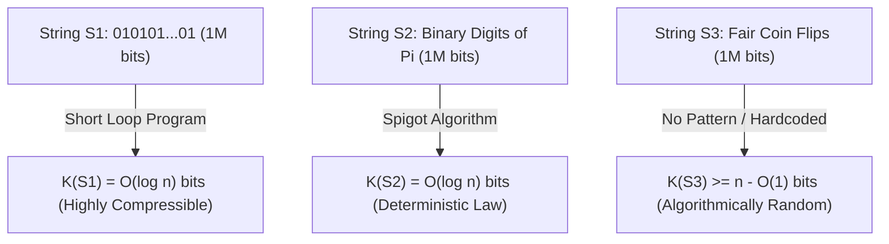
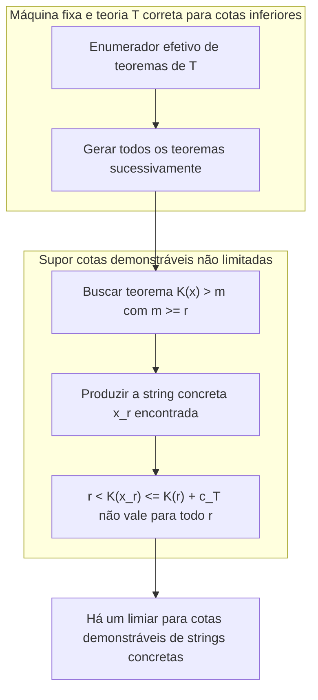

## Introdução: O Enigma das Três Strings de Um Milhão de Bits — O Ponto Cego da Teoria de Shannon

Imagine que você tem diante de si três strings binárias com exatamente $1.000.000$ de bits cada uma:
- A primeira string $S_1$ é a repetição quinhentas mil vezes de `01`: `01010101...01`.
- A segunda string $S_2$ contém o primeiro milhão de dígitos binários após a vírgula do número $\pi$: `0010010000111111...`.
- A terceira string $S_3$ é a sequência obtida ao lançar um milhão de vezes uma moeda honesta (cara = `1`, coroa = `0`).

Qual dessas três strings contém mais “informação”? Qual é a mais “complexa” e qual é verdadeiramente “aleatória”?
Se buscarmos a resposta na <strong>teoria clássica da informação de Claude Shannon (1948)</strong>, esbarraremos em uma limitação surpreendente: a entropia de Shannon $H(X) = -\sum P(x)\log_2 P(x)$ mede a incerteza média de uma <strong>distribuição de probabilidade (um conjunto ou *ensemble*)</strong>, mas nada diz sobre a complexidade intrínseca de um <strong>objeto individual específico $x$</strong>! No modelo de lançamentos de uma moeda justa, a sequência perfeitamente periódica $S_1$ e a sequência caótica $S_3$ têm exatamente a mesma probabilidade $2^{-1.000.000}$; e para a constante determinística $\pi$ ($S_2$), sua distribuição é pontual com entropia $0$, embora a frequência estatística de seus bits passe em todos os testes de pseudoaleatoriedade!

Para dar um fundamento matemático rigoroso à complexidade e à aleatoriedade de um objeto individual, Ray Solomonoff (1960), <strong>Andrey Kolmogorov (1965)</strong> e Gregory Chaitin (1966) criaram independentemente a <strong>Teoria Algorítmica da Informação (AIT)</strong>. Seu insight central é profundo: <strong>a verdadeira complexidade de um objeto não se mede pela quantidade de caracteres que ele possui, mas pelo comprimento do menor programa de computador capaz de gerá-lo!</strong>



---

## 1. Programas mínimos, complexidade simples e complexidade prefixa

### 1.1 Duas convenções que precisam ser distinguidas

Seja $\{0,1\}^*$ o conjunto das strings binárias finitas, e $|p|$ o comprimento de um programa em bits. Para uma máquina parcialmente computável $A$, a expressão $A(p)=x$ significa que a máquina para em tempo finito e produz exatamente $x$.

$$
C_A(x)=\min\{|p|:A(p)=x\}
$$

Se não houver tal programa, adotamos o valor $\infty$. Quando uma entrada auxiliar $y$ é fornecida gratuitamente, definimos:

$$
C_A(x\mid y)=\min\{|p|:A(p,y)=x\}
$$

Saber previamente o comprimento ou um dicionário não tem o mesmo custo que incluí-los na descrição.

Na <strong>complexidade prefixa $K$</strong>, o conjunto dos programas que param é livre de prefixos: nenhum deles é prefixo próprio de outro. Essa restrição permite aplicar a desigualdade de Kraft.

$$
K_U(x)=\min\{|p|:U(p)=x\},\qquad
\sum_{p\in\operatorname{dom}U}2^{-|p|}\le1
$$

Na versão condicional, o domínio de parada deve ser livre de prefixos para cada entrada auxiliar fixa $y$. Um programa autodelimitado não é simplesmente um código-fonte ao qual acrescentamos um parêntese de fechamento.

Fixaremos máquinas de referência aditivamente ótimas nas classes correspondentes a $C$ e $K$. A optimalidade será explicitada abaixo.

### 1.2 Concatenação e custos de delimitação

Ao concatenar programas simples, precisamos informar onde termina cada parte. Para uma codificação computável fixa de pares ordenados, uma cota possível é:

$$
C(x,y)\le C(x)+C(y)
+2\log_2\bigl(\min\{C(x),C(y)\}+2\bigr)+O(1)
$$

Programas autodelimitados podem ser concatenados e interpretados. Com descrições condicionais, temos:

$$
K(x,y)\le K(x)+K(y\mid x)+O(1)
\le K(x)+K(y)+O(1)
$$

As duas convenções de complexidade se relacionam por:

$$
C(x)\le K(x)+O(1),\qquad
K(x)\le C(x)+2\log_2(C(x)+2)+O(1)
$$

Aqui $O(1)$ significa uma constante independente do objeto $x$, e não uma medição de custo zero ou de poucos bits.

### 1.3 O que o teorema da invariância realmente garante

Para $C$, escolhemos uma máquina ótima na classe das máquinas simples; para $K$, na classe das máquinas livres de prefixos. Se “universal” significar apenas capacidade de simulação, é necessário exigir também a propriedade de preservar comprimentos com sobrecusto aditivo constante.

Para qualquer máquina livre de prefixos $A$, existe uma constante $c_A$, independente de $x$, tal que:

$$
K_U(x)\le K_A(x)+c_A
$$

A construção antepõe ao programa $p$ uma etiqueta autodelimitada fixa $s_A$ que identifica a máquina $A$. A máquina de referência simula $A(p)$. Se $A(p)=x$, essa simulação produz $x$ com comprimento $|p|+|s_A|$ mais um custo fixo; o programa mínimo não pode ser maior. É possível construir uma máquina ótima dessa maneira. Há um argumento correspondente para a complexidade simples dentro de sua classe.

Aplicando a desigualdade nos dois sentidos entre máquinas aditivamente ótimas, obtemos:

$$
|K_{U_1}(x)-K_{U_2}(x)|\le c_{12}
$$

A constante precisa cobrir os dois custos de simulação. Não devemos identificar apenas o tamanho de um interpretador em uma direção com uma cota para a diferença absoluta.

Uma máquina especializada pode imprimir uma string particular de um milhão de bits com uma instrução curta. O custo de descrever e simular essa máquina entra na constante. Portanto, a invariância <strong>não elimina a dependência da máquina para objetos finitos</strong>. A contribuição relativa de uma constante dividida por $n$ tende a zero quando $n\to\infty$, mas isso não revela o comprimento mínimo exato de qualquer string específica. Também não se deve identificar uma CPU real de memória finita com uma máquina matemática que admite armazenamento ilimitado.

### 1.4 Alternância, dígitos de pi e resultados de uma moeda

Identifiquemos $n$ com uma representação binária fixa. Seja $s(n)$ a string alternante de comprimento $n$, ou os primeiros $n$ bits da parte fracionária de $\pi$. Podemos calcular $s(n)$ a partir de $n$ e recuperar $n$ pelo comprimento da string. Essas transformações nos dois sentidos dão:

$$
K(s(n))=K(n)+O(1),\qquad K(s(n)\mid n)=O(1)
$$

Se a posição final é fornecida gratuitamente, basta um gerador de comprimento constante. Caso contrário, devemos descrever também $n$. Por exemplo, para $n\ge2$, uma codificação autodelimitada de inteiros fornece:

$$
K(n)\le \log_2 n+2\log_2\log_2 n+O(1)=O(\log n)
$$

Isso não significa que $K(n)=\log_2n+O(1)$ para todos os inteiros. Se $n=2^m$, uma descrição curta do expoente $m$ permite reconstruir $n$. Tampouco a notação assintótica mede um programa real como tendo exatamente vinte bits ou algumas centenas de bytes.

Para a string $S_3$ obtida de lançamentos independentes de uma moeda justa, a conclusão é probabilística. Resultados simples podem ocorrer; não há garantia de alta complexidade para cada realização. Para uma string $x$ de comprimento $n$, a reprodução literal dá:

$$
C(x)\le n+O(1),\qquad K(x\mid n)\le n+O(1)
$$

Sem fornecer o comprimento, uma descrição prefixa precisa delimitá-lo:

$$
K(x)\le n+K(n)+O(1)
$$

Não pode existir uma cota uniforme $K(x)\le |x|+O(1)$ para todas as strings: em cada comprimento $n$, a soma $\sum_{|x|=n}2^{-K(x)}$ teria a mesma cota inferior positiva, e somar sobre todos os comprimentos violaria Kraft.

---

## 2. Incompressibilidade finita e aleatoriedade de sequências infinitas

### 2.1 O argumento exato de contagem

Sejam inteiros $n\ge0$ e $0\le c\le n$. Existem $2^n$ strings binárias de comprimento $n$. O número de programas binários de comprimento estritamente menor que $n-c$ é:

$$
\sum_{j=0}^{n-c-1}2^j=2^{n-c}-1
$$

Quando $c=n$, a soma vazia vale zero. Cada programa que para produz no máximo uma string. Assim, a quantidade de strings de comprimento $n$ com $C(x)<n-c$ não pode ultrapassar essa contagem, e portanto:

$$
\#\{x\in\{0,1\}^n:C(x)\ge n-c\}
\ge2^n-2^{n-c}+1
$$

Programas que não param ou que repetem a mesma saída podem tornar o número de saídas distintas ainda menor. Se $c>n$, então $n-c<0$ e todas as strings satisfazem trivialmente $C(x)\ge n-c$. Não se deve estender a fórmula da soma geométrica diretamente a esse domínio.

Sob a distribuição uniforme das strings de comprimento $n$, correspondente a lançamentos independentes de uma moeda justa:

$$
P\{C(X)<n-c\}
\le\frac{2^{n-c}-1}{2^n}<2^{-c}
$$

Para $c=0$, existe pelo menos uma string de cada comprimento com $C(x)\ge n$. Para $c=1$, mais da metade das strings não admite redução de <strong>mais de</strong> um bit. Para $c=10$ e $c=20$, as cotas inferiores $1-2^{-c}$ para a proporção que não admite economia superior a 10 ou 20 bits são aproximadamente 99,902% e 99,999905%. Isso não exclui uma economia de exatamente $c$ bits.

O mesmo argumento funciona para $K(x\mid n)$ quando a condição $n$ é fixa. Portanto, os resultados da moeda exigem, com alta probabilidade, descrições próximas do próprio comprimento. Não há garantia para cada realização individual.

Um compressor reversível que encurtasse todos os arquivos contrariaria essa contagem. Compressores reais exploram regularidades de determinados dados. A proporção obtida sob a distribuição uniforme de todas as strings não é automaticamente a frequência de dados estruturados na natureza ou na produção humana.

### 2.2 Testes de Martin-Löf

A impossibilidade de encurtar uma string finita por uma quantidade especificada e a aleatoriedade de uma sequência infinita são definições distintas. No espaço das sequências binárias infinitas, usamos a medida $\mu$ da moeda justa. O conjunto cilíndrico $[w]$ contém as sequências que começam pela string finita $w$ e tem medida $2^{-|w|}$.

Um <strong>teste de Martin-Löf</strong> é uma sequência de conjuntos abertos $V_j$, enumeráveis computavelmente de maneira uniforme como uniões de cilindros de prefixos finitos, que satisfaz:

$$
\mu(V_j)\le2^{-j},\qquad j=1,2,\ldots
$$

Se $\omega\in\bigcap_jV_j$, a sequência falha nesse teste. Ela é aleatória no sentido de Martin-Löf quando não pertence ao conjunto de falha de nenhum teste desse tipo. Isso não proíbe que algum padrão finito raro apareça. Há uma quantidade enumerável de testes efetivos, cada conjunto de falha tem medida zero, e o conjunto das sequências que passam em todos os testes tem medida um.

O teorema de Levin–Schnorr caracteriza essa propriedade usando a complexidade <strong>prefixa</strong> ótima:

$$
\omega\text{ é aleatória no sentido de Martin-Löf}
\iff
\exists c\ \forall n\quad K(\omega_{1:n})\ge n-c
$$

É essencial que <strong>a mesma constante $c$</strong> funcione para todos os comprimentos $n$. Não podemos simplesmente trocar $K$ pela complexidade simples $C$ nessa equivalência.

As regras de seleção de von Mises e Church fazem parte dessa história, mas mudar as condições de efetividade dos testes ou das estratégias de aposta produz noções diferentes. Em particular, a aleatoriedade computável, definida pela impossibilidade de uma martingala computável obter capital ilimitado, é mais fraca que a aleatoriedade de Martin-Löf.

A sequência computável dos dígitos de $\pi$ não é aleatória no sentido de Martin-Löf. Normalidade e aleatoriedade algorítmica também não são sinônimos: uma expansão pode ser computável e normal, e testes de frequência finitos não demonstram normalidade.

---

## 3. Incomputabilidade, limites da demonstração e probabilidade de parada

### 3.1 Aproximação por cima sem critério geral de conclusão

Podemos executar os programas candidatos em paralelo intercalado, dando alguns passos a cada um. O menor comprimento encontrado entre os programas que produzem $x$ fornece uma aproximação superior:

$$
K_t(x)\searrow K(x)\qquad(t\to\infty)
$$

Começamos com uma cota finita computável obtida por reprodução literal. Como as cotas são inteiras, para cada $x$ fixo elas acabam atingindo o valor verdadeiro e permanecem nele. Porém, não há um procedimento geral que reconheça esse momento para todas as entradas. Um programa mais curto que ainda não parou pode produzir $x$ posteriormente.

### 3.2 Um argumento do tipo Berry

A expressão “o menor inteiro positivo que não pode ser definido em menos de vinte palavras” tem quatorze palavras separadas por espaços. O exemplo já usa corretamente o menor inteiro positivo. Como “definido” é ambíguo em linguagem natural, a frase não constitui por si só uma demonstração formal. Transferimos a ideia para procedimentos computáveis.

Suponha que um procedimento `ComputeK` retorne o verdadeiro $K(x)$ e pare para toda string $x$. O seguinte <strong>pseudocódigo</strong> usa essa hipótese impossível; não é um calculador implementado de complexidade.

```text
Berry(m):
    Enumerar todas as strings binárias x por comprimento 0,1,2,... e, no mesmo comprimento, em ordem lexicográfica:
        if ComputeK(x) >= m:
            Produzir x e parar
```

A ordem usada é shortlex: primeiro o comprimento, depois a ordem lexicográfica. A ordem lexicográfica comum, sozinha, não fornece a enumeração de todas as strings finitas necessária aqui.

A contagem mostra que a complexidade não é limitada. Sob a hipótese, a busca termina para cada $m$ e produz $x_m$ com $K(x_m)\ge m$. Entretanto, bastam um programa fixo e uma descrição autodelimitada de $m$ para gerar essa saída.

$$
m\le K(x_m)\le K(m)+c
\le \log_2m+2\log_2\log_2m+c'
$$

A última cota vale para $m\ge2$. Para constantes fixas e $m$ suficientemente grande, surge uma contradição; portanto, `ComputeK` não existe. Não é necessário afirmar, sem medir os custos da máquina, que uma margem fixa de 10.000 bits sempre bastaria.

### 3.3 Incompletude de Chaitin

Fixemos a máquina de referência e uma teoria $T$ efetivamente axiomatizável que possa expressar cotas de complexidade de strings concretas. Supomos a <strong>correção semântica</strong> das cotas inferiores que ela demonstra: essas afirmações são verdadeiras.

Existe então um limiar $b_T$ tal que $T$ não pode demonstrar “$K(x)>b_T$” para nenhuma string concreta $x$.

O núcleo do argumento é supor que as cotas numéricas demonstráveis não sejam limitadas. Para qualquer entrada $r$, poderíamos enumerar todos os teoremas e encontrar um da forma “$K(x)>m$”, com um número concreto $m\ge r$.

```text
SearchProof(r):
    Enumerar efetivamente todos os teoremas de T:
        if um teorema afirma "K(x) > m" para uma string concreta x e um inteiro m, com m >= r:
            Produzir x e parar
```

A correção garante que a saída $x_r$ tem complexidade maior que $r$. Mas o código fixo do procedimento já pode incluir o enumerador de teoremas de $T$, de modo que:

$$
r<K(x_r)\le K(r)+c_T=O(\log r)+c_T
$$

Isso é impossível para $r$ suficientemente grande. Logo, as cotas numéricas demonstráveis são limitadas.



O limiar depende da máquina, da teoria e da representação. Não estamos medindo um limite universal de ZFC em 20.000 ou 50.000 bits. Quando o comprimento $n$ excede suficientemente o limiar, a contagem mostra que muitas strings realmente têm complexidade superior a ele; ainda assim, demonstrar essa cota para uma string específica pode estar além da teoria.

O resultado conecta a incompletude de Gödel à descrição algorítmica. Não é uma lei geral de “conservação da informação” que proíba deduzir teoremas longos ou numerosos de axiomas curtos. Ao acrescentar axiomas, obtemos outra teoria, com outra constante.

### 3.4 A probabilidade de parada depende da máquina

Para uma máquina ótima livre de prefixos $U$, a probabilidade de uma sequência infinita de bits independentes e equiprováveis começar por um programa que para é:

$$
\Omega_U=\sum_{p\in\operatorname{dom}U}2^{-|p|}
$$

Os cilindros dos programas que param são disjuntos, justificando a interpretação probabilística. Kraft dá $\Omega_U\le1$. Com a optimalidade e as demais condições indicadas, $\Omega_U$ é também um real incomputável, aleatório no sentido de Martin-Löf, e $0<\Omega_U<1$. Todas essas propriedades não valem para uma máquina arbitrária apenas por ela ser livre de prefixos.

Enumerar programas que param produz somas parciais crescentes por baixo. Assim, $\Omega_U$ é um <strong>real computavelmente enumerável pela esquerda (left-c.e.)</strong>. Não existe uma função computável que informe quando a aproximação garante cada precisão solicitada.

Suponha conhecidos exatamente os primeiros $N$ bits fracionários e seja $a$ o extremo inferior binário correspondente. Como $\Omega_U$ não tem expansão binária terminante:

$$
a=\frac{\lfloor2^N\Omega_U\rfloor}{2^N},
\qquad a<\Omega_U<a+2^{-N}
$$

Executamos os programas de forma intercalada até a soma parcial dos pesos de parada $q_s$ <strong>ultrapassar</strong> $a$. Nesse momento:

$$
0\le\Omega_U-q_s<2^{-N}
$$

Um programa ainda não enumerado de comprimento no máximo $N$, se parasse mais tarde, acrescentaria pelo menos $2^{-N}$, contradizendo a cota da massa restante. Portanto, esses bits permitem decidir a parada de todas as entradas de comprimento no máximo $N$ da <strong>mesma máquina</strong>.

Isso não significa que alguns milhares de bits fixos decidam infinitas proposições matemáticas arbitrárias. Ao codificar buscas de contraexemplos como problemas de parada, importam a máquina, o comprimento do programa e a forma lógica da proposição. Calcular alguns bits em condições especiais também não fornece um algoritmo para toda a expansão.

---

## 4. Aplicações e relações com a informação e a inteligência

Na engenharia e na inteligência artificial modernas, limites superiores computáveis de $K(x)$ impulsionam tecnologias essenciais:
1. <strong>Ponte com a Entropia de Shannon</strong>: Para processos estacionários ergódicos, a esperança $\frac{1}{n}\mathbb{E}[K(X_{1:n})]$ converge para a taxa de entropia de Shannon $H(X)$.
2. <strong>Indução Universal de Solomonoff e Comprimento Mínimo de Descrição (MDL)</strong>: A Navalha de Ockham é formalizada pela distribuição a priori universal $P_M(x) \propto 2^{-K(x)}$.
3. <strong>Distância de Compressão Normalizada (NCD)</strong>: Aproximando $K(x)$ com compressores reais (`zstd`, `lzma`, `gzip`), a fórmula $\text{NCD}(x,y) = \frac{C(xy) - \min(C(x),C(y))}{\max(C(x),C(y))}$ constrói árvores filogenéticas e agrupa malwares sem engenharia de atributos.
4. <strong>Grandes Modelos de Linguagem (LLMs): Compressão é Inteligência</strong>: Como apontaram Marcus Hutter (Hutter Prize) e Ilya Sutskever, minimizar a perda de entropia cruzada $-\sum \log_2 P_\theta(x_t \mid x_{<t})$ de um Transformer autorregressivo é, via codificação aritmética, <strong>estritamente equivalente a buscar a compressão sem perdas ótima dos dados</strong>. Para comprimir ao máximo o texto humano, o modelo é forçado a internalizar a gramática, o raciocínio lógico e um modelo causal do mundo.

| Dimensão / Conceito | Entropia de Shannon $H(X)$ | Complexidade de Kolmogorov $K(x)$ | Aproximações Modernas (MDL / LLM / NCD) |
| :--- | :--- | :--- | :--- |
| <strong>Objeto Medido</strong> | Distribuição de probabilidade (*Ensemble*) | <strong>Objeto ou string individual $x$</strong> | Arquivos reais, genomas, corpus de texto |
| <strong>Julgamento sobre $10^6$ bits de $\pi$</strong> | Constante determinística ($H=0$); frequências uniformes | $K(\pi_{1:n}) = O(\log n)$ (muito simples graças ao algoritmo) | Codificação aritmética e redes neurais |
| <strong>Computabilidade</strong> | Exatamente computável se $P(X)$ for conhecida | <strong>Estritamente incomputável</strong> (problema da parada) | Limites superiores via `zstd`/LZMA ou Transformer $P_\theta$ |
| <strong>Teoremas e Filosofia</strong> | Teorema da codificação de fonte | Teorema da invariância, incompletude de Chaitin, $\Omega$ | Navalha de Ockham, “Compressão = Predição = Inteligência” |

$$
P_M(x) = \sum_{p:\, U(p)=x} 2^{-|p|} \approx 2^{-K(x)}, \qquad \text{NCD}(x, y) = \frac{C(xy) - \min\{C(x), C(y)\}}{\max\{C(x), C(y)\}}
$$
