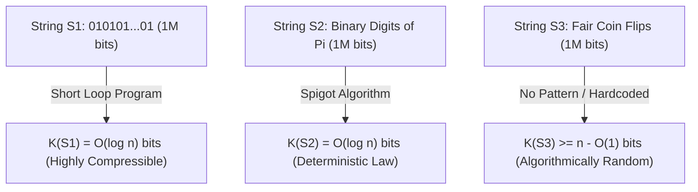
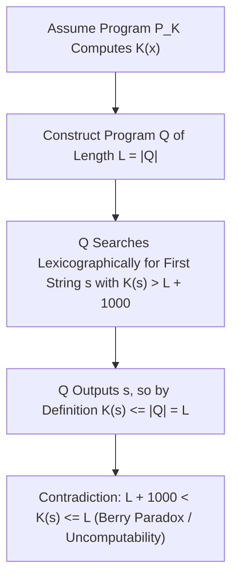

## Introdução: O Enigma das Três Strings de Um Milhão de Bits — O Ponto Cego da Teoria de Shannon

Imagine que você tem diante de si três strings binárias com exatamente $1.000.000$ de bits cada uma:
- A primeira string $S_1$ é a repetição quinhentas mil vezes de `01`: `01010101...01`.
- A segunda string $S_2$ contém o primeiro milhão de dígitos binários após a vírgula do número $\pi$: `0010010000111111...`.
- A terceira string $S_3$ é a sequência obtida ao lançar um milhão de vezes uma moeda honesta (cara = `1`, coroa = `0`).

Qual dessas três strings contém mais “informação”? Qual é a mais “complexa” e qual é verdadeiramente “aleatória”?
Se buscarmos a resposta na <strong>teoria clássica da informação de Claude Shannon (1948)</strong>, esbarraremos em uma limitação surpreendente: a entropia de Shannon $H(X) = -\sum P(x)\log_2 P(x)$ mede a incerteza média de uma <strong>distribuição de probabilidade (um conjunto ou *ensemble*)</strong>, mas nada diz sobre a complexidade intrínseca de um <strong>objeto individual específico $x$</strong>! No modelo de lançamentos de uma moeda justa, a sequência perfeitamente periódica $S_1$ e a sequência caótica $S_3$ têm exatamente a mesma probabilidade $2^{-1.000.000}$; e para a constante determinística $\pi$ ($S_2$), sua distribuição é pontual com entropia $0$, embora a frequência estatística de seus bits passe em todos os testes de pseudoaleatoriedade!

Para dar um fundamento matemático rigoroso à complexidade e à aleatoriedade de um objeto individual, Ray Solomonoff (1960), <strong>Andrey Kolmogorov (1965)</strong> e Gregory Chaitin (1966) criaram independentemente a <strong>Teoria Algorítmica da Informação (AIT)</strong>. Seu insight central é profundo: <strong>a verdadeira complexidade de um objeto não se mede pela quantidade de caracteres que ele possui, mas pelo comprimento do menor programa de computador capaz de gerá-lo!</strong>

---

## 1. Programas mínimos, complexidade simples e complexidade prefixa

### 1.1 Duas convenções que precisam ser distinguidas

Seja $\{0,1\}^*$ o conjunto das strings binárias finitas, e $|p|$ o comprimento de um programa em bits. Para uma máquina parcialmente computável $A$, a expressão $A(p)=x$ significa que a máquina para em tempo finito e produz exatamente $x$.

$$
C_A(x)=\min\{|p|:A(p)=x\}
$$

Se não houver tal programa, adotamos o valor $\infty$. Quando uma entrada auxiliar $y$ é fornecida gratuitamente, definimos:

$$
C_A(x\mid y)=\min\{|p|:A(p,y)=x\}
$$

Saber previamente o comprimento ou um dicionário não tem o mesmo custo que incluí-los na descrição.

Na <strong>complexidade prefixa $K$</strong>, o conjunto dos programas que param é livre de prefixos: nenhum deles é prefixo próprio de outro. Essa restrição permite aplicar a desigualdade de Kraft.

$$
K_U(x)=\min\{|p|:U(p)=x\},\qquad
\sum_{p\in\operatorname{dom}U}2^{-|p|}\le1
$$

Na versão condicional, o domínio de parada deve ser livre de prefixos para cada entrada auxiliar fixa $y$. Um programa autodelimitado não é simplesmente um código-fonte ao qual acrescentamos um parêntese de fechamento.

Fixaremos máquinas de referência aditivamente ótimas nas classes correspondentes a $C$ e $K$. A optimalidade será explicitada abaixo.

### 1.2 Concatenação e custos de delimitação

Ao concatenar programas simples, precisamos informar onde termina cada parte. Para uma codificação computável fixa de pares ordenados, uma cota possível é:

$$
C(x,y)\le C(x)+C(y)
+2\log_2\bigl(\min\{C(x),C(y)\}+2\bigr)+O(1)
$$

Programas autodelimitados podem ser concatenados e interpretados. Com descrições condicionais, temos:

$$
K(x,y)\le K(x)+K(y\mid x)+O(1)
\le K(x)+K(y)+O(1)
$$

As duas convenções de complexidade se relacionam por:

$$
C(x)\le K(x)+O(1),\qquad
K(x)\le C(x)+2\log_2(C(x)+2)+O(1)
$$

Aqui $O(1)$ significa uma constante independente do objeto $x$, e não uma medição de custo zero ou de poucos bits.

### 1.3 O que o teorema da invariância realmente garante

Para $C$, escolhemos uma máquina ótima na classe das máquinas simples; para $K$, na classe das máquinas livres de prefixos. Se “universal” significar apenas capacidade de simulação, é necessário exigir também a propriedade de preservar comprimentos com sobrecusto aditivo constante.

Para qualquer máquina livre de prefixos $A$, existe uma constante $c_A$, independente de $x$, tal que:

$$
K_U(x)\le K_A(x)+c_A
$$

A construção antepõe ao programa $p$ uma etiqueta autodelimitada fixa $s_A$ que identifica a máquina $A$. A máquina de referência simula $A(p)$. Se $A(p)=x$, essa simulação produz $x$ com comprimento $|p|+|s_A|$ mais um custo fixo; o programa mínimo não pode ser maior. É possível construir uma máquina ótima dessa maneira. Há um argumento correspondente para a complexidade simples dentro de sua classe.

Aplicando a desigualdade nos dois sentidos entre máquinas aditivamente ótimas, obtemos:

$$
|K_{U_1}(x)-K_{U_2}(x)|\le c_{12}
$$

A constante precisa cobrir os dois custos de simulação. Não devemos identificar apenas o tamanho de um interpretador em uma direção com uma cota para a diferença absoluta.

Uma máquina especializada pode imprimir uma string particular de um milhão de bits com uma instrução curta. O custo de descrever e simular essa máquina entra na constante. Portanto, a invariância <strong>não elimina a dependência da máquina para objetos finitos</strong>. A contribuição relativa de uma constante dividida por $n$ tende a zero quando $n\to\infty$, mas isso não revela o comprimento mínimo exato de qualquer string específica. Também não se deve identificar uma CPU real de memória finita com uma máquina matemática que admite armazenamento ilimitado.

### 1.4 Alternância, dígitos de pi e resultados de uma moeda

Identifiquemos $n$ com uma representação binária fixa. Seja $s(n)$ a string alternante de comprimento $n$, ou os primeiros $n$ bits da parte fracionária de $\pi$. Podemos calcular $s(n)$ a partir de $n$ e recuperar $n$ pelo comprimento da string. Essas transformações nos dois sentidos dão:

$$
K(s(n))=K(n)+O(1),\qquad K(s(n)\mid n)=O(1)
$$

Se a posição final é fornecida gratuitamente, basta um gerador de comprimento constante. Caso contrário, devemos descrever também $n$. Por exemplo, para $n\ge2$, uma codificação autodelimitada de inteiros fornece:

$$
K(n)\le \log_2 n+2\log_2\log_2 n+O(1)=O(\log n)
$$

Isso não significa que $K(n)=\log_2n+O(1)$ para todos os inteiros. Se $n=2^m$, uma descrição curta do expoente $m$ permite reconstruir $n$. Tampouco a notação assintótica mede um programa real como tendo exatamente vinte bits ou algumas centenas de bytes.

Para a string $S_3$ obtida de lançamentos independentes de uma moeda justa, a conclusão é probabilística. Resultados simples podem ocorrer; não há garantia de alta complexidade para cada realização. Para uma string $x$ de comprimento $n$, a reprodução literal dá:

$$
C(x)\le n+O(1),\qquad K(x\mid n)\le n+O(1)
$$

Sem fornecer o comprimento, uma descrição prefixa precisa delimitá-lo:

$$
K(x)\le n+K(n)+O(1)
$$

Não pode existir uma cota uniforme $K(x)\le |x|+O(1)$ para todas as strings: em cada comprimento $n$, a soma $\sum_{|x|=n}2^{-K(x)}$ teria a mesma cota inferior positiva, e somar sobre todos os comprimentos violaria Kraft.

---

## 2. A Essência do Acaso: Princípio da Casa dos Pombos, Incompressibilidade e Aleatoriedade de Martin-Löf

Antes de Kolmogorov, a teoria das probabilidades não conseguia explicar por que `0000000000` não é aleatório enquanto `0110100110` parece ser. A Teoria Algorítmica da Informação fornece a primeira definição rigorosa do acaso individual: <strong>aleatoriedade é incompressibilidade — a ausência total de regularidade algorítmica!</strong>

Mais surpreendente ainda, usando o elementar <strong>Princípio da Casa dos Pombos (Pigeonhole Principle)</strong>, podemos provar em duas linhas que <strong>quase todas as strings binárias são algoritmicamente aleatórias (incompressíveis)</strong>:
Existem exatamente $2^n$ strings binárias de comprimento $n$. Quantos programas binários existem com comprimento estritamente menor que $n - c$ bits? Somando o número de programas de comprimentos $0, 1, \dots, n-c-1$, obtemos no total $\sum_{i=0}^{n-c-1} 2^i = 2^{n-c} - 1$ programas possíveis. Como cada programa produz no máximo uma saída, <strong>no máximo $2^{n-c} - 1$ strings de comprimento $n$ podem ser comprimidas em mais de $c$ bits</strong> ($K(x) < n - c$)!
Em outras palavras, a fração de strings de comprimento $n$ que admitem compressão de pelo menos $c$ bits é estritamente menor que $2^{-c}$. Tomando $c = 20$, mais de $99,9999\,\%$ de todas as strings não podem ser encurtadas nem mesmo em $20$ bits por nenhum algoritmo concebível! Per Martin-Löf provou em 1966 que uma sequência binária infinita passa em todos os testes estatísticos computáveis de aleatoriedade (<strong>aleatoriedade de Martin-Löf</strong>) se e somente se todos os seus prefixos $x_{1:n}$ forem incompressíveis ($K(x_{1:n}) \ge n - O(1)$).

$$
\sum_{i=0}^{n-c-1} 2^i = 2^{n-c} - 1 \implies \mathbb{P}_{x \sim \text{Unif}(\{0,1\}^n)}\big( K(x) < n - c \big) < \frac{2^{n-c}}{2^n} = 2^{-c}
$$

$$
\Omega = \sum_{p:\, U(p)\text{ halts}} 2^{-|p|} \in (0, 1), \qquad K(\Omega_{1:n}) \ge n - O(1)
$$

---

## 3. Paradoxo de Berry, Incomputabilidade de $K(x)$, Constante $\Omega$ de Chaitin e IA Moderna

Se $K(x)$ é tão poderosa, podemos escrever um compressor definitivo que receba qualquer string $x$ e calcule exatamente $K(x)$? A resposta é um <strong>não absoluto: a função $K(x)$ é incomputável!</strong>

Essa impossibilidade decorre do clássico <strong>Paradoxo de Berry</strong> (“o menor inteiro positivo que não pode ser definido em menos de vinte palavras” — frase com quatorze palavras separadas por espaços; a ambiguidade de “definido” exige um argumento formal separado). Gregory Chaitin formalizou isso da seguinte maneira: suponha que exista uma sub-rotina `ComputeK(x)` de tamanho fixo $L$ bits que calcule $K(x)$. Construímos então um programa principal $Q$ que enumera todas as strings $s$ em ordem lexicográfica, chama `ComputeK(s)` e imprime a primeira string $s^*$ que satisfaz $K(s^*) > L + 10000$. O comprimento total do programa $Q$ é de apenas $L + O(1)$ bits, mas ele consegue imprimir $s^*$! Pela definição de $K(s^*)$ como o comprimento do menor programa que gera $s^*$, deve valer $K(s^*) \le |Q| < L + 10000$, contradizendo diretamente $K(s^*) > L + 10000$! Daqui decorre o <strong>Teorema da Incompletude de Chaitin</strong>: nenhum sistema axiomático formal de complexidade $C$ bits pode provar que uma string específica satisfaz $K(x) > C + O(1)$.

Chaitin também condensou a probabilidade de parada de uma máquina universal livre de prefixos no lendário <strong>número Ômega $\Omega = \sum_{U(p)\text{ para}} 2^{-|p|}$</strong>. Embora $\Omega \in (0,1)$ seja perfeitamente definido, ele é <strong>totalmente incomputável e algoritmicamente aleatório</strong> ($K(\Omega_{1:n}) \ge n - O(1)$): conhecer os primeiros $n$ bits de $\Omega$ equivaleria a resolver o problema da parada de Turing para todos os programas de tamanho até $n$!

Na engenharia e na inteligência artificial modernas, limites superiores computáveis de $K(x)$ impulsionam tecnologias essenciais:
1. <strong>Ponte com a Entropia de Shannon</strong>: Para processos estacionários ergódicos, a esperança $\frac{1}{n}\mathbb{E}[K(X_{1:n})]$ converge para a taxa de entropia de Shannon $H(X)$.
2. <strong>Indução Universal de Solomonoff e Comprimento Mínimo de Descrição (MDL)</strong>: A Navalha de Ockham é formalizada pela distribuição a priori universal $P_M(x) \propto 2^{-K(x)}$.
3. <strong>Distância de Compressão Normalizada (NCD)</strong>: Aproximando $K(x)$ com compressores reais (`zstd`, `lzma`, `gzip`), a fórmula $\text{NCD}(x,y) = \frac{C(xy) - \min(C(x),C(y))}{\max(C(x),C(y))}$ constrói árvores filogenéticas e agrupa malwares sem engenharia de atributos.
4. <strong>Grandes Modelos de Linguagem (LLMs): Compressão é Inteligência</strong>: Como apontaram Marcus Hutter (Hutter Prize) e Ilya Sutskever, minimizar a perda de entropia cruzada $-\sum \log_2 P_\theta(x_t \mid x_{<t})$ de um Transformer autorregressivo é, via codificação aritmética, <strong>estritamente equivalente a buscar a compressão sem perdas ótima dos dados</strong>. Para comprimir ao máximo o texto humano, o modelo é forçado a internalizar a gramática, o raciocínio lógico e um modelo causal do mundo.

| Dimensão / Conceito | Entropia de Shannon $H(X)$ | Complexidade de Kolmogorov $K(x)$ | Aproximações Modernas (MDL / LLM / NCD) |
| :--- | :--- | :--- | :--- |
| <strong>Objeto Medido</strong> | Distribuição de probabilidade (*Ensemble*) | <strong>Objeto ou string individual $x$</strong> | Arquivos reais, genomas, corpus de texto |
| <strong>Julgamento sobre $10^6$ bits de $\pi$</strong> | Constante determinística ($H=0$); frequências uniformes | $K(\pi_{1:n}) = O(\log n)$ (muito simples graças ao algoritmo) | Codificação aritmética e redes neurais |
| <strong>Computabilidade</strong> | Exatamente computável se $P(X)$ for conhecida | <strong>Estritamente incomputável</strong> (problema da parada) | Limites superiores via `zstd`/LZMA ou Transformer $P_\theta$ |
| <strong>Teoremas e Filosofia</strong> | Teorema da codificação de fonte | Teorema da invariância, incompletude de Chaitin, $\Omega$ | Navalha de Ockham, “Compressão = Predição = Inteligência” |

$$
P_M(x) = \sum_{p:\, U(p)=x} 2^{-|p|} \approx 2^{-K(x)}, \qquad \text{NCD}(x, y) = \frac{C(xy) - \min\{C(x), C(y)\}}{\max\{C(x), C(y)\}}
$$
