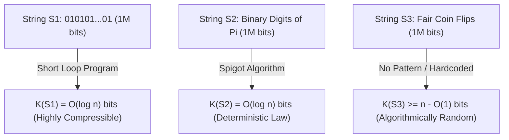
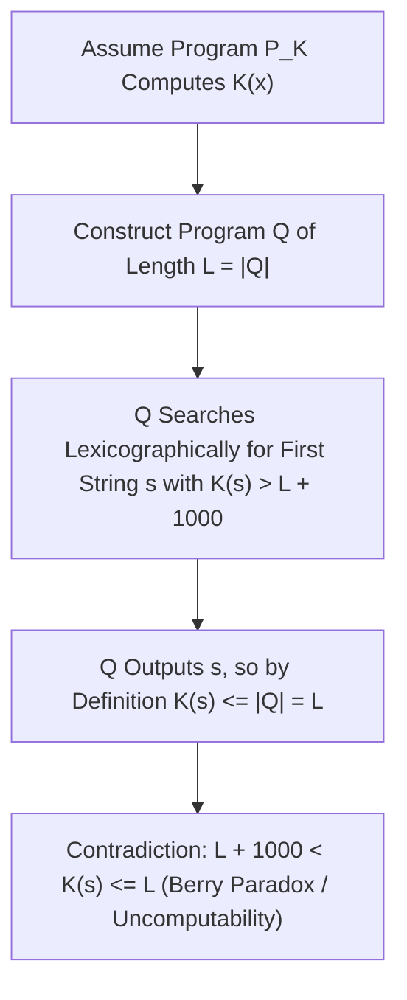

## Introdução: O Enigma das Três Strings de Um Milhão de Bits — O Ponto Cego da Teoria de Shannon

Imagine que você tem diante de si três strings binárias com exatamente $1.000.000$ de bits cada uma:
- A primeira string $S_1$ é a repetição quinhentas mil vezes de `01`: `01010101...01`.
- A segunda string $S_2$ contém o primeiro milhão de dígitos binários após a vírgula do número $\pi$: `1100100100001111110110...`.
- A terceira string $S_3$ é a sequência obtida ao lançar um milhão de vezes uma moeda honesta (cara = `1`, coroa = `0`).

Qual dessas três strings contém mais “informação”? Qual é a mais “complexa” e qual é verdadeiramente “aleatória”?
Se buscarmos a resposta na <strong>teoria clássica da informação de Claude Shannon (1948)</strong>, esbarraremos em uma limitação surpreendente: a entropia de Shannon $H(X) = -\sum P(x)\log_2 P(x)$ mede a incerteza média de uma <strong>distribuição de probabilidade (um conjunto ou *ensemble*)</strong>, mas nada diz sobre a complexidade intrínseca de um <strong>objeto individual específico $x$</strong>! No modelo de lançamentos de uma moeda justa, a sequência perfeitamente periódica $S_1$ e a sequência caótica $S_3$ têm exatamente a mesma probabilidade $2^{-1.000.000}$; e para a constante determinística $\pi$ ($S_2$), sua distribuição é pontual com entropia $0$, embora a frequência estatística de seus bits passe em todos os testes de pseudoaleatoriedade!

Para dar um fundamento matemático rigoroso à complexidade e à aleatoriedade de um objeto individual, Ray Solomonoff (1960), <strong>Andrey Kolmogorov (1965)</strong> e Gregory Chaitin (1966) criaram independentemente a <strong>Teoria Algorítmica da Informação (AIT)</strong>. Seu insight central é profundo: <strong>a verdadeira complexidade de um objeto não se mede pela quantidade de caracteres que ele possui, mas pelo comprimento do menor programa de computador capaz de gerá-lo!</strong>

---

## 1. A Complexidade de Kolmogorov $K(x)$ e o Teorema da Invariância

Dada uma máquina de Turing universal $U$ (ou qualquer linguagem de programação Turing-completa como C ou Python), a <strong>complexidade de Kolmogorov</strong> $K_U(x)$ de uma string binária $x \in \{0,1\}^*$ é definida como o comprimento em bits $|p|$ do menor programa $p$ que, executado em $U$, imprime $x$ e para. Para satisfazer a desigualdade de Kraft $\sum 2^{-|p|} \le 1$, a teoria moderna adota a <strong>complexidade livre de prefixos (complexidade de Levin-Chaitin)</strong> $K(x)$, na qual nenhum programa válido é prefixo de outro.

Olhando para as nossas três strings de um milhão de bits através da lente de $K(x)$, o mistério se desfaz imediatamente:
- Para $S_1$, basta o minúsculo programa `print("01" * 500000)`. Como só precisamos codificar em binário o contador de loop $n/2$, temos $K(S_1) = O(\log_2 n) pprox 20$ bits: é uma string <strong>algoritmicamente trivial</strong>.
- Para $S_2$ (os primeiros $n$ bits de $\pi$), embora pareça ruído aleatório, um pequeno programa de poucas centenas de bytes implementando uma fórmula de Machin ou o algoritmo BBP calcula $S_2$ com exatidão. Logo, também vale $K(S_2) = O(\log_2 n)$! Isso revela uma verdade central da filosofia da ciência: <strong>uma lei da natureza nada mais é do que uma compressão algorítmica extrema de dados empíricos.</strong>
- Por outro lado, para a string $S_3$ gerada por lançamentos reais de moeda, não há nenhuma regra oculta capaz de resumi-la. O menor programa capaz de produzir $S_3$ precisa incorporar literalmente o milhão de bits (`print("1011001...")`), resultando em $K(S_3) pprox n + O(1) pprox 1.000.000$ de bits!

Mas $K_U(x)$ não dependeria arbitrariamente da linguagem de programação $U$ escolhida? O <strong>Teorema da Invariância de Kolmogorov</strong> prova que não: para quaisquer duas máquinas universais $U_1$ e $U_2$, existe uma constante $c_{12}$ que depende apenas de $U_1$ e $U_2$ (sendo <strong>totalmente independente de $x$</strong>) tal que $|K_{U_1}(x) - K_{U_2}(x)| \le c_{12}$. A prova é cristalina: $c_{12}$ é simplesmente o tamanho fixo em bits de um <strong>interpretador (ou compilador cruzado)</strong> escrito em $U_1$ que simula $U_2$! Quando o tamanho dos dados $n 	o \infty$, esse custo fixo torna-se desprezível.

$$
H(X) = -\sum_{x \in \mathcal{X}} P(X = x) \log_2 P(X = x)
$$

$$
K_U(x) = \min_{p \in \{0,1\}^*} \Big\{ |p| \;\Big|\; U(p) = x \Big\}, \qquad \Big| K_{U_1}(x) - K_{U_2}(x) \Big| \le c_{12}
$$

---

## 2. A Essência do Acaso: Princípio da Casa dos Pombos, Incompressibilidade e Aleatoriedade de Martin-Löf

Antes de Kolmogorov, a teoria das probabilidades não conseguia explicar por que `0000000000` não é aleatório enquanto `0110100110` parece ser. A Teoria Algorítmica da Informação fornece a primeira definição rigorosa do acaso individual: <strong>aleatoriedade é incompressibilidade — a ausência total de regularidade algorítmica!</strong>

Mais surpreendente ainda, usando o elementar <strong>Princípio da Casa dos Pombos (Pigeonhole Principle)</strong>, podemos provar em duas linhas que <strong>quase todas as strings binárias são algoritmicamente aleatórias (incompressíveis)</strong>:
Existem exatamente $2^n$ strings binárias de comprimento $n$. Quantos programas binários existem com comprimento estritamente menor que $n - c$ bits? Somando o número de programas de comprimentos $0, 1, \dots, n-c-1$, obtemos no total $\sum_{i=0}^{n-c-1} 2^i = 2^{n-c} - 1$ programas possíveis. Como cada programa produz no máximo uma saída, <strong>no máximo $2^{n-c} - 1$ strings de comprimento $n$ podem ser comprimidas em mais de $c$ bits</strong> ($K(x) < n - c$)!
Em outras palavras, a fração de strings de comprimento $n$ que admitem compressão de pelo menos $c$ bits é estritamente menor que $2^{-c}$. Tomando $c = 20$, mais de $99,9999\,\%$ de todas as strings não podem ser encurtadas nem mesmo em $20$ bits por nenhum algoritmo concebível! Per Martin-Löf provou em 1966 que uma sequência binária infinita passa em todos os testes estatísticos computáveis de aleatoriedade (<strong>aleatoriedade de Martin-Löf</strong>) se e somente se todos os seus prefixos $x_{1:n}$ forem incompressíveis ($K(x_{1:n}) \ge n - O(1)$).

$$
\sum_{i=0}^{n-c-1} 2^i = 2^{n-c} - 1 \implies \mathbb{P}_{x \sim \text{Unif}(\{0,1\}^n)}\big( K(x) < n - c \big) < \frac{2^{n-c}}{2^n} = 2^{-c}
$$

$$
\Omega = \sum_{p:\, U(p)\text{ halts}} 2^{-|p|} \in (0, 1), \qquad K(\Omega_{1:n}) \ge n - O(1)
$$

---

## 3. Paradoxo de Berry, Incomputabilidade de $K(x)$, Constante $\Omega$ de Chaitin e IA Moderna

Se $K(x)$ é tão poderosa, podemos escrever um compressor definitivo que receba qualquer string $x$ e calcule exatamente $K(x)$? A resposta é um <strong>não absoluto: a função $K(x)$ é incomputável!</strong>

Essa impossibilidade decorre do clássico <strong>Paradoxo de Berry</strong> (“o menor inteiro positivo que não pode ser definido em menos de vinte palavras” — frase que o define em quinze palavras!). Gregory Chaitin formalizou isso da seguinte maneira: suponha que exista uma sub-rotina `ComputeK(x)` de tamanho fixo $L$ bits que calcule $K(x)$. Construímos então um programa principal $Q$ que enumera todas as strings $s$ em ordem lexicográfica, chama `ComputeK(s)` e imprime a primeira string $s^*$ que satisfaz $K(s^*) > L + 10000$. O comprimento total do programa $Q$ é de apenas $L + O(1)$ bits, mas ele consegue imprimir $s^*$! Pela definição de $K(s^*)$ como o comprimento do menor programa que gera $s^*$, deve valer $K(s^*) \le |Q| < L + 10000$, contradizendo diretamente $K(s^*) > L + 10000$! Daqui decorre o <strong>Teorema da Incompletude de Chaitin</strong>: nenhum sistema axiomático formal de complexidade $C$ bits pode provar que uma string específica satisfaz $K(x) > C + O(1)$.

Chaitin também condensou a probabilidade de parada de uma máquina universal livre de prefixos no lendário <strong>número Ômega $\Omega = \sum_{U(p)	ext{ para}} 2^{-|p|}$</strong>. Embora $\Omega \in (0,1)$ seja perfeitamente definido, ele é <strong>totalmente incomputável e algoritmicamente aleatório</strong> ($K(\Omega_{1:n}) \ge n - O(1)$): conhecer os primeiros $n$ bits de $\Omega$ equivaleria a resolver o problema da parada de Turing para todos os programas de tamanho até $n$!

Na engenharia e na inteligência artificial modernas, limites superiores computáveis de $K(x)$ impulsionam tecnologias essenciais:
1. <strong>Ponte com a Entropia de Shannon</strong>: Para processos estacionários ergódicos, a esperança $rac{1}{n}\mathbb{E}[K(X_{1:n})]$ converge para a taxa de entropia de Shannon $H(X)$.
2. <strong>Indução Universal de Solomonoff e Comprimento Mínimo de Descrição (MDL)</strong>: A Navalha de Ockham é formalizada pela distribuição a priori universal $P_M(x) \propto 2^{-K(x)}$.
3. <strong>Distância de Compressão Normalizada (NCD)</strong>: Aproximando $K(x)$ com compressores reais (`zstd`, `lzma`, `gzip`), a fórmula $	ext{NCD}(x,y) = rac{C(xy) - \min(C(x),C(y))}{\max(C(x),C(y))}$ constrói árvores filogenéticas e agrupa malwares sem engenharia de atributos.
4. <strong>Grandes Modelos de Linguagem (LLMs): Compressão é Inteligência</strong>: Como apontaram Marcus Hutter (Hutter Prize) e Ilya Sutskever, minimizar a perda de entropia cruzada $-\sum \log_2 P_	heta(x_t \mid x_{<t})$ de um Transformer autorregressivo é, via codificação aritmética, <strong>estritamente equivalente a buscar a compressão sem perdas ótima dos dados</strong>. Para comprimir ao máximo o texto humano, o modelo é forçado a internalizar a gramática, o raciocínio lógico e um modelo causal do mundo.

| Dimensão / Conceito | Entropia de Shannon $H(X)$ | Complexidade de Kolmogorov $K(x)$ | Aproximações Modernas (MDL / LLM / NCD) |
| :--- | :--- | :--- | :--- |
| <strong>Objeto Medido</strong> | Distribuição de probabilidade (*Ensemble*) | <strong>Objeto ou string individual $x$</strong> | Arquivos reais, genomas, corpus de texto |
| <strong>Julgamento sobre $10^6$ bits de $\pi$</strong> | Constante determinística ($H=0$); frequências uniformes | $K(\pi_{1:n}) = O(\log n)$ (muito simples graças ao algoritmo) | Codificação aritmética e redes neurais |
| <strong>Computabilidade</strong> | Exatamente computável se $P(X)$ for conhecida | <strong>Estritamente incomputável</strong> (problema da parada) | Limites superiores via `zstd`/LZMA ou Transformer $P_	heta$ |
| <strong>Teoremas e Filosofia</strong> | Teorema da codificação de fonte | Teorema da invariância, incompletude de Chaitin, $\Omega$ | Navalha de Ockham, “Compressão = Predição = Inteligência” |

$$
P_M(x) = \sum_{p:\, U(p)=x} 2^{-|p|} \approx 2^{-K(x)}, \qquad \text{NCD}(x, y) = \frac{C(xy) - \min\{C(x), C(y)\}}{\max\{C(x), C(y)\}}
$$
