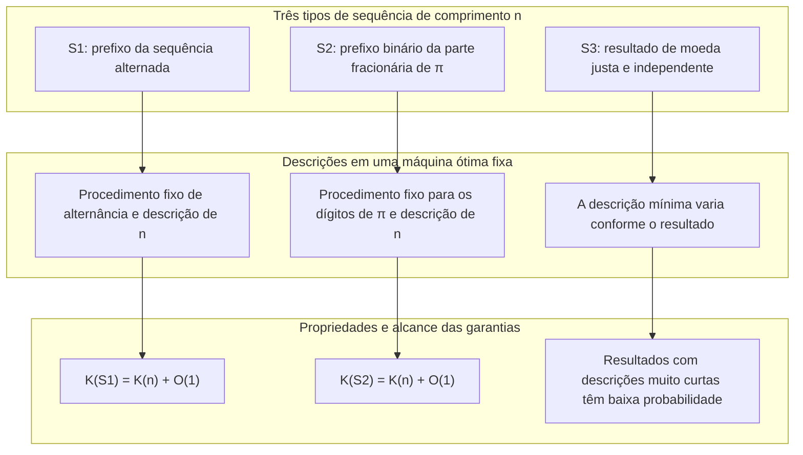
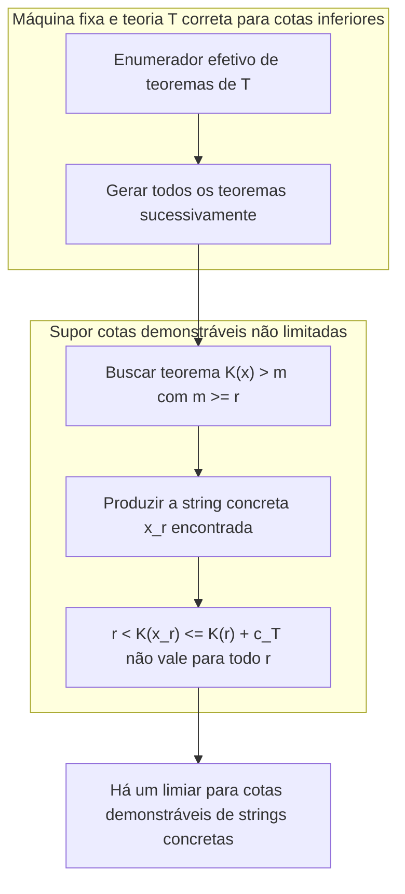

## 1. Três sequências de um milhão de bits

Considere três sequências binárias de comprimento $n=1{,}000{,}000$:

1. $S_1$: a repetição de `01` quinhentas mil vezes.
2. $S_2$: o primeiro milhão de bits da expansão binária da <strong>parte fracionária</strong> de $\pi$.
3. $S_3$: um resultado do modelo de um milhão de lançamentos independentes de uma moeda justa.

Armazenadas com os bits compactados, todas ocupam 125.000 bytes, ou 125 kB. Se cada `0` e `1` for salvo como um caractere ASCII ou UTF-8, serão um milhão de bytes. Cabeçalhos e estruturas de gerenciamento exigem espaço adicional.

A representação binária de $\pi$ é $11.0010010000111111\ldots{}_2$. Portanto, $S_2$ começa com `0010010000111111...`, excluindo a parte inteira. Esses exemplos são ilustrativos; não representam um experimento físico de um milhão de lançamentos realizado para este artigo.

Uma instrução de repetição gera $S_1$, e algoritmos de cálculo de dígitos geram $S_2$. Já $S_3$ não precisa ser complexa: uma moeda pode produzir, por acaso, apenas zeros. A afirmação correta é probabilística: <strong>fixado o modelo de computação, poucos resultados admitem descrições muito mais curtas que seu comprimento</strong>.

No modelo de moeda justa e independente, qualquer sequência específica de comprimento $n$ tem a mesma probabilidade, inclusive uma sequência alternada ou um prefixo de $\pi$:

$$
P(X=x)=2^{-n},\qquad x\in\{0,1\}^n
$$

Como distinguir a existência de regras curtas de geração entre resultados igualmente prováveis? A <strong>teoria algorítmica da informação (AIT)</strong>, desenvolvida por Solomonoff, Kolmogorov, Chaitin e outros desde a década de 1960, usa o comprimento do menor programa que produz a sequência e para.

---

## 2. Informação de Shannon e sequências individuais

### 2.1 Autoinformação, entropia e codificação

Para uma distribuição discreta $P$, a autoinformação de um resultado com $P(x)>0$ e sua média, a entropia, são quantidades distintas. Usaremos logaritmos de base 2 e unidades em bits.

$$
I_P(x)=-\log_2P(x),\qquad
H(P)=-\sum_xP(x)\log_2P(x)
$$

Na soma, convencionamos $0\log_2 0=0$. A autoinformação de um resultado de probabilidade zero é infinita.

Para codificar um símbolo de um alfabeto finito com um código binário prefixo, o comprimento médio ótimo satisfaz:

$$
H(P)\le L_{\mathrm{opt}}<H(P)+1
$$

Isso não significa que cada palavra-código tenha comprimento igual à entropia. Ao agrupar $r$ símbolos independentes e identicamente distribuídos, a margem de arredondamento por símbolo diminui:

$$
H(P)\le \frac{L_{\mathrm{opt},r}}{r}<H(P)+\frac1r
$$

Fontes com dependência exigem considerar distribuições de blocos ou a taxa de entropia. Códigos de Huffman e codificação aritmética também precisam ser entendidos em relação ao modelo e à distinção entre valores individuais e médios.

### 2.2 Escolha do modelo e frequências empíricas

O valor $-\log_2P(x)$ depende do modelo $P$, não apenas de $x$. Sob a distribuição de uma moeda justa, até a sequência alternada tem um milhão de bits de autoinformação. Uma distribuição pontual que produz exclusivamente essa sequência tem entropia zero. Porém, <strong>o custo de comunicar o próprio modelo não se torna zero</strong>.

Se observarmos apenas frequências de bits individuais, a repetição de `01` apresenta metade de zeros e metade de uns. Sua entropia empírica de ordem zero é:

$$
\widehat H_0((01)^{n/2})
=-\tfrac12\log_2\tfrac12-\tfrac12\log_2\tfrac12=1
$$

Um modelo que prevê o próximo bit a partir do anterior consegue captar a regularidade. Entre os blocos sobrepostos de comprimento $k$ da sequência alternada, há no máximo dois tipos. Sua entropia empírica é, portanto, no máximo 1 bit por bloco, ou $1/k$ por bit. Não se deve confundir a entropia do bloco inteiro com o valor por bit.

A normalidade de $\pi$, propriedade segundo a qual todos os blocos de cada comprimento fixo aparecem com frequências iguais no limite, não foi demonstrada. Testes finitos de frequência ou uma aparência irregular não a provam. Mesmo a normalidade seria compatível com uma sequência computável. Se o modelo permite calcular os dígitos, a previsão e a codificação baseadas em probabilidades podem aproveitar essa regra.

AIT não invalida a teoria de Shannon. <strong>O comprimento de código relativo a um modelo probabilístico e o comprimento de descrição de um objeto em uma máquina fixa respondem a perguntas diferentes.</strong>

| Aspecto | Informação de Shannon | Comprimento algorítmico de descrição |
| :--- | :--- | :--- |
| Objeto | Distribuição e resultados sob esse modelo | Sequência finita produzida por uma máquina fixa |
| Referência | Modelo probabilístico e regras de codificação | Máquina, codificação dos programas e entrada auxiliar |
| Quantidades | $I_P(x)$, $H(P)$ e taxa de entropia | Complexidade simples $C(x)$ e prefixa $K(x)$ |
| Limitações | Descrever o modelo tem um custo separado | Constantes dependentes da máquina e incomputabilidade |
| Tratamento de $\pi$ | Depende do modelo escolhido | É possível descrever a regra dos dígitos e onde parar |

---

## 3. Programas mínimos, complexidade simples e complexidade prefixa

### 3.1 Duas convenções que precisam ser distinguidas

Seja $\{0,1\}^*$ o conjunto das strings binárias finitas, e $|p|$ o comprimento de um programa em bits. Para uma máquina parcialmente computável $A$, a expressão $A(p)=x$ significa que a máquina para em tempo finito e produz exatamente $x$.

$$
C_A(x)=\min\{|p|:A(p)=x\}
$$

Se não houver tal programa, adotamos o valor $\infty$. Quando uma entrada auxiliar $y$ é fornecida gratuitamente, definimos:

$$
C_A(x\mid y)=\min\{|p|:A(p,y)=x\}
$$

Saber previamente o comprimento ou um dicionário não tem o mesmo custo que incluí-los na descrição.

Na <strong>complexidade prefixa $K$</strong>, o conjunto dos programas que param é livre de prefixos: nenhum deles é prefixo próprio de outro. Essa restrição permite aplicar a desigualdade de Kraft.

$$
K_U(x)=\min\{|p|:U(p)=x\},\qquad
\sum_{p\in\operatorname{dom}U}2^{-|p|}\le1
$$

Na versão condicional, o domínio de parada deve ser livre de prefixos para cada entrada auxiliar fixa $y$. Um programa autodelimitado não é simplesmente um código-fonte ao qual acrescentamos um parêntese de fechamento.

Fixaremos máquinas de referência aditivamente ótimas nas classes correspondentes a $C$ e $K$. A optimalidade será explicitada abaixo.

### 3.2 Concatenação e custos de delimitação

Ao concatenar programas simples, precisamos informar onde termina cada parte. Para uma codificação computável fixa de pares ordenados, uma cota possível é:

$$
C(x,y)\le C(x)+C(y)
+2\log_2\bigl(\min\{C(x),C(y)\}+2\bigr)+O(1)
$$

Programas autodelimitados podem ser concatenados e interpretados. Com descrições condicionais, temos:

$$
K(x,y)\le K(x)+K(y\mid x)+O(1)
\le K(x)+K(y)+O(1)
$$

As duas convenções de complexidade se relacionam por:

$$
C(x)\le K(x)+O(1),\qquad
K(x)\le C(x)+2\log_2(C(x)+2)+O(1)
$$

Aqui $O(1)$ significa uma constante independente do objeto $x$, e não uma medição de custo zero ou de poucos bits.

### 3.3 O que o teorema da invariância realmente garante

Para $C$, escolhemos uma máquina ótima na classe das máquinas simples; para $K$, na classe das máquinas livres de prefixos. Se “universal” significar apenas capacidade de simulação, é necessário exigir também a propriedade de preservar comprimentos com sobrecusto aditivo constante.

Para qualquer máquina livre de prefixos $A$, existe uma constante $c_A$, independente de $x$, tal que:

$$
K_U(x)\le K_A(x)+c_A
$$

A construção antepõe ao programa $p$ uma etiqueta autodelimitada fixa $s_A$ que identifica a máquina $A$. A máquina de referência simula $A(p)$. Se $A(p)=x$, essa simulação produz $x$ com comprimento $|p|+|s_A|$ mais um custo fixo; o programa mínimo não pode ser maior. É possível construir uma máquina ótima dessa maneira. Há um argumento correspondente para a complexidade simples dentro de sua classe.

Aplicando a desigualdade nos dois sentidos entre máquinas aditivamente ótimas, obtemos:

$$
|K_{U_1}(x)-K_{U_2}(x)|\le c_{12}
$$

A constante precisa cobrir os dois custos de simulação. Não devemos identificar apenas o tamanho de um interpretador em uma direção com uma cota para a diferença absoluta.

Uma máquina especializada pode imprimir uma string particular de um milhão de bits com uma instrução curta. O custo de descrever e simular essa máquina entra na constante. Portanto, a invariância <strong>não elimina a dependência da máquina para objetos finitos</strong>. A contribuição relativa de uma constante dividida por $n$ tende a zero quando $n\to\infty$, mas isso não revela o comprimento mínimo exato de qualquer string específica. Também não se deve identificar uma CPU real de memória finita com uma máquina matemática que admite armazenamento ilimitado.

### 3.4 Alternância, dígitos de pi e resultados de uma moeda

Identifiquemos $n$ com uma representação binária fixa. Seja $s(n)$ a string alternante de comprimento $n$, ou os primeiros $n$ bits da parte fracionária de $\pi$. Podemos calcular $s(n)$ a partir de $n$ e recuperar $n$ pelo comprimento da string. Essas transformações nos dois sentidos dão:

$$
K(s(n))=K(n)+O(1),\qquad K(s(n)\mid n)=O(1)
$$

Se a posição final é fornecida gratuitamente, basta um gerador de comprimento constante. Caso contrário, devemos descrever também $n$. Por exemplo, para $n\ge2$, uma codificação autodelimitada de inteiros fornece:

$$
K(n)\le \log_2 n+2\log_2\log_2 n+O(1)=O(\log n)
$$

Isso não significa que $K(n)=\log_2n+O(1)$ para todos os inteiros. Se $n=2^m$, uma descrição curta do expoente $m$ permite reconstruir $n$. Tampouco a notação assintótica mede um programa real como tendo exatamente vinte bits ou algumas centenas de bytes.

Para a string $S_3$ obtida de lançamentos independentes de uma moeda justa, a conclusão é probabilística. Resultados simples podem ocorrer; não há garantia de alta complexidade para cada realização. Para uma string $x$ de comprimento $n$, a reprodução literal dá:

$$
C(x)\le n+O(1),\qquad K(x\mid n)\le n+O(1)
$$

Sem fornecer o comprimento, uma descrição prefixa precisa delimitá-lo:

$$
K(x)\le n+K(n)+O(1)
$$

Não pode existir uma cota uniforme $K(x)\le |x|+O(1)$ para todas as strings: em cada comprimento $n$, a soma $\sum_{|x|=n}2^{-K(x)}$ teria a mesma cota inferior positiva, e somar sobre todos os comprimentos violaria Kraft.

---



## 4. Incompressibilidade finita e aleatoriedade de sequências infinitas

### 4.1 O argumento exato de contagem

Sejam inteiros $n\ge0$ e $0\le c\le n$. Existem $2^n$ strings binárias de comprimento $n$. O número de programas binários de comprimento estritamente menor que $n-c$ é:

$$
\sum_{j=0}^{n-c-1}2^j=2^{n-c}-1
$$

Quando $c=n$, a soma vazia vale zero. Cada programa que para produz no máximo uma string. Assim, a quantidade de strings de comprimento $n$ com $C(x)<n-c$ não pode ultrapassar essa contagem, e portanto:

$$
\#\{x\in\{0,1\}^n:C(x)\ge n-c\}
\ge2^n-2^{n-c}+1
$$

Programas que não param ou que repetem a mesma saída podem tornar o número de saídas distintas ainda menor. Se $c>n$, então $n-c<0$ e todas as strings satisfazem trivialmente $C(x)\ge n-c$. Não se deve estender a fórmula da soma geométrica diretamente a esse domínio.

Sob a distribuição uniforme das strings de comprimento $n$, correspondente a lançamentos independentes de uma moeda justa:

$$
P\{C(X)<n-c\}
\le\frac{2^{n-c}-1}{2^n}<2^{-c}
$$

Para $c=0$, existe pelo menos uma string de cada comprimento com $C(x)\ge n$. Para $c=1$, mais da metade das strings não admite redução de <strong>mais de</strong> um bit. Para $c=10$ e $c=20$, as cotas inferiores $1-2^{-c}$ para a proporção que não admite economia superior a 10 ou 20 bits são aproximadamente 99,902% e 99,999905%. Isso não exclui uma economia de exatamente $c$ bits.

O mesmo argumento funciona para $K(x\mid n)$ quando a condição $n$ é fixa. Portanto, os resultados da moeda exigem, com alta probabilidade, descrições próximas do próprio comprimento. Não há garantia para cada realização individual.

Um compressor reversível que encurtasse todos os arquivos contrariaria essa contagem. Compressores reais exploram regularidades de determinados dados. A proporção obtida sob a distribuição uniforme de todas as strings não é automaticamente a frequência de dados estruturados na natureza ou na produção humana.

### 4.2 Testes de Martin-Löf

A impossibilidade de encurtar uma string finita por uma quantidade especificada e a aleatoriedade de uma sequência infinita são definições distintas. No espaço das sequências binárias infinitas, usamos a medida $\mu$ da moeda justa. O conjunto cilíndrico $[w]$ contém as sequências que começam pela string finita $w$ e tem medida $2^{-|w|}$.

Um <strong>teste de Martin-Löf</strong> é uma sequência de conjuntos abertos $V_j$, enumeráveis computavelmente de maneira uniforme como uniões de cilindros de prefixos finitos, que satisfaz:

$$
\mu(V_j)\le2^{-j},\qquad j=1,2,\ldots
$$

Se $\omega\in\bigcap_jV_j$, a sequência falha nesse teste. Ela é aleatória no sentido de Martin-Löf quando não pertence ao conjunto de falha de nenhum teste desse tipo. Isso não proíbe que algum padrão finito raro apareça. Há uma quantidade enumerável de testes efetivos, cada conjunto de falha tem medida zero, e o conjunto das sequências que passam em todos os testes tem medida um.

O teorema de Levin–Schnorr caracteriza essa propriedade usando a complexidade <strong>prefixa</strong> ótima:

$$
\omega\text{ é aleatória no sentido de Martin-Löf}
\iff
\exists c\ \forall n\quad K(\omega_{1:n})\ge n-c
$$

É essencial que <strong>a mesma constante $c$</strong> funcione para todos os comprimentos $n$. Não podemos simplesmente trocar $K$ pela complexidade simples $C$ nessa equivalência.

As regras de seleção de von Mises e Church fazem parte dessa história, mas mudar as condições de efetividade dos testes ou das estratégias de aposta produz noções diferentes. Em particular, a aleatoriedade computável, definida pela impossibilidade de uma martingala computável obter capital ilimitado, é mais fraca que a aleatoriedade de Martin-Löf.

A sequência computável dos dígitos de $\pi$ não é aleatória no sentido de Martin-Löf. Normalidade e aleatoriedade algorítmica também não são sinônimos: uma expansão pode ser computável e normal, e testes de frequência finitos não demonstram normalidade.

---

## 5. Incomputabilidade, limites da demonstração e probabilidade de parada

### 5.1 Aproximação por cima sem critério geral de conclusão

Podemos executar os programas candidatos em paralelo intercalado, dando alguns passos a cada um. O menor comprimento encontrado entre os programas que produzem $x$ fornece uma aproximação superior:

$$
K_t(x)\searrow K(x)\qquad(t\to\infty)
$$

Começamos com uma cota finita computável obtida por reprodução literal. Como as cotas são inteiras, para cada $x$ fixo elas acabam atingindo o valor verdadeiro e permanecem nele. Porém, não há um procedimento geral que reconheça esse momento para todas as entradas. Um programa mais curto que ainda não parou pode produzir $x$ posteriormente.

### 5.2 Um argumento do tipo Berry

A expressão “o menor inteiro positivo que não pode ser definido em menos de vinte palavras” tem quatorze palavras separadas por espaços. Como “definido” é ambíguo em linguagem natural, a frase não constitui por si só uma demonstração formal. Transferimos a ideia para procedimentos computáveis.

Suponha que um procedimento `ComputeK` retorne o verdadeiro $K(x)$ e pare para toda string $x$. O seguinte <strong>pseudocódigo</strong> usa essa hipótese impossível; não é um calculador implementado de complexidade.

```text
Berry(m):
    Enumerar todas as strings binárias x por comprimento 0,1,2,... e, no mesmo comprimento, em ordem lexicográfica:
        if ComputeK(x) >= m:
            Produzir x e parar
```

A ordem usada é shortlex: primeiro o comprimento, depois a ordem lexicográfica. A ordem lexicográfica comum, sozinha, não fornece a enumeração de todas as strings finitas necessária aqui.

A contagem mostra que a complexidade não é limitada. Sob a hipótese, a busca termina para cada $m$ e produz $x_m$ com $K(x_m)\ge m$. Entretanto, bastam um programa fixo e uma descrição autodelimitada de $m$ para gerar essa saída.

$$
m\le K(x_m)\le K(m)+c
\le \log_2m+2\log_2\log_2m+c'
$$

A última cota vale para $m\ge2$. Para constantes fixas e $m$ suficientemente grande, surge uma contradição; portanto, `ComputeK` não existe. Não é necessário afirmar, sem medir os custos da máquina, que uma margem fixa de 10.000 bits sempre bastaria.

### 5.3 Incompletude de Chaitin

Fixemos a máquina de referência e uma teoria $T$ efetivamente axiomatizável que possa expressar cotas de complexidade de strings concretas. Supomos a <strong>correção semântica</strong> das cotas inferiores que ela demonstra: essas afirmações são verdadeiras.

Existe então um limiar $b_T$ tal que $T$ não pode demonstrar “$K(x)>b_T$” para nenhuma string concreta $x$.

O núcleo do argumento é supor que as cotas numéricas demonstráveis não sejam limitadas. Para qualquer entrada $r$, poderíamos enumerar todos os teoremas e encontrar um da forma “$K(x)>m$”, com um número concreto $m\ge r$.

```text
SearchProof(r):
    Enumerar efetivamente todos os teoremas de T:
        if um teorema afirma "K(x) > m" para uma string concreta x e um inteiro m, com m >= r:
            Produzir x e parar
```

A correção garante que a saída $x_r$ tem complexidade maior que $r$. Mas o código fixo do procedimento já pode incluir o enumerador de teoremas de $T$, de modo que:

$$
r<K(x_r)\le K(r)+c_T=O(\log r)+c_T
$$

Isso é impossível para $r$ suficientemente grande. Logo, as cotas numéricas demonstráveis são limitadas.



O limiar depende da máquina, da teoria e da representação. Não estamos medindo um limite universal de ZFC em 20.000 ou 50.000 bits. Quando o comprimento $n$ excede suficientemente o limiar, a contagem mostra que muitas strings realmente têm complexidade superior a ele; ainda assim, demonstrar essa cota para uma string específica pode estar além da teoria.

O resultado conecta a incompletude de Gödel à descrição algorítmica. Não é uma lei geral de “conservação da informação” que proíba deduzir teoremas longos ou numerosos de axiomas curtos. Ao acrescentar axiomas, obtemos outra teoria, com outra constante.

### 5.4 A probabilidade de parada depende da máquina

Para uma máquina ótima livre de prefixos $U$, a probabilidade de uma sequência infinita de bits independentes e equiprováveis começar por um programa que para é:

$$
\Omega_U=\sum_{p\in\operatorname{dom}U}2^{-|p|}
$$

Os cilindros dos programas que param são disjuntos, justificando a interpretação probabilística. Kraft dá $\Omega_U\le1$. Com a optimalidade e as demais condições indicadas, $\Omega_U$ é também um real incomputável, aleatório no sentido de Martin-Löf, e $0<\Omega_U<1$. Todas essas propriedades não valem para uma máquina arbitrária apenas por ela ser livre de prefixos.

Enumerar programas que param produz somas parciais crescentes por baixo. Assim, $\Omega_U$ é um <strong>real computavelmente enumerável pela esquerda (left-c.e.)</strong>. Não existe uma função computável que informe quando a aproximação garante cada precisão solicitada.

Suponha conhecidos exatamente os primeiros $N$ bits fracionários e seja $a$ o extremo inferior binário correspondente. Como $\Omega_U$ não tem expansão binária terminante:

$$
a=\frac{\lfloor2^N\Omega_U\rfloor}{2^N},
\qquad a<\Omega_U<a+2^{-N}
$$

Executamos os programas de forma intercalada até a soma parcial dos pesos de parada $q_s$ <strong>ultrapassar</strong> $a$. Nesse momento:

$$
0\le\Omega_U-q_s<2^{-N}
$$

Um programa ainda não enumerado de comprimento no máximo $N$, se parasse mais tarde, acrescentaria pelo menos $2^{-N}$, contradizendo a cota da massa restante. Portanto, esses bits permitem decidir a parada de todas as entradas de comprimento no máximo $N$ da <strong>mesma máquina</strong>.

Isso não significa que alguns milhares de bits fixos decidam infinitas proposições matemáticas arbitrárias. Ao codificar buscas de contraexemplos como problemas de parada, importam a máquina, o comprimento do programa e a forma lógica da proposição. Calcular alguns bits em condições especiais também não fornece um algoritmo para toda a expansão.

---

## 6. Entropia, MDL, NCD e inteligência artificial

### 6.1 Comprimento médio de descrição e taxa de entropia

Seja $P$ uma distribuição discreta computável sobre strings finitas, especificada por um procedimento finito $d_P$. Quando $d_P$ é compartilhado como entrada auxiliar gratuita e $H(P)<\infty$, temos:

$$
H(P)\le\mathbb E_{X\sim P}[K(X\mid d_P)]\le H(P)+c
$$

O suporte pode ser finito ou enumerável, e as probabilidades devem ser calculáveis uniformemente até a precisão solicitada. A constante $c$ inclui o custo de um decodificador fixo; não se afirma igualdade numérica exata.

A cota inferior resulta de aplicar Kraft às descrições prefixas mínimas sob a condição fixa $d_P$ e usar o argumento do comprimento médio de código. Para a superior, construímos um código prefixo segundo as probabilidades compartilhadas e o decodificamos com um procedimento fixo. Sem compartilhar a distribuição, seu custo de descrição também deve ser contado. Uma distribuição arbitrária ser “conhecida” não garante que sua entropia possa sempre ser calculada exatamente em tempo finito.

Um resultado distinto, do tipo Brudno, vale para <strong>processos estacionários ergódicos sobre um alfabeto finito</strong>. Se $h$ é a taxa de entropia em bits por símbolo, então, para quase toda sequência de amostras:

$$
\lim_{n\to\infty}\frac{K(X_{1:n})}{n}=h
$$

Também $\mathbb E[K(X_{1:n})]/n\to h$. Uma codificação literal das sequências de $n$ símbolos fornece uma cota linear uniforme, permitindo passar da convergência quase certa à convergência das médias. A diferença de ordem logarítmica entre complexidade simples e prefixa desaparece ao dividir por $n$. Não é necessário impor a esse teorema de taxa a computabilidade da medida exigida na desigualdade condicional anterior.

### 6.2 Semimedida universal discreta e previsão de Solomonoff

Para uma máquina prefixa ótima que produz uma saída finita e para, definimos a probabilidade de produzir exatamente $x$ e parar:

$$
m_U(x)=\sum_{p:U(p)=x}2^{-|p|}
$$

A massa total é no máximo um, portanto trata-se de uma <strong>semimedida</strong>, semicomputável inferiormente. O teorema da codificação relaciona essa semimedida universal discreta à complexidade prefixa:

$$
-\log_2m_U(x)=K_U(x)+O(1),
\qquad m_U(x)=\Theta(2^{-K_U(x)})
$$

A previsão sequencial de Solomonoff, por outro lado, usa uma máquina monótona e uma semimedida $M(x)$ para a probabilidade de a saída <strong>começar por $x$</strong>. A máquina não precisa parar nesse ponto, e vale $M(x)\ge M(x0)+M(x1)$. Não podemos identificar o objeto discreto $m_U$ com o objeto sequencial $M$ e transferir sem condições o mesmo teorema da codificação.

A preferência por descrições curtas está relacionada à navalha de Ockham. Isso não significa que uma hipótese curta tenha necessariamente maior probabilidade depois de observar os dados: a verossimilhança também importa.

### 6.3 Seleção bayesiana e comprimento mínimo de descrição

Atribuímos a cada modelo $H$ um comprimento efetivo de descrição prefixa $L(H)$ e uma probabilidade a priori proporcional ao peso de seu código. A fórmula de Bayes dá:

$$
-\log_2P(H\mid D)
=L(H)-\log_2P(D\mid H)+\mathrm{const}
$$

A constante aditiva não depende de $H$. Nessa escolha particular, maximizar a probabilidade posterior corresponde a minimizar o lado direito. Em geral, porém, não podemos substituir sempre $-\log_2P(D\mid H)$ por $K(D\mid H)$.

O <strong>princípio do comprimento mínimo de descrição (MDL)</strong> compara o custo conjunto do modelo e dos dados codificados com ele.

$$
\widehat H=\arg\min_{H\in\mathcal H}
\{L(H)+L(D\mid H)\}
$$

Um modelo simples demais pode deixar um código longo para os dados; um modelo que memoriza tudo pode ter uma descrição própria muito longa. Eliminar resíduos por memorização não é o mesmo que reduzir o comprimento total. O MDL de Rissanen é um princípio prático de seleção estatística, não uma garantia de descobrir qualquer lei natural ou relação causal verdadeira.

### 6.4 Distância ideal e compressores reais

Para denominador positivo, a <strong>distância de informação normalizada (NID)</strong> ideal é definida por:

$$
\operatorname{NID}(x,y)=
\frac{\max\{K(x\mid y),K(y\mid x)\}}
{\max\{K(x),K(y)\}}
$$

Ela também se relaciona a expressões com a descrição do par $K(x,y)$, admitindo erros aditivos e normalizados apropriados. A concatenação sem delimitadores $xy$ não equivale exatamente a uma codificação que permita recuperar unicamente os dois componentes do par.

Escrevamos $Z$ para o comprimento da saída de um compressor real, distinguindo-o da complexidade simples $C$. A <strong>distância de compressão normalizada (NCD)</strong> é:

$$
\operatorname{NCD}_Z(x,y)=
\frac{Z(xy)-\min\{Z(x),Z(y)\}}
{\max\{Z(x),Z(y)\}}
$$

Se o compressor consegue reutilizar estruturas comuns, arquivos semelhantes devem ter valores pequenos. Quando não consegue, o valor tende a ficar próximo de um.

Compressores reais têm cabeçalhos, janelas de dicionário, blocos, configurações e efeitos de ordem. Nem todo compressor satisfaz, para toda entrada, a idempotência, monotonicidade, simetria e distributividade exigidas pelo conceito teórico de normal compressor. Mesmo arquivos idênticos podem não satisfazer $Z(xx)\approx Z(x)$. Para arquivos finitos, a NCD não garante exatamente os axiomas de uma distância nem valores sempre entre zero e um.

Uma verificação auxiliar concatenou uma string fixa de 65.536 bytes consigo mesma. Com gzip e sua janela finita, a NCD do arquivo consigo mesmo ficou próxima de 0,9997. Isso não refuta a NID ideal: mostra uma limitação da aproximação prática.

Cilibrasi, Vitányi e colaboradores investigaram agrupamento por compressão de genomas, linguagens e música. Evitar atributos projetados manualmente tem vantagens, mas o método continua dependendo da codificação, da representação dos arquivos e do compressor. Não há garantia de reconstruir corretamente qualquer árvore filogenética.

### 6.5 Previsão de modelos de linguagem e comprimento de código

Para uma sequência de tokens $D=x_{1:T}$ e um modelo autorregressivo fixo, o comprimento ideal associado às previsões é:

$$
\mathcal L_\theta(D)=
-\sum_{t=1}^T\log_2p_\theta(x_t\mid x_{<t})
$$

Com logaritmos naturais, a unidade é o nat; dividimos por $\ln2$ para obter bits. Trata-se da log-verossimilhança negativa sobre dados finitos, cuja média por token é usada como perda de entropia cruzada.

Para resultados de probabilidade positiva, compartilhando o modelo e o comprimento da sequência, uma codificação aritmética ideal ou construção relacionada permite uma descrição prefixa de comprimento no máximo $\lceil\mathcal L_\theta(D)\rceil+2$. Nem toda implementação ocupa exatamente “perda mais dois bits”: precisão finita, terminação, arredondamento e delimitação de quadros têm custos.

Sejam $L_{\mathrm{model}}$ e $L_{\mathrm{meta}}$ os comprimentos efetivos das descrições autodelimitadas do modelo e dos metadados necessários. Com um decodificador fixo:

$$
K(D)\le L_{\mathrm{model}}+L_{\mathrm{meta}}
+\lceil\mathcal L_\theta(D)\rceil+O(1)
$$

Os metadados incluem, conforme necessário, comprimento da sequência, vocabulário e especificação de uma tokenização reversível. Se a normalização elimina espaços ou caracteres originais, não podemos recuperá-los sem informação adicional.

Reduzir a perda de um modelo compartilhado de tamanho fixo reduz o comprimento de código dos dados. Se o tamanho do modelo também varia, precisamos comparar o custo total. Minimizar apenas a perda de treinamento não é o mesmo problema que minimizar um objetivo MDL de duas partes.

A perspectiva sobre compressão e inteligência representada pelo AIXI e pelo Hutter Prize de Marcus Hutter motiva essas conexões. Mas AIXI é um modelo ideal incomputável, não um Transformer real. O trabalho de Delétang e colaboradores sobre compressão com modelos de linguagem também investiga a correspondência entre previsão e compressão.

Prever corretamente o nome do culpado em um romance policial encurta o código desse nome. A melhora pode vir do raciocínio, mas também de memorização, vieses lexicais ou dados repetidos. Comprimir textos de treinamento não demonstra que o modelo adquiriu necessariamente um modelo causal do mundo, raciocínio correto, capacidade de generalização ou inteligência artificial geral.

| Teoria ou princípio | Correspondência prática | Distinção necessária |
| :--- | :--- | :--- |
| $K(x)$, $K(x\mid y)$ | Descrições com decodificador e contexto compartilhado | O comprimento real não é necessariamente mínimo |
| Semimedida discreta $m_U$ | Modelos que favorecem descrições curtas | Saída com parada versus previsão sequencial $M$ |
| MDL | Custo do modelo mais código dos dados | Verossimilhança versus complexidade condicional |
| NID e NCD | Similaridade e agrupamento por compressão | Janela, representação, ordem e comprimento finito |
| Modelos de linguagem e codificação aritmética | Probabilidade prevista e comprimento | Modelo compartilhado, custo total autossuficiente e avaliação de inteligência |

---

## 7. Conclusão: o que a compressão explica?

Mesmo com um milhão de bits, a alternância e os prefixos de $\pi$ têm geradores curtos. Descrever a posição final custa algo diferente de recebê-la gratuitamente como condição. Resultados de uma moeda apresentam incompressibilidade com alta probabilidade por contagem, sem garantia individual.

A invariância controla diferenças constantes entre máquinas ótimas. O argumento de Berry mostra que o comprimento mínimo verdadeiro é incomputável em geral. Chaitin e $\Omega_U$ tornam mais precisos os limites da demonstração e da computação. Não fornecem uma avaliação de qualquer objeto finito independente de máquinas e hipóteses.

MDL, NCD e comprimentos de código de modelos de linguagem conectam o ideal à prática. A compressão ajuda a estudar regularidades e modelos compartilhados, mas sua taxa não substitui uma definição completa de compreensão ou inteligência.


### Referências

- [Shen: Algorithmic Information Theory and Kolmogorov Complexity](https://www.lirmm.fr/~ashen/uppsala-notes.pdf) — Complexidade simples e prefixa, decodificadores ótimos, incomputabilidade e teorema de codificação.
- [Rute: Computable randomness and betting for computable probability spaces](https://arxiv.org/html/1203.5535v4) — Diferença entre aleatoriedade computável e testes de Martin-Löf.
- [Tadaki: Chaitin Ω numbers and halting problems](https://arxiv.org/abs/0904.1149) — Probabilidade de parada de máquinas ótimas e problemas de parada para entradas de comprimento limitado.
- [Chazottes: Entropy in Dynamical Systems & Ergodic Theory](https://www.claymath.org/wp-content/uploads/2023/04/Chazottes-rev.pdf) — Slide 50: teorema de Brudno para partições finitas.
- [Cilibrasi e Vitányi: Clustering by Compression](https://arxiv.org/html/cs/0312044v2) — Hipóteses de compressor normal e NCD.
- [Delétang et al.: Language Modeling Is Compression](https://arxiv.org/abs/2309.10668) — Estudo da relação entre previsão e compressão.
- [Hutter: Universal Algorithmic Intelligence](https://www.hutter1.net/ai/aixigentle.htm) — O ideal AIXI, que combina indução universal e decisão, e suas limitações computacionais.
- [Bailey et al.: An Empirical Approach to the Normality of Pi](https://www.davidhbailey.com/dhbpapers/normality-digits-pi.pdf) — Diferença entre testes empíricos de dígitos e uma demonstração de normalidade.
