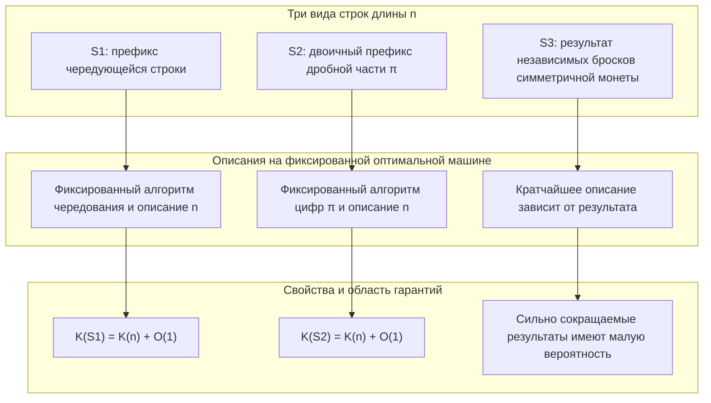
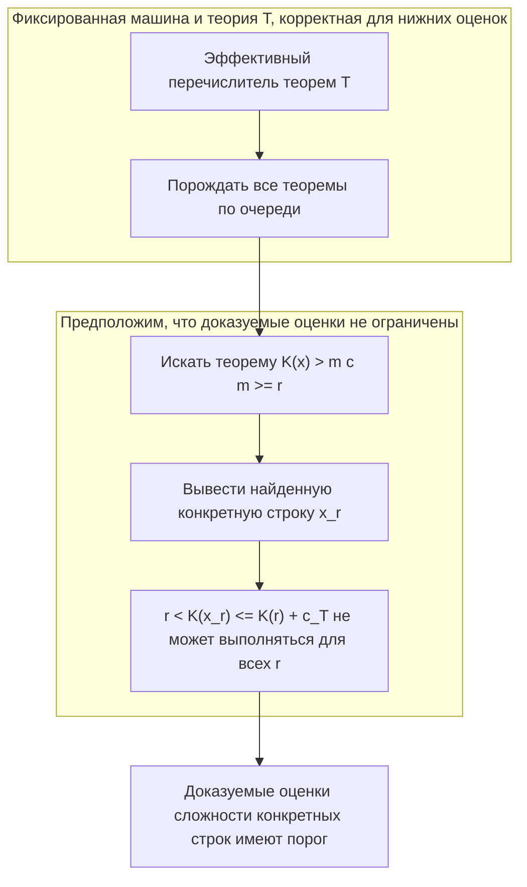

## 1. Три строки длиной в миллион бит

Рассмотрим три двоичные строки длины $n=1{,}000{,}000$:

1. $S_1$: сочетание `01`, повторённое пятьсот тысяч раз.
2. $S_2$: первый миллион бит двоичного разложения <strong>дробной части</strong> $\pi$.
3. $S_3$: один из результатов модели миллиона независимых бросков симметричной монеты.

При плотной упаковке битов каждая строка занимает 125 000 байт, или 125 kB. Если же хранить `0` и `1` как символы ASCII или UTF-8, понадобится миллион байт. Заголовки файлов и служебные структуры требуют дополнительного места.

Двоичная запись $\pi$ имеет вид $11.0010010000111111\ldots{}_2$. Поэтому без целой части строка $S_2$ начинается с `0010010000111111...`. Эти примеры служат иллюстрацией: мы не утверждаем, что для статьи был проведён физический эксперимент из миллиона бросков.

$S_1$ можно получить командой повторения, а для вычисления цифр $S_2$ существуют алгоритмы. Однако $S_3$ не обязательно сложна: случайно могут выпасть одни нули. Верное утверждение вероятностное: <strong>при фиксированной модели вычислений лишь немногие результаты допускают описание, намного более короткое, чем сами данные</strong>.

В модели независимых бросков симметричной монеты вероятность любой конкретной строки длины $n$ одинакова, будь то чередующаяся строка или префикс $\pi$:

$$
P(X=x)=2^{-n},\qquad x\in\{0,1\}^n
$$

Как выразить наличие короткого правила порождения у отдельных равновероятных результатов? <strong>Алгоритмическая теория информации (AIT)</strong>, которую с 1960-х годов развивали Соломонофф, Колмогоров, Хайтин и другие исследователи, рассматривает длину кратчайшей программы, выводящей строку и останавливающейся.

---

## 2. Информация Шеннона и отдельные строки

### 2.1 Собственная информация, энтропия и кодирование

Для дискретного распределения $P$ различают собственную информацию результата с $P(x)>0$ и её среднее значение — энтропию. Далее логарифмы имеют основание 2, единица измерения — бит.

$$
I_P(x)=-\log_2P(x),\qquad
H(P)=-\sum_xP(x)\log_2P(x)
$$

В сумме принимается соглашение $0\log_2 0=0$. Собственная информация результата нулевой вероятности бесконечна.

При двоичном префиксном кодировании одного символа конечного алфавита оптимальная средняя длина удовлетворяет неравенству:

$$
H(P)\le L_{\mathrm{opt}}<H(P)+1
$$

Это не означает, что длина каждого кодового слова равна энтропии. Объединяя $r$ независимых одинаково распределённых символов, можно уменьшить избыточность округления в расчёте на символ:

$$
H(P)\le \frac{L_{\mathrm{opt},r}}{r}<H(P)+\frac1r
$$

Для зависимых источников важны распределения блоков и энтропийная скорость. Коды Хаффмана и арифметическое кодирование также следует рассматривать относительно модели, различая индивидуальные и средние величины.

### 2.2 Выбор модели и эмпирические частоты

Значение $-\log_2P(x)$ зависит не только от $x$, но и от модели $P$. В модели симметричной монеты даже чередующаяся строка имеет миллион бит собственной информации. Если же выбрать точечное распределение, выдающее только эту строку с вероятностью один, энтропия будет нулевой. Но <strong>стоимость передачи самой модели от этого не становится нулевой</strong>.

Если учитывать только частоты отдельных битов, в повторении `01` нулей и единиц поровну. Эмпирическая энтропия нулевого порядка равна:

$$
\widehat H_0((01)^{n/2})
=-\tfrac12\log_2\tfrac12-\tfrac12\log_2\tfrac12=1
$$

Модель, предсказывающая следующий бит по предыдущему, обнаруживает закономерность. Перекрывающиеся блоки длины $k$ в чередующейся строке бывают не более чем двух видов. Поэтому их эмпирическая энтропия не превышает 1 бит на блок, то есть $1/k$ бита на бит. Энтропия всего блока и величина в расчёте на бит различаются.

Нормальность $\pi$ не доказана. Она означала бы, что все блоки каждой фиксированной длины имеют одинаковые предельные частоты. Конечные частотные тесты и видимая нерегулярность этого не доказывают. Даже нормальность совместима с вычислимостью последовательности. Если модели разрешено вычислять цифры, вероятностное предсказание и кодирование тоже могут использовать это правило.

AIT не опровергает теорию Шеннона. <strong>Длина кода относительно вероятностной модели и длина описания отдельного объекта на фиксированной машине отвечают на разные вопросы.</strong>

| Аспект | Информация Шеннона | Алгоритмическое описание |
| :--- | :--- | :--- |
| Объект | Распределение и результаты в этой модели | Конечная строка, выводимая фиксированной машиной |
| Основа | Вероятностная модель и правила кодирования | Машина, кодирование программ и вспомогательный вход |
| Величины | $I_P(x)$, $H(P)$, энтропийная скорость | Обычная сложность $C(x)$ и префиксная $K(x)$ |
| Ограничения | Описание модели имеет отдельную стоимость | Машинные константы и невычислимость |
| Случай $\pi$ | Зависит от выбранной модели | Можно описать правило порождения цифр и точку остановки |

---

## 3. Кратчайшие программы и теорема об инвариантности

### 3.1 Обычная и условная сложность

Обозначим через $\{0,1\}^*$ множество конечных двоичных строк, а через $|p|$ — длину программы в битах. Для частично вычислимой машины $A$ равенство $A(p)=x$ означает, что машина за конечное время выводит ровно $x$ и останавливается.

$$
C_A(x)=\min\{|p|:A(p)=x\}
$$

Если такой программы нет, значение полагают равным $\infty$. Если вспомогательный вход $y$ предоставляется бесплатно, определяют:

$$
C_A(x\mid y)=\min\{|p|:A(p,y)=x\}
$$

Знать длину или словарь заранее — не то же самое по стоимости, что включать их описание в программу.

### 3.2 Префиксная сложность и границы программ

Для <strong>префиксной сложности $K$</strong> множество останавливающихся программ беспрефиксно: ни одна допустимая программа не является собственным префиксом другой. Выполняется неравенство Крафта:

$$
K_U(x)=\min\{|p|:U(p)=x\},\qquad
\sum_{p\in\operatorname{dom}U}2^{-|p|}\le1
$$

В условном случае область остановки должна быть беспрефиксной для каждого фиксированного вспомогательного входа $y$. Саморазграничение — не просто добавление закрывающей скобки к обычному исходному коду. Для $C$ и $K$ мы фиксируем аддитивно оптимальные машины в соответствующих классах.

При соединении обычных программ нужно сообщить их границы. Для фиксированного вычислимого кодирования пар можно получить, например, оценку:

$$
C(x,y)\le C(x)+C(y)
+2\log_2\bigl(\min\{C(x),C(y)\}+2\bigr)+O(1)
$$

Префиксные программы можно соединять и интерпретировать. Используя условные описания, получаем:

$$
K(x,y)\le K(x)+K(y\mid x)+O(1)
\le K(x)+K(y)+O(1)
$$

Для соответствующих фиксированных машин обе сложности связаны неравенствами:

$$
C(x)\le K(x)+O(1),\qquad
K(x)\le C(x)+2\log_2(C(x)+2)+O(1)
$$

$O(1)$ означает константу, не зависящую от $x$, а не измеренную стоимость в ноль или несколько бит.

### 3.3 Аддитивная оптимальность и зависимость от машины

Для $C$ выбирается оптимальная машина в классе обычных машин, для $K$ — в классе беспрефиксных. Если «универсальность» означает только способность моделировать вычисления других машин, дополнительно требуется сохранение длин описаний с постоянной аддитивной надбавкой.

Для любой беспрефиксной машины $A$ существует не зависящая от $x$ константа $c_A$, такая что:

$$
K_U(x)\le K_A(x)+c_A
$$

Конструкция добавляет перед программой $p$ фиксированную саморазграничивающуюся метку $s_A$, определяющую машину $A$, а затем моделирует $A(p)$. Если $A(p)=x$, моделирующая программа выводит $x$; её длина равна $|p|+|s_A|$ плюс фиксированная надбавка. Кратчайшая программа не длиннее этой. Так можно построить оптимальную машину. Для обычной сложности аналогичный аргумент проводится в её собственном классе.

Применив неравенство в обоих направлениях между двумя аддитивно оптимальными машинами, получаем:

$$
|K_{U_1}(x)-K_{U_2}(x)|\le c_{12}
$$

Константа должна покрывать обе стоимости моделирования. Размер интерпретатора лишь в одном направлении сам по себе не является оценкой абсолютной разности.

Можно создать специальную машину, которая по короткой команде печатает определённую строку длиной в миллион бит. Стоимость описания и моделирования этой машины входит в константу. Поэтому <strong>инвариантность не устраняет зависимость от машины для конечных объектов</strong>. Константа, делённая на $n$, становится относительно малой при $n\to\infty$, но точная минимальная длина описания конкретной строки в общем случае остаётся неизвестной. Реальный процессор с конечной памятью также не следует отождествлять с математической машиной с неограниченной памятью.

### 3.4 Чередование, цифры пи и точка остановки

Отождествим $n$ с фиксированным двоичным представлением целых чисел. Пусть $s(n)$ — чередующаяся строка длины $n$ либо первые $n$ бит дробной части $\pi$. Из $n$ можно вычислить $s(n)$, а по длине строки восстановить $n$. Вычислимые преобразования в обе стороны дают:

$$
K(s(n))=K(n)+O(1),\qquad K(s(n)\mid n)=O(1)
$$

Если точка остановки сообщается бесплатно, достаточно генератора постоянной длины. Иначе нужно описать и $n$. Например, саморазграничивающееся кодирование целых чисел даёт для $n\ge2$:

$$
K(n)\le \log_2 n+2\log_2\log_2 n+O(1)=O(\log n)
$$

Равенство $K(n)=\log_2n+O(1)$ не выполняется для всех целых чисел. Если $n=2^m$, короткого описания показателя $m$ может хватить для восстановления $n$. Асимптотическая запись не измеряет реальную программу как ровно двадцать бит или несколько сотен байт.



Кратчайшее описание $S_3$ не обязательно является копией исходных битов. Вероятностный смысл этого случая уточняется подсчётом в следующем разделе.

---

## 4. Несжимаемость и случайность бесконечных последовательностей

### 4.1 Оценки через буквальный вывод

Описание, буквально выводящее произвольную строку $x$ длины $n$, даёт оценки:

$$
C(x)\le n+O(1),\qquad K(x\mid n)\le n+O(1)
$$

Для безусловной префиксной сложности нужно также саморазграничивающимся образом сообщить длину:

$$
K(x)\le n+K(n)+O(1)
$$

Единой оценки $K(x)\le |x|+O(1)$ для всех строк быть не может. Иначе при каждой длине $n$ сумма $\sum_{|x|=n}2^{-K(x)}$ имела бы одну и ту же положительную нижнюю границу. Суммирование по всем длинам нарушило бы неравенство Крафта.

### 4.2 Точный подсчёт

Пусть $n\ge0$ и $0\le c\le n$ — целые числа. Число двоичных программ длины строго меньше $n-c$ равно:

$$
\sum_{j=0}^{n-c-1}2^j=2^{n-c}-1
$$

При $c=n$ пустая сумма равна нулю. Каждая остановившаяся программа выводит не более одной строки. Поэтому среди $2^n$ строк длины $n$ число строк с $C(x)<n-c$ не превышает этого количества программ. Следовательно:

$$
\#\{x\in\{0,1\}^n:C(x)\ge n-c\}
\ge2^n-2^{n-c}+1
$$

Некоторые программы не останавливаются или выводят одинаковые строки, так что различных результатов может быть ещё меньше. При $c>n$ имеем $n-c<0$, и неравенство $C(x)\ge n-c$ тривиально для всех строк. Формулу геометрической суммы не следует механически продолжать на эту область.

Для равномерного распределения, соответствующего независимым броскам симметричной монеты:

$$
P\{C(X)<n-c\}
\le\frac{2^{n-c}-1}{2^n}<2^{-c}
$$

При $c=0$ для каждой длины существует хотя бы одна строка с $C(x)\ge n$. При $c=1$ больше половины строк нельзя сократить <strong>более чем</strong> на один бит. При $c=10$ и $c=20$ нижние границы $1-2^{-c}$ для доли строк, не допускающих сокращения более чем на 10 или 20 бит, составляют примерно 99,902% и 99,999905%. Это не исключает сокращения ровно на $c$ бит.

Такой же подсчёт применим к $K(x\mid n)$ при фиксированном условии $n$. Поэтому результатам бросков с высокой вероятностью нужны описания, близкие по длине к самим данным, но это не гарантия для каждого отдельного результата.

Компрессор без потерь, сокращающий любой файл, противоречил бы этому подсчёту. Реальные компрессоры используют определённые закономерности. Долю при равномерном распределении всех строк нельзя автоматически считать частотой природных или созданных человеком данных.

### 4.3 Случайность по Мартин-Лёфу

Несжимаемость конечной строки на заданное число бит и случайность бесконечной последовательности — разные определения. На пространстве бесконечных двоичных последовательностей возьмём меру симметричной монеты $\mu$. Цилиндр $[w]$ состоит из последовательностей, начинающихся конечной строкой $w$, и имеет меру $2^{-|w|}$.

<strong>Тест Мартин-Лёфа</strong> — последовательность открытых множеств $V_j$, равномерно эффективно перечислимых как объединения цилиндров конечных префиксов, для которых:

$$
\mu(V_j)\le2^{-j},\qquad j=1,2,\ldots
$$

Если $\omega\in\bigcap_jV_j$, последовательность не проходит этот тест. Она случайна по Мартин-Лёфу, если не попадает в множество неудачи ни одного такого теста. Это не запрещает единичного появления редкого конечного узора. Эффективных тестов счётно много, каждое множество неудачи имеет меру ноль, поэтому множество последовательностей, проходящих все тесты, имеет меру один.

Теорема Левина — Шнорра характеризует это свойство с помощью оптимальной <strong>префиксной сложности</strong>:

$$
\omega\text{ случайна по Мартин-Лёфу}
\iff
\exists c\ \forall n\quad K(\omega_{1:n})\ge n-c
$$

Существенно, что <strong>одна и та же константа $c$</strong> подходит для всех $n$. Нельзя просто заменить здесь $K$ обычной сложностью $C$.

Правила отбора фон Мизеса и Чёрча входят в историю этих идей, но разные требования вычислимости к тестам и стратегиям ставок дают разные понятия. В частности, вычислимая случайность, при которой никакой вычислимый мартингал не наращивает капитал неограниченно, слабее случайности по Мартин-Лёфу. Вычислимая последовательность цифр $\pi$ не случайна по Мартин-Лёфу. Нормальность — другое свойство.

---

## 5. Невычислимость, пределы доказательства и вероятность остановки

### 5.1 Приближение сверху без общего критерия завершения

Чтобы искать короткие программы, выводящие $x$, можно чередовать их выполнение, постепенно выделяя шаги каждому кандидату. Минимальная из найденных длин даёт приближение сверху:

$$
K_t(x)\searrow K(x)\qquad(t\to\infty)
$$

Начать можно с вычислимой конечной верхней оценки, полученной буквальным выводом. Поскольку значения целые, для каждого фиксированного $x$ они в какой-то момент достигают истинной сложности и затем остаются постоянными. Однако общего способа распознать этот момент для всех входов нет. Более короткая программа, ещё не остановившаяся, может вывести $x$ позднее.

### 5.2 Рассуждение в духе Берри

Фраза «наименьшее натуральное число, которое нельзя описать менее чем двадцатью словами» содержит десять слов, разделённых пробелами, то есть меньше двадцати. Слово «описать» в естественном языке неоднозначно; сама фраза не является формальным доказательством. Идею следует перенести на вычислимые процедуры.

Предположим, что процедура `ComputeK` для каждой строки $x$ возвращает истинное $K(x)$ и останавливается. Следующий <strong>псевдокод</strong> использует это невозможное предположение; он не является реализуемым вычислителем сложности.

```text
Berry(m):
    Перечислять все двоичные строки x по длине 0,1,2,..., а при одинаковой длине — лексикографически:
        if ComputeK(x) >= m:
            Вывести x и остановиться
```

Такой порядок называется shortlex: сначала длина, затем лексикографический порядок. Обычный лексикографический порядок сам по себе не даёт нужного перечисления всех конечных строк.

Подсчёт показывает, что сложность не ограничена сверху. При сделанном предположении поиск заканчивается для каждого $m$ и выдаёт $x_m$ с $K(x_m)\ge m$. Но для получения этого результата достаточно фиксированной программы и саморазграничивающегося описания $m$:

$$
m\le K(x_m)\le K(m)+c
\le \log_2m+2\log_2\log_2m+c'
$$

Последняя оценка относится к $m\ge2$. При фиксированных константах и достаточно большом $m$ возникает противоречие. Следовательно, `ComputeK` не существует. Утверждать, что всегда достаточно зазора ровно в 10 000 бит, не измерив машинные расходы, не требуется.

### 5.3 Теорема Хайтина о неполноте

Зафиксируем эталонную машину и эффективно аксиоматизируемую теорию $T$, способную выражать оценки сложности конкретных конечных строк. Предположим её <strong>семантическую корректность</strong> для доказываемых нижних оценок: эти утверждения истинны.

Тогда существует порог $b_T$, такой что $T$ не может доказать «$K(x)>b_T$» ни для какой конкретной строки $x$.

Для доказательства предположим, что доказуемые числовые нижние оценки не ограничены. Тогда для каждого входа $r$ можно перечислять все теоремы и найти утверждение вида «$K(x)>m$» с конкретным целым $m\ge r$.

```text
SearchProof(r):
    Эффективно перечислять теоремы T:
        if теорема утверждает "K(x) > m" для конкретной строки x и целого m, причём m >= r:
            Вывести x и остановиться
```

Корректность гарантирует, что сложность результата $x_r$ больше $r$. Однако фиксированная часть программы может уже включать перечислитель теорем $T$, поэтому:

$$
r<K(x_r)\le K(r)+c_T=O(\log r)+c_T
$$

При достаточно большом $r$ это невозможно. Значит, доказуемые числовые нижние оценки ограничены.



Порог зависит от машины, теории и представления. Это не измерение универсального предела ZFC в 20 000 или 50 000 бит. Если длина $n$ достаточно велика по сравнению с порогом, подсчёт показывает, что множество строк действительно имеет большую сложность. Тем не менее доказательство соответствующей оценки для конкретной строки может оказаться недоступно теории.

Это связывает неполноту Гёделя с алгоритмическими описаниями. Но это не общий «закон сохранения информации», запрещающий выводить длинные или многочисленные теоремы из коротких аксиом. Добавление аксиом даёт другую теорию с другой константой.

### 5.4 Вероятность остановки зависит от машины

Для оптимальной беспрефиксной машины $U$ вероятность того, что бесконечная последовательность независимых равновероятных битов начинается останавливающейся программой, равна:

$$
\Omega_U=\sum_{p\in\operatorname{dom}U}2^{-|p|}
$$

Цилиндры останавливающихся программ не пересекаются, поэтому сумма имеет вероятностный смысл. Из Крафта следует $\Omega_U\le1$. При указанных условиях, включая оптимальность, $\Omega_U$ также является невычислимым случайным по Мартин-Лёфу действительным числом, причём $0<\Omega_U<1$. Одна лишь беспрефиксность произвольной машины не гарантирует всех этих свойств.

Перечисление останавливающихся программ даёт возрастающие снизу частичные суммы весов. Поэтому $\Omega_U$ <strong>полувычислимо снизу (left-c.e.)</strong>: существует вычислимая возрастающая последовательность рациональных приближений. Но нет вычислимой функции, указывающей для каждой требуемой точности этап, на котором эта точность гарантирована.

Предположим, что первые $N$ двоичных знаков дробной части известны точно, и обозначим соответствующий нижний конец интервала через $a$. Поскольку двоичное разложение $\Omega_U$ не обрывается:

$$
a=\frac{\lfloor2^N\Omega_U\rfloor}{2^N},
\qquad a<\Omega_U<a+2^{-N}
$$

Чередуем выполнение программ, пока частичная сумма весов остановки $q_s$ не <strong>превысит</strong> $a$. Тогда:

$$
0\le\Omega_U-q_s<2^{-N}
$$

Ещё не обнаруженная программа длины не больше $N$, остановившись позднее, добавила бы как минимум $2^{-N}$, что противоречит оценке оставшейся массы. Поэтому эти биты позволяют решить вопрос остановки всех входов длины не больше $N$ для <strong>той же самой машины</strong>.

Это не означает, что несколько фиксированных тысяч бит решают любые математические утверждения. При кодировании, например, поиска контрпримера в виде задачи остановки важны машина, длина программы и логическая форма утверждения. Исследование конечного числа знаков также не даёт алгоритма, порождающего все знаки.

---

## 6. Энтропия, MDL, NCD и искусственный интеллект

### 6.1 Средняя длина описания и скорость энтропии

Пусть вычислимое дискретное распределение $P$ на конечных строках задано конечной вычислительной процедурой $d_P$. Если эта процедура доступна как вспомогательный вход и $H(P)<\infty$, то:

$$
H(P)\le\mathbb E_{X\sim P}[K(X\mid d_P)]\le H(P)+c
$$

Носитель распределения может быть конечным или счётным; предполагается, что его вероятности можно равномерно вычислять с заданной точностью. Константа $c$ учитывает, в частности, процедуру декодирования. Равенство численных значений здесь не утверждается.

Нижняя оценка следует из неравенства Крафта для кратчайших префиксных описаний при каждом фиксированном условии $d_P$ и оценки средней длины кода. Для верхней оценки по общей процедуре вычисления распределения строят префиксный код, соответствующий вероятностям, и декодируют его фиксированным алгоритмом. Если распределение не известно обеим сторонам, нужно учитывать описание модели. Из того, что произвольное распределение названо «известным», не следует возможность всегда точно вычислить его энтропию за конечное время.

Другая связь задаётся теоремой типа Брудно для <strong>стационарного эргодического процесса с конечным алфавитом</strong>. Если скорость энтропии равна $h$ бит на символ, то почти для каждой реализации:

$$
\lim_{n\to\infty}\frac{K(X_{1:n})}{n}=h
$$

Сходится и среднее: $\mathbb E[K(X_{1:n})]/n\to h$. Равномерная линейная верхняя оценка, получаемая буквальным кодированием строки длины $n$, позволяет перейти от почти наверное выполненной сходимости к сходимости средних. Разница порядка логарифма между обычной и префиксной сложностью исчезает после деления на $n$. Для этой теоремы о скорости не требуется автоматически добавлять предположение о вычислимости распределения из предыдущего неравенства.

### 6.2 Дискретная универсальная полумера и предсказание Соломоноффа

Для оптимальной префиксной машины с остановкой вероятность вывести в точности $x$ и остановиться определяется так:

$$
m_U(x)=\sum_{p:U(p)=x}2^{-|p|}
$$

Это <strong>полумера</strong>, поскольку сумма по всем результатам не превышает единицы; она полувычислима снизу. Теорема о кодировании связывает эту дискретную универсальную полумеру с префиксной сложностью:

$$
-\log_2m_U(x)=K_U(x)+O(1),
\qquad m_U(x)=\Theta(2^{-K_U(x)})
$$

В последовательном предсказании Соломоноффа используется другая полумера $M(x)$: вероятность того, что вывод монотонной машины <strong>начинается</strong> с $x$. Вывод не обязан на этом завершаться; выполняется условие согласованности $M(x)\ge M(x0)+M(x1)$. Нельзя отождествлять определения дискретной $m_U$ и последовательной $M$ или без дополнительных условий переносить на них одну и ту же теорему о кодировании.

Предпочтение коротких описаний связано с бритвой Оккама. Но короткая гипотеза не обязательно получает наибольшую вероятность после наблюдения данных: существенна также функция правдоподобия.

### 6.3 Байесовский выбор и принцип минимальной длины описания

Пусть модели $H$ назначена фактическая длина префиксного описания $L(H)$, а априорная вероятность пропорциональна соответствующему кодовому весу. Тогда формула Байеса принимает вид:

$$
-\log_2P(H\mid D)
=L(H)-\log_2P(D\mid H)+\mathrm{const}
$$

Константа здесь не зависит от $H$. При этих условиях максимизация апостериорной вероятности соответствует минимизации правой части. Однако произвольную величину $-\log_2P(D\mid H)$ нельзя всегда заменять равным ей значением $K(D\mid H)$.

<strong>Принцип минимальной длины описания (MDL)</strong> сравнивает суммарные затраты на описание модели и данных с её помощью:

$$
\widehat H=\arg\min_{H\in\mathcal H}
\{L(H)+L(D\mid H)\}
$$

Слишком простая модель оставляет длинное описание данных. Модель, запоминающая все данные, сама требует длинного описания. Устранить остаток запоминанием — не то же самое, что сократить общую длину. MDL Риссанена — практический подход к статистическому выбору, а не гарантия обнаружения любого истинного закона природы или причинной связи.

### 6.4 Идеальное информационное расстояние и NCD реального компрессора

При положительном знаменателе идеальное <strong>нормализованное информационное расстояние (NID)</strong> определяется формулой:

$$
\operatorname{NID}(x,y)=
\frac{\max\{K(x\mid y),K(y\mid x)\}}
{\max\{K(x),K(y)\}}
$$

Оно также связано с выражениями через сложность пары $K(x,y)$ с соответствующими аддитивными и нормированными погрешностями. Конкатенация $xy$ без разделителя не тождественна кодированию пары, позволяющему однозначно восстановить обе части.

Обозначим длину результата реального компрессора через $Z$, чтобы отличать её от обычной сложности $C$. Тогда <strong>нормализованное расстояние сжатия (NCD)</strong> имеет вид:

$$
\operatorname{NCD}_Z(x,y)=
\frac{Z(xy)-\min\{Z(x),Z(y)\}}
{\max\{Z(x),Z(y)\}}
$$

Идея состоит в том, что компрессор может повторно использовать общую структуру похожих файлов, уменьшая расстояние. Если использовать общую структуру не удаётся, значение приближается к единице.

Однако у реальных компрессоров есть заголовки, ограниченное окно словаря, блоки, настройки и зависимость от порядка данных. Предположения о normal compressor — идемпотентность, монотонность, симметрия и дистрибутивность — не выполняются автоматически для любого компрессора на всех входах. Даже для одинаковых файлов возможно нарушение приближённого равенства $Z(xx)\approx Z(x)$. Для конечных данных NCD не обязано точно удовлетворять аксиомам метрики или всегда лежать между нулём и единицей.

Во вспомогательной проверке фиксированную строку из 65 536 байт соединили с её копией. Для gzip с конечным окном получилось NCD около 0,9997 между строкой и ею самой. Это пример ограничения практической аппроксимации, а не контрпример к идеальному NID.

Чилибраси, Витаньи и другие исследователи изучали кластеризацию с помощью сжатия для геномов, языков и музыки. Отсутствие необходимости вручную конструировать признаки для каждой области полезно, но результат зависит от кодировки, представления файлов и компрессора. Метод не гарантирует точного восстановления любого филогенетического дерева.

### 6.5 Предсказания языковой модели и длина кода

Для последовательности токенов $D=x_{1:T}$ и фиксированной авторегрессионной модели идеальная длина кода, соответствующая предсказаниям, равна:

$$
\mathcal L_\theta(D)=
-\sum_{t=1}^T\log_2p_\theta(x_t\mid x_{<t})
$$

Если используется натуральный логарифм, единицей будет нат; для перехода к битам результат делят на $\ln2$. Это отрицательное логарифмическое правдоподобие конечных данных, среднее которого используется как функция потерь на основе перекрёстной энтропии.

Для исходов с положительной вероятностью при общей модели и известной длине последовательности идеальное арифметическое кодирование позволяет построить префиксное описание длиной не более $\lceil\mathcal L_\theta(D)\rceil+2$. Это постоянные накладные расходы, а не утверждение, что любая реализация всегда выдаёт ровно «потери плюс 2 бита». Влияют конечная точность, завершение, округление и оформление потока.

Пусть $L_{\mathrm{model}}$ и $L_{\mathrm{meta}}$ — длины фактических саморазграничивающихся описаний модели и необходимых метаданных. Для фиксированного декодера получаем верхнюю оценку:

$$
K(D)\le L_{\mathrm{model}}+L_{\mathrm{meta}}
+\lceil\mathcal L_\theta(D)\rceil+O(1)
$$

В метаданные включают необходимую длину последовательности, словарь и спецификацию обратимой токенизации. Нельзя восстановить исходные пробелы или символы, удалённые нормализацией, не передав соответствующую информацию.

Снижение потерь предсказания для модели фиксированного размера соответствует сокращению кода данных, когда модель общая для кодера и декодера. При изменении размера модели нужно сравнивать полные затраты. Одна лишь минимизация обучающих потерь не равнозначна минимизации двухчастного MDL.

AIXI Маркуса Хаттера и Hutter Prize отражают исследовательский интерес к связи сжатия и интеллекта. Однако AIXI — невычислимая идеальная модель, а не реальный Transformer. Работа Delétang и соавторов о сжатии языковыми моделями также исследует соответствие предсказания и сжатия.

Если модель успешно предсказывает имя преступника в детективе, код правильного имени становится короче. Причиной улучшения может быть не только логическое рассуждение, но и запоминание, лексические закономерности или дублирование данных. Из способности сжать обучающие тексты не следует теорема о неизбежном приобретении причинной модели мира, правильного рассуждения, способности к обобщению или общего искусственного интеллекта.

| Теория или подход | Практическое соответствие | Важное различие |
| :--- | :--- | :--- |
| $K(x)$, $K(x\mid y)$ | Описания с декодером, кодирование при общем контексте | Реальная длина сжатия обычно не является минимумом |
| Дискретная универсальная полумера $m_U$ | Модели, предпочитающие короткие описания | Остановка с выводом и последовательное предсказание $M$ различаются |
| MDL | Сравнение затрат на модель и код данных | Правдоподобие и условная сложность не всегда равны |
| NID и NCD | Сходство и кластеризация по сжатию | Важны окно компрессора, представление, порядок и конечная длина |
| Языковые модели и арифметическое кодирование | Соответствие вероятностей предсказания и длины кода | Общая модель отличается от полного самостоятельного описания; оценка интеллекта — отдельный вопрос |

---

## 7. Что позволяет узнать сжатие и какие вопросы остаются

Для миллиона чередующихся битов и для префикса числа $\pi$ существуют короткие процедуры порождения. Описание, включающее место завершения, отличается от условного описания при уже известной длине. Подсчёт даёт высокую вероятность несжимаемости результата бросков симметричной монеты, но не гарантию для каждой реализации.

Теорема об инвариантности устанавливает постоянную разницу между оптимальными машинами. Рассуждение в духе Берри показывает, что истинную минимальную длину в общем случае нельзя вычислить. Теорема Хайтина и $\Omega_U$ уточняют пределы доказательства и вычисления. Они не дают способа оценивать любой конечный объект независимо от машины и предположений.

MDL, NCD и кодирование языковыми моделями связывают теоретический идеал с практикой. Сжатие помогает рассуждать о закономерностях и совместном использовании моделей, но степень сжатия сама по себе не становится исчерпывающим определением понимания или интеллекта.

### Литература

- [Shen: Algorithmic Information Theory and Kolmogorov Complexity](https://www.lirmm.fr/~ashen/uppsala-notes.pdf) — обычная и префиксная сложность, оптимальные декодеры, невычислимость и теорема о кодировании.
- [Rute: Computable randomness and betting for computable probability spaces](https://arxiv.org/html/1203.5535v4) — различие вычислимой случайности и тестов Мартин-Лёфа.
- [Tadaki: Chaitin Ω numbers and halting problems](https://arxiv.org/abs/0904.1149) — вероятность остановки оптимальной машины и задачи остановки для ограниченных длин.
- [Chazottes: Entropy in Dynamical Systems & Ergodic Theory](https://www.claymath.org/wp-content/uploads/2023/04/Chazottes-rev.pdf) — слайд 50, теорема Брудно для конечных разбиений.
- [Cilibrasi, Vitányi: Clustering by Compression](https://arxiv.org/html/cs/0312044v2) — предположения о normal compressor и NCD.
- [Delétang и соавторы: Language Modeling Is Compression](https://arxiv.org/abs/2309.10668) — исследование соответствия предсказания и сжатия.
- [Hutter: Universal Algorithmic Intelligence](https://www.hutter1.net/ai/aixigentle.htm) — идеальная модель AIXI, объединяющая универсальную индукцию и принятие решений, и вычислительные ограничения.
- [Bailey и соавторы: An Empirical Approach to the Normality of Pi](https://www.davidhbailey.com/dhbpapers/normality-digits-pi.pdf) — различие эмпирических проверок цифр и доказательства нормальности.
