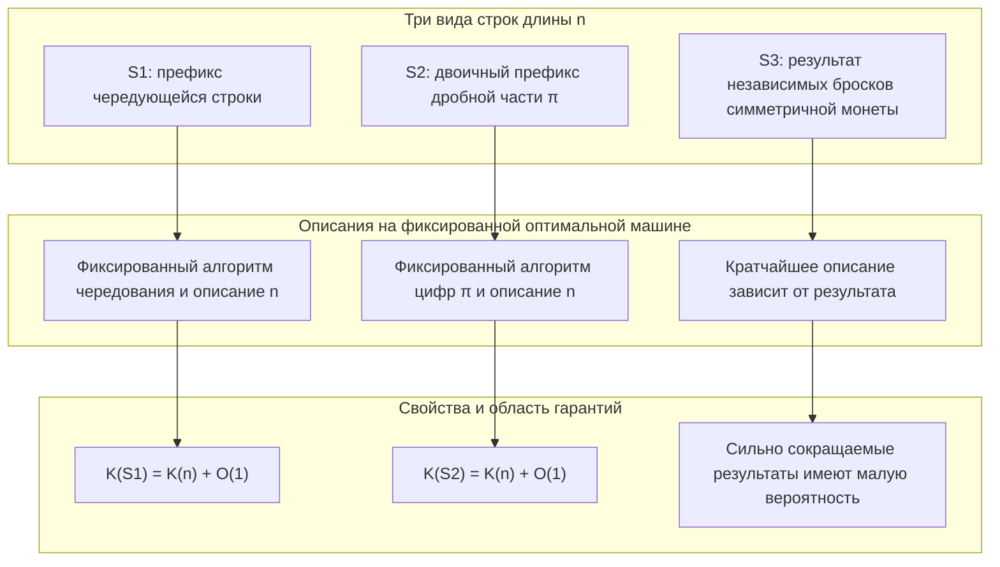

## 1. Три строки длиной в миллион бит

Рассмотрим три двоичные строки длины $n=1{,}000{,}000$:

1. $S_1$: сочетание `01`, повторённое пятьсот тысяч раз.
2. $S_2$: первый миллион бит двоичного разложения <strong>дробной части</strong> $\pi$.
3. $S_3$: один из результатов модели миллиона независимых бросков симметричной монеты.

При плотной упаковке битов каждая строка занимает 125 000 байт, или 125 kB. Если же хранить `0` и `1` как символы ASCII или UTF-8, понадобится миллион байт. Заголовки файлов и служебные структуры требуют дополнительного места.

Двоичная запись $\pi$ имеет вид $11.0010010000111111\ldots{}_2$. Поэтому без целой части строка $S_2$ начинается с `0010010000111111...`. Эти примеры служат иллюстрацией: мы не утверждаем, что для статьи был проведён физический эксперимент из миллиона бросков.

$S_1$ можно получить командой повторения, а для вычисления цифр $S_2$ существуют алгоритмы. Однако $S_3$ не обязательно сложна: случайно могут выпасть одни нули. Верное утверждение вероятностное: <strong>при фиксированной модели вычислений лишь немногие результаты допускают описание, намного более короткое, чем сами данные</strong>.

В модели независимых бросков симметричной монеты вероятность любой конкретной строки длины $n$ одинакова, будь то чередующаяся строка или префикс $\pi$:

$$
P(X=x)=2^{-n},\qquad x\in\{0,1\}^n
$$

Как выразить наличие короткого правила порождения у отдельных равновероятных результатов? <strong>Алгоритмическая теория информации (AIT)</strong>, которую с 1960-х годов развивали Соломонофф, Колмогоров, Хайтин и другие исследователи, рассматривает длину кратчайшей программы, выводящей строку и останавливающейся.

---

## 2. Информация Шеннона и отдельные строки

### 2.1 Собственная информация, энтропия и кодирование

Для дискретного распределения $P$ различают собственную информацию результата с $P(x)>0$ и её среднее значение — энтропию. Далее логарифмы имеют основание 2, единица измерения — бит.

$$
I_P(x)=-\log_2P(x),\qquad
H(P)=-\sum_xP(x)\log_2P(x)
$$

В сумме принимается соглашение $0\log_2 0=0$. Собственная информация результата нулевой вероятности бесконечна.

При двоичном префиксном кодировании одного символа конечного алфавита оптимальная средняя длина удовлетворяет неравенству:

$$
H(P)\le L_{\mathrm{opt}}<H(P)+1
$$

Это не означает, что длина каждого кодового слова равна энтропии. Объединяя $r$ независимых одинаково распределённых символов, можно уменьшить избыточность округления в расчёте на символ:

$$
H(P)\le \frac{L_{\mathrm{opt},r}}{r}<H(P)+\frac1r
$$

Для зависимых источников важны распределения блоков и энтропийная скорость. Коды Хаффмана и арифметическое кодирование также следует рассматривать относительно модели, различая индивидуальные и средние величины.

### 2.2 Выбор модели и эмпирические частоты

Значение $-\log_2P(x)$ зависит не только от $x$, но и от модели $P$. В модели симметричной монеты даже чередующаяся строка имеет миллион бит собственной информации. Если же выбрать точечное распределение, выдающее только эту строку с вероятностью один, энтропия будет нулевой. Но <strong>стоимость передачи самой модели от этого не становится нулевой</strong>.

Если учитывать только частоты отдельных битов, в повторении `01` нулей и единиц поровну. Эмпирическая энтропия нулевого порядка равна:

$$
\widehat H_0((01)^{n/2})
=-\tfrac12\log_2\tfrac12-\tfrac12\log_2\tfrac12=1
$$

Модель, предсказывающая следующий бит по предыдущему, обнаруживает закономерность. Перекрывающиеся блоки длины $k$ в чередующейся строке бывают не более чем двух видов. Поэтому их эмпирическая энтропия не превышает 1 бит на блок, то есть $1/k$ бита на бит. Энтропия всего блока и величина в расчёте на бит различаются.

Нормальность $\pi$ не доказана. Она означала бы, что все блоки каждой фиксированной длины имеют одинаковые предельные частоты. Конечные частотные тесты и видимая нерегулярность этого не доказывают. Даже нормальность совместима с вычислимостью последовательности. Если модели разрешено вычислять цифры, вероятностное предсказание и кодирование тоже могут использовать это правило.

AIT не опровергает теорию Шеннона. <strong>Длина кода относительно вероятностной модели и длина описания отдельного объекта на фиксированной машине отвечают на разные вопросы.</strong>

| Аспект | Информация Шеннона | Алгоритмическое описание |
| :--- | :--- | :--- |
| Объект | Распределение и результаты в этой модели | Конечная строка, выводимая фиксированной машиной |
| Основа | Вероятностная модель и правила кодирования | Машина, кодирование программ и вспомогательный вход |
| Величины | $I_P(x)$, $H(P)$, энтропийная скорость | Обычная сложность $C(x)$ и префиксная $K(x)$ |
| Ограничения | Описание модели имеет отдельную стоимость | Машинные константы и невычислимость |
| Случай $\pi$ | Зависит от выбранной модели | Можно описать правило порождения цифр и точку остановки |

---

## 3. Кратчайшие программы и теорема об инвариантности

### 3.1 Обычная и условная сложность

Обозначим через $\{0,1\}^*$ множество конечных двоичных строк, а через $|p|$ — длину программы в битах. Для частично вычислимой машины $A$ равенство $A(p)=x$ означает, что машина за конечное время выводит ровно $x$ и останавливается.

$$
C_A(x)=\min\{|p|:A(p)=x\}
$$

Если такой программы нет, значение полагают равным $\infty$. Если вспомогательный вход $y$ предоставляется бесплатно, определяют:

$$
C_A(x\mid y)=\min\{|p|:A(p,y)=x\}
$$

Знать длину или словарь заранее — не то же самое по стоимости, что включать их описание в программу.

### 3.2 Префиксная сложность и границы программ

Для <strong>префиксной сложности $K$</strong> множество останавливающихся программ беспрефиксно: ни одна допустимая программа не является собственным префиксом другой. Выполняется неравенство Крафта:

$$
K_U(x)=\min\{|p|:U(p)=x\},\qquad
\sum_{p\in\operatorname{dom}U}2^{-|p|}\le1
$$

В условном случае область остановки должна быть беспрефиксной для каждого фиксированного вспомогательного входа $y$. Саморазграничение — не просто добавление закрывающей скобки к обычному исходному коду. Для $C$ и $K$ мы фиксируем аддитивно оптимальные машины в соответствующих классах.

При соединении обычных программ нужно сообщить их границы. Для фиксированного вычислимого кодирования пар можно получить, например, оценку:

$$
C(x,y)\le C(x)+C(y)
+2\log_2\bigl(\min\{C(x),C(y)\}+2\bigr)+O(1)
$$

Префиксные программы можно соединять и интерпретировать. Используя условные описания, получаем:

$$
K(x,y)\le K(x)+K(y\mid x)+O(1)
\le K(x)+K(y)+O(1)
$$

Для соответствующих фиксированных машин обе сложности связаны неравенствами:

$$
C(x)\le K(x)+O(1),\qquad
K(x)\le C(x)+2\log_2(C(x)+2)+O(1)
$$

$O(1)$ означает константу, не зависящую от $x$, а не измеренную стоимость в ноль или несколько бит.

### 3.3 Аддитивная оптимальность и зависимость от машины

Для $C$ выбирается оптимальная машина в классе обычных машин, для $K$ — в классе беспрефиксных. Если «универсальность» означает только способность моделировать вычисления других машин, дополнительно требуется сохранение длин описаний с постоянной аддитивной надбавкой.

Для любой беспрефиксной машины $A$ существует не зависящая от $x$ константа $c_A$, такая что:

$$
K_U(x)\le K_A(x)+c_A
$$

Конструкция добавляет перед программой $p$ фиксированную саморазграничивающуюся метку $s_A$, определяющую машину $A$, а затем моделирует $A(p)$. Если $A(p)=x$, моделирующая программа выводит $x$; её длина равна $|p|+|s_A|$ плюс фиксированная надбавка. Кратчайшая программа не длиннее этой. Так можно построить оптимальную машину. Для обычной сложности аналогичный аргумент проводится в её собственном классе.

Применив неравенство в обоих направлениях между двумя аддитивно оптимальными машинами, получаем:

$$
|K_{U_1}(x)-K_{U_2}(x)|\le c_{12}
$$

Константа должна покрывать обе стоимости моделирования. Размер интерпретатора лишь в одном направлении сам по себе не является оценкой абсолютной разности.

Можно создать специальную машину, которая по короткой команде печатает определённую строку длиной в миллион бит. Стоимость описания и моделирования этой машины входит в константу. Поэтому <strong>инвариантность не устраняет зависимость от машины для конечных объектов</strong>. Константа, делённая на $n$, становится относительно малой при $n\to\infty$, но точная минимальная длина описания конкретной строки в общем случае остаётся неизвестной. Реальный процессор с конечной памятью также не следует отождествлять с математической машиной с неограниченной памятью.

### 3.4 Чередование, цифры пи и точка остановки

Отождествим $n$ с фиксированным двоичным представлением целых чисел. Пусть $s(n)$ — чередующаяся строка длины $n$ либо первые $n$ бит дробной части $\pi$. Из $n$ можно вычислить $s(n)$, а по длине строки восстановить $n$. Вычислимые преобразования в обе стороны дают:

$$
K(s(n))=K(n)+O(1),\qquad K(s(n)\mid n)=O(1)
$$

Если точка остановки сообщается бесплатно, достаточно генератора постоянной длины. Иначе нужно описать и $n$. Например, саморазграничивающееся кодирование целых чисел даёт для $n\ge2$:

$$
K(n)\le \log_2 n+2\log_2\log_2 n+O(1)=O(\log n)
$$

Равенство $K(n)=\log_2n+O(1)$ не выполняется для всех целых чисел. Если $n=2^m$, короткого описания показателя $m$ может хватить для восстановления $n$. Асимптотическая запись не измеряет реальную программу как ровно двадцать бит или несколько сотен байт.

Кратчайшее описание $S_3$ не обязательно является копией исходных битов. Вероятностный смысл этого случая уточняется подсчётом в следующем разделе.

---

## 4. Несжимаемость и случайность бесконечных последовательностей

### 4.1 Оценки через буквальный вывод

Описание, буквально выводящее произвольную строку $x$ длины $n$, даёт оценки:

$$
C(x)\le n+O(1),\qquad K(x\mid n)\le n+O(1)
$$

Для безусловной префиксной сложности нужно также саморазграничивающимся образом сообщить длину:

$$
K(x)\le n+K(n)+O(1)
$$

Единой оценки $K(x)\le |x|+O(1)$ для всех строк быть не может. Иначе при каждой длине $n$ сумма $\sum_{|x|=n}2^{-K(x)}$ имела бы одну и ту же положительную нижнюю границу. Суммирование по всем длинам нарушило бы неравенство Крафта.

### 4.2 Точный подсчёт

Пусть $n\ge0$ и $0\le c\le n$ — целые числа. Число двоичных программ длины строго меньше $n-c$ равно:

$$
\sum_{j=0}^{n-c-1}2^j=2^{n-c}-1
$$

При $c=n$ пустая сумма равна нулю. Каждая остановившаяся программа выводит не более одной строки. Поэтому среди $2^n$ строк длины $n$ число строк с $C(x)<n-c$ не превышает этого количества программ. Следовательно:

$$
\#\{x\in\{0,1\}^n:C(x)\ge n-c\}
\ge2^n-2^{n-c}+1
$$

Некоторые программы не останавливаются или выводят одинаковые строки, так что различных результатов может быть ещё меньше. При $c>n$ имеем $n-c<0$, и неравенство $C(x)\ge n-c$ тривиально для всех строк. Формулу геометрической суммы не следует механически продолжать на эту область.

Для равномерного распределения, соответствующего независимым броскам симметричной монеты:

$$
P\{C(X)<n-c\}
\le\frac{2^{n-c}-1}{2^n}<2^{-c}
$$

При $c=0$ для каждой длины существует хотя бы одна строка с $C(x)\ge n$. При $c=1$ больше половины строк нельзя сократить <strong>более чем</strong> на один бит. При $c=10$ и $c=20$ нижние границы $1-2^{-c}$ для доли строк, не допускающих сокращения более чем на 10 или 20 бит, составляют примерно 99,902% и 99,999905%. Это не исключает сокращения ровно на $c$ бит.

Такой же подсчёт применим к $K(x\mid n)$ при фиксированном условии $n$. Поэтому результатам бросков с высокой вероятностью нужны описания, близкие по длине к самим данным, но это не гарантия для каждого отдельного результата.

Компрессор без потерь, сокращающий любой файл, противоречил бы этому подсчёту. Реальные компрессоры используют определённые закономерности. Долю при равномерном распределении всех строк нельзя автоматически считать частотой природных или созданных человеком данных.

### 4.3 Случайность по Мартин-Лёфу

Несжимаемость конечной строки на заданное число бит и случайность бесконечной последовательности — разные определения. На пространстве бесконечных двоичных последовательностей возьмём меру симметричной монеты $\mu$. Цилиндр $[w]$ состоит из последовательностей, начинающихся конечной строкой $w$, и имеет меру $2^{-|w|}$.

<strong>Тест Мартин-Лёфа</strong> — последовательность открытых множеств $V_j$, равномерно эффективно перечислимых как объединения цилиндров конечных префиксов, для которых:

$$
\mu(V_j)\le2^{-j},\qquad j=1,2,\ldots
$$

Если $\omega\in\bigcap_jV_j$, последовательность не проходит этот тест. Она случайна по Мартин-Лёфу, если не попадает в множество неудачи ни одного такого теста. Это не запрещает единичного появления редкого конечного узора. Эффективных тестов счётно много, каждое множество неудачи имеет меру ноль, поэтому множество последовательностей, проходящих все тесты, имеет меру один.

Теорема Левина — Шнорра характеризует это свойство с помощью оптимальной <strong>префиксной сложности</strong>:

$$
\omega\text{ случайна по Мартин-Лёфу}
\iff
\exists c\ \forall n\quad K(\omega_{1:n})\ge n-c
$$

Существенно, что <strong>одна и та же константа $c$</strong> подходит для всех $n$. Нельзя просто заменить здесь $K$ обычной сложностью $C$.

Правила отбора фон Мизеса и Чёрча входят в историю этих идей, но разные требования вычислимости к тестам и стратегиям ставок дают разные понятия. В частности, вычислимая случайность, при которой никакой вычислимый мартингал не наращивает капитал неограниченно, слабее случайности по Мартин-Лёфу. Вычислимая последовательность цифр $\pi$ не случайна по Мартин-Лёфу. Нормальность — другое свойство.

---

## 5. Парадокс Берри, невычислимость $K(x)$, константа Хайтина $\Omega$ и современный ИИ

Можно ли написать идеальный архиватор, который для любой входной строки $x$ вычисляет её точную сложность $K(x)$? Ответ категоричен: <strong>нет, функция $K(x)$ алгоритмически невычислима!</strong>

Это ограничение восходит к классическому <strong>парадоксу Берри</strong> («наименьшее натуральное число, которое нельзя описать менее чем двадцатью словами» — фраза из десяти слов, описывающая это число!). Грегори Хайтин формализовал его так: допустим, существует подпрограмма `ComputeK(x)` фиксированной длины $L$ бит, вычисляющая $K(x)$. Построим главную программу $Q$, которая перебирает все строки $s$ в лексикографическом порядке, вызывает `ComputeK(s)` и выводит первую же строку $s^*$, для которой $K(s^*) > L + 10000$. Полная длина программы $Q$ составляет всего $L + O(1)$ бит, но она выдаёт $s^*$! По определению $K(s^*)$ как длины кратчайшей программы должно выполняться $K(s^*) \le |Q| < L + 10000$, что прямо противоречит условию $K(s^*) > L + 10000$! Отсюда следует <strong>теорема Хайтина о неполноте</strong>: никакая формальная аксиоматическая система сложности $C$ бит не способна доказать оценку $K(x) > C + O(1)$ ни для какой конкретной строки $x$.

Хайтин также определил вероятность остановки универсальной беспрефиксной машины Тьюринга — легендарную <strong>константу Омега $\Omega = \sum_{U(p)\text{ останавливается}} 2^{-|p|}$</strong>. Число $\Omega \in (0,1)$ строго определено, но <strong>абсолютно невычислимо и алгоритмически случайно</strong> ($K(\Omega_{1:n}) \ge n - O(1)$): знание первых $n$ бит числа $\Omega$ позволяет решить проблему остановки Тьюринга для всех программ длины до $n$!

В современной инженерии и искусственном интеллекте вычислимые оценки сверху для $K(x)$ лежат в основе прорывных технологий:
1. <strong>Связь с энтропией Шеннона</strong>: для стационарных эргодических источников математическое ожидание $\frac{1}{n}\mathbb{E}[K(X_{1:n})]$ сходится к скорости энтропии Шеннона $H(X)$.
2. <strong>Универсальная индукция Соломоноффа и принцип минимальной длины описания (MDL)</strong>: бритва Оккама формализуется через универсальное априорное распределение $P_M(x) \propto 2^{-K(x)}$.
3. <strong>Нормализованное расстояние сжатия (NCD)</strong>: аппроксимируя $K(x)$ реальными архиваторами (`zstd`, `lzma`, `gzip`), формула $\text{NCD}(x,y) = \frac{C(xy) - \min(C(x),C(y))}{\max(C(x),C(y))}$ позволяет строить эволюционные деревья геномов и классифицировать вредоносный код без ручного выделения признаков.
4. <strong>Большие языковые модели (LLM): сжатие есть интеллект</strong>: как показали Маркус Хаттер (Hutter Prize) и Илья Суцкевер, минимизация кросс-энтропийной функции потерь $-\sum \log_2 P_\theta(x_t \mid x_{<t})$ авторегрессионного трансформера с помощью арифметического кодирования <strong>математически эквивалентна поиску кратчайшего сжатия данных без потерь</strong>. Чтобы сжать человеческие тексты до предела, нейросеть вынуждена усвоить грамматику, логику и причинно-следственную модель мира.

| Измерение / Концепция | Энтропия Шеннона $H(X)$ | Колмогоровская сложность $K(x)$ | Инженерные аппроксимации (MDL / LLM / NCD) |
| :--- | :--- | :--- | :--- |
| <strong>Объект измерения</strong> | Распределение вероятностей (ансамбль) | <strong>Индивидуальный объект / строка $x$</strong> | Реальные файлы, геномы, текстовые корпуса |
| <strong>Оценка первых $10^6$ бит числа $\pi$</strong> | Детерминированная константа ($H=0$); частоты равномерны | $K(\pi_{1:n}) = O(\log n)$ (проста благодаря короткому алгоритму) | Арифметическое кодирование и нейросети находят структуру |
| <strong>Вычислимость</strong> | Точно вычислима при известном распределении $P(X)$ | <strong>Строго невычислима</strong> (эквивалентна проблеме остановки) | Оценки сверху через `zstd`/LZMA или Transformer $P_\theta$ |
| <strong>Ключевые теоремы и философия</strong> | Теорема Шеннона о кодировании источника | Теорема об инвариантности, неполнота Хайтина, число $\Omega$ | Бритва Оккама, «Сжатие = Предсказание = Интеллект» |

$$
P_M(x) = \sum_{p:\, U(p)=x} 2^{-|p|} \approx 2^{-K(x)}, \qquad \text{NCD}(x, y) = \frac{C(xy) - \min\{C(x), C(y)\}}{\max\{C(x), C(y)\}}
$$
