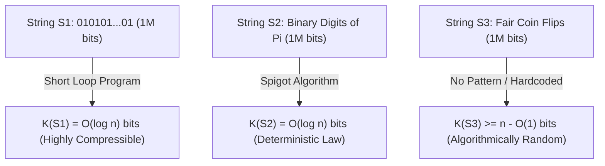
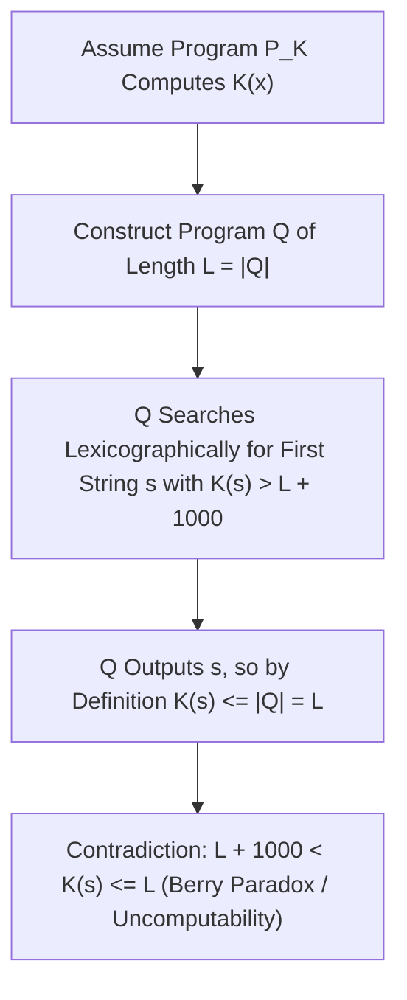

## Введение: Загадка трёх строк длиной в миллион бит — Слепое пятно теории информации Шеннона

Представьте, что перед вами лежат три двоичные строки, каждая длиной ровно $1\,000\,000$ бит:
- Первая строка $S_1$ — это пятьсот тысяч раз повторённая комбинация `01`: `01010101...01`.
- Вторая строка $S_2$ — первые $1\,000\,000$ двоичных знаков после запятой числа $\pi$: `1100100100001111110110...`.
- Третья строка $S_3$ получена в результате миллиона реальных подбрасываний симметричной монеты (орёл = `1`, решка = `0`).

Какая из этих трёх строк содержит больше «информации»? Какая из них «сложнее», и какая является по-настоящему «случайной»?
Если мы обратимся к классической <strong>теории информации Клода Шеннона (1948)</strong>, мы столкнёмся с неожиданным парадоксом: шенноновская энтропия $H(X) = -\sum P(x)\log_2 P(x)$ измеряет среднюю неопределённость <strong>распределения вероятностей (ансамбля источника)</strong>, но совершенно ничего не говорит о внутренней сложности <strong>отдельного конкретного объекта $x$</strong>! В модели честной монеты вероятность выпадения идеально регулярной строки $S_1$ и хаотичной строки $S_3$ абсолютно одинакова и равна $2^{-1\,000\,000}$; а для детерминированной константы $\pi$ ($S_2$) распределение вообще вырождено в одну точку с нулевой энтропией ($H=0$), хотя частота нулей и единиц в ней проходит любые статистические тесты на псевдослучайность!

Чтобы дать строгое математическое определение сложности и случайности индивидуального объекта, Рэй Соломонофф (1960), <strong>Андрей Николаевич Колмогоров (1965)</strong> и Грегори Хайтин (1966) независимо друг от друга создали <strong>алгоритмическую теорию информации (Algorithmic Information Theory, AIT)</strong>. Их ключевая идея проста и гениальна: <strong>истинная сложность объекта определяется не количеством символов в нём, а длиной самой короткой компьютерной программы, способной этот объект породить!</strong>

---

## 1. Колмогоровская сложность $K(x)$ и теорема об инвариантности

Зафиксируем универсальную машину Тьюринга $U$ (или любой Тьюринг-полный язык программирования, такой как C или Python). <strong>Колмогоровской сложностью</strong> $K_U(x)$ двоичной строки $x \in \{0,1\}^*$ называется битовая длина $|p|$ кратчайшей программы $p$, которая при запуске на машине $U$ выводит строку $x$ и останавливается. Чтобы выполнялось неравенство Крафта $\sum 2^{-|p|} \le 1$, в современной теории обычно используется <strong>беспрефиксная сложность (сложность Левина — Хайтина)</strong> $K(x)$, при которой ни одна допустимая программа не является началом другой.

Взглянем на наши три строки длиной в миллион бит сквозь призму $K(x)$:
- Для $S_1$ достаточно крошечной программы `print("01" * 500000)`. Поскольку в программе нужно закодировать лишь двоичную запись счётчика цикла $n/2$, получаем $K(S_1) = O(\log_2 n) pprox 20$ бит — эта строка <strong>алгоритмически тривиальна</strong>.
- Для $S_2$ (первые $n$ бит числа $\pi$), несмотря на кажущийся хаос битов, программа длиной в несколько сотен байт, реализующая формулу Мэчина или капельный алгоритм BBP, вычисляет $S_2$ абсолютно точно. Следовательно, и здесь $K(S_2) = O(\log_2 n)$! Это открывает глубокую философскую истину: <strong>закон природы — это не что иное, как предельное алгоритмическое сжатие эмпирических наблюдений.</strong>
- Напротив, для строки $S_3$, полученной бросками монеты, не существует никакой скрытой закономерности. Кратчайшая программа для вывода $S_3$ вынуждена буквально хранить все миллион бит в явном виде (`print("1011001...")`), поэтому $K(S_3) pprox n + O(1) pprox 1\,000\,000$ бит!

Возникает естественный вопрос: не зависит ли $K_U(x)$ от произвольного выбора языка программирования $U$? <strong>Теорема Колмогорова об инвариантности (Invariance Theorem)</strong> доказывает, что нет: для любых двух универсальных машин Тьюринга $U_1$ и $U_2$ существует константа $c_{12}$, зависящая только от $U_1$ и $U_2$ (и <strong>не зависящая от строки $x$</strong>), такая что $|K_{U_1}(x) - K_{U_2}(x)| \le c_{12}$. Доказательство прозрачно: $c_{12}$ — это просто фиксированный размер <strong>интерпретатора (симулятора)</strong> машины $U_2$, написанного на языке $U_1$! При стремлении длины данных $n 	o \infty$ эта константа становится пренебрежимо малой.

$$
H(X) = -\sum_{x \in \mathcal{X}} P(X = x) \log_2 P(X = x)
$$

$$
K_U(x) = \min_{p \in \{0,1\}^*} \Big\{ |p| \;\Big|\; U(p) = x \Big\}, \qquad \Big| K_{U_1}(x) - K_{U_2}(x) \Big| \le c_{12}
$$

---

## 2. Природа случайности: принцип Дирихле, несжимаемость и случайность по Мартин-Лёфу

До Колмогорова теория вероятностей не могла объяснить, почему индивидуальная строка `0000000000` не случайна, а `0110100110` кажется случайной. Алгоритмическая теория информации дала первое строгое определение: <strong>случайность есть несжимаемость — полное отсутствие алгоритмических закономерностей!</strong>

Более того, с помощью элементарного <strong>принципа Дирихле (Pigeonhole Principle)</strong> в две строчки доказывается, что <strong>подавляющее большинство двоичных строк алгоритмически случайны (несжимаемы)</strong>:
Всего существует ровно $2^n$ двоичных строк длины $n$. А сколько существует двоичных программ длины строго меньше $n - c$ бит? Суммируя количество программ длины $0, 1, \dots, n-c-1$, получаем $\sum_{i=0}^{n-c-1} 2^i = 2^{n-c} - 1$ возможных программ. Поскольку каждая программа выдаёт не более одного результата, из $2^n$ строк длины $n$ <strong>не более чем $2^{n-c} - 1$ строк могут быть сжаты хотя бы на $c$ бит</strong> ($K(x) < n - c$)!
Иными словами, доля строк длины $n$, поддающихся сжатию на $c$ бит и более, строго меньше $2^{-c}$. При $c = 20$ свыше $99,9999\,\%$ всех строк невозможно сжать даже на $20$ бит никаким мыслимым алгоритмом! Пер Мартин-Лёф в 1966 году доказал, что бесконечная двоичная последовательность проходит все вычислимые статистические тесты на случайность (<strong>случайность по Мартин-Лёфу</strong>) тогда и только тогда, когда все её префиксы $x_{1:n}$ несжимаемы ($K(x_{1:n}) \ge n - O(1)$).

$$
\sum_{i=0}^{n-c-1} 2^i = 2^{n-c} - 1 \implies \mathbb{P}_{x \sim \text{Unif}(\{0,1\}^n)}\big( K(x) < n - c \big) < \frac{2^{n-c}}{2^n} = 2^{-c}
$$

$$
\Omega = \sum_{p:\, U(p)\text{ halts}} 2^{-|p|} \in (0, 1), \qquad K(\Omega_{1:n}) \ge n - O(1)
$$

---

## 3. Парадокс Берри, невычислимость $K(x)$, константа Хайтина $\Omega$ и современный ИИ

Можно ли написать идеальный архиватор, который для любой входной строки $x$ вычисляет её точную сложность $K(x)$? Ответ категоричен: <strong>нет, функция $K(x)$ алгоритмически невычислима!</strong>

Это ограничение восходит к классическому <strong>парадоксу Берри</strong> («наименьшее натуральное число, которое нельзя описать менее чем двадцатью словами» — фраза из двенадцати слов, описывающая это число!). Грегори Хайтин формализовал его так: допустим, существует подпрограмма `ComputeK(x)` фиксированной длины $L$ бит, вычисляющая $K(x)$. Построим главную программу $Q$, которая перебирает все строки $s$ в лексикографическом порядке, вызывает `ComputeK(s)` и выводит первую же строку $s^*$, для которой $K(s^*) > L + 10000$. Полная длина программы $Q$ составляет всего $L + O(1)$ бит, но она выдаёт $s^*$! По определению $K(s^*)$ как длины кратчайшей программы должно выполняться $K(s^*) \le |Q| < L + 10000$, что прямо противоречит условию $K(s^*) > L + 10000$! Отсюда следует <strong>теорема Хайтина о неполноте</strong>: никакая формальная аксиоматическая система сложности $C$ бит не способна доказать оценку $K(x) > C + O(1)$ ни для какой конкретной строки $x$.

Хайтин также определил вероятность остановки универсальной беспрефиксной машины Тьюринга — легендарную <strong>константу Омега $\Omega = \sum_{U(p)	ext{ останавливается}} 2^{-|p|}$</strong>. Число $\Omega \in (0,1)$ строго определено, но <strong>абсолютно невычислимо и алгоритмически случайно</strong> ($K(\Omega_{1:n}) \ge n - O(1)$): знание первых $n$ бит числа $\Omega$ позволяет решить проблему остановки Тьюринга для всех программ длины до $n$!

В современной инженерии и искусственном интеллекте вычислимые оценки сверху для $K(x)$ лежат в основе прорывных технологий:
1. <strong>Связь с энтропией Шеннона</strong>: для стационарных эргодических источников математическое ожидание $rac{1}{n}\mathbb{E}[K(X_{1:n})]$ сходится к скорости энтропии Шеннона $H(X)$.
2. <strong>Универсальная индукция Соломоноффа и принцип минимальной длины описания (MDL)</strong>: бритва Оккама формализуется через универсальное априорное распределение $P_M(x) \propto 2^{-K(x)}$.
3. <strong>Нормализованное расстояние сжатия (NCD)</strong>: аппроксимируя $K(x)$ реальными архиваторами (`zstd`, `lzma`, `gzip`), формула $	ext{NCD}(x,y) = rac{C(xy) - \min(C(x),C(y))}{\max(C(x),C(y))}$ позволяет строить эволюционные деревья геномов и классифицировать вредоносный код без ручного выделения признаков.
4. <strong>Большие языковые модели (LLM): сжатие есть интеллект</strong>: как показали Маркус Хаттер (Hutter Prize) и Илья Суцкевер, минимизация кросс-энтропийной функции потерь $-\sum \log_2 P_	heta(x_t \mid x_{<t})$ авторегрессионного трансформера с помощью арифметического кодирования <strong>математически эквивалентна поиску кратчайшего сжатия данных без потерь</strong>. Чтобы сжать человеческие тексты до предела, нейросеть вынуждена усвоить грамматику, логику и причинно-следственную модель мира.

| Измерение / Концепция | Энтропия Шеннона $H(X)$ | Колмогоровская сложность $K(x)$ | Инженерные аппроксимации (MDL / LLM / NCD) |
| :--- | :--- | :--- | :--- |
| <strong>Объект измерения</strong> | Распределение вероятностей (ансамбль) | <strong>Индивидуальный объект / строка $x$</strong> | Реальные файлы, геномы, текстовые корпуса |
| <strong>Оценка первых $10^6$ бит числа $\pi$</strong> | Детерминированная константа ($H=0$); частоты равномерны | $K(\pi_{1:n}) = O(\log n)$ (проста благодаря короткому алгоритму) | Арифметическое кодирование и нейросети находят структуру |
| <strong>Вычислимость</strong> | Точно вычислима при известном распределении $P(X)$ | <strong>Строго невычислима</strong> (эквивалентна проблеме остановки) | Оценки сверху через `zstd`/LZMA или Transformer $P_	heta$ |
| <strong>Ключевые теоремы и философия</strong> | Теорема Шеннона о кодировании источника | Теорема об инвариантности, неполнота Хайтина, число $\Omega$ | Бритва Оккама, «Сжатие = Предсказание = Интеллект» |

$$
P_M(x) = \sum_{p:\, U(p)=x} 2^{-|p|} \approx 2^{-K(x)}, \qquad \text{NCD}(x, y) = \frac{C(xy) - \min\{C(x), C(y)\}}{\max\{C(x), C(y)\}}
$$
