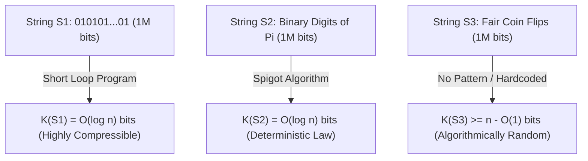
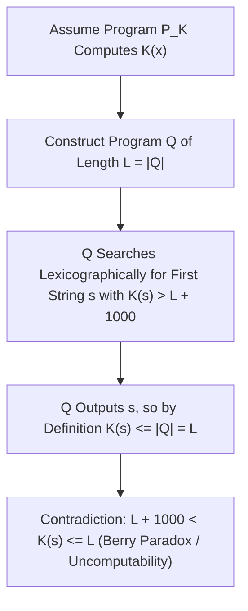

## 引言：三个一百万比特字符串的谜题——香农信息论的盲区

想象你面前有三个长度均为 $1,000,000$ 比特（bit）的二进制字符串：
- 第一个字符串 $S_1$ 是交替重复五十万次的 `01010101...01`；
- 第二个字符串 $S_2$ 是圆周率 $\pi$ 的二进制展开小数点后的前 $1,000,000$ 位：`1100100100001111110110...`；
- 第三个字符串 $S_3$ 是你通过连续抛掷一百万次均匀硬币（正面记为 `1`，反面记为 `0`）亲手记录下来的序列。

现在请问：<strong>这三个字符串哪一个包含更多的“信息”？哪一个更“复杂”？哪一个才是真正“随机”的？</strong>
如果我们向克劳德·香农（Claude Shannon）在1948年创立的经典<strong>香农信息论（Classical Information Theory）</strong>寻求答案，我们会遭遇一个意想不到的困境。香农熵 $H(X) = -\sum P(x)\log_2 P(x)$ 衡量的是一个<strong>概率分布（随机信源的系综 Ensemble）</strong>的平均不确定性，而不是<strong>单个具体对象（Individual Object）</strong>本身的内在复杂性！在均匀抛硬币模型下，产生 $S_1$（全 `01` 交替）的概率与产生 $S_3$（任意特定乱序序列）的概率完全相等，都是 $2^{-1,000,000}$；而对于确定性常数 $S_2$（$\pi$ 的展开），它的概率分布甚至是退化的单点分布（熵为 $0$），但它的0和1统计频率却与随机抛硬币几乎无法区分！

为了给“单个字符串的复杂性与随机性”奠定严格的数学基础，20世纪60年代，雷·索洛莫诺夫（Ray Solomonoff, 1960）、<strong>安德烈·柯尔莫哥洛夫（Andrey Kolmogorov, 1965）</strong>与格雷戈里·蔡廷（Gregory Chaitin, 1966）各自独立地创立了<strong>算法信息论（Algorithmic Information Theory, AIT）</strong>。他们的核心洞见惊人地一致：<strong>一个对象的真正复杂性，不在于它表面上有多少个字符，而在于能够生成它的“最短计算机程序”有多长！</strong>

---

## 1. 柯尔莫哥洛夫复杂性 $K(x)$ 与普适图灵机的不变性定理

给定一台通用图灵机（Universal Turing Machine, 或任意图灵完备的编程语言如 Python/C）$U$，字符串 $x \in \{0,1\}^*$ 的<strong>柯尔莫哥洛夫复杂性（Kolmogorov Complexity，又称算法熵或描述复杂性）</strong> $K_U(x)$ 定义为：在图灵机 $U$ 上运行后能够输出 $x$ 并停机的最短二进制程序 $p$ 的比特长度 $|p|$。为了使概率之和收敛（满足克拉夫特不等式 $\sum 2^{-|p|} \le 1$），现代理论通常采用<strong>前缀无关复杂性（Prefix-Free Complexity / Levin-Chaitin Complexity）</strong> $K(x)$，即要求没有任何合法程序是另一个合法程序的前缀。

用 $K(x)$ 的视角重新审视开篇的三个一百万比特字符串，迷雾瞬间消散：
- 对于 $S_1$，程序只需写 `print("01" * 500000)`。无论长度 $n$ 多大，程序只需存储循环次数 $n/2$ 的二进制表示，因此 $K(S_1) = O(\log_2 n) pprox 20$ 比特，它是<strong>极端简单的</strong>。
- 对于 $S_2$（$\pi$ 的前 $n$ 位），虽然表面上看起来杂乱无章、通过了几乎所有统计伪随机检验，但我们可以写一段百余字节的马青公式（Machin-like formula）或 BBP 滴定算法程序来精确计算前 $n$ 位，因此同样有 $K(S_2) = O(\log_2 n)$！这揭示了科学哲学的核心真理：<strong>自然法则（Law）的本质就是对观测数据的极限压缩</strong>。
- 对于真正随机抛硬币产生的 $S_3$，它内部没有任何可压缩的规律。要在计算机上输出 $S_3$，最短的程序只能是把这一百万个比特原封不动地硬编码进程序里：`print("1011001...")`，因此 $K(S_3) pprox n + O(1) pprox 1,000,000$ 比特！

也许你会质疑：如果换一种编程语言（比如从 C 语言换成 Python 或汇编语言），最短程序的长度岂不是会改变吗？<strong>柯尔莫哥洛夫不变性定理（Invariance Theorem）</strong>完美消除了这一顾虑：对于任意两台通用图灵机 $U_1$ 和 $U_2$，存在一个仅依赖于 $U_1$ 和 $U_2$（而与字符串 $x$ 完全无关）的常数 $c_{12}$，使得对一切 $x$ 都有 $|K_{U_1}(x) - K_{U_2}(x)| \le c_{12}$。证明极其直观：$c_{12}$ 不过是在图灵机 $U_1$ 上编写一个能够模拟 $U_2$ 的<strong>解释器（Interpreter / 交叉编译器）</strong>所需的固定比特数！当数据规模 $n 	o \infty$ 时，固定长度的解释器开销 $c_{12}$ 完全可以忽略不计，$K(x)$ 成为了独立于具体硬件与语言的绝对数学不变量。

$$
H(X) = -\sum_{x \in \mathcal{X}} P(X = x) \log_2 P(X = x)
$$

$$
K_U(x) = \min_{p \in \{0,1\}^*} \Big\{ |p| \;\Big|\; U(p) = x \Big\}, \qquad \Big| K_{U_1}(x) - K_{U_2}(x) \Big| \le c_{12}
$$

---

## 2. 随机性的正体：鸽巢原理、不可压缩性与马丁-洛夫随机

在柯尔莫哥洛夫之前，概率论学家一直无法回答：“为什么 `0000000000` 不是随机序列，而 `0110100110` 看起来是随机的？”算法信息论给出了人类历史上第一个关于单个对象随机性的严格定义：<strong>随机性就是不可压缩性（Randomness is Incompressibility），即规律的彻底缺席！</strong>

更令人震惊的是，利用最基础的<strong>鸽巢原理（Pigeonhole Principle）</strong>，我们可以用两行算术证明<strong>宇宙中绝大多数字符串都是算法随机（不可压缩）的</strong>：
考虑所有长度为 $n$ 的二进制字符串，共有 $2^n$ 个。那么，长度严格小于 $n - c$ 比特的二进制程序一共有多少个呢？把长度为 $0, 1, 2, \dots, n-c-1$ 的所有可能程序加起来，总数为：$\sum_{i=0}^{n-c-1} 2^i = 2^{n-c} - 1$。由于每个程序最多只能输出一个结果，这意味着在 $2^n$ 个长度为 $n$ 的字符串中，能够被压缩掉至少 $c$ 个比特（即满足 $K(x) < n - c$）的字符串<strong>最多只有 $2^{n-c} - 1$ 个</strong>！
换言之，随机抽取一个长度为 $n$ 的字符串，它能被压缩超过 $c$ 比特的概率严格小于 $2^{-c}$。取 $c = 20$，就有超过 $1 - 2^{-20} pprox 99.9999\%$ 的字符串连区区 $20$ 比特都无法被任何算法压缩！佩尔·马丁-洛夫（Per Martin-Löf, 1966）进一步证明了：一个无限二进制序列能够通过所有可计算的统计显著性检验（Martin-Löf Randomness），当且仅当它的所有长度为 $n$ 的前缀 $x_{1:n}$ 都是不可压缩的（满足 $K(x_{1:n}) \ge n - O(1)$）。

$$
\sum_{i=0}^{n-c-1} 2^i = 2^{n-c} - 1 \implies \mathbb{P}_{x \sim \text{Unif}(\{0,1\}^n)}\big( K(x) < n - c \big) < \frac{2^{n-c}}{2^n} = 2^{-c}
$$

$$
\Omega = \sum_{p:\, U(p)\text{ halts}} 2^{-|p|} \in (0, 1), \qquad K(\Omega_{1:n}) \ge n - O(1)
$$

---

## 3. 贝里悖论、不可计算性与蔡廷停机概率 $\Omega$ 及现代 AI 压缩律

既然 $K(x)$ 如此强大，我们能否写出一个终极压缩软件，输入任意字符串 $x$，直接算出它的 $K(x)$ 呢？答案是<strong>绝对不可能——函数 $K(x)$ 是不可计算的（Uncomputable）！</strong>

这一深刻限制源于古老的<strong>贝里悖论（Berry's Paradox）</strong>：“不能用少于二十个汉字定义的最大正整数”（这句话本身只有十四个汉字，却定义了那个数，从而产生矛盾）。格雷戈里·蔡廷将其转化为严格的停机归谬法证明：假设存在一个子程序 `ComputeK(x)` 能够算出任意 $x$ 的复杂性，其代码固定长度为 $L$ 比特。我们构造一个主程序 $Q$：按字典序枚举所有二进制字符串 $s$，调用 `ComputeK(s)`，一旦找到第一个满足 $K(s) > L + 10000$ 的字符串 $s^*$，就立即打印 $s^*$ 并停机。这个主程序 $Q$ 的总长度不过是 $L + O(1)$ 比特（远小于 $L + 10000$），但它却成功输出了 $s^*$！根据 $K(s^*)$ 作为“最短输出程序长度”的定义，必然有 $K(s^*) \le |Q| < L + 10000$，与 $K(s^*) > L + 10000$ 直接矛盾！由此直接导出<strong>蔡廷不完备性定理（Chaitin's Incompleteness Theorem）</strong>：任何信息量为 $C$ 比特的公理化形式系统（如 ZFC 集合论），都永远无法证明任何一个具体字符串的复杂性 $K(x) > C + O(1)$。

蔡廷还将所有停机程序的长度汇聚成了一个传奇的实数——<strong>蔡廷常数 $\Omega = \sum_{U(p)	ext{ halts}} 2^{-|p|}$（停机概率）</strong>。$\Omega$ 是一个明确定义在 $(0,1)$ 之间的实数，但它是<strong>极端不可计算且算法随机的</strong>：它的前 $n$ 位二进制展开 $\Omega_{1:n}$ 满足 $K(\Omega_{1:n}) \ge n - O(1)$，知道 $\Omega$ 的前 $n$ 位就等价于解决了所有长度不超过 $n$ 的程序的图灵停机问题！

在现实工程与人工智能中，虽然精确的 $K(x)$ 不可计算，但它的可计算上界正驱动着现代信息科技：
1. <strong>香农熵与柯氏复杂性的桥梁</strong>：对于平稳遍历随机过程，期望柯氏复杂性除以长度收敛于香农熵率 $\lim_{n	o\infty} rac{1}{n}\mathbb{E}[K(X_{1:n})] = H(X)$。
2. <strong>索洛莫诺夫普适归纳（Solomonoff Induction）与最小描述长度（MDL）</strong>：将奥卡姆剃刀定律形式化为先验分布 $P_M(x) \propto 2^{-K(x)}$，越短的程序（越简洁的科学假说）具有指数级越高的先验后验权重。
3. <strong>归一化压缩距离（Normalized Compression Distance, NCD）</strong>：利用真实压缩器（如 `zstd`、`lzma`、`gzip`）近似 $K(x)$，通过公式 $	ext{NCD}(x,y) = rac{C(xy) - \min(C(x),C(y))}{\max(C(x),C(y))}$ 在无需任何领域特征工程的情况下完成基因组演化树构建、恶意软件聚类与抄袭检测。
4. <strong>大语言模型（LLM）：压缩即智能（Compression is Intelligence）</strong>：正如 마커스 후터（Marcus Hutter）的 Hutter Prize 与 OpenAI 首席科学家伊利亚·苏茨克维（Ilya Sutskever）所指出的，自回归语言模型最小化交叉熵损失 $-\sum \log_2 P_	heta(x_t \mid x_{<t})$ 在算术编码下<strong>严格等价于寻找人类全部文本数据的最短无损压缩编码</strong>。模型为了把数据压缩到极致，不得不内化语法、逻辑推理与物理世界的因果模型——<strong>无损压缩的极限，就是通用人工智能（AGI）的涌现</strong>。

| 维度 / 概念 | 香农信息熵 $H(X)$ | 柯尔莫哥洛夫复杂性 $K(x)$ | 现代工程近似（MDL / LLM / NCD） |
| :--- | :--- | :--- | :--- |
| <strong>衡量对象</strong> | 随机变量的概率分布（系综 Ensemble） | <strong>单个具体字符串/对象 $x$ 本身</strong> | 具体文件、基因组序列、自然语言语料 |
| <strong>对 $\pi$ 的前 $10^6$ 位的判定</strong> | 若看作确定性常数则 $H=0$；统计频率近似均匀 | $K(\pi_{1:n}) = O(\log n)$（极度简单，由短算法生成） | 高阶算术编码/神经网络可捕获深层结构 |
| <strong>可计算性（Computability）</strong> | 已知分布 $P(X)$ 时完全可计算 | <strong>严格不可计算</strong>（等价于图灵停机问题） | 由 Lempel-Ziv (`zstd`) 或 Transformer $P_	heta$ 提供可计算上界 |
| <strong>核心哲学与数学定理</strong> | 信源编码定理（无损压缩极限为 $H(X)$） | 不变性定理、蔡廷不完备定理、停机概率 $\Omega$ | 奥卡姆剃刀形式化、“压缩即智能（Compression = Prediction）” |

$$
P_M(x) = \sum_{p:\, U(p)=x} 2^{-|p|} \approx 2^{-K(x)}, \qquad \text{NCD}(x, y) = \frac{C(xy) - \min\{C(x), C(y)\}}{\max\{C(x), C(y)\}}
$$
