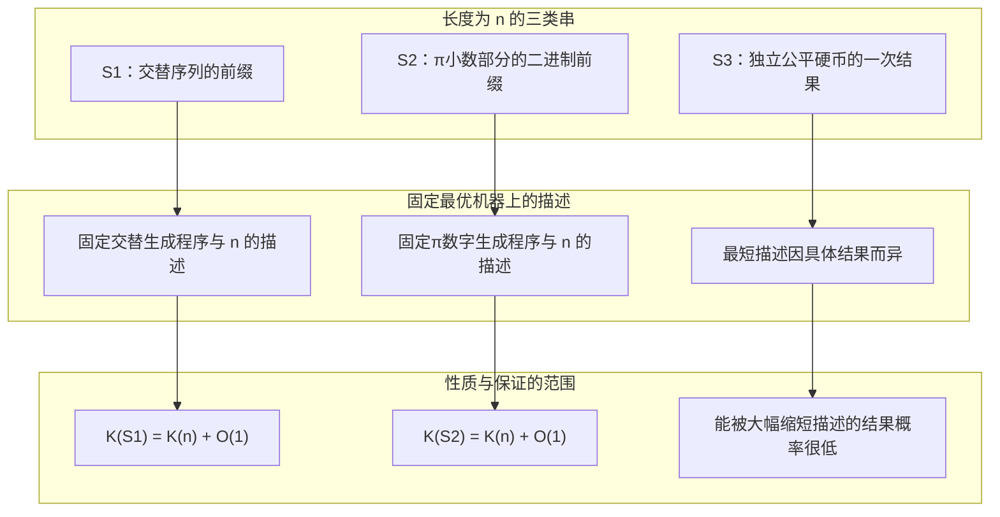
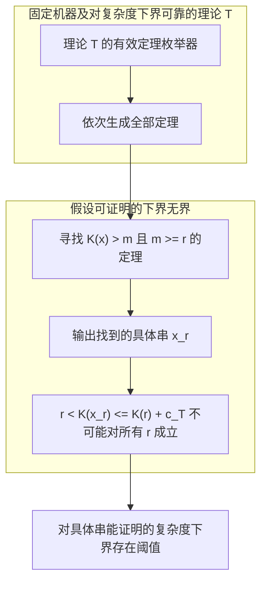

## 1. 三个百万比特串：长度等于复杂度吗？

考虑三个长度均为 $n=1{,}000{,}000$ 的二进制串。

1. $S_1$：将 `01` 重复五十万次。
2. $S_2$：取圆周率 $\pi$ 的<strong>小数部分</strong>二进制展开的前一百万比特。
3. $S_3$：独立抛掷公平硬币一百万次这一概率模型产生的一个结果。

将比特紧密打包，三者都占125,000字节，即十进制的125 kB。但若把 `0` 和 `1` 当作ASCII或UTF-8字符保存，就需要一百万字节。文件头和对象管理开销另计。

$\pi$ 的二进制表示以 $11.0010010000111111\ldots{}_2$ 开头，因此去掉整数部分后的 $S_2$ 以 `0010010000111111...` 开头。这里的短串只是示意，并不表示本文实际进行了百万次物理硬币实验。

$S_1$ 可用重复规则生成，$S_2$ 也有计算所需各位的算法。但 $S_3$ 不一定复杂：公平硬币也可能偶然给出全零串或交替串。正确结论是一个高概率陈述：<strong>固定计算模型后，能被大幅缩短描述的结果只占很小的比例</strong>。

在独立公平硬币模型中，每一个指定的 $n$ 比特串概率相同，交替串与 $\pi$ 的前缀也不例外。

$$
P(X=x)=2^{-n},\qquad x\in\{0,1\}^n
$$

怎样刻画这些等概率结果之间“是否存在简短生成规则”的差别？这正是索洛莫诺夫、柯尔莫哥洛夫、蔡廷等人自20世纪60年代起发展的<strong>算法信息论（AIT）</strong>研究的问题。核心量是“输出该串并停机的最短程序的比特长度”。

---

## 2. 香农信息量与单个字符串

### 2.1 自信息、熵与编码

对于离散分布 $P$，应区分概率 $P(x)>0$ 的单个结果的自信息与其平均值——熵。以下对数默认以2为底，信息量单位为比特。

$$
I_P(x)=-\log_2P(x),\qquad
H(P)=-\sum_xP(x)\log_2P(x)
$$

求和时约定 $0\log_2 0=0$。模型赋予零概率的结果具有无穷大的自信息。

对有限字母表中的一个符号使用二进制前缀码，平均码长不能小于熵，而且存在平均码长小于熵加一的编码。

$$
H(P)\le L_{\mathrm{opt}}<H(P)+1
$$

这并不表示每个码字长度都等于熵。将 $r$ 个独立同分布的符号组成一块，可以减小每个符号承担的整数取整开销。

$$
H(P)\le \frac{L_{\mathrm{opt},r}}{r}<H(P)+\frac1r
$$

对于有依赖的信息源，要考虑块分布或熵率。讨论哈夫曼编码和算术编码时，同样需要区分所用模型、平均量和单次结果。

### 2.2 模型选择与经验频率

$-\log_2P(x)$ 不只是 $x$ 的性质，还取决于所选分布 $P$。公平硬币模型甚至给交替串赋予一百万比特的自信息。反过来，若选取只以概率1输出该特定串的点质量分布，其熵就是0；但这不等于把模型本身传给接收者的成本也为0。

只统计单个比特的频率，`01` 重复串的0和1各占一半，零阶经验熵为1比特。不过，利用前一个比特预测下一个比特的模型能够捕捉其中的规律。

$$
\widehat H_0((01)^{n/2})
=-\tfrac12\log_2\tfrac12-\tfrac12\log_2\tfrac12=1
$$

若统计长度为 $k$ 的重叠块，交替串至多出现两种块，所以整个块的经验熵至多为1比特，除以 $k$ 后每比特至多为 $1/k$。块的熵与每比特的熵不是同一个量。

$\pi$ 的正规性，即每一种固定长度的块都以相同极限频率出现，并未被证明。有限频率检验和表面无序不能证明正规性。即使一个数是正规数，其数字序列仍然可以是可计算的。而且，如果概率预测模型能计算 $\pi$ 的数字，香农式预测和编码也能利用这条规律；香农理论并不限于零阶频率模型。

AIT并不否定香农理论。<strong>相对于概率模型的码长与相对于固定计算机的单个对象描述长度，回答的是不同问题。</strong>

| 角度 | 香农信息量 | 算法描述长度 |
| :--- | :--- | :--- |
| 对象 | 分布及其下的单个结果 | 固定机器输出的有限串 |
| 参照 | 概率模型与编码规则 | 机器、程序编码与辅助输入 |
| 主要量 | $I_P(x)$、$H(P)$、熵率 | 普通复杂度 $C(x)$、前缀复杂度 $K(x)$ |
| 限制 | 描述模型的成本需要另计 | 存在机器相关常数与不可计算性 |
| 对 $\pi$ 的处理 | 取决于选择的模型 | 可描述数字生成规则，但还要交代终点 |

---

## 3. 最短程序与不变性定理

### 3.1 普通复杂度与条件复杂度

用 $\{0,1\}^*$ 表示全部有限二进制串，$|p|$ 表示程序的比特长度。对于部分可计算机器 $A$，$A(p)=x$ 表示机器在有限时间内停机，并且恰好输出 $x$。

$$
C_A(x)=\min\{|p|:A(p)=x\}
$$

若没有这样的程序，最小值约定为 $\infty$。当辅助输入 $y$ 免费提供时，定义：

$$
C_A(x\mid y)=\min\{|p|:A(p,y)=x\}
$$

预先知道长度或字典，与把长度或字典一并放入程序，是两种不同的成本计算方式。

### 3.2 自定界的前缀复杂度

<strong>前缀复杂度 $K$</strong>要求停机程序的集合是前缀自由的（prefix-free）：任何一个停机程序都不是另一个停机程序的真前缀。

$$
K_U(x)=\min\{|p|:U(p)=x\},\qquad
\sum_{p\in\operatorname{dom}U}2^{-|p|}\le1
$$

后一个式子是克拉夫特不等式。条件前缀复杂度要求，对于每个固定辅助输入 $y$，停机程序的集合都前缀自由。这里的自定界并不是给任意源代码加上一个右括号就能满足的条件。

以下的 $C$ 与 $K$ 分别固定其机器类别中加法最优的参考机器。下一节说明这种最优性。

拼接普通程序需要交代边界。使用固定的可计算有序对编码，例如可以得到：

$$
C(x,y)\le C(x)+C(y)
+2\log_2\bigl(\min\{C(x),C(y)\}+2\bigr)+O(1)
$$

自定界程序可以直接连接并解释，使用条件描述后，上界更简洁：

$$
K(x,y)\le K(x)+K(y\mid x)+O(1)
\le K(x)+K(y)+O(1)
$$

对于固定的相应参考机器，两类复杂度满足：

$$
C(x)\le K(x)+O(1),\qquad
K(x)\le C(x)+2\log_2(C(x)+2)+O(1)
$$

$O(1)$ 指不依赖于对象 $x$ 的常数，而不是实际测得开销为零或只有几个比特。

### 3.3 加法最优机器的不变性

对于 $C$，在普通机器类别中选取加法最优机器；对于 $K$，在前缀自由机器类别中选取加法最优机器。若“通用”只表示能够模拟其他机器，还必须另行指定描述长度只有常数开销这一性质。

对前缀复杂度，任意前缀自由机器 $A$ 都对应一个不依赖 $x$ 的常数 $c_A$，使得：

$$
K_U(x)\le K_A(x)+c_A
$$

<strong>证明的构造</strong>是在程序 $p$ 前加上识别机器 $A$ 的固定自定界标签 $s_A$，让参考机器模拟 $A(p)$。若 $A(p)=x$，这个模拟程序以 $|p|+|s_A|$ 加上固定开销的长度输出 $x$；最短程序不会更长。可以用这种方式构造最优机器。普通复杂度也有同类别内的对应论证。

对两台加法最优机器双向应用这个上界，得到：

$$
|K_{U_1}(x)-K_{U_2}(x)|\le c_{12}
$$

常数应当覆盖两个方向的模拟成本，不能只把单向解释器的大小等同于复杂度绝对差的界。

可以设计一台专用机器，用一个很短的指令输出某个特定的百万比特串。模拟这台机器的成本进入常数，但不变性定理并不消除有限对象的机器依赖性。常数除以长度 $n$ 的相对影响在 $n\to\infty$ 时趋于0；一般情况下，仍无法知道任意具体串的精确最短描述。现实中内存有限的CPU和语言实现，也不等同于数学模型中允许无界存储的机器。

### 3.4 重新分析交替串、圆周率与硬币

将整数 $n$ 与其固定的二进制表示对应起来。设 $s(n)$ 为长度 $n$ 的交替前缀，或 $\pi$ 小数部分的前 $n$ 个二进制位。由 $n$ 可以计算出串，由串的长度又可以求出 $n$。两个方向的可计算变换给出：

$$
K(s(n))=K(n)+O(1),\qquad K(s(n)\mid n)=O(1)
$$

免费提供终点时，只需固定长度的生成程序；否则需要描述 $n$。例如，对 $n\ge2$ 使用自定界整数编码可得：

$$
K(n)\le \log_2 n+2\log_2\log_2 n+O(1)=O(\log n)
$$

但这并不意味着对所有整数都有 $K(n)=\log_2n+O(1)$。若 $n=2^m$，可以先描述指数 $m$，再重建 $n$，从而利用 $m$ 的简短描述。



不能断言 $S_3$ 的最短描述一定只是复制原始数据。下面用计数说明其正确的概率含义。

---

## 4. 不可压缩性与无限序列的随机性

### 4.1 直接输出原串的上界

对于任意长度为 $n$ 的串 $x$，直接输出它的描述给出普通复杂度及已知长度的条件前缀复杂度上界：

$$
C(x)\le n+O(1),\qquad K(x\mid n)\le n+O(1)
$$

无条件的前缀描述还需要自定界地交代长度：

$$
K(x)\le n+K(n)+O(1)
$$

不能对所有串都断言 $K(x)\le |x|+O(1)$。否则每个长度 $n$ 下的总权重 $\sum_{|x|=n}2^{-K(x)}$ 都至少是同一个正常数；对所有长度求和便会违反克拉夫特不等式。

### 4.2 鸽巢原理的精确计数

设整数 $n\ge0$、$0\le c\le n$。长度严格小于 $n-c$ 的二进制程序共有：

$$
\sum_{j=0}^{n-c-1}2^j=2^{n-c}-1
$$

$c=n$ 时把空和规定为0。一个停机程序至多输出一个串，因此长度为 $n$ 且满足 $C(x)<n-c$ 的串不会超过上述数目。于是：

$$
\#\{x\in\{0,1\}^n:C(x)\ge n-c\}
\ge2^n-2^{n-c}+1
$$

有些短程序不停止，或者输出相同的串，所以能够被短描述表示的串还可能更少。$c>n$ 时 $n-c<0$，所有串都自动满足 $C(x)\ge n-c$；不能把这一几何和公式直接延伸到该范围。

在公平硬币的均匀分布下，计数结果成为：

$$
P\{C(X)<n-c\}
\le\frac{2^{n-c}-1}{2^n}<2^{-c}
$$

$c=0$ 时，每种长度都至少有一个串满足 $C(x)\ge n$。$c=1$ 时，超过一半的串不能缩短<strong>超过</strong>1比特。$c=10$、$c=20$ 时，不能缩短超过10比特、20比特的串的比例，其下界 $1-2^{-c}$ 分别约为99.902%和99.999905%。这并不禁止恰好节省 $c$ 比特。

固定长度条件 $n$ 后，同样的计数也适用于 $K(x\mid n)$。所以公平硬币结果以高概率需要接近自身长度的描述，却不是对每一个结果的确定保证。

若某种可逆压缩器能把所有文件都缩短，就会违反这一计数。实际压缩器只擅长利用某些规则。全体二进制串上均匀分布的比例，不能直接解释成自然界或人类数据中结构化对象出现的比例。

### 4.3 马丁–洛夫随机性

有限串不能缩短指定的比特数，与无限序列的随机性，是两种不同的定义。对无限二进制序列空间使用公平硬币测度 $\mu$。所有以有限串 $w$ 开头的序列构成柱集 $[w]$，其测度为 $2^{-|w|}$。

<strong>马丁–洛夫检验</strong>由一列开集 $V_j$ 构成；它们作为有限前缀柱集的并，可以一致地计算枚举，并满足：

$$
\mu(V_j)\le2^{-j},\qquad j=1,2,\ldots
$$

若 $\omega\in\bigcap_jV_j$，就称该序列未通过这个检验。不落入任何这类检验的失败集合，才称为马丁–洛夫随机。它并不是“从不出现任何罕见的有限模式”。这样的有效检验只有可数多个，每个失败集合测度都为0，因此通过所有检验的序列集合测度为1。

莱文–施诺尔定理用最优<strong>前缀</strong>复杂度给出如下等价：

$$
\omega\text{ 是马丁–洛夫随机序列}
\iff
\exists c\ \forall n\quad K(\omega_{1:n})\ge n-c
$$

关键在于<strong>同一个常数 $c$</strong>适用于所有 $n$。不能把式中的 $K$ 直接替换为普通复杂度 $C$。

历史上冯·米塞斯、丘奇等人研究过位置选择规则；允许的检验或下注策略采用不同的可计算性条件，会得到不同的随机性定义。特别是“任何可计算鞅都不能获得无界资本”的可计算随机性，比马丁–洛夫随机性弱，二者不是同义词。

可计算的 $\pi$ 无限数字序列不是马丁–洛夫随机序列。这也再次说明，算法随机性不同于正规性。

---

## 5. 不可计算性、证明的限度与停机概率

### 5.1 可以从上方逼近，却没有一般的终止判据

交错模拟（dovetailing）让各个候选程序每次运行少量步骤。记录目前找到的最短描述，就可以不断更新 $K(x)$ 的上界。

$$
K_t(x)\searrow K(x)\qquad(t\to\infty)
$$

初始值可取直接输出原串所得的一个可计算有限上界。因为这些上界是整数，对每个固定 $x$，它们最终确实会达到真值并保持不变。但不存在对所有输入都能识别“这已经是真正最短值”的通用算法；尚未停机的更短候选仍可能在未来输出 $x$。

### 5.2 贝里式的反证

考虑短语“不能用少于二十个汉字定义的最小正整数”。不计引号和标点，它有18个汉字，确实少于20个。有限长度的表达式至多定义有限多个正整数，其余整数形成无限集合，没有最大值；悖论讨论的是其中的最小值。

自然语言中的“可定义”含义并不严格。因此，不把这句话本身当作形式证明，而是把它转化为可计算程序的反证。

假设存在一个对所有 $x$ 都返回其真实 $K(x)$ 并停机的过程 `ComputeK`。下面是使用这一不可能假设的<strong>伪代码</strong>，不是已经实现的复杂度计算器。

```text
Berry(m):
    按长度0,1,2,...递增、同一长度内按字典序枚举所有二进制串x:
        if ComputeK(x) >= m:
            输出x并停机
```

这称为长度优先字典序（shortlex）。普通字典序本身不能提供这里需要的全部有限串枚举。

计数说明复杂度无界，所以在假设成立时，搜索对每个 $m$ 都会停止，输出的 $x_m$ 满足 $K(x_m)\ge m$。另一方面，生成它只需固定程序和 $m$ 的自定界描述。

$$
m\le K(x_m)\le K(m)+c
\le \log_2m+2\log_2\log_2m+c'
$$

最后一个上界用于 $m\ge2$。对固定的 $c'$，足够大的 $m$ 会导致矛盾，故 `ComputeK` 不存在。不必把没有测量的机器开销强行指定为“多10000比特总够用”。

### 5.3 蔡廷不完备性定理

固定参考机器，以及能表达具体有限串复杂度命题的有效公理化理论 $T$。这里假设它所证明的复杂度下界命题都是真的，即具有相应的<strong>可靠性</strong>。

于是存在阈值 $b_T$，使 $T$ 无法对任何一个具体串 $x$ 证明“$K(x)>b_T$”。

证明的核心是：反设可证明的数值下界无界，则给定任意输入 $r$，都能枚举全部定理，最终找到某个形如“$K(x)>m$”且 $m\ge r$ 的定理。

```text
SearchProof(r):
    有效枚举理论T的所有定理:
        if 定理对具体串x和整数m断言“K(x) > m”，且m >= r:
            输出x并停机
```

可靠性保证输出 $x_r$ 的复杂度大于 $r$。但这个过程的固定代码已包含 $T$ 的定理枚举器，因而：

$$
r<K(x_r)\le K(r)+c_T=O(\log r)+c_T
$$

这对足够大的 $r$ 不可能成立，故可证明的数值下界必然有界。



阈值依赖机器、理论与表达方式，并不是测出了ZFC普遍适用的20,000比特或50,000比特极限。当串长 $n$ 与固定阈值相差足够大时，计数能够说明许多串的真实复杂度超过阈值；但对某个指定串证明这个下界，仍然受理论限制。

这把哥德尔以来的不完备性与算法描述联系起来，却不是禁止短公理导出长定理或大量定理的一般“信息守恒定律”。增加公理会得到另一套理论，其对应常数也会改变。

### 5.4 由机器决定的停机概率 $\Omega_U$

对最优的前缀自由机器 $U$，随机无限公平比特流以某个停机程序开头的概率是：

$$
\Omega_U=\sum_{p\in\operatorname{dom}U}2^{-|p|}
$$

对应停机程序的柱集互不相交，因此该和有概率解释。克拉夫特不等式给出 $\Omega_U\le1$。在包括最优性在内的这一设定下，$\Omega_U$ 还是不可计算的马丁–洛夫随机实数，并且 $0<\Omega_U<1$。这些额外性质并不适用于任意一台仅仅前缀自由的机器。

枚举已经停机的程序，其权重部分和从下方增加。因此 $\Omega_U$ 是<strong>左可计算枚举实数（left-c.e.）</strong>，却没有可计算的收敛模来告知何时达到了任意指定的精度。

假设准确知道它的前 $N$ 个二进制小数位，并以 $a$ 表示相应的二进制有理下端点。因为 $\Omega_U$ 没有有限终止的二进制展开，

$$
a=\frac{\lfloor2^N\Omega_U\rfloor}{2^N},
\qquad a<\Omega_U<a+2^{-N}
$$

交错运行程序，直到已枚举的停机权重部分和 $q_s$ <strong>超过</strong> $a$。此时：

$$
0\le\Omega_U-q_s<2^{-N}
$$

如果尚未枚举到的长度不超过 $N$ 的程序后来停机，就至少要再加入 $2^{-N}$，与剩余权重的界矛盾。因此可以判定<strong>同一台机器</strong>长度不超过 $N$ 的全部输入是否停机。

这不等于固定几千位就能判定无限多的任意数学命题。将反例搜索编码为停机问题时，机器、程序长度与命题的逻辑形式都有关。研究中特殊设定下的有限位计算，也不同于生成全部位数的算法。

---

## 6. 香农理论的桥梁、MDL、NCD与人工智能

### 6.1 平均描述长度与熵率

设有限串上的可计算离散分布 $P$ 由有限计算过程 $d_P$ 指定。若免费共享 $d_P$ 作为辅助输入，当 $H(P)<\infty$ 时，

$$
H(P)\le\mathbb E_{X\sim P}[K(X\mid d_P)]\le H(P)+c
$$

分布可以具有有限或可数支持，并要求各概率能够一致地计算到所需精度。常数 $c$ 包含固定解码过程的成本，不表示两边数值完全相等。

下界来自：在固定条件 $d_P$ 下，对最短前缀描述应用克拉夫特不等式，再使用平均码长的论证。上界来自：使用共享分布构造按概率分配的前缀码，再以固定程序解码。不共享分布时，模型的描述成本也必须计入。“知道”一个任意分布，并不保证能在有限时间内精确计算其熵。

另一个Brudno型关系适用于<strong>有限字母表上的平稳遍历过程</strong>。若熵率为每符号 $h$ 比特，则几乎每个样本序列都满足：

$$
\lim_{n\to\infty}\frac{K(X_{1:n})}{n}=h
$$

期望值也满足 $\mathbb E[K(X_{1:n})]/n\to h$。长度 $n$ 的符号串有一致的线性直接编码上界，因此可以由几乎处处收敛进一步讨论期望收敛。普通复杂度与前缀复杂度之间对数级的差，除以 $n$ 后趋于0。不能把前面条件分布不等式的可计算性假设，不加区分地套用到这个熵率定理上。

### 6.2 离散普适半测度与索洛莫诺夫预测

对最优的停机型前缀机器，定义恰好输出 $x$ 并停机的概率：

$$
m_U(x)=\sum_{p:U(p)=x}2^{-|p|}
$$

总质量不超过1，因此它是<strong>半测度</strong>，并且下半可计算。编码定理把这个离散普适半测度与前缀复杂度联系起来。

$$
-\log_2m_U(x)=K_U(x)+O(1),
\qquad m_U(x)=\Theta(2^{-K_U(x)})
$$

索洛莫诺夫逐次预测则使用单调机器，考虑输出<strong>以 $x$ 开头</strong>的概率半测度 $M(x)$。输出不必恰在这里停机，并有 $M(x)\ge M(x0)+M(x1)$ 的一致性关系。不能把离散的 $m_U$ 与逐次预测的 $M$ 定义为同一对象，再直接照搬同一个编码定理。

偏好简短描述与奥卡姆剃刀有关，但并不意味着数据给出后，较短假说的概率也总是更大；还需要考虑似然。

### 6.3 贝叶斯选择与最小描述长度

给模型 $H$ 分配实际的前缀描述长度 $L(H)$，再令先验概率与相应编码权重成正比，贝叶斯公式给出：

$$
-\log_2P(H\mid D)
=L(H)-\log_2P(D\mid H)+\mathrm{const}
$$

其中加法常数与 $H$ 无关。在这一特定设定下，最大化后验概率对应于最小化右端。但一般的 $-\log_2P(D\mid H)$ 不能总是替换成 $K(D\mid H)$。

<strong>最小描述长度（MDL）原则</strong>比较模型与使用该模型编码数据的总成本。

$$
\widehat H=\arg\min_{H\in\mathcal H}
\{L(H)+L(D\mid H)\}
$$

过于简单的模型可能留下很长的数据编码，而死记数据的模型本身又可能很长。把残差记进模型与缩短总描述，不是同一件事。里萨宁的MDL是实用的统计选择原则，并不保证必然发现真实自然法则或因果关系。

### 6.4 理想信息距离与实际NCD

在分母为正时，理想的<strong>归一化信息距离（NID）</strong>定义为：

$$
\operatorname{NID}(x,y)=
\frac{\max\{K(x\mid y),K(y\mid x)\}}
{\max\{K(x),K(y)\}}
$$

它也与包含有序对描述 $K(x,y)$ 的表达式有关，但要允许适当的加法误差与归一化误差。不能把无分隔的连接串 $xy$，精确等同于能唯一恢复两个分量的有序对编码。

用 $Z$ 表示实际压缩器的输出长度，以区别于普通复杂度 $C$，则<strong>归一化压缩距离（NCD）</strong>是：

$$
\operatorname{NCD}_Z(x,y)=
\frac{Z(xy)-\min\{Z(x),Z(y)\}}
{\max\{Z(x),Z(y)\}}
$$

其想法是：若压缩器能复用共同结构，相似文件的值应较小；无法利用共同结构时，值会接近1。

实际压缩器有文件头、字典窗口、分块、设置与顺序效应。理论中normal compressor所需的幂等性、单调性、对称性和分配性等假设，不是每个实际压缩器都对所有输入满足的性质。即使文件完全相同，也可能不满足 $Z(xx)\approx Z(x)$；有限文件的NCD不保证严格满足距离公理，也不保证总在0到1之间。

辅助检验把一个固定的65,536字节串与自身连接，用有限窗口的gzip得到同一文件对的NCD约为0.9997。这不是理想NID的反例，而是实际近似有局限的一个例子。

Cilibrasi、Vitányi等人研究了基因组、语言、音乐等数据的压缩聚类。不手工设计领域特征有其价值，但方法并不独立于字符编码、文件表示和压缩器选择，也不保证正确恢复任意系统发育树。

### 6.5 语言模型预测与码长

对token序列 $D=x_{1:T}$ 和固定自回归模型，预测对应的理想码长是：

$$
\mathcal L_\theta(D)=
-\sum_{t=1}^T\log_2p_\theta(x_t\mid x_{<t})
$$

若使用自然对数，单位则为nat，除以 $\ln2$ 可换成比特。这是有限数据上的负对数似然，按token平均后作为交叉熵损失使用。

对概率为正的结果，在模型和序列长度共享的条件下，理想算术编码或相关构造能给出长度至多为 $\lceil\mathcal L_\theta(D)\rceil+2$ 的前缀描述。这不是每种实现都恰好占“损失加2比特”；有限精度、终止、取整与分帧都有成本。

设模型及必要元数据的实际自定界描述长度为 $L_{\mathrm{model}}$、$L_{\mathrm{meta}}$。固定解码器后可得：

$$
K(D)\le L_{\mathrm{model}}+L_{\mathrm{meta}}
+\lceil\mathcal L_\theta(D)\rceil+O(1)
$$

元数据按需包含序列长度、词表以及可逆token化的规范。如果规范化丢掉了原始空格或字符，就不可能在没有额外信息的情况下恢复。

固定大小的共享模型降低预测损失，对应于降低数据码长。如果还改变模型大小，就必须考察总成本；单独最小化训练损失，并不是最小化二部MDL目标的同一个优化问题。

马库斯·胡特的AIXI与Hutter Prize所体现的压缩和智能研究视角，为这种联系提供了动机。但AIXI是不可计算的理想模型，不等同于实际Transformer。Delétang等人的语言模型压缩研究，同样考察的是预测与压缩的关系。

若模型正确预测推理小说中的凶手姓名，该姓名的码长就会缩短。但改善不一定只来自逻辑推理，也可能来自记忆、词汇偏差或重复数据。能压缩训练文本本身，推不出必然获得因果世界模型、正确推理、泛化能力或AGI的数学定理。

| 理论或原则 | 实际联系 | 需要区分的方面 |
| :--- | :--- | :--- |
| $K(x)$、$K(x\mid y)$ | 包含解码过程的描述、共享上下文的编码 | 实际压缩长度一般不是最短值 |
| 离散普适半测度 $m_U$ | 偏好短描述的建模 | 停机输出与逐次预测的 $M$ 不同 |
| MDL | 比较模型成本与数据码长 | 不能总把似然等同于条件复杂度 |
| NID与NCD | 基于压缩的相似性与聚类 | 实际压缩器的窗口、表示、顺序与有限长度 |
| 语言模型与算术编码 | 预测概率与码长的对应 | 共享模型与自包含总成本、智能的评价 |

---

## 7. 结语：压缩能说明什么，还有什么待解决？

即使长度同为一百万比特，交替串与 $\pi$ 的前缀仍有简短的生成程序。把终点也描述出来，与免费已知终点的条件描述不同。公平硬币的结果有计数支持的高概率不可压缩性，却不是对每一个实现值的保证。

不变性定理控制最优机器之间的常数差，贝里式论证说明真实最短长度一般不可计算。蔡廷定理与 $\Omega_U$ 进一步揭示证明和计算的限制。这些结果并不提供一种脱离机器和假设、评价任意有限对象的方法。

MDL、NCD与语言模型码长是理想理论与实践的交会处。压缩有助于研究规律和模型共享，但不能只用压缩率替代一个完整的理解或智能定义。

### 参考文献

- [Shen：Algorithmic Information Theory and Kolmogorov Complexity](https://www.lirmm.fr/~ashen/uppsala-notes.pdf) — 普通与前缀复杂度、最优解压器、不可计算性和编码定理。
- [Rute：Computable randomness and betting for computable probability spaces](https://arxiv.org/html/1203.5535v4) — 可计算随机性与马丁–洛夫检验。
- [Tadaki：Chaitin Ω numbers and halting problems](https://arxiv.org/abs/0904.1149) — 最优机器的停机概率与有限长度停机问题。
- [Chazottes：Entropy in Dynamical Systems & Ergodic Theory](https://www.claymath.org/wp-content/uploads/2023/04/Chazottes-rev.pdf) — 第50页幻灯片，有限分割的Brudno定理。
- [Cilibrasi、Vitányi：Clustering by Compression](https://arxiv.org/html/cs/0312044v2) — normal compressor的假设与NCD。
- [Delétang等：Language Modeling Is Compression](https://arxiv.org/abs/2309.10668) — 预测与压缩对应关系的研究。
- [Hutter：Universal Algorithmic Intelligence](https://www.hutter1.net/ai/aixigentle.htm) — 结合普适归纳与决策的AIXI理想及其计算限制。
- [Bailey等：An Empirical Approach to the Normality of Pi](https://www.davidhbailey.com/dhbpapers/normality-digits-pi.pdf) — 经验数字检验与正规性证明的区分。

