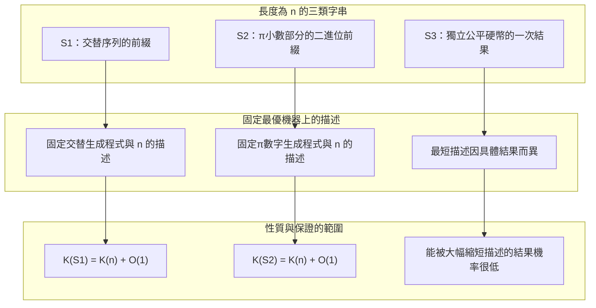
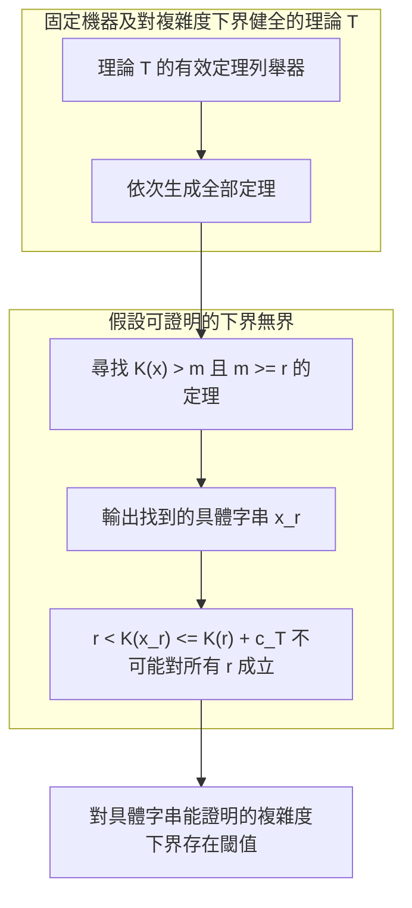

## 1. 三個百萬位元字串：長度等於複雜度嗎？

考慮三個長度均為 $n=1{,}000{,}000$ 的二進位字串。

1. $S_1$：將 `01` 重複五十萬次。
2. $S_2$：取圓周率 $\pi$ 的<strong>小數部分</strong>二進位展開的前一百萬位元。
3. $S_3$：獨立拋擲公平硬幣一百萬次這一機率模型產生的一個結果。

將位元緊密打包，三者都佔125,000位元組，即十進位的125 kB。但若把 `0` 和 `1` 當作ASCII或UTF-8字元儲存，就需要一百萬位元組。檔案頭和物件管理開銷另計。

$\pi$ 的二進位表示以 $11.0010010000111111\ldots{}_2$ 開頭，因此去掉整數部分後的 $S_2$ 以 `0010010000111111...` 開頭。這裡的短字串只是示意，並不表示本文實際進行了百萬次物理硬幣實驗。

$S_1$ 可用重複規則生成，$S_2$ 也有計算所需各位的演算法。但 $S_3$ 不一定複雜：公平硬幣也可能偶然給出全零字串或交替字串。正確結論是一個高機率陳述：<strong>固定計算模型後，能被大幅縮短描述的結果只佔很小的比例</strong>。

在獨立公平硬幣模型中，每一個指定的 $n$ 位元字串機率相同，交替字串與 $\pi$ 的前綴也不例外。

$$
P(X=x)=2^{-n},\qquad x\in\{0,1\}^n
$$

怎樣刻畫這些等機率結果之間「是否存在簡短生成規則」的差別？這正是索洛莫諾夫、柯爾莫哥洛夫、蔡廷等人自20世紀60年代起發展的<strong>演算法資訊理論（AIT）</strong>研究的問題。核心量是「輸出該字串並停機的最短程式的位元長度」。

---

## 2. 夏農資訊量與單個字串

### 2.1 自資訊量、熵與編碼

對於離散分佈 $P$，應區分機率 $P(x)>0$ 的單個結果的自資訊量與其平均值——熵。以下對數預設以2為底，資訊量單位為位元。

$$
I_P(x)=-\log_2P(x),\qquad
H(P)=-\sum_xP(x)\log_2P(x)
$$

求和時約定 $0\log_2 0=0$。模型賦予零機率的結果具有無窮大的自資訊量。

對有限字母表中的一個符號使用二進位前綴碼，平均碼長不能小於熵，而且存在平均碼長小於熵加一的編碼。

$$
H(P)\le L_{\mathrm{opt}}<H(P)+1
$$

這並不表示每個碼字長度都等於熵。將 $r$ 個獨立同分布的符號組成一塊，可以減小每個符號承擔的整數取整開銷。

$$
H(P)\le \frac{L_{\mathrm{opt},r}}{r}<H(P)+\frac1r
$$

對於有依賴的資訊源，要考慮塊分佈或熵率。討論哈夫曼編碼和算術編碼時，同樣需要區分所用模型、平均量和單次結果。

### 2.2 模型選擇與經驗頻率

$-\log_2P(x)$ 不只是 $x$ 的性質，還取決於所選分佈 $P$。公平硬幣模型甚至給交替字串賦予一百萬位元的自資訊量。反過來，若選取只以機率1輸出該特定字串的點質量分佈，其熵就是0；但這不等於把模型本身傳給接收者的成本也為0。

只統計單個位元的頻率，`01` 重複字串的0和1各佔一半，零階經驗熵為1位元。不過，利用前一個位元預測下一個位元的模型能夠捕捉其中的規律。

$$
\widehat H_0((01)^{n/2})
=-\tfrac12\log_2\tfrac12-\tfrac12\log_2\tfrac12=1
$$

若統計長度為 $k$ 的重疊塊，交替字串至多出現兩種塊，所以整個塊的經驗熵至多為1位元，除以 $k$ 後每位元至多為 $1/k$。塊的熵與每位元的熵不是同一個量。

$\pi$ 的正規性，即每一種固定長度的塊都以相同極限頻率出現，並未被證明。有限頻率檢驗和表面無序不能證明正規性。即使一個數是正規數，其數字序列仍然可以是可計算的。而且，如果機率預測模型能計算 $\pi$ 的數字，夏農式預測和編碼也能利用這條規律；夏農理論並不限於零階頻率模型。

AIT並不否定夏農理論。<strong>相對於機率模型的碼長與相對於固定計算機的單個物件描述長度，回答的是不同問題。</strong>

| 角度 | 夏農資訊量 | 演算法描述長度 |
| :--- | :--- | :--- |
| 物件 | 分佈及其下的單個結果 | 固定機器輸出的有限字串 |
| 參照 | 機率模型與編碼規則 | 機器、程式編碼與輔助輸入 |
| 主要量 | $I_P(x)$、$H(P)$、熵率 | 普通複雜度 $C(x)$、前綴複雜度 $K(x)$ |
| 限制 | 描述模型的成本需要另計 | 存在機器相關常數與不可計算性 |
| 對 $\pi$ 的處理 | 取決於選擇的模型 | 可描述數字生成規則，但還要交代終點 |

---

## 3. 最短程式與不變性定理

### 3.1 普通複雜度與條件複雜度

用 $\{0,1\}^*$ 表示全部有限二進位字串，$|p|$ 表示程式的位元長度。對於部分可計算機器 $A$，$A(p)=x$ 表示機器在有限時間內停機，並且恰好輸出 $x$。

$$
C_A(x)=\min\{|p|:A(p)=x\}
$$

若沒有這樣的程式，最小值約定為 $\infty$。當輔助輸入 $y$ 免費提供時，定義：

$$
C_A(x\mid y)=\min\{|p|:A(p,y)=x\}
$$

預先知道長度或字典，與把長度或字典一併放入程式，是兩種不同的成本計算方式。

### 3.2 自我定界的前綴複雜度

<strong>前綴複雜度 $K$</strong>要求停機程式的集合是前綴自由的（prefix-free）：任何一個停機程式都不是另一個停機程式的真前綴。

$$
K_U(x)=\min\{|p|:U(p)=x\},\qquad
\sum_{p\in\operatorname{dom}U}2^{-|p|}\le1
$$

後一個式子是克拉夫特不等式。條件前綴複雜度要求，對於每個固定輔助輸入 $y$，停機程式的集合都前綴自由。這裡的自我定界並不是給任意原始碼加上一個右括號就能滿足的條件。

以下的 $C$ 與 $K$ 分別固定其機器類別中加法最優的參考機器。下一節說明這種最優性。

拼接普通程式需要交代邊界。使用固定的可計算有序對編碼，例如可以得到：

$$
C(x,y)\le C(x)+C(y)
+2\log_2\bigl(\min\{C(x),C(y)\}+2\bigr)+O(1)
$$

自我定界程式可以直接串接並解釋，使用條件描述後，上界更簡潔：

$$
K(x,y)\le K(x)+K(y\mid x)+O(1)
\le K(x)+K(y)+O(1)
$$

對於固定的相應參考機器，兩類複雜度滿足：

$$
C(x)\le K(x)+O(1),\qquad
K(x)\le C(x)+2\log_2(C(x)+2)+O(1)
$$

$O(1)$ 指不依賴於物件 $x$ 的常數，而不是實際測得開銷為零或只有幾個位元。

### 3.3 加法最優機器的不變性

對於 $C$，在普通機器類別中選取加法最優機器；對於 $K$，在前綴自由機器類別中選取加法最優機器。若「通用」只表示能夠模擬其他機器，還必須另行指定描述長度只有常數開銷這一性質。

對前綴複雜度，任意前綴自由機器 $A$ 都對應一個不依賴 $x$ 的常數 $c_A$，使得：

$$
K_U(x)\le K_A(x)+c_A
$$

<strong>證明的構造</strong>是在程式 $p$ 前加上識別機器 $A$ 的固定自我定界標籤 $s_A$，讓參考機器模擬 $A(p)$。若 $A(p)=x$，這個模擬程式以 $|p|+|s_A|$ 加上固定開銷的長度輸出 $x$；最短程式不會更長。可以用這種方式構造最優機器。普通複雜度也有同類別內的對應論證。

對兩臺加法最優機器雙向應用這個上界，得到：

$$
|K_{U_1}(x)-K_{U_2}(x)|\le c_{12}
$$

常數應當覆蓋兩個方向的模擬成本，不能只把單向直譯器的大小等同於複雜度絕對差的界。

可以設計一臺專用機器，用一個很短的指令輸出某個特定的百萬位元字串。模擬這臺機器的成本進入常數，但不變性定理並不消除有限物件的機器依賴性。常數除以長度 $n$ 的相對影響在 $n\to\infty$ 時趨於0；一般情況下，仍無法知道任意具體字串的精確最短描述。現實中記憶體有限的CPU和語言實現，也不等同於數學模型中允許無界儲存的機器。

### 3.4 重新分析交替字串、圓周率與硬幣

將整數 $n$ 與其固定的二進位表示對應起來。設 $s(n)$ 為長度 $n$ 的交替前綴，或 $\pi$ 小數部分的前 $n$ 個位元。由 $n$ 可以計算出字串，由字串的長度又可以求出 $n$。兩個方向的可計算變換給出：

$$
K(s(n))=K(n)+O(1),\qquad K(s(n)\mid n)=O(1)
$$

免費提供終點時，只需固定長度的生成程式；否則需要描述 $n$。例如，對 $n\ge2$ 使用自我定界整數編碼可得：

$$
K(n)\le \log_2 n+2\log_2\log_2 n+O(1)=O(\log n)
$$

但這並不意味著對所有整數都有 $K(n)=\log_2n+O(1)$。若 $n=2^m$，可以先描述指數 $m$，再重建 $n$，從而利用 $m$ 的簡短描述。



不能斷言 $S_3$ 的最短描述一定只是複製原始資料。下面用計數說明其正確的機率含義。

---

## 4. 不可壓縮性與無限序列的隨機性

### 4.1 直接輸出原字串的上界

對於任意長度為 $n$ 的字串 $x$，直接輸出它的描述給出普通複雜度及已知長度的條件前綴複雜度上界：

$$
C(x)\le n+O(1),\qquad K(x\mid n)\le n+O(1)
$$

無條件的前綴描述還需要自我定界地交代長度：

$$
K(x)\le n+K(n)+O(1)
$$

不能對所有字串都斷言 $K(x)\le |x|+O(1)$。否則每個長度 $n$ 下的總權重 $\sum_{|x|=n}2^{-K(x)}$ 都至少是同一個正的常數；對所有長度求和便會違反克拉夫特不等式。

### 4.2 鴿巢原理的精確計數

設整數 $n\ge0$、$0\le c\le n$。長度嚴格小於 $n-c$ 的二進位程式共有：

$$
\sum_{j=0}^{n-c-1}2^j=2^{n-c}-1
$$

$c=n$ 時把空和規定為0。一個停機程式至多輸出一個字串，因此長度為 $n$ 且滿足 $C(x)<n-c$ 的字串不會超過上述數目。於是：

$$
\#\{x\in\{0,1\}^n:C(x)\ge n-c\}
\ge2^n-2^{n-c}+1
$$

有些短程式不停止，或者輸出相同的字串，所以能夠被短描述表示的字串還可能更少。$c>n$ 時 $n-c<0$，所有字串都自動滿足 $C(x)\ge n-c$；不能把這一幾何和公式直接延伸到該範圍。

在公平硬幣的均勻分佈下，計數結果成為：

$$
P\{C(X)<n-c\}
\le\frac{2^{n-c}-1}{2^n}<2^{-c}
$$

$c=0$ 時，每種長度都至少有一個字串滿足 $C(x)\ge n$。$c=1$ 時，超過一半的字串不能縮短<strong>超過</strong>1位元。$c=10$、$c=20$ 時，不能縮短超過10位元、20位元的字串的比例，其下界 $1-2^{-c}$ 分別約為99.902%和99.999905%。這並不禁止恰好節省 $c$ 位元。

固定長度條件 $n$ 後，同樣的計數也適用於 $K(x\mid n)$。所以公平硬幣結果以高機率需要接近自身長度的描述，卻不是對每一個結果的確定保證。

若某種可逆壓縮器能把所有檔案都縮短，就會違反這一計數。實際壓縮器只擅長利用某些規則。全體二進位字串上均勻分佈的比例，不能直接解釋成自然界或人類資料中結構化物件出現的比例。

### 4.3 馬丁–洛夫隨機性

有限字串不能縮短指定的位元數，與無限序列的隨機性，是兩種不同的定義。對無限二進位序列空間使用公平硬幣測度 $\mu$。所有以有限字串 $w$ 開頭的序列構成柱集 $[w]$，其測度為 $2^{-|w|}$。

<strong>馬丁–洛夫檢驗</strong>由一列開集 $V_j$ 構成；它們作為有限前綴柱集的並，可以一致地計算列舉，並滿足：

$$
\mu(V_j)\le2^{-j},\qquad j=1,2,\ldots
$$

若 $\omega\in\bigcap_jV_j$，就稱該序列未通過這個檢驗。不落入任何這類檢驗的失敗集合，才稱為馬丁–洛夫隨機。它並不是「從不出現任何罕見的有限模式」。這樣的有效檢驗只有可數多個，每個失敗集合測度都為0，因此通過所有檢驗的序列集合測度為1。

萊文–施諾爾定理用最優<strong>前綴</strong>複雜度給出如下等價：

$$
\omega\text{ 是馬丁–洛夫隨機序列}
\iff
\exists c\ \forall n\quad K(\omega_{1:n})\ge n-c
$$

關鍵在於<strong>同一個常數 $c$</strong>適用於所有 $n$。不能把式中的 $K$ 直接替換為普通複雜度 $C$。

歷史上馮·米塞斯、丘奇等人研究過位置選擇規則；允許的檢驗或下注策略採用不同的可計算性條件，會得到不同的隨機性定義。特別是「任何可計算鞅都不能獲得無界資本」的可計算隨機性，比馬丁–洛夫隨機性弱，二者不是同義詞。

可計算的 $\pi$ 無限數字序列不是馬丁–洛夫隨機序列。這也再次說明，演算法隨機性不同於正規性。

---

## 5. 不可計算性、證明的限度與停機機率

### 5.1 可以從上方逼近，卻沒有一般的終止判據

交錯模擬（dovetailing）讓各個候選程式每次執行少量步驟。記錄目前找到的最短描述，就可以不斷更新 $K(x)$ 的上界。

$$
K_t(x)\searrow K(x)\qquad(t\to\infty)
$$

初始值可取直接輸出原字串所得的一個可計算有限上界。因為這些上界是整數，對每個固定 $x$，它們最終確實會達到真值並保持不變。但不存在對所有輸入都能識別「這已經是真正最短值」的通用演算法；尚未停機的更短候選仍可能在未來輸出 $x$。

### 5.2 貝里式的反證

考慮短語「不能用少於二十個漢字定義的最小正整數」。不計引號和標點，它有18個漢字，確實少於20個。有限長度的表示式至多定義有限多個正整數，其餘整數形成無限集合，沒有最大值；悖論討論的是其中的最小值。

自然語言中的「可定義」含義並不嚴格。因此，不把這句話本身當作形式證明，而是把它轉化為可計算程式的反證。

假設存在一個對所有 $x$ 都返回其真實 $K(x)$ 並停機的過程 `ComputeK`。下面是使用這一不可能假設的<strong>擬似碼</strong>，不是已經實現的複雜度計算器。

```text
Berry(m):
    按長度0,1,2,...遞增、同一長度內按字典序列舉所有二進位字串x:
        if ComputeK(x) >= m:
            輸出x並停機
```

這稱為長度優先字典序（shortlex）。普通字典序本身不能提供這裡需要的全部有限字串列舉。

計數說明複雜度無界，所以在假設成立時，搜尋對每個 $m$ 都會停止，輸出的 $x_m$ 滿足 $K(x_m)\ge m$。另一方面，生成它只需固定程式和 $m$ 的自我定界描述。

$$
m\le K(x_m)\le K(m)+c
\le \log_2m+2\log_2\log_2m+c'
$$

最後一個上界用於 $m\ge2$。對固定的 $c'$，足夠大的 $m$ 會導致矛盾，故 `ComputeK` 不存在。不必把沒有測量的機器開銷強行指定為「多10000位元總夠用」。

### 5.3 蔡廷不完備性定理

固定參考機器，以及能表達具體有限字串複雜度命題的有效公理化理論 $T$。這裡假設它所證明的複雜度下界命題都是真的，即具有相應的<strong>健全性</strong>。

於是存在閾值 $b_T$，使 $T$ 無法對任何一個具體字串 $x$ 證明「$K(x)>b_T$」。

證明的核心是：反設可證明的數值下界無界，則給定任意輸入 $r$，都能列舉全部定理，最終找到某個形如「$K(x)>m$」且 $m\ge r$ 的定理。

```text
SearchProof(r):
    有效列舉理論T的所有定理:
        if 定理對具體字串x和整數m斷言「K(x) > m」，且m >= r:
            輸出x並停機
```

健全性保證輸出 $x_r$ 的複雜度大於 $r$。但這個過程的固定程式碼已包含 $T$ 的定理列舉器，因而：

$$
r<K(x_r)\le K(r)+c_T=O(\log r)+c_T
$$

這對足夠大的 $r$ 不可能成立，故可證明的數值下界必然有界。



閾值依賴機器、理論與表達方式，並不是測出了ZFC普遍適用的20,000位元或50,000位元極限。當字串長 $n$ 與固定閾值相差足夠大時，計數能夠說明許多字串的真實複雜度超過閾值；但對某個指定字串證明這個下界，仍然受理論限制。

這把哥德爾以來的不完備性與演算法描述聯絡起來，卻不是禁止短公理導出長定理或大量定理的一般「資訊守恆定律」。增加公理會得到另一套理論，其對應常數也會改變。

### 5.4 由機器決定的停機機率 $\Omega_U$

對最優的前綴自由機器 $U$，隨機無限公平位元流以某個停機程式開頭的機率是：

$$
\Omega_U=\sum_{p\in\operatorname{dom}U}2^{-|p|}
$$

對應停機程式的柱集互不相交，因此該和有機率解釋。克拉夫特不等式給出 $\Omega_U\le1$。在包括最優性在內的這一設定下，$\Omega_U$ 還是不可計算的馬丁–洛夫隨機實數，並且 $0<\Omega_U<1$。這些額外性質並不適用於任意一臺僅僅前綴自由的機器。

列舉已經停機的程式，其權重部分和從下方增加。因此 $\Omega_U$ 是<strong>左可計算列舉實數（left-c.e.）</strong>，卻沒有可計算的收斂模來告知何時達到了任意指定的精度。

假設準確知道它的前 $N$ 個二進位小數位，並以 $a$ 表示相應的二進位有理下端點。因為 $\Omega_U$ 沒有有限終止的二進位展開，

$$
a=\frac{\lfloor2^N\Omega_U\rfloor}{2^N},
\qquad a<\Omega_U<a+2^{-N}
$$

交錯執行程式，直到已列舉的停機權重部分和 $q_s$ <strong>超過</strong> $a$。此時：

$$
0\le\Omega_U-q_s<2^{-N}
$$

如果尚未列舉到的長度不超過 $N$ 的程式後來停機，就至少要再加入 $2^{-N}$，與剩餘權重的界矛盾。因此可以判定<strong>同一臺機器</strong>長度不超過 $N$ 的全部輸入是否停機。

這不等於固定幾千位就能判定無限多的任意數學命題。將反例搜尋編碼為停機問題時，機器、程式長度與命題的邏輯形式都有關。研究中特殊設定下的有限位計算，也不同於生成全部位數的演算法。

---

## 6. 夏農理論的橋樑、MDL、NCD與人工智慧

### 6.1 平均描述長度與熵率

設有限字串上的可計算離散分佈 $P$ 由有限計算過程 $d_P$ 指定。若免費共享 $d_P$ 作為輔助輸入，當 $H(P)<\infty$ 時，

$$
H(P)\le\mathbb E_{X\sim P}[K(X\mid d_P)]\le H(P)+c
$$

分佈可以具有有限或可數的支撐集，並要求各機率能夠一致地計算到所需精度。常數 $c$ 包含固定解碼過程的成本，不表示兩邊數值完全相等。

下界來自：在固定條件 $d_P$ 下，對最短前綴描述應用克拉夫特不等式，再使用平均碼長的論證。上界來自：使用共享分佈構造按機率分配的前綴碼，再以固定程式解碼。不共享分佈時，模型的描述成本也必須計入。「知道」一個任意分佈，並不保證能在有限時間內精確計算其熵。

另一個Brudno型關係適用於<strong>有限字母表上的平穩遍歷過程</strong>。若熵率為每符號 $h$ 位元，則幾乎每個樣本序列都滿足：

$$
\lim_{n\to\infty}\frac{K(X_{1:n})}{n}=h
$$

期望值也滿足 $\mathbb E[K(X_{1:n})]/n\to h$。長度 $n$ 的符號字串有一致的線性直接編碼上界，因此可以由幾乎處處收斂進一步討論期望收斂。普通複雜度與前綴複雜度之間對數級的差，除以 $n$ 後趨於0。不能把前面條件分佈不等式的可計算性假設，不加區分地套用到這個熵率定理上。

### 6.2 離散普適半測度與索洛莫諾夫預測

對最優的停機型前綴機器，定義恰好輸出 $x$ 並停機的機率：

$$
m_U(x)=\sum_{p:U(p)=x}2^{-|p|}
$$

總質量不超過1，因此它是<strong>半測度</strong>，並且下半可計算。編碼定理把這個離散普適半測度與前綴複雜度聯絡起來。

$$
-\log_2m_U(x)=K_U(x)+O(1),
\qquad m_U(x)=\Theta(2^{-K_U(x)})
$$

索洛莫諾夫逐次預測則使用單調機器，考慮輸出<strong>以 $x$ 開頭</strong>的機率半測度 $M(x)$。輸出不必恰在這裡停機，並有 $M(x)\ge M(x0)+M(x1)$ 的一致性關係。不能把離散的 $m_U$ 與逐次預測的 $M$ 定義為同一物件，再直接照搬同一個編碼定理。

偏好簡短描述與奧卡姆剃刀有關，但並不意味著資料給出後，較短假說的機率也總是更大；還需要考慮概似。

### 6.3 貝氏選擇與最小描述長度

給模型 $H$ 分配實際的前綴描述長度 $L(H)$，再令先驗機率與相應編碼權重成正比，貝氏公式給出：

$$
-\log_2P(H\mid D)
=L(H)-\log_2P(D\mid H)+\mathrm{const}
$$

其中加法常數與 $H$ 無關。在這一特定設定下，最大化後驗機率對應於最小化右端。但一般的 $-\log_2P(D\mid H)$ 不能總是替換成 $K(D\mid H)$。

<strong>最小描述長度（MDL）原則</strong>比較模型與使用該模型編碼資料的總成本。

$$
\widehat H=\arg\min_{H\in\mathcal H}
\{L(H)+L(D\mid H)\}
$$

過於簡單的模型可能留下很長的資料編碼，而死記資料的模型本身又可能很長。把殘差記進模型與縮短總描述，不是同一件事。Rissanen的MDL是實用的統計選擇原則，並不保證必然發現真實自然法則或因果關係。

### 6.4 理想資訊距離與實際NCD

在分母為正時，理想的<strong>正規化資訊距離（NID）</strong>定義為：

$$
\operatorname{NID}(x,y)=
\frac{\max\{K(x\mid y),K(y\mid x)\}}
{\max\{K(x),K(y)\}}
$$

它也與包含有序對描述 $K(x,y)$ 的表示式有關，但要允許適當的加法誤差與正規化誤差。不能把無分隔的串接字串 $xy$，精確等同於能唯一恢復兩個分量的有序對編碼。

用 $Z$ 表示實際壓縮器的輸出長度，以區別於普通複雜度 $C$，則<strong>正規化壓縮距離（NCD）</strong>是：

$$
\operatorname{NCD}_Z(x,y)=
\frac{Z(xy)-\min\{Z(x),Z(y)\}}
{\max\{Z(x),Z(y)\}}
$$

其想法是：若壓縮器能複用共同結構，相似檔案的值應較小；無法利用共同結構時，值會接近1。

實際壓縮器有檔案頭、字典視窗、分塊、設定與順序效應。理論中normal compressor所需的冪等性、單調性、對稱性和分配性等假設，不是每個實際壓縮器都對所有輸入滿足的性質。即使檔案完全相同，也可能不滿足 $Z(xx)\approx Z(x)$；有限檔案的NCD不保證嚴格滿足距離公理，也不保證總在0到1之間。

輔助檢驗把一個固定的65,536位元組字串與自身串接，用有限視窗的gzip得到同一檔案對的NCD約為0.9997。這不是理想NID的反例，而是實際近似有侷限的一個例子。

Cilibrasi、Vitányi等人研究了基因組、語言、音樂等資料的壓縮分群。不手工設計領域特徵有其價值，但方法並不獨立於字元編碼、檔案表示和壓縮器選擇，也不保證正確恢復任意演化樹。

### 6.5 語言模型預測與碼長

對token序列 $D=x_{1:T}$ 和固定自迴歸模型，預測對應的理想碼長是：

$$
\mathcal L_\theta(D)=
-\sum_{t=1}^T\log_2p_\theta(x_t\mid x_{<t})
$$

若使用自然對數，單位則為nat，除以 $\ln2$ 可換成位元。這是有限資料上的負對數概似，按token平均後作為交叉熵損失使用。

對機率為正的結果，在模型和序列長度共享的條件下，理想算術編碼或相關構造能給出長度至多為 $\lceil\mathcal L_\theta(D)\rceil+2$ 的前綴描述。這不是每種實現都恰好佔「損失加2位元」；有限精度、終止、取整與分幀都有成本。

設模型及必要後設資料的實際自我定界描述長度為 $L_{\mathrm{model}}$、$L_{\mathrm{meta}}$。固定解碼器後可得：

$$
K(D)\le L_{\mathrm{model}}+L_{\mathrm{meta}}
+\lceil\mathcal L_\theta(D)\rceil+O(1)
$$

後設資料按需包含序列長度、詞表以及可逆token化的規範。如果正規化丟掉了原始空格或字元，就不可能在沒有額外資訊的情況下恢復。

固定大小的共享模型降低預測損失，對應於降低資料碼長。如果還改變模型大小，就必須考察總成本；單獨最小化訓練損失，並不是最小化二部MDL目標的同一個最佳化問題。

馬庫斯·胡特的AIXI與Hutter Prize所體現的壓縮和智慧研究視角，為這種聯絡提供了動機。但AIXI是不可計算的理想模型，不等同於實際Transformer。Delétang等人的語言模型壓縮研究，同樣考察的是預測與壓縮的關係。

若模型正確預測推理小說中的兇手姓名，該姓名的碼長就會縮短。但改善不一定只來自邏輯推理，也可能來自記憶、詞彙偏差或重複資料。能壓縮訓練文字本身，推不出必然獲得因果世界模型、正確推理、泛化能力或AGI的數學定理。

| 理論或原則 | 實際聯絡 | 需要區分的方面 |
| :--- | :--- | :--- |
| $K(x)$、$K(x\mid y)$ | 包含解碼過程的描述、共享上下文的編碼 | 實際壓縮長度一般不是最短值 |
| 離散普適半測度 $m_U$ | 偏好短描述的建模 | 停機輸出與逐次預測的 $M$ 不同 |
| MDL | 比較模型成本與資料碼長 | 不能總把概似等同於條件複雜度 |
| NID與NCD | 基於壓縮的相似性與聚類 | 實際壓縮器的視窗、表示、順序與有限長度 |
| 語言模型與算術編碼 | 預測機率與碼長的對應 | 共享模型與自包含總成本、智慧的評價 |

---

## 7. 結語：壓縮能說明什麼，還有什麼待解決？

即使長度同為一百萬位元，交替字串與 $\pi$ 的前綴仍有簡短的生成程式。把終點也描述出來，與免費已知終點的條件描述不同。公平硬幣的結果有計數支持的高機率不可壓縮性，卻不是對每一個實現值的保證。

不變性定理控制最優機器之間的常數差，貝里式論證說明真實最短長度一般不可計算。蔡廷定理與 $\Omega_U$ 進一步揭示證明和計算的限制。這些結果並不提供一種脫離機器和假設、評價任意有限物件的方法。

MDL、NCD與語言模型碼長是理想理論與實踐的交會處。壓縮有助於研究規律和模型共享，但不能只用壓縮率替代一個完整的理解或智慧定義。

### 參考文獻

- [Shen：Algorithmic Information Theory and Kolmogorov Complexity](https://www.lirmm.fr/~ashen/uppsala-notes.pdf) — 普通與前綴複雜度、最優解壓器、不可計算性和編碼定理。
- [Rute：Computable randomness and betting for computable probability spaces](https://arxiv.org/html/1203.5535v4) — 可計算隨機性與馬丁–洛夫檢驗。
- [Tadaki：Chaitin Ω numbers and halting problems](https://arxiv.org/abs/0904.1149) — 最優機器的停機機率與有限長度停機問題。
- [Chazottes：Entropy in Dynamical Systems & Ergodic Theory](https://www.claymath.org/wp-content/uploads/2023/04/Chazottes-rev.pdf) — 第50頁投影片，有限分割的Brudno定理。
- [Cilibrasi、Vitányi：Clustering by Compression](https://arxiv.org/html/cs/0312044v2) — normal compressor的假設與NCD。
- [Delétang等：Language Modeling Is Compression](https://arxiv.org/abs/2309.10668) — 預測與壓縮對應關係的研究。
- [Hutter：Universal Algorithmic Intelligence](https://www.hutter1.net/ai/aixigentle.htm) — 結合普適歸納與決策的AIXI理想及其計算限制。
- [Bailey等：An Empirical Approach to the Normality of Pi](https://www.davidhbailey.com/dhbpapers/normality-digits-pi.pdf) — 經驗數字檢驗與正規性證明的區分。
