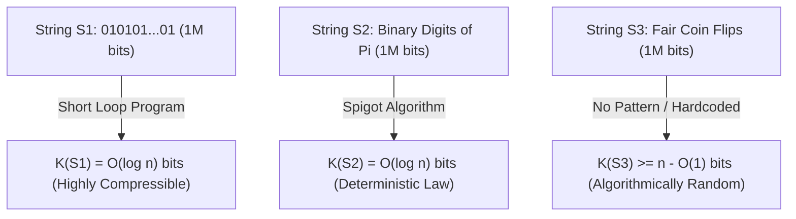
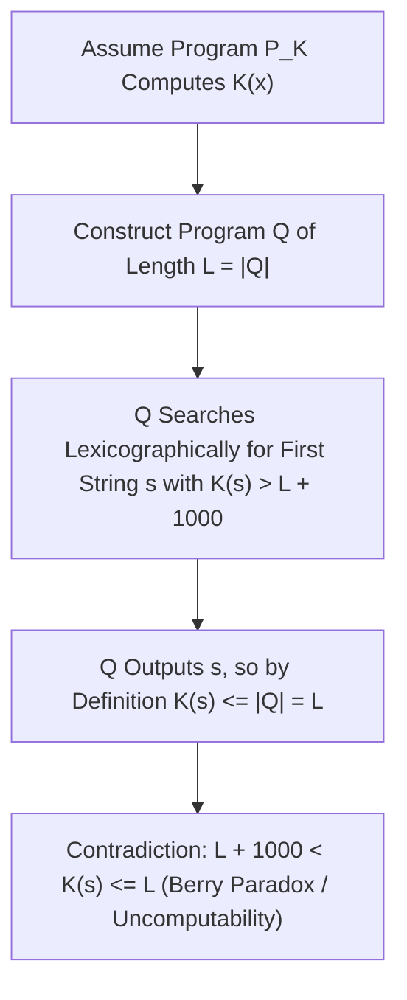

## 引言：三個一百萬位元字串的謎題——香農資訊理論的盲區

想像你面前有三個長度均為 $1,000,000$ 位元（bit）的二進位字串：
- 第一個字串 $S_1$ 是交替重複五十萬次的 `01010101...01`；
- 第二個字串 $S_2$ 是圓周率 $\pi$ 的二進位展開小數點後的前 $1,000,000$ 位：`1100100100001111110110...`；
- 第三個字串 $S_3$ 是你透過連續拋擲一百萬次均勻硬幣（正面記為 `1`，反面記為 `0`）親手記錄下來的序列。

現在請問：<strong>這三個字串哪一個包含更多的「資訊」？哪一個更「複雜」？哪一個才是真正「隨機」的？</strong>
如果我們向克勞德·香農（Claude Shannon）在1948年創立的經典<strong>香農資訊理論（Classical Information Theory）</strong>尋求答案，我們會遭遇一個意想不到的困境。香農熵 $H(X) = -\sum P(x)\log_2 P(x)$ 衡量的是<strong>機率分佈（隨機種源的系綜 Ensemble）</strong>的平均不確定性，而不是<strong>單一具體物件（Individual Object）</strong>本身的內在複雜性！在均勻拋硬幣模型下，產生 $S_1$（全 `01` 交替）的機率與產生 $S_3$（任意特定亂序序列）的機率完全相等，都是 $2^{-1,000,000}$；而對於確定性常數 $S_2$（$\pi$ 的展開），它的機率分佈甚至是退化的單點分佈（熵為 $0$），但它的0和1統計頻率卻與隨機拋硬幣幾乎無法區分！

為了給「單一字串的複雜性與隨機性」奠定嚴格的數學基礎，20世紀60年代，雷·索洛莫諾夫（Ray Solomonoff, 1960）、<strong>安德烈·柯爾莫哥洛夫（Andrey Kolmogorov, 1965）</strong>與格雷戈里·蔡廷（Gregory Chaitin, 1966）各自獨立地創立了<strong>演算法資訊理論（Algorithmic Information Theory, AIT）</strong>。他們的核心洞見驚人地一致：<strong>一個物件的真正複雜性，不在於它表面上有多少個字元，而在於能夠生成它的「最短電腦程式」有多長！</strong>

---

## 1. 柯爾莫哥洛夫複雜性 $K(x)$ 與通用圖靈機的不變性定理

給定一台通用圖靈機（Universal Turing Machine, 或任意圖靈完備的程式語言如 Python/C）$U$，字串 $x \in \{0,1\}^*$ 的<strong>柯爾莫哥洛夫複雜性（Kolmogorov Complexity，又稱演算法熵或描述複雜性）</strong> $K_U(x)$ 定義為：在圖靈機 $U$ 上執行後能夠輸出 $x$ 並停機的最短二進位程式 $p$ 的位元長度 $|p|$。為了使機率和收斂（滿足克拉夫特不等式 $\sum 2^{-|p|} \le 1$），現代常採用<strong>前綴無關複雜性（Prefix-Free Complexity / Levin-Chaitin Complexity）</strong> $K(x)$，即要求沒有任何合法程式是另一個合法程式的前綴。

用 $K(x)$ 的視角重新審視開篇的三個一百萬位元字串，迷霧瞬間消散：
- 對於 $S_1$，程式只需寫 `print("01" * 500000)`。無論長度 $n$ 多大，程式只需儲存迴圈次數 $n/2$ 的二進位表示，因此 $K(S_1) = O(\log_2 n) pprox 20$ 位元，它是<strong>極端簡單的</strong>。
- 對於 $S_2$（$\pi$ 的前 $n$ 位），雖然表面上看起來雜亂無章、通過了幾乎所有統計偽隨機檢定，但我們可以寫一段百餘位元組的馬青公式（Machin-like formula）或 BBP 滴定演算法程式來精確計算前 $n$ 位，因此同樣有 $K(S_2) = O(\log_2 n)$！這揭示了科學哲學的核心真理：<strong>自然法則（Law）的本質就是對觀測資料的極限壓縮</strong>。
- 對於真正隨機拋硬幣產生的 $S_3$，它內部沒有任何可壓縮的規律。要在電腦上輸出 $S_3$，最短的程式只能是把這一百萬個位元原封不動地硬編碼進程式裡：`print("1011001...")`，因此 $K(S_3) pprox n + O(1) pprox 1,000,000$ 位元！

也許你會質疑：如果換一種程式語言（比如從 C 語言換成 Python 或組合語言），最短程式的長度豈不是會改變嗎？<strong>柯爾莫哥洛夫不變性定理（Invariance Theorem）</strong>完美消除了這一顧慮：對於任意兩台通用圖靈機 $U_1$ 和 $U_2$，存在一個僅依賴於 $U_1$ 和 $U_2$（而與字串 $x$ 完全無關）的常數 $c_{12}$，使得對一切 $x$ 都有 $|K_{U_1}(x) - K_{U_2}(x)| \le c_{12}$。證明極其直觀：$c_{12}$ 不過是在圖靈機 $U_1$ 上編寫一個能夠模擬 $U_2$ 的<strong>直譯器（Interpreter / 交叉編譯器）</strong>所需的固定位元數！當資料規模 $n 	o \infty$ 時，固定長度的直譯器開銷 $c_{12}$ 完全可以忽略不計，$K(x)$ 成為了獨立於具體硬體與語言的絕對數學不變量。

$$
H(X) = -\sum_{x \in \mathcal{X}} P(X = x) \log_2 P(X = x)
$$

$$
K_U(x) = \min_{p \in \{0,1\}^*} \Big\{ |p| \;\Big|\; U(p) = x \Big\}, \qquad \Big| K_{U_1}(x) - K_{U_2}(x) \Big| \le c_{12}
$$

---

## 2. 隨機性的正體：鴿巢原理、不可壓縮性與馬丁-洛夫隨機

在柯爾莫哥洛夫之前，機率論學家一直無法回答：「為什麼 `0000000000` 不是隨機序列，而 `0110100110` 看起來是隨機的？」演算法資訊理論給出了人類歷史上第一個關於單一物件隨機性的嚴格定義：<strong>隨機性就是不可壓縮性（Randomness is Incompressibility），即規律的徹底缺席！</strong>

更令人震驚的是，利用最基礎的<strong>鴿巢原理（Pigeonhole Principle）</strong>，我們可以用兩行算術證明<strong>宇宙中絕大多數字串都是演算法隨機（不可壓縮）的</strong>：
考慮所有長度為 $n$ 的二進位字串，共有 $2^n$ 個。那麼，長度嚴格小於 $n - c$ 位元的二進位程式一共有多少個呢？把長度為 $0, 1, 2, \dots, n-c-1$ 的所有可能程式加起來，總數為：$\sum_{i=0}^{n-c-1} 2^i = 2^{n-c} - 1$。由於每個程式最多只能輸出一個結果，這意味著在 $2^n$ 個長度為 $n$ 的字串中，能夠被壓縮掉至少 $c$ 個位元（即滿足 $K(x) < n - c$）的字串<strong>最多只有 $2^{n-c} - 1$ 個</strong>！
換言之，隨機抽取一個長度為 $n$ 的字串，它能被壓縮超過 $c$ 位元的機率嚴格小於 $2^{-c}$。取 $c = 20$，就有超過 $1 - 2^{-20} pprox 99.9999\%$ 的字串連區區 $20$ 位元都無法被任何演算法壓縮！佩爾·馬丁-洛夫（Per Martin-Löf, 1966）進一步證明了：一個無限二進位序列能夠通過所有可計算的統計顯著性檢定（Martin-Löf Randomness），當且僅當它的所有長度為 $n$ 的前綴 $x_{1:n}$ 都是不可壓縮的（滿足 $K(x_{1:n}) \ge n - O(1)$）。

$$
\sum_{i=0}^{n-c-1} 2^i = 2^{n-c} - 1 \implies \mathbb{P}_{x \sim \text{Unif}(\{0,1\}^n)}\big( K(x) < n - c \big) < \frac{2^{n-c}}{2^n} = 2^{-c}
$$

$$
\Omega = \sum_{p:\, U(p)\text{ halts}} 2^{-|p|} \in (0, 1), \qquad K(\Omega_{1:n}) \ge n - O(1)
$$

---

## 3. 貝里悖論、不可計算性與蔡廷停機機率 $\Omega$ 及現代 AI 壓縮律

既然 $K(x)$ 如此強大，我們能否寫出一個終極壓縮軟體，輸入任意字串 $x$，直接算出它的 $K(x)$ 呢？答案是<strong>絕對不可能——函數 $K(x)$ 是不可計算的（Uncomputable）！</strong>

這一深刻限制源於古老的<strong>貝里悖論（Berry's Paradox）</strong>：「不能用少於二十個漢字定義的最大正整數」（這句話本身只有十四個漢字，卻定義了那個數，從而產生矛盾）。格雷戈里·蔡廷將其轉化為嚴格的停機歸謬法證明：假設存在一個子程式 `ComputeK(x)` 能夠算出任意 $x$ 的複雜性，其程式碼固定長度為 $L$ 位元。我們構造一個主程式 $Q$：按字典序枚舉所有二進位字串 $s$，呼叫 `ComputeK(s)`，一旦找到第一個滿足 $K(s) > L + 10000$ 的字串 $s^*$，就立即印出 $s^*$ 並停機。這個主程式 $Q$ 的總長度不過是 $L + O(1)$ 位元（遠小於 $L + 10000$），但它卻成功輸出了 $s^*$！根據 $K(s^*)$ 作為「最短輸出程式長度」的定義，必然有 $K(s^*) \le |Q| < L + 10000$，與 $K(s^*) > L + 10000$ 直接矛盾！由此直接導出<strong>蔡廷不完備性定理（Chaitin's Incompleteness Theorem）</strong>：任何資訊量為 $C$ 位元的公理化形式系統（如 ZFC 集合論），都永遠無法證明任何一個具體字串的複雜性 $K(x) > C + O(1)$。

蔡廷還將所有停機程式的長度匯聚成了一個傳奇的實數——<strong>蔡廷常數 $\Omega = \sum_{U(p)	ext{ halts}} 2^{-|p|}$（停機機率）</strong>。$\Omega$ 是一個明確定義在 $(0,1)$ 之間的實數，但它是<strong>極端不可計算且演算法隨機的</strong>：它的前 $n$ 位二進位展開 $\Omega_{1:n}$ 滿足 $K(\Omega_{1:n}) \ge n - O(1)$，知道 $\Omega$ 的前 $n$ 位就等價於解決了所有長度不超過 $n$ 的程式的圖靈停機問題！

在現實工程與人工智慧中，雖然精確的 $K(x)$ 不可計算，但它的可計算上界正驅動著現代資訊科技：
1. <strong>香農熵與柯氏複雜性的橋樑</strong>：對於平穩遍歷隨機過程，期望柯氏複雜性除以長度收斂於香農熵率 $\lim_{n	o\infty} rac{1}{n}\mathbb{E}[K(X_{1:n})] = H(X)$。
2. <strong>索洛莫諾夫普適歸納（Solomonoff Induction）與最小描述長度（MDL）</strong>：將奧卡姆剃刀定律形式化為先驗分佈 $P_M(x) \propto 2^{-K(x)}$，越短的程式（越簡潔的科學假說）具有指數級越高的先驗權重。
3. <strong>歸一化壓縮距離（Normalized Compression Distance, NCD）</strong>：利用真實壓縮器（如 `zstd`、`lzma`、`gzip`）近似 $K(x)$，透過公式 $	ext{NCD}(x,y) = rac{C(xy) - \min(C(x),C(y))}{\max(C(x),C(y))}$ 在無需任何領域特徵工程的情況下完成基因組演化樹建構、惡意軟體聚類與抄襲檢測。
4. <strong>大型語言模型（LLM）：壓縮即智慧（Compression is Intelligence）</strong>：正如馬庫斯·胡特（Marcus Hutter）的 Hutter Prize 與 OpenAI 首席科學家伊利亞·蘇茨克維（Ilya Sutskever）所指出的，自迴歸語言模型最小化交叉熵損失 $-\sum \log_2 P_	heta(x_t \mid x_{<t})$ 在算術編碼下<strong>嚴格等價於尋找人類全部文本資料的最短無損壓縮編碼</strong>。模型為了把資料壓縮到極致，不得不內化語法、邏輯推理與物理世界的因果模型——<strong>無損壓縮的極限，就是通用人工智慧（AGI）的湧現</strong>。

| 維度 / 概念 | 香農資訊熵 $H(X)$ | 柯爾莫哥洛夫複雜性 $K(x)$ | 現代工程近似（MDL / LLM / NCD） |
| :--- | :--- | :--- | :--- |
| <strong>衡量對象</strong> | 隨機變數的機率分佈（系綜 Ensemble） | <strong>單一具體字串/物件 $x$ 本身</strong> | 具體檔案、基因組序列、自然語言文本 |
| <strong>對 $\pi$ 的前 $10^6$ 位的判定</strong> | 若看作確定性常數則 $H=0$；統計頻率近似均勻 | $K(\pi_{1:n}) = O(\log n)$（極度簡單，由短演算法生成） | 高階算術編碼/神經網路可捕獲深層結構 |
| <strong>可計算性（Computability）</strong> | 已知分佈 $P(X)$ 時完全可計算 | <strong>嚴格不可計算</strong>（等價於圖靈停機問題） | 由 Lempel-Ziv (`zstd`) 或 Transformer $P_	heta$ 提供可計算上界 |
| <strong>核心哲學與數學定理</strong> | 信源編碼定理（無損壓縮極限為 $H(X)$） | 不變性定理、蔡廷不完備定理、停機機率 $\Omega$ | 奧卡姆剃刀形式化、「壓縮即智慧（Compression = Prediction）」 |

$$
P_M(x) = \sum_{p:\, U(p)=x} 2^{-|p|} \approx 2^{-K(x)}, \qquad \text{NCD}(x, y) = \frac{C(xy) - \min\{C(x), C(y)\}}{\max\{C(x), C(y)\}}
$$
