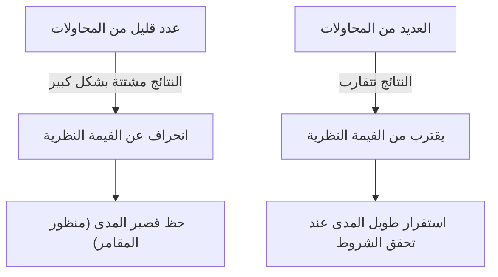
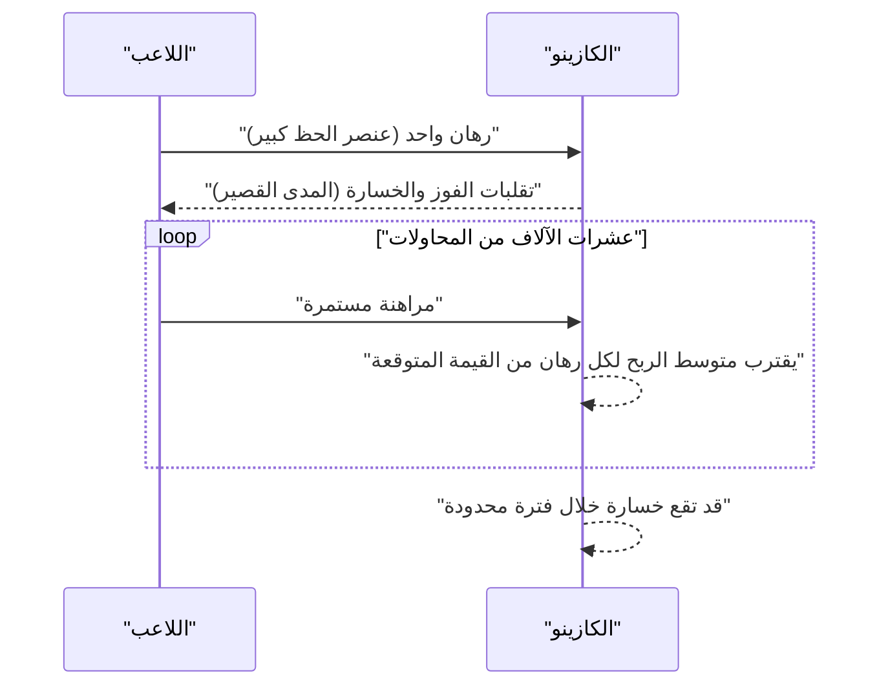

## 1. مقدمة: عائد الكازينو المتوقع وتقلباته

قد يربح اللاعبون مبالغ كبيرة على المدى القصير. في نموذج ذي قواعد ثابتة، قد يقترب متوسط عائد رهانات مستقلة كثيرة من قيمته المتوقعة. يدعم قانون الأعداد الكبيرة هذه الفكرة، لكنه لا يضمن الربح خلال مدة محدودة أو نجاح المشروع التجاري.

في هذا المقال، نشرح بشكل شامل "قانون الأعداد الكبيرة"، النظرية الأساسية والأكثر أهمية في نظرية الاحتمالات، بدءًا من الفهم البديهي وصولاً إلى التعاريف الرياضية الصارمة. وعلاوة على ذلك، نتعمق في المفاهيم الخاطئة الشائعة وكيف يتم تطبيقها في المجتمع.

## 2. ما هو قانون الأعداد الكبيرة؟

ينص قانون الأعداد الكبيرة (LLN) على تقارب متوسط عينة من متغيرات مستقلة ومتطابقة التوزيع إلى قيمتها المتوقعة إذا كان $E[|X_1|]<\infty$. وعند استخدام مؤشرات الحدث ذات القيمتين صفر وواحد، يقترب التكرار النسبي المرصود من احتمال الحدث. لا يتغير احتمال الحدث نفسه مع تراكم التجارب.

تخيل رمي عملة معدنية. احتمال الحصول على صورة هو $1/2$ ($50\%$). ومع ذلك، فإن رميها 10 مرات فقط لا يضمن الحصول على 5 صور و 5 كتابات. قد تحصل على 7 صور، أو ربما 2 فقط.
عند رمي عملة عادلة بشكل مستقل، تتقارب نسبة الصورة إلى 50% باحتمال واحد. لا يضمن ذلك نسبة 50% بالضبط بعد عدد محدود من الرميات، ولا أن الخطأ يتناقص عند كل خطوة.



هذه الفجوة بين "التقلب قصير المدى" و"الاستقرار طويل المدى" هي جوهر الاحتمالات، وهي نقطة يسيء البشر فهمها بديهياً.

## 3. أفضلية الكازينو ومتوسط العائد

أفضلية الكازينو هي ربحه المتوقع كنسبة من مبلغ الرهان. لنأخذ روليت أمريكية مثالية ذات 38 جيباً متساوية الاحتمال: من 1 إلى 36، مع 0 و00.

إذا راهنت على "أحمر أو أسود"، فإن احتمال الفوز هو $18/38$ (حوالي $47.37\%$). الدفع يكون الضعف (1 إلى 1)، ولكن بما أن احتمال الفوز أقل من $50\%$، فإن القيمة المتوقعة لرهان واحد تكون سالبة.

$$
\text{القيمة المتوقعة} = \left( \frac{18}{38} \times 1 \right) + \left( \frac{20}{38} \times (-1) \right) = -\frac{1}{19} \approx -0.0526
$$

بعبارة أخرى، مقابل كل دولار يتم المراهنة به، يخسر اللاعب في المتوسط حوالي $5.26$ سنتات.
مع دورات مستقلة ورهان بالقيمة نفسها على الأحمر في كل مرة، يتقارب متوسط ربح الكازينو لكل رهان تقارباً شبه مؤكد إلى $1/19\approx5.26\%$ من مبلغ الرهان. هذا ليس تقارباً للربح الإجمالي، ولا ضماناً للربح بعد عدد محدود من الرهانات. يجب النظر منفصلاً في النفقات واختلاف المبالغ وقيود رأس المال.



## 4. التعريف الرياضي لقانون الأعداد الكبيرة

بناءً على قوة التقارب، هناك نوعان من قانون الأعداد الكبيرة: **قانون الأعداد الكبيرة الضعيف** (WLLN) و **قانون الأعداد الكبيرة القوي** (SLLN). معبرًا عنه بصرامة في الرياضيات، يكون كما يلي.

### 4.1. قانون الأعداد الكبيرة الضعيف (WLLN)

يستند القانون الضعيف إلى مفهوم "التقارب في الاحتمال".
لتكن $X_1,X_2,\dots$ مستقلة ومتطابقة التوزيع (i.i.d.)، مع $E[|X_1|]<\infty$ و$E[X_1]=\mu$. لمتوسط العينة $\bar{X}_n=\frac{1}{n}\sum_{i=1}^n X_i$، تتحقق العلاقة التالية لكل $\epsilon>0$.

$$
\lim_{n \to \infty} P(|\bar{X}_n - \mu| > \epsilon) = 0
$$

هذا يعني أنه "كلما زاد حجم العينة $n$، فإن احتمال أن ينحرف متوسط العينة عن القيمة المتوقعة الحقيقية بأكثر من $\epsilon$ يقترب من $0$".

### 4.2. قانون الأعداد الكبيرة القوي (SLLN)

يعتمد القانون القوي على مفهوم أقوى وهو "التقارب شبه المؤكد (التقارب باحتمال 1)".

$$
P\left(\lim_{n \to \infty} \bar{X}_n = \mu \right) = 1
$$

ينص القانون الضعيف على أن احتمال تجاوز حد خطأ ثابت يصبح صغيراً لكل n كبير بما يكفي. وتحت شروط الاستقلال وتطابق التوزيع والقابلية للتكامل نفسها، ينص القانون القوي على تقارب متتالية متوسطات العينة كلها إلى القيمة المتوقعة على حدث احتماله واحد. قد توجد استثناءات باحتمال صفر. لا يضمن أي منهما المساواة الدقيقة بعد عدد محدود من التجارب أو أرباحاً موجبة دائماً.

### 4.3. إثبات القانون الضعيف باستخدام متباينة تشيبيشيف

لهذا الإثبات نفترض إضافةً إلى ذلك تبايناً محدوداً $\sigma^2<\infty$ ونستخدم متباينة تشيبيشيف. أما القانون الضعيف للمتغيرات المستقلة والمتطابقة التوزيع فلا يتطلب بحد ذاته تبايناً محدوداً.
إذا كانت القيمة المتوقعة للمتغير العشوائي $Y$ هي $\mu_Y$ وتباينه هو $\sigma_Y^2$، يتم التعبير عن متباينة تشيبيشيف على النحو التالي:

$$
P(|Y - \mu_Y| \ge \epsilon) \le \frac{\sigma_Y^2}{\epsilon^2}
$$

هنا، دعنا نضع $Y = \bar{X}_n$. إذا كان تباين كل $X_i$ هو $\sigma^2$، فإن تباين متوسط العينة $\bar{X}_n$ يكون $\sigma^2 / n$.
بالتعويض بهذا في متباينة تشيبيشيف:

$$
P(|\bar{X}_n - \mu| \ge \epsilon) \le \frac{\sigma^2}{n \epsilon^2}
$$

عندما $n\to\infty$، يقترب الطرف الأيمن من الصفر. لذلك يتقارب الاحتمال في الطرف الأيسر إلى الصفر أيضاً، فيثبت القانون الضعيف تحت شرط التباين المحدود.

## 5. مغالطة المقامر (Gambler's Fallacy)

الانحياز النفسي الشهير الناشئ عن سوء فهم قانون الأعداد الكبيرة هو **مغالطة المقامر**.

عندما يرى الناس اللون "الأحمر" يظهر 10 مرات متتالية في لعبة الروليت، يعتقد الكثيرون أن "الأسود يجب أن يظهر قريبًا". يعتمد هذا على المنطق الخاطئ بأنه "نظرًا لأن قانون الأعداد الكبيرة ينص على أن نسبة الأحمر إلى الأسود يجب أن تتقارب إلى $50\%$، يصبح ظهور الأسود أكثر احتمالًا لتعويض الانحياز السابق".

في روليت مثالية ذات 38 جيباً ودورات مستقلة، يكون احتمال الأحمر في الدورة التالية $18/38$ واحتمال الأسود $18/38$، بغض النظر عن النتائج السابقة. بسبب 0 و00، لا تساوي أي من النسبتين الحديتين 50%. لا ينشئ القانون قوة لتعويض الاختلالات الماضية ولا يغير احتمالات النتيجة التالية.

## 6. محاكاة باستخدام بايثون

دعونا نتخيل قانون الأعداد الكبيرة بصرياً باستخدام البرمجة. سنقوم بمحاكاة رمي حجر النرد ومشاهدة متوسط الرميات يتقارب إلى القيمة المتوقعة 3.5.

```python
import numpy as np
import matplotlib.pyplot as plt

# معلمات المحاكاة
n_trials = 10000  # عدد المحاولات
expected_value = 3.5  # القيمة المتوقعة لرمي حجر النرد

# توليد أرقام عشوائية من 1 إلى 6
np.random.seed(42)
rolls = np.random.randint(1, 7, size=n_trials)

# حساب المتوسط التراكمي
cumulative_average = np.cumsum(rolls) / np.arange(1, n_trials + 1)

# رسم النتائج
plt.figure(figsize=(10, 6))
plt.plot(cumulative_average, label=r"$\bar{X}_n$", color="blue", alpha=0.7)
plt.axhline(y=expected_value, color="red", linestyle="--", label=r"$E[X]=3.5$")
plt.title(r"$\bar{X}_n$")
plt.xlabel(r"n")
plt.ylabel(r"$\bar{X}_n$")
plt.legend()
plt.grid(True)
plt.show()
```

يوضح هذا المثال متوسطاً تراكمياً يتقلب قرب 3.5. المحاكاة المحدودة تساعد على الفهم الحدسي لكنها ليست برهاناً للنظرية. قد يبتعد المتوسط عن القيمة المتوقعة أثناء المسار، وليس مطلوباً أن يساوي 3.5 بالضبط في أي وقت.

## 7. الحالات التي لا ينطبق فيها قانون الأعداد الكبيرة: توزيع كوشي

قانون الأعداد الكبيرة ليس عالميًا. شرط أساسي هو أن "القيمة المتوقعة (المتوسط) يجب أن تكون محدودة".
لا يملك توزيع كوشي قيمة متوقعة مطلقة محدودة، ومتوسطه غير معرّف. لا يعني ذلك أن المتوسط يساوي اللانهاية الموجبة. عزمه الثاني غير محدود، وليس له تباين محدود بالمعنى المعتاد.

يبقى متوسط عينة من متغيرات كوشي معيارية مستقلة موزعاً بتوزيع كوشي المعياري لكل $n$، فلا يتقارب في الاحتمال إلى ثابت. في البيانات الحقيقية، لا تكفي الذيول الثقيلة وحدها للحكم بفشل القانون؛ يجب فحص القابلية للتكامل والاعتماد وبقية فروض النموذج.

## 8. أمثلة تطبيقية في العالم الحقيقي

لا يُستخدم قانون الأعداد الكبيرة في الكازينوهات فحسب، بل في أنظمة مختلفة تدعم أساس مجتمعنا.

### 8.1. أعمال التأمين
في التأمين، قد يساعد متوسط الخسائر عبر عقود كثيرة على توقع الخطر الكلي. عدد العقود وحده لا يضمن دقة عالية. يجب أن تراعي النماذج الكوارث المشتركة وارتباط الخسائر واختلاف المجموعات وتغير توزيعات الخسائر أو شروط العقود.

### 8.2. مراقبة الجودة الإحصائية
في تصنيع المنتجات في المصانع، قد يكون فحص جميع المنتجات مستحيلًا من منظور التكلفة والوقت. لذلك، يتم فحص جزء من المنتجات المختارة عشوائيًا (عينة)، ويتم تقدير معدل العيوب الإجمالي من النتائج. هنا أيضًا، يعمل قانون الأعداد الكبيرة كأساس قوي لاستنتاج خصائص المجتمع الإحصائي من العينة.

### 8.3. التعلم الآلي والبيانات الضخمة
في التعلم الآلي، يمكن للقانون تبرير تقارب متوسط الخسارة المرصودة إلى الخسارة المتوقعة لنموذج ثابت، إذا كانت الخسائر مستقلة ومتطابقة التوزيع وقابلة للتكامل. أما التعميم بعد اختيار النموذج من بيانات التدريب فيحتاج حججاً إضافية. زيادة البيانات وحدها لا تزيل انحياز العينة أو تغير التوزيع أو خطأ تحديد النموذج.

## 9. خاتمة

يعد قانون الأعداد الكبيرة أداة قوية بالنسبة لنا لفهم عالم شديد عدم اليقين واتخاذ قرارات عقلانية. من هياكل أرباح الكازينو إلى التأمين وتكنولوجيا الذكاء الاصطناعي، يعمل هذا القانون بهدوء ولكن بشكل موثوق في كل مكان في المجتمع الحديث.

في المرة القادمة التي ترمي فيها عملة معدنية أو حجر نرد، لماذا لا تفكر في القوانين الرياضية العظيمة والجميلة المخبأة خلف كل حدث مصادفة؟ بدلاً من الانتقال من الفرح إلى اليأس بسبب الحظ قصير المدى، فإن امتلاك منظور طويل المدى قد يغير قليلاً من كيفية رؤيتك للعالم.

## المراجع

- [MIT 18.05: Central Limit Theorem and the Law of Large Numbers](https://math.mit.edu/~dav/05.dir/class6-prep.pdf)
- [Mathlib: The strong law of large numbers](https://leanprover-community.github.io/mathlib4_docs/Mathlib/Probability/StrongLaw.html)
- [MIT: Cauchy Distribution](https://web.mit.edu/urban_or_book/www/book/chapter3/3.3.3.html)
