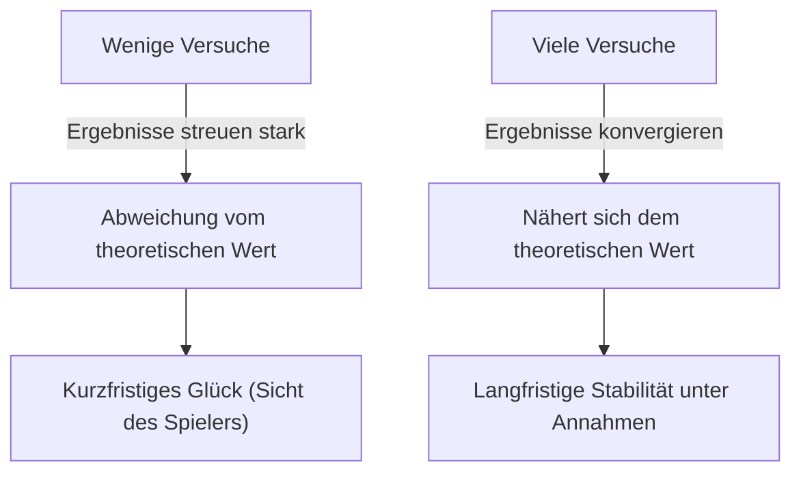
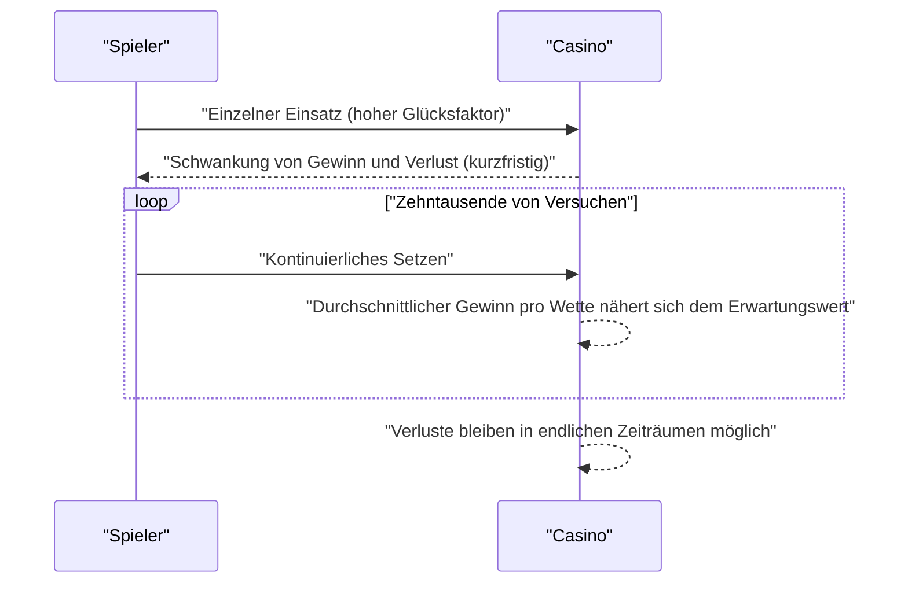

## 1. Einleitung: Erwartete Casinoerträge und Schwankungen

Spieler können kurzfristig große Summen gewinnen. In einem festen Modell kann sich der durchschnittliche Ertrag vieler unabhängiger Einsätze seinem Erwartungswert annähern. Das Gesetz der großen Zahlen stützt diese Idee, garantiert aber weder Gewinne in einem endlichen Zeitraum noch den Erfolg des Unternehmens.

In diesem Artikel erklären wir das "Gesetz der großen Zahlen", das grundlegendste und wichtigste Theorem der Wahrscheinlichkeitstheorie, umfassend, vom intuitiven Verständnis bis hin zu strengen mathematischen Definitionen. Darüber hinaus gehen wir auf alltägliche Missverständnisse ein und untersuchen, wie es in der Gesellschaft angewandt wird.

## 2. Was ist das Gesetz der großen Zahlen?

Das Gesetz der großen Zahlen (LLN) besagt, dass der Stichprobenmittelwert unabhängiger, identisch verteilter Zufallsvariablen bei $E[|X_1|]<\infty$ gegen ihren Erwartungswert konvergiert. Bei Null-Eins-Indikatoren eines Ereignisses nähert sich die beobachtete relative Häufigkeit dessen Wahrscheinlichkeit. Die Wahrscheinlichkeit selbst ändert sich nicht mit der Anzahl der Versuche.

Stellen Sie sich einen Münzwurf vor. Die Wahrscheinlichkeit für "Kopf" liegt bei $1/2$ ($50\%$). Es nur 10 Mal zu werfen garantiert jedoch nicht, dass 5 Mal Kopf und 5 Mal Zahl fallen. Man könnte 7 Mal Kopf oder auch nur 2 Mal bekommen.
Bei unabhängigen Würfen einer fairen Münze konvergiert der Kopfanteil mit Wahrscheinlichkeit eins gegen 50%. Das garantiert weder genau 50% nach endlich vielen Würfen noch einen Fehler, der bei jedem Schritt kleiner wird.



Diese Lücke zwischen "kurzfristiger Volatilität" und "langfristiger Stabilität" ist die eigentliche Essenz der Wahrscheinlichkeit und ein Punkt, an dem Menschen intuitiv oft Fehlannahmen treffen.

## 3. Hausvorteil und durchschnittlicher Ertrag

Der Hausvorteil ist der erwartete Gewinn des Casinos als Anteil am Einsatz. Wir betrachten ein ideales amerikanisches Roulette mit 38 gleich wahrscheinlichen Fächern: 1 bis 36 sowie 0 und 00.

Wer auf eine der Farben Rot oder Schwarz setzt, gewinnt mit Wahrscheinlichkeit $18/38$ (etwa $47{,}37\%$). Der Nettogewinn bei einem Treffer entspricht dem Einsatz (1:1); zusammen mit dem zurückgezahlten Einsatz erhält man das Doppelte. Da die Gewinnchance unter 50% liegt, ist der Erwartungswert des Nettogewinns negativ.

$$
\text{Erwartungswert} = \left( \frac{18}{38} \times 1 \right) + \left( \frac{20}{38} \times (-1) \right) = -\frac{1}{19} \approx -0{,}0526
$$

Mit anderen Worten, für jeden gesetzten Dollar verliert der Spieler im Durchschnitt etwa $5,26$ Cent.
Bei unabhängigen Drehungen und gleichem Einsatz auf Rot konvergiert der durchschnittliche Gewinn des Casinos pro Wette fast sicher gegen $1/19\approx5{,}26\%$ des Einsatzes. Das bedeutet weder eine Konvergenz des Gesamtgewinns noch einen garantierten Gewinn nach endlich vielen Wetten. Kosten, unterschiedliche Einsätze und Kapitalbeschränkungen sind gesondert zu betrachten.



## 4. Mathematische Definition des Gesetzes der großen Zahlen

Je nach Stärke der Konvergenz gibt es zwei Arten des Gesetzes der großen Zahlen: das **schwache Gesetz der großen Zahlen** (WLLN) und das **starke Gesetz der großen Zahlen** (SLLN). Mathematisch streng ausgedrückt sieht das folgendermaßen aus.

### 4.1. Schwaches Gesetz der großen Zahlen (WLLN)

Das schwache Gesetz basiert auf dem Konzept der "stochastischen Konvergenz" (Konvergenz in Wahrscheinlichkeit).
Seien $X_1,X_2,\dots$ unabhängig und identisch verteilt (i.i.d.) mit $E[|X_1|]<\infty$ und $E[X_1]=\mu$. Für den Stichprobenmittelwert $\bar{X}_n=\frac{1}{n}\sum_{i=1}^n X_i$ gilt für jedes $\epsilon>0$:

$$
\lim_{n \to \infty} P(|\bar{X}_n - \mu| > \epsilon) = 0
$$

Das bedeutet: "Wenn der Stichprobenumfang $n$ größer wird, nähert sich die Wahrscheinlichkeit, dass das Stichprobenmittel um mehr als $\epsilon$ vom wahren Erwartungswert abweicht, dem Wert $0$ an."

### 4.2. Starkes Gesetz der großen Zahlen (SLLN)

Das starke Gesetz basiert auf dem stärkeren Konzept der "fast sicheren Konvergenz (Konvergenz mit Wahrscheinlichkeit 1)".

$$
P\left(\lim_{n \to \infty} \bar{X}_n = \mu \right) = 1
$$

Das schwache Gesetz besagt, dass für jedes hinreichend große n die Wahrscheinlichkeit einer Überschreitung einer festen Fehlertoleranz klein wird. Unter denselben i.i.d.- und Integrierbarkeitsannahmen besagt das starke Gesetz, dass die ganze Folge der Stichprobenmittelwerte auf einem Ereignis der Wahrscheinlichkeit eins gegen den Erwartungswert konvergiert. Ausnahmen mit Wahrscheinlichkeit null sind möglich. Keines der Gesetze garantiert exakte Übereinstimmung nach endlich vielen Versuchen oder dauerhaft positive Gewinne.

### 4.3. Beweis des schwachen Gesetzes mithilfe der Tschebyscheff-Ungleichung

Für diesen Beweis nehmen wir zusätzlich eine endliche Varianz $\sigma^2<\infty$ an und verwenden die Tschebyscheff-Ungleichung. Das i.i.d.-Gesetz in seiner schwachen Form erfordert selbst keine endliche Varianz.
Sei der Erwartungswert einer Zufallsvariable $Y$ gleich $\mu_Y$ und ihre Varianz $\sigma_Y^2$, dann wird die Tschebyscheff-Ungleichung wie folgt ausgedrückt:

$$
P(|Y - \mu_Y| \ge \epsilon) \le \frac{\sigma_Y^2}{\epsilon^2}
$$

Nehmen wir hier $Y = \bar{X}_n$ an. Wenn die Varianz jedes $X_i$ gleich $\sigma^2$ ist, dann ist die Varianz des Stichprobenmittelwerts $\bar{X}_n$ gleich $\sigma^2 / n$.
Wenn wir dies in die Tschebyscheff-Ungleichung einsetzen:

$$
P(|\bar{X}_n - \mu| \ge \epsilon) \le \frac{\sigma^2}{n \epsilon^2}
$$

Wenn $n \to \infty$, nähert sich die rechte Seite der $0$ an. Folglich konvergiert auch die Wahrscheinlichkeit auf der linken Seite gegen $0$, womit das schwache Gesetz bewiesen ist.

## 5. Der Spielerfehlschluss (Gambler's Fallacy)

Eine bekannte psychologische Verzerrung, die aus einem Missverständnis des Gesetzes der großen Zahlen entsteht, ist der **Spielerfehlschluss**.

Wenn die Leute sehen, dass beim Roulette 10 Mal hintereinander "Rot" fällt, denken viele: "Als nächstes sollte bald Schwarz kommen". Dies beruht auf der falschen Annahme, dass "da das Gesetz der großen Zahlen besagt, dass das Verhältnis von Rot und Schwarz gegen $50\%$ konvergieren sollte, Schwarz wahrscheinlicher wird, um die vorherige Unausgewogenheit auszugleichen."

Bei einem idealen Roulette mit 38 Fächern und unabhängigen Drehungen beträgt die Wahrscheinlichkeit für Rot beim nächsten Dreh $18/38$ und für Schwarz ebenfalls $18/38$, unabhängig von früheren Ergebnissen. Wegen 0 und 00 ist keiner der Grenzanteile 50%. Das Gesetz erzeugt keine Kraft zum Ausgleich früherer Ungleichgewichte und ändert nicht die Wahrscheinlichkeiten des nächsten Ergebnisses.

## 6. Simulation mit Python

Lassen Sie uns das Gesetz der großen Zahlen mithilfe der Programmierung visuell darstellen. Wir simulieren das Werfen eines Würfels und beobachten, wie der Durchschnitt der Würfe gegen den Erwartungswert von 3,5 konvergiert.

```python
import numpy as np
import matplotlib.pyplot as plt

# Parameter der Simulation
n_trials = 10000  # Anzahl der Versuche
expected_value = 3.5  # Erwartungswert eines Würfelwurfs

# Zufällig Zahlen von 1 bis 6 generieren
np.random.seed(42)
rolls = np.random.randint(1, 7, size=n_trials)

# Kumulativen Durchschnitt berechnen
cumulative_average = np.cumsum(rolls) / np.arange(1, n_trials + 1)

# Ergebnisse plotten
plt.figure(figsize=(10, 6))
plt.plot(cumulative_average, label=r"$\bar{X}_n$", color="blue", alpha=0.7)
plt.axhline(y=expected_value, color="red", linestyle="--", label=r"$E[X]=3.5$")
plt.title(r"$\bar{X}_n$")
plt.xlabel(r"n")
plt.ylabel(r"$\bar{X}_n$")
plt.legend()
plt.grid(True)
plt.show()
```

Dieses Beispiel zeigt einen kumulativen Mittelwert, der nahe 3,5 schwankt. Eine endliche Simulation unterstützt die Anschauung, ist aber kein Beweis. Der Mittelwert kann sich zwischendurch vom Erwartungswert entfernen und muss nie genau 3,5 betragen.

## 7. Fälle, in denen das Gesetz der großen Zahlen nicht gilt: [Cauchy](https://kenji.blog/de/p/cauchy/)-Verteilung

Das Gesetz der großen Zahlen ist nicht universell. Eine Voraussetzung ist, dass "der Erwartungswert (Mittelwert) endlich sein muss".
Die Cauchy-Verteilung besitzt keinen endlichen absoluten Erwartungswert; ihr Mittelwert ist nicht definiert. Das bedeutet nicht, dass der Mittelwert gleich positiv unendlich wäre. Ihr zweites Moment ist unendlich, und sie besitzt keine gewöhnliche endliche Varianz.

Der Stichprobenmittelwert unabhängiger standard-Cauchy-verteilter Variablen ist für jedes $n$ wieder standard-Cauchy-verteilt und konvergiert daher nicht in Wahrscheinlichkeit gegen eine Konstante. Bei realen Daten beweisen schwere Verteilungsschwänze allein kein Scheitern des Gesetzes: Integrierbarkeit, Abhängigkeiten und weitere Modellannahmen müssen geprüft werden.

## 8. Anwendungsbeispiele in der realen Welt

Das Gesetz der großen Zahlen wird nicht nur in Casinos genutzt, sondern in zahlreichen Systemen, die das Fundament unserer Gesellschaft stützen.

### 8.1. Versicherungsgeschäft
In Versicherungen kann das Mitteln von Schäden über viele Verträge bei der Vorhersage des Gesamtrisikos helfen. Die Vertragszahl allein garantiert keine hohe Genauigkeit. Modelle müssen gemeinsame Katastrophen, korrelierte Schäden, Gruppenunterschiede sowie Änderungen der Schadenverteilungen oder Vertragsbedingungen berücksichtigen.

### 8.2. Statistische Qualitätskontrolle
Bei der Produktherstellung in Fabriken ist es aus Kosten- und Zeitgründen oft unmöglich, alle Produkte zu überprüfen. Daher wird ein Teil zufällig ausgewählter Produkte (Stichprobe) geprüft, und aus den Ergebnissen wird die Gesamtausschussquote geschätzt. Auch hier dient das Gesetz der großen Zahlen als starke Grundlage, um von einer Stichprobe auf die Eigenschaften der Grundgesamtheit zu schließen.

### 8.3. Maschinelles Lernen und Big Data
Beim maschinellen Lernen kann das Gesetz für ein festes Modell mit i.i.d. und integrierbaren Verlusten die Konvergenz des mittleren beobachteten Verlusts zum erwarteten Verlust begründen. Die Generalisierung nach einer datenabhängigen Modellauswahl benötigt zusätzliche Argumente. Mehr Daten allein beseitigen weder Stichprobenverzerrungen noch Verteilungsänderungen oder Modellfehlspezifikationen.

## 9. Fazit

Das Gesetz der großen Zahlen ist ein mächtiges Werkzeug für uns, um eine hochgradig unsichere Welt zu verstehen und rationale Entscheidungen zu treffen. Von der Gewinnstruktur eines Casinos bis hin zu Versicherungen und KI-Technologie wirkt dieses Gesetz leise, aber zuverlässig überall in der modernen Gesellschaft.

Wenn Sie das nächste Mal eine Münze werfen oder würfeln, warum denken Sie nicht einmal an die großartigen und wunderschönen mathematischen Gesetze, die sich hinter jedem zufälligen Ereignis verbergen? Anstatt sich über kurzfristiges Glück zu freuen oder zu ärgern, kann eine langfristige Perspektive vielleicht Ihre Sicht auf die Welt ein wenig verändern.

## Quellen

- [MIT 18.05: Central Limit Theorem and the Law of Large Numbers](https://math.mit.edu/~dav/05.dir/class6-prep.pdf)
- [Mathlib: The strong law of large numbers](https://leanprover-community.github.io/mathlib4_docs/Mathlib/Probability/StrongLaw.html)
- [MIT: Cauchy Distribution](https://web.mit.edu/urban_or_book/www/book/chapter3/3.3.3.html)
