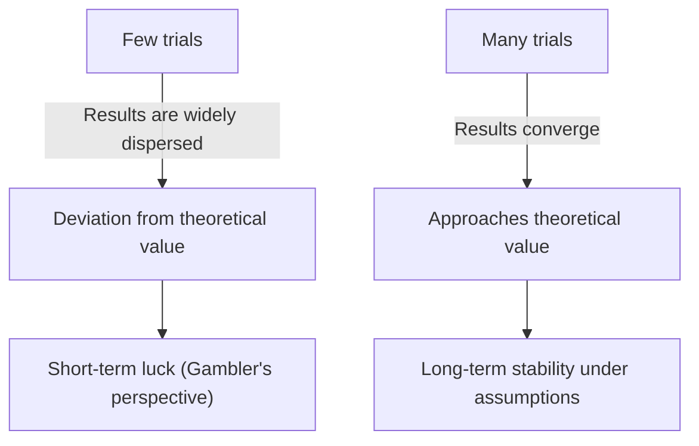
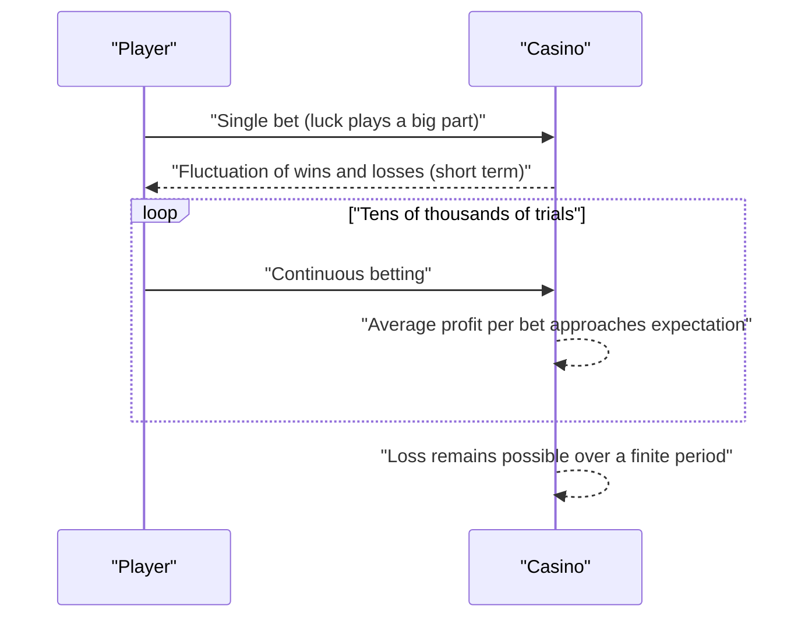

## 1. Introduction: Expected Casino Returns and Fluctuations

Players can win large amounts in the short term. Under a fixed model, averaging many independent bets can make the average return approach its expectation. The law of large numbers supports this idea, but does not guarantee a casino’s profit over a finite period or the success of its business.

In this article, we comprehensively explain the "Law of Large Numbers," the most fundamental and important theorem in probability theory, from intuitive understanding to rigorous mathematical definitions. Furthermore, we delve into common misconceptions and how it is applied in society.

## 2. What is the Law of Large Numbers?

The law of large numbers (LLN) states that the sample mean of independent, identically distributed random variables converges to their expectation when $E[|X_1|]<\infty$. For zero–one indicators of an event, the observed relative frequency approaches its probability. The probability itself does not change as trials accumulate.

Imagine tossing a coin. The probability of getting heads is $1/2$ ($50\%$). However, just tossing it 10 times doesn't guarantee 5 heads and 5 tails. You might get 7 heads, or only 2.
For independent tosses of a fair coin, the proportion of heads converges to 50% with probability one. This does not guarantee exactly 50% after finitely many tosses or an error that decreases at every step.



This gap between "short-term volatility" and "long-term stability" is the very essence of probability, and it's a point where humans intuitively tend to misunderstand.

## 3. House Edge and Average Returns

The house edge is the house’s expected profit as a fraction of the amount wagered. Consider an ideal American roulette wheel with 38 equally likely pockets: 1 through 36, plus 0 and 00.

If you bet on "red or black," the probability of winning is $18/38$ (about $47.37\%$). The payout is 2x, but since the winning probability is under $50\%$, the expected value of a single bet is negative.

$$
\text{Expected Value} = \left( \frac{18}{38} \times 1 \right) + \left( \frac{20}{38} \times (-1) \right) = -\frac{1}{19} \approx -0.0526
$$

For each dollar wagered, the player’s expected net loss is about 5.26 cents.
With independent spins and an equal stake on red each time, the house’s average profit per bet converges almost surely to $1/19\approx5.26\%$ of the stake. This is not convergence of total profit or a guarantee of profit after finitely many bets. Expenses, varying stakes, and capital constraints require separate consideration.



## 4. Mathematical Definition of the Law of Large Numbers

Depending on the strength of convergence, the Law of Large Numbers has two types: the **Weak Law of Large Numbers** (WLLN) and the **Strong Law of Large Numbers** (SLLN). Expressed rigorously in mathematics, it is as follows.

### 4.1. Weak Law of Large Numbers (WLLN)

The weak law is based on the concept of "convergence in probability."
Let $X_1,X_2,\dots$ be independent and identically distributed (i.i.d.) with $E[|X_1|]<\infty$ and $E[X_1]=\mu$. For the sample mean $\bar{X}_n=\frac{1}{n}\sum_{i=1}^n X_i$, the following holds for every $\epsilon>0$.

$$
\lim_{n \to \infty} P(|\bar{X}_n - \mu| > \epsilon) = 0
$$

This means that "as the sample size $n$ becomes larger, the probability that the sample mean deviates from the true expected value by more than $\epsilon$ approaches $0$."

### 4.2. Strong Law of Large Numbers (SLLN)

The strong law is based on the stronger concept of "almost sure convergence (convergence with probability 1)."

$$
P\left(\lim_{n \to \infty} \bar{X}_n = \mu \right) = 1
$$

The weak law says that, for each sufficiently large n, the probability of exceeding a fixed error tolerance becomes small. Under the same i.i.d. and integrability assumptions, the strong law says that the entire sequence of sample means converges to the expectation on an event of probability one. Probability-zero exceptions are possible. Neither law guarantees exact agreement after finitely many trials or permanently positive profits.

### 4.3. Proof of the Weak Law using Chebyshev's Inequality

For this proof, assume additionally that the variance is finite, $\sigma^2<\infty$, and apply Chebyshev’s inequality. Finite variance is not required for the i.i.d. weak law itself.
Let the expected value of a random variable $Y$ be $\mu_Y$ and its variance be $\sigma_Y^2$. Chebyshev's inequality is expressed as follows:

$$
P(|Y - \mu_Y| \ge \epsilon) \le \frac{\sigma_Y^2}{\epsilon^2}
$$

Here, let $Y = \bar{X}_n$. If the variance of each $X_i$ is $\sigma^2$, the variance of the sample mean $\bar{X}_n$ is $\sigma^2 / n$.
Substituting this into Chebyshev's inequality,

$$
P(|\bar{X}_n - \mu| \ge \epsilon) \le \frac{\sigma^2}{n \epsilon^2}
$$

As $n \to \infty$, the right side approaches $0$. Therefore, the probability on the left side also converges to $0$, proving the weak law.

## 5. Gambler's Fallacy

A famous psychological bias born from misunderstanding the Law of Large Numbers is the **Gambler's Fallacy**.

When people see "red" appear 10 times in a row in roulette, many think "black should be coming up soon." This is based on the erroneous reasoning that "since the Law of Large Numbers states the ratio of red to black should converge to $50\%$, black becomes more likely to appear to offset the previous bias."

For independent spins of an ideal 38-pocket roulette wheel, the next spin has probability $18/38$ of red and $18/38$ of black, regardless of past results. Because of 0 and 00, neither limiting proportion is 50%. The law does not introduce a force that cancels past imbalances or changes the next outcome’s probabilities.

## 6. Simulation with Python

Let's actually visualize the Law of Large Numbers using programming. We will simulate rolling a die and watching the average of the rolls converge to the expected value of 3.5.

```python
import numpy as np
import matplotlib.pyplot as plt

# Simulation parameters
n_trials = 10000  # Number of trials
expected_value = 3.5  # Expected value of a die roll

# Randomly generate numbers from 1 to 6
np.random.seed(42)
rolls = np.random.randint(1, 7, size=n_trials)

# Calculate cumulative average
cumulative_average = np.cumsum(rolls) / np.arange(1, n_trials + 1)

# Plot the results
plt.figure(figsize=(10, 6))
plt.plot(cumulative_average, label=r"$\bar{X}_n$", color="blue", alpha=0.7)
plt.axhline(y=expected_value, color="red", linestyle="--", label=r"$E[X]=3.5$")
plt.title(r"$\bar{X}_n$")
plt.xlabel(r"n")
plt.ylabel(r"$\bar{X}_n$")
plt.legend()
plt.grid(True)
plt.show()
```

This example illustrates a cumulative mean fluctuating near 3.5. A finite simulation aids intuition; it is not a proof. The mean can move farther from the expectation along the way and need not ever equal 3.5 exactly.

## 7. Cases Where the Law of Large Numbers Doesn't Hold: [Cauchy](https://kenji.blog/en/p/cauchy/) Distribution

The Law of Large Numbers is not universal. A prerequisite is that "the expected value (mean) must be finite."
The Cauchy distribution has no finite absolute expectation, and its mean is undefined. This does not mean its mean equals positive infinity. Its second moment is infinite, and it has no ordinary finite variance.

The sample mean of independent standard Cauchy variables is standard Cauchy for every $n$, so it does not converge in probability to a constant. For real data, heavy tails alone do not establish that the law fails: check integrability, dependence, and the model’s other assumptions.

## 8. Application Examples in the Real World

The Law of Large Numbers is utilized not only in casinos but in various systems that support the foundation of our society.

### 8.1. Insurance Business
In insurance, averaging losses across many contracts can help predict aggregate risk. Contract count alone does not guarantee high accuracy. Models must consider shared catastrophes, correlated losses, differences between groups, and changes in loss distributions or policy conditions.

### 8.2. Statistical Quality Control
In product manufacturing at factories, inspecting all products may be impossible from a cost and time perspective. Therefore, a portion of randomly selected products (sample) is inspected, and the overall defect rate is estimated from the results. Here too, the Law of Large Numbers serves as a powerful basis for inferring the properties of a population from a sample.

### 8.3. Machine Learning and Big Data
In machine learning, the law can justify convergence of average observed loss to expected loss for a fixed model with i.i.d., integrable losses. Generalization after choosing a model from training data requires additional arguments. More data alone does not remove sampling bias, distribution shift, or model misspecification.

## 9. Conclusion

The Law of Large Numbers is a powerful tool for us to understand a highly uncertain world and make rational decisions. From casino profit structures to insurance and AI technology, this law functions quietly but reliably everywhere in modern society.

The next time you toss a coin or roll a die, why not think about the grand and beautiful mathematical laws hidden behind each chance occurrence? Instead of going from joy to despair over short-term luck, having a long-term perspective might just change how the world looks to you a little bit.

## References

- [MIT 18.05: Central Limit Theorem and the Law of Large Numbers](https://math.mit.edu/~dav/05.dir/class6-prep.pdf)
- [Mathlib: The strong law of large numbers](https://leanprover-community.github.io/mathlib4_docs/Mathlib/Probability/StrongLaw.html)
- [MIT: Cauchy Distribution](https://web.mit.edu/urban_or_book/www/book/chapter3/3.3.3.html)
