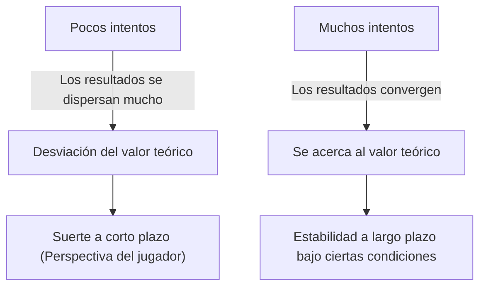
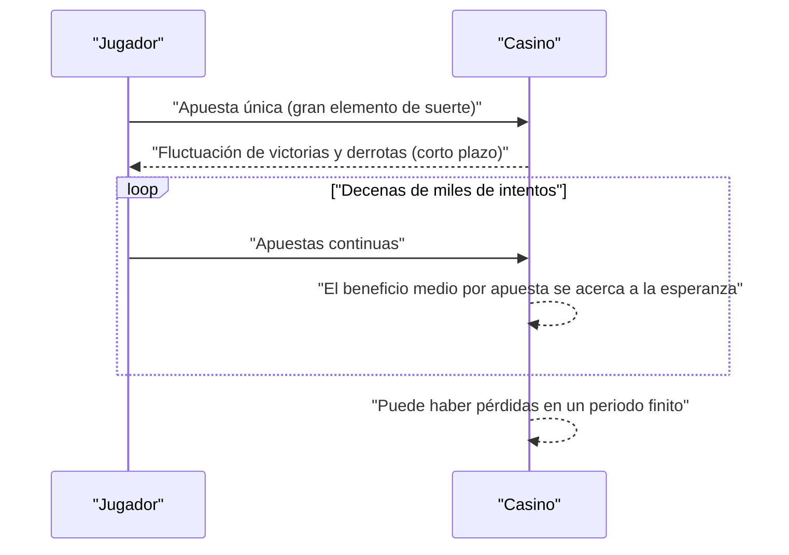

## 1. Introducción: Rendimiento esperado del casino y fluctuaciones

Los jugadores pueden ganar grandes cantidades a corto plazo. En un modelo fijo, promediar muchas apuestas independientes puede acercar el rendimiento medio a su esperanza. La ley de los grandes números respalda esta idea, pero no garantiza beneficios en un periodo finito ni el éxito del negocio.

En este artículo, explicaremos de manera exhaustiva la "Ley de los Grandes Números", el teorema más fundamental e importante de la teoría de la probabilidad, desde la comprensión intuitiva hasta las definiciones matemáticas rigurosas. Además, profundizaremos en los malentendidos cotidianos y en cómo se aplica en la sociedad.

## 2. ¿Qué es la Ley de los Grandes Números?

La ley de los grandes números (LLN) establece que la media muestral de variables independientes e idénticamente distribuidas converge a su esperanza cuando $E[|X_1|]<\infty$. Para los indicadores cero–uno de un evento, la frecuencia relativa observada se acerca a su probabilidad. La probabilidad en sí no cambia al acumular ensayos.

Imagina lanzar una moneda. La probabilidad de que salga cara es de $1/2$ ($50\%$). Sin embargo, lanzarla solo 10 veces no garantiza que saldrán 5 caras y 5 cruces. Podrías obtener 7 caras, o solo 2.
Con lanzamientos independientes de una moneda equilibrada, la proporción de caras converge al 50% con probabilidad uno. No se garantiza exactamente un 50% después de un número finito de lanzamientos ni que el error disminuya en cada paso.



Esta brecha entre la "fluctuación a corto plazo" y la "estabilidad a largo plazo" es la esencia misma de la probabilidad, y también es el punto que los humanos suelen malinterpretar por intuición.

## 3. La ventaja de la casa y el rendimiento medio

La ventaja de la casa es su beneficio esperado como proporción de lo apostado. Consideremos una ruleta americana ideal con 38 casillas equiprobables: del 1 al 36, más el 0 y el 00.

Si apuestas a "rojo o negro", la probabilidad de ganar es de $18/38$ (aproximadamente $47.37\%$). El pago es el doble, pero como la probabilidad de ganar es inferior al $50\%$, el valor esperado de una sola apuesta es negativo.

$$
\text{Valor Esperado} = \left( \frac{18}{38} \times 1 \right) + \left( \frac{20}{38} \times (-1) \right) = -\frac{1}{19} \approx -0.0526
$$

En otras palabras, por cada dólar apostado, el jugador pierde en promedio unos $5.26$ centavos.
Con giros independientes y la misma cantidad apostada al rojo cada vez, el beneficio medio de la casa por apuesta converge casi seguramente al $1/19\approx5.26\%$ de la cantidad apostada. Esto no significa que converja el beneficio total ni garantiza ganancias tras un número finito de apuestas. Gastos, apuestas variables y restricciones de capital requieren un análisis aparte.



## 4. Definición matemática de la Ley de los Grandes Números

Existen dos tipos de la Ley de los Grandes Números según la fuerza de convergencia: la **Ley Débil de los Grandes Números** (WLLN) y la **Ley Fuerte de los Grandes Números** (SLLN). Matemáticamente, se expresan de manera rigurosa de la siguiente manera.

### 4.1. Ley Débil de los Grandes Números (WLLN)

La ley débil se basa en el concepto de "convergencia en probabilidad".
Sean $X_1,X_2,\dots$ variables independientes e idénticamente distribuidas (i.i.d.), con $E[|X_1|]<\infty$ y $E[X_1]=\mu$. Para la media muestral $\bar{X}_n=\frac{1}{n}\sum_{i=1}^n X_i$, se cumple lo siguiente para todo $\epsilon>0$.

$$
\lim_{n \to \infty} P(|\bar{X}_n - \mu| > \epsilon) = 0
$$

Esto significa que "a medida que el tamaño de la muestra $n$ se hace más grande, la probabilidad de que la media muestral se desvíe del valor esperado verdadero en más de $\epsilon$ se acerca a $0$".

### 4.2. Ley Fuerte de los Grandes Números (SLLN)

La ley fuerte se basa en un concepto más riguroso de "convergencia casi segura (convergencia con probabilidad 1)".

$$
P\left(\lim_{n \to \infty} \bar{X}_n = \mu \right) = 1
$$

La ley débil afirma que, para cada n suficientemente grande, la probabilidad de superar una tolerancia de error fija se hace pequeña. Bajo las mismas condiciones de independencia, distribución idéntica e integrabilidad, la ley fuerte afirma que toda la sucesión de medias converge a la esperanza en un evento de probabilidad uno. Puede haber excepciones de probabilidad cero. Ninguna garantiza igualdad exacta tras un número finito de ensayos ni beneficios permanentemente positivos.

### 4.3. Demostración de la Ley Débil usando la desigualdad de Chebyshev

Para esta demostración, supongamos además que la varianza es finita, $\sigma^2<\infty$, y apliquemos la desigualdad de Chebyshev. La ley débil i.i.d. no requiere por sí misma varianza finita.
Si el valor esperado de una variable aleatoria $Y$ es $\mu_Y$ y su varianza es $\sigma_Y^2$, la desigualdad de Chebyshev se expresa de la siguiente manera:

$$
P(|Y - \mu_Y| \ge \epsilon) \le \frac{\sigma_Y^2}{\epsilon^2}
$$

Aquí, digamos que $Y = \bar{X}_n$. Si la varianza de cada $X_i$ es $\sigma^2$, entonces la varianza de la media muestral $\bar{X}_n$ será $\sigma^2 / n$.
Sustituyendo esto en la desigualdad de Chebyshev:

$$
P(|\bar{X}_n - \mu| \ge \epsilon) \le \frac{\sigma^2}{n \epsilon^2}
$$

A medida que $n \to \infty$, el lado derecho se acerca a $0$. Por lo tanto, la probabilidad del lado izquierdo también converge a $0$, demostrando así la ley débil.

## 5. La falacia del apostador (Gambler's Fallacy)

Un famoso sesgo psicológico que nace de un malentendido de la Ley de los Grandes Números es la **falacia del apostador**.

Cuando la gente ve salir el "rojo" 10 veces seguidas en la ruleta, muchos piensan que "ya debería salir el negro". Esto se basa en el razonamiento erróneo de que "dado que la Ley de los Grandes Números establece que la proporción de rojos y negros debe converger al $50\%$, es más probable que salga el negro para contrarrestar el sesgo anterior".

En una ruleta ideal de 38 casillas con giros independientes, la probabilidad de rojo en el siguiente giro es $18/38$ y la de negro también es $18/38$, con independencia del historial. Debido al 0 y al 00, ninguna proporción límite es del 50%. La ley no introduce una fuerza que compense desequilibrios pasados ni cambia las probabilidades del siguiente resultado.

## 6. Simulación con Python

Visualicemos la Ley de los Grandes Números en la práctica utilizando programación. Simularemos el lanzamiento de un dado y veremos cómo el promedio de los resultados converge al valor esperado de 3.5.

```python
import numpy as np
import matplotlib.pyplot as plt

# Parámetros de la simulación
n_trials = 10000  # Número de intentos
expected_value = 3.5  # Valor esperado de la cara del dado

# Generar aleatoriamente números del 1 al 6
np.random.seed(42)
rolls = np.random.randint(1, 7, size=n_trials)

# Calcular el promedio acumulado
cumulative_average = np.cumsum(rolls) / np.arange(1, n_trials + 1)

# Graficar los resultados
plt.figure(figsize=(10, 6))
plt.plot(cumulative_average, label=r"$\bar{X}_n$", color="blue", alpha=0.7)
plt.axhline(y=expected_value, color="red", linestyle="--", label=r"$E[X]=3.5$")
plt.title(r"$\bar{X}_n$")
plt.xlabel(r"n")
plt.ylabel(r"$\bar{X}_n$")
plt.legend()
plt.grid(True)
plt.show()
```

Este ejemplo muestra una media acumulada que fluctúa cerca de 3.5. Una simulación finita ayuda a la intuición, pero no es una demostración. La media puede alejarse de la esperanza durante el proceso y no tiene por qué ser exactamente 3.5 en ningún momento.

## 7. Casos en los que no se cumple la Ley de los Grandes Números: Distribución de [Cauchy](https://kenji.blog/es/p/cauchy/)

La Ley de los Grandes Números no es universal. Como condición previa se requiere que "el valor esperado (la media) sea finito".
La distribución de Cauchy no tiene esperanza absoluta finita y su media no está definida. Esto no significa que su media sea infinito positivo. Su segundo momento es infinito y no posee una varianza finita ordinaria.

La media muestral de variables de Cauchy estándar independientes sigue siendo Cauchy estándar para todo $n$, por lo que no converge en probabilidad a una constante. En datos reales, las colas pesadas por sí solas no demuestran que la ley falle: hay que comprobar integrabilidad, dependencia y las demás condiciones del modelo.

## 8. Ejemplos de aplicación en el mundo real

La Ley de los Grandes Números no solo se utiliza en los casinos, sino también en diversos sistemas que sustentan los cimientos de nuestra sociedad.

### 8.1. El negocio de los seguros
En seguros, promediar pérdidas entre muchos contratos puede ayudar a predecir el riesgo agregado. El número de contratos por sí solo no garantiza precisión elevada. Los modelos deben considerar catástrofes compartidas, pérdidas correlacionadas, diferencias entre grupos y cambios en las distribuciones de pérdidas o en las condiciones de las pólizas.

### 8.2. Control estadístico de calidad
En la fabricación de productos en las fábricas, inspeccionar todos y cada uno de los productos a menudo resulta imposible desde el punto de vista del coste y del tiempo. Por lo tanto, se inspecciona una parte de los productos extraídos al azar (una muestra), y a partir de los resultados se estima la tasa de defectos de todo el conjunto. Aquí, de nuevo, la Ley de los Grandes Números sirve como un fundamento poderoso para deducir las propiedades de una población a partir de una muestra.

### 8.3. Aprendizaje automático y Big Data
En aprendizaje automático, la ley puede justificar que la pérdida media observada se acerque a la pérdida esperada para un modelo fijo con pérdidas i.i.d. e integrables. La generalización después de elegir un modelo a partir de los datos requiere argumentos adicionales. Más datos no eliminan por sí solos el sesgo de muestreo, los cambios de distribución ni una especificación inadecuada del modelo.

## 9. Conclusión

La Ley de los Grandes Números es una herramienta poderosa que nos permite comprender un mundo de alta incertidumbre y tomar decisiones racionales. Desde la estructura de beneficios de un casino, hasta los seguros y la tecnología de IA, esta ley funciona de manera silenciosa cuando se cumplen sus condiciones en todos los rincones de la sociedad moderna.

La próxima vez que lances una moneda o tires un dado, ¿por qué no pensar en la magnífica y hermosa ley matemática que se esconde detrás de cada suceso aleatorio? En lugar de dejarse llevar por la alegría o la tristeza de la suerte a corto plazo, tener una perspectiva a largo plazo podría cambiar un poco la manera en que ves el mundo.

## Referencias

- [MIT 18.05: Central Limit Theorem and the Law of Large Numbers](https://math.mit.edu/~dav/05.dir/class6-prep.pdf)
- [Mathlib: The strong law of large numbers](https://leanprover-community.github.io/mathlib4_docs/Mathlib/Probability/StrongLaw.html)
- [MIT: Cauchy Distribution](https://web.mit.edu/urban_or_book/www/book/chapter3/3.3.3.html)
