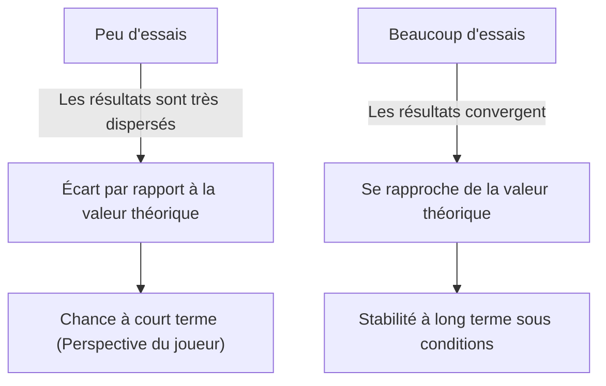
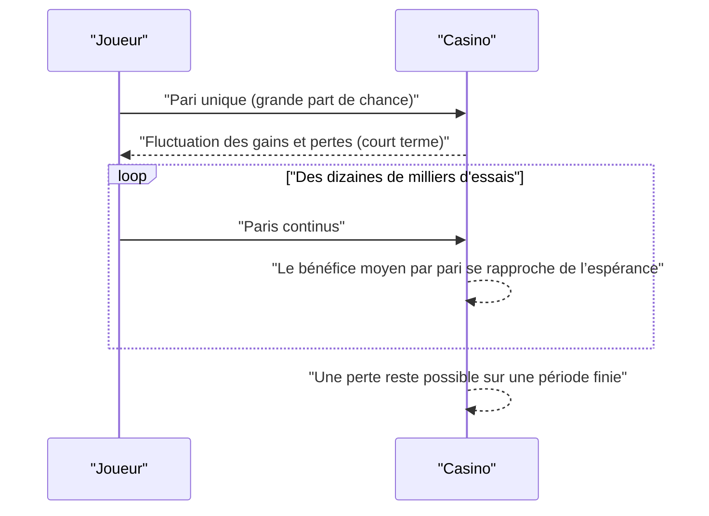

## 1. Introduction : Rendement espéré du casino et fluctuations

Les joueurs peuvent gagner de grosses sommes à court terme. Dans un modèle fixe, la moyenne de nombreux paris indépendants peut se rapprocher de son espérance. La loi des grands nombres étaye cette idée, mais ne garantit ni un bénéfice sur une période finie ni la réussite de l’entreprise.

Dans cet article, nous expliquons de manière exhaustive la "loi des grands nombres", le théorème le plus fondamental et important de la théorie des probabilités, de la compréhension intuitive aux définitions mathématiques rigoureuses. De plus, nous examinerons les idées fausses courantes et son application dans la société.

## 2. Qu'est-ce que la loi des grands nombres ?

La loi des grands nombres (LLN) indique que la moyenne empirique de variables indépendantes et identiquement distribuées converge vers leur espérance si $E[|X_1|]<\infty$. Pour les indicatrices zéro–un d’un événement, la fréquence relative observée se rapproche de sa probabilité. La probabilité elle-même ne change pas avec l’accumulation des essais.

Imaginez que vous lancez une pièce de monnaie. La probabilité d'obtenir face est de $1/2$ ($50\%$). Cependant, la lancer seulement 10 fois ne garantit pas que vous obtiendrez 5 faces et 5 piles. Vous pourriez obtenir 7 faces, ou seulement 2.
Pour des lancers indépendants d’une pièce équilibrée, la proportion de faces converge vers 50% avec probabilité un. Cela ne garantit ni exactement 50% après un nombre fini de lancers ni une erreur qui diminue à chaque étape.



Cet écart entre "volatilité à court terme" et "stabilité à long terme" est l'essence même des probabilités, et c'est un point que les humains ont souvent du mal à appréhender intuitivement.

## 3. Avantage de la maison et rendement moyen

L’avantage de la maison est son bénéfice espéré rapporté à la mise. Considérons une roulette américaine idéale de 38 cases équiprobables : de 1 à 36, plus 0 et 00.

Si vous pariez sur "rouge ou noir", la probabilité de gagner est de $18/38$ (environ $47,37\%$). Le gain est doublé, mais comme la probabilité de gagner est inférieure à $50\%$, la valeur espérée d'un seul pari est négative.

$$
\text{Valeur Espérée} = \left( \frac{18}{38} \times 1 \right) + \left( \frac{20}{38} \times (-1) \right) = -\frac{1}{19} \approx -0{,}0526
$$

En d'autres termes, pour chaque dollar parié, le joueur perd en moyenne environ $5,26$ cents.
Avec des tours indépendants et une même mise sur le rouge à chaque tour, le bénéfice moyen de la maison par pari converge presque sûrement vers $1/19\approx5{,}26\%$ de la mise. Cela ne signifie pas que le bénéfice total converge et ne garantit pas un gain après un nombre fini de paris. Frais, mises variables et contraintes de capital nécessitent une analyse distincte.



## 4. Définition mathématique de la loi des grands nombres

Selon la force de la convergence, la loi des grands nombres se divise en deux catégories : la **loi faible des grands nombres** (WLLN) et la **loi forte des grands nombres** (SLLN). Exprimée de manière rigoureuse en mathématiques, elle se présente comme suit.

### 4.1. Loi faible des grands nombres (WLLN)

La loi faible repose sur le concept de "convergence en probabilité".
Soient $X_1,X_2,\dots$ indépendantes et identiquement distribuées (i.i.d.), avec $E[|X_1|]<\infty$ et $E[X_1]=\mu$. Pour la moyenne empirique $\bar{X}_n=\frac{1}{n}\sum_{i=1}^n X_i$, la relation suivante vaut pour tout $\epsilon>0$.

$$
\lim_{n \to \infty} P(|\bar{X}_n - \mu| > \epsilon) = 0
$$

Cela signifie que "à mesure que la taille de l'échantillon $n$ augmente, la probabilité que la moyenne empirique s'écarte de la valeur espérée réelle de plus de $\epsilon$ s'approche de $0$".

### 4.2. Loi forte des grands nombres (SLLN)

La loi forte repose sur un concept plus fort, celui de "convergence presque sûre (convergence avec probabilité 1)".

$$
P\left(\lim_{n \to \infty} \bar{X}_n = \mu \right) = 1
$$

La loi faible indique que, pour chaque n suffisamment grand, la probabilité de dépasser une tolérance d’erreur fixée devient petite. Sous les mêmes hypothèses d’indépendance, de distribution identique et d’intégrabilité, la loi forte affirme que toute la suite des moyennes converge vers l’espérance sur un événement de probabilité un. Des exceptions de probabilité nulle sont possibles. Aucune des deux lois ne garantit une égalité exacte après un nombre fini d’essais ni des bénéfices toujours positifs.

### 4.3. Preuve de la loi faible par l'inégalité de Bienaymé-Tchebychev

Pour cette preuve, supposons en outre une variance finie, $\sigma^2<\infty$, et appliquons l’inégalité de Bienaymé-Tchebychev. La loi faible i.i.d. n’exige pas elle-même une variance finie.
Soit $\mu_Y$ la valeur espérée d'une variable aléatoire $Y$ et $\sigma_Y^2$ sa variance. L'inégalité s'exprime ainsi :

$$
P(|Y - \mu_Y| \ge \epsilon) \le \frac{\sigma_Y^2}{\epsilon^2}
$$

Posons ici $Y = \bar{X}_n$. Si la variance de chaque $X_i$ est $\sigma^2$, alors la variance de la moyenne empirique $\bar{X}_n$ est $\sigma^2 / n$.
En substituant ceci dans l'inégalité de Tchebychev :

$$
P(|\bar{X}_n - \mu| \ge \epsilon) \le \frac{\sigma^2}{n \epsilon^2}
$$

Lorsque $n \to \infty$, le membre de droite tend vers $0$. Par conséquent, la probabilité du membre de gauche converge également vers $0$, ce qui prouve la loi faible.

## 5. L'erreur du parieur (Gambler's Fallacy)

L' **erreur du parieur** est un biais psychologique célèbre né d'une mauvaise compréhension de la loi des grands nombres.

Lorsqu'à la roulette, le "rouge" sort 10 fois de suite, beaucoup de gens se disent "le noir devrait bientôt sortir". Ce raisonnement erroné repose sur l'idée que "puisque la loi des grands nombres stipule que la proportion de rouge et de noir doit converger vers $50\%$, le noir devient plus susceptible de sortir pour compenser le biais précédent".

Pour une roulette idéale de 38 cases à tours indépendants, le prochain tour a une probabilité $18/38$ de rouge et $18/38$ de noir, quels que soient les résultats précédents. À cause du 0 et du 00, aucune proportion limite n’est de 50%. La loi n’introduit pas de force compensant les déséquilibres passés et ne change pas les probabilités du résultat suivant.

## 6. Simulation avec Python

Visualisons concrètement la loi des grands nombres à l'aide de la programmation. Nous allons simuler le lancer d'un dé et observer la moyenne des résultats converger vers la valeur espérée de 3,5.

```python
import numpy as np
import matplotlib.pyplot as plt

# Paramètres de simulation
n_trials = 10000  # Nombre d'essais
expected_value = 3.5  # Valeur espérée d'un lancer de dé

# Générer aléatoirement des nombres de 1 à 6
np.random.seed(42)
rolls = np.random.randint(1, 7, size=n_trials)

# Calculer la moyenne cumulée
cumulative_average = np.cumsum(rolls) / np.arange(1, n_trials + 1)

# Tracer les résultats
plt.figure(figsize=(10, 6))
plt.plot(cumulative_average, label=r"$\bar{X}_n$", color="blue", alpha=0.7)
plt.axhline(y=expected_value, color="red", linestyle="--", label=r"$E[X]=3.5$")
plt.title(r"$\bar{X}_n$")
plt.xlabel(r"n")
plt.ylabel(r"$\bar{X}_n$")
plt.legend()
plt.grid(True)
plt.show()
```

Cet exemple illustre une moyenne cumulée fluctuant près de 3,5. Une simulation finie facilite l’intuition, mais n’est pas une preuve. La moyenne peut s’éloigner de l’espérance en cours de route et ne doit pas nécessairement être exactement égale à 3,5 à un instant donné.

## 7. Les cas où la loi des grands nombres ne s'applique pas : la distribution de [Cauchy](https://kenji.blog/fr/p/cauchy/)

La loi des grands nombres n'est pas universelle. L'une de ses conditions préalables est que "la valeur espérée (moyenne) doit être finie".
La loi de Cauchy n’a pas d’espérance absolue finie, et sa moyenne n’est pas définie. Cela ne signifie pas que sa moyenne vaut l’infini positif. Son deuxième moment est infini et elle ne possède pas de variance finie usuelle.

La moyenne empirique de variables de Cauchy standard indépendantes suit encore une loi de Cauchy standard pour tout $n$ ; elle ne converge donc pas en probabilité vers une constante. Pour des données réelles, des queues lourdes ne suffisent pas à conclure que la loi échoue : il faut vérifier l’intégrabilité, la dépendance et les autres hypothèses du modèle.

## 8. Exemples d'applications dans le monde réel

La loi des grands nombres n'est pas seulement utilisée dans les casinos, mais aussi dans divers systèmes qui soutiennent les fondements de notre société.

### 8.1. Le secteur de l'assurance
En assurance, la moyenne des pertes sur de nombreux contrats peut aider à prévoir le risque agrégé. Le nombre de contrats ne garantit pas à lui seul une grande précision. Les modèles doivent tenir compte des catastrophes communes, des pertes corrélées, des différences entre groupes et des changements de distribution des pertes ou des conditions des contrats.

### 8.2. Contrôle qualité statistique
Lors de la fabrication de produits en usine, inspecter l'intégralité de la production est souvent impossible pour des raisons de coût et de temps. Par conséquent, une partie des produits sélectionnés au hasard (un échantillon) est inspectée, et le taux global de défauts est estimé à partir des résultats. Ici aussi, la loi des grands nombres fournit un argument puissant pour déduire les caractéristiques d'une population à partir d'un échantillon.

### 8.3. Apprentissage automatique (Machine Learning) et Big Data
En apprentissage automatique, la loi peut justifier la convergence de la perte moyenne observée vers la perte espérée pour un modèle fixe dont les pertes sont i.i.d. et intégrables. La généralisation après sélection d’un modèle à partir des données exige des arguments supplémentaires. Davantage de données ne supprime pas à lui seul les biais d’échantillonnage, les changements de distribution ou une mauvaise spécification du modèle.

## 9. Conclusion

La loi des grands nombres est un outil puissant qui nous permet de comprendre un monde hautement incertain et de prendre des décisions rationnelles. De la structure des profits des casinos aux assurances et à la technologie de l'IA, cette loi fonctionne discrètement mais sûrement partout dans la société moderne.

La prochaine fois que vous lancerez une pièce ou un dé, pourquoi ne pas songer aux grandes et belles lois mathématiques qui se cachent derrière chaque événement fortuit ? Au lieu de se réjouir ou de se désoler au gré de la chance à court terme, adopter une perspective à long terme pourrait changer un peu votre façon de voir le monde.

## Références

- [MIT 18.05: Central Limit Theorem and the Law of Large Numbers](https://math.mit.edu/~dav/05.dir/class6-prep.pdf)
- [Mathlib: The strong law of large numbers](https://leanprover-community.github.io/mathlib4_docs/Mathlib/Probability/StrongLaw.html)
- [MIT: Cauchy Distribution](https://web.mit.edu/urban_or_book/www/book/chapter3/3.3.3.html)
