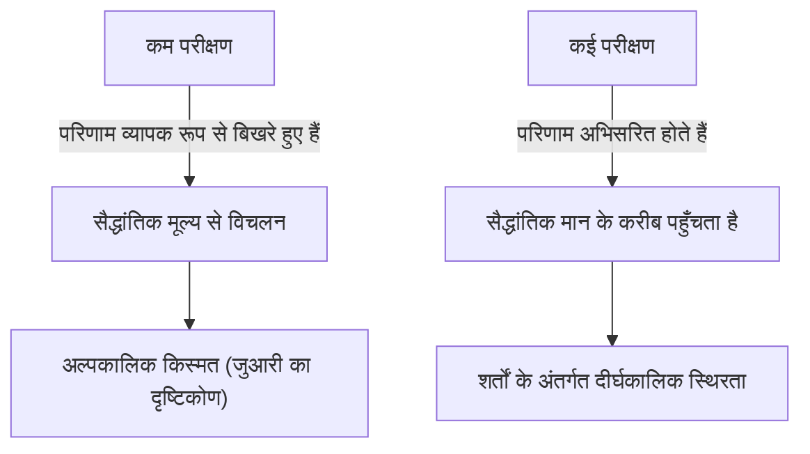
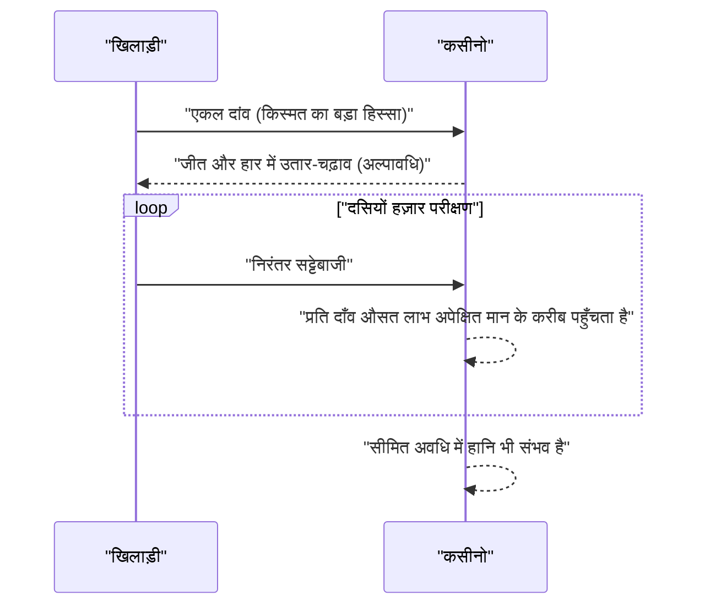

## 1. परिचय: कसीनो का अपेक्षित लाभ और उतार-चढ़ाव

कम अवधि में खिलाड़ी बड़ी रकम जीत सकते हैं। निश्चित नियमों वाले मॉडल में अनेक स्वतंत्र दाँवों का औसत परिणाम उसके अपेक्षित मान के करीब पहुँच सकता है। बड़ी संख्याओं का नियम इस विचार का आधार है, लेकिन सीमित अवधि के लाभ या व्यवसाय की सफलता की गारंटी नहीं देता।

इस लेख में, हम प्रायिकता सिद्धांत में सबसे बुनियादी और महत्वपूर्ण प्रमेय, "बड़ी संख्याओं का नियम" की व्यापक रूप से व्याख्या करते हैं, सहज ज्ञान युक्त समझ से लेकर कठोर गणितीय परिभाषाओं तक। इसके अलावा, हम रोजमर्रा की गलतफहमियों और समाज में इसके कैसे लागू होने के बारे में गहराई से जानेंगे।

## 2. बड़ी संख्याओं का नियम क्या है?

बड़ी संख्याओं का नियम (LLN) कहता है कि स्वतंत्र और समान वितरण वाले यादृच्छिक चरों का नमूना माध्य उनके अपेक्षित मान की ओर अभिसरित होता है, यदि $E[|X_1|]<\infty$ हो। घटना के शून्य–एक सूचक चरों के लिए देखी गई सापेक्ष आवृत्ति घटना की प्रायिकता के करीब पहुँचती है। परीक्षण बढ़ने से घटना की प्रायिकता स्वयं नहीं बदलती।

एक सिक्का उछालने की कल्पना करें। चित (heads) आने की प्रायिकता $1/2$ ($50\%$) है। हालांकि, इसे केवल 10 बार उछालने से 5 चित और 5 पट की गारंटी नहीं मिलती। आपको 7 चित या केवल 2 चित मिल सकते हैं।
निष्पक्ष सिक्के के स्वतंत्र उछालों में चित का अनुपात प्रायिकता एक के साथ 50% की ओर अभिसरित होता है। यह सीमित उछालों के बाद ठीक 50% या हर चरण पर घटती त्रुटि की गारंटी नहीं है।



"अल्पकालिक अस्थिरता" और "दीर्घकालिक स्थिरता" के बीच का यह अंतर ही प्रायिकता का सार है, और यह एक ऐसा बिंदु है जहां मनुष्य सहज रूप से गलत समझने की प्रवृत्ति रखते हैं।

## 3. हाउस एज और औसत लाभ

हाउस एज दाँव की राशि के अनुपात में कसीनो का अपेक्षित लाभ है। एक आदर्श अमेरिकी रूले पर विचार करें जिसमें 38 समान संभावना वाले पॉकेट हों: 1 से 36 तथा 0 और 00।

यदि आप "लाल या काले" पर दांव लगाते हैं, तो जीतने की प्रायिकता $18/38$ (लगभग $47.37\%$) है। भुगतान दोगुना है, लेकिन चूंकि जीतने की प्रायिकता $50\%$ से कम है, एक ही दांव का अपेक्षित मान नकारात्मक है।

$$
\text{अपेक्षित मान} = \left( \frac{18}{38} \times 1 \right) + \left( \frac{20}{38} \times (-1) \right) = -\frac{1}{19} \approx -0.0526
$$

प्रत्येक दाँव में लगाए गए एक डॉलर पर खिलाड़ी की अपेक्षित शुद्ध हानि लगभग 5.26 सेंट है।
स्वतंत्र स्पिन और हर बार लाल पर समान राशि के दाँव वाले मॉडल में, कसीनो का प्रति दाँव औसत लाभ लगभग निश्चित रूप से दाँव की राशि के $1/19\approx5.26\%$ की ओर अभिसरित होता है। यह कुल लाभ का अभिसरण या सीमित दाँवों के बाद लाभ की गारंटी नहीं है। खर्च, अलग-अलग दाँव राशि और पूँजी की सीमाओं पर अलग विचार आवश्यक है।



## 4. बड़ी संख्याओं के नियम की गणितीय परिभाषा

अभिसरण की ताकत के आधार पर, बड़ी संख्याओं के नियम दो प्रकार के होते हैं: **बड़ी संख्याओं का दुर्बल नियम** (WLLN) और **बड़ी संख्याओं का प्रबल नियम** (SLLN)। गणित में कठोरता से व्यक्त किया गया है, यह इस प्रकार है।

### 4.1. बड़ी संख्याओं का दुर्बल नियम (WLLN)

दुर्बल नियम "प्रायिकता में अभिसरण" की अवधारणा पर आधारित है।
मान लें कि $X_1,X_2,\dots$ स्वतंत्र और समान वितरण वाले (i.i.d.) चर हैं, $E[|X_1|]<\infty$ और $E[X_1]=\mu$ है। नमूना माध्य $\bar{X}_n=\frac{1}{n}\sum_{i=1}^n X_i$ के लिए हर $\epsilon>0$ पर निम्नलिखित सत्य है।

$$
\lim_{n \to \infty} P(|\bar{X}_n - \mu| > \epsilon) = 0
$$

इसका अर्थ है कि "जैसे-जैसे नमूने का आकार $n$ बड़ा होता जाता है, नमूना माध्य के वास्तविक अपेक्षित मान से $\epsilon$ से अधिक विचलित होने की प्रायिकता $0$ के करीब पहुंच जाती है।"

### 4.2. बड़ी संख्याओं का प्रबल नियम (SLLN)

प्रबल नियम "लगभग निश्चित अभिसरण (प्रायिकता 1 के साथ अभिसरण)" की मजबूत अवधारणा पर आधारित है।

$$
P\left(\lim_{n \to \infty} \bar{X}_n = \mu \right) = 1
$$

दुर्बल नियम कहता है कि प्रत्येक पर्याप्त बड़े n पर, निश्चित त्रुटि-सीमा से अधिक विचलन की प्रायिकता छोटी हो जाती है। स्वतंत्रता, समान वितरण और समाकलनीयता की उन्हीं शर्तों के अंतर्गत प्रबल नियम कहता है कि नमूना माध्यों का पूरा अनुक्रम प्रायिकता एक वाली घटना पर अपेक्षित मान की ओर अभिसरित होता है। शून्य प्रायिकता वाले अपवाद संभव हैं। कोई भी नियम सीमित परीक्षणों के बाद ठीक समानता या हमेशा धनात्मक लाभ की गारंटी नहीं देता।

### 4.3. चेबिशेव की असमानता का उपयोग करके दुर्बल नियम का प्रमाण

इस प्रमाण के लिए अतिरिक्त रूप से परिमित प्रसरण $\sigma^2<\infty$ मानकर चेबिशेव की असमानता का उपयोग करते हैं। स्वतंत्र और समान वितरण वाले चरों के दुर्बल नियम के लिए स्वयं परिमित प्रसरण आवश्यक नहीं है।
मान लीजिए यादृच्छिक चर $Y$ का अपेक्षित मान $\mu_Y$ है और इसका प्रसरण (variance) $\sigma_Y^2$ है। चेबिशेव की असमानता को इस प्रकार व्यक्त किया जाता है:

$$
P(|Y - \mu_Y| \ge \epsilon) \le \frac{\sigma_Y^2}{\epsilon^2}
$$

यहाँ, मान लें कि $Y = \bar{X}_n$ है। यदि प्रत्येक $X_i$ का प्रसरण $\sigma^2$ है, तो नमूना माध्य $\bar{X}_n$ का प्रसरण $\sigma^2 / n$ है।
चेबिशेव की असमानता में इसे प्रतिस्थापित करने पर,

$$
P(|\bar{X}_n - \mu| \ge \epsilon) \le \frac{\sigma^2}{n \epsilon^2}
$$

जैसे-जैसे $n \to \infty$, दाहिना पक्ष $0$ के करीब पहुंचता है। इसलिए, बाएं पक्ष की प्रायिकता भी $0$ में अभिसरित होती है, जो दुर्बल नियम को सिद्ध करती है।

## 5. जुआरी की भ्रांति (Gambler's Fallacy)

बड़ी संख्याओं के नियम को गलत समझने से पैदा होने वाला एक प्रसिद्ध मनोवैज्ञानिक पूर्वाग्रह **जुआरी की भ्रांति** है।

जब लोग रूले में "लाल" को लगातार 10 बार आते देखते हैं, तो कई लोग सोचते हैं "जल्द ही काला आना चाहिए।" यह इस गलत तर्क पर आधारित है कि "चूंकि बड़ी संख्याओं का नियम कहता है कि लाल और काले का अनुपात $50\%$ तक अभिसरित होना चाहिए, इसलिए पिछले पूर्वाग्रह की भरपाई करने के लिए काले रंग के आने की संभावना अधिक हो जाती है।"

38 पॉकेट वाले आदर्श रूले के स्वतंत्र स्पिन में, पिछले परिणामों से निरपेक्ष, अगले स्पिन पर लाल की प्रायिकता $18/38$ और काले की भी $18/38$ है। 0 और 00 के कारण दोनों का सीमा अनुपात 50% नहीं है। यह नियम पुराने असंतुलन की भरपाई करने वाला बल या अगले परिणाम की प्रायिकता में बदलाव नहीं लाता।

## 6. पायथन के साथ सिमुलेशन

आइए प्रोग्रामिंग का उपयोग करके बड़ी संख्याओं के नियम की कल्पना करें। हम एक पासा फेंकने का अनुकरण करेंगे और देखेंगे कि परिणामों का औसत 3.5 के अपेक्षित मान पर कैसे अभिसरित होता है।

```python
import numpy as np
import matplotlib.pyplot as plt

# सिमुलेशन पैरामीटर
n_trials = 10000  # परीक्षणों की संख्या
expected_value = 3.5  # पासा फेंकने का अपेक्षित मान

# 1 से 6 तक बेतरतीब ढंग से संख्याएँ उत्पन्न करें
np.random.seed(42)
rolls = np.random.randint(1, 7, size=n_trials)

# संचयी औसत की गणना करें
cumulative_average = np.cumsum(rolls) / np.arange(1, n_trials + 1)

# परिणामों को प्लॉट करें
plt.figure(figsize=(10, 6))
plt.plot(cumulative_average, label=r"$\bar{X}_n$", color="blue", alpha=0.7)
plt.axhline(y=expected_value, color="red", linestyle="--", label=r"$E[X]=3.5$")
plt.title(r"$\bar{X}_n$")
plt.xlabel(r"n")
plt.ylabel(r"$\bar{X}_n$")
plt.legend()
plt.grid(True)
plt.show()
```

यह उदाहरण संचयी माध्य को 3.5 के आसपास बदलते हुए दिखाता है। सीमित सिमुलेशन सहज समझ में मदद करता है, लेकिन प्रमेय का प्रमाण नहीं है। माध्य बीच में अपेक्षित मान से और दूर भी जा सकता है, और उसका कभी ठीक 3.5 होना आवश्यक नहीं है।

## 7. ऐसे मामले जहां बड़ी संख्याओं का नियम लागू नहीं होता: कॉची वितरण

बड़ी संख्याओं का नियम सार्वभौमिक नहीं है। एक शर्त यह है कि "अपेक्षित मान (माध्य) परिमित (finite) होना चाहिए।"
कॉची वितरण का निरपेक्ष अपेक्षित मान परिमित नहीं है और उसका माध्य अपरिभाषित है। इसका अर्थ यह नहीं कि माध्य धनात्मक अनंत है। उसका दूसरा आघूर्ण अनंत है और सामान्य अर्थ में परिमित प्रसरण भी नहीं है।

स्वतंत्र मानक कॉची चरों का नमूना माध्य प्रत्येक $n$ के लिए मानक कॉची वितरण का ही होता है; इसलिए वह किसी स्थिरांक की ओर प्रायिकता में अभिसरित नहीं होता। वास्तविक डेटा में केवल भारी पूँछ होने से नियम का विफल होना सिद्ध नहीं होता; समाकलनीयता, निर्भरता और मॉडल की अन्य शर्तें जाँचें।

## 8. वास्तविक दुनिया में अनुप्रयोग के उदाहरण

बड़ी संख्याओं के नियम का उपयोग न केवल कसीनो में किया जाता है, बल्कि विभिन्न प्रणालियों में भी किया जाता है जो हमारे समाज की नींव का समर्थन करते हैं।

### 8.1. बीमा व्यवसाय
बीमा में अनेक अनुबंधों की औसत हानि कुल जोखिम का अनुमान लगाने में सहायक है। केवल अनुबंधों की संख्या उच्च सटीकता की गारंटी नहीं देती। मॉडल में साझा आपदाएँ, हानियों के सहसंबंध, समूहों के अंतर और हानि वितरण या पॉलिसी शर्तों के बदलाव शामिल करने चाहिए।

### 8.2. सांख्यिकीय गुणवत्ता नियंत्रण
कारखानों में उत्पाद निर्माण में, लागत और समय के दृष्टिकोण से सभी उत्पादों का निरीक्षण करना अक्सर असंभव होता है। इसलिए, बेतरतीब ढंग से निकाले गए उत्पादों (नमूना) के एक हिस्से का निरीक्षण किया जाता है, और परिणामों से समग्र दोष दर का अनुमान लगाया जाता है। यहां भी, बड़ी संख्याओं का नियम नमूने से समष्टि के गुणों का अनुमान लगाने के लिए एक शक्तिशाली आधार के रूप में कार्य करता है।

### 8.3. मशीन लर्निंग और बिग डेटा
मशीन लर्निंग में, निश्चित मॉडल की हानियाँ स्वतंत्र, समान वितरण वाली और समाकलनीय हों तो यह नियम देखी गई औसत हानि के अपेक्षित हानि की ओर अभिसरण का आधार दे सकता है। प्रशिक्षण डेटा से मॉडल चुनने के बाद सामान्यीकरण के लिए अतिरिक्त तर्क चाहिए। अधिक डेटा अपने आप नमूना पक्षपात, वितरण बदलाव या गलत मॉडल को दूर नहीं करता।

## 9. निष्कर्ष

बड़ी संख्याओं का नियम हमारे लिए एक अत्यधिक अनिश्चित दुनिया को समझने और तर्कसंगत निर्णय लेने के लिए एक शक्तिशाली उपकरण है। कसीनो लाभ संरचनाओं से लेकर बीमा और एआई तकनीक तक, यह नियम आधुनिक समाज में हर जगह चुपचाप लेकिन मज़बूती से काम करता है।

अगली बार जब आप कोई सिक्का उछालें या पासा फेंकें, तो हर आकस्मिक घटना के पीछे छिपे भव्य और सुंदर गणितीय नियमों के बारे में क्यों न सोचें? अल्पकालिक भाग्य पर खुशी या निराशा में जाने के बजाय, दीर्घकालिक दृष्टिकोण रखने से दुनिया को देखने का आपका तरीका थोड़ा बदल सकता है।

## संदर्भ

- [MIT 18.05: Central Limit Theorem and the Law of Large Numbers](https://math.mit.edu/~dav/05.dir/class6-prep.pdf)
- [Mathlib: The strong law of large numbers](https://leanprover-community.github.io/mathlib4_docs/Mathlib/Probability/StrongLaw.html)
- [MIT: Cauchy Distribution](https://web.mit.edu/urban_or_book/www/book/chapter3/3.3.3.html)
