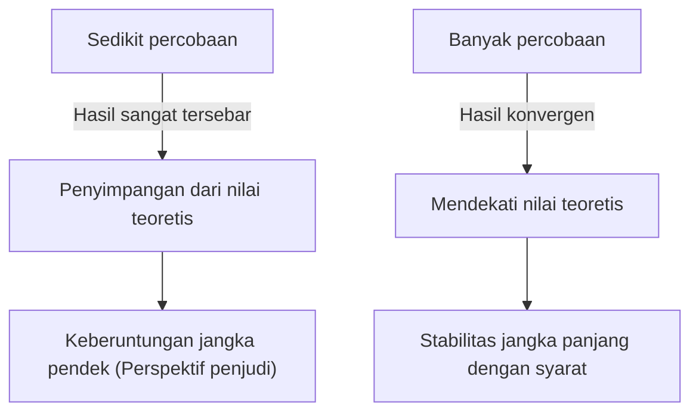
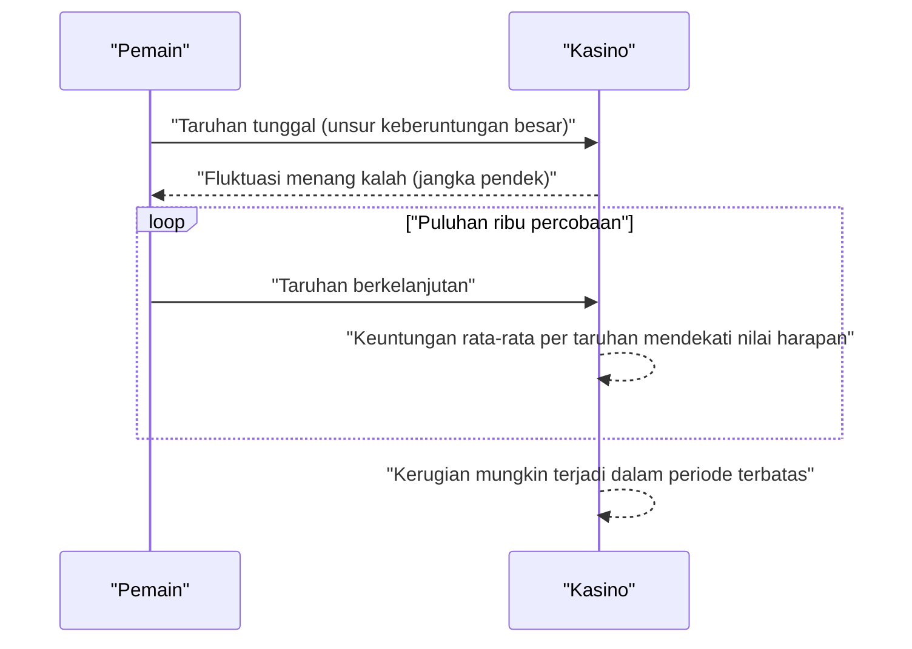

## 1. Pendahuluan: Nilai Harapan Keuntungan Kasino dan Fluktuasi

Pemain dapat menang besar dalam jangka pendek. Pada model dengan aturan tetap, rata-rata dari banyak taruhan independen dapat mendekati nilai harapannya. Hukum bilangan besar mendukung gagasan ini, tetapi tidak menjamin laba selama periode terbatas ataupun keberhasilan bisnis kasino.

Dalam artikel ini, kami menjelaskan secara komprehensif tentang "Hukum Bilangan Besar," teorema paling mendasar dan penting dalam teori probabilitas, dari pemahaman intuitif hingga definisi matematis yang ketat. Selain itu, kami menggali kesalahpahaman umum dan bagaimana hal ini diterapkan dalam masyarakat.

## 2. Apa Itu Hukum Bilangan Besar?

Hukum bilangan besar (LLN) menyatakan bahwa rata-rata sampel variabel acak independen dan berdistribusi identik konvergen ke nilai harapannya jika $E[|X_1|]<\infty$. Untuk indikator nol–satu suatu kejadian, frekuensi relatif yang diamati mendekati probabilitas kejadian itu. Probabilitasnya sendiri tidak berubah saat percobaan bertambah.

Bayangkan melempar koin. Probabilitas mendapatkan sisi angka adalah $1/2$ ($50\%$). Namun, hanya melemparnya 10 kali tidak menjamin 5 angka dan 5 gambar. Anda mungkin mendapatkan 7 angka, atau hanya 2.
Untuk lemparan koin adil yang independen, proporsi sisi angka konvergen ke 50% dengan probabilitas satu. Ini tidak menjamin tepat 50% setelah jumlah lemparan terbatas atau galat yang mengecil pada setiap langkah.



Kesenjangan antara "fluktuasi jangka pendek" dan "stabilitas jangka panjang" ini adalah inti dari probabilitas, dan juga titik di mana manusia secara intuitif sering salah paham.

## 3. Keunggulan Kasino dan Keuntungan Rata-Rata

House edge adalah nilai harapan keuntungan kasino sebagai proporsi dari nilai taruhan. Pertimbangkan rolet Amerika ideal dengan 38 kantong yang sama peluangnya: angka 1 hingga 36, serta 0 dan 00.

Jika Anda bertaruh pada "merah atau hitam", probabilitas untuk menang adalah $18/38$ (sekitar $47,37\%$). Pembayarannya adalah 2 kali lipat, namun karena probabilitas menangnya di bawah $50\%$, nilai harapan dari taruhan tunggal adalah negatif.

$$
\text{Nilai Harapan} = \left( \frac{18}{38} \times 1 \right) + \left( \frac{20}{38} \times (-1) \right) = -\frac{1}{19} \approx -0{,}0526
$$

Dengan kata lain, untuk setiap 1 dolar yang dipertaruhkan, pemain kehilangan rata-rata sekitar $5,26$ sen.
Dengan putaran independen dan nilai taruhan yang sama pada merah setiap kali, rata-rata keuntungan kasino per taruhan konvergen hampir pasti ke $1/19\approx5{,}26\%$ dari nilai taruhan. Ini bukan konvergensi laba total atau jaminan laba setelah jumlah taruhan terbatas. Biaya, taruhan yang bervariasi, dan keterbatasan modal perlu dipertimbangkan tersendiri.



## 4. Definisi Matematis dari Hukum Bilangan Besar

Bergantung pada kekuatan konvergensinya, Hukum Bilangan Besar memiliki dua jenis: **Hukum Lemah Bilangan Besar** (WLLN) dan **Hukum Kuat Bilangan Besar** (SLLN). Dinyatakan secara matematis dan ketat, bunyinya adalah sebagai berikut.

### 4.1. Hukum Lemah Bilangan Besar (WLLN)

Hukum lemah didasarkan pada konsep "konvergensi dalam probabilitas."
Misalkan $X_1,X_2,\dots$ independen dan berdistribusi identik (i.i.d.), dengan $E[|X_1|]<\infty$ dan $E[X_1]=\mu$. Untuk rata-rata sampel $\bar{X}_n=\frac{1}{n}\sum_{i=1}^n X_i$, berlaku hal berikut untuk setiap $\epsilon>0$.

$$
\lim_{n \to \infty} P(|\bar{X}_n - \mu| > \epsilon) = 0
$$

Ini berarti "seiring dengan membesarnya ukuran sampel $n$, probabilitas rata-rata sampel menyimpang dari nilai harapan sebenarnya lebih dari $\epsilon$ akan mendekati $0$."

### 4.2. Hukum Kuat Bilangan Besar (SLLN)

Hukum kuat didasarkan pada konsep yang lebih kuat yaitu "konvergensi hampir pasti (konvergensi dengan probabilitas 1)."

$$
P\left(\lim_{n \to \infty} \bar{X}_n = \mu \right) = 1
$$

Hukum lemah menyatakan bahwa untuk setiap n yang cukup besar, probabilitas galat melebihi toleransi tetap menjadi kecil. Dengan asumsi independensi, distribusi identik, dan keterintegralan yang sama, hukum kuat menyatakan bahwa seluruh barisan rata-rata sampel konvergen ke nilai harapan pada kejadian berprobabilitas satu. Pengecualian berprobabilitas nol mungkin ada. Keduanya tidak menjamin kesamaan tepat setelah percobaan terbatas ataupun laba yang selalu positif.

### 4.3. Pembuktian Hukum Lemah menggunakan Ketidaksamaan Chebyshev

Untuk pembuktian ini, asumsikan juga varians berhingga, $\sigma^2<\infty$, lalu gunakan ketidaksamaan Chebyshev. Hukum lemah i.i.d. sendiri tidak memerlukan varians berhingga.
Jika nilai harapan variabel acak $Y$ adalah $\mu_Y$ dan variansnya adalah $\sigma_Y^2$, maka ketidaksamaan Chebyshev dinyatakan sebagai berikut:

$$
P(|Y - \mu_Y| \ge \epsilon) \le \frac{\sigma_Y^2}{\epsilon^2}
$$

Di sini, misalkan $Y = \bar{X}_n$. Jika varians setiap $X_i$ adalah $\sigma^2$, maka varians dari rata-rata sampel $\bar{X}_n$ adalah $\sigma^2 / n$.
Substitusikan ini ke dalam ketidaksamaan Chebyshev:

$$
P(|\bar{X}_n - \mu| \ge \epsilon) \le \frac{\sigma^2}{n \epsilon^2}
$$

Saat $n \to \infty$, sisi kanan mendekati $0$. Oleh karena itu, probabilitas di sisi kiri juga konvergen ke $0$, membuktikan hukum lemah.

## 5. Kekeliruan Penjudi (Gambler's Fallacy)

Salah satu bias psikologis terkenal yang lahir dari kesalahpahaman terhadap Hukum Bilangan Besar adalah **Kekeliruan Penjudi**.

Ketika orang melihat "merah" muncul 10 kali berturut-turut pada rolet, banyak yang berpikir "seharusnya hitam segera keluar". Hal ini didasarkan pada penalaran yang salah bahwa "karena Hukum Bilangan Besar menyatakan rasio merah dan hitam harus konvergen ke $50\%$, hitam menjadi lebih mungkin muncul untuk mengimbangi bias sebelumnya."

Pada rolet ideal 38 kantong dengan putaran independen, probabilitas merah pada putaran berikutnya adalah $18/38$ dan hitam juga $18/38$, terlepas dari hasil sebelumnya. Karena ada 0 dan 00, proporsi limit keduanya bukan 50%. Hukum ini tidak menciptakan gaya untuk meniadakan ketimpangan masa lalu atau mengubah probabilitas hasil berikutnya.

## 6. Simulasi dengan Python

Mari kita visualisasikan Hukum Bilangan Besar secara konkret menggunakan pemrograman. Kita akan menyimulasikan melempar dadu dan melihat bagaimana rata-rata hasilnya konvergen menuju nilai harapan 3.5.

```python
import numpy as np
import matplotlib.pyplot as plt

# Parameter simulasi
n_trials = 10000  # Jumlah percobaan
expected_value = 3.5  # Nilai harapan lemparan dadu

# Hasilkan angka secara acak dari 1 hingga 6
np.random.seed(42)
rolls = np.random.randint(1, 7, size=n_trials)

# Hitung rata-rata kumulatif
cumulative_average = np.cumsum(rolls) / np.arange(1, n_trials + 1)

# Plot hasilnya
plt.figure(figsize=(10, 6))
plt.plot(cumulative_average, label=r"$\bar{X}_n$", color="blue", alpha=0.7)
plt.axhline(y=expected_value, color="red", linestyle="--", label=r"$E[X]=3.5$")
plt.title(r"$\bar{X}_n$")
plt.xlabel(r"n")
plt.ylabel(r"$\bar{X}_n$")
plt.legend()
plt.grid(True)
plt.show()
```

Contoh ini memperlihatkan rata-rata kumulatif berfluktuasi di sekitar 3,5. Simulasi terbatas membantu intuisi, tetapi bukan bukti teorema. Rata-rata dapat menjauh dari nilai harapan selama proses dan tidak harus pernah tepat sama dengan 3,5.

## 7. Kasus di Mana Hukum Bilangan Besar Tidak Berlaku: Distribusi [Cauchy](https://kenji.blog/id/p/cauchy/)

Hukum Bilangan Besar tidak bersifat universal. Salah satu prasyaratnya adalah "nilai harapan (rata-rata) harus berhingga."
Distribusi Cauchy tidak memiliki nilai harapan absolut berhingga, dan rata-ratanya tidak terdefinisi. Ini tidak berarti rata-ratanya sama dengan tak hingga positif. Momen keduanya tak hingga, dan distribusi ini tidak memiliki varians berhingga biasa.

Rata-rata sampel variabel Cauchy standar independen tetap berdistribusi Cauchy standar untuk setiap $n$, sehingga tidak konvergen dalam probabilitas ke konstanta. Untuk data nyata, ekor berat saja tidak membuktikan bahwa hukum gagal; periksa keterintegralan, ketergantungan, dan syarat model lainnya.

## 8. Contoh Penerapan di Dunia Nyata

Hukum Bilangan Besar digunakan tidak hanya di kasino, tetapi dalam berbagai sistem yang mendukung fondasi masyarakat kita.

### 8.1. Bisnis Asuransi
Dalam asuransi, merata-ratakan kerugian banyak kontrak dapat membantu memperkirakan risiko agregat. Jumlah kontrak saja tidak menjamin akurasi tinggi. Model harus mempertimbangkan bencana bersama, kerugian yang berkorelasi, perbedaan kelompok, serta perubahan distribusi kerugian atau ketentuan polis.

### 8.2. Pengendalian Kualitas Statistik
Dalam pembuatan produk di pabrik, memeriksa seluruh produk seringkali tidak mungkin dilakukan dari sudut pandang biaya dan waktu. Oleh karena itu, sebagian produk yang dipilih secara acak (sampel) diperiksa, dan tingkat cacat keseluruhan diestimasi dari hasilnya. Di sini juga, Hukum Bilangan Besar berfungsi sebagai dasar yang kuat untuk menyimpulkan sifat-sifat suatu populasi dari sampel.

### 8.3. Pembelajaran Mesin (Machine Learning) dan Big Data
Dalam pembelajaran mesin, hukum ini dapat mendukung konvergensi rata-rata kerugian yang diamati ke nilai harapan kerugian pada model tetap dengan kerugian i.i.d. dan terintegralkan. Generalisasi setelah memilih model dari data pelatihan memerlukan argumen tambahan. Lebih banyak data saja tidak menghapus bias sampel, pergeseran distribusi, atau kesalahan spesifikasi model.

## 9. Kesimpulan

Hukum Bilangan Besar adalah alat yang ampuh bagi kita untuk memahami dunia yang sangat tidak pasti ini dan membuat keputusan yang rasional. Dari struktur keuntungan kasino hingga asuransi dan teknologi AI, hukum ini diam-diam tetapi pasti beroperasi di mana-mana dalam masyarakat modern.

Lain kali saat Anda melempar koin atau melempar dadu, bagaimana jika Anda memikirkan tentang hukum matematika yang besar dan indah yang tersembunyi di balik setiap kebetulan? Daripada hanyut dalam suka atau duka akibat keberuntungan jangka pendek, memiliki perspektif jangka panjang mungkin akan sedikit mengubah cara Anda memandang dunia.

## Referensi

- [MIT 18.05: Central Limit Theorem and the Law of Large Numbers](https://math.mit.edu/~dav/05.dir/class6-prep.pdf)
- [Mathlib: The strong law of large numbers](https://leanprover-community.github.io/mathlib4_docs/Mathlib/Probability/StrongLaw.html)
- [MIT: Cauchy Distribution](https://web.mit.edu/urban_or_book/www/book/chapter3/3.3.3.html)
