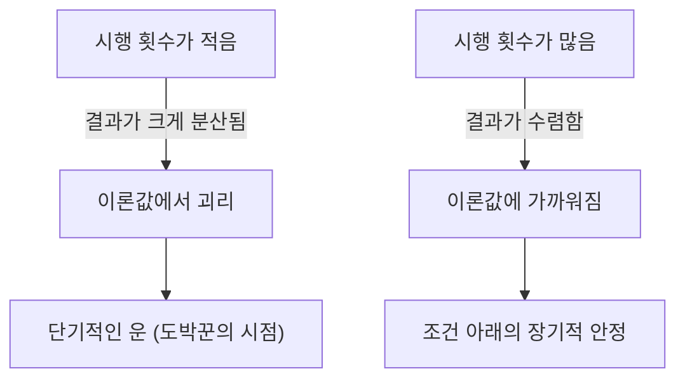
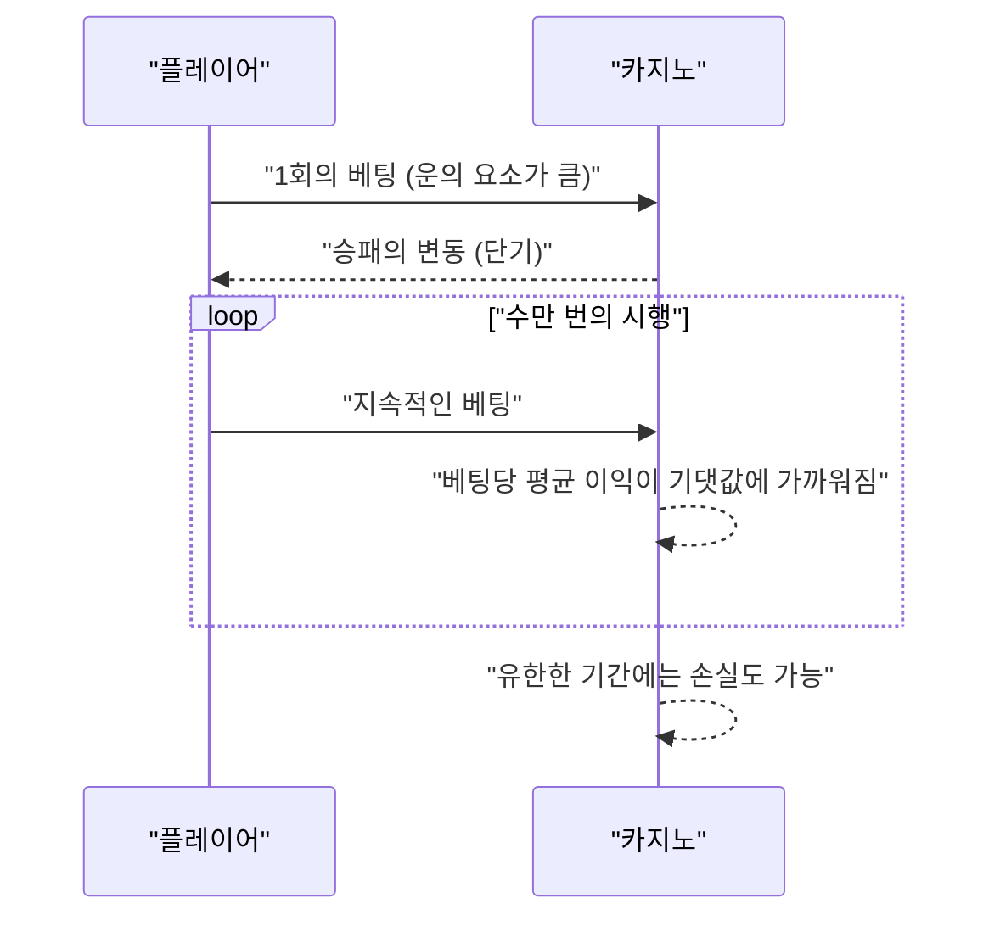

## 1. 서론: 카지노의 기대 수익과 변동

단기적으로는 플레이어가 큰돈을 딸 수도 있습니다. 고정된 규칙의 모형에서 독립적인 베팅을 많이 모으면 평균 수익이 기댓값에 가까워질 수 있습니다. 대수의 법칙은 이 생각을 뒷받침하지만, 유한한 기간의 이익이나 사업의 성공을 보장하지는 않습니다.

이 글에서는 확률론의 가장 기본적이고 중요한 정리인 '대수의 법칙'에 대해 직관적인 이해부터 엄밀한 수학적 정의까지 망라하여 해설합니다. 나아가 일상 속에 숨어 있는 오해나 사회에서 어떻게 응용되고 있는지에 대해서도 깊이 파헤쳐 봅니다.

## 2. 대수의 법칙이란 무엇인가?

대수의 법칙(LLN)은 독립동일분포 확률변수가 $E[|X_1|]<\infty$를 만족할 때 표본평균이 기댓값으로 수렴한다는 정리입니다. 사건의 0–1 지시변수에서는 관측한 상대도수가 사건의 확률에 가까워집니다. 시행을 반복하면서 사건 자체의 확률이 바뀐다는 뜻은 아닙니다.

동전 던지기를 상상해 보십시오. 앞면이 나올 확률은 $1/2$($50\%$)입니다. 그러나 10번 던졌다고 해서 앞면이 5번, 뒷면이 5번 나온다는 보장은 없습니다. 앞면이 7번 나올 수도 있고, 2번밖에 나오지 않을 수도 있습니다.
독립적인 공정한 동전 던지기에서 앞면의 비율은 확률 1로 50%에 수렴합니다. 유한한 횟수 뒤에 정확히 50%가 되거나 매번 오차가 줄어드는 것은 보장되지 않습니다.



이러한 '단기적인 변동'과 '장기적인 안정'의 갭이야말로 확률이라는 것의 본질이며, 인간이 직관적으로 오해하기 쉬운 포인트이기도 합니다.

## 3. 하우스 엣지와 평균 수익

하우스 엣지는 베팅 금액에 대한 운영자의 기대 이익 비율입니다. 여기서는 1부터 36, 0, 00의 38개 포켓이 같은 확률로 나오는 이상적인 아메리칸 룰렛을 생각합니다.

'빨간색인가 검은색인가'에 돈을 걸었을 때, 맞출 확률은 $18/38$(약 $47.37\%$)입니다. 배당은 2배지만, 승률이 $50\%$ 를 밑돌기 때문에 1번의 베팅에 대한 기댓값은 마이너스가 됩니다.

$$
\text{기댓값} = \left( \frac{18}{38} \times 1 \right) + \left( \frac{20}{38} \times (-1) \right) = -\frac{1}{19} \approx -0.0526
$$

즉, 1달러를 걸 때마다 플레이어는 평균적으로 약 $5.26$ 센트를 잃는 계산이 됩니다.
스핀이 독립적이고 매번 같은 금액을 빨간색에 거는 모형에서는 운영자의 베팅당 평균 이익이 확률 1로 베팅 금액의 $1/19\approx5.26\%$에 수렴합니다. 총이익이 수렴한다거나 유한한 횟수 뒤에 흑자가 된다는 뜻은 아닙니다. 비용, 베팅 금액의 차이, 자금 제약 등은 따로 고려해야 합니다.



## 4. 대수의 법칙의 수학적 정의

대수의 법칙에는 수렴의 강도에 따라 **대수의 약법칙** (Weak Law of Large Numbers, WLLN)과 **대수의 강법칙** (Strong Law of Large Numbers, SLLN) 두 종류가 존재합니다. 수학적으로 엄밀하게 표현하면 다음과 같습니다.

### 4.1. 대수의 약법칙 (WLLN)

약법칙은 '확률 수렴'이라는 개념에 기반하고 있습니다.
$X_1,X_2,\dots$가 독립동일분포(i.i.d.)이고 $E[|X_1|]<\infty$, $E[X_1]=\mu$라고 하겠습니다. 표본평균 $\bar{X}_n=\frac{1}{n}\sum_{i=1}^n X_i$에 대해 모든 $\epsilon>0$에서 다음이 성립합니다.

$$
\lim_{n \to \infty} P(|\bar{X}_n - \mu| > \epsilon) = 0
$$

이것은 "표본의 크기 $n$ 이 커질수록, 표본 평균이 참인 기댓값에서 $\epsilon$보다 크게 벗어날 확률은 $0$ 에 가까워진다"는 의미입니다.

### 4.2. 대수의 강법칙 (SLLN)

강법칙은 '거의 확실한 수렴(확률 1로 수렴)'이라는 보다 강력한 개념에 기반하고 있습니다.

$$
P\left(\lim_{n \to \infty} \bar{X}_n = \mu \right) = 1
$$

약법칙은 충분히 큰 각각의 n에 대해 고정된 허용 오차를 넘을 확률이 작아진다는 뜻입니다. 같은 독립동일분포 및 적분 가능 조건 아래에서 강법칙은 표본평균의 전체 수열이 기댓값으로 수렴하는 사건의 확률이 1이라고 말합니다. 확률 0인 예외는 있을 수 있습니다. 어느 쪽도 유한한 횟수 뒤의 정확한 일치나 영구적인 이익을 보장하지 않습니다.

### 4.3. 체비셰프의 부등식을 이용한 약법칙의 증명

이 증명에서는 추가로 유한한 분산 $\sigma^2<\infty$를 가정하고 체비셰프의 부등식을 사용합니다. 독립동일분포인 경우 약법칙 자체에 유한한 분산이 꼭 필요한 것은 아닙니다.
확률 변수 $Y$ 의 기댓값을 $\mu_Y$, 분산을 $\sigma_Y^2$ 라고 하면, 체비셰프의 부등식은 다음과 같이 표현됩니다.

$$
P(|Y - \mu_Y| \ge \epsilon) \le \frac{\sigma_Y^2}{\epsilon^2}
$$

여기서 $Y = \bar{X}_n$ 이라고 합시다. 각 $X_i$ 의 분산을 $\sigma^2$ 라고 하면, 표본 평균 $\bar{X}_n$ 의 분산은 $\sigma^2 / n$ 이 됩니다.
이것을 체비셰프의 부등식에 대입하면,

$$
P(|\bar{X}_n - \mu| \ge \epsilon) \le \frac{\sigma^2}{n \epsilon^2}
$$

$n \to \infty$ 로 하면 우변은 $0$ 에 가까워집니다. 따라서 좌변의 확률도 $0$ 에 수렴하여 약법칙이 증명됩니다.

## 5. 도박꾼의 오류(Gambler's Fallacy)

대수의 법칙을 오해함으로써 생겨나는 유명한 심리적 편향으로 **도박꾼의 오류** 가 있습니다.

룰렛에서 '빨간색'이 10번 연속으로 나온 것을 보았을 때, 많은 사람들은 '다음에는 슬슬 검은색이 나와야 한다'고 생각합니다. 이것은 '대수의 법칙에 의해 빨간색과 검은색의 비율은 $50\%$ 로 수렴해야 하므로, 지금까지의 치우침을 상쇄하기 위해 검은색이 나오기 쉬워진다'는 잘못된 추론에 기반하고 있습니다.

스핀이 독립적인 이상적 38포켓 룰렛에서 다음에 빨간색이나 검은색이 나올 확률은 과거 결과와 무관하게 각각 $18/38$입니다. 0과 00이 있으므로 각각의 극한 비율은 50%가 아닙니다. 대수의 법칙은 과거의 편향을 상쇄하는 힘이나 다음 결과의 확률 변화를 뜻하지 않습니다.

## 6. Python을 이용한 시뮬레이션

실제로 프로그래밍을 사용하여 대수의 법칙을 시각화해 봅시다. 주사위를 던져서 나온 눈의 평균이 기댓값인 3.5에 수렴하는 모습을 시뮬레이션합니다.

```python
import numpy as np
import matplotlib.pyplot as plt

# 시뮬레이션의 파라미터
n_trials = 10000  # 시행 횟수
expected_value = 3.5  # 주사위 눈의 기댓값

# 1부터 6까지의 눈을 랜덤하게 생성
np.random.seed(42)
rolls = np.random.randint(1, 7, size=n_trials)

# 누적 평균을 계산
cumulative_average = np.cumsum(rolls) / np.arange(1, n_trials + 1)

# 결과 플롯
plt.figure(figsize=(10, 6))
plt.plot(cumulative_average, label=r"$\bar{X}_n$", color="blue", alpha=0.7)
plt.axhline(y=expected_value, color="red", linestyle="--", label=r"$E[X]=3.5$")
plt.title(r"$\bar{X}_n$")
plt.xlabel(r"n")
plt.ylabel(r"$\bar{X}_n$")
plt.legend()
plt.grid(True)
plt.show()
```

이 예는 누적 평균이 3.5 부근에서 변동하는 모습을 보여 줍니다. 유한한 시뮬레이션은 직관을 돕는 예이며 정리의 증명이 아닙니다. 평균이 중간에 기댓값에서 더 멀어질 수도 있고, 정확히 3.5가 될 필요도 없습니다.

## 7. 대수의 법칙이 성립하지 않는 케이스: 코시 분포

대수의 법칙이 만능은 아닙니다. 전제 조건으로서 '기댓값(평균)이 유한할 것'이 필요합니다.
코시 분포는 유한한 절대 기댓값을 가지지 않으며 평균이 정의되지 않습니다. 평균이 양의 무한대라는 뜻은 아닙니다. 이차 모멘트는 무한대이고, 통상적인 유한 분산도 가지지 않습니다.

독립적인 표준 코시 확률변수의 표본평균은 모든 $n$에서 표준 코시 분포이므로 상수로 확률 수렴하지 않습니다. 실제 데이터에서도 꼬리가 두껍다는 사실만으로 대수의 법칙이 성립하지 않는다고 판단하지 말고, 적분 가능성과 의존성 등 모형의 조건을 확인해야 합니다.

## 8. 실사회에서의 응용 예

대수의 법칙은 카지노뿐만 아니라 우리 사회의 근간을 지탱하는 다양한 시스템에서 활용되고 있습니다.

### 8.1. 보험 비즈니스
보험에서는 많은 계약의 평균 손실을 이용해 전체 위험을 예측할 수 있습니다. 다만 계약 수만으로 높은 정확도가 보장되지는 않습니다. 공통 재해, 손실 간 상관관계, 집단 차이, 손실 분포나 제도의 변화를 모형에 반영해야 합니다.

### 8.2. 통계적 품질 관리
공장에서의 제품 제조에 있어 모든 제품을 검사하는 것은 비용과 시간의 관점에서 불가능한 경우가 있습니다. 그래서 무작위로 추출한 일부 제품(샘플)을 검사하고, 그 결과로부터 전체의 불량률을 추정합니다. 여기서도 대수의 법칙이 샘플에서 모집단의 성질을 추측하는 강력한 근거가 되고 있습니다.

### 8.3. 기계 학습과 빅데이터
기계 학습에서는 고정된 모형의 손실이 독립동일분포이며 적분 가능할 때 관측 평균 손실이 기대 손실에 가까워지는 근거로 대수의 법칙을 쓸 수 있습니다. 학습 데이터로 모형 자체를 선택한 뒤의 일반화에는 추가 논의가 필요합니다. 데이터 양만 늘려서는 표본 편향, 분포 변화, 부적절한 모형을 해결할 수 없습니다.

## 9. 맺음말

대수의 법칙은 우리가 불확실성이 높은 세계를 이해하고 합리적인 의사결정을 내리기 위한 강력한 도구입니다. 카지노의 수익 구조부터 보험, AI 기술에 이르기까지 이 법칙은 현대 사회의 곳곳에서 조용히, 그러나 확실하게 작동하고 있습니다.

다음에 동전을 던질 때나 주사위를 굴릴 때에는, 그 한 번 한 번의 우연 뒤에 숨겨진 장대하고 아름다운 수학의 법칙을 떠올려 보는 것은 어떨까요? 단기적인 운에 일희일비하기보다는 장기적인 시야를 가짐으로써, 세상이 보이는 방식이 조금은 달라질지도 모릅니다.

## 참고 자료

- [MIT 18.05: Central Limit Theorem and the Law of Large Numbers](https://math.mit.edu/~dav/05.dir/class6-prep.pdf)
- [Mathlib: The strong law of large numbers](https://leanprover-community.github.io/mathlib4_docs/Mathlib/Probability/StrongLaw.html)
- [MIT: Cauchy Distribution](https://web.mit.edu/urban_or_book/www/book/chapter3/3.3.3.html)
