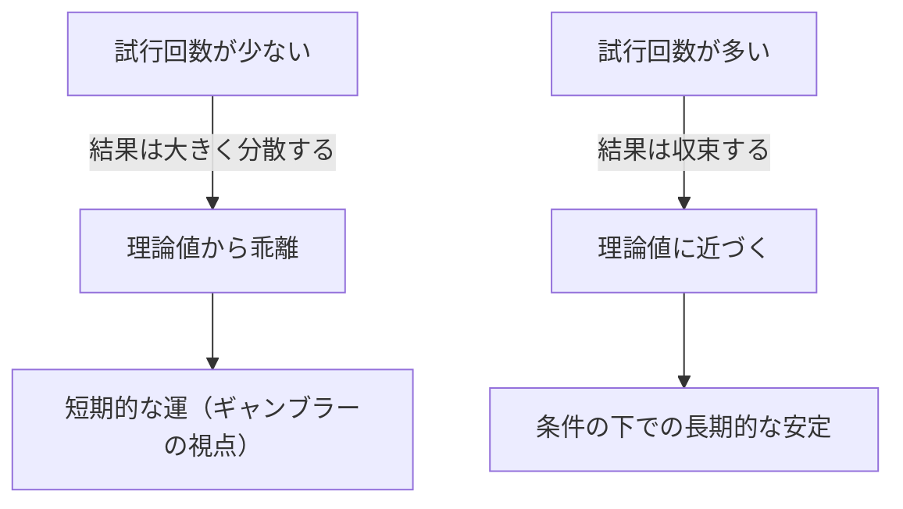
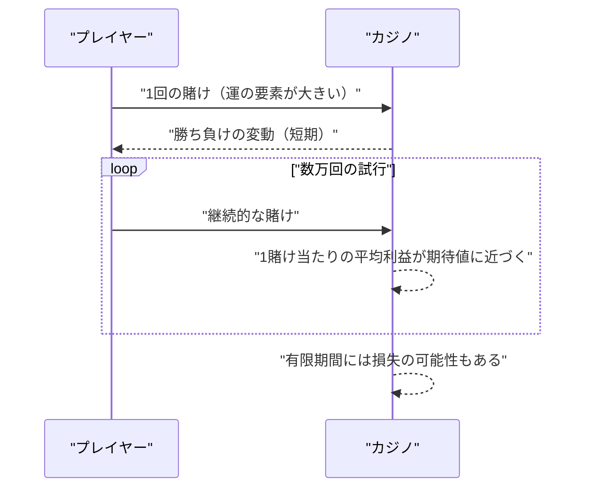

## 1. はじめに：カジノの期待収益と変動

カジノでは短期的にプレイヤーが大きく勝つこともあります。一定のルールの下で多数の独立な賭けを集めると、平均収益を期待値で捉えやすくなります。大数の法則はこの考え方を支えますが、有限期間の利益や経営全体の成功を保証しません。

この記事では、確率論の最も基本的かつ重要な定理である「大数の法則」について、直感的な理解から厳密な数学的定義までを網羅的に解説します。さらに、日常に潜む誤解や、社会でどのように応用されているかについても深く掘り下げます。

## 2. 大数の法則とは何か？

大数の法則（Law of Large Numbers, LLN）は、独立同分布の確率変数に有限の絶対期待値 $E[|X_1|]<\infty$ があるとき、標本平均が期待値に収束する法則です。事象の0・1指示変数では、観測した相対度数がその事象の確率に近づきます。事象自体の確率が試行とともに変わるという意味ではありません。

コイン投げを想像してください。表が出る確率は $1/2$（$50\%$）です。しかし、10回投げただけで表が5回、裏が5回出るとは限りません。表が7回出ることもあれば、2回しか出ないこともあります。
独立な公平なコイン投げでは、表の割合は確率1で50%に収束します。有限の回数でちょうど50%になることや、誤差が毎回小さくなることは保証されません。



この「短期的な変動」と「長期的な安定」のギャップこそが、確率というものの本質であり、人間が直感的に誤解しやすいポイントでもあります。

## 3. ハウスエッジと平均収益

ハウスエッジは、賭け金に対する運営側の期待利益の割合です。ここでは、各ポケットが等確率で出る、1〜36と0、00の計38ポケットのアメリカンルーレットを例にします。

「赤か黒か」に賭けた場合、当たる確率は $18/38$（約 $47.37\%$）です。配当は2倍ですが、勝率が $50\%$ を切っているため、1回の賭けにおける期待値はマイナスになります。

$$
\text{期待値} = \left( \frac{18}{38} \times 1 \right) + \left( \frac{20}{38} \times (-1) \right) = -\frac{1}{19} \approx -0.0526
$$

つまり、1ドル賭けるごとに、プレイヤーは平均して約 $5.26$ セントを失う計算になります。
独立なスピンごとに同じ金額を赤へ賭けるモデルでは、運営側の1賭け当たりの平均利益は確率1で賭け金の $1/19\approx5.26\%$ に収束します。これは総利益の収束や、有限回での黒字を保証しません。経費、賭け金の違い、資金制約なども別に考える必要があります。



## 4. 大数の法則の数学的定義

大数の法則には、収束の強さに応じて **大数の弱法則** （Weak Law of Large Numbers, WLLN）と **大数の強法則** （Strong Law of Large Numbers, SLLN）の2種類が存在します。数学的に厳密に表現すると以下のようになります。

### 4.1. 大数の弱法則 (WLLN)

弱法則は、「確率収束」という概念に基づいています。
独立同分布（i.i.d.）の確率変数列 $X_1,X_2,\dots$ が $E[|X_1|]<\infty$ を満たし、$E[X_1]=\mu$ とします。標本平均 $\bar{X}_n=\frac{1}{n}\sum_{i=1}^n X_i$ について、任意の $\epsilon>0$ に対し次が成り立ちます。

$$
\lim_{n \to \infty} P(|\bar{X}_n - \mu| > \epsilon) = 0
$$

これは、「サンプルサイズ $n$ が大きくなるにつれて、標本平均が真の期待値から $\epsilon$ より大きく離れる確率は $0$ に近づく」という意味です。

### 4.2. 大数の強法則 (SLLN)

強法則は、「概収束（確率 1 で収束）」という、より強い概念に基づいています。

$$
P\left(\lim_{n \to \infty} \bar{X}_n = \mu \right) = 1
$$

弱法則は、十分大きな各nについて、一定の誤差を超える確率が小さくなることを述べます。同じ独立同分布・可積分の条件の下で、強法則は標本平均の列全体が期待値に収束する事象の確率が1であることを述べます。確率0の例外はあり得ます。有限回で理論値と一致することや、永続的な利益は保証しません。

### 4.3. チェビシェフの不等式による弱法則の証明

ここでは追加条件として有限の分散 $\sigma^2<\infty$ を仮定し、チェビシェフの不等式で弱法則を証明します。独立同分布の場合、弱法則自体には有限の分散までは必要ありません。
確率変数 $Y$ の期待値を $\mu_Y$、分散を $\sigma_Y^2$ とすると、チェビシェフの不等式は以下のように表されます。

$$
P(|Y - \mu_Y| \ge \epsilon) \le \frac{\sigma_Y^2}{\epsilon^2}
$$

ここで $Y = \bar{X}_n$ とします。各 $X_i$ の分散を $\sigma^2$ とすると、標本平均 $\bar{X}_n$ の分散は $\sigma^2 / n$ となります。
これをチェビシェフの不等式に代入すると、

$$
P(|\bar{X}_n - \mu| \ge \epsilon) \le \frac{\sigma^2}{n \epsilon^2}
$$

$n \to \infty$ とすると、右辺は $0$ に近づきます。したがって、左辺の確率も $0$ に収束し、弱法則が証明されます。

## 5. ギャンブラーの誤謬（Gambler's Fallacy）

大数の法則を誤解することから生まれる有名な心理的バイアスに **ギャンブラーの誤謬** があります。

ルーレットで「赤」が10回連続で出たのを見たとき、多くの人は「次はそろそろ黒が出るはずだ」と考えます。これは「大数の法則によって、赤と黒の割合は $50\%$ に収束するはずだから、これまでの偏りを打ち消すために黒が出やすくなる」という誤った推論に基づいています。

独立で公平な38ポケットのルーレットでは、次に赤または黒のそれぞれが出る確率は、過去の結果にかかわらず $18/38$ です。0と00があるため、それぞれの割合の極限は50%ではありません。大数の法則は、過去の偏りを打ち消す力や次の結果の確率の変化を意味しません。

## 6. Pythonによるシミュレーション

実際にプログラミングを用いて大数の法則を可視化してみましょう。サイコロを振って、出た目の平均が期待値の 3.5 に収束する様子をシミュレーションします。

```python
import numpy as np
import matplotlib.pyplot as plt

# シミュレーションのパラメータ
n_trials = 10000  # 試行回数
expected_value = 3.5  # サイコロの目の期待値

# 1から6の目をランダムに生成
np.random.seed(42)
rolls = np.random.randint(1, 7, size=n_trials)

# 累積平均を計算
cumulative_average = np.cumsum(rolls) / np.arange(1, n_trials + 1)

# 結果のプロット
plt.figure(figsize=(10, 6))
plt.plot(cumulative_average, label=r"$\bar{X}_n$", color="blue", alpha=0.7)
plt.axhline(y=expected_value, color="red", linestyle="--", label=r"$E[X]=3.5$")
plt.title(r"$\bar{X}_n$")
plt.xlabel(r"n")
plt.ylabel(r"$\bar{X}_n$")
plt.legend()
plt.grid(True)
plt.show()
```

この実行例は累積平均が3.5付近で推移する様子を示します。有限のシミュレーションは直感を助ける例であり、定理の証明ではありません。平均は途中で期待値から遠ざかることもあり、ちょうど3.5になる必要はありません。

## 7. 大数の法則が成り立たないケース：[コーシー](https://kenji.blog/p/cauchy/)分布

大数の法則は万能ではありません。前提条件として「期待値（平均）が有限であること」が必要です。
例えばコーシー分布には有限の絶対期待値がなく、平均は未定義です。「平均が正の無限大」と決まるわけではありません。二次モーメントは無限大で、通常の有限の分散も持ちません。

独立な標準コーシー変数の標本平均は、どの $n$ でも標準コーシー分布のままで、定数には確率収束しません。実際のデータでも、裾が重いという理由だけで大数の法則が使えないと判断せず、可積分性や依存関係など、モデルの条件を確認する必要があります。

## 8. 実社会における応用例

大数の法則は、カジノだけでなく、私たちの社会の根幹を支える様々なシステムで活用されています。

### 8.1. 保険ビジネス
保険では多数の契約の平均的な損失を予測する考え方が役立ちます。ただし、契約数だけで高精度が保証されるわけではありません。共通災害による相関、集団の違い、損失分布や制度の変化を考慮したモデルが必要です。

### 8.2. 統計的品質管理
工場での製品製造において、全製品を検査することはコストと時間の観点から不可能な場合があります。そこで、ランダムに抽出した一部の製品（サンプル）を検査し、その結果から全体の不良品率を推定します。ここでも大数の法則が、サンプルから母集団の性質を推測する強力な根拠となっています。

### 8.3. 機械学習とビッグデータ
機械学習では、固定したモデルの損失が独立同分布かつ可積分である場合などに、平均損失を期待損失へ近づける根拠として大数の法則を使えます。ただし、学習データからモデル自体を選ぶ場合の汎化には追加の議論が必要です。データ量を増やすだけでは、偏り、分布の変化、不適切なモデルを解消できません。

## 9. おわりに

大数の法則は、私たちが不確実性の高い世界を理解し、合理的な意思決定を行うための強力なツールです。カジノの利益構造から、保険、AI技術に至るまで、この法則は現代社会の至る所で静かに、しかし確実に機能しています。

次にコインを投げるときやサイコロを振るときには、その一回一回の偶然の背後に隠された、壮大で美しい数学の法則に思いを馳せてみてはいかがでしょうか。短期的な運に一喜一憂するのではなく、長期的な視点を持つことで、世界の見え方が少し変わるかもしれません。

## 参考資料

- [MIT 18.05: Central Limit Theorem and the Law of Large Numbers](https://math.mit.edu/~dav/05.dir/class6-prep.pdf)
- [Mathlib: The strong law of large numbers](https://leanprover-community.github.io/mathlib4_docs/Mathlib/Probability/StrongLaw.html)
- [MIT: Cauchy Distribution](https://web.mit.edu/urban_or_book/www/book/chapter3/3.3.3.html)
