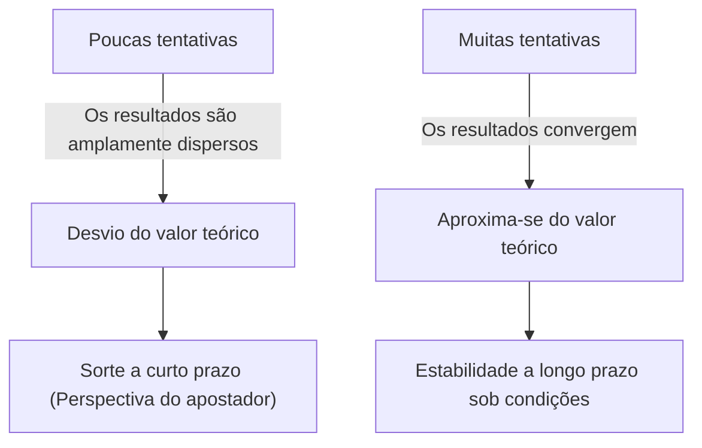
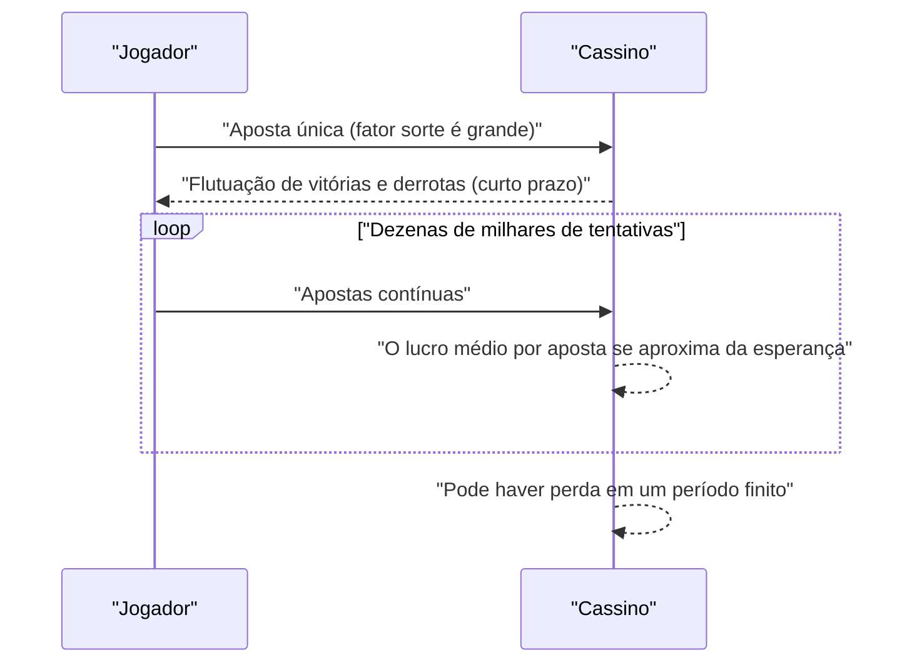

## 1. Introdução: Retorno esperado do cassino e flutuações

Jogadores podem ganhar grandes quantias no curto prazo. Em um modelo fixo, a média de muitas apostas independentes pode se aproximar de sua esperança. A lei dos grandes números apoia essa ideia, mas não garante lucro em um período finito nem o sucesso do negócio.

Neste artigo, explicamos de forma abrangente a "Lei dos Grandes Números", o teorema mais fundamental e importante da teoria das probabilidades, desde o entendimento intuitivo até as definições matemáticas rigorosas. Além disso, aprofundamos nos mal-entendidos comuns e como isso é aplicado na sociedade.

## 2. O que é a Lei dos Grandes Números?

A lei dos grandes números (LLN) afirma que a média amostral de variáveis independentes e identicamente distribuídas converge para sua esperança quando $E[|X_1|]<\infty$. Para indicadores zero–um de um evento, a frequência relativa observada se aproxima da probabilidade do evento. A probabilidade em si não muda com o acúmulo de ensaios.

Imagine jogar uma moeda. A probabilidade de dar cara é de $1/2$ ($50\%$). No entanto, jogar a moeda apenas 10 vezes não garante que você obterá 5 caras e 5 coroas. Você pode obter 7 caras, ou apenas 2.
Em lançamentos independentes de uma moeda equilibrada, a proporção de caras converge para 50% com probabilidade um. Isso não garante exatamente 50% após uma quantidade finita de lançamentos nem um erro que diminua a cada passo.



Essa lacuna entre "volatilidade a curto prazo" e "estabilidade a longo prazo" é a própria essência da probabilidade, e também é o ponto onde os humanos costumam se confundir intuitivamente.

## 3. A vantagem da casa e o retorno médio

A vantagem da casa é seu lucro esperado como proporção do valor apostado. Considere uma roleta americana ideal com 38 casas equiprováveis: de 1 a 36, além de 0 e 00.

Se você apostar no "vermelho ou preto", a probabilidade de ganhar é de $18/38$ (cerca de $47,37\%$). O prêmio é dobrado, mas como a probabilidade de vitória é inferior a $50\%$, o valor esperado de uma única aposta é negativo.

$$
\text{Valor Esperado} = \left( \frac{18}{38} \times 1 \right) + \left( \frac{20}{38} \times (-1) \right) = -\frac{1}{19} \approx -0{,}0526
$$

Em outras palavras, para cada dólar apostado, o jogador perde, em média, cerca de $5,26$ centavos.
Com giros independentes e a mesma quantia apostada no vermelho em cada giro, o lucro médio da casa por aposta converge quase certamente para $1/19\approx5{,}26\%$ do valor apostado. Isso não é convergência do lucro total nem garantia de lucro após um número finito de apostas. Despesas, valores variáveis e restrições de capital precisam ser considerados separadamente.



## 4. Definição matemática da Lei dos Grandes Números

Dependendo da força da convergência, a Lei dos Grandes Números se divide em dois tipos: a **Lei Fraca dos Grandes Números** (WLLN) e a **Lei Forte dos Grandes Números** (SLLN). Em termos estritamente matemáticos, isso é expresso da seguinte forma.

### 4.1. Lei Fraca dos Grandes Números (WLLN)

A lei fraca baseia-se no conceito de "convergência em probabilidade".
Sejam $X_1,X_2,\dots$ independentes e identicamente distribuídas (i.i.d.), com $E[|X_1|]<\infty$ e $E[X_1]=\mu$. Para a média amostral $\bar{X}_n=\frac{1}{n}\sum_{i=1}^n X_i$, vale o seguinte para todo $\epsilon>0$.

$$
\lim_{n \to \infty} P(|\bar{X}_n - \mu| > \epsilon) = 0
$$

Isso significa que "à medida que o tamanho da amostra $n$ aumenta, a probabilidade de que a média amostral se desvie do verdadeiro valor esperado por mais de $\epsilon$ se aproxima de $0$".

### 4.2. Lei Forte dos Grandes Números (SLLN)

A lei forte baseia-se no conceito mais rigoroso de "convergência quase certa (convergência com probabilidade 1)".

$$
P\left(\lim_{n \to \infty} \bar{X}_n = \mu \right) = 1
$$

A lei fraca diz que, para cada n suficientemente grande, a probabilidade de exceder uma tolerância fixa de erro se torna pequena. Sob as mesmas condições de independência, distribuição idêntica e integrabilidade, a lei forte afirma que toda a sequência de médias converge para a esperança em um evento de probabilidade um. Exceções de probabilidade zero são possíveis. Nenhuma das leis garante igualdade exata após um número finito de ensaios nem lucros permanentemente positivos.

### 4.3. Prova da Lei Fraca usando a desigualdade de Chebyshev

Para esta prova, suponha adicionalmente variância finita, $\sigma^2<\infty$, e aplique a desigualdade de Chebyshev. A lei fraca i.i.d. não exige, por si só, variância finita.
Seja $\mu_Y$ o valor esperado de uma variável aleatória $Y$ e $\sigma_Y^2$ sua variância, a desigualdade de Chebyshev é expressa da seguinte forma:

$$
P(|Y - \mu_Y| \ge \epsilon) \le \frac{\sigma_Y^2}{\epsilon^2}
$$

Aqui, digamos que $Y = \bar{X}_n$. Se a variância de cada $X_i$ é $\sigma^2$, a variância da média amostral $\bar{X}_n$ será $\sigma^2 / n$.
Substituindo isso na desigualdade de Chebyshev:

$$
P(|\bar{X}_n - \mu| \ge \epsilon) \le \frac{\sigma^2}{n \epsilon^2}
$$

Quando $n \to \infty$, o lado direito se aproxima de $0$. Portanto, a probabilidade no lado esquerdo também converge para $0$, provando a lei fraca.

## 5. A falácia do apostador (Gambler's Fallacy)

Um viés psicológico famoso nascido da má interpretação da Lei dos Grandes Números é a **falácia do apostador**.

Quando as pessoas veem o "vermelho" sair 10 vezes seguidas na roleta, muitos pensam "o preto deve estar prestes a sair". Isso se baseia no raciocínio errôneo de que "uma vez que a Lei dos Grandes Números afirma que a proporção entre vermelho e preto deve convergir para $50\%$, o preto se torna mais provável de aparecer para compensar o desequilíbrio anterior".

Em uma roleta ideal de 38 casas com giros independentes, o próximo giro tem probabilidade $18/38$ de vermelho e $18/38$ de preto, independentemente dos resultados anteriores. Por causa de 0 e 00, nenhuma proporção limite é 50%. A lei não cria uma força que compense desequilíbrios passados nem muda as probabilidades do próximo resultado.

## 6. Simulação com Python

Vamos visualizar concretamente a Lei dos Grandes Números através da programação. Simularemos o lançamento de um dado e observaremos como a média dos resultados converge para o valor esperado de 3,5.

```python
import numpy as np
import matplotlib.pyplot as plt

# Parâmetros da simulação
n_trials = 10000  # Número de tentativas
expected_value = 3.5  # Valor esperado da face do dado

# Gerar aleatoriamente números de 1 a 6
np.random.seed(42)
rolls = np.random.randint(1, 7, size=n_trials)

# Calcular a média cumulativa
cumulative_average = np.cumsum(rolls) / np.arange(1, n_trials + 1)

# Plotar os resultados
plt.figure(figsize=(10, 6))
plt.plot(cumulative_average, label=r"$\bar{X}_n$", color="blue", alpha=0.7)
plt.axhline(y=expected_value, color="red", linestyle="--", label=r"$E[X]=3.5$")
plt.title(r"$\bar{X}_n$")
plt.xlabel(r"n")
plt.ylabel(r"$\bar{X}_n$")
plt.legend()
plt.grid(True)
plt.show()
```

Este exemplo ilustra uma média cumulativa oscilando perto de 3,5. Uma simulação finita ajuda a intuição, mas não é uma prova. A média pode se afastar da esperança ao longo do caminho e não precisa ser exatamente 3,5 em nenhum momento.

## 7. Casos em que a Lei dos Grandes Números não se aplica: Distribuição de [Cauchy](https://kenji.blog/pt/p/cauchy/)

A Lei dos Grandes Números não é universal. Um pré-requisito é que "o valor esperado (média) deve ser finito".
A distribuição de Cauchy não tem esperança absoluta finita, e sua média é indefinida. Isso não significa que a média seja infinito positivo. Seu segundo momento é infinito, e ela não possui variância finita usual.

A média amostral de variáveis de Cauchy padrão independentes continua sendo Cauchy padrão para todo $n$; portanto, não converge em probabilidade para uma constante. Em dados reais, caudas pesadas por si só não demonstram falha da lei: verifique integrabilidade, dependência e as demais condições do modelo.

## 8. Exemplos de aplicação no mundo real

A Lei dos Grandes Números é usada não apenas em cassinos, mas em vários sistemas que sustentam as bases de nossa sociedade.

### 8.1. O setor de seguros
Em seguros, calcular médias de perdas entre muitos contratos pode ajudar a prever o risco agregado. A quantidade de contratos por si só não garante alta precisão. Os modelos devem considerar catástrofes compartilhadas, perdas correlacionadas, diferenças entre grupos e mudanças nas distribuições das perdas ou nas condições das apólices.

### 8.2. Controle de qualidade estatístico
Na fabricação de produtos em fábricas, muitas vezes é impossível inspecionar todos os produtos do ponto de vista de custo e tempo. Portanto, inspeciona-se uma parcela dos produtos selecionada aleatoriamente (amostra), e a partir dos resultados estima-se a taxa de defeito geral. Aqui também, a Lei dos Grandes Números serve como um poderoso fundamento para inferir as propriedades de uma população a partir de uma amostra.

### 8.3. Aprendizado de Máquina (Machine Learning) e Big Data
No aprendizado de máquina, a lei pode justificar a convergência da perda média observada para a perda esperada de um modelo fixo, quando as perdas são i.i.d. e integráveis. A generalização após escolher um modelo com dados de treinamento exige argumentos adicionais. Mais dados, por si só, não eliminam viés de amostragem, mudança de distribuição nem especificação inadequada do modelo.

## 9. Conclusão

A Lei dos Grandes Números é uma ferramenta poderosa para entendermos um mundo altamente incerto e tomar decisões racionais. Da estrutura de lucros de um cassino aos seguros e à tecnologia de IA, esta lei atua de forma silenciosa e segura em todos os lugares da sociedade moderna.

Da próxima vez que você jogar uma moeda ou lançar um dado, por que não pensar nas grandes e belas leis matemáticas ocultas por trás de cada acaso? Em vez de ir da alegria à tristeza com a sorte a curto prazo, ter uma visão a longo prazo pode mudar um pouco a maneira como o mundo lhe parece.

## Referências

- [MIT 18.05: Central Limit Theorem and the Law of Large Numbers](https://math.mit.edu/~dav/05.dir/class6-prep.pdf)
- [Mathlib: The strong law of large numbers](https://leanprover-community.github.io/mathlib4_docs/Mathlib/Probability/StrongLaw.html)
- [MIT: Cauchy Distribution](https://web.mit.edu/urban_or_book/www/book/chapter3/3.3.3.html)
