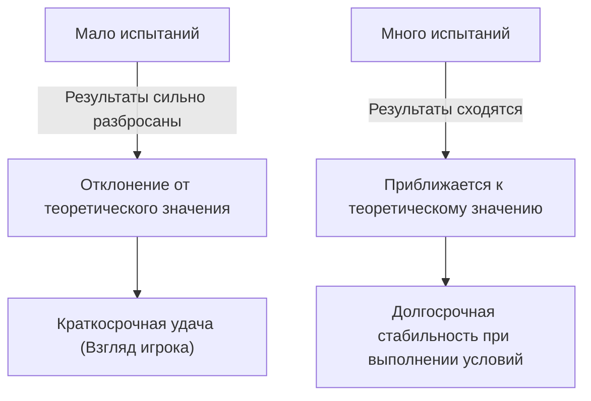
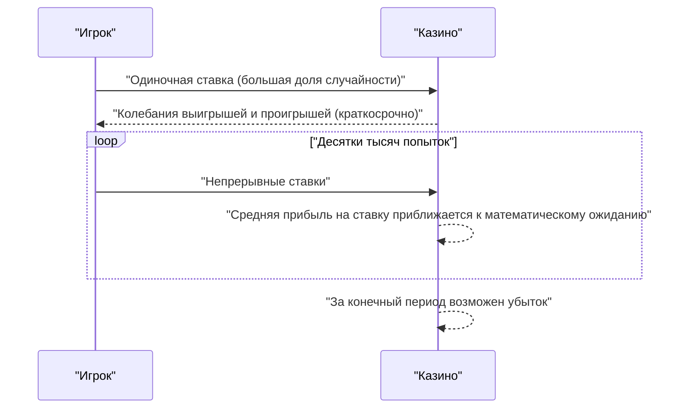

## 1. Введение: Ожидаемый доход казино и колебания

Игроки могут выигрывать крупные суммы в краткосрочной перспективе. В фиксированной модели средний результат многих независимых ставок может приближаться к математическому ожиданию. Закон больших чисел поддерживает эту идею, но не гарантирует прибыль за конечный период или успех бизнеса.

В этой статье мы подробно разберем "Закон больших чисел", самую фундаментальную и важную теорему теории вероятностей, от интуитивного понимания до строгих математических определений. Кроме того, мы рассмотрим повседневные заблуждения и то, как этот закон применяется в обществе.

## 2. Что такое Закон больших чисел?

Закон больших чисел (ЗБЧ) утверждает, что выборочное среднее независимых одинаково распределённых величин сходится к математическому ожиданию при $E[|X_1|]<\infty$. Для индикаторов события со значениями ноль и один относительная частота приближается к вероятности события. Сама вероятность с числом испытаний не меняется.

Представьте себе бросание монеты. Вероятность выпадения орла составляет $1/2$ ($50\%$). Однако всего 10 бросков не гарантируют, что вы получите 5 орлов и 5 решек. Может выпасть 7 орлов, или только 2.
При независимых бросках симметричной монеты доля орлов сходится к 50% с вероятностью один. Это не гарантирует ровно 50% после конечного числа бросков или уменьшение ошибки на каждом шаге.



Этот разрыв между "краткосрочной волатильностью" и "долгосрочной стабильностью" — это сама суть вероятности, и именно здесь люди часто интуитивно ошибаются.

## 3. Преимущество заведения и средний доход

Преимущество заведения — ожидаемая прибыль казино как доля суммы ставки. Рассмотрим идеальную американскую рулетку с 38 равновероятными ячейками: от 1 до 36, а также 0 и 00.

При ставке на один из цветов — красный или чёрный — вероятность выигрыша равна $18/38$ (около $47{,}37\%$). Чистый выигрыш равен ставке (1:1); вместе с возвращённой ставкой игрок получает двойную сумму. Поскольку вероятность выигрыша меньше 50%, математическое ожидание чистого результата отрицательно.

$$
\text{Ожидаемое значение} = \left( \frac{18}{38} \times 1 \right) + \left( \frac{20}{38} \times (-1) \right) = -\frac{1}{19} \approx -0{,}0526
$$

Иными словами, на каждый поставленный доллар игрок в среднем теряет около $5,26$ центов.
При независимых вращениях и одинаковой ставке на красное средняя прибыль казино на ставку сходится почти наверное к $1/19\approx5{,}26\%$ от ставки. Это не сходимость общей прибыли и не гарантия прибыли после конечного числа ставок. Расходы, разные ставки и ограничения капитала учитываются отдельно.



## 4. Математическое определение Закона больших чисел

В зависимости от силы сходимости, Закон больших чисел бывает двух видов: **Слабый закон больших чисел** (СЗБЧ) и **Усиленный закон больших чисел** (УЗБЧ). В строгом математическом выражении это выглядит следующим образом.

### 4.1. Слабый закон больших чисел (СЗБЧ)

Слабый закон основан на концепции "сходимости по вероятности".
Пусть $X_1,X_2,\dots$ независимы и одинаково распределены (i.i.d.), $E[|X_1|]<\infty$ и $E[X_1]=\mu$. Для выборочного среднего $\bar{X}_n=\frac{1}{n}\sum_{i=1}^n X_i$ при любом $\epsilon>0$ выполняется:

$$
\lim_{n \to \infty} P(|\bar{X}_n - \mu| > \epsilon) = 0
$$

Это означает, что "по мере увеличения размера выборки $n$ вероятность того, что выборочное среднее отклонится от истинного математического ожидания более чем на $\epsilon$, приближается к $0$".

### 4.2. Усиленный закон больших чисел (УЗБЧ)

Усиленный закон базируется на более строгом понятии "сходимости почти наверное (сходимости с вероятностью 1)".

$$
P\left(\lim_{n \to \infty} \bar{X}_n = \mu \right) = 1
$$

Слабый закон означает, что для каждого достаточно большого n вероятность превышения фиксированного допуска ошибки становится малой. При тех же условиях независимости, одинакового распределения и интегрируемости усиленный закон утверждает сходимость всей последовательности средних к математическому ожиданию на событии вероятности один. Исключения вероятности ноль возможны. Ни один закон не гарантирует точного совпадения после конечного числа испытаний или постоянно положительной прибыли.

### 4.3. Доказательство слабого закона с использованием неравенства Чебышёва

Для этого доказательства дополнительно предположим конечную дисперсию $\sigma^2<\infty$ и применим неравенство Чебышёва. Сам слабый закон для i.i.d. величин конечной дисперсии не требует.
Если математическое ожидание случайной величины $Y$ равно $\mu_Y$, а её дисперсия равна $\sigma_Y^2$, то неравенство Чебышёва выражается так:

$$
P(|Y - \mu_Y| \ge \epsilon) \le \frac{\sigma_Y^2}{\epsilon^2}
$$

Пусть $Y = \bar{X}_n$. Если дисперсия каждого $X_i$ равна $\sigma^2$, то дисперсия выборочного среднего $\bar{X}_n$ будет равна $\sigma^2 / n$.
Подставив это в неравенство Чебышёва:

$$
P(|\bar{X}_n - \mu| \ge \epsilon) \le \frac{\sigma^2}{n \epsilon^2}
$$

По мере того, как $n \to \infty$, правая часть стремится к $0$. Следовательно, вероятность в левой части также сходится к $0$, что доказывает слабый закон.

## 5. Ошибка игрока (Gambler's Fallacy)

Знаменитое психологическое когнитивное искажение, возникающее из-за непонимания Закона больших чисел, — это **ошибка игрока**.

Когда люди видят, что в рулетке "красное" выпадает 10 раз подряд, многие думают: "Скоро должно выпасть черное". Это основано на ошибочном рассуждении, что "поскольку Закон больших чисел гласит, что соотношение красного и черного должно стремиться к $50\%$, черное становится более вероятным, чтобы компенсировать предыдущий перекос".

В идеальной рулетке с 38 ячейками и независимыми вращениями вероятность красного на следующем вращении равна $18/38$, чёрного — тоже $18/38$, независимо от прошлых результатов. Из-за 0 и 00 ни одна предельная доля не равна 50%. Закон не создаёт силу для компенсации прежнего дисбаланса и не меняет вероятности следующего результата.

## 6. Моделирование с помощью Python

Давайте визуализируем Закон больших чисел на практике с помощью программирования. Мы смоделируем бросание кубика и увидим, как среднее значение бросков сходится к математическому ожиданию 3,5.

```python
import numpy as np
import matplotlib.pyplot as plt

# Параметры симуляции
n_trials = 10000  # Количество попыток
expected_value = 3.5  # Ожидаемое значение броска кубика

# Случайная генерация чисел от 1 до 6
np.random.seed(42)
rolls = np.random.randint(1, 7, size=n_trials)

# Расчет накопленного среднего
cumulative_average = np.cumsum(rolls) / np.arange(1, n_trials + 1)

# Построение графика результатов
plt.figure(figsize=(10, 6))
plt.plot(cumulative_average, label=r"$\bar{X}_n$", color="blue", alpha=0.7)
plt.axhline(y=expected_value, color="red", linestyle="--", label=r"$E[X]=3.5$")
plt.title(r"$\bar{X}_n$")
plt.xlabel(r"n")
plt.ylabel(r"$\bar{X}_n$")
plt.legend()
plt.grid(True)
plt.show()
```

Пример показывает накопленное среднее, колеблющееся около 3,5. Конечное моделирование помогает интуиции, но не доказывает теорему. По пути среднее может удаляться от математического ожидания и не обязано когда-либо точно равняться 3,5.

## 7. Случаи, когда Закон больших чисел не работает: Распределение Коши

Закон больших чисел не универсален. Одним из условий является то, что "математическое ожидание (среднее) должно быть конечным".
У распределения Коши нет конечного абсолютного математического ожидания, а среднее не определено. Это не означает, что среднее равно положительной бесконечности. Второй момент бесконечен, обычной конечной дисперсии также нет.

Выборочное среднее независимых стандартных величин Коши имеет стандартное распределение Коши при любом $n$ и не сходится по вероятности к константе. Для реальных данных тяжёлых хвостов самих по себе недостаточно, чтобы объявить закон неприменимым: проверьте интегрируемость, зависимости и остальные условия модели.

## 8. Примеры применения в реальном мире

Закон больших чисел используется не только в казино, но и в различных системах, составляющих основу нашего общества.

### 8.1. Страховой бизнес
В страховании усреднение убытков по множеству договоров помогает прогнозировать совокупный риск. Число договоров само по себе не гарантирует точности. Модели должны учитывать общие катастрофы, корреляцию убытков, различия групп, изменения распределения убытков и условий договоров.

### 8.2. Статистический контроль качества
При производстве продукции на заводах часто бывает невозможно проверить каждую единицу продукции из соображений стоимости и времени. Поэтому проверяется часть случайно выбранных продуктов (выборка), и по результатам оценивается общий уровень брака. Здесь Закон больших чисел также служит мощным основанием для вывода о свойствах всей совокупности на основе выборки.

### 8.3. Машинное обучение и Большие данные (Big Data)
В машинном обучении закон может обосновывать сходимость среднего наблюдаемого значения потерь к его математическому ожиданию для фиксированной модели с i.i.d. интегрируемыми потерями. Обобщение после выбора модели по обучающим данным требует дополнительных аргументов. Больше данных само по себе не устраняет смещение выборки, сдвиг распределения или неверную спецификацию модели.

## 9. Заключение

Закон больших чисел — это мощный инструмент, позволяющий нам понимать этот крайне неопределенный мир и принимать рациональные решения. От структуры прибыли казино до страхования и технологий ИИ, этот закон тихо, но верно работает повсюду в современном обществе.

В следующий раз, когда вы будете бросать монету или игральную кость, подумайте о тех великих и красивых математических законах, скрытых за каждой случайностью. Вместо того чтобы радоваться или расстраиваться из-за краткосрочной удачи, долгосрочный взгляд может немного изменить ваше восприятие мира.

## Источники

- [MIT 18.05: Central Limit Theorem and the Law of Large Numbers](https://math.mit.edu/~dav/05.dir/class6-prep.pdf)
- [Mathlib: The strong law of large numbers](https://leanprover-community.github.io/mathlib4_docs/Mathlib/Probability/StrongLaw.html)
- [MIT: Cauchy Distribution](https://web.mit.edu/urban_or_book/www/book/chapter3/3.3.3.html)
