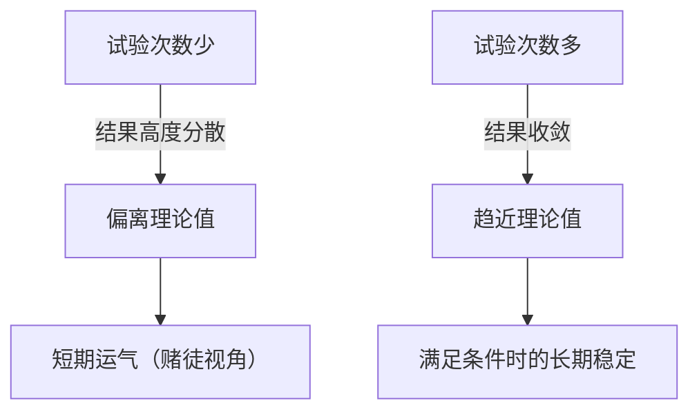
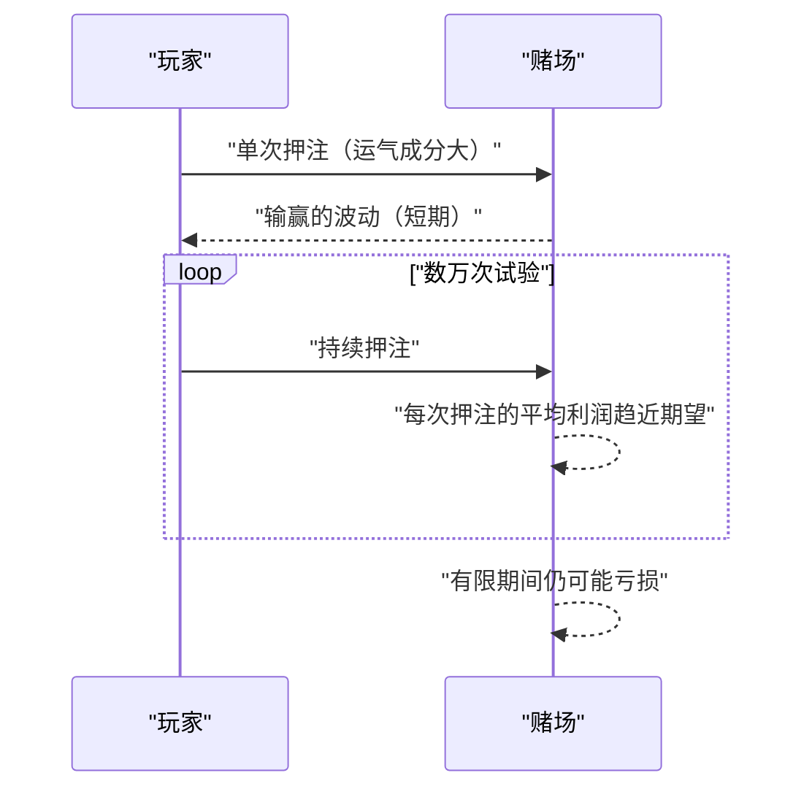

## 1. 引言：赌场的期望收益与波动

短期内玩家也可能赢得大笔金钱。在规则固定的模型下，汇集大量独立的押注，可以让平均收益接近期望值。大数定律支持这种思路，但不保证赌场在有限期间内获利，也不保证其经营成功。

本文将全面解析概率论中最基本且最重要的定理“大数定律”，从直观理解到严格的数学定义。此外，我们还将深入探讨日常中的误解以及它在社会中的应用。

## 2. 什么是大数定律？

大数定律（LLN）指出：对于满足 $E[|X_1|]<\infty$ 的独立同分布随机变量，样本均值收敛于其期望。对于事件的0–1指示变量，观测到的相对频率趋近事件的概率。并不是事件本身的概率随着试验而改变。

想象一下抛硬币。正面朝上的概率是 $1/2$（$50\%$）。但是，仅仅抛10次，并不意味着一定会有5次正面、5次反面。有时可能会有7次正面，或者只有2次。
对于独立的公平硬币投掷，正面比例以概率1收敛到50%。这不保证有限次投掷后恰好达到50%，也不保证误差每一步都减小。



这种“短期波动”与“长期稳定”之间的差距正是概率的本质，也是人类直觉上容易误解的地方。

## 3. 赌场优势与平均收益

赌场优势（House Edge）是赌场的期望利润占押注金额的比例。这里考虑理想的美式轮盘：1至36、0和00共38个槽，每个槽出现的概率相同。

如果你押注“红色或黑色”，中奖的概率是 $18/38$（约 $47.37\%$）。虽然赔率是1赔1（赢了得2倍），但由于胜率低于 $50\%$，单次押注的期望值为负。

$$
\text{期望值} = \left( \frac{18}{38} \times 1 \right) + \left( \frac{20}{38} \times (-1) \right) = -\frac{1}{19} \approx -0.0526
$$

也就是说，平均每押注1美元，玩家将损失约 $5.26$ 美分。
在各次旋转独立、每次以相同金额押红色的模型下，赌场每次押注的平均利润以概率1收敛到押注金额的 $1/19\approx5.26\%$。这不表示总利润收敛，也不保证有限次押注后盈利。经营费用、金额差异和资金约束需要另行考虑。



## 4. 大数定律的数学定义

根据收敛强度的不同，大数定律分为 **大数弱定律** （Weak Law of Large Numbers, WLLN）和 **大数强定律** （Strong Law of Large Numbers, SLLN）两种。其严格的数学表述如下。

### 4.1. 大数弱定律 (WLLN)

弱定律基于“依概率收敛”的概念。
设 $X_1,X_2,\dots$ 独立同分布（i.i.d.），满足 $E[|X_1|]<\infty$，且 $E[X_1]=\mu$。对样本均值 $\bar{X}_n=\frac{1}{n}\sum_{i=1}^n X_i$，任意 $\epsilon>0$ 都有：

$$
\lim_{n \to \infty} P(|\bar{X}_n - \mu| > \epsilon) = 0
$$

这意味着“随着样本量 $n$ 的增大，样本均值偏离真实期望值超过 $\epsilon$ 的概率趋近于 $0$”。

### 4.2. 大数强定律 (SLLN)

强定律基于更强的“几乎处处收敛（以概率1收敛）”的概念。

$$
P\left(\lim_{n \to \infty} \bar{X}_n = \mu \right) = 1
$$

弱定律指出，对足够大的各个n，误差超过固定容限的概率趋小。在相同的独立同分布与可积条件下，强定律指出，整列样本均值收敛于期望的事件具有概率1。概率为0的例外仍可能存在；两者均不保证有限次试验后恰好等于理论值，或此后一直盈利。

### 4.3. 利用切比雪夫不等式证明弱定律

这里额外假设方差有限，即 $\sigma^2<\infty$，再用切比雪夫不等式证明弱定律。独立同分布情形下，弱定律本身并不要求方差有限。
设随机变量 $Y$ 的期望值为 $\mu_Y$，方差为 $\sigma_Y^2$，则切比雪夫不等式表示为：

$$
P(|Y - \mu_Y| \ge \epsilon) \le \frac{\sigma_Y^2}{\epsilon^2}
$$

这里令 $Y = \bar{X}_n$。若每个 $X_i$ 的方差为 $\sigma^2$，则样本均值 $\bar{X}_n$ 的方差为 $\sigma^2 / n$。
将其代入切比雪夫不等式：

$$
P(|\bar{X}_n - \mu| \ge \epsilon) \le \frac{\sigma^2}{n \epsilon^2}
$$

当 $n \to \infty$ 时，右边趋近于 $0$。因此，左边的概率也收敛于 $0$，从而证明了弱定律。

## 5. 赌徒谬误（Gambler's Fallacy）

由于对大数定律的误解，产生了一个著名的心理偏差，即 **赌徒谬误** 。

当在轮盘赌中看到“红色”连续出现10次时，许多人会想“接下来该出黑色了”。这种错误推理基于“根据大数定律，红黑的比例应该收敛于 $50\%$，因此为了抵消之前的偏差，黑色出现的概率会增加”。

对旋转相互独立的理想38槽轮盘，无论过去结果如何，下次出现红色和黑色的概率各为 $18/38$。由于存在0和00，两者的极限比例都不是50%。大数定律不意味着有某种力量抵消过去的偏差，也不会改变下一次结果的概率。

## 6. 使用Python进行模拟

让我们实际使用编程来可视化大数定律。我们将模拟掷骰子，观察掷出的点数平均值如何收敛于期望值3.5。

```python
import numpy as np
import matplotlib.pyplot as plt

# 模拟参数
n_trials = 10000  # 试验次数
expected_value = 3.5  # 骰子点数的期望值

# 随机生成1到6的点数
np.random.seed(42)
rolls = np.random.randint(1, 7, size=n_trials)

# 计算累计平均值
cumulative_average = np.cumsum(rolls) / np.arange(1, n_trials + 1)

# 绘制结果
plt.figure(figsize=(10, 6))
plt.plot(cumulative_average, label=r"$\bar{X}_n$", color="blue", alpha=0.7)
plt.axhline(y=expected_value, color="red", linestyle="--", label=r"$E[X]=3.5$")
plt.title(r"$\bar{X}_n$")
plt.xlabel(r"n")
plt.ylabel(r"$\bar{X}_n$")
plt.legend()
plt.grid(True)
plt.show()
```

此示例展示累积均值在3.5附近波动。有限次模拟可帮助形成直觉，但不是定理的证明。均值在过程中也可能远离期望，并不一定恰好等于3.5。

## 7. 大数定律不成立的情况：柯西分布

大数定律并非万能。它的一个前提条件是“期望值（均值）必须是有限的”。
柯西分布没有有限的绝对期望，均值未定义；这并不等于均值是正无穷大。它的二阶矩为无穷大，也没有通常意义下的有限方差。

独立标准柯西变量的样本均值对每个 $n$ 仍服从标准柯西分布，因此不依概率收敛到常数。对真实数据，不能仅凭重尾就断言大数定律失效，应检查可积性、依赖关系等模型条件。

## 8. 在现实社会中的应用实例

大数定律不仅用于赌场，还被广泛应用于支撑我们社会根基的各种系统中。

### 8.1. 保险业务
保险中，多份合同的平均损失有助于预测总体风险。但合同数量本身不保证高精度；模型还需考虑共同灾害、损失之间的相关性、群体差异，以及损失分布或制度的变化。

### 8.2. 统计质量控制
在工厂的产品制造中，从成本和时间的角度来看，对所有产品进行全数检查往往是不可能的。因此，会随机抽取一部分产品（样本）进行检验，并根据结果推算整体的不良品率。在这里，大数定律同样是根据样本推断总体性质的强有力依据。

### 8.3. 机器学习与大数据
机器学习中，对于固定模型，如果损失独立同分布且可积，大数定律可以支持观测平均损失趋近期望损失。从训练数据中选择模型后的泛化还需要额外论证。增加数据量本身不能消除抽样偏差、分布变化或模型设定错误。

## 9. 结语

大数定律是我们理解高度不确定性世界、做出合理决策的强大工具。从赌场的盈利结构，到保险、AI技术，这一定律在现代社会的各个角落都在安静而确实地发挥着作用。

下次再掷硬币或掷骰子时，不妨想想每一次偶然背后隐藏的宏大而美丽的数学定律。不再因短期的运气而患得患失，拥有长远的眼光，或许会让这个世界在你眼中变得有些不同。

## 参考资料

- [MIT 18.05: Central Limit Theorem and the Law of Large Numbers](https://math.mit.edu/~dav/05.dir/class6-prep.pdf)
- [Mathlib: The strong law of large numbers](https://leanprover-community.github.io/mathlib4_docs/Mathlib/Probability/StrongLaw.html)
- [MIT: Cauchy Distribution](https://web.mit.edu/urban_or_book/www/book/chapter3/3.3.3.html)
