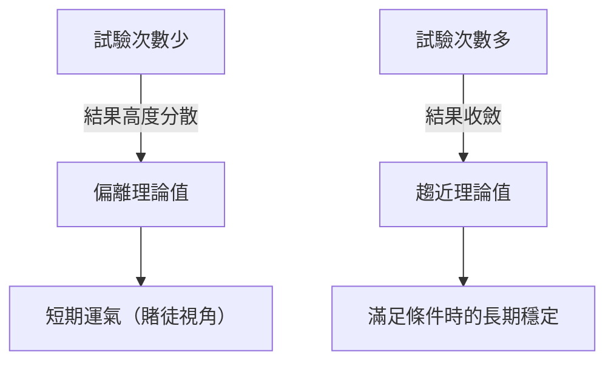
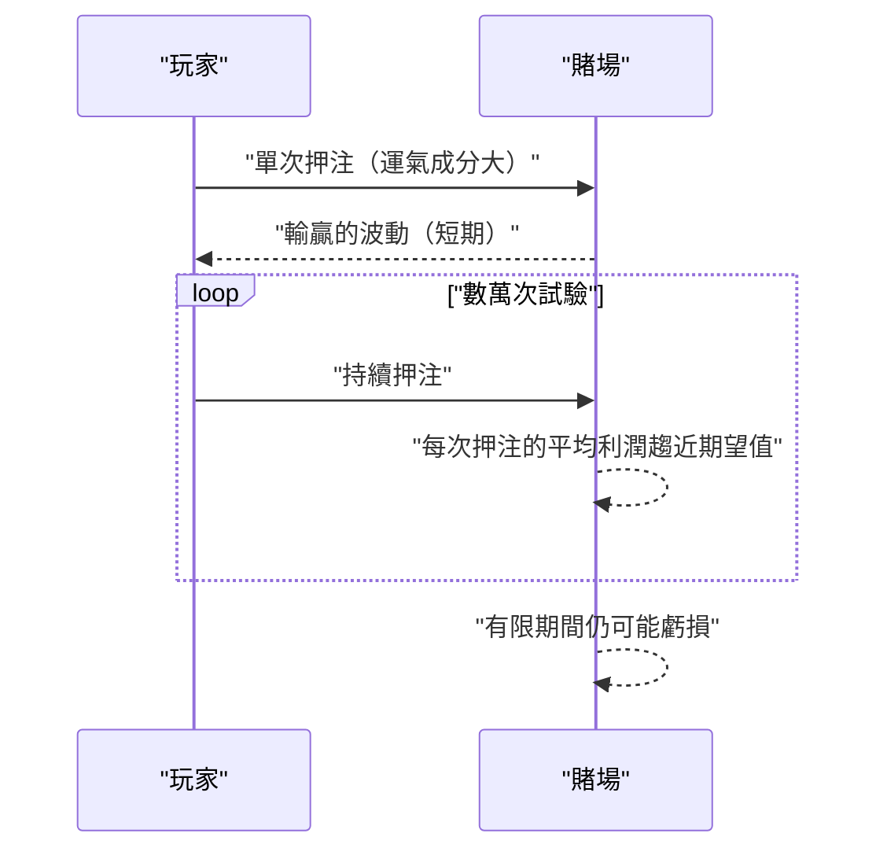

## 1. 前言：賭場的期望收益與波動

短期內玩家也可能贏得大筆金錢。在規則固定的模型下，彙集大量獨立的押注，可以讓平均收益接近期望值。大數法則支持這種思路，但不保證賭場在有限期間內獲利，也不保證其經營成功。

本文將全面解析機率論中最基本且最重要的定理「大數法則」，從直觀理解到嚴格的數學定義。此外，我們還將深入探討日常中的誤解以及它在社會中的應用。

## 2. 什麼是大數法則？

大數法則（LLN）指出：對於滿足 $E[|X_1|]<\infty$ 的獨立同分布隨機變數，樣本平均值收斂於其期望值。對事件的0–1指示變數，觀察到的相對次數趨近該事件的機率。並非事件本身的機率隨試驗而改變。

想像一下擲硬幣。正面朝上的機率是 $1/2$（$50\%$）。但是，僅僅擲10次，並不意味著一定會有5次正面、5次反面。有時可能會有7次正面，或者只有2次。
對獨立的公平硬幣投擲，正面比例以機率1收斂至50%。這不保證有限次投擲後恰好達到50%，也不保證誤差每一步都減小。



這種「短期波動」與「長期穩定」之間的差距正是機率的本質，也是人類直覺上容易誤解的地方。

## 3. 莊家優勢與平均收益

莊家優勢（House Edge）是賭場的期望利潤占押注金額的比例。此處考慮理想的美式輪盤：1至36、0和00共38個槽，各槽出現的機率相同。

如果你押注「紅色或黑色」，中獎的機率是 $18/38$（約 $47.37\%$）。雖然賠率是1賠1（贏了得2倍），但由於勝率低於 $50\%$，單次押注的期望值為負。

$$
\text{期望值} = \left( \frac{18}{38} \times 1 \right) + \left( \frac{20}{38} \times (-1) \right) = -\frac{1}{19} \approx -0.0526
$$

也就是說，平均每押注1美元，玩家將損失約 $5.26$ 美分。
在各次旋轉獨立、每次以相同金額押紅色的模型下，賭場每次押注的平均利潤以機率1收斂至押注金額的 $1/19\approx5.26\%$。這不表示總利潤收斂，也不保證有限次押注後獲利。營運費用、金額差異與資金限制須另行考慮。



## 4. 大數法則的數學定義

根據收斂強度的不同，大數法則分為 **大數弱法則** （Weak Law of Large Numbers, WLLN）和 **大數強法則** （Strong Law of Large Numbers, SLLN）兩種。其嚴格的數學表述如下。

### 4.1. 大數弱法則 (WLLN)

弱法則基於「依機率收斂」的概念。
設 $X_1,X_2,\dots$ 獨立同分布（i.i.d.），滿足 $E[|X_1|]<\infty$，且 $E[X_1]=\mu$。對樣本平均值 $\bar{X}_n=\frac{1}{n}\sum_{i=1}^n X_i$，任意 $\epsilon>0$ 都有：

$$
\lim_{n \to \infty} P(|\bar{X}_n - \mu| > \epsilon) = 0
$$

這意味著「隨著樣本量 $n$ 的增大，樣本平均值偏離真實期望值超過 $\epsilon$ 的機率趨近於 $0$」。

### 4.2. 大數強法則 (SLLN)

強法則基於更強的「幾乎處處收斂（以機率1收斂）」的概念。

$$
P\left(\lim_{n \to \infty} \bar{X}_n = \mu \right) = 1
$$

弱法則指出，對足夠大的各個n，誤差超過固定容許範圍的機率趨小。在相同的獨立同分布與可積條件下，強法則指出，整列樣本平均值收斂於期望值的事件具有機率1。機率為0的例外仍可能存在；兩者均不保證有限次試驗後恰好等於理論值，或此後持續獲利。

### 4.3. 利用切比雪夫不等式證明弱法則

此處額外假設變異數有限，即 $\sigma^2<\infty$，再以切比雪夫不等式證明弱法則。獨立同分布情形下，弱法則本身並不要求有限的變異數。
設隨機變數 $Y$ 的期望值為 $\mu_Y$，變異數為 $\sigma_Y^2$，則切比雪夫不等式表示為：

$$
P(|Y - \mu_Y| \ge \epsilon) \le \frac{\sigma_Y^2}{\epsilon^2}
$$

這裡令 $Y = \bar{X}_n$。若每個 $X_i$ 的變異數為 $\sigma^2$，則樣本平均值 $\bar{X}_n$ 的變異數為 $\sigma^2 / n$。
將其代入切比雪夫不等式：

$$
P(|\bar{X}_n - \mu| \ge \epsilon) \le \frac{\sigma^2}{n \epsilon^2}
$$

當 $n \to \infty$ 時，右邊趨近於 $0$。因此，左邊的機率也收斂於 $0$，從而證明了弱法則。

## 5. 賭徒謬誤（Gambler's Fallacy）

由於對大數法則的誤解，產生了一個著名的心理偏差，即 **賭徒謬誤** 。

當在輪盤賭中看到「紅色」連續出現10次時，許多人會想「接下來該出黑色了」。這種錯誤推理基於「根據大數法則，紅黑的比例應該收斂於 $50\%$，因此為了抵消之前的偏差，黑色出現的機率會增加」。

對各次旋轉獨立的理想38槽輪盤，無論過去結果如何，下次出現紅色與黑色的機率各為 $18/38$。因為有0和00，兩者的極限比例都不是50%。大數法則不表示存在抵消過去偏差的力量，也不會改變下一次結果的機率。

## 6. 使用Python進行模擬

讓我們實際使用程式設計來視覺化大數法則。我們將模擬擲骰子，觀察擲出的點數平均值如何收斂於期望值3.5。

```python
import numpy as np
import matplotlib.pyplot as plt

# 模擬參數
n_trials = 10000  # 試驗次數
expected_value = 3.5  # 骰子點數的期望值

# 隨機生成1到6的點數
np.random.seed(42)
rolls = np.random.randint(1, 7, size=n_trials)

# 計算累計平均值
cumulative_average = np.cumsum(rolls) / np.arange(1, n_trials + 1)

# 繪製結果
plt.figure(figsize=(10, 6))
plt.plot(cumulative_average, label=r"$\bar{X}_n$", color="blue", alpha=0.7)
plt.axhline(y=expected_value, color="red", linestyle="--", label=r"$E[X]=3.5$")
plt.title(r"$\bar{X}_n$")
plt.xlabel(r"n")
plt.ylabel(r"$\bar{X}_n$")
plt.legend()
plt.grid(True)
plt.show()
```

這個範例呈現累積平均值在3.5附近波動的情形。有限次模擬能幫助建立直覺，但不是定理的證明。平均值在過程中也可能遠離期望值，並不一定恰好等於3.5。

## 7. 大數法則不成立的情況：柯西分布

大數法則並非萬能。它的一個前提條件是「期望值（平均值）必須是有限的」。
柯西分布沒有有限的絕對期望值，平均值未定義；這不等於平均值是正無窮大。它的二階動差為無窮大，也沒有通常意義下的有限變異數。

獨立標準柯西變數的樣本平均值對每個 $n$ 仍服從標準柯西分布，因此不依機率收斂至常數。對真實資料，不能只因重尾就斷言大數法則不適用，應檢查可積性、相依關係等模型條件。

## 8. 在現實社會中的應用實例

大數法則不僅用於賭場，還被廣泛應用於支撐我們社會根基的各種系統中。

### 8.1. 保險業務
保險中，多份契約的平均損失有助於預測整體風險。但契約數量本身不保證高精度；模型仍須考慮共同災害、損失間的相關性、群體差異，以及損失分布或制度的變化。

### 8.2. 統計品質管制
在工廠的產品製造中，從成本和時間的角度來看，對所有產品進行全數檢查往往是不可能的。因此，會隨機抽取一部分產品（樣本）進行檢驗，並根據結果推算整體的不良品率。在這裡，大數法則同樣是根據樣本推斷母體性質的強有力依據。

### 8.3. 機器學習與大數據
機器學習中，對固定模型而言，若損失獨立同分布且可積，大數法則可支持觀測平均損失趨近期望損失。從訓練資料中選擇模型後的泛化仍須額外論證。增加資料量本身不能消除抽樣偏差、分布改變或模型設定錯誤。

## 9. 結語

大數法則是我們理解高度不確定性世界、做出合理決策的強大工具。從賭場的獲利結構，到保險、AI技術，這一法則在現代社會的各個角落都在安靜而確實地發揮著作用。

下次再擲硬幣或擲骰子時，不妨想想每一次偶然背後隱藏的宏大而美麗的數學法則。不再因短期的運氣而患得患失，擁有長遠的眼光，或許會讓這個世界在你眼中變得有些不同。

## 參考資料

- [MIT 18.05: Central Limit Theorem and the Law of Large Numbers](https://math.mit.edu/~dav/05.dir/class6-prep.pdf)
- [Mathlib: The strong law of large numbers](https://leanprover-community.github.io/mathlib4_docs/Mathlib/Probability/StrongLaw.html)
- [MIT: Cauchy Distribution](https://web.mit.edu/urban_or_book/www/book/chapter3/3.3.3.html)
