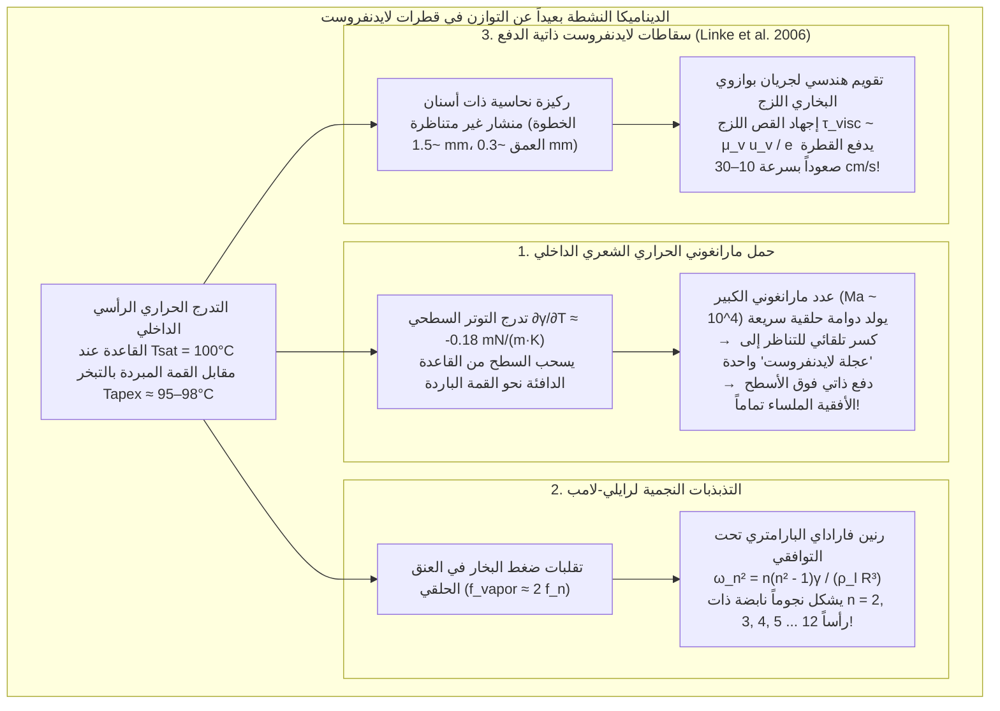

كل من اختبر يوماً درجة حرارة مقلاة من الحديد الزهر أو الفولاذ المقاوم للصدأ عبر رش بضع قطرات من الماء على سطحها قد شاهد إحدى أكثر المفارقات إثارة للدهشة في الفيزياء الحرارية. عندما تكون درجة حرارة سطح المقلاة أعلى بقليل من نقطة غليان الماء — أي بين $110^\circ\text{C}$ و$130^\circ\text{C}$ — فإن قطرة الماء الساقطة تنتشر فوراً عند الاصطدام، وتصدر فحيحاً عنيفاً، وتتبخر بالكامل في أقل من ثانية واحدة.

غير أننا إذا واصلنا تسخين المقلاة نفسها حتى تتجاوز درجة حرارتها $200^\circ\text{C}$ إلى $300^\circ\text{C}$، ينعكس سلوك الماء تماماً؛ إذ بدلاً من أن يتبخر في لحظة، ينكمش الماء على شكل كرة لامعة تشبه الزئبق، ولا يصدر أي صوت فحيح، ولا يبلل المعدن على الإطلاق، بل <strong>ينزلق ويتقافز في أنحاء المقلاة باحتكاك يكاد يساوي الصفر</strong>، ويظل حياً لمدة <strong>عدة دقائق</strong> — أي أطول بما يصل إلى مئة ضعف مقارنة بحالته عند $120^\circ\text{C}$!

هذه الظاهرة المناقضة للبداهة تُعرف باسم <strong>ظاهرة لايدنفروست (Leidenfrost effect)</strong>. ففوق عتبة حرارية حرجة تُسمى <strong>درجة حرارة لايدنفروست ($T_L$)</strong>، يتبخر الجزء السفلي من القطرة بسرعة هائلة عند اقترابه من السطح الساخن بحيث يولّد <strong>وسادة بخارية (طبقة بخار / vapor cushion)</strong> متصلة ومستدامة ذاتياً لا يتجاوز سمكها $10$ إلى $100\,\mu\text{m}$. وتؤدي هذه الطبقة المجهرية من البخار دورين في آن واحد: فهي تعمل هيدروديناميكياً كحوامة هوائية تحمل وزن القطرة بفضل ضغط التزييت اللزج دون أي تلامس بين الصلب والسائل، وتعمل حرارياً كعازل فائق لأن الموصلية الحرارية لبخار الماء ($\kappa_v \approx 0.03\,\text{W/(m}\cdot\text{K)}$) أقل بأكثر من عشرين مرة من الموصلية الحرارية للماء السائل ($\kappa_l \approx 0.68\,\text{W/(m}\cdot\text{K)}$).

في هذا المقال، نشتق فيزياء ظاهرة لايدنفروست بصرامة رياضية من المبادئ الأولى: بدءاً من <strong>رسالة يوهان غوتلوب لايدنفروست التاريخية عام 1756</strong> و<strong>منحنى الغليان لشيرو نوكياما (1934)</strong>، مروراً <strong>بالحد الهيدروديناميكي للتدفق الحراري الحرج (CHF) لنوفاك زوبر</strong> و<strong>التدفق الحراري الأدنى (MHF) لبول بيرينسون</strong>، وصولاً إلى الاشتقاق الرياضي <strong>لقانون تحجيم التزييت لبيانس وكلانيت وكيري (2003)</strong>، و<strong>دوامات مارانغوني الحرارية الشعرية الداخلية («عجلات لايدنفروست»)</strong>، و<strong>التذبذبات المضلعة النجمية لرايلي-لامب</strong>، و<strong>سقاطات هاينر لينكي ذاتية الدفع (2006)</strong>، والتطبيقات الصناعية الحاسمة في <strong>إخماد قلب المفاعل النووي أثناء حوادث فقدان المبرد (LOCA)</strong>.

---

## 1. «الكرة البلورية» فوق ملعقة الحديد المتوهجة: اكتشاف لايدنفروست (1756)

رغم أن الطبيب والكيميائي الهولندي هيرمان بورهيف أشار بإيجاز عام 1732 إلى سلوك الكحول فوق الحديد المتوهج، فإن أول دراسة تجريبية كمية نُشرت عام 1756 على يد الطبيب والفيلسوف الطبيعي الألماني <strong>يوهان غوتلوب لايدنفروست (Johann Gottlob Leidenfrost, 1715–1794)</strong> في جامعة دويسبورغ.

في أطروحته المكتوبة باللاتينية *De Aquae Communis Nonnullis Qualitatibus Tractatus* (*رسالة في بعض خواص الماء العادي*)، وصف لايدنفروست تجربته الشهيرة باستخدام ملعقة حديدية مسخنة على الجمر حتى التوهج الأحمر:

> «في هذه الملعقة المتوهجة، ألقِ قطرة واحدة من الماء العادي النقي... لا يلتصق الماء بالحديد ولا ينتشر؛ بل على العكس، ينكمش في لحظة التلامس فوراً ليشكل كرية كروية لامعة وشفافة مثل <strong>كرة بلورية</strong> (*globulus crystallinus*). وهي تدور بسرعة وترقص بخفة في قاع الملعقة بلا ضجيج ولا بخار مرئي. وبدلاً من أنتتلاشى على الفور، تتضاءل ببطء شديد على مدى ثلاثين أو أربعين ثانية — أو حتى دقيقة كاملة — إلى أن تختفي في النهاية ذرة متناهية الصغر مع طقطقة خافتة مسموعة.»

وبقياس عمر القطرات بواسطة بندول أثناء تبريد الملعقة تدريجياً، أثبت لايدنفروست أن معدل التبخر ينخفض فجأة فوق درجة حرارة حرجة بفضل طبقة رقيقة من البخار (*vaporis strato*). وفي عام 1842، أطلق الفيزيائي الفرنسي بيير هيبوليت بوتيني على هذا النظام اسم «الحالة الكروية» وتمكن حتى من تجميد الماء إلى جليد داخل بوتقة بلاتينية متوهجة باستخدام ثاني أكسيد الكبريت السائل في حالة لايدنفروست.

---

## 2. منحنى الغليان لشيرو نوكياما (1934) والأطوار الأربعة لغليان الحوض

```mermaid
flowchart TD
    subgraph BoilingCurve["منحنى الغليان لشيرو نوكياما (q'' مقابل فرط التسخين ΔTe = Tw - Tsat)"]
        R1["الطور I: غليان الحمل الطبيعي<br/>ΔTe < 5°C (Tw < 105°C)<br/>لا يوجد تنوي فقاعات؛ حمل طبيعي أحادي الطور<br/>q'' ∝ ΔTe^(5/4)"]
        R2["الطور II: الغليان النووي (Nucleate Boiling)<br/>5°C ≤ ΔTe ≤ 30°C (Tw = 105–130°C)<br/>تنوي كثيف للفقاعات في الفجوات المجهرية وتبخر الطبقة الدقيقة<br/>q'' ∝ ΔTe^3 (أقصى كفاءة تبريد)"]
        CHF["القمة: التدفق الحراري الحرج (CHF / DNB)<br/>ΔTe ≈ 30°C, q''_max ≈ 1.1–1.26 MW/m²<br/>الحد الهيدروديناميكي لزوبر (انهيار أعمدة البخار)"]
        R3["الطور III: الغليان الانتقالي<br/>30°C < ΔTe < 100–120°C<br/>غشاء بخاري جزئي غير مستقر وتبلل متقطع<br/>التدفق الحراري ينخفض مع ارتفاع الحرارة! (∂q''/∂ΔTe < 0)"]
        LP["القاع: نقطة لايدنفروست (MHF)<br/>ΔTe,L ≈ 93–120°C (Tw ≈ 193–220°C)<br/>q''_min ≈ 18–25 kW/m² (أقل بـ 50 مرة من CHF!)"]
        R4["الطور IV: الغليان الغشائي المستقر<br/>ΔTe ≥ ΔTe,L (Tw > 200°C)<br/>وسادة بخارية عازلة متصلة (κ_v ≈ 0.03 W/m·K)<br/>الإشعاع الحراري (∝ Tw^4) يضاف عند Tw > 500°C"]
    end

    R1 -->|"بداية الغليان النووي (ONB)"| R2
    R2 -->|"اندماج الفقاعات وأزمة الجريان المعاكس"| CHF
    CHF -->|"مسار التحكم في درجة الحرارة"| R3
    R3 -->|"استقرار كامل للغشاء البخاري"| LP
    LP -->|"طور الغليان الغشائي"| R4
    CHF -.->|"قفزة الاحتراق / Burnout عند التحكم في التدفق الحراري (ΔTw > +800°C)"| R4
```

لفهم سبب بقاء القطرة لعدة دقائق عند $250^\circ\text{C}$ بينما تختفي في أقل من ثانية عند $125^\circ\text{C}$، ندرس <strong>كثافة التدفق الحراري السطحي</strong> $q''$ $[\text{W/m}^2]$ كدالة في <strong>فرط التسخين الجداري (wall superheat)</strong> $\Delta T_e \equiv T_w - T_{\text{sat}}$ (حيث $T_{\text{sat}} = 100^\circ\text{C}$ للماء عند $1\,\text{atm}$)، وهو المنحنى الذي رسمه لأول مرة عام 1934 العالم الياباني <strong>شيرو نوكياما (Shiro Nukiyama)</strong> في جامعة توهوكو الإمبراطورية.

1. <strong>الطور I: غليان الحمل الطبيعي ($\Delta T_e < 5^\circ\text{C}$)</strong>: بسبب ضغط لابلاس $\Delta P = 2\gamma / r_c$، تحتاج نوى البخار داخل الفجوات المجهرية ذات نصف القطر $r_c$ إلى $\Delta T_e > \Delta T_{\text{ONB}} \approx \frac{2\gamma T_{\text{sat}}}{\rho_v L_{lv} r_c}$ لكي تنمو. ودون ذلك ينتقل الحرارة بالحمل الطبيعي أحادي الطور ($q'' \propto \Delta T_e^{5/4}$).
2. <strong>الطور II: الغليان النووي ($5^\circ\text{C} \le \Delta T_e \le 30^\circ\text{C}$) والتدفق الحراري الحرج (CHF) لزوبر</strong>: يؤدي تبخر الطبقة الميكروية تحت الفقاعات والتحريك الميكروي إلى زيادة التدفق الحراري مع مكعب فرط التسخين (علاقة روزيناو: $q'' \propto \Delta T_e^3$). وعند $\Delta T_e \approx 30^\circ\text{C}$ ($T_w \approx 130^\circ\text{C}$)، تندمج الفقاعات في أعمدة بخار متصلة. وفي عام 1958، جمع <strong>نوفاك زوبر (Novak Zuber)</strong> بين <strong>عدم استقرار رايلي-تايلور</strong> ($\lambda_{RT} = 2\pi\sqrt{3\gamma/[g(\rho_l - \rho_v)]}$) و<strong>عدم استقرار كلفن-هيلمهولتز</strong> لإثبات معادلة <strong>التدفق الحراري الحرج (CHF)</strong>:
   $$q''_{\max} = \frac{\pi}{24} \rho_v L_{lv} \left[ \frac{\gamma g (\rho_l - \rho_v)}{\rho_v^2} \right]^{1/4} \approx 0.131 \rho_v L_{lv} \left[ \frac{\gamma g (\rho_l - \rho_v)}{\rho_v^2} \right]^{1/4} \approx 1.1\text{–}1.26\,\text{MW/m}^2$$
   وعند التسخين الكهربائي لسلك بلاتيني، يؤدي بلوغ $q''_{\max}$ إلى قفزة لحظية في درجة الحرارة من $130^\circ\text{C}$ إلى أكثر من $1100^\circ\text{C}$ (<strong>أزمة الغليان / الاحتراق / burnout</strong>).
3. <strong>الطور III: الغليان الانتقالي ($30^\circ\text{C} < \Delta T_e < 100\text{–}120^\circ\text{C}$)</strong>: يغطي الجدار غشاء بخاري جزئي غير مستقر؛ وكلما ارتفعت $T_w$ زادت نسبة المساحة الجافة العازلة، مما يجعل <strong>التدفق الحراري ينخفض مع ارتفاع درجة الحرارة</strong> ($\partial q'' / \partial \Delta T_e < 0$).
4. <strong>الطور IV: الغليان الغشائي المستقر ونقطة لايدنفروست (MHF لبيرينسون)</strong>: عند <strong>نقطة لايدنفروست ($T_L \approx 193^\circ\text{C}\text{–}220^\circ\text{C}$)</strong> ينعدم التلامس بين الصلب والسائل تماماً. وفي عام 1961، اشتق <strong>بول بيرينسون (P. J. Berenson)</strong> معادلة التدفق الحراري الأدنى (MHF):
   $$q''_{\min} = 0.09 \rho_v L_{lv} \left[ \frac{\gamma g (\rho_l - \rho_v)}{(\rho_l + \rho_v)^2} \right]^{1/4} \approx 18\text{–}25\,\text{kW/m}^2$$
   وهي قيمة <strong>أقل بنحو 50 مرة</strong> من قمة الغليان النووي!

| طور الغليان | فرط التسخين $\Delta T_e = T_w - T_{\text{sat}}$ (الماء، $1\,\text{atm}$) | التدفق الحراري النموذجي $q''$ $[\text{W/m}^2]$ | الآلية الفيزيائية السائدة | سلوك وعمر القطرة $\tau$ فوق المقلاة |
| :--- | :--- | :--- | :--- | :--- |
| <strong>I. الحمل الطبيعي</strong> | $\Delta T_e < 5^\circ\text{C}$ ($T_w < 105^\circ\text{C}$) | $10^3 \text{–} 10^4$ | الفجوات غير نشطة؛ حمل أحادي الطور ($q'' \propto \Delta T_e^{5/4}$). | تبلل السطح وتتبخر بهدوء دون فقاعات خلال $30\text{–}120\,\text{s}$. |
| <strong>II. الغليان النووي</strong> | $5^\circ\text{C} \le \Delta T_e \le 30^\circ\text{C}$ ($T_w = 105\text{–}130^\circ\text{C}$) | $10^4 \text{–} 1.26 \times 10^6$ (قمة CHF) | تنوي فقاعات كثيف وتبخر الطبقة الدقيقة ($q'' \propto \Delta T_e^3$)؛ حد زوبر. | تصدر فحيحاً عنيفاً وتنتشر وتختفي خلال <strong>$0.3\text{–}1.5\,\text{s}$</strong>. |
| <strong>III. الغليان الانتقالي</strong> | $30^\circ\text{C} < \Delta T_e < 100^\circ\text{C}$ ($T_w = 130\text{–}200^\circ\text{C}$) | $1.2 \times 10^6 \to 2 \times 10^4$ ($\partial q''/\partial \Delta T_e < 0$) | تذبذب فوضوي بين الغشاء البخاري والتلامس الانفجاري. | تطقطق وتقفز وتقذف قطيرات دقيقة؛ تعيش $2\text{–}15\,\text{s}$. |
| <strong>IV. الغليان الغشائي (حالة لايدنفروست)</strong> | $\Delta T_e \ge \Delta T_L \approx 93\text{–}120^\circ\text{C}$ ($T_w \ge 193\text{–}220^\circ\text{C}$) | $2 \times 10^4 \to 10^5$ (قاع MHF) | طفو كامل فوق وسادة بخارية ($10\text{–}100\,\mu\text{m}$)؛ توصيل غازي بطيء. | كرة أو فطيرة سائلة بلا احتكاك ولا صوت؛ تعيش <strong>$60\text{–}300\,\text{s}$</strong>. |

---

## 3. الاستاتيكا الشعرية وقانون التحجيم الهيدروديناميكي للوسادة البخارية (Biance, Clanet, & Quéré 2003)

### 3.1 الطول الشعري $\ell_c$ ومورفولوجيا القطرات الطافية

مع زاوية تلامس ظاهرية $\theta_c = 180^\circ$، يحدد التوازن بين ضغط لابلاس الشعري ($\sim \gamma / R$) والضغط الهيدروستاتيكي ($\sim \rho_l g R$) <strong>الطول الشعري</strong> $\ell_c$:

$$\ell_c = \sqrt{\frac{\gamma}{\rho_l g}} \approx 2.50\,\text{mm} \quad (\text{الماء عند } 100^\circ\text{C})$$

واعتماداً على عدد بوند $\text{Bo} = (R/\ell_c)^2$، توجد ثلاثة أنظمة شكلية:
1. <strong>قطرات شبه كروية ($R < \ell_c \approx 2.5\,\text{mm}$)</strong>: كرات نصف قطرها $R$ ذات رقعة تلامس سفلية مسطحة صغيرة نصف قطرها $r_c = \sqrt{\frac{2}{3}}\frac{R^2}{\ell_c}$.
2. <strong>برك / فطائر لايدنفروست ($\ell_c < R < 4\ell_c$)</strong>: تفلطح الجاذبية القطرة إلى قرص بسمك كوني ثابت $h_p = 2\ell_c \sin(180^\circ/2) = 2\ell_c \approx 5.0\,\text{mm}$، مع جيب بخاري مقعر مركزي (*dimple*) محاط بعنق حلقي ضيق (*neck*).
3. <strong>مداخن بخار رايلي-تايلور ($R > R_{\max} \approx 3.83\ell_c \approx 9.6\,\text{mm}$)</strong>: عندما يتجاوز نصف القطر $R \approx 1\,\text{cm}$، تصبح الواجهة بين البخار والماء غير مستقرة وفق رايلي-تايلور، فتندفع فقاعات بخار كبيرة دورياً عبر مركز البركة (*vapor chimneys*).

### 3.2 اشتقاق سمك الفيلم البخاري $e$ وعمر القطرة $\tau$

في بحثهم الكلاسيكي عام 2003 (*Physics of Fluids*)، ربط <strong>آن-لور بيانس وكريستوف كلانيت وديفيد كيري</strong> بين توصيل فورييه الحراري ونظرية التزييت اللزج لبركة نصف قطرها $R > \ell_c$:

1. <strong>التوصيل الحراري لفورييه عبر السمك $e$</strong>:
   $$Q = \kappa_v \frac{\Delta T}{e} \pi R^2 = \dot{m} L_{lv} \quad \Longrightarrow \quad \dot{m} = \frac{\kappa_v \Delta T}{L_{lv} e} \pi R^2 \qquad \cdots (1)$$
2. <strong>نظرية التزييت اللزج (جريان بوازوي الشعاعي)</strong>:
   تعطي معادلة التزييت $\mu_v \frac{\partial^2 u_r}{\partial z^2} = \frac{dP}{dr}$ توزيع السرعة القطعي المكافئ $u_r(r,z) = \frac{1}{2\mu_v}\left(-\frac{dP}{dr}\right)z(e-z)$ والتدفق الحجمي $Q_v(r) = \frac{\pi r e^3}{6\mu_v}\left(-\frac{dP}{dr}\right) = \frac{\dot{m}}{\rho_v}\frac{r^2}{R^2}$. وبتكامل الضغط نحصل على متوسط الضغط الفائض في الوسادة:
   $$\Delta P_{\text{cushion}} = \frac{3 \mu_v \dot{m}}{2 \pi \rho_v e^3} \qquad \cdots (2)$$
3. <strong>التوازن الهيدروستاتيكي وقانون التحجيم $e \propto R^{1/2}$</strong>:
   بمساواة $\Delta P_{\text{cushion}}$ بالضغط الهيدروستاتيكي للبركة $\Delta P_{\text{weight}} = 2\rho_l g \ell_c$ وتعويض (1) في (2)، نحصل على <strong>قانون بيانس-كلانيت-كيري</strong>:
   $$e = \left(\frac{3}{4}\right)^{1/4} \left( \frac{\kappa_v \mu_v \Delta T}{\rho_v \rho_l g L_{lv} \ell_c} \right)^{1/4} R^{1/2} \approx 10\text{–}100\,\mu\text{m} \qquad \cdots (3)$$
   ولأجل $R = 5\,\text{mm}$ و$\Delta T = 200\,\text{K}$، نجد $e \approx 54\,\mu\text{m}$ (بينما للقطرات الصغيرة $R < \ell_c$ ينطبق $e_{\text{small}} \propto \Delta T^{1/4} R^{5/4}$). وبتكامل $-\frac{dM}{dt} = \dot{m} \propto R^{3/2}$ نحصل على $R(t) = R_0(1 - t/\tau)^2$ والعمر الكلي $\tau \propto \Delta T^{-3/4} R_0^{3/2}$ (أو $\tau \propto R_0^{5/4}$ إلى $R_0^2$).

---

## 4. دوامات مارانغوني الحرارية الشعرية، نجوم رايلي-لامب، وسقاطات لايدنفروست

### 4.1 حمل مارانغوني الحراري الشعري و«عجلات لايدنفروست»

يولّد فرق الحرارة بين القاعدة ($100^\circ\text{C}$) والقمة ($95\text{–}98^\circ\text{C}$)، عبر $\frac{\partial \gamma}{\partial T} \approx -0.18\,\text{mN/(m}\cdot\text{K)}$، إجهاد قص <strong>مارانغوني</strong> $\tau_s = \frac{\partial \gamma}{\partial T}\nabla_s T$ ($\text{Ma} = \frac{|\partial \gamma/\partial T|\Delta T_{\text{int}} R}{\mu_l \alpha_l} \sim 2 \times 10^4 \gg \text{Ma}_c$) يقضي تماماً على <strong>تأثير حلقة القهوة (*coffee-ring effect*)</strong>. وعلاوة على ذلك، اكتشف <strong>Bouillant, Quéré et al. (2018, *Nature Physics*)</strong> أنه عند $R \lesssim 1.5\,\text{mm}$ تكسر الدوامة الحلقية تناظرها تلقائياً لتشكل خلية دوارة واحدة (<strong>«عجلة لايدنفروست»</strong>) تميل الوسادة البخارية وتدفع القطرة ذاتياً فوق سطح أفقي تماماً!

### 4.2 التذبذبات المضلعة النجمية لرايلي-لامب

تطور البرك الكبيرة ($R \sim 5\text{–}15\,\text{mm}$) أمواجاً موقوفة سمتية على شكل مضلعات نجمية تخضع <strong>لعلاقة تفريق رايلي-لامب</strong>:

$$\omega_n^2 = \frac{n(n^2 - 1)\gamma}{\rho_l R^3} \qquad (n = 2, 3, 4, \dots, 12)$$

والتي تُستثار عبر <strong>رنين فاراداي البارامتري تحت التوافقي ($f_n = \frac{\omega_n}{2\pi} \approx \frac{1}{2} f_{\text{vapor}}$)</strong> بفعل نبضات ضغط البخار المتدفق من العنق.

### 4.3 سقاطات هاينر لينكي ذاتية الدفع (2006)

في عام 2006، أثبت <strong>هاينر لينكي وزملاؤه (Heiner Linke et al., *Phys. Rev. Lett.*)</strong> أنه فوق صفيحة ساخنة محفورة بأسنان منشار غير متناظرة (الخطوة $\sim 1.5\,\text{mm}$، العمق $\sim 0.3\,\text{mm}$)، تنطلق قطرات لايدنفروست ذاتياً بسرعة $10\text{–}30\,\text{cm/s}$ صاعدةً الدرجات الحادة: إذ يسد السطح الهلالي السفلي الدرجة الرأسية ويوجه جريان بوازوي البخاري للخلف على طول المنحدر اللطيف، مولداً برد الفعل قوة جر لزجة $F_{\text{ratchet}} \sim \frac{\mu_v u_{\text{vapor}}}{e}\pi R^2 \sim 30\,\mu\text{N}$.

---

## 5. التطبيقات الصناعية: أمان المفاعلات النووية (LOCA)، تقسية الفولاذ، والنيتروجين السائل

1. <strong>التبريد الطارئ للمفاعلات النووية عند حوادث فقدان المبرد (LOCA)</strong>:
   إذا تجاوز التدفق الحراري في غلاف الوقود المصنوع من الزيركالوي قيمة CHF، يقفز النظام إلى طور الغليان الغشائي للايدنفروست (الطور IV) وترتفع درجة الحرارة فوق $1000^\circ\text{C}$ خلال ثوانٍ. وعندما يضخ نظام التبريد الطارئ (ECCS) الماء، تطرده الوسادة البخارية ($T_w \gg T_L$) ولا تتقدم جبهة الإخماد (*quench front*) إلا عبر التوصيل الحراري المحوري داخل المعدن (نموذج يامانوتشي: $u_q \propto (T_L - T_{\text{sat}})/(T_{\text{init}} - T_L)$).
2. <strong>التقسية المعدنية للفولاذ (Quenching)</strong>:
   عند غمر الفولاذ الأوستنيتي ($850^\circ\text{C}$) في الماء، يؤخر غلاف بخار لايدنفروست الأولي التبريد حتى تنخفض الحرارة دون $T_L$، حيث يبدأ الغليان النووي بتكوين المارتنسيت. ويؤدي الانهيار غير المتجانس لطبقة البخار إلى التواء القطع و<strong>تشققات التقسية</strong>.
3. <strong>الأصابع المبللة في الرصاص المنصهر والنيتروجين السائل على الجلد</strong>:
   إن غمر إصبع مبلل بالماء لجزء من الثانية في الرصاص المنصهر عند $400^\circ\text{C}$ (<strong>خطير للغاية، لا تحاول تجربته أبداً!</strong>) يحميه تكون وسادة بخار الماء اللحظية؛ وبالمثل فإن <strong>النيتروجين السائل ($T_{\text{sat}} = 77\,\text{K} = -196^\circ\text{C}$)</strong> يرى جلد الإنسان الدافئ ($307\,\text{K}$، أي $\Delta T_e = 230\,\text{K}$) كمقلاة ملتهبة فيطفو وينزلق فوق وسادة من غاز النيتروجين.

---

## المراجع

1. <strong>Leidenfrost, J. G.</strong> (1756). *De Aquae Communis Nonnullis Qualitatibus Tractatus*. Duisburg.
2. <strong>Nukiyama, S.</strong> (1934). "The Maximum and Minimum Values of the Heat Transmitted from Metal to Boiling Water under Atmospheric Pressure". *J. Jpn. Soc. Mech. Eng.*, 37(206), 367–374.
3. <strong>Zuber, N.</strong> (1958). "On the stability of boiling heat transfer". *Trans. ASME*, 80(3), 711–720.
4. <strong>Berenson, P. J.</strong> (1961). "Film-boiling heat transfer from a horizontal surface". *J. Heat Transf.*, 83(3), 351–356.
5. <strong>Biance, A.-L., Clanet, C., & Quéré, D.</strong> (2003). "Leidenfrost drops". *Physics of Fluids*, 15(6), 1632–1637.
6. <strong>Linke, H., et al.</strong> (2006). "Self-Propelled Leidenfrost Droplets". *Physical Review Letters*, 96(15), 154502.
7. <strong>Quéré, D.</strong> (2013). "Leidenfrost Dynamics". *Annual Review of Fluid Mechanics*, 45, 197–215.
8. <strong>Bouillant, A., et al.</strong> (2018). "Leidenfrost wheels". *Nature Physics*, 14(12), 1188–1192.
