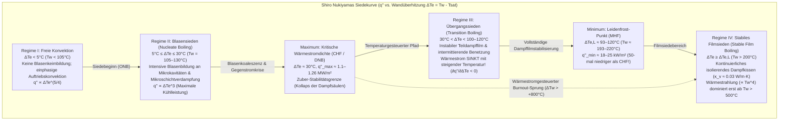
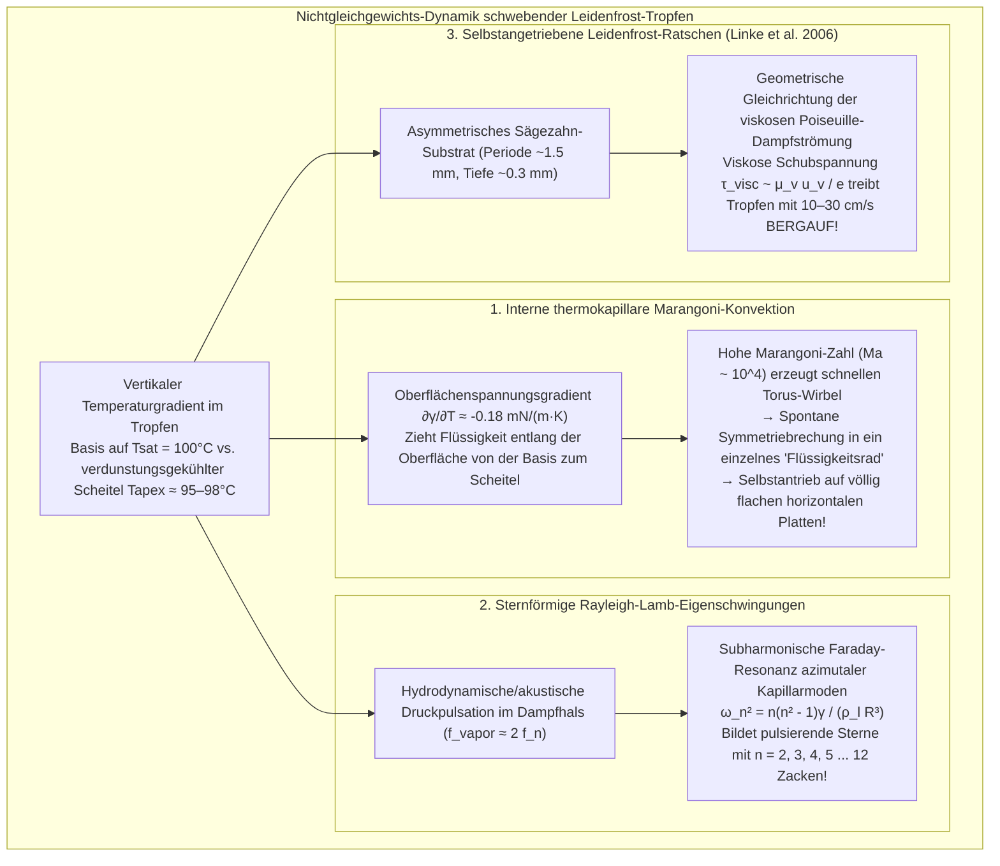

Jeder, der beim Kochen schon einmal ein paar Wassertropfen in eine heiße Eisen- oder Edelstahlpfanne gespritzt hat, um deren Temperatur zu prüfen, kennt dieses verblüffende Paradoxon der Thermodynamik. Liegt die Oberflächentemperatur der Pfanne nur knapp über dem Siedepunkt von Wasser – etwa bei $110^\circ\text{C}$ bis $130^\circ\text{C}$ –, breitet sich der auftreffende Wassertropfen augenblicklich aus, zischt heftig und verdampft in weniger als einer Sekunde restlos.

Erhitzt man dieselbe Pfanne jedoch weiter auf über $200^\circ\text{C}$ bis $300^\circ\text{C}$, kehrt sich das Verhalten vollständig um. Statt explosionsartig zu verdampfen, zieht sich das Wasser zu einer glänzenden, quecksilberartigen Kugel zusammen. Es zischt nicht mehr, benetzt das Metall überhaupt nicht, sondern <strong>gleitet nahezu reibungslos wie ein Luftkissenfahrzeug quer durch die Pfanne</strong> und überlebt dabei <strong>mehrere Minuten lang</strong> – bis zu hundertmal länger als bei $120^\circ\text{C}$!

Dieses kontraintuitive Phänomen ist der <strong>Leidenfrost-Effekt</strong>. Oberhalb einer kritischen Temperaturschwelle – der <strong>Leidenfrost-Temperatur ($T_L$)</strong> – bildet sich zwischen dem Flüssigkeitstropfen und dem heißen Substrat eine kontinuierliche, selbsttragende <strong>Dampfschicht (ein Dampfkissen / vapor cushion)</strong> von nur $10$ bis $100\,\mu\text{m}$ Dicke. Diese mikroskopische Wasserdampfschicht wirkt einerseits als hydrodynamisches Schmierpolster, das den Tropfen ohne jeden Fest-Flüssig-Kontakt in der Schwebe hält, und andererseits als hochwirksamer Wärmeisolator, da die Wärmeleitfähigkeit von Wasserdampf ($\kappa_v \approx 0.03\,\text{W/(m}\cdot\text{K)}$) mehr als zwanzigmal geringer ist als die von flüssigem Wasser ($\kappa_l \approx 0.68\,\text{W/(m}\cdot\text{K)}$).

In diesem Artikel analysieren wir die Physik des Leidenfrost-Effekts aus den Grundgleichungen der Hydrodynamik und Wärmeübertragung: von <strong>Johann Gottlob Leidenfrosts historischer Abhandlung aus dem Jahr 1756</strong> über <strong>Shiro Nukiyamas Siedekurve (1934)</strong>, <strong>Novak Zubers hydrodynamisches Limit der kritischen Wärmestromdichte (CHF)</strong> und <strong>Paul Berensons minimale Wärmestromdichte (MHF)</strong> bis zur exakten <strong>Schmierfilm-Skalierungstheorie von Biance, Clanet und Quéré (2003)</strong>, den internen <strong>thermokapillaren Marangoni-Wirbeln</strong>, den <strong>sternförmigen Rayleigh-Lamb-Eigenschwingungen</strong>, <strong>Heiner Linkes selbstangetriebenen Leidenfrost-Ratschen (2006)</strong> und der sicherheitskritischen Wiederbenetzung (Quenching) bei einem <strong>Kühlmittelverluststörfall (LOCA) im Kernreaktor</strong>.

---

## 1. Die „Kristallkugel“ auf dem glühenden Eisenlöffel: Johann Gottlob Leidenfrosts Entdeckung von 1756

Obwohl bereits Herman Boerhaave 1732 das Verhalten von Alkohol auf glühendem Eisen kurz erwähnte, stammt die erste systematische experimentelle und physikalische Untersuchung von dem deutschen Arzt und Naturphilosophen <strong>Johann Gottlob Leidenfrost (1715–1794)</strong>, Professor an der Universität Duisburg.

In seiner 1756 auf Latein verfassten Schrift *De Aquae Communis Nonnullis Qualitatibus Tractatus* (*Abhandlung über einige Eigenschaften des gemeinen Wassers*) beschrieb Leidenfrost sein berühmtes Experiment mit einem bis zur Rotglut erhitzten eisernen Löffel:

> „In diesen glühenden Löffel gebe man einen einzigen Tropfen reinen gemeinen Wassers ... Das Wasser haftet nicht am Eisen und breitet sich nicht aus; vielmehr zieht es sich im Augenblick der Berührung sofort zu einer kugelförmigen Perle zusammen, hell und durchsichtig wie ein <strong>Kristallglobus</strong> (*globulus crystallinus*). Es dreht sich rasch und tanzt mühelos auf dem Boden des Löffels umher, ohne Geräusch und ohne Dampf auszustoßen. Weit davon entfernt, sofort zu verschwinden, schrumpft es unmerklich über dreißig oder vierzig Sekunden – oder gar eine volle Minute –, bis schließlich ein winziges Teilchen mit einem leisen Knacken verschwindet.“

Leidenfrost maß mit einem Pendel die Lebensdauer der Tropfen bei sinkender Löffeltemperatur und erkannte, dass die Verdampfungsrate beim Unterschreiten einer kritischen Temperatur sprunghaft um Größenordnungen ansteigt. Im Jahr 1842 prägte der französische Physiker Pierre Hippolyte Boutigny hierfür den Begriff des „sphäroidalen Zustands“ (*état sphéroïdal*) und demonstrierte sogar das Gefrieren von Wasser zu Eis in einem rotglühenden Platintiegel mithilfe von flüssigem Schwefeldioxid im Leidenfrost-Zustand.

---

## 2. Shiro Nukiyamas Siedekurve (1934) und die vier Regime des Behältersiedens

Um zu verstehen, warum ein Tropfen bei $250^\circ\text{C}$ minutenlang überlebt, während er bei $125^\circ\text{C}$ in Sekundenbruchteilen verdampft, betrachten wir die <strong>Wärmestromdichte</strong> $q''$ $[\text{W/m}^2]$ als Funktion der <strong>Wandüberhitzung</strong> $\Delta T_e \equiv T_w - T_{\text{sat}}$ (mit der Wandtemperatur $T_w$ und der Sättigungstemperatur $T_{\text{sat}} = 100^\circ\text{C}$ bei $1\,\text{atm}$). Diese universelle <strong>Siedekurve</strong> wurde erstmals 1934 von <strong>Shiro Nukiyama</strong> an der Kaiserlichen Universität Tōhoku in Sendai vollständig vermessen.

1. <strong>Regime I: Freie Konvektion ($\Delta T_e < 5^\circ\text{C}$)</strong>: Wegen des Laplace-Drucks $\Delta P = 2\gamma / r_c$ können Dampfkeime in Oberflächenporen vom Radius $r_c$ erst ab der Überhitzung $\Delta T_{\text{ONB}} \approx \frac{2\gamma T_{\text{sat}}}{\rho_v L_{lv} r_c}$ wachsen. Darunter erfolgt der Wärmetransport rein einphasig ($q'' \propto \Delta T_e^{5/4}$).
2. <strong>Regime II: Blasensieden ($5^\circ\text{C} \le \Delta T_e \le 30^\circ\text{C}$) und Zubers Kritische Wärmestromdichte (CHF)</strong>: Oberhalb des Siedebeginns (ONB) wächst die Wärmestromdichte durch Mikroschichtverdampfung und Rührwirkung der ablösenden Blasen gemäß der Rohsenow-Korrelation mit der dritten Potenz: $q'' \propto \Delta T_e^3$. Bei $\Delta T_e \approx 30^\circ\text{C}$ ($T_w \approx 130^\circ\text{C}$) verschmelzen die Blasen zu Dampfsäulen. <strong>Novak Zuber (1958)</strong> zeigte durch Kopplung der <strong>Rayleigh-Taylor-Instabilität</strong> ($\lambda_{RT} = 2\pi\sqrt{3\gamma/[g(\rho_l - \rho_v)]}$) mit der <strong>Kelvin-Helmholtz-Instabilität</strong> der aufsteigenden Dampfjets, dass die maximale Wärmestromdichte (<strong>Critical Heat Flux, CHF</strong>) rein hydrodynamisch begrenzt ist:
   $$q''_{\max} = \frac{\pi}{24} \rho_v L_{lv} \left[ \frac{\gamma g (\rho_l - \rho_v)}{\rho_v^2} \right]^{1/4} \approx 0.131 \rho_v L_{lv} \left[ \frac{\gamma g (\rho_l - \rho_v)}{\rho_v^2} \right]^{1/4} \approx 1.1\text{–}1.26\,\text{MW/m}^2$$
   Bei stromgesteuerter Heizung führt das Erreichen von $q''_{\max}$ zum sofortigen Temperatursprung auf über $1000^\circ\text{C}$ (<strong>Burnout</strong>).
3. <strong>Regime III: Übergangssieden ($30^\circ\text{C} < \Delta T_e < 100\text{–}120^\circ\text{C}$)</strong>: Instabile Dampfblasenfragmente bedecken Teile der Wand. Mit steigender Temperatur wächst der trockene Wandanteil, sodass der Wärmestrom bei steigender Temperatur <strong>abfällt</strong> ($\partial q'' / \partial \Delta T_e < 0$, negative differentielle Wärmeleitfähigkeit).
4. <strong>Regime IV: Stabiles Filmsieden und der Leidenfrost-Punkt (Berensons MHF)</strong>: Ab der <strong>Leidenfrost-Temperatur $T_L \approx 193^\circ\text{C}\text{–}220^\circ\text{C}$</strong> bricht der Fest-Flüssig-Kontakt völlig ab. Am Minimum der Siedekurve – dem <strong>Leidenfrost-Punkt</strong> – gilt nach <strong>Paul J. Berenson (1961)</strong> für die minimale Wärmestromdichte (MHF):
   $$q''_{\min} = 0.09 \rho_v L_{lv} \left[ \frac{\gamma g (\rho_l - \rho_v)}{(\rho_l + \rho_v)^2} \right]^{1/4} \approx 18\text{–}25\,\text{kW/m}^2$$
   Da $q''_{\min}$ rund 50-mal kleiner ist als $q''_{\max}$ und die Wärmeleitfähigkeit des Dampfes ($\kappa_v \approx 0.03\,\text{W/(m}\cdot\text{K)}$) extrem niedrig liegt, wird der Tropfen thermisch isoliert.

| Siederegime | Wandüberhitzung $\Delta T_e = T_w - T_{\text{sat}}$ (Wasser, $1\,\text{atm}$) | Typische Wärmestromdichte $q''$ $[\text{W/m}^2]$ | Dominanter Mechanismus | Verhalten & Lebensdauer $\tau$ eines Tropfens in der Pfanne |
| :--- | :--- | :--- | :--- | :--- |
| <strong>I. Freie Konvektion</strong> | $\Delta T_e < 5^\circ\text{C}$ ($T_w < 105^\circ\text{C}$) | $10^3 \text{–} 10^4$ | Keine Blasenbildung; einphasige Konvektion ($q'' \propto \Delta T_e^{5/4}$). | Benetzt die Fläche; verdampft ruhig ohne Blasen in $30\text{–}120\,\text{s}$. |
| <strong>II. Blasensieden</strong> | $5^\circ\text{C} \le \Delta T_e \le 30^\circ\text{C}$ ($T_w = 105\text{–}130^\circ\text{C}$) | $10^4 \text{–} 1.26 \times 10^6$ (Maximum bei CHF) | Intensive Keimbildung & Mikroschichtverdampfung ($q'' \propto \Delta T_e^3$); Zuber-Limit. | Zischt heftig, breitet sich aus und verdampft in <strong>$0.3\text{–}1.5\,\text{s}$</strong>. |
| <strong>III. Übergangssieden</strong> | $30^\circ\text{C} < \Delta T_e < 100^\circ\text{C}$ ($T_w = 130\text{–}200^\circ\text{C}$) | $1.2 \times 10^6 \to 2 \times 10^4$ ($\partial q''/\partial \Delta T_e < 0$) | Chaotischer Wechsel zwischen Dampffilm und explosivem Wandkontakt. | Zerspratzt heftig in feine Sekundärtropfen; lebt $2\text{–}15\,\text{s}$. |
| <strong>IV. Stabiles Filmsieden (Leidenfrost-Zustand)</strong> | $\Delta T_e \ge \Delta T_L \approx 93\text{–}120^\circ\text{C}$ ($T_w \ge 193\text{–}220^\circ\text{C}$) | $2 \times 10^4 \to 10^5$ (Minimum bei MHF) | Vollständige Schwebe auf $10\text{–}100\,\mu\text{m}$ Dampfkissen; langsame Gaswärmeleitung. | Bildet reibungslose Kugel oder Pfannkuchen; gleitet <strong>$60\text{–}300\,\text{s}$</strong> lang. |

---

## 3. Kapillarstatik und die Schmierfilm-Skalierung des Dampfkissens (Biance, Clanet, & Quéré 2003)

### 3.1 Kapillarlänge $\ell_c$ und Tropfenmorphologie

Ein schwebender Leidenfrost-Tropfen besitzt einen scheinbaren Kontaktwinkel von $\theta_c = 180^\circ$. Das Gleichgewicht zwischen dem krümmungsgetriebenen Laplace-Druck ($\sim \gamma / R$) und dem hydrostatischen Schweredruck ($\sim \rho_l g R$) definiert die <strong>Kapillarlänge</strong> $\ell_c$:

$$\ell_c = \sqrt{\frac{\gamma}{\rho_l g}} \approx 2.50\,\text{mm} \quad (\text{für siedendes Wasser bei } 100^\circ\text{C})$$

Abhängig von der Bond-Zahl $\text{Bo} = (R/\ell_c)^2$ durchläuft der Tropfen drei Regime:
1. <strong>Quasi-kugelförmige Tropfen ($R < \ell_c \approx 2.5\,\text{mm}$)</strong>: Der Tropfen bleibt fast kugelförmig mit einer kleinen abgeplatteten Bodenfläche vom Radius $r_c = \sqrt{\frac{2}{3}}\frac{R^2}{\ell_c}$.
2. <strong>Leidenfrost-Pfützen / Flüssigkeits-Pfannkuchen ($\ell_c < R < 4\ell_c$)</strong>: Die Schwerkraft drückt den Tropfen zu einer flachen Scheibe mit der universellen Gleichgewichtsdicke $h_p = 2\ell_c \sin(180^\circ/2) = 2\ell_c \approx 5.0\,\text{mm}$. Die Unterseite wölbt sich mittig zu einer konkaven Dampftasche (*dimple*), die von einem engen ringförmigen Hals (*neck*) nahe dem Rand umschlossen wird.
3. <strong>Rayleigh-Taylor-Dampfschornsteine ($R > R_{\max} \approx 3.83\ell_c \approx 9.6\,\text{mm}$)</strong>: Überschreitet der Pfützenradius ca. $1\,\text{cm}$, wird die Dampftasche unter dem schweren Wasser Rayleigh-Taylor-instabil, und Dampfblasen brechen periodisch als „Schornsteine“ (*vapor chimneys*) durch die Tropfenmitte nach oben durch.

### 3.2 Herleitung der Dampffilmdicke $e$ und der Lebensdauer $\tau$

Im Jahr 2003 leiteten <strong>Anne-Laure Biance, Christophe Clanet und David Quéré</strong> (*Physics of Fluids*) die exakte Skalierung der Dampfkissendicke $e$ für eine Pfütze vom Radius $R > \ell_c$ her:

1. <strong>Fouriersche Wärmeleitung durch den Dampffilm</strong>:
   Der Wärmestrom $Q = \kappa_v \frac{\Delta T}{e} \pi R^2$ über die Gasschicht der Dicke $e$ liefert über $Q = \dot{m} L_{lv}$ den Massenstrom des erzeugten Dampfes:
   $$\dot{m} = \frac{\kappa_v \Delta T}{L_{lv} e} \pi R^2 \qquad \cdots (1)$$
2. <strong>Viskose Schmierfilmtheorie (radiale Poiseuille-Strömung)</strong>:
   Da $e \ll R$ gilt, folgt die radiale Ausströmung der Schmierfilmgleichung $\mu_v \frac{\partial^2 u_r}{\partial z^2} = \frac{dP}{dr}$ mit dem parabolischen Geschwindigkeitsprofil $u_r(r,z) = \frac{1}{2\mu_v}\left(-\frac{dP}{dr}\right)z(e-z)$. Die Integration über die Spalthöhe $e$ liefert den Volumenstrom $Q_v(r) = \frac{\pi r e^3}{6\mu_v}\left(-\frac{dP}{dr}\right) = \frac{\dot{m}}{\rho_v}\frac{r^2}{R^2}$. Durch Integration über $r$ erhält man den mittleren Schmierfilmdruck im Dampfkissen:
   $$\Delta P_{\text{cushion}} = \frac{3 \mu_v \dot{m}}{2 \pi \rho_v e^3} \qquad \cdots (2)$$
3. <strong>Hydrostatisches Kräftegleichgewicht</strong>:
   Im Gleichgewicht trägt $\Delta P_{\text{cushion}}$ genau den hydrostatischen Druck der Pfütze der Dicke $2\ell_c$, also $\Delta P_{\text{weight}} = 2\rho_l g \ell_c$. Einsetzen von Gleichung (1) in (2) ergibt sofort das <strong>Biance-Clanet-Quéré-Skalierungsgesetz</strong>:
   $$e = \left(\frac{3}{4}\right)^{1/4} \left( \frac{\kappa_v \mu_v \Delta T}{\rho_v \rho_l g L_{lv} \ell_c} \right)^{1/4} R^{1/2} \approx 10\text{–}100\,\mu\text{m} \qquad \cdots (3)$$
   Für $R = 5\,\text{mm}$ und $\Delta T = 200\,\text{K}$ ergibt sich $e \approx 54\,\mu\text{m}$ (für kleine Kugeltropfen $R < \ell_c$ gilt hingegen $e_{\text{small}} \propto \Delta T^{1/4} R^{5/4}$). Die Integration der Massenabnahme $-\frac{dM}{dt} = \dot{m} \propto R^{3/2}$ führt auf $R(t) = R_0(1 - t/\tau)^2$ und die Lebensdauerskalierung $\tau \propto \Delta T^{-3/4} R_0^{3/2}$ (bzw. $\tau \propto R_0^{5/4}$ bis $R_0^2$ im Übergangsbereich).

---

## 4. Thermokapillare Marangoni-Wirbel, Stern-Oszillationen und Leidenfrost-Ratschen

### 4.1 Thermokapillare Marangoni-Wirbel und „Leidenfrost-Räder“

Da die Tropfenbasis Siedetemperatur ($100^\circ\text{C}$) besitzt, während der obere Scheitelpunkt durch Verdunstung auf $95\text{–}98^\circ\text{C}$ abkühlt, entsteht durch $\frac{\partial \gamma}{\partial T} \approx -0.18\,\text{mN/(m}\cdot\text{K)}$ eine tangentiale <strong>Marangoni-Schubspannung</strong> $\tau_s = \frac{\partial \gamma}{\partial T}\nabla_s T$ (Marangoni-Zahl $\text{Ma} = \frac{|\partial \gamma/\partial T|\Delta T_{\text{int}} R}{\mu_l \alpha_l} \sim 2 \times 10^4 \gg \text{Ma}_c$). Diese starke interne Zirkulation verhindert den <strong>Kaffeering-Effekt</strong> bei trocknenden Nanopartikelsuspensionen vollständig. Zudem zeigten <strong>Bouillant, Quéré et al. (2018)</strong> in *Nature Physics*, dass der achsensymmetrische Torus-Wirbel bei kleinen Tropfen ($R \lesssim 1.5\,\text{mm}$) spontan seine Symmetrie bricht und in eine einzelne rotierende Walze übergeht: Dieses <strong>„Leidenfrost-Rad“</strong> neigt das Dampfkissen leicht und treibt den Tropfen selbst auf perfekt horizontalen Oberflächen von allein an!

### 4.2 Sternförmige Rayleigh-Lamb-Eigenschwingungen

Größere Leidenfrost-Pfützen ($R \sim 5\text{–}15\,\text{mm}$) beginnen oft spontan zu pulsieren und nehmen die Form regelmäßiger Sterne (Dreiecke, Quadrate, Pentagramme bis hin zu $n=12$-Sternen) an. Ihre Eigenfrequenz folgt der <strong>Rayleigh-Lamb-Dispersionsrelation</strong> für azimutale Kapillarwellen:

$$\omega_n^2 = \frac{n(n^2 - 1)\gamma}{\rho_l R^3} \qquad (n = 2, 3, 4, \dots, 12)$$

Angeregt werden diese Moden durch Druckpulsationen des ausströmenden Dampfkissens mit der Frequenz $f_{\text{vapor}}$ über eine <strong>subharmonische parametrische Faraday-Resonanz ($f_n = \frac{\omega_n}{2\pi} \approx \frac{1}{2} f_{\text{vapor}}$)</strong>.

### 4.3 Heiner Linkes Leidenfrost-Ratschen (2006)

<strong>Heiner Linke et al. (2006)</strong> zeigten in *Physical Review Letters*, dass Leidenfrost-Tropfen auf einer heißen Messingplatte mit asymmetrischem Sägezahnprofil (Periode $\sim 1.5\,\text{mm}$, Tiefe $\sim 0.3\,\text{mm}$) ohne äußere Kraft mit $10\text{–}30\,\text{cm/s}$ <strong>in Richtung der steilen Zahnflanken (und sogar schiefe Ebenen hinauf!)</strong> rasen. Die Tropfenunterseite hängt leicht in die Sägezahntäler durch und blockiert die steilen Stufen, sodass der abströmende Poiseuille-Dampf entlang der flachen Rampen nach hinten gleichgerichtet wird. Die viskose Schubspannung $\tau_{\text{visc}} \sim \mu_v u_{\text{vapor}} / e$ erzeugt eine Schubkraft $F_{\text{ratchet}} \sim 30\,\mu\text{N}$, die den reibungsfreien Tropfen vorwärtstreibt.

---

## 5. Industrielle Anwendungen: Reaktorsicherheit (LOCA), Stahlhärten und flüssiger Stickstoff

1. <strong>Kernreaktor-Kühlmittelverluststörfall (LOCA) und Quench-Front-Ausbreitung</strong>:
   Im Normalbetrieb arbeiten Druck- und Siedewasserreaktoren im Bereich des Blasensiedens (Regime II) unterhalb von CHF ($\text{MDNBR} > 1.3$). Überschreitet die Wärmestromdichte bei einem Störfall CHF, springt die Zircaloy-Brennstabhülle sofort in das stabile Filmsieden (Regime IV / Leidenfrost-Zustand), wodurch die Hüllrohrtemperatur binnen Sekunden auf über $1000^\circ\text{C}$ eskaliert (Zirkonium-Wasserdampf-Oxidation mit Wasserstoffbildung). Beim Fluten des Kerns durch das Notkühlsystem (ECCS) perlt das Wasser an den überhitzten Brennstäben ($T_w \gg T_L$) ab; die Wiederbenetzung schreitet nur entlang einer schmalen <strong>Quench-Front</strong> voran, deren Geschwindigkeit durch axiale Wärmeleitung in der Hülle begrenzt ist (Yamanouchi-Modell: $u_q \propto (T_L - T_{\text{sat}})/(T_{\text{init}} - T_L)$). Mikro-/nanoporöse hydrophile Beschichtungen zur Erhöhung von CHF und $T_L$ sind daher ein zentrales Forschungsfeld der Kerntechnik.
2. <strong>Metallurgisches Abschrecken von Stahl (Quenching)</strong>:
   Beim Eintauchen von $850^\circ\text{C}$ heißem Austenit-Stahl in Wasser bildet sich zuerst ein isolierender Leidenfrost-Dampfmantel (langsame Abkühlung), bevor unterhalb von $T_L$ starkes Blasensieden einsetzt und die gewünschte harte Martensit-Struktur erzeugt. Ein ungleichmäßiger Zusammenbruch des Dampfmantels führt zu Verzug und <strong>Härterissen</strong>, weshalb Salzlösungen, Polymere oder starke Umwälzung eingesetzt werden.
3. <strong>Nasse Finger in flüssigem Blei & flüssiger Stickstoff auf der Haut</strong>:
   Ein angefeuchteter Finger kann für den Bruchteil einer Sekunde in $400^\circ\text{C}$ heißes geschmolzenes Blei getaucht werden (<strong>extrem gefährlich, niemals nachahmen!</strong>), weil das Wasser auf der Haut sofort ein schützendes Leidenfrost-Dampfkissen bildet. Umgekehrt befindet sich menschliche Haut ($307\,\text{K}$) gegenüber <strong>flüssigem Stickstoff ($\text{LN}_2$, Siedepunkt $77\,\text{K} = -196^\circ\text{C}$)</strong> auf einer Überhitzung von $\Delta T_e = 230\,\text{K} \gg \Delta T_L$, sodass $\text{LN}_2$-Tropfen auf bloßer Haut sofort auf einem Stickstoffgaskissen abperlen.

---

## Literaturverzeichnis

1. <strong>Leidenfrost, J. G.</strong> (1756). *De Aquae Communis Nonnullis Qualitatibus Tractatus*. Duisburg.
2. <strong>Nukiyama, S.</strong> (1934). "The Maximum and Minimum Values of the Heat Transmitted from Metal to Boiling Water under Atmospheric Pressure". *J. Jpn. Soc. Mech. Eng.*, 37(206), 367–374.
3. <strong>Zuber, N.</strong> (1958). "On the stability of boiling heat transfer". *Trans. ASME*, 80(3), 711–720.
4. <strong>Berenson, P. J.</strong> (1961). "Film-boiling heat transfer from a horizontal surface". *J. Heat Transf.*, 83(3), 351–356.
5. <strong>Biance, A.-L., Clanet, C., & Quéré, D.</strong> (2003). "Leidenfrost drops". *Physics of Fluids*, 15(6), 1632–1637.
6. <strong>Linke, H., et al.</strong> (2006). "Self-Propelled Leidenfrost Droplets". *Physical Review Letters*, 96(15), 154502.
7. <strong>Quéré, D.</strong> (2013). "Leidenfrost Dynamics". *Annual Review of Fluid Mechanics*, 45, 197–215.
8. <strong>Bouillant, A., et al.</strong> (2018). "Leidenfrost wheels". *Nature Physics*, 14(12), 1188–1192.
