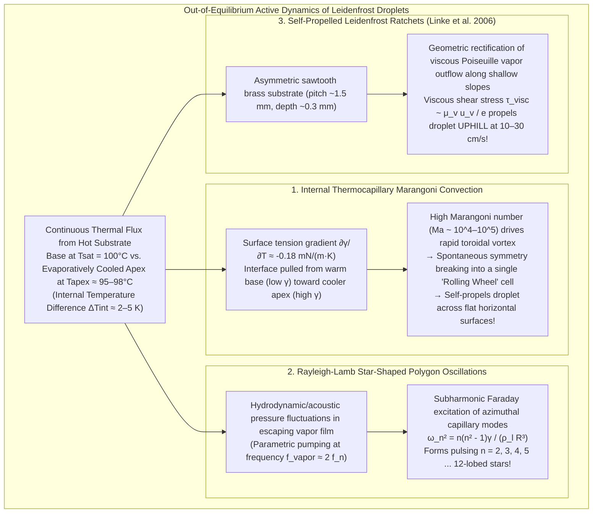

Anyone who has ever tested the readiness of a cast-iron or stainless-steel skillet by flicking a few drops of water onto its surface has witnessed one of the most counterintuitive phenomena in classical physics. When the pan's surface temperature sits just above the boiling point of water—say, at $110^\circ\text{C}$ to $130^\circ\text{C}$—a falling water droplet spreads instantly upon impact, hisses violently, and boils away into nothingness in less than a single second.

Yet if you leave that same skillet over the burner until its temperature climbs past $200^\circ\text{C}$ to $300^\circ\text{C}$, the behavior of the water reverses completely. Instead of flashing into steam, the droplet pulls itself into a glistening, quicksilver-like bead. It makes no hissing sound. It does not wet the metal at all. Instead, it <strong>skitters effortlessly across the pan with virtually zero friction</strong>, bouncing off the rim like a billiard ball on an air-hockey table, and survives for <strong>several minutes</strong>—up to a hundred times longer than it did at $120^\circ\text{C}$.

Why does raising the temperature of a metal plate dramatically *slow down* the evaporation of water? The answer lies in the <strong>Leidenfrost effect</strong>: above a critical threshold known as the <strong>Leidenfrost temperature ($T_L$)</strong>, the bottom of the droplet vaporizes so rapidly upon approaching the hot substrate that it generates a continuous, self-sustaining <strong>vapor cushion (vapor film)</strong> only $10$ to $100\,\mu\text{m}$ thick. This microscopic layer of steam acts simultaneously as a hydrodynamic hovercraft—supporting the droplet's weight via viscous lubrication pressure without any solid-liquid contact—and as a potent thermal insulator whose thermal conductivity ($\kappa_v \approx 0.03\,\text{W/(m}\cdot\text{K)}$) is more than twenty times lower than that of liquid water.

In this comprehensive article, we trace the physics of the Leidenfrost effect from its 18th-century discovery to the frontiers of modern non-equilibrium fluid mechanics and nuclear safety engineering. We examine <strong>Johann Gottlob Leidenfrost's 1756 treatise</strong>, derive the four regimes of <strong>Shiro Nukiyama's 1934 boiling curve</strong> alongside <strong>Novak Zuber's hydrodynamic limit for Critical Heat Flux (CHF)</strong> and <strong>Paul Berenson's Minimum Heat Flux (MHF)</strong>, solve the coupled Fourier-Poiseuille lubrication equations of <strong>Biance, Clanet, and Quéré (2003)</strong> to obtain the exact $R^{1/2}$ scaling of the vapor film thickness, and explore the remarkable active-matter dynamics of levitated droplets: internal <strong>thermocapillary Marangoni vortices</strong> that break symmetry to roll droplets like wheels, <strong>Rayleigh-Lamb star-shaped polygon oscillations</strong>, <strong>Heiner Linke's self-propelled Leidenfrost ratchets</strong> that climb uphill sawtooth grooves, and the life-or-death engineering of <strong>nuclear reactor Loss-of-Coolant Accident (LOCA) quenching</strong>.

---

## 1. The "Crystal Globe" on a Red-Hot Spoon: Johann Gottlob Leidenfrost's 1756 Treatise

While the Dutch physician and chemist Herman Boerhaave briefly noted in his 1732 *Elementa Chemiae* that alcohol dropped onto red-hot iron forms a rolling globule rather than igniting immediately, the first rigorous experimental investigation of this phenomenon was carried out in 1756 by the German physician and natural philosopher <strong>Johann Gottlob Leidenfrost (1715–1794)</strong> at the University of Duisburg.

In his Latin monograph *De Aquae Communis Nonnullis Qualitatibus Tractatus* (*A Tract About Some Qualities of Common Water*), Leidenfrost described a deceptively simple experiment using a well-polished iron spoon heated over glowing coals until it was red-hot:

> "Into this glowing spoon, send a single drop of pure common water... The water does not adhere to the iron, nor does it spread out; instead, at the very instant of touch, it contracts into a spherical globule, bright and transparent like a <strong>crystal globe</strong> (*globulus crystallinus*). It rotates swiftly and dances effortlessly around the bottom of the spoon without making noise or throwing off steam. Far from vanishing immediately, it diminishes imperceptibly over thirty or forty seconds—or even a full minute—until at last an exceedingly minute particle vanishes with a faint audible crack."

Leidenfrost went further than mere qualitative observation: he used a pendulum to time the survival duration of fixed-volume droplets as the iron spoon gradually cooled. He discovered that as the spoon cooled from glowing red heat down toward moderate temperatures, the droplet lifetime decreased steadily until, at a specific threshold temperature, the water suddenly wet the iron, erupted into violent boiling with a loud hiss, and evaporated in less than one second. Even before modern thermometry and the kinetic theory of gases existed, Leidenfrost correctly deduced that at extreme temperatures a thin, invisible layer of vapor (*vaporis strato*) separates the liquid globe from the glowing metal, preventing direct contact.

In the 1840s, the French physicist Pierre Hippolyte Boutigny popularized this phenomenon across European academies under the name <strong>"the spheroidal state" (*l'état sphéroïdal*)</strong>, famously demonstrating that liquid sulfur dioxide ($\text{SO}_2$, boiling point $-10^\circ\text{C}$) poured into a red-hot platinum crucible enters the Leidenfrost state so effectively that if water is poured into the levitated $\text{SO}_2$ drop, the water freezes into a lump of ice inside a glowing furnace! Yet a complete quantitative explanation of how heat transfer varies across the entire temperature spectrum had to await a landmark experiment in 1930s Japan.

---

## 2. Shiro Nukiyama's 1934 Boiling Curve and the Four Regimes of Pool Boiling

To understand why a droplet survives for minutes at $250^\circ\text{C}$ while vanishing in under a second at $125^\circ\text{C}$, we must examine how the <strong>surface heat flux</strong> $q''$ $[\text{W/m}^2]$—the thermal power transferred per unit area from a heated solid wall at temperature $T_w$ into a liquid at its saturation (boiling) temperature $T_{\text{sat}}$—depends on the <strong>wall superheat (excess temperature)</strong>:

$$\Delta T_e \equiv T_w - T_{\text{sat}}$$

For water at standard atmospheric pressure ($P = 1\,\text{atm} = 101.325\,\text{kPa}$), $T_{\text{sat}} = 100^\circ\text{C}$ ($373.15\,\text{K}$). In ordinary single-phase heat transfer without phase change, Newton's law of cooling dictates that $q'' = h \Delta T_e$ increases monotonically with $\Delta T_e$. When boiling occurs, however, the relationship between $\log_{10} q''$ and $\log_{10} \Delta T_e$ becomes violently non-monotonic.

```mermaid
flowchart TD
    subgraph BoilingCurve["Shiro Nukiyama's Boiling Curve (q'' vs. Wall Superheat ΔTe = Tw - Tsat)"]
        R1["Regime I: Natural Convection Boiling<br/>ΔTe < 5°C (Tw < 105°C)<br/>No bubble nucleation; single-phase buoyant convection<br/>q'' ∝ ΔTe^(5/4)"]
        R2["Regime II: Nucleate Boiling<br/>5°C ≤ ΔTe ≤ 30°C (Tw = 105–130°C)<br/>Rapid bubble nucleation at micro-cavities & microlayer evaporation<br/>q'' ∝ ΔTe^3 (Maximum cooling efficiency)"]
        CHF["Peak: Critical Heat Flux (CHF / DNB)<br/>ΔTe ≈ 30°C, q''_max ≈ 1.1–1.26 MW/m²<br/>Zuber Hydrodynamic Limit (vapor column Helmholtz collapse)"]
        R3["Regime III: Transition Boiling<br/>30°C < ΔTe < 100–120°C<br/>Unstable partial vapor blanketing & intermittent wetting<br/>Heat flux FALLS as temperature rises! (∂q''/∂ΔTe < 0)"]
        LP["Minimum: Leidenfrost Point (MHF)<br/>ΔTe,L ≈ 93–120°C (Tw ≈ 193–220°C)<br/>q''_min ≈ 18–25 kW/m² (50x lower than CHF!)"]
        R4["Regime IV: Stable Film Boiling<br/>ΔTe ≥ ΔTe,L (Tw > 200°C)<br/>Continuous insulating vapor cushion (κ_v ≈ 0.03 W/m·K)<br/>Thermal radiation (∝ Tw^4) adds at Tw > 500°C"]
    end

    R1 -->|"Onset of Nucleate Boiling (ONB)"| R2
    R2 -->|"Bubble coalescence & counter-flow crisis"| CHF
    CHF -->|"Temperature-controlled path"| R3
    R3 -->|"Complete vapor film stabilization"| LP
    LP -->|"Film boiling regime"| R4
    CHF -.->|"Heat-flux-controlled burnout jump (ΔTw > +800°C)"| R4
```

This universal curve—known today in every heat-transfer textbook as the <strong>Boiling Curve</strong>—was first mapped in 1934 by <strong>Shiro Nukiyama (1896–1983)</strong>, a professor of mechanical engineering at Tohoku Imperial University in Sendai, Japan, in his seminal paper *The Maximum and Minimum Values of the Heat Transmitted from Metal to Boiling Water under Atmospheric Pressure*.

Let us examine the physics governing each of the four regimes of pool boiling in detail.

### 2.1 Regime I: Natural Convection Boiling ($\Delta T_e < 5^\circ\text{C}$)

When the wall superheat is very small ($\Delta T_e < 5^\circ\text{C}$, or $100^\circ\text{C} < T_w < 105^\circ\text{C}$), the liquid water immediately adjacent to the solid surface is slightly superheated, yet no vapor bubbles form on the wall. Why? Because a microscopic vapor embryo trapped inside a surface crevice of mouth radius $r_c$ experiences an inward squeezing <strong>Laplace pressure</strong> $\Delta P = 2\gamma / r_c$ due to surface tension $\gamma$. By the Clausius-Clapeyron relation $\frac{dP}{dT} = \frac{\rho_v L_{lv}}{T_{\text{sat}}}$, a bubble nucleus cannot grow unless the wall superheat exceeds the nucleation threshold:

$$\Delta T_{\text{ONB}} \approx \frac{2 \gamma T_{\text{sat}}}{\rho_v L_{lv} r_c}$$

Here $\rho_v \approx 0.598\,\text{kg/m}^3$ is the saturated vapor density and $L_{lv} \approx 2.257 \times 10^6\,\text{J/kg}$ is the latent heat of vaporization. For typical machined metal surfaces with micro-cavities of radius $r_c \sim 5\text{–}10\,\mu\text{m}$, $\Delta T_{\text{ONB}}$ is around $3^\circ\text{C}$ to $5^\circ\text{C}$. Below this threshold, superheated liquid simply rises by buoyancy to the free surface and evaporates quietly, following single-phase natural convection scaling ($q'' \propto \Delta T_e^{5/4}$ for laminar boundary layers or $\Delta T_e^{4/3}$ for turbulent plumes).

### 2.2 Regime II: Nucleate Boiling ($5^\circ\text{C} \le \Delta T_e \le 30^\circ\text{C}$) and Zuber's Critical Heat Flux (CHF)

Once $\Delta T_e$ surpasses $\approx 5^\circ\text{C}$—the <strong>Onset of Nucleate Boiling (ONB)</strong>—vapor bubbles begin nucleating at discrete micro-cavities across the heated surface. As $\Delta T_e$ increases from $5^\circ\text{C}$ to $30^\circ\text{C}$ ($T_w = 105^\circ\text{C}\text{–}130^\circ\text{C}$), smaller and smaller cavities become activated according to $r_c \propto \Delta T_e^{-1}$, causing the active nucleation site density $n_a$ to surge by orders of magnitude.

This <strong>Nucleate Boiling regime</strong> is the most efficient mode of heat transfer known in engineering. Two synergistic mechanisms drive the heat flux skyward:
1. <strong>Transient microlayer evaporation</strong>: As each vapor bubble expands rapidly against the solid wall, it traps an ultra-thin wedge of liquid—the *microlayer* (thickness $\delta_m \sim 1\text{–}5\,\mu\text{m}$)—beneath its base, which evaporates almost instantaneously at enormous local heat fluxes.
2. <strong>Micro-convective wake agitation</strong>: When the bubble detaches at the Fritz departure diameter $D_b \sim \sqrt{\gamma / [g(\rho_l - \rho_v)]}$, cooler bulk liquid rushes in violently to sweep and quench the dry spot left behind.

According to the classic correlation derived by Warren M. Rohsenow (1952), the heat flux in nucleate boiling scales with the <strong>cube of the wall superheat</strong>:

$$q''_{\text{nucleate}} = \mu_l L_{lv} \left[ \frac{g(\rho_l - \rho_v)}{\gamma} \right]^{1/2} \left( \frac{c_{p,l} \Delta T_e}{C_{sf} L_{lv} \text{Pr}_l^n} \right)^3 \propto \Delta T_e^3$$

where $\mu_l$, $c_{p,l}$, and $\text{Pr}_l = \mu_l c_{p,l} / \kappa_l$ are the dynamic viscosity, specific heat, and Prandtl number of the liquid, and $C_{sf} \approx 0.006\text{–}0.013$ is an empirical surface-fluid coefficient. Because $q''$ grows as $\Delta T_e^3$, a modest $25^\circ\text{C}$ superheat drives the heat transfer coefficient above $h \sim 40,000\,\text{W/(m}^2\cdot\text{K)}$. When you drop water onto a pan at $125^\circ\text{C}$, it lands squarely near the peak of Regime II—explaining why it hisses violently and disappears in a fraction of a second!

However, nucleate boiling hits a catastrophic hydrodynamic wall at $\Delta T_e \approx 30^\circ\text{C}$ ($T_w \approx 130^\circ\text{C}$). At this point, the bubble generation frequency is so high that individual rising bubbles merge vertically into continuous <strong>vapor jets (columns)</strong> escaping upward, while liquid water must flow downward between the vapor columns to replenish the surface. This counter-current gas-liquid flow reaches a limit known as the <strong>Critical Heat Flux (CHF)</strong>, or <strong>Departure from Nucleate Boiling (DNB)</strong>.

In a celebrated 1958 paper, <strong>Novak Zuber</strong> proved that the CHF is governed purely by two coupled hydrodynamic instabilities at the vapor-liquid interface:
1. <strong>Rayleigh-Taylor instability</strong>: Because dense liquid ($\rho_l$) sits atop light vapor ($\rho_v$) in a gravitational field $g$, the interface breaks into a periodic square array of rising vapor jets spaced by the fastest-growing Rayleigh-Taylor wavelength:
   $$\lambda_{RT} = 2\pi \sqrt{\frac{3\gamma}{g(\rho_l - \rho_v)}}$$
2. <strong>Kelvin-Helmholtz instability</strong>: As vapor rushes upward through jets of radius $R_{\text{jet}} = \lambda_{RT}/4$ at velocity $u_v$, the relative shear across the cylindrical interface triggers Kelvin-Helmholtz waves of wavelength $\lambda_{KH} = 2\pi R_{\text{jet}}$. The vapor columns become hydrodynamically unstable and collapse—choking off the downward liquid supply—when the upward vapor velocity reaches the Kelvin-Helmholtz critical speed:
   $$u_{v,\text{crit}} = \left[ \frac{2\pi \gamma}{\rho_v \lambda_{KH}} \left( \frac{\rho_l}{\rho_l + \rho_v} \right) \right]^{1/2} \sim \left[ \frac{\gamma g (\rho_l - \rho_v)}{\rho_v^2} \right]^{1/4}$$

Multiplying the mass flux of escaping vapor ($\rho_v u_{v,\text{crit}}$ multiplied by the jet area fraction $\frac{\pi R_{\text{jet}}^2}{\lambda_{RT}^2} = \frac{\pi}{16}$) by the latent heat $L_{lv}$, Zuber obtained his famous analytical formula for the <strong>Critical Heat Flux</strong>:

$$q''_{\max} = C_{\text{Zuber}} \rho_v L_{lv} \left[ \frac{\gamma g (\rho_l - \rho_v)}{\rho_v^2} \right]^{1/4}, \qquad C_{\text{Zuber}} = \frac{\pi}{24} \approx 0.131$$

Substituting the physical properties of saturated water at $1\,\text{atm}$ ($\rho_l = 958.4\,\text{kg/m}^3$, $\rho_v = 0.598\,\text{kg/m}^3$, $L_{lv} = 2.257 \times 10^6\,\text{J/kg}$, $\gamma = 0.0589\,\text{N/m}$, $g = 9.81\,\text{m/s}^2$) yields:

$$q''_{\max} \approx 0.131 \times 0.598 \times (2.257 \times 10^6) \times \left[ \frac{0.0589 \times 9.81 \times 957.8}{(0.598)^2} \right]^{1/4} \approx 1.10\text{–}1.26\,\text{MW/m}^2$$

That is over <strong>one megawatt per square meter</strong>—comparable to the heat flux at the nozzle throat of a rocket engine!

In Nukiyama's original 1934 apparatus, he heated a submerged platinum wire electrically by gradually increasing the current $I$ (thereby controlling the heat flux $q'' = I^2 R_e / A$ directly). The moment $q''$ reached $q''_{\max}$, the wire could no longer shed heat via nucleate boiling; its temperature jumped instantaneously along the horizontal dashed line in the diagram from $130^\circ\text{C}$ to over $1100^\circ\text{C}$, often melting the wire in what engineers call <strong>boiling crisis or burnout</strong>. Only by switching to a temperature-controlled heating system (such as condensing high-pressure steam inside a copper tube) was it possible to trace the descending branch of the curve.

### 2.3 Regime III: Transition Boiling ($30^\circ\text{C} < \Delta T_e < 100\text{–}120^\circ\text{C}$)

Between the Critical Heat Flux ($\Delta T_e \approx 30^\circ\text{C}$) and the Leidenfrost point ($\Delta T_e \approx 100\text{–}120^\circ\text{C}$) lies the chaotic <strong>Transition Boiling (or unstable film boiling) regime</strong>. Here, the heated surface is partially blanketed by an unstable, shifting patchwork of vapor. Wherever liquid momentarily touches the superheated metal, an explosive micro-burst of vapor blasts the liquid back off the wall.

The defining thermodynamic signature of Regime III is that <strong>as the wall temperature $T_w$ increases, the time-averaged fraction of the surface covered by insulating dry vapor increases, causing the net heat flux $q''$ to decrease rapidly with increasing temperature</strong>:

$$\frac{\partial q''}{\partial \Delta T_e} < 0 \quad (\text{Negative Differential Thermal Conductance})$$

Just like negative differential resistance in a tunnel diode, this negative slope makes Regime III dynamically unstable under constant-heat-flux boundary conditions, explaining the hysteretic jump between nucleate and film boiling.

### 2.4 Regime IV: Stable Film Boiling and the Leidenfrost Point (Berenson's Minimum Heat Flux)

When the wall superheat reaches the <strong>Leidenfrost threshold $\Delta T_{e,L} = T_L - T_{\text{sat}}$</strong> (typically $T_L \approx 193^\circ\text{C}\text{–}220^\circ\text{C}$ for water on smooth, high-conductivity metals like polished brass, aluminum, or copper), the momentum and pressure of the evaporating vapor finally become sufficient to prevent any liquid waves from ever touching the solid crests. Solid-liquid contact drops to zero.

At this exact boundary—the <strong>Leidenfrost Point</strong>—the boiling curve hits its local minimum, known as the <strong>Minimum Heat Flux (MHF, $q''_{\min}$)</strong>. In 1961, <strong>Paul J. Berenson</strong> analyzed the Rayleigh-Taylor instability of a continuous horizontal vapor film beneath a liquid pool, calculating the minimum rate of vapor generation required to replenish the vapor bubbles detaching Periodically at nodes spaced by $\lambda_{RT}$. Berenson derived the celebrated formula for the Minimum Heat Flux at the Leidenfrost point:

$$q''_{\min} = C_{\text{Berenson}} \rho_v L_{lv} \left[ \frac{\gamma g (\rho_l - \rho_v)}{(\rho_l + \rho_v)^2} \right]^{1/4}, \qquad C_{\text{Berenson}} \approx 0.09$$

Evaluating Berenson's equation for atmospheric water gives $q''_{\min} \approx 18\text{–}25\,\text{kW/m}^2$. Compare this with $q''_{\max} \approx 1,200\,\text{kW/m}^2$: <strong>at the Leidenfrost point, the heat flux drops to roughly $1/50$ (less than $2\%$) of its value at the peak of nucleate boiling!</strong>

Once inside <strong>Regime IV (Stable Film Boiling)</strong>, heat must traverse the continuous vapor blanket via molecular thermal conduction across the gas layer (supplemented by Bromley film-boiling convection $h_{\text{conv}} \propto [\kappa_v^3 \rho_v (\rho_l - \rho_v) g L_{lv} / (\mu_v \Delta T_e \lambda_{RT})]^{1/4}$) and, at very high temperatures ($T_w > 500^\circ\text{C}$), thermal radiation $q''_{\text{rad}} = \varepsilon_{\text{eff}} \sigma_{SB} (T_w^4 - T_{\text{sat}}^4)$. Because water vapor has a thermal conductivity of only $\kappa_v \approx 0.025\text{–}0.033\,\text{W/(m}\cdot\text{K)}$—more than <strong>20 times lower</strong> than liquid water ($\kappa_l \approx 0.68\,\text{W/(m}\cdot\text{K)}$)—the vapor cushion acts as a phenomenal fiberglass-like thermal shield.

The table below summarizes the quantitative characteristics of all four regimes of Nukiyama's boiling curve for water at $1\,\text{atm}$.

| Boiling Regime | Wall Superheat $\Delta T_e = T_w - T_{\text{sat}}$ (Water, $1\,\text{atm}$) | Typical Heat Flux $q''$ $[\text{W/m}^2]$ | Dominant Heat Transfer & Hydrodynamic Mechanism | Behavior & Lifetime $\tau$ of a Skillet Water Droplet |
| :--- | :--- | :--- | :--- | :--- |
| <strong>I. Natural Convection</strong> | $\Delta T_e < 5^\circ\text{C}$ ($T_w < 105^\circ\text{C}$) | $10^3 \text{–} 10^4$ | Cavities unactivated ($\Delta T_e < \Delta T_{\text{ONB}}$); single-phase buoyant convection ($q'' \propto \Delta T_e^{5/4}$) and quiet free-surface evaporation. | Spreads into a sessile lens; evaporates quietly without bubbling over $30\text{–}120\,\text{s}$. |
| <strong>II. Nucleate Boiling</strong> | $5^\circ\text{C} \le \Delta T_e \le 30^\circ\text{C}$ ($T_w = 105\text{–}130^\circ\text{C}$) | $10^4 \text{–} 1.26 \times 10^6$ (Peak at CHF) | Intense bubble nucleation at micro-cavities, microlayer evaporation ($q'' \propto \Delta T_e^3$), culminating in Zuber's Helmholtz vapor-jet collapse at CHF. | Spreads, hisses violently, and boils away completely in <strong>$0.3\text{–}1.5\,\text{s}$</strong>. |
| <strong>III. Transition Boiling</strong> | $30^\circ\text{C} < \Delta T_e < 100^\circ\text{C}$ ($T_w = 130\text{–}200^\circ\text{C}$) | $1.2 \times 10^6 \to 2 \times 10^4$ ($\partial q''/\partial \Delta T_e < 0$) | Chaotic oscillation between partial vapor blanketing and explosive intermittent solid-liquid contact. | Sputters, crackles, and violently ejects secondary micro-droplets; survives $2\text{–}15\,\text{s}$. |
| <strong>IV. Stable Film Boiling (Leidenfrost State)</strong> | $\Delta T_e \ge \Delta T_L \approx 93\text{–}120^\circ\text{C}$ ($T_w \ge 193\text{–}220^\circ\text{C}$) | $2 \times 10^4 \to 10^5$ (Minimum at MHF) | Complete non-wetting levitation on a continuous $10\text{–}100\,\mu\text{m}$ vapor cushion; heat transfer limited by slow gas conduction ($\kappa_v \ll \kappa_l$). | Forms a silent, frictionless sphere or pancake; glides around for <strong>$60\text{–}300\,\text{s}$</strong>. |

---

## 3. Capillary Statics of Levitated Droplets: Spheres, Pancakes, and Vapor Chimneys

Before deriving the fluid dynamics of the vapor cushion, we must determine the equilibrium shape of the liquid drop sitting on top of it. Because the vapor film completely eliminates solid-liquid contact, a Leidenfrost droplet behaves statical-mechanically like a liquid drop resting on a perfectly non-wetting substrate with an apparent contact angle of exactly $\theta_c = 180^\circ$.

### 3.1 The Capillary Length $\ell_c$ and Bond Number $\text{Bo}$

The morphology of any non-wetting droplet is governed by the competition between two pressures:
1. <strong>Laplace pressure</strong> $\Delta P_{\text{Laplace}} \sim \gamma / R$, which strives to pull the droplet into a sphere of radius $R$ to minimize surface area.
2. <strong>Hydrostatic pressure</strong> $\Delta P_{\text{hydro}} \sim \rho_l g R$, which strives to flatten the droplet under its own weight.

Equating these two pressures defines the fundamental length scale of capillarity—the <strong>capillary length</strong> $\ell_c$:

$$\frac{\gamma}{\ell_c} = \rho_l g \ell_c \quad \Longrightarrow \quad \ell_c = \sqrt{\frac{\gamma}{\rho_l g}}$$

For boiling water at $T_{\text{sat}} = 100^\circ\text{C}$ ($\gamma = 58.9\,\text{mN/m}$, $\rho_l = 958.4\,\text{kg/m}^3$, $g = 9.81\,\text{m/s}^2$), the capillary length is:

$$\ell_c = \sqrt{\frac{0.0589}{958.4 \times 9.81}} \approx 2.50 \times 10^{-3}\,\text{m} = 2.50\,\text{mm}$$

The dimensionless ratio of gravitational to capillary forces for a droplet of equatorial radius $R$ is the <strong>Bond number</strong>:

$$\text{Bo} \equiv \frac{\rho_l g R^2}{\gamma} = \left( \frac{R}{\ell_c} \right)^2$$

Depending on the value of $R / \ell_c$, a Leidenfrost droplet adopts one of three distinct morphological states:

### 3.2 Regime 1: Quasi-Spherical Droplets ($R < \ell_c$, $\text{Bo} < 1$)

When the droplet radius $R$ is smaller than $\ell_c \approx 2.5\,\text{mm}$, surface tension dominates gravity. The droplet remains nearly a perfect sphere of radius $R$, except at its very bottom where gravity flattens a small circular contact patch of radius $r_c$ against the vapor cushion.

We can calculate $r_c$ by balancing the total weight of the sphere, $M g = \frac{4}{3}\pi R^3 \rho_l g$, against the internal Laplace pressure $\Delta P = \frac{2\gamma}{R}$ acting over the flat circular patch area $\pi r_c^2$:

$$\pi r_c^2 \left( \frac{2\gamma}{R} \right) = \frac{4}{3}\pi R^3 \rho_l g \quad \Longrightarrow \quad r_c = \sqrt{\frac{2}{3}} \frac{R^2}{\ell_c} \approx 0.816 \frac{R^2}{\ell_c}$$

Notice that for small droplets ($R \ll \ell_c$), the contact patch radius $r_c$ scales as $R^2 / \ell_c$ and is much smaller than the droplet radius $R$ itself (e.g., for $R = 1.0\,\text{mm}$, $r_c \approx 0.33\,\text{mm}$).

### 3.3 Regime 2: Gravitationally Flattened "Leidenfrost Puddles" ($\ell_c < R < 4\ell_c$)

When you pipette more water onto the skillet so that $R > \ell_c \approx 2.5\,\text{mm}$ ($\text{Bo} > 1$), gravity crushes the sphere into a flat disk with rounded edges—a <strong>Leidenfrost puddle (pancake)</strong>.

What is the thickness $h_p$ of this liquid pancake? By balancing the vertically integrated hydrostatic force per unit perimeter length pushing outward on the puddle edge, $\int_0^{h_p} \rho_l g z\,dz = \frac{1}{2}\rho_l g h_p^2$, against the inward horizontal pull of surface tension at the top and bottom surfaces, $\gamma (1 - \cos\theta_c)\big|_{\theta_c = 180^\circ} = 2\gamma$, we obtain a celebrated exact result due to Pierre-Gilles de Gennes:

$$\frac{1}{2} \rho_l g h_p^2 = 2\gamma \quad \Longrightarrow \quad h_p = 2\sqrt{\frac{\gamma}{\rho_l g}} = 2\ell_c \approx 5.0\,\text{mm}$$

Regardless of how much water you add, a Leidenfrost puddle on a flat skillet never grows taller than <strong>$2\ell_c \approx 5.0\,\text{mm}$</strong>; adding more volume simply increases its horizontal radius $R$.

Furthermore, high-resolution laser interferometry and X-ray imaging reveal that the bottom interface of a Leidenfrost puddle is not flat: the upward lubrication pressure of the trapped steam pushes the center of the bottom surface upward into a concave dome—a <strong>central vapor pocket (dimple)</strong> $100\text{–}300\,\mu\text{m}$ deep—surrounded near the outer perimeter ($r \approx R$) by a narrow annular ring where the vapor gap reaches its minimum thickness $e_{\text{neck}}$. Just like an amphibious hovercraft with a flexible peripheral skirt, the droplet traps a deep reservoir of pressurized steam under its belly that leaks out through the narrow annular neck!

### 3.4 Regime 3: Rayleigh-Taylor Vapor Chimneys ($R > R_{\max} \approx 4\ell_c$)

What happens if you keep adding water so that the puddle radius $R$ exceeds roughly $1\,\text{cm}$? Suddenly, the center of the puddle bulges upward and a large <strong>vapor bubble (vapor chimney)</strong> erupts right through the middle of the liquid disk!

This eruption is driven by the <strong>Rayleigh-Taylor instability</strong> of the inverted density interface at the bottom of the puddle, where dense water ($\rho_l = 958\,\text{kg/m}^3$) rests atop light steam ($\rho_v = 0.6\,\text{kg/m}^3$). While surface tension stabilizes perturbations of small wavelength, once the puddle radius $R$ exceeds the critical cutoff radius set by the first zero of the Bessel function $J_0(k R)$ ($k_c R_{\max} \approx 3.8317$, where $k_c = \sqrt{(\rho_l - \rho_v)g / \gamma} \approx 1/\ell_c$):

$$R_{\max} \approx 3.8317\,\ell_c \approx 9.6\,\text{mm}$$

capillarity can no longer suppress the buoyancy of the underlying vapor pocket. The central dimple grows uncontrollably upward until it punctures the upper surface of the puddle, forming a periodic volcano-like chimney that vents excess steam vertically.

---

## 4. Fluid Mechanics and Scaling Law of the Vapor Cushion (Biance, Clanet, & Quéré 2003)

We now arrive at the central mathematical problem of the Leidenfrost effect: <strong>How thick is the vapor cushion $e$, and how does $e$ scale with the droplet radius $R$, the substrate superheat $\Delta T = T_w - T_{\text{sat}}$, and the fluid properties?</strong>

In a landmark 2003 paper published in *Physics of Fluids*, <strong>Anne-Laure Biance, Christophe Clanet, and David Quéré</strong> solved this problem by coupling <strong>Fourier's law of heat conduction</strong> across the vapor film with <strong>viscous lubrication theory (Poiseuille radial squeezing flow)</strong> and hydrostatic pressure balance. Let us derive their classic scaling laws from first principles.

### 4.1 Step 1: Fourier Heat Conduction and the Evaporation Mass Flux $\dot{m}$

Consider a Leidenfrost puddle of radius $R$ ($\ell_c < R < 4\ell_c$, base area $A = \pi R^2$ and thickness $h_p = 2\ell_c$) floating above a flat substrate at temperature $T_w$ separated by a vapor layer of characteristic thickness $e \ll R$. Because the lower interface of the droplet is undergoing phase change at atmospheric pressure, its temperature is pinned at the saturation temperature $T_{\text{sat}} = 100^\circ\text{C}$.

Since the vapor gap $e \sim 10\text{–}100\,\mu\text{m}$ is minuscule, the Rayleigh number inside the gas film is vanishingly small ($\text{Ra}_e \ll 1$), meaning buoyancy-driven convection within the vapor film is completely absent. For moderate superheats ($T_w \lesssim 400^\circ\text{C}$), radiative heat transfer $q''_{\text{rad}} = \varepsilon \sigma_{SB}(T_w^4 - T_{\text{sat}}^4)$ is less than $5\%$ of conductive heat transfer. Thus, thermal energy crosses the vapor gap purely via <strong>Fourier thermal conduction</strong>:

$$Q = \kappa_v \frac{T_w - T_{\text{sat}}}{e} \pi R^2 = \kappa_v \frac{\Delta T}{e} \pi R^2$$

where $\kappa_v$ is the thermal conductivity of the vapor evaluated at the mean film temperature $T_m = (T_w + T_{\text{sat}})/2$.

Because the bulk droplet is already at $T_{\text{sat}}$, all of this conducted thermal power $Q$ is consumed as latent heat of vaporization $L_{lv}$ to produce new steam at mass rate $\dot{m} = -\frac{dM}{dt}$ $[\text{kg/s}]$:

$$Q = \dot{m} L_{lv} \quad \Longrightarrow \quad \dot{m} = \frac{\kappa_v \Delta T}{L_{lv} e} \pi R^2 \qquad \cdots (1)$$

Equation (1) expresses the <strong>thermal production rate of vapor</strong>: notice that $\dot{m} \propto e^{-1}$. If the droplet sinks closer to the plate ($e$ decreases), heat conduction intensifies and generates more steam to push it back up!

### 4.2 Step 2: Viscous Lubrication Theory (Radial Poiseuille Outflow)

To remain in steady state, the mass rate $\dot{m}$ of steam generated beneath the droplet must escape radially outward through the narrow gap of height $e$ to the ambient atmosphere at $r = R$.

Because the aspect ratio is tiny ($e / R \sim 10^{-2} \ll 1$) and the film Reynolds number is small ($\text{Re}_e = \frac{\rho_v u_r e}{\mu_v} \frac{e}{R} \ll 1$), the Navier-Stokes equations inside the vapor cushion reduce to the classic <strong>lubrication equation</strong> in cylindrical coordinates $(r, z)$:

$$\mu_v \frac{\partial^2 u_r}{\partial z^2} = \frac{dP}{dr}, \qquad \frac{\partial P}{\partial z} = 0$$

where $\mu_v$ is the dynamic viscosity of the vapor. Imposing no-slip boundary conditions at the stationary solid plate ($u_r(r, 0) = 0$) and at the liquid-vapor interface ($u_r(r, e) \approx 0$, valid since $\mu_l \gg \mu_v$), integration with respect to $z$ yields the parabolic <strong>Hagen-Poiseuille velocity profile</strong>:

$$u_r(r, z) = \frac{1}{2\mu_v} \left( -\frac{dP}{dr} \right) z (e - z)$$

Integrating $u_r(r, z)$ across the gap from $z = 0$ to $z = e$ and multiplying by the circumference $2\pi r$ gives the volumetric outflow rate $Q_v(r)$ $[\text{m}^3/\text{s}]$ at radius $r$:

$$Q_v(r) = 2\pi r \int_0^e u_r(r, z)\,dz = \frac{\pi r e^3}{6\mu_v} \left( -\frac{dP}{dr} \right)$$

By mass conservation, the volumetric flow of vapor crossing radius $r$ equals the vapor volume generated inside the disk of radius $r$: $Q_v(r) = \frac{\dot{m}}{\rho_v} \frac{r^2}{R^2}$. Equating these two expressions determines the radial pressure gradient:

$$\frac{\pi r e^3}{6\mu_v} \left( -\frac{dP}{dr} \right) = \frac{\dot{m}}{\rho_v} \frac{r^2}{R^2} \quad \Longrightarrow \quad -\frac{dP}{dr} = \frac{6 \mu_v \dot{m}}{\pi \rho_v R^2 e^3} r$$

Integrating from $r$ to the outer edge $r = R$ (where $P(R) = P_0$ is atmospheric pressure) yields the parabolic lubrication pressure distribution inside the vapor cushion:

$$P(r) - P_0 = \frac{3 \mu_v \dot{m}}{\pi \rho_v R^2 e^3} (R^2 - r^2)$$

Integrating this overpressure over the entire base area $\pi R^2$ gives the total upward lubrication lift force $F_{\text{lift}}$, and dividing by $\pi R^2$ gives the mean cushion overpressure $\Delta P_{\text{cushion}}$:

$$\Delta P_{\text{cushion}} = \frac{1}{\pi R^2} \int_0^R \big( P(r) - P_0 \big) 2\pi r\,dr = \frac{3 \mu_v \dot{m}}{2 \pi \rho_v e^3} \qquad \cdots (2)$$

Equation (2) expresses the <strong>hydrodynamic drainage law</strong>: for a given mass evaporation rate $\dot{m}$, the supporting pressure scales inversely with the <strong>cube of the film thickness</strong> ($\Delta P_{\text{cushion}} \propto e^{-3}$).

### 4.3 Step 3: Coupling Conduction and Lubrication to Solve for Film Thickness $e$

For a levitated puddle of thickness $h_p = 2\ell_c$, mechanical equilibrium requires that the upward lubrication overpressure $\Delta P_{\text{cushion}}$ exactly balance the downward hydrostatic pressure of the liquid pancake, $\Delta P_{\text{weight}} = \rho_l g h_p = 2 \rho_l g \ell_c$:

$$\Delta P_{\text{cushion}} = \frac{3 \mu_v \dot{m}}{2 \pi \rho_v e^3} = 2 \rho_l g \ell_c$$

Now substitute the Fourier conduction evaporation rate $\dot{m} = \frac{\kappa_v \Delta T}{L_{lv} e} \pi R^2$ from Equation (1) into this pressure balance:

$$\frac{3 \mu_v}{2 \pi \rho_v e^3} \left( \frac{\kappa_v \Delta T}{L_{lv} e} \pi R^2 \right) = 2 \rho_l g \ell_c$$

Solving for $e^4$ and taking the fourth root yields the celebrated <strong>Biance-Clanet-Quéré scaling law for the Leidenfrost vapor cushion thickness</strong>:

$$e = \left( \frac{3}{4} \right)^{1/4} \left( \frac{\kappa_v \mu_v \Delta T}{\rho_v \rho_l g L_{lv} \ell_c} \right)^{1/4} R^{1/2} \sim \left( \frac{\kappa_v \mu_v \Delta T}{\rho_v \rho_l g L_{lv} \ell_c} \right)^{1/4} R^{1/2} \qquad \cdots (3)$$

Let us pause to appreciate the physics encoded in Equation (3):
- <strong>Every single physical mechanism is represented inside the fourth root</strong>: thermal conduction ($\kappa_v \Delta T$), viscous lubrication resistance ($\mu_v$), vapor density and latent heat ($\rho_v L_{lv}$), and capillary-gravitational hydrostatic pressure ($\rho_l g \ell_c$).
- <strong>Weak $\Delta T^{1/4}$ temperature dependence</strong>: Because thefourth power $e^4$ appears in the coupled conduction-lubrication balance ($e^1$ from Fourier conduction times $e^3$ from Poiseuille flow), doubling the superheat $\Delta T$ from $100\,\text{K}$ to $200\,\text{K}$ increases the vapor gap thickness by only $2^{1/4} - 1 \approx 19\%$.
- <strong>Square-root $R^{1/2}$ radius dependence</strong>: Larger puddles require steam to travel a longer radial path $R$ before escaping, building up higher lubrication pressure and lifting the droplet higher ($e \propto R^{1/2}$). For a water puddle of radius $R = 5\,\text{mm}$ on an aluminum plate at $T_w = 300^\circ\text{C}$ ($\Delta T = 200\,\text{K}$), substituting standard steam and water properties into Equation (3) yields $e \approx 54\,\mu\text{m}$—roughly the thickness of a human hair.

What about <strong>small quasi-spherical droplets ($R < \ell_c$)</strong>? As derived in Section 3.2, a small droplet has a flattened bottom contact patch of radius $r_c \sim R^2 / \ell_c$ and exerts a capillary Laplace pressure $\Delta P = 2\gamma / R = 2 \rho_l g \ell_c^2 / R$ on the vapor cushion. Replacing the radial flow length $R$ by $r_c \sim R^2 / \ell_c$ and the pressure $2\rho_l g \ell_c$ by $2\gamma / R$ in our derivation yields the small-drop film thickness scaling:

$$e_{\text{small}} \sim \left( \frac{\kappa_v \mu_v \Delta T}{\rho_v \gamma L_{lv}} \right)^{1/4} \ell_c^{-1/2} R^{5/4} \propto \Delta T^{1/4} R^{5/4} \qquad (R < \ell_c) \qquad \cdots (4)$$

### 4.4 Step 4: Droplet Evaporation Rate and Lifetime Scaling $\tau$

Substituting the film thickness $e \propto R^{1/2}$ from Equation (3) back into the mass evaporation rate Equation (1) gives the rate at which a Leidenfrost puddle loses mass:

$$\dot{m} = -\frac{dM}{dt} = \frac{\kappa_v \Delta T}{L_{lv} e} \pi R^2 \propto \Delta T^{3/4} R^{3/2}$$

Since the mass of a puddle of thickness $2\ell_c$ is $M = 2\pi \rho_l \ell_c R^2$, we have $-\frac{dM}{dt} = -4\pi \rho_l \ell_c R \frac{dR}{dt} \propto R^{3/2}$, which simplifies to the differential equation:

$$R^{-1/2} \frac{dR}{dt} = -\frac{1}{2\tau_{\text{puddle}}} R_0^{1/2}$$

Integrating from $R(0) = R_0$ to $R(\tau_{\text{puddle}}) = 0$ yields the exact time evolution of the puddle radius and its total lifetime $\tau_{\text{puddle}}$:

$$R(t) = R_0 \left( 1 - \frac{t}{\tau_{\text{puddle}}} \right)^2, \qquad \tau_{\text{puddle}} = 2 \left( \frac{4}{3} \right)^{1/4} \left( \frac{\rho_l L_{lv} \ell_c}{\kappa_v \Delta T} \right)^{3/4} \left( \frac{\rho_v g}{\mu_v} \right)^{-1/4} R_0^{3/2} \propto \Delta T^{-3/4} R_0^{3/2}$$

If instead one approximates the vapor layer thickness $e$ as roughly constant during the middle stage of evaporation (or includes radiative/sidewall heat transfer), $-R \frac{dR}{dt} = \text{const.}$ integrates to $\tau \propto R_0^2$, whereas in the intermediate spherical regime ($R \lesssim \ell_c$) experimental trajectories over the full droplet life often fit an effective power law $\tau \propto R_0^{5/4}$.

| Droplet Regime | Radius Range | Contact Patch Radius $r_c$ | Supporting Pressure $\Delta P$ | Vapor Film Thickness $e(R, \Delta T)$ | Mass Loss Rate $\dot{m} = -dM/dt$ |
| :--- | :--- | :--- | :--- | :--- | :--- |
| <strong>Quasi-Spherical Drop</strong> | $R < \ell_c \approx 2.5\,\text{mm}$ | $r_c = \sqrt{\frac{2}{3}} \frac{R^2}{\ell_c} \propto R^2$ | Laplace pressure $\frac{2\gamma}{R} \propto R^{-1}$ | $e \propto \Delta T^{1/4} R^{5/4}$ ($5\text{–}25\,\mu\text{m}$) | $\dot{m} \propto \frac{r_c^2}{e} \propto \Delta T^{3/4} R^{11/4}$ |
| <strong>Leidenfrost Puddle</strong> | $\ell_c < R < 4\ell_c$ ($2.5\text{–}10\,\text{mm}$) | $r_c \approx R$ | Hydrostatic pressure $2\rho_l g \ell_c = \text{const.}$ | $e \propto \Delta T^{1/4} R^{1/2}$ ($30\text{–}90\,\mu\text{m}$) | $\dot{m} \propto \frac{R^2}{e} \propto \Delta T^{3/4} R^{3/2}$ |
| <strong>Chimney Puddle</strong> | $R > 4\ell_c \approx 10\,\text{mm}$ | $r_c \approx R$ (with central vents) | $2\rho_l g \ell_c$ (Rayleigh-Taylor unstable) | $e \sim 80\text{–}120\,\mu\text{m}$ (modulated by bubbling) | Enhanced by periodic vapor-chimney eruptions |

---

## 5. Internal Marangoni Vortices, Star-Shaped Polygon Oscillations, and Self-Propelled Leidenfrost Ratchets

Far from being passive cushions of water, Leidenfrost droplets are textbook examples of <strong>out-of-equilibrium dissipative structures</strong>. Steep thermal gradients and escaping vapor streams continuously inject mechanical work into the liquid, exciting three remarkable dynamical phenomena: internal <strong>thermocapillary Marangoni rolls</strong>, <strong>Rayleigh-Lamb star-shaped oscillations</strong>, and directed <strong>ratchet self-propulsion</strong>.

### 5.1 Internal Thermocapillary Marangoni Convection and "Leidenfrost Wheels"

While the bottom surface of a Leidenfrost water drop is pinned at $T_{\text{base}} = T_{\text{sat}} = 100^\circ\text{C}$, the upper free surface is exposed to cooler ambient air and undergoes evaporative cooling, lowering the temperature at the droplet apex to $T_{\text{apex}} \approx 95^\circ\text{C}\text{–}98^\circ\text{C}$. This establishes a vertical temperature difference $\Delta T_{\text{int}} = T_{\text{base}} - T_{\text{apex}} \approx 2\text{–}5\,\text{K}$ across the droplet height.

Because the surface tension of water decreases linearly with temperature near the boiling point:

$$\frac{\partial \gamma}{\partial T} \approx -0.18\,\text{mN/(m}\cdot\text{K)}$$

the cooler apex has a *higher* surface tension than the warmer base. This surface tension gradient along the liquid-vapor interface creates a tangential <strong>thermocapillary (Marangoni) shear stress</strong>:

$$\tau_s = \nabla_s \gamma = \left( \frac{\partial \gamma}{\partial T} \right) \nabla_s T$$

that continuously pulls surface liquid upward from the warm base toward the cool apex. To quantify the strength of this thermocapillary driving relative to viscous drag and thermal diffusion, we compute the dimensionless <strong>Marangoni number</strong> $\text{Ma}$:

$$\text{Ma} \equiv \frac{|\partial \gamma / \partial T| \Delta T_{\text{int}} R}{\mu_l \alpha_l}$$

Using the properties of liquid water at $100^\circ\text{C}$ ($\mu_l \approx 2.82 \times 10^{-4}\,\text{Pa}\cdot\text{s}$, thermal diffusivity $\alpha_l = \kappa_l / (\rho_l c_{p,l}) \approx 1.68 \times 10^{-7}\,\text{m}^2/\text{s}$) for a drop of radius $R = 2\,\text{mm}$ and $\Delta T_{\text{int}} = 3\,\text{K}$, we find $\text{Ma} \approx 2.3 \times 10^4$—nearly three orders of magnitude above the critical threshold ($\text{Ma}_c \approx 80$) for convective instability! Consequently, the interior of a Leidenfrost droplet churns with vigorous overturning convection cells at velocities of several centimeters per second.

In a landmark 2018 study published in *Nature Physics* (*Leidenfrost wheels*), <strong>Amable Bouillant, David Quéré, and colleagues</strong> demonstrated via particle image velocimetry (PIV) that when a droplet's radius falls below $R \lesssim 1.5\,\text{mm}$, the axisymmetric toroidal Marangoni roll becomes hydrodynamically unstable and undergoes <strong>spontaneous symmetry breaking into a single overturning vortex cell</strong>—turning the entire droplet into a <strong>"rolling liquid wheel"</strong>!

Once the internal fluid rotates as a single wheel, the liquid moving across the bottom interface drags the underlying vapor cushion toward one side, tilting the droplet base by a tiny angle ($\sim 0.5^\circ$). This asymmetric vapor wedge acts like a thrust nozzle, propelling the droplet forward at speeds of $v \sim 5\text{–}15\,\text{cm/s}$ <strong>even on a perfectly level, atomically flat substrate</strong>! Thus, a Leidenfrost droplet skittering across a flat pan is not merely sliding down imperceptible gravitational slopes—it is an autonomous, self-propelled active engine driven by its own internal Marangoni vortex.

Moreover, this intense internal Marangoni circulation completely suppresses the famous <strong>coffee-ring effect</strong>. When a colloidal suspension of nanoparticles dries on an ordinary surface, contact-line pinning forces outward capillary flow that deposits a ring-shaped stain. In a Leidenfrost droplet, there is zero contact-line pinning and rapid 3D Marangoni mixing, allowing materials scientists to synthesize monodisperse, nanoporous 3D spherical supraparticles (*Leidenfrost supraballs*) and catalyst pellets in a single containerless step.

### 5.2 Rayleigh-Lamb Star-Shaped Polygon Oscillations

When a larger Leidenfrost puddle ($R \sim 5\text{–}15\,\text{mm}$) is placed on a gently curved watch glass or flat plate, it often begins to pulsate rhythmically, transforming its circular perimeter into a breathtaking sequence of regular polygons and stars—triangles ($n=3$), squares ($n=4$), pentagrams ($n=5$), hexagrams ($n=6$), all the way up to 12-pointed stars!

These <strong>star-shaped oscillations</strong> correspond to the free azimuthal capillary-gravity eigenmodes of an inviscid droplet derived by <strong>Lord Rayleigh (1879)</strong> and <strong>Horace Lamb (1932)</strong>. When the equatorial radius is perturbed as $r(\theta, t) = R + \zeta_n \cos(n\theta)\cos(\omega_n t)$ for integer mode number $n \ge 2$, balancing surface tension restoring pressure against fluid inertia yields the <strong>Rayleigh-Lamb dispersion relation</strong>:

$$\omega_n^2 = \frac{n(n^2 - 1)\gamma}{\rho_l R^3} \qquad (n = 2, 3, 4, \dots)$$

(For a flattened puddle of thickness $h_p = 2\ell_c$, shallow-water geometric corrections modify the numerical prefactor by $\tanh(n h_p / R)$, while preserving the fundamental capillary scaling $\omega_n \propto (\gamma / \rho_l)^{1/2} k_n^{3/2}$ where $k_n = n / R = 2\pi / \lambda_n$ is the azimuthal wavenumber).

What excites these specific star modes against viscous damping? High-speed acoustic and interferometric measurements by X. Ma, J.-J. Liétor-Santos, and J. C. Burton (2017) proved that the radial Poiseuille vapor flow escaping beneath the droplet neck undergoes capillary-hydrodynamic fluttering at a characteristic frequency $f_{\text{vapor}}$. This periodic pressure modulation beneath the droplet rim acts as a parametric pump—exciting <strong>subharmonic Faraday instability</strong> governed by the Mathieu equation:

$$\frac{d^2 \zeta_n}{dt^2} + 2\beta_n \frac{d\zeta_n}{dt} + \omega_n^2 \big[ 1 + \epsilon \cos(2\pi f_{\text{vapor}} t) \big] \zeta_n = 0$$

Parametric resonance occurs whenever the natural Rayleigh-Lamb mode frequency $f_n = \omega_n / (2\pi)$ matches <strong>half the vapor pulsation frequency</strong> ($f_n \approx \frac{1}{2} f_{\text{vapor}} \approx 13\text{–}18\,\text{Hz}$ for water). Because $f_n$ is locked by the vapor film dynamics, the azimuthal wavelength $\lambda_n = 2\pi R / n$ remains nearly constant ($\lambda_n \approx 6.5\text{–}8.0\,\text{mm}$). Consequently, as a puddle slowly evaporates and its radius $R$ shrinks, it steps down sequentially through integer star modes: $n = 8 \to 7 \to 6 \to 5 \to 4 \to 3 \to 2$!

### 5.3 Heiner Linke's Self-Propelled Leidenfrost Ratchets (2006)

If a Leidenfrost droplet can roll itself on a flat plate by breaking internal symmetry, what happens if we intentionally break the geometrical symmetry of the solid substrate?

In 2006, <strong>Heiner Linke</strong> and coworkers at the University of Oregon demonstrated that when a Leidenfrost droplet is placed onto a hot brass plate machined with an <strong>asymmetric periodic sawtooth profile (a Leidenfrost ratchet</strong> with tooth pitch $\lambda_{\text{tooth}} \approx 1.5\,\text{mm}$ and tooth depth $d \approx 0.2\text{–}0.3\,\text{mm}$), the droplet immediately accelerates in a predetermined direction—<strong>climbing up the steep faces of the sawtooth steps at speeds of $10\text{–}30\,\text{cm/s}$</strong> and effortlessly ascending inclined ramps against gravity!

The physical mechanism behind the Leidenfrost ratchet is <strong>viscous vapor flow rectification</strong>:
1. <strong>Local meniscus draping</strong>: The soft bottom interface of the levitated droplet sags slightly into each sawtooth valley, pinching down the vapor gap over the sharp vertical step while leaving a smooth, diverging wedge along the gentle slope of each tooth.
2. <strong>Rectified Poiseuille outflow</strong>: Steam generated beneath the droplet over each tooth takes the path of least hydraulic resistance, flowing preferentially down the gentle slope (backward) rather than across the constricted vertical step.
3. <strong>Viscous drag traction</strong>: This rectified backward stream of escaping steam (velocity $u_{\text{vapor}} \sim 1\text{–}5\,\text{m/s}$) exerts a viscous shear stress $\tau_{\text{visc}} \sim \mu_v \frac{u_{\text{vapor}}}{e}$ and an asymmetric pressure thrust against the droplet base. By Newton's third law (momentum conservation), pulling the vapor stream backward down the shallow slopes propels the liquid droplet <strong>forward up the steep steps</strong> with a net propulsive force:
   $$F_{\text{ratchet}} \sim \frac{\mu_v u_{\text{vapor}}}{e} \pi R^2 \sim 10\text{–}50\,\mu\text{N}$$

Because the droplet experiences zero solid friction, a $30\,\mu\text{N}$ thrust accelerates a millimeter-scale droplet at $a = F_{\text{ratchet}} / M \sim 0.3\text{–}1.0\,\text{m/s}^2$ until aerodynamic drag balances ratchet thrust. Engineers have since harnessed Leidenfrost ratchets to build zero-power thermal coolant pumps that automatically guide droplets toward hot spots on microelectronics, frictionless microfluidic sorting mazes, and even sublimation heat engines where dry-ice ($\text{CO}_2$) disks spin on ratchet turbines.

---

## 6. Industrial and Extreme-Physics Applications: Nuclear Reactor LOCA Quenching, Steel Metallurgy, and Molten Lead

While the Leidenfrost effect is delightful on a kitchen skillet or a laboratory ratchet, in heavy industry and power generation it represents a formidable thermal barrier that must be rigorously predicted and controlled.

### 6.1 Nuclear Reactor Safety: Loss-of-Coolant Accidents (LOCA) and Reflood Quenching

In a Pressurized Water Reactor (PWR) or Boiling Water Reactor (BWR), nuclear fuel pellets ($\text{UO}_2$) encased in zirconium-alloy (Zircaloy) cladding tubes transfer immense thermal power into flowing water. Under normal operation, the reactor core operates safely within <strong>Regime II (Nucleate Boiling)</strong>, maintaining a strict safety margin below Zuber's Critical Heat Flux (quantified by the <strong>Minimum Departure from Nucleate Boiling Ratio</strong>, $\text{MDNBR} = q''_{\text{CHF}} / q''_{\text{actual}} > 1.3$).

However, if a pipe rupture triggers a <strong>Loss-of-Coolant Accident (LOCA)</strong> or a reactivity excursion pushes the heat flux past CHF, the fuel rods undergo <strong>boiling crisis (DNB)</strong> and jump across Nukiyama's curve directly into <strong>Regime IV (Stable Film Boiling / Leidenfrost state)</strong>. Blanketed by insulating steam, the Zircaloy cladding temperature shoots up from $300^\circ\text{C}$ to $800^\circ\text{C}\text{–}1200^\circ\text{C}$ within seconds. Above $1200^\circ\text{C}$, steam rapidly oxidizes zirconium in a violent exothermic reaction ($\text{Zr} + 2\text{H}_2\text{O} \to \text{ZrO}_2 + 2\text{H}_2 + \Delta H$), generating explosive hydrogen gas and risking core meltdown.

When the <strong>Emergency Core Cooling System (ECCS)</strong> injects emergency water to reflood the overheated core, the water cannot immediately wet the fuel rods because their surface temperature is far above the Leidenfrost temperature $T_L$! Instead, a vapor film repels the coolant, and rewetting can only proceed along a narrow advancing boundary—the <strong>quench front</strong>—where axial thermal conduction inside the metal cladding cools the dry wall ahead of the front down below $T_L$. As derived by A. Yamanouchi (1968), the quench front propagation velocity $u_q$ scales as:

$$u_q \sim \frac{1}{\rho_s c_{p,s}} \sqrt{\frac{\kappa_s h_{\text{wet}}}{\delta_s}} \left( \frac{T_L - T_{\text{sat}}}{T_{\text{init}} - T_L} \right)$$

Consequently, nuclear materials engineers design micro-/nano-structured hydrophilic oxide coatings on Accident-Tolerant Fuels (ATF) specifically to disrupt vapor film stability via capillary wicking, raising both CHF and the Leidenfrost temperature $T_L$ to accelerate emergency core quenching.

### 6.2 Metallurgical Quenching of Steel

When a blacksmith or metallurgist plunges red-hot austenite steel ($T \approx 850^\circ\text{C}$) into water or oil to form hard <strong>martensite</strong>, the cooling process passes backward through Nukiyama's boiling curve in three distinct stages:
1. <strong>Stage A (Vapor Blanket / Leidenfrost Stage)</strong>: Immediately upon immersion, $T_w \gg T_L$, so an insulating Leidenfrost vapor jacket surrounds the steel, resulting in surprisingly slow initial cooling.
2. <strong>Stage B (Nucleate Boiling Stage)</strong>: Once the surface cools below $T_L$, the vapor jacket collapses violently; nucleate boiling ensues, extracting heat at $> 1\,\text{MW/m}^2$ and rapidly quenching the steel through the martensite start temperature ($M_s$).
3. <strong>Stage C (Convection Stage)</strong>: Below $T_{\text{sat}}$, cooling finishes slowly via single-phase convection.

If the Leidenfrost vapor blanket collapses unevenly across a complex steel gear, some sections transform and expand into martensite while adjacent sections remain insulated in soft austenite—inducing severe internal residual stresses, warping, and catastrophic <strong>quench cracking</strong>. Adding dissolved salts (brine quenching), polymer quenchants, or vigorous mechanical agitation is done specifically to destabilize the Leidenfrost vapor blanket immediately upon immersion, ensuring uniform, simultaneous transition into nucleate boiling.

### 6.3 Wet Fingers in Molten Lead and Liquid Nitrogen on Skin

Finally, the Leidenfrost effect explains two famous extreme-physics demonstrations:
- <strong>Dipping a wet hand into molten lead ($T_{\text{Pb}} \approx 350\text{–}400^\circ\text{C}$)</strong>: Featured on *MythBusters* and in 19th-century Victorian lectures (and <strong>never to be attempted without professional safety controls</strong>), when a thoroughly wet finger is dipped for a fraction of a second into molten lead, the thin film of water on the skin instantly enters the Leidenfrost state. The resulting steam cushion ($\kappa_v \approx 0.03\,\text{W/(m}\cdot\text{K)}$) and high latent heat of water ($L_{lv} = 2257\,\text{kJ/kg}$) insulate the skin for $\sim 0.2\text{–}0.5\,\text{s}$, whereas a dry finger would suffer immediate third-degree burns.
- <strong>Liquid nitrogen ($\text{LN}_2$, $T_{\text{sat}} = 77\,\text{K} = -196^\circ\text{C}$) splashing on warm skin ($T_{\text{skin}} \approx 307\,\text{K} = 34^\circ\text{C}$)</strong>: Here the roles are reversed—human skin is at a wall superheat of $\Delta T_e = 307 - 77 = 230\,\text{K}$ above nitrogen's boiling point, far above nitrogen's Leidenfrost superheat ($\Delta T_L \approx 35\,\text{K}$). Thus, droplets of $\text{LN}_2$ spilled onto bare skin immediately levitate on a cushion of nitrogen gas and roll off harmlessly! However, if $\text{LN}_2$ soaks into cotton gloves or clothing, capillary trapping prevents the droplets from rolling off; once the vapor film collapses inside the fabric, nucleate boiling extracts heat at extreme rates, causing rapid, severe frostbite.

---

## 7. Conclusion

What begins as a simple kitchen curiosity—a bead of water dancing silently across a hot frying pan—unfolds into a remarkably rich chapter of thermal and fluid physics:
1. <strong>Nukiyama's Boiling Curve</strong> reveals how phase-change heat transfer peaks at Zuber's hydrodynamic Critical Heat Flux ($q''_{\max} \approx 1.2\,\text{MW/m}^2$) before plummeting by a factor of 50 across the unstable transition regime to Berenson's Minimum Heat Flux at the Leidenfrost point ($T_L \approx 193^\circ\text{C}$).
2. <strong>Capillary Statics</strong> dictates that levitated droplets transition from quasi-spheres ($R < \ell_c \approx 2.5\,\text{mm}$) to universal $2\ell_c \approx 5.0\,\text{mm}$ thick pancakes ($\ell_c < R < 4\ell_c$), before erupting into Rayleigh-Taylor vapor chimneys above $R \approx 10\,\text{mm}$.
3. <strong>Biance-Clanet-Quéré Lubrication Theory</strong> couples Fourier conduction across the vapor gap with radial Poiseuille outflow to prove that the vapor cushion thickness obeys $e \propto \Delta T^{1/4} R^{1/2} \approx 10\text{–}100\,\mu\text{m}$, extending droplet lifetimes to minutes ($\tau \propto R_0^{3/2}$).
4. <strong>Active Non-Equilibrium Dynamics</strong> transform the levitated drop into a self-propelled engine via symmetry-breaking internal Marangoni wheels, parametrically excited Rayleigh-Lamb star oscillations, and viscous-rectified uphill motion on Linke's Leidenfrost ratchets.

---

## References

1. <strong>Leidenfrost, J. G.</strong> (1756). *De Aquae Communis Nonnullis Qualitatibus Tractatus*. Duisburg. (English translation by C. Wares (1966), *Int. J. Heat Mass Transf.*, 9(11), 1153–1166.)
2. <strong>Nukiyama, S.</strong> (1934). "The Maximum and Minimum Values of the Heat Transmitted from Metal to Boiling Water under Atmospheric Pressure". *J. Jpn. Soc. Mech. Eng.*, 37(206), 367–374.
3. <strong>Zuber, N.</strong> (1958). "On the stability of boiling heat transfer". *Trans. ASME*, 80(3), 711–720.
4. <strong>Berenson, P. J.</strong> (1961). "Film-boiling heat transfer from a horizontal surface". *J. Heat Transf.*, 83(3), 351–356.
5. <strong>Biance, A.-L., Clanet, C., & Quéré, D.</strong> (2003). "Leidenfrost drops". *Physics of Fluids*, 15(6), 1632–1637.
6. <strong>Linke, H., et al.</strong> (2006). "Self-Propelled Leidenfrost Droplets". *Physical Review Letters*, 96(15), 154502.
7. <strong>Quéré, D.</strong> (2013). "Leidenfrost Dynamics". *Annual Review of Fluid Mechanics*, 45, 197–215.
8. <strong>Bouillant, A., Mouterde, T., Bourrianne, P., Lagubeau, A., Clanet, C., & Quéré, D.</strong> (2018). "Leidenfrost wheels". *Nature Physics*, 14(12), 1188–1192.
9. <strong>Ma, X., Liétor-Santos, J.-J., & Burton, J. C.</strong> (2017). "Star-shaped oscillations of Leidenfrost drops". *Physical Review Fluids*, 2(3), 031602(R).
10. <strong>Yamanouchi, A.</strong> (1968). "Effect of core spray cooling in transient state after loss of coolant accident". *J. Nucl. Sci. Technol.*, 5(11), 547–558.
