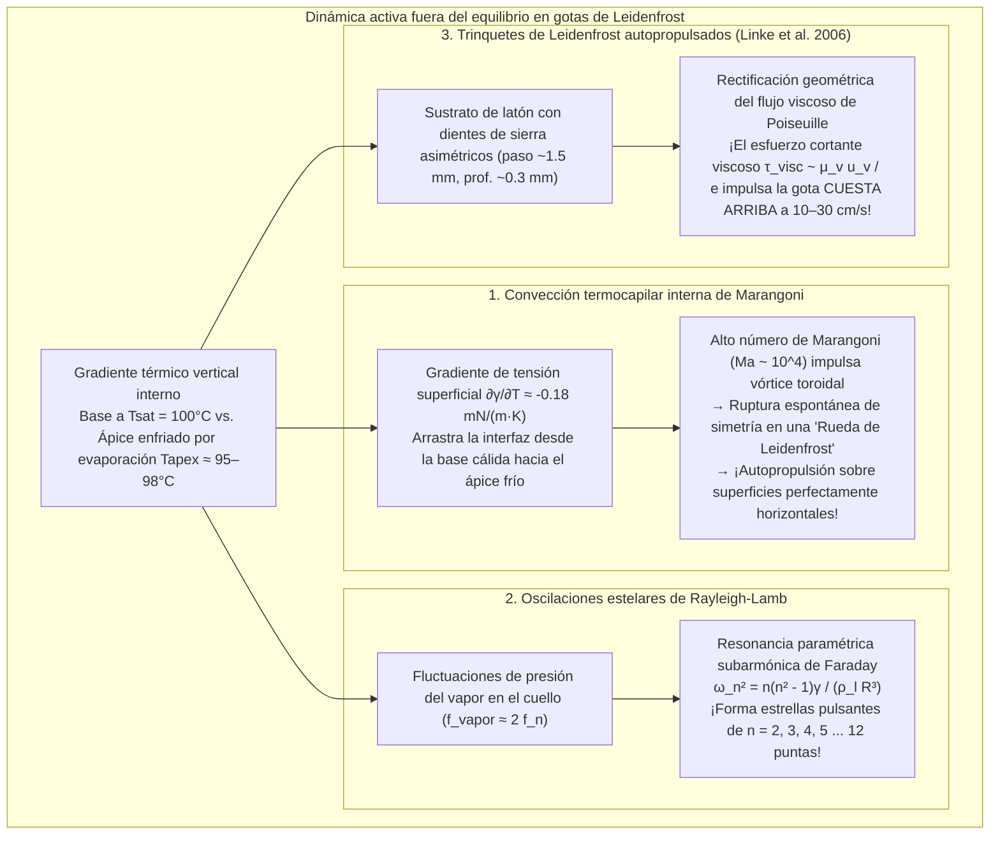

Cualquiera que haya comprobado alguna vez la temperatura de una sartén de hierro o acero inoxidable salpicando unas gotas de agua sobre su superficie ha presenciado una de las paradojas más sorprendentes de la física térmica. Cuando la temperatura de la sartén supera apenas el punto de ebullición del agua —situándose entre $110^\circ\text{C}$ y $130^\circ\text{C}$—, la gota se extiende instantáneamente al impactar, chisporrotea con violencia y se evapora por completo en menos de un segundo.

Sin embargo, si calentamos esa misma sartén por encima de los $200^\circ\text{C}$ o $300^\circ\text{C}$, el comportamiento del agua se invierte por completo. En lugar de vaporizarse al instante, la gota se contrae formando una esfera brillante similar al mercurio. No emite ningún sonido, no moja en absoluto el metal y <strong>comienza a deslizarse y rebotar por toda la sartén con una fricción prácticamente nula</strong>, sobreviviendo durante <strong>varios minutos</strong> —¡hasta cien veces más tiempo que a $120^\circ\text{C}$!

Este fenómeno contraintuitivo es el <strong>efecto Leidenfrost</strong>. Por encima de un umbral crítico denominado <strong>temperatura de Leidenfrost ($T_L$)</strong>, la base de la gota se vaporiza tan rápido al acercarse al sustrato caliente que genera un <strong>colchón de vapor (película de vapor)</strong> continuo y autosostenido de apenas $10$ a $100\,\mu\text{m}$ de espesor. Esta capa microscópica de gas actúa simultáneamente como un aerodeslizador hidrodinámico que sostiene el peso de la gota mediante presión de lubricación viscosa sin contacto sólido-líquido, y como un potente aislante térmico cuya conductividad térmica ($\kappa_v \approx 0.03\,\text{W/(m}\cdot\text{K)}$) es más de veinte veces inferior a la del agua líquida ($\kappa_l \approx 0.68\,\text{W/(m}\cdot\text{K)}$).

En este artículo desarrollamos rigurosamente la física del efecto Leidenfrost desde los primeros principios: desde el <strong>tratado histórico de Johann Gottlob Leidenfrost (1756)</strong> y la <strong>curva de ebullición de Shiro Nukiyama (1934)</strong>, pasando por el <strong>límite hidrodinámico del Flujo Crítico de Calor (CHF) de Novak Zuber</strong> y el <strong>Flujo Mínimo de Calor (MHF) de Paul Berenson</strong>, hasta la derivación matemática de la <strong>ley de escala de lubricación de Biance, Clanet y Quéré (2003)</strong>, los <strong>vórtices termocapilares internos de Marangoni («ruedas de Leidenfrost»)</strong>, las <strong>oscilaciones poligonales en estrella de Rayleigh-Lamb</strong>, los <strong>trinquetes autopropulsados de Heiner Linke (2006)</strong> y el enfriamiento de emergencia ante un <strong>accidente de pérdida de refrigerante (LOCA) en un reactor nuclear</strong>.

---

## 1. El «globo de cristal» sobre una cuchara al rojo vivo: el descubrimiento de Leidenfrost (1756)

Aunque el médico y químico neerlandés Herman Boerhaave mencionó brevemente en 1732 el comportamiento del alcohol sobre hierro al rojo vivo, el primer estudio experimental cuantitativo fue publicado en 1756 por el médico y filósofo natural alemán <strong>Johann Gottlob Leidenfrost (1715–1794)</strong> en la Universidad de Duisburgo.

En su tratado en latín *De Aquae Communis Nonnullis Qualitatibus Tractatus* (*Tratado sobre algunas cualidades del agua común*), Leidenfrost describió su famoso experimento con una cuchara de hierro calentada hasta brillar al rojo vivo:

> «En esta cuchara incandescente, viértase una sola gota de agua común pura... El agua no se adhiere al hierro ni se extiende; por el contrario, en el mismo instante del contacto se contrae formando un glóbulo esférico, brillante y transparente como un <strong>globo de cristal</strong> (*globulus crystallinus*). Gira velozmente y danza sin esfuerzo por el fondo de la cuchara sin hacer ruido ni desprender vapor visible. Lejos de desaparecer de inmediato, disminuye imperceptiblemente durante treinta o cuarenta segundos —o incluso un minuto entero— hasta que finalmente una partícula diminuta se desvanece con un leve chasquido.»

Cronometrando con un péndulo la vida de las gotas a medida que la cuchara se enfriaba, Leidenfrost demostró que la tasa de evaporación cae drásticamente por encima de cierta temperatura crítica debido a una fina capa de vapor (*vaporis strato*). En 1842, Pierre Hippolyte Boutigny denominó a este régimen «estado esferoidal» y llegó a congelar agua dentro de un crisol de platino al rojo vivo empleando dióxido de azufre líquido en estado de Leidenfrost.

---

## 2. La curva de ebullición de Shiro Nukiyama (1934) y los cuatro regímenes de ebullición en piscina

```mermaid
flowchart TD
    subgraph BoilingCurve["Curva de ebullición de Shiro Nukiyama (q'' vs. Sobrecalentamiento ΔTe = Tw - Tsat)"]
        R1["Régimen I: Convección natural<br/>ΔTe < 5°C (Tw < 105°C)<br/>Sin nucleación de burbujas; convección monofásica<br/>q'' ∝ ΔTe^(5/4)"]
        R2["Régimen II: Ebullición nucleada (Nucleate Boiling)<br/>5°C ≤ ΔTe ≤ 30°C (Tw = 105–130°C)<br/>Nucleación intensa en microcavidades y evaporación de microcapa<br/>q'' ∝ ΔTe^3 (Máxima eficiencia de enfriamiento)"]
        CHF["Pico: Flujo Crítico de Calor (CHF / DNB)<br/>ΔTe ≈ 30°C, q''_max ≈ 1.1–1.26 MW/m²<br/>Límite hidrodinámico de Zuber (colapso de columnas de vapor)"]
        R3["Régimen III: Ebullición de transición<br/>30°C < ΔTe < 100–120°C<br/>Manto de vapor parcial inestable y mojadura intermitente<br/>¡El flujo de calor CAE al subir la temperatura! (∂q''/∂ΔTe < 0)"]
        LP["Mínimo: Punto de Leidenfrost (MHF)<br/>ΔTe,L ≈ 93–120°C (Tw ≈ 193–220°C)<br/>q''_min ≈ 18–25 kW/m² (¡50 veces menor que el CHF!)"]
        R4["Régimen IV: Ebullición en película estable<br/>ΔTe ≥ ΔTe,L (Tw > 200°C)<br/>Colchón de vapor aislante continuo (κ_v ≈ 0.03 W/m·K)<br/>La radiación térmica (∝ Tw^4) se suma a Tw > 500°C"]
    end

    R1 -->|"Inicio de ebullición nucleada (ONB)"| R2
    R2 -->|"Coalescencia y crisis hidrodinámica"| CHF
    CHF -->|"Ruta de temperatura controlada"| R3
    R3 -->|"Estabilización completa de la película"| LP
    LP -->|"Régimen de película estable"| R4
    CHF -.->|"Salto de quemado / Burnout bajo flujo impuesto (ΔTw > +800°C)"| R4
```

Para comprender por qué una gota sobrevive minutos a $250^\circ\text{C}$ pero desaparece en menos de un segundo a $125^\circ\text{C}$, analizamos el <strong>flujo de calor superficial</strong> $q''$ $[\text{W/m}^2]$ en función del <strong>sobrecalentamiento de la pared</strong> $\Delta T_e \equiv T_w - T_{\text{sat}}$ (donde $T_{\text{sat}} = 100^\circ\text{C}$ para agua a $1\,\text{atm}$), trazado por primera vez en 1934 por <strong>Shiro Nukiyama</strong> en la Universidad Imperial de Tōhoku.

1. <strong>Régimen I: Convección natural ($\Delta T_e < 5^\circ\text{C}$)</strong>: Debido a la presión de Laplace $\Delta P = 2\gamma / r_c$, los embriones de vapor en microcavidades de radio $r_c$ requieren $\Delta T_e > \Delta T_{\text{ONB}} \approx \frac{2\gamma T_{\text{sat}}}{\rho_v L_{lv} r_c}$ para crecer. Por debajo, el calor se transfiere por convección monofásica ($q'' \propto \Delta T_e^{5/4}$).
2. <strong>Régimen II: Ebullición nucleada ($5^\circ\text{C} \le \Delta T_e \le 30^\circ\text{C}$) y el Flujo Crítico de Calor (CHF) de Zuber</strong>: La evaporación de la microcapa bajo las burbujas y la agitación microconvectiva elevan el flujo según la correlación de Rohsenow: $q'' \propto \Delta T_e^3$. En $\Delta T_e \approx 30^\circ\text{C}$ ($T_w \approx 130^\circ\text{C}$), las burbujas forman columnas continuas de vapor. En 1958, <strong>Novak Zuber</strong> acopló la <strong>inestabilidad de Rayleigh-Taylor</strong> ($\lambda_{RT} = 2\pi\sqrt{3\gamma/[g(\rho_l - \rho_v)]}$) con la <strong>inestabilidad de Kelvin-Helmholtz</strong> para demostrar que el <strong>Flujo Crítico de Calor (CHF)</strong> es:
   $$q''_{\max} = \frac{\pi}{24} \rho_v L_{lv} \left[ \frac{\gamma g (\rho_l - \rho_v)}{\rho_v^2} \right]^{1/4} \approx 0.131 \rho_v L_{lv} \left[ \frac{\gamma g (\rho_l - \rho_v)}{\rho_v^2} \right]^{1/4} \approx 1.1\text{–}1.26\,\text{MW/m}^2$$
   Bajo calentamiento eléctrico (flujo controlado), alcanzar $q''_{\max}$ dispara la temperatura de la pared desde $130^\circ\text{C}$ a más de $1100^\circ\text{C}$ (<strong>burnout</strong>).
3. <strong>Régimen III: Ebullición de transición ($30^\circ\text{C} < \Delta T_e < 100\text{–}120^\circ\text{C}$)</strong>: Una película parcial e inestable cubre la pared; a mayor $T_w$, mayor fracción seca aislante y <strong>menor flujo de calor</strong> ($\partial q'' / \partial \Delta T_e < 0$).
4. <strong>Régimen IV: Ebullición en película estable y Punto de Leidenfrost (MHF de Berenson)</strong>: En el <strong>punto de Leidenfrost ($T_L \approx 193^\circ\text{C}\text{–}220^\circ\text{C}$)</strong> cesa todo contacto sólido-líquido. En 1961, <strong>Paul J. Berenson</strong> dedujo el Flujo Mínimo de Calor (MHF):
   $$q''_{\min} = 0.09 \rho_v L_{lv} \left[ \frac{\gamma g (\rho_l - \rho_v)}{(\rho_l + \rho_v)^2} \right]^{1/4} \approx 18\text{–}25\,\text{kW/m}^2$$
   ¡Un valor 50 veces menor que en el pico de ebullición nucleada!

| Régimen de ebullición | Sobrecalentamiento $\Delta T_e = T_w - T_{\text{sat}}$ (Agua, $1\,\text{atm}$) | Flujo de calor típico $q''$ $[\text{W/m}^2]$ | Mecanismo físico dominante | Comportamiento y vida $\tau$ de la gota en la sartén |
| :--- | :--- | :--- | :--- | :--- |
| <strong>I. Convección natural</strong> | $\Delta T_e < 5^\circ\text{C}$ ($T_w < 105^\circ\text{C}$) | $10^3 \text{–} 10^4$ | Cavidades inactivas; convección monofásica ($q'' \propto \Delta T_e^{5/4}$). | Moja la superficie y se evapora sin burbujas en $30\text{–}120\,\text{s}$. |
| <strong>II. Ebullición nucleada</strong> | $5^\circ\text{C} \le \Delta T_e \le 30^\circ\text{C}$ ($T_w = 105\text{–}130^\circ\text{C}$) | $10^4 \text{–} 1.26 \times 10^6$ (Pico en CHF) | Nucleación intensa y evaporación de microcapa ($q'' \propto \Delta T_e^3$); límite de Zuber. | Chisporrotea con violencia y desaparece en <strong>$0.3\text{–}1.5\,\text{s}$</strong>. |
| <strong>III. Ebullición de transición</strong> | $30^\circ\text{C} < \Delta T_e < 100^\circ\text{C}$ ($T_w = 130\text{–}200^\circ\text{C}$) | $1.2 \times 10^6 \to 2 \times 10^4$ ($\partial q''/\partial \Delta T_e < 0$) | Oscilación caótica entre manto de vapor y contacto explosivo. | Crepita, salta y expulsa microgotas; sobrevive $2\text{–}15\,\text{s}$. |
| <strong>IV. Película estable (Estado de Leidenfrost)</strong> | $\Delta T_e \ge \Delta T_L \approx 93\text{–}120^\circ\text{C}$ ($T_w \ge 193\text{–}220^\circ\text{C}$) | $2 \times 10^4 \to 10^5$ (Mínimo en MHF) | Levitación total sobre colchón de vapor ($10\text{–}100\,\mu\text{m}$); conducción lenta en gas. | Esfera o tortita líquida sin fricción ni ruido; vive <strong>$60\text{–}300\,\text{s}$</strong>. |

---

## 3. Estática capilar y ley de escala hidrodinámica del colchón de vapor (Biance, Clanet, & Quéré 2003)

### 3.1 Longitud capilar $\ell_c$ y morfología de las gotas levitadas

Con un ángulo de contacto aparente $\theta_c = 180^\circ$, el equilibrio entre la presión capilar de Laplace ($\sim \gamma / R$) y la presión hidrostática ($\sim \rho_l g R$) define la <strong>longitud capilar</strong> $\ell_c$:

$$\ell_c = \sqrt{\frac{\gamma}{\rho_l g}} \approx 2.50\,\text{mm} \quad (\text{agua a } 100^\circ\text{C})$$

Según el número de Bond $\text{Bo} = (R/\ell_c)^2$, existen tres regímenes:
1. <strong>Gotas cuasi-esféricas ($R < \ell_c \approx 2.5\,\text{mm}$)</strong>: Esferas de radio $R$ con un pequeño parche plano basal de radio $r_c = \sqrt{\frac{2}{3}}\frac{R^2}{\ell_c}$.
2. <strong>Charcos / Tortitas de Leidenfrost ($\ell_c < R < 4\ell_c$)</strong>: La gravedad aplana la gota hasta un espesor universal constante $h_p = 2\ell_c \sin(180^\circ/2) = 2\ell_c \approx 5.0\,\text{mm}$, con un bolsillo cóncavo central de vapor (*dimple*) rodeado de un cuello anular estrecho (*neck*).
3. <strong>Chimeneas de vapor de Rayleigh-Taylor ($R > R_{\max} \approx 3.83\ell_c \approx 9.6\,\text{mm}$)</strong>: Para $R \gtrsim 1\,\text{cm}$, la interfaz vapor-líquido sufre la inestabilidad de Rayleigh-Taylor y grandes burbujas de vapor emergen periódicamente por el centro del charco (*vapor chimneys*).

### 3.2 Derivación del espesor de película $e$ y del tiempo de vida $\tau$

En su artículo clásico de 2003 (*Physics of Fluids*), <strong>Anne-Laure Biance, Christophe Clanet y David Quéré</strong> acoplaron la conducción de Fourier con la lubricación viscosa para un charco de radio $R > \ell_c$:

1. <strong>Conducción de calor de Fourier a través del espesor $e$</strong>:
   $$Q = \kappa_v \frac{\Delta T}{e} \pi R^2 = \dot{m} L_{lv} \quad \Longrightarrow \quad \dot{m} = \frac{\kappa_v \Delta T}{L_{lv} e} \pi R^2 \qquad \cdots (1)$$
2. <strong>Teoría de lubricación viscosa (flujo radial de Poiseuille)</strong>:
   La ecuación de lubricación $\mu_v \frac{\partial^2 u_r}{\partial z^2} = \frac{dP}{dr}$ produce el perfil parabólico $u_r(r,z) = \frac{1}{2\mu_v}\left(-\frac{dP}{dr}\right)z(e-z)$ y el caudal volumétrico $Q_v(r) = \frac{\pi r e^3}{6\mu_v}\left(-\frac{dP}{dr}\right) = \frac{\dot{m}}{\rho_v}\frac{r^2}{R^2}$. Integrando la presión se obtiene la sobrepresión media del colchón:
   $$\Delta P_{\text{cushion}} = \frac{3 \mu_v \dot{m}}{2 \pi \rho_v e^3} \qquad \cdots (2)$$
3. <strong>Equilibrio hidrostático y ley de escala $e \propto R^{1/2}$</strong>:
   Igualando $\Delta P_{\text{cushion}}$ a la presión hidrostática del charco $\Delta P_{\text{weight}} = 2\rho_l g \ell_c$ y sustituyendo (1) en (2), se obtiene la <strong>ley de Biance-Clanet-Quéré</strong>:
   $$e = \left(\frac{3}{4}\right)^{1/4} \left( \frac{\kappa_v \mu_v \Delta T}{\rho_v \rho_l g L_{lv} \ell_c} \right)^{1/4} R^{1/2} \approx 10\text{–}100\,\mu\text{m} \qquad \cdots (3)$$
   Para $R = 5\,\text{mm}$ y $\Delta T = 200\,\text{K}$, resulta $e \approx 54\,\mu\text{m}$ (mientras que para gotas pequeñas $R < \ell_c$ se cumple $e_{\text{small}} \propto \Delta T^{1/4} R^{5/4}$). Integrando $-\frac{dM}{dt} = \dot{m} \propto R^{3/2}$ se obtiene $R(t) = R_0(1 - t/\tau)^2$ y una vida total $\tau \propto \Delta T^{-3/4} R_0^{3/2}$ (o $\tau \propto R_0^{5/4}$ a $R_0^2$).

---

## 4. Vórtices termocapilares de Marangoni, estrellas de Rayleigh-Lamb y trinquetes de Leidenfrost

### 4.1 Convección termocapilar de Marangoni y «ruedas de Leidenfrost»

El gradiente térmico entre la base ($100^\circ\text{C}$) y el ápice ($95\text{–}98^\circ\text{C}$) genera, vía $\frac{\partial \gamma}{\partial T} \approx -0.18\,\text{mN/(m}\cdot\text{K)}$, un esfuerzo cortante de <strong>Marangoni</strong> $\tau_s = \frac{\partial \gamma}{\partial T}\nabla_s T$ ($\text{Ma} = \frac{|\partial \gamma/\partial T|\Delta T_{\text{int}} R}{\mu_l \alpha_l} \sim 2 \times 10^4 \gg \text{Ma}_c$) que suprime el <strong>efecto anillo de café (*coffee-ring effect*)</strong>. Además, <strong>Bouillant, Quéré et al. (2018, *Nature Physics*)</strong> descubrieron que para $R \lesssim 1.5\,\text{mm}$ el vórtice toroidal rompe espontáneamente su simetría formando una única celda rodante (<strong>«rueda de Leidenfrost»</strong>) que inclina el colchón de vapor y autopropulsa la gota sobre un plano horizontal.

### 4.2 Oscilaciones poligonales en estrella de Rayleigh-Lamb

Los charcos grandes ($R \sim 5\text{–}15\,\text{mm}$) desarrollan ondas estacionarias azimutales en forma de polígonos estrellados regidas por la <strong>relación de dispersión de Rayleigh-Lamb</strong>:

$$\omega_n^2 = \frac{n(n^2 - 1)\gamma}{\rho_l R^3} \qquad (n = 2, 3, 4, \dots, 12)$$

excitadas mediante <strong>resonancia paramétrica subarmónica de Faraday ($f_n = \frac{\omega_n}{2\pi} \approx \frac{1}{2} f_{\text{vapor}}$)</strong> por las fluctuaciones de presión del flujo de vapor en el cuello.

### 4.3 Trinquetes autopropulsados de Heiner Linke (2006)

En 2006, <strong>Heiner Linke et al.</strong> (*Phys. Rev. Lett.*) demostraron que sobre una placa caliente tallada con dientes de sierra asimétricos (paso $\sim 1.5\,\text{mm}$, profundidad $\sim 0.3\,\text{mm}$), las gotas de Leidenfrost se autopropulsan a $10\text{–}30\,\text{cm/s}$ subiendo los escalones verticales: el menisco basal ocluye el escalón vertical y rectifica el flujo de Poiseuille hacia atrás a lo largo de la rampa suave, generando por reacción una fuerza de arrastre viscoso $F_{\text{ratchet}} \sim \frac{\mu_v u_{\text{vapor}}}{e}\pi R^2 \sim 30\,\mu\text{N}$.

---

## 5. Aplicaciones industriales: Seguridad de reactores nucleares (LOCA), temple del acero y nitrógeno líquido

1. <strong>Enfriamiento de emergencia de reactores nucleares ante pérdida de refrigerante (LOCA)</strong>:
   Si el flujo de calor en las vainas de Zircaloy supera el CHF, el reactor salta al régimen de película de Leidenfrost (Régimen IV) y la temperatura supera los $1000^\circ\text{C}$ en segundos. Cuando el sistema de emergencia (ECCS) inyecta agua, el vapor repele el líquido ($T_w \gg T_L$) y el frente de remojado (*quench front*) sólo avanza por conducción axial en el metal (modelo de Yamanouchi: $u_q \propto (T_L - T_{\text{sat}})/(T_{\text{init}} - T_L)$).
2. <strong>Temple metalúrgico del acero</strong>:
   Al sumergir acero austenítico a $850^\circ\text{C}$, el manto inicial de vapor de Leidenfrost retrasa el enfriamiento hasta caer bajo $T_L$, donde la ebullición nucleada forma martensita. Un colapso desigual de la película de vapor produce deformaciones y <strong>grietas de temple</strong>.
3. <strong>Dedos húmedos en plomo fundido y nitrógeno líquido sobre la piel</strong>:
   Un dedo mojado introducido una fracción de segundo en plomo fundido a $400^\circ\text{C}$ (<strong>extremadamente peligroso, ¡jamás intentarlo!</strong>) queda protegido por el colchón instantáneo de vapor de agua; análogamente, el <strong>nitrógeno líquido ($T_{\text{sat}} = 77\,\text{K} = -196^\circ\text{C}$)</strong> experimenta la piel humana ($307\,\text{K}$, $\Delta T_e = 230\,\text{K}$) como una sartén ardiente y levita sobre un colchón de gas nitrógeno.

---

## Referencias

1. <strong>Leidenfrost, J. G.</strong> (1756). *De Aquae Communis Nonnullis Qualitatibus Tractatus*. Duisburg.
2. <strong>Nukiyama, S.</strong> (1934). "The Maximum and Minimum Values of the Heat Transmitted from Metal to Boiling Water under Atmospheric Pressure". *J. Jpn. Soc. Mech. Eng.*, 37(206), 367–374.
3. <strong>Zuber, N.</strong> (1958). "On the stability of boiling heat transfer". *Trans. ASME*, 80(3), 711–720.
4. <strong>Berenson, P. J.</strong> (1961). "Film-boiling heat transfer from a horizontal surface". *J. Heat Transf.*, 83(3), 351–356.
5. <strong>Biance, A.-L., Clanet, C., & Quéré, D.</strong> (2003). "Leidenfrost drops". *Physics of Fluids*, 15(6), 1632–1637.
6. <strong>Linke, H., et al.</strong> (2006). "Self-Propelled Leidenfrost Droplets". *Physical Review Letters*, 96(15), 154502.
7. <strong>Quéré, D.</strong> (2013). "Leidenfrost Dynamics". *Annual Review of Fluid Mechanics*, 45, 197–215.
8. <strong>Bouillant, A., et al.</strong> (2018). "Leidenfrost wheels". *Nature Physics*, 14(12), 1188–1192.
